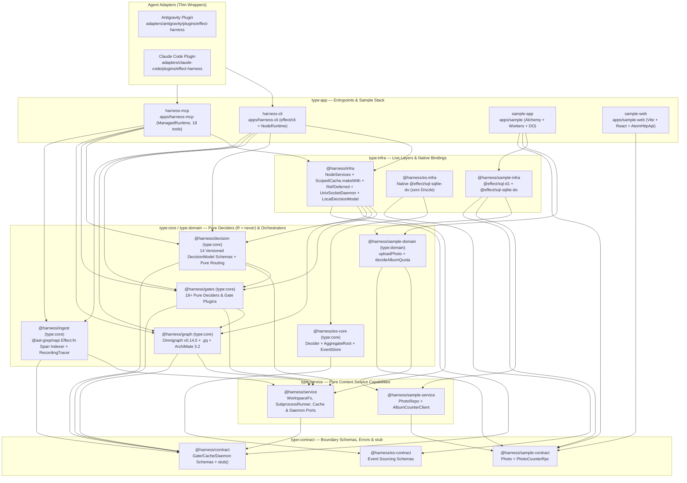
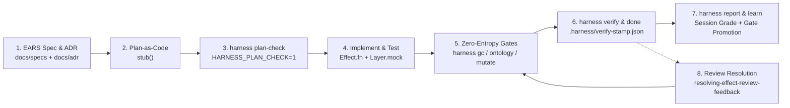

# Effect-TS Engineering Harness

> [!CAUTION]
>
> ## ⚠️ Work in Progress — Strictly Experimental
>
> This project is currently an **active work-in-progress (WIP)** and is **purely experimental**.
> **It should NOT be used anywhere** (in production, staging, or any critical workflows).
> Architecture, public interfaces, and harness behaviors are subject to rapid and breaking changes without notice.

An agentic software engineering harness built in **Effect v4 (`4.0.0-beta.48`)** and **Alchemy v2 (`2.0.0-beta.80`)** on **Cloudflare Workers / D1 / Durable Objects**.

The harness constrains coding agents with deterministic compiler, linter, property-graph, and ontology gates while routing idioms and architectural queries through an embedded structural index and an advisory local language model.

---

## Core Design Principles

1. **Deterministic Gates Always Win:** `@effect/tsgo` (`tsgo` + `@effect/language-service`), `oxlint` (20+ custom AST rules + Nx module boundary rules), Vitest, `GraphGc.decide`, `OntologyInvariants.decide`, and `SpanBudget.decide` hold absolute veto power. The local advisory model (`DecisionModel` / `clef-flash`) never overrides a deterministic check.
2. **Plan-as-Code (`stub<A, E, R>()`):** Before writing implementation bodies, agents translate EARS requirements and ADR decisions into compilable TypeScript skeletons using `stub<A, E, R>(...args)` from `@harness/contract`. `harness plan-check` verifies that `A` (success), `E` (`Schema.TaggedError` union), and `R` (`Context.Service` capabilities) typecheck across the workspace before implementation begins.
3. **ArchiMate 3.2 + Omnigraph Property Graph:** Requirements, ADRs, domain contracts, services, layers, handlers, and tests are indexed into a single property graph backed by `@modernrelay/omnigraph-core` (`v0.14.0` Rust NAPI), queried via declarative `.gq` pattern-matching queries.
4. **Zero-Docker, Zero-Python Local Stack:** All parsing, AST extraction, graph traversal, and `Effect.fn` span indexing run in-process on Node.js `>=24.10.0` via the TypeScript Compiler API, `@ast-grep/napi`, and `@modernrelay/omnigraph-core`.
5. **Compounding Learnings Without Context Bloat:** Verification failures and route misses are recorded in `.harness/friction-log.jsonl` and `.harness/telemetry-log.jsonl`. Instead of appending prose rules to `AGENTS.md`, `harness learn` clusters recurring friction into executable `oxlint` rules, deterministic gate tests, or indexed `agent-patterns/*.md` recipes.

---

## Architecture & Monorepo Topology

The harness is organized as an **Nx (`22.6.1`) + pnpm (`10.27.0`)** monorepo of **18 workspace packages** (**14** libraries in `libs/` + **4** apps in `apps/`) with strict 5-tier hexagonal boundaries enforced at lint time via `@nx/enforce-module-boundaries` and `HarnessTierTopology.decide`:



### Nx Dependency Taxonomy

| Nx Tag                      | Allowed Dependencies                                                                                                                  | Responsibilities                                                                                                       | Packages                                                                                                                                        |
| :-------------------------- | :------------------------------------------------------------------------------------------------------------------------------------ | :--------------------------------------------------------------------------------------------------------------------- | :---------------------------------------------------------------------------------------------------------------------------------------------- |
| `type:contract`             | `effect` only (`[]` workspace deps)                                                                                                   | Shared `Schema.Class`, `Schema.TaggedError`, `HttpApi`, `RpcGroup`, `stub<A, E, R>()`                                  | `@harness/contract` (`libs/harness/contract`), `@harness/es-contract` (`libs/es/contract`), `@harness/sample-contract` (`libs/sample/contract`) |
| `type:service`              | `type:contract`, `type:service`                                                                                                       | `Context.Service` capability interfaces (ports only, zero `node:*` imports or `Live` layers)                           | `@harness/service` (`libs/harness/service`), `@harness/sample-service` (`libs/sample/service`)                                                  |
| `type:core` / `type:domain` | `type:core`: `type:contract`, `type:service`, `type:core`; `type:domain`: `type:contract`, `type:service`, `type:core`, `type:domain` | Pure business/engine logic and `R = never` deciders; zero host I/O                                                     | `@harness/{gates,graph,decision,ingest}` (`type:core`), `@harness/es-core` (`type:core`), `@harness/sample-domain` (`type:domain`)              |
| `type:infra`                | `type:contract`, `type:service`, `type:core`, `type:domain`, `type:infra`                                                             | Live `Layer` implementations, native `@effect/sql-d1` & `@effect/sql-sqlite-do` (zero Drizzle), Node platform bindings | `@harness/infra` (`libs/harness/infra`), `@harness/es-infra` (`libs/es/infra`), `@harness/sample-infra` (`libs/sample/infra`)                   |
| `type:app`                  | All tiers (`scope:web` restricted to `contract` + UI)                                                                                 | Composition root (`Layer.provideMerge`), CLI/MCP servers, Alchemy `alchemy.run.ts`, web UI                             | `harness-cli` (`apps/harness-cli`), `harness-mcp` (`apps/harness-mcp`), `sample-app` (`apps/sample`), `sample-web` (`apps/sample-web`)          |

---

## The 7-Step Gated Task Lifecycle

Every feature or bugfix follows a deterministic 7-step lifecycle:



1. **EARS Specification & ADR (`specifying-ears-with-effect`):**
   Author or update requirements in `docs/specs/<id>.md` using EARS syntax (`WHEN`, `IF/THEN`, `WHILE`, `WHERE`) and architectural decisions in `docs/adr/<id>.md` with YAML frontmatter linking `realizes` / `influences`. Validated by `EarsSpecLint.decide` and `AdrDocLint.decide`.
2. **Plan-as-Code Skeleton (`planning-effect-skeletons`):**
   Map EARS clauses directly to Effect v4 types:
   - `WHEN <trigger>` $\rightarrow$ boundary `Schema.Class` input & success type `A`
   - `IF <condition> THEN <outcome>` $\rightarrow$ `Schema.TaggedError` in error channel `E`
   - `WHILE <state>` $\rightarrow$ pure `decide(state, input)` function with `R = never` + stateful `Context.Service` in `R`
   - `WHERE <feature>` $\rightarrow$ `Layer` / `Config` dependency in `R`
     Write function signatures returning `stub<A, E, R>(...args)` from `@harness/contract` and add `@harness-Requirement: REQ-...` JSDoc tags.
3. **Plan Gate (`harness plan-check`):**
   Runs `HARNESS_PLAN_CHECK=1 tsgo -b --noEmit` + `oxlint` (allowing `stub()` calls) + `PlanStepCoverageV1`. Checkpoints the verified skeleton onto `plan/<task>`.
4. **Implementation (`executing-effect-stubs`):**
   Replace `stub<A, E, R>()` bodies with production `Effect.fn("Domain.operation")` implementations, live Layers, and Vitest tests using `@effect/vitest` (`it.effect`, `TestClock`, `Layer.mock`). Concurrent subagents isolate work via `Workspace: "share"` worktrees (for full-slice `plan-check -> verify` flows, with `HARNESS_WORKTREE_ID` unset) or `HARNESS_WORKTREE_ID=<id>` (for package-scoped `nx run <pkg>:verify` workers in a shared checkout).
5. **Zero-Entropy, Ontology & Mutation Gates (`harness gc`, `harness ontology`, `harness mutate`):**
   - `harness gc --strict`: Checks `GraphGc.decide` for orphan symbols, dead exports, and unreferenced files.
   - `harness ontology <why|impact|layers|check> [--strict] [--deterministic] [--scope=...]`: Verifies all 5 ArchiMate 3.2 cross-layer traceability invariants (`OntologyInvariants.decide`) and optionally checks semantic drift via `OntologyConflictV1` (skip with `--deterministic`).
   - `harness mutate`: Checks test killer ratios against modified pure domain deciders (`MutationCheck.decide`).
6. **Sanctioned Verification & Completion (`harness verify` $\rightarrow$ `harness done`):**
   - `CI=true harness verify` runs `nx affected -t verify` (`tsgo -b` with `@effect/language-service` strict errors + `oxlint` banning `stub()` and `@effect-diagnostics` suppressions + Vitest), checks `SpanBudget.decide` and `MigrationSafety.decide`, checkpoints `impl/<task>`, and writes `.harness/verify-stamp.json` bound to `git rev-parse HEAD` + working-tree diff hash.
   - `harness done` verifies the stamp matches the current tree before allowing the agent or human to conclude the task.
7. **Observability & Compounding Learnings (`harness report` & `harness learn`):**
   - `harness report` evaluates `.harness/telemetry-log.jsonl` via `SessionReport.decide`, computing a session health score (`0–100`, grade `A–D`) and writing `.harness/session-report.md`.
   - `harness learn` clusters `.harness/friction-log.jsonl` via `Friction.decide` + `LearnProposalV1` to promote recurring mistakes into new `oxlint` rules or `agent-patterns/*.md` recipes.
8. **Post-PR / External Review Feedback Resolution (`resolving-effect-review-feedback`):**
   External review findings (pasted markdown from Grok, Codex, Claude, or human reviewers, or GitHub PR threads fetched via `gh pr view` / `gh api`) flow through a strict 5-phase loop:
   - **Phase 1 (Ingest & Normalize):** Parse comments into enumerated findings (`F-1`, `F-2`, ...), filtering out-of-scope items immediately.
   - **Phase 2 (Graph MCP Adjudication):** The orchestrator alone adjudicates each finding against the harness Order of Authority using `harness_resolve`, `harness_callers`, `harness_ontology_why`, `harness_structural_search` (clustering AST twin anti-patterns into a single `class-fix`), and `harness_tests_reaching`. Produces the Adjudication Ledger table (`fix`, `class-fix`, `doc-sync-fix`, `decline-with-evidence`, `escalate-to-human`).
   - **Phase 3 (Spec & ADR Sync First):** Before any code edits, synchronize touched `type:contract` Schemas, EARS specs (`libs/<scope>/docs/specs/*.md`), and ADRs (`libs/<scope>/docs/adr/*.md`). Run `harness plan-check` if boundaries shifted.
   - **Phase 4 (Package-Isolated Fixer Dispatch):** Dispatch parallel `flash` fixer subagents (`Workspace: "share"` or `HARNESS_WORKTREE_ID`) with target files, governing ADRs, test files, and sanctioned recipes from `harness_route` (`IdiomRouterV1`). Fixers verify locally with `harness_lsp_diagnostics` and package tests; they never run monorepo verify or modify stamps.
   - **Phase 5 (Gate Promotion, Metric Sync & Stamp-Safe Workspace Gates):** In Step 0, the orchestrator executes the Compounding Gate Audit (`compounding-effect-learnings` / `harness learn`) across `@harness/contract`, `@harness/gates` (`HarnessTierTopology.decide`, `SelfDogfooding.decide`), `@harness/graph`, and `tools/oxlint/syntax-bans.js` and publishes the post-edit `Phase 5 Metric Sync Matrix` (`wc -l`), then runs the terminal stamp-safe verification sequence in Step 1 (`harness gc --strict`, `harness ontology check --strict`, `harness mutate --strict`, `harness verify`, and `harness done`).

---

## ArchiMate 3.2 Ontology & Omnigraph `.gq` Engine

`@harness/graph` (`libs/harness/graph`) layers an **ArchiMate 3.2** metamodel on top of `@modernrelay/omnigraph-core` (`v0.14.0`):

| ArchiMate 3.2 Layer | Node Kinds                                                          | Source Artifacts                                                        | Outgoing Traceability Edges                                            |
| :------------------ | :------------------------------------------------------------------ | :---------------------------------------------------------------------- | :--------------------------------------------------------------------- |
| **Motivation**      | `Requirement`, `Principle`, `Constraint`, `Goal`, `Outcome`         | `docs/specs/*.md` (EARS clauses + frontmatter), `docs/adr/*.md`         | `INFLUENCES`                                                           |
| **Business**        | `BusinessProcess`, `BusinessObject`, `Contract`                     | `type:contract` `Schema.Class`, `Schema.TaggedError`, `RpcGroup`        | `REALIZES` ($\rightarrow$ Motivation)                                  |
| **Application**     | `ApplicationService`, `ApplicationComponent`, `ApplicationFunction` | `type:service` `Context.Service`, `type:domain` `Effect.fn` / `.decide` | `REALIZES` ($\rightarrow$ Motivation / Business), `SERVES`, `ACCESSES` |
| **Technology**      | `SystemSoftware`, `Artifact`, `Node`                                | `type:infra` `Layer`, `@effect/sql-*` repositories, Alchemy resources   | `REALIZES` ($\rightarrow$ ApplicationService), `ASSIGNED_TO`           |
| **Implementation**  | `WorkPackage`, `Deliverable`                                        | Vitest `it.effect` tests, migration SQL files                           | `TESTS` ($\rightarrow$ Application / Business), `ASSOCIATED_WITH`      |

### Cross-Layer Invariants (`OntologyInvariants.decide`)

1. **Unrealized Requirements:** Every EARS `Requirement` node in `docs/specs/*.md` must have at least one incoming `REALIZES` edge from an `ApplicationFunction`, `ApplicationService`, or `Contract`.
2. **Untested Requirements:** Every `Requirement` must be transitively covered by a test (`Implementation -[TESTS]-> Application -[REALIZES]-> Requirement`).
3. **Orphan Domain Functions:** Every exported use-case in `type:domain` must carry an `@harness-Requirement: REQ-...` JSDoc tag or link to a realized contract/service.
4. **Unprovided Services:** Every `Context.Service` (`ApplicationService`) must have at least one providing `Layer` (`SystemSoftware`) via `REALIZES`.
5. **Forbidden Cross-Layer Shortcuts:** `Technology` nodes cannot bypass `ApplicationService` interfaces, and `Application` domain nodes cannot depend on `Technology` nodes.

### Declarative `.gq` Queries (`libs/harness/graph/queries/harness.gq`)

Agents and gates query the property graph using Omnigraph's `.gq` language via the `harness_gq_query` MCP tool (and `invokeNamedQuery` in `@harness/graph`):

- `unrealized_requirements`
- `requirement_realization_chain`
- `service_layer_providers`
- `layer_composition_dag`
- `test_coverage_chain`
- `adr_influenced_code`
- `domain_infra_violations`

---

## Deterministic Gates & Advisory Schemas

### 18+ Pure Domain Deciders (`@harness/gates`, `R = never`)

| Decider                     | File                                            | Purpose                                                                                                 |
| :-------------------------- | :---------------------------------------------- | :------------------------------------------------------------------------------------------------------ |
| `GraphGc.decide`            | `libs/harness/gates/src/gc-check.ts`            | Flags dead exports, orphan files, and unused symbols (`error` in `--strict` mode).                      |
| `SpanBudget.decide`         | `libs/harness/gates/src/span-budget.ts`         | Enforces CPU/latency budgets on traced `Effect.fn` spans (`CpuBudgetExceeded`, `D1QueryLimitExceeded`). |
| `MigrationSafety.decide`    | `libs/harness/gates/src/migration-check.ts`     | Blocks destructive SQL (`DROP TABLE`, `DROP COLUMN`, table rebuilds) without human escalation.          |
| `MutationCheck.decide`      | `libs/harness/gates/src/mutation-check.ts`      | Enforces minimum mutation score (`>= 0.80`) on pure domain logic.                                       |
| `LoopCircuitBreaker.decide` | `libs/harness/gates/src/friction-log.ts`        | Trips after 3 consecutive identical verification failures or edits to force re-planning/triage.         |
| `EarsSpecLint.decide`       | `libs/harness/gates/src/ears-lint.ts`           | Validates EARS requirement documents (`WHEN`, `IF/THEN`, `WHILE`, `WHERE`, frontmatter IDs).            |
| `AdrDocLint.decide`         | `libs/harness/gates/src/adr-lint.ts`            | Validates ADR frontmatter (`id`, `status`, `realizes`, `influences`) and required sections.             |
| `OntologyInvariants.decide` | `libs/harness/gates/src/ontology-invariants.ts` | Enforces all 5 ArchiMate 3.2 cross-layer traceability invariants.                                       |
| `SessionHandoff.decide`     | `libs/harness/gates/src/session-handoff.ts`     | Computes session resume state, dirty worktree status, and verify stamp freshness.                       |
| `Friction.decide`           | `libs/harness/gates/src/friction-log.ts`        | Clusters `.harness/friction-log.jsonl` events by root cause (`>= 2` occurrences) for `harness learn`.   |
| `SessionReport.decide`      | `libs/harness/gates/src/telemetry.ts`           | Computes session health score (`0–100`), letter grade (`A–D`), gate pass rates, and recommendations.    |

### 13 Versioned `DecisionModel` Schemas (`@harness/decision`) & Live Layer (`@harness/infra`)

Schema contracts and deterministic fallback are owned by `@harness/decision` (`type:core`, 100% pure), while the live `LocalDecisionModel` layer (`libs/harness/infra/src/local-decision-model-live.ts`) lives in `@harness/infra` (`type:infra`) and is backed by resident Ollama (`clef-flash` via `POST /v1/systemone` using `@effect/ai-typesafe` `TypeSafeDecisionModel` + `TypeSafeClient`, `OLLAMA_KEEP_ALIVE=-1`, and deterministic fallback when Ollama is offline; System One models do not use `/api/generate` or `/v1/chat/completions`):

| Schema                        | Used By                          | Purpose                                                                                                                                                                                                                                                                             |
| :---------------------------- | :------------------------------- | :---------------------------------------------------------------------------------------------------------------------------------------------------------------------------------------------------------------------------------------------------------------------------------- |
| `IdiomRouterV1`               | `harness route`, `harness_route` | Runs deterministic regex rules (`DETERMINISTIC_ROUTE_RULES`) then `IdiomRouterV1` (`DecisionModel.decide`) to classify a plan step into one of the 18 idiom blocks (`agent-patterns/<block>.md`), with deterministic keyword/filename fallback when `DecisionModel` is unavailable. |
| `GuardV1`                     | `harness guard`                  | Classifies ambiguous shell commands when deterministic regex/path guards return `ask`.                                                                                                                                                                                              |
| `TriageV1`                    | `harness verify`                 | Summarizes compiler/test failures and identifies the minimal causal locus when verification fails.                                                                                                                                                                                  |
| `PlanStepCoverageV1`          | `harness plan-check`             | Audits whether `stub<A, E, R>()` signatures cover all EARS clauses in the plan.                                                                                                                                                                                                     |
| `LearnProposalV1`             | `harness learn`                  | Drafts `oxlint` AST rule specifications or `agent-patterns/*.md` recipes from friction clusters.                                                                                                                                                                                    |
| `OntologyConflictV1`          | `harness ontology check`         | Detects semantic contradictions between EARS requirements/ADRs and implementing `Effect.fn` / `Layer` signatures (skip with `--deterministic`).                                                                                                                                     |
| `EarsClauseSemanticsV1`       | `EarsSpecLint`                   | Evaluates semantic clarity and testability of EARS requirement clauses.                                                                                                                                                                                                             |
| `HoleRelevanceAndEdgePriorV1` | `harness_graph_infer`            | Scores candidate graph holes and edge priors during Datalog/Omnigraph inference.                                                                                                                                                                                                    |
| `DstHazardPriorV1`            | `harness mutate`                 | Ranks distributed/async hazard scenarios for deterministic simulation testing.                                                                                                                                                                                                      |
| `MutantEquivalenceV1`         | `harness mutate`                 | Advises on equivalent-mutant classification during mutation testing.                                                                                                                                                                                                                |
| `SynthesizedRuleQualityV1`    | `harness learn`                  | Evaluates quality of synthesized AST/lint rules before graduation.                                                                                                                                                                                                                  |
| `DpoCandidateRankerV1`        | `harness_graph_rewrite`          | Ranks double-pushout (DPO) graph rewrite candidates.                                                                                                                                                                                                                                |
| `PlanSearchScorerV1`          | `harness plan-check`             | Scores candidate plan-as-code decomposition paths.                                                                                                                                                                                                                                  |

---

## Static Analysis & Effect Language Service (`@effect/tsgo`)

Every typecheck (`pnpm typecheck` / `harness verify`) runs `tsgo -b` patched with `@effect/language-service` (`v0.80.0`), enforcing strict compile-time errors (`tsconfig.base.json`):

- `floatingEffect: "error"` — every `Effect` must be yielded (`yield*`), returned, or explicitly run.
- `missingEffectContext: "error"` & `missingEffectError: "error"` — unhandled `R` or `E` channels fail compilation.
- `missingStarInYieldEffect: "error"` — `yield` instead of `yield*` inside `Effect.gen` / `Effect.fn` is a compile error.
- `returnEffectInGen: "error"`, `tryCatchInEffectGen: "error"`, `unnecessaryEffectGen: "error"`, `scopeInLayerEffect: "error"`, `layerMergeAllWithDependencies: "error"`.

In addition, `tools/oxlint/syntax-bans.js` (`harness/syntax-bans` and `harness/test-integrity`) together with `AstGateCache` / `SelfDogfooding` enforce Effect v4, Alchemy v2, and SQL AST rules, including:

- `harness/syntax-bans`: bans `// @effect-diagnostics` and `/* @effect-diagnostics */` suppressions, `stub()` outside `HARNESS_PLAN_CHECK=1`, `banned-drizzle-import` (`drizzle-orm` / `drizzle-kit`), `discriminant-branching` (`switch` / discriminant `if-else` / ternary), `non-exhaustive-union-match`, `invalid-clef-endpoint`, `nondeterministic-workflow-body` (side effects, wall-clock/randomness, env, fs, git, Omnigraph, and network calls inside `Workflow.make(...)` outside `Activity.make({ execute: ... })`), `unscoped-effect-run` (allowing `runFork`/`runForkWith` only in `apps/*/src/` and `Effect.runSync(Effect.die(...))` only in `libs/es/infra/src/memory.ts` synchronous DO `SqlStorage` bridge methods; also enforced as `domain-purity` in `AstGateCache`), raw `JSON.parse`, `async`/`await`, `try`/`catch`, `throw`, `any` / `as never`, and imports from `repos/`.
- `harness/test-integrity`: bans vacuous `.thenFails()` assertions and blocks `oxlint-disable` suppressions.
- `SelfDogfooding.decide`: enforces the 10 hexagonal hygiene rules (`no-node-builtins-outside-infra`, `no-global-mutable-cache`, `no-layer-build-in-layer-effect`, `no-double-wrapped-effect-fn`, `silent-gate-fs-fallback`, `test-env-branch-in-src`, `bare-cause-has-interrupts`, `process-env-outside-infra-or-app`, `facade-star-reexport`, and `dynamic-harness-import`; `18` total `SelfDogfoodingRuleId` rules).

---

## CLI & MCP Server Reference

### `harness` CLI (`apps/harness-cli`)

Invoke via `node --import ./tools/node-ts-resolver.mjs apps/harness-cli/src/index.ts <subcommand>`:

| Subcommand                                                                         | Description                                                                                                                                                                                                                                                                       |
| :--------------------------------------------------------------------------------- | :-------------------------------------------------------------------------------------------------------------------------------------------------------------------------------------------------------------------------------------------------------------------------------- |
| `doctor`                                                                           | Checks Node `>=24.10.0`, `@effect/tsgo` (`effectLspOk`), Omnigraph NAPI, `Effect.fn` span index, and Ollama `clef-flash` status.                                                                                                                                                  |
| `session`                                                                          | Prints session resume handoff (`SessionHandoff.decide`), active branch, verify stamp freshness, and environment health.                                                                                                                                                           |
| `ingest`                                                                           | Indexes workspace `Effect.fn` spans via `@ast-grep/napi` (`fn-index.ts`), extracts the type-aware workspace graph (`extractWorkspaceTypeAwareGraph`), and syncs/snapshots workspace symbols into Omnigraph.                                                                       |
| `route "<step>"`                                                                   | Runs deterministic regex rules (`DETERMINISTIC_ROUTE_RULES`) then `IdiomRouterV1` (`DecisionModel.decide`) to classify a plan step into one of the 18 `agent-patterns/<block>.md` idiom blocks, with deterministic keyword/filename fallback when `DecisionModel` is unavailable. |
| `guard --format=antigravity\|claude`                                               | Evaluates `PreToolUse` shell commands and file edits against `repos/` read-only rules, destructive SQL, and `alchemy deploy`/`destroy` guards.                                                                                                                                    |
| `plan-check`                                                                       | Runs `HARNESS_PLAN_CHECK=1` typecheck + `oxlint` + `PlanStepCoverageV1` and checkpoints `plan/<task>`.                                                                                                                                                                            |
| `gc [--strict]`                                                                    | Runs `GraphGc.decide` over the Omnigraph symbol graph to detect dead exports and orphan files.                                                                                                                                                                                    |
| `ontology <why\|impact\|layers\|check> [--strict] [--deterministic] [--scope=...]` | Runs ArchiMate 3.2 cross-layer invariant checks (`check`, with `OntologyConflictV1` unless `--deterministic`), lists layers (`layers`), traces `why` a symbol exists, or computes `impact` blast radius.                                                                          |
| `mutate [--scope=...] [--strict]`                                                  | Evaluates mutation score thresholds (`MutationCheck.decide`) on pure domain logic.                                                                                                                                                                                                |
| `verify`                                                                           | Runs `CI=true pnpm nx affected -t verify`, `SpanBudget.decide`, `MigrationSafety.decide`, checkpoints `impl/<task>`, and writes `.harness/verify-stamp.json`.                                                                                                                     |
| `done --format=antigravity\|claude`                                                | Verifies `.harness/verify-stamp.json` matches `HEAD` and current working tree hash before allowing task completion.                                                                                                                                                               |
| `report`                                                                           | Generates `.harness/session-report.md` from `.harness/telemetry-log.jsonl` with session health score (`0–100`, grade `A–D`).                                                                                                                                                      |
| `learn`                                                                            | Clusters `.harness/friction-log.jsonl` via `Friction.decide` + `LearnProposalV1` to promote recurring issues into gates/recipes.                                                                                                                                                  |
| `workflow <compile\|start\|status\|complete\|resume\|doctor\|abort>`               | Compiles, starts, inspects, completes, resumes, diagnoses/rebuilds (`--mode=rebuild` / `--rebuild-views`), or aborts `HarnessTaskWorkflow` runs over `<git-common-dir>/harness/daemon.sock` (`HARNESS_UNIT_WORKER=1` guards block recursive orchestration in spawned workers).    |

### `harness-mcp` Server (`apps/harness-mcp`)

Exposes 18 structural, diff, ontology, Datalog/DPO, diagnostics, telemetry, and workflow MCP tools over stdio:

| MCP Tool                    | Arguments                                                             | Description                                                                                                                                                                                                                                                                       |
| :-------------------------- | :-------------------------------------------------------------------- | :-------------------------------------------------------------------------------------------------------------------------------------------------------------------------------------------------------------------------------------------------------------------------------- |
| `harness_resolve`           | `{ symbolOrSpan, repoRoot? }`                                         | Resolves symbol definitions (`Service`, `Layer`, `Schema`, `TaggedError`, `EffectFn`, `Requirement`, `ADR`) by name or prefix.                                                                                                                                                    |
| `harness_callers`           | `{ symbolOrSpan, repoRoot? }`                                         | Lists incoming edges (`CALLS`, `PROVIDES`, `REQUIRES`, `TESTS`, `REALIZES`) for a symbol.                                                                                                                                                                                         |
| `harness_callees`           | `{ symbolOrSpan, repoRoot? }`                                         | Lists outgoing edges from a symbol.                                                                                                                                                                                                                                               |
| `harness_tests_reaching`    | `{ symbolOrSpan, repoRoot? }`                                         | Finds the minimal set of Vitest test files transitively reaching the given symbol IDs.                                                                                                                                                                                            |
| `harness_structural_search` | `{ pattern, filePath?, paths?, subDirs?, repoRoot? }`                 | Runs `@ast-grep/napi` structural AST pattern searches across TypeScript files.                                                                                                                                                                                                    |
| `harness_route`             | `{ planStep, repoRoot? }`                                             | Runs deterministic regex rules (`DETERMINISTIC_ROUTE_RULES`) then `IdiomRouterV1` (`DecisionModel.decide`) to classify a plan step into one of the 18 `agent-patterns/<block>.md` idiom blocks, with deterministic keyword/filename fallback when `DecisionModel` is unavailable. |
| `harness_review_route`      | `{ changedFiles, diffSummary?, changedLineCount?, repoRoot? }`        | Computes a monotonic hybrid `ReviewRoutingPlan` (`SkipReviewPlan` \| `ActiveReviewPlan` across all 7 specialist reviewers) using `ReviewRouterV1` (`clef-flash`) plus a precomputed `ReviewGraphContextBundle`.                                                                   |
| `harness_ontology_why`      | `{ symbolOrSpan, repoRoot? }`                                         | Traces a symbol upward through ArchiMate 3.2 layers to the EARS `Requirement` and `ADR` nodes it realizes.                                                                                                                                                                        |
| `harness_ontology_impact`   | `{ symbolOrSpan, repoRoot? }`                                         | Computes downstream blast radius across contracts, domain functions, services, layers, and tests when a requirement or symbol changes.                                                                                                                                            |
| `harness_ontology_check`    | `{ scope?, deterministic?, repoRoot? }`                               | Runs `OntologyInvariants.decide` across the workspace and returns any cross-layer violations.                                                                                                                                                                                     |
| `harness_gq_query`          | `{ queryName?, querySource? }`                                        | Executes a named query from `libs/harness/graph/queries/harness.gq` or an inline `.gq` query against Omnigraph.                                                                                                                                                                   |
| `harness_graph_infer`       | `{ ... }`                                                             | Runs incremental Datalog (`@electric-sql/d2ts`) inference (`S0..S3`) over the workspace property graph.                                                                                                                                                                           |
| `harness_graph_complete`    | `{ ... }`                                                             | Computes graph completion candidates and missing traceability edges.                                                                                                                                                                                                              |
| `harness_graph_rewrite`     | `{ ... }`                                                             | Evaluates double-pushout (DPO) graph rewrite rules over the workspace graph.                                                                                                                                                                                                      |
| `harness_lsp_diagnostics`   | `{ file?, filePath?, project?, tsconfigPath?, overlays?, repoRoot? }` | Runs `@effect/tsgo` (`tsgo -b --noEmit`) and returns structured diagnostics (including `@effect/language-service` errors) with file, line, column, and code.                                                                                                                      |
| `harness_telemetry_report`  | `{ format?, cumulative?, repoRoot? }`                                 | Computes the current session health report (`SessionReport.decide`) from `.harness/telemetry-log.jsonl`.                                                                                                                                                                          |
| `harness_git_diff`          | `{ repoRoot?, baseRef?, paths?, statOnly?, maxPatchChars? }`          | Returns bounded read-only unified diff, stats, and untracked-file previews via `git --no-optional-locks` (default `120000` chars, max `400000`).                                                                                                                                  |
| `harness_workflow_plan`     | `{ repoRoot?, runId? }`                                               | Read-only status inspection of the active or latest `HarnessTaskWorkflow` run, work units, attempts, pending `DurableDeferred`s, and worktree/`commonGitDir` binding.                                                                                                             |

---

## Agent Adapters, Workflow Skills & Usage Guide

The harness packages full engineering capabilities into two first-class adapter bundles: `adapters/antigravity/plugins/effect-harness` (Antigravity plugin) and `adapters/claude-code` (Claude Code adapter). Both adapters wire agents to the exact same underlying `harness` CLI, `harness-mcp` server, deterministic gates, and pattern repositories.

### 1. Overview of Adapter Bundles

| Component             | Antigravity Plugin (`adapters/antigravity/plugins/effect-harness`)     | Claude Code Adapter (`adapters/claude-code`)                                |
| :-------------------- | :--------------------------------------------------------------------- | :-------------------------------------------------------------------------- |
| **Manifest / Config** | `plugin.json` (`"name": "effect-harness"`)                             | `.mcp.json` (`harness-mcp`, `omnigraph-mcp`, `nx-mcp`)                      |
| **Rules Engine**      | `rules/AGENTS.md` (and repo root `AGENTS.md`)                          | `rules/AGENTS.md` (and repo root `AGENTS.md`)                               |
| **Hooks Engine**      | `hooks.json` (`PreInvocation`, `PreToolUse`, `PostToolUse`, `Stop`)    | `hooks.json` (`SessionStart`, `PreToolUse`, `PostToolUse`, `Stop`)          |
| **MCP Servers**       | `mcp_config.json` (`harness-mcp`, `omnigraph-mcp`, `nx-mcp`)           | `.mcp.json` (`harness-mcp`, `omnigraph-mcp`, `nx-mcp`)                      |
| **Workflow Skills**   | 8 skills in `skills/` (including `/effect-lfg`, `/effect-code-review`) | 8 skills in `skills/` + `/effect-lfg`, `/effect-code-review` in `commands/` |
| **Specialist Agents** | 7 read-only reviewer subagents in `agents/`                            | 7 read-only reviewer subagents in `agents/`                                 |

#### Lifecycle Hook Discipline

- **Session Resume (`PreInvocation` / `SessionStart`):** Executes `harness session` to evaluate uncommitted working tree state, branch position, `.harness/verify-stamp.json` freshness, and environment health.
- **Write-Surface Guard (`PreToolUse`):** Evaluates shell commands and file edits. Blocks direct modification of `repos/effect` and `repos/alchemy`. Blocks stamp forgery (`.harness/verify-stamp.json`). Intercepts `alchemy deploy` and `alchemy destroy` to require interactive human confirmation.
- **Incremental Ingest (`PostToolUse`):** Runs `harness ingest` after file write/edit operations to re-index workspace `Effect.fn` spans via `@ast-grep/napi` (`fn-index.ts`) and update the resident Omnigraph symbol graph.
- **Completion Check (`Stop`):** Runs `harness done` before concluding a task, verifying that `.harness/verify-stamp.json` exists and matches `HEAD` commit and working tree hash.

---

### 2. 8 Workflow Skills — Reference & Usage Matrix

| Skill                              | Lifecycle Stage & When to Use                                                                                                                                                 | Example Prompt / Trigger                                                                                                       | MCP Tools & CLI Gates Used                                                                                                                                                                                               | Required Output / Exit Gate                                                                                                                                     |
| :--------------------------------- | :---------------------------------------------------------------------------------------------------------------------------------------------------------------------------- | :----------------------------------------------------------------------------------------------------------------------------- | :----------------------------------------------------------------------------------------------------------------------------------------------------------------------------------------------------------------------- | :-------------------------------------------------------------------------------------------------------------------------------------------------------------- |
| `effect-harness`                   | Full lifecycle orchestration. Use when starting a new feature or orchestrating tasks across contracts, domain logic, and infra.                                               | `"Implement user authentication with D1 sessions and durable rate limits following the harness lifecycle."`                    | `harness_route`<br>`harness_lsp_diagnostics`<br>`harness gc --strict`<br>`harness verify`<br>`harness done`                                                                                                              | Verified implementation on `impl/<task>` branch with valid `.harness/verify-stamp.json` passing `harness done`.                                                 |
| `effect-lfg`                       | Autonomous end-to-end pipeline (`/effect-lfg`). Use when passing a requirement, bug report, or EARS spec to execute hands-off from intake through commit/PR without stopping. | `"/effect-lfg Add Sample.archiveAlbum use-case to libs/sample that marks an album archived or fails with AlbumNotFoundError."` | `harness_resolve`<br>`harness_ontology_why`<br>`harness plan-check`<br>7 specialist reviewers<br>`harness learn`<br>`harness gc --strict`<br>`harness mutate --strict`<br>`harness verify`<br>`harness done`             | Accepted EARS spec with `## Assumptions`, verified stamp, clean `harness done`, scoped git commit (and open PR when applicable), and `<promise>DONE</promise>`. |
| `effect-code-review`               | Read-only monotonic hybrid code review (`/effect-code-review`). Use when reviewing diffs, branches, commit ranges, or PRs before opening or merging.                          | `"/effect-code-review Review git diff main...HEAD"`                                                                            | `harness_review_route`<br>`harness_lsp_diagnostics`<br>`harness_ontology_check`<br>`harness_resolve`<br>`harness_structural_search`                                                                                      | 4-part Quote-the-Line review report with suppressed deterministic noise and handoff to `resolving-effect-review-feedback`.                                      |
| `specifying-ears-with-effect`      | Step 1 (EARS Specification & ADR). Use before writing code or skeletons when requirements are informal or missing EARS clauses.                                               | `"Specify requirements and architecture for D1 session store with exponential backoff retries."`                               | `harness_ontology_check`<br>`harness_ontology_impact`<br>`EarsSpecLint.decide`<br>`AdrDocLint.decide`                                                                                                                    | Validated spec `libs/<scope>/docs/specs/YYYY-MM-DD-<slug>.md` and ADR `libs/<scope>/docs/adr/NNNN-<slug>.md` passing linter deciders.                           |
| `planning-effect-skeletons`        | Steps 2–3 (Plan-as-Code Skeleton & Plan Gate). Use after specification approval to construct typed skeletons with `stub<A, E, R>()`.                                          | `"Create typed skeletons and plan-as-code for the session store use cases and repository ports."`                              | `harness_route`<br>`harness_lsp_diagnostics`<br>`harness plan-check`<br>`PlanStepCoverageV1`                                                                                                                             | Typechecked skeleton with JSDoc `@harness-Requirement` tags, clean `harness_lsp_diagnostics`, and checkpointed `plan/<task>` branch.                            |
| `executing-effect-stubs`           | Steps 4–6 (Implementation & Verification). Use after `harness plan-check` passes to replace stubs with `Effect.fn` bodies, Layers, and tests.                                 | `"Execute stubs for session repository in libs/sample/infra and domain deciders in libs/sample/domain."`                       | `harness_route`<br>`harness_tests_reaching`<br>`harness_structural_search`<br>`harness_lsp_diagnostics`<br>`harness gc --strict`<br>`harness mutate`<br>`harness verify`                                                 | Zero stubs remaining, 100% passing Vitest tests, mutation score `>= 0.85`, zero orphan symbols (`gc --strict`), and verified stamp.                             |
| `resolving-effect-review-feedback` | Step 8 (Post-PR / External Review Resolution). Use when receiving review feedback (from Grok, Codex, Claude, human, or GitHub PR thread).                                     | `"Resolve the code review feedback from PR #42"` or `"Resolve this review paste: [markdown]"`                                  | `harness_resolve`<br>`harness_callers`<br>`harness_ontology_why`<br>`harness_structural_search`<br>`harness_tests_reaching`<br>`harness_route`<br>`harness gc --strict`<br>`harness mutate --strict`<br>`harness verify` | Completed Adjudication Ledger, synchronized specs/ADRs, class-fixes resolved via `flash` subagents, and verified stamp with clean gates.                        |
| `compounding-effect-learnings`     | Step 7 & Post-Review Compounding. Use when completing a task with friction, route misses, or gate escapes, or when running `harness learn`.                                   | `"Run harness learn and promote recent friction clusters into AST rules and pattern recipes."`                                 | `harness_telemetry_report`<br>`harness report`<br>`harness learn`<br>`Friction.decide`<br>`LearnProposalV1`<br>`SessionReport.decide`                                                                                    | `.harness/session-report.md` with session letter grade, and promoted artifacts across the 5 learning targets.                                                   |

---

### 3. Practical Skill Usage Recipes

#### Recipe A: Starting a New Feature (`specifying-ears-with-effect` $\rightarrow$ `planning-effect-skeletons`)

1. **Ingest Requirements:** Ingest raw requirements from user prompt or issue.
2. **Author EARS Specification:** Create `libs/<scope>/docs/specs/YYYY-MM-DD-<slug>.md` with frontmatter (`id`, `title`, `spans`, `services`, `errors`) and EARS requirements (`WHEN`, `IF/THEN`, `WHILE`, `WHERE`).
3. **Author ADR:** Create `libs/<scope>/docs/adr/NNNN-<slug>.md` with frontmatter (`realizes`, `influences`, `status: accepted`).
4. **Map EARS Clauses to Effect Types:**
   - `WHEN <trigger>` $\rightarrow$ boundary `Schema.Class` input and success type `A`.
   - `IF <condition> THEN <outcome>` $\rightarrow$ `Schema.TaggedError` in error channel `E`.
   - `WHILE <state>` $\rightarrow$ pure `decide(state, input)` function (`R = never`) + stateful `Context.Service` in `R`.
   - `WHERE <feature>` $\rightarrow$ `Layer` / `Config` dependency in `R`.
5. **Write Typed Skeletons:** Write signatures in `type:domain` and `type:service` returning `stub<A, E, R>(...args)` from `@harness/contract` with `@harness-Requirement: REQ-...` JSDoc tags.
6. **Execute Plan Gate:** Run `harness plan-check` (`HARNESS_PLAN_CHECK=1`) to lock boundaries and checkpoint `plan/<task>`.

#### Recipe B: Implementing with Package-Isolated `flash` Subagents (`executing-effect-stubs`)

1. **Route Patterns:** Orchestrator queries `harness_route` (`IdiomRouterV1` via `clef-flash`) for the sanctioned patterns matching each package archetype.
2. **Partition Package Subagents:** The orchestrator dispatches parallel subagents (`TypeName: "self"`, `Model: "flash"`, `Workspace: "share"` or `HARNESS_WORKTREE_ID=<id>`):
   - **Subagent 1 (`libs/<scope>/domain`):** Replaces pure stubs with `Effect.fn` use-cases and `.decide` deciders.
   - **Subagent 2 (`libs/<scope>/infra`):** Implements live `@effect/sql-d1` / `@effect/sql-sqlite-do` repositories and Alchemy resource bindings.
   - **Subagent 3 (`apps/sample-web` or UI):** Implements `@effect/atom-react` state and client contracts.
3. **Subagent Execution Discipline:** Subagents run `harness_lsp_diagnostics` and package unit tests (`pnpm nx run <project>:test`). Subagents **never** run monorepo `verify` or mutate `.harness/verify-stamp.json`.
4. **Specialist Review Lenses:** Orchestrator queries `harness_review_route` and dispatches matching read-only specialist subagents from the 7-reviewer roster (`effect-ears-test-reviewer`, `effect-security-reviewer`, `effect-reliability-reviewer`, `effect-adversarial-reviewer`, `effect-web-reviewer`, `effect-migration-contract-reviewer`, `effect-architecture-reviewer`) against the implementation.
5. **Close Monorepo Gates:** Orchestrator runs `harness gc --strict`, `harness mutate --strict`, `CI=true harness verify`, and `harness done`.

#### Recipe C: Resolving Code Review Feedback (`resolving-effect-review-feedback`)

1. **Ingest & Normalize:** Ingest pasted markdown or GitHub PR threads (`gh pr view <pr> --comments`, `gh api .../pulls/<pr>/comments`). Normalize into `F-1`, `F-2`, ... and separate out-of-scope items.
2. **Central Adjudication Ledger:** The orchestrator evaluates each item against the harness Order of Authority:
   - Call `harness_resolve` and `harness_callers` to inspect types, caller trees, and error channels.
   - Call `harness_ontology_why` to verify governing ADR invariants.
   - Call `harness_structural_search` (`@ast-grep/napi`) to uncover twin anti-patterns across the workspace and cluster into a `class-fix`.
   - Call `harness_tests_reaching` to inspect test coverage and identify assertion gaps.
   - Output the Adjudication Ledger (`fix`, `class-fix`, `doc-sync-fix`, `decline-with-evidence`, `escalate-to-human`).
3. **Spec & ADR Sync First:** Update `libs/<scope>/docs/specs/*.md` and `libs/<scope>/docs/adr/*.md` before editing implementation code. Run `harness plan-check` if public interfaces changed.
4. **Dispatch Package-Isolated Fixers:** Launch `flash` subagents with exact pattern routes from `harness_route` and reaching test files. Subagents execute fixes and verify locally.
5. **Promote Gates, Sync Metrics & Run Stamp-Safe Gates:** In Phase 5 Step 0, the orchestrator executes the Compounding Gate Audit (`compounding-effect-learnings`) and updates all post-edit `wc -l` LOC tables (`Phase 5 Metric Sync Matrix`), then runs the terminal stamp-safe root gates (`harness gc --strict`, `harness ontology check --strict`, `harness mutate --strict`, `harness verify`, `harness done`).

#### Recipe D: Compounding Friction into Deterministic Gates (`compounding-effect-learnings`)

1. **Cluster Friction Logs:** `harness learn` runs `Friction.decide` over `.harness/friction-log.jsonl`, clustering events with `>= 2` occurrences by root-cause signature.
2. **Generate Proposals:** `LearnProposalV1` evaluates clusters and proposes target artifacts across the 5 graduation destinations:
   - `agent-pattern`: Adds new or updated recipes in `agent-patterns/*.md`.
   - `triage-rule`: Adds diagnostic error patterns to `libs/harness/decision/src/triage-decision.ts`.
   - `guard-allowlist`: Updates shell or file patterns in `libs/harness/gates/src/policy.ts`.
   - `ast-graph-gate`: Adds AST syntax bans in `tools/oxlint/syntax-bans.js` or ArchiMate invariants in `libs/harness/gates/src/ontology-invariants.ts`.
   - `adr`: Documents architectural tradeoffs in `libs/<scope>/docs/adr/NNNN-<slug>.md`.
3. **Apply & Verify:** Commit the generated gate rules, ensuring recurring mistakes are blocked at compile or lint time.

---

### 4. 7 Read-Only Specialist Review Subagents

| Subagent                             | Activation Signal                                                                        | Primary Audit Focus                                                                                                                                                                                                | Supporting References                                                                                       |
| :----------------------------------- | :--------------------------------------------------------------------------------------- | :----------------------------------------------------------------------------------------------------------------------------------------------------------------------------------------------------------------- | :---------------------------------------------------------------------------------------------------------- |
| `effect-ears-test-reviewer`          | Step 4 test authoring, PR review, or when test fidelity is questioned.                   | Audits 1:1 coverage between EARS clauses (`WHEN`, `IF/THEN`, `WHILE`, `WHERE`) and `@effect/vitest` assertions; flags vacuous `.thenFails()` without expected error instances; checks mock boundary leakage.       | `docs/specs/*.md`<br>`agent-patterns/testing.md`                                                            |
| `effect-security-reviewer`           | Contract changes, authentication/authorization updates, SQL queries, or secrets.         | Audits boundary decoding (`Schema.decodeUnknownEffect`); checks IDOR authorization checks in `type:domain`; detects raw SQL string interpolation; verifies `Redacted` usage for sensitive configuration.           | `agent-patterns/schema.md`<br>`agent-patterns/d1-repository.md`<br>`agent-patterns/httpapi.md`              |
| `effect-reliability-reviewer`        | Concurrency, background fibers, Durable Object transactions, retry schedules, or scopes. | Audits DO SQLite synchronous transaction discipline (`MixedScheduler("sync")`, pre-transaction decoding, commit-order mutation); checks `Scope` finalizers; detects unbounded `Schedule` retries and fiber leaks.  | `agent-patterns/durable-object-state.md`<br>`agent-patterns/concurrency.md`<br>`agent-patterns/schedule.md` |
| `effect-adversarial-reviewer`        | Complex state machines, distributed transactions, deciders, or multi-step operations.    | Constructs partial-failure crash-between-steps sequences; constructs concurrent race conditions; analyzes out-of-order event replay; tests boundary value mutations against pure deciders.                         | `agent-patterns/event-sourcing.md`<br>`agent-patterns/pattern-matching.md`<br>`agent-patterns/errors.md`    |
| `effect-web-reviewer`                | `scope:web`, `apps/*-web/**`, `*.tsx`, `AtomHttpApi`, `useAtomValue`, `useAtomSend`.     | Audits `AtomHttpApi` / `@effect/atom-react` boundary discipline, frontend concurrency & double-submit races, exhaustive `Result`/`Option` rendering via `ts-pattern`, and form/URL brand decoding.                 | `agent-patterns/atom.md`<br>`agent-patterns/pattern-matching.md`<br>`agent-patterns/schema.md`              |
| `effect-migration-contract-reviewer` | `migrations/*.sql`, `SqliteMigrator`, `alchemy.run.ts`, or `type:contract` evolution.    | Audits SQL migration correctness & `SqliteMigrator` table isolation, D1/SQLite index coverage, `HttpApiEndpoint`/`RpcGroup`/event contract consistency & explicit upcaster chains, and Alchemy v2 binding hygiene. | `agent-patterns/d1-repository.md`<br>`agent-patterns/alchemy-infra.md`<br>`agent-patterns/schema.md`        |
| `effect-architecture-reviewer`       | `type:service`, `libs/es/**`, `libs/harness/**`, `adapters/**`, or large diffs (>= 180). | Audits framework-vs-application archetype purity, 5-tier hexagonal cohesion & `Context.Service`/`Layer` design, `SelfDogfooding.decide` line-ceiling proximity, and agent-surface adapter parity.                  | `agent-patterns/planning.md`<br>`agent-patterns/services-and-layers.md`                                     |

---

### 5. 18 Indexed Pattern Recipes (`agent-patterns/*.md`)

All 18 pattern files (`17` recipes + `agent-patterns/README.md` index) are indexed as `PatternDoc` nodes in Omnigraph and routed via `harness route` / `harness_route` (`IdiomRouterV1`):

| Pattern Recipe        | File                                     | Key Effect v4 / Alchemy v2 Constructs                                                      | Gate / AST Ban Enforced                                               |
| :-------------------- | :--------------------------------------- | :----------------------------------------------------------------------------------------- | :-------------------------------------------------------------------- |
| **Planning**          | `agent-patterns/planning.md`             | `stub<A, E, R>()`, 16-row building block mapping, JSDoc `@harness-Requirement`             | `harness/syntax-bans` (`stub()` outside `HARNESS_PLAN_CHECK=1`)       |
| **Services & Layers** | `agent-patterns/services-and-layers.md`  | `Context.Service`, `Layer.effect`, `Layer.succeed`, `Layer.provide`, `Layer.provideMerge`  | `no-layer-build-in-layer-effect`                                      |
| **Errors**            | `agent-patterns/errors.md`               | `Schema.TaggedError`, `Data.TaggedError`, `Effect.catchTag`, `Effect.fail`                 | `harness/syntax-bans` (`throw`, `try`/`catch`)                        |
| **Schema**            | `agent-patterns/schema.md`               | `Schema.Struct`, `Schema.Class`, `Schema.Int`, `Schema.decodeUnknownEffect`                | `harness/syntax-bans` (raw `JSON.parse`, `unbranded-contract-schema`) |
| **Resources & Scope** | `agent-patterns/resources-scope.md`      | `Scope`, `Effect.acquireRelease`, `Effect.addFinalizer`, `Layer.effect`                    | `no-global-mutable-cache`                                             |
| **Concurrency**       | `agent-patterns/concurrency.md`          | `Effect.all({ concurrency })`, `Fiber`, `Queue`, `Deferred`, `Semaphore`                   | `harness/syntax-bans` (`async`/`await`)                               |
| **Schedule**          | `agent-patterns/schedule.md`             | `Schedule.exponential`, `Schedule.jittered`, `Schedule.recurs`, `Effect.retry`             | `harness/syntax-bans` (Effect v4 `Schedule` discipline)               |
| **Testing**           | `agent-patterns/testing.md`              | `@effect/vitest` (`it.effect`, `it.scoped`), `TestClock`, `Layer.mock`                     | `harness/test-integrity` (vacuous assertions)                         |
| **Alchemy Infra**     | `agent-patterns/alchemy-infra.md`        | `alchemy`, `Worker`, `R2Bucket`, `D1Database`, `DurableObjectNamespace`                    | `harness/syntax-bans` (`alchemy` outside `type:infra`)                |
| **D1 Repository**     | `agent-patterns/d1-repository.md`        | `@effect/sql-d1`, `D1Client.layer`, `SqlClient`, row schema decoders                       | `banned-drizzle-import` / `unsafe-sql-migration`                      |
| **DO State**          | `agent-patterns/durable-object-state.md` | `@effect/sql-sqlite-do`, `SqliteMigrator`, `Scheduler.MixedScheduler("sync")`              | `unmanaged-sql-ddl` / `invalid-migrator-record-key`                   |
| **Event Sourcing**    | `agent-patterns/event-sourcing.md`       | `Decider.make`, pure synchronous `evolve<Aggregate>`, effectful `.decide`                  | `unscoped-effect-run`                                                 |
| **HTTP API**          | `agent-patterns/httpapi.md`              | `HttpApi`, `HttpApiGroup`, `HttpApiEndpoint`, OpenAPI generation, `oasdiff breaking`       | `harness check-openapi`                                               |
| **RPC**               | `agent-patterns/rpc.md`                  | `RpcGroup`, `Cloudflare.toHttpClient`, W3C `traceparent` propagation                       | `harness/syntax-bans` (contract schema boundaries)                    |
| **Atom State**        | `agent-patterns/atom.md`                 | `@effect/atom-react`, `AtomHttpApi`, client state without manual `fetch`                   | `harness/syntax-bans` (manual `fetch` in `scope:web`)                 |
| **Pattern Matching**  | `agent-patterns/pattern-matching.md`     | `ts-pattern` (`match(value)...exhaustive()`), closed discriminated unions                  | `discriminant-branching`, `non-exhaustive-union-match`                |
| **Decision Model**    | `agent-patterns/decision-model.md`       | `Decision.make`, `DecisionModel.decide`, `@effect/ai-typesafe`, System One `/v1/systemone` | `invalid-clef-endpoint`                                               |

---

## Prerequisites & Quickstart

### Prerequisites

- **Node.js `>=24.10.0`** and **pnpm `10.27.0`**
- **Ollama** (optional, recommended for advisory `DecisionModel` via `POST /v1/systemone`; set `OLLAMA_KEEP_ALIVE=-1` to keep weights resident in VRAM):
  ```bash
  ollama pull clef-flash
  ```

### Installation & Index Bootstrap

```bash
# 1. Install dependencies (automatically runs `effect-tsgo patch --typescript --oxlint`)
pnpm install

# 2. Check environment health (Node, @effect/tsgo LSP, Omnigraph NAPI, Ollama)
node --import ./tools/node-ts-resolver.mjs apps/harness-cli/src/index.ts doctor

# 3. Build the workspace Effect.fn span & Omnigraph symbol index
node --import ./tools/node-ts-resolver.mjs apps/harness-cli/src/index.ts ingest

# 4. Run full workspace verification
CI=true node --import ./tools/node-ts-resolver.mjs apps/harness-cli/src/index.ts verify
```

---

## Using as a Template & Bidirectional `upstream` Sync

[`selmeci/effect-ts-harness`](https://github.com/selmeci/effect-ts-harness) is configured as a GitHub Template Repository (`is_template: true`). Its Node TS resolver (`tools/node-ts-resolver.mjs`) and Omnigraph extractor (`libs/harness/graph/src/type-extractor.ts`) dynamically resolve any `@harness/<scope>-<tier>` package added under `libs/<scope>/<tier>`.

> [!IMPORTANT]
> Clicking **"Use this template"** in the GitHub UI creates a repository with a squashed initial commit and **no shared Git commit history**, which causes `unrelated histories` conflicts when syncing future harness upgrades.
> To keep **bidirectional Git sync (`upstream`)** working cleanly, initialize new project repositories by cloning and pushing the `main` history directly.

### 1. Creating a New Project Repository with Shared History

```bash
# 1. Create an empty repository on GitHub (without README or initial commit)
gh repo create <owner>/<new-project> --public

# 2. Clone effect-ts-harness and rename the remote to `upstream`
git clone git@github.com:selmeci/effect-ts-harness.git <new-project>
cd <new-project>
git remote rename origin upstream
git remote add origin git@github.com:<owner>/<new-project>.git

# 3. Push the shared `main` baseline to `origin`
git push -u origin main
```

### 2. Pulling Harness Upgrades into a Project (`upstream` $\rightarrow$ `origin`)

```bash
git fetch upstream
git checkout main
git merge upstream/main
git push origin main
```

### 3. Upstream-Contributing Improvements Back to the Harness (`origin` $\rightarrow$ `upstream`)

Keep commits that touch harness infrastructure (`apps/harness-*`, `libs/harness/*`, `tools/*`, `adapters/*`, `agent-patterns/*`) separate from domain commits (`libs/<your-domain>/*`, `docs/specs/*`), then cherry-pick them back to `upstream`:

```bash
git fetch upstream
git checkout -b fix/harness-improvement upstream/main
git cherry-pick <commit-sha>
git push upstream fix/harness-improvement
```
