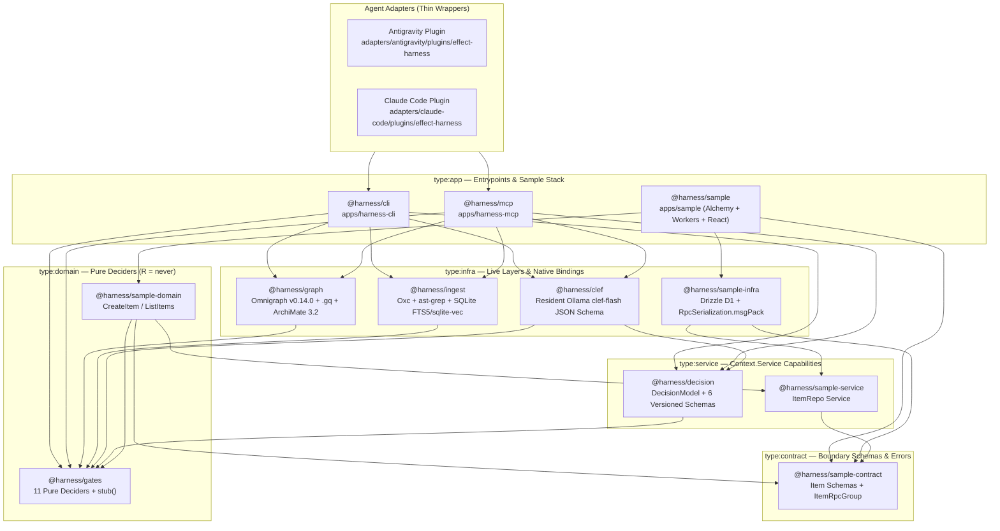
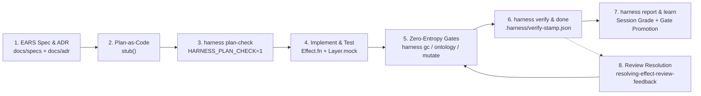

# Effect-TS Engineering Harness

An agentic software engineering harness built in **Effect v4 (`4.0.0-beta.48`)** and **Alchemy v2 (`2.0.0-beta.80`)** on **Cloudflare Workers / D1 / Durable Objects**.

The harness constrains coding agents with deterministic compiler, linter, property-graph, and ontology gates while routing idioms and architectural queries through an embedded structural index and an advisory local language model.

---

## Core Design Principles

1. **Deterministic Gates Always Win:** `@effect/tsgo` (`tsgo` + `@effect/language-service`), `oxlint` (20+ custom AST rules + Nx module boundary rules), Vitest, `GraphGc.decide`, `OntologyInvariants.decide`, and `SpanBudget.decide` hold absolute veto power. The local advisory model (`DecisionModel` / `clef-flash`) never overrides a deterministic check.
2. **Plan-as-Code (`stub<A, E, R>()`):** Before writing implementation bodies, agents translate EARS requirements and ADR decisions into compilable TypeScript skeletons using `stub<A, E, R>(...args)` from `@harness/gates`. `harness plan-check` verifies that `A` (success), `E` (`Schema.TaggedErrorClass` union), and `R` (`Context.Service` capabilities) typecheck across the workspace before implementation begins.
3. **ArchiMate 3.2 + Omnigraph Property Graph:** Requirements, ADRs, domain contracts, services, layers, handlers, and tests are indexed into a single property graph backed by `@modernrelay/omnigraph-core` (`v0.14.0` Rust NAPI + SQLite + `sqlite-vec`) and queried via declarative `.gq` pattern-matching queries.
4. **Zero-Docker, Zero-Python Local Stack:** All parsing, AST extraction, graph traversal, and vector search run in-process on Node.js `>=24.10.0` via Rust NAPI addons (`oxc-parser`, `@ast-grep/napi`, `@modernrelay/omnigraph-core`, `sqlite-vec`).
5. **Compounding Learnings Without Context Bloat:** Verification failures and route misses are recorded in `.harness/friction-log.jsonl` and `.harness/telemetry-log.jsonl`. Instead of appending prose rules to `AGENTS.md`, `harness learn` clusters recurring friction into executable `oxlint` rules, deterministic gate tests, or indexed `agent-patterns/*.md` recipes.

---

## Architecture & Monorepo Topology

The harness is organized as an **Nx (`22.6.1`) + pnpm (`10.27.0`)** monorepo with strict 5-tier architectural boundaries enforced at lint time via `@nx/enforce-module-boundaries`:



### Nx Dependency Taxonomy

| Nx Tag | Allowed Dependencies | Responsibilities | Packages |
| :--- | :--- | :--- | :--- |
| `type:contract` | `type:contract` (`effect` only) | Shared `Schema.Class`, `Schema.TaggedErrorClass`, `HttpApi`, `RpcGroup` | `@harness/sample-contract` (`libs/sample/contract`), `@harness/<scope>-contract` |
| `type:service` | `type:contract`, `type:service` | `Context.Service` capability interfaces (repositories, gateways, model ports) | `@harness/decision` (`libs/harness/decision`), `@harness/sample-service` (`libs/sample/service`) |
| `type:domain` | `type:contract`, `type:service`, `type:domain` | Pure business logic and `R = never` deciders; zero I/O, zero `Layer` construction | `@harness/gates` (`libs/harness/gates`), `@harness/sample-domain` (`libs/sample/domain`) |
| `type:infra` | `type:contract`, `type:service`, `type:domain`, `type:infra` | Live `Layer` implementations, Drizzle D1 repositories, Omnigraph, SQLite, Ollama HTTP | `@harness/clef` (`libs/harness/clef`), `@harness/ingest` (`libs/harness/ingest`), `@harness/graph` (`libs/harness/graph`), `@harness/sample-infra` (`libs/sample/infra`) |
| `type:app` | All tiers | Composition root (`Layer.provideMerge`), CLI/MCP servers, Alchemy `alchemy.run.ts`, web UI | `@harness/cli` (`apps/harness-cli`), `@harness/mcp` (`apps/harness-mcp`), `@harness/sample` (`apps/sample`) |

---

## The 7-Step Gated Task Lifecycle

Every feature or bugfix follows a deterministic 7-step lifecycle:



1. **EARS Specification & ADR (`specifying-ears-with-effect`):**
   Author or update requirements in `docs/specs/<id>.md` using EARS syntax (`WHEN`, `IF/THEN`, `WHILE`, `WHERE`) and architectural decisions in `docs/adr/<id>.md` with YAML frontmatter linking `realizes` / `influences`. Validated by `EarsSpecLint.decide` and `AdrDocLint.decide`.
2. **Plan-as-Code Skeleton (`planning-effect-skeletons`):**
   Map EARS clauses directly to Effect v4 types:
   - `WHEN <trigger>` $\rightarrow$ boundary `Schema.Class` input & success type `A`
   - `IF <condition> THEN <outcome>` $\rightarrow$ `Schema.TaggedErrorClass` in error channel `E`
   - `WHILE <state>` $\rightarrow$ pure `decide(state, input)` function with `R = never` + stateful `Context.Service` in `R`
   - `WHERE <feature>` $\rightarrow$ `Layer` / `Config` dependency in `R`
   Write function signatures returning `stub<A, E, R>(...args)` from `@harness/gates` and add `@harness-Requirement: REQ-...` JSDoc tags.
3. **Plan Gate (`harness plan-check`):**
   Runs `HARNESS_PLAN_CHECK=1 tsgo -b --noEmit` + `oxlint` (allowing `stub()` calls) + `PlanStepCoverageV1`. Checkpoints the verified skeleton onto `plan/<task>`.
4. **Implementation (`executing-effect-stubs`):**
   Replace `stub<A, E, R>()` bodies with production `Effect.fn("Domain.operation")` implementations, live Layers, and Vitest tests using `@effect/vitest` (`it.effect`, `TestClock`, `Layer.mock`). Concurrent subagents isolate work via `Workspace: "share"` or `HARNESS_WORKTREE_ID=<id>`.
5. **Zero-Entropy, Ontology & Mutation Gates (`harness gc`, `harness ontology`, `harness mutate`):**
   - `harness gc --strict`: Checks `GraphGc.decide` for orphan symbols, dead exports, and unreferenced files.
   - `harness ontology --action=check`: Verifies all 5 ArchiMate 3.2 cross-layer traceability invariants (`OntologyInvariants.decide`) and optionally checks semantic drift via `OntologyConflictV1` (`--with-clef`).
   - `harness mutate`: Checks test killer ratios against modified pure domain deciders (`MutationCheck.decide`).
6. **Sanctioned Verification & Completion (`harness verify` $\rightarrow$ `harness done`):**
   - `CI=true harness verify` runs `nx affected -t verify` (`tsgo -b` with `@effect/language-service` strict errors + `oxlint` banning `stub()` and `@effect-diagnostics` suppressions + Vitest), checks `SpanBudget.decide` and `MigrationSafety.decide`, checkpoints `impl/<task>`, and writes `.harness/verify-stamp.json` bound to `git rev-parse HEAD` + working-tree diff hash.
   - `harness done` verifies the stamp matches the current tree before allowing the agent or human to conclude the task.
7. **Observability & Compounding Learnings (`harness report` & `harness learn`):**
   - `harness report` evaluates `.harness/telemetry-log.jsonl` via `SessionReport.decide`, computing a session health score (`0–100`, grade `A–D`) and writing `.harness/session-report.md`.
   - `harness learn` clusters `.harness/friction-log.jsonl` via `Friction.decide` + `LearnProposalV1` to promote recurring mistakes into new `oxlint` rules or `agent-patterns/*.md` recipes.
8. **Post-PR / External Review Feedback Resolution (`resolving-effect-review-feedback`):**
   External review findings (pasted markdown from Grok, Codex, Claude, or human reviewers, or GitHub PR threads fetched via `gh pr view` / `gh api`) flow through a strict 5-phase loop:
   - **Phase 1 (Ingest & Normalize):** Parse comments into enumerated findings (`F-1`, `F-2`, ...), filtering out-of-scope items immediately.
   - **Phase 2 (Graph MCP Adjudication):** The orchestrator alone adjudicates each finding against the harness Order of Authority using `harness_resolve`, `harness_callers`, `harness_ontology_why`, `harness_structural_search` (clustering AST twin anti-patterns into a single `class-fix`), and `harness_tests_reaching`. Produces the Adjudication Ledger table (`fix`, `class-fix`, `doc-sync-fix`, `decline-with-evidence`, `escalate-to-human`).
   - **Phase 3 (Spec & ADR Sync First):** Before any code edits, synchronize touched `type:contract` Schemas, EARS specs (`libs/<scope>/docs/specs/*.md`), and ADRs (`libs/<scope>/docs/adr/*.md`). Run `harness plan-check` if boundaries shifted.
   - **Phase 4 (Package-Isolated Fixer Dispatch):** Dispatch parallel `flash` fixer subagents (`Workspace: "share"` or `HARNESS_WORKTREE_ID`) with target files, governing ADRs, test files, and sanctioned recipes from `harness_route` (`IdiomRouterV1`). Fixers verify locally with `harness_lsp_diagnostics` and package tests; they never run monorepo verify or modify stamps.
   - **Phase 5 (Whole-Workspace Gates & Compounding):** Orchestrator executes `harness gc --strict`, `harness mutate --strict`, `harness verify`, and `harness done`. Conducts the Compounding Gate Audit (`compounding-effect-learnings` / `harness learn`) to turn missed defects into permanent AST rules (`oxlint`) or test invariants.

---

## ArchiMate 3.2 Ontology & Omnigraph `.gq` Engine

`@harness/graph` (`libs/harness/graph`) layers an **ArchiMate 3.2** metamodel on top of `@modernrelay/omnigraph-core` (`v0.14.0`):

| ArchiMate 3.2 Layer | Node Kinds | Source Artifacts | Outgoing Traceability Edges |
| :--- | :--- | :--- | :--- |
| **Motivation** | `Requirement`, `Principle`, `Constraint`, `Goal`, `Outcome` | `docs/specs/*.md` (EARS clauses + frontmatter), `docs/adr/*.md` | `INFLUENCES` |
| **Business** | `BusinessProcess`, `BusinessObject`, `Contract` | `type:contract` `Schema.Class`, `Schema.TaggedErrorClass`, `RpcGroup` | `REALIZES` ($\rightarrow$ Motivation) |
| **Application** | `ApplicationService`, `ApplicationComponent`, `ApplicationFunction` | `type:service` `Context.Service`, `type:domain` `Effect.fn` / `.decide` | `REALIZES` ($\rightarrow$ Motivation / Business), `SERVES`, `ACCESSES` |
| **Technology** | `SystemSoftware`, `Artifact`, `Node` | `type:infra` `Layer`, Drizzle repositories, Alchemy resources | `REALIZES` ($\rightarrow$ ApplicationService), `ASSIGNED_TO` |
| **Implementation** | `WorkPackage`, `Deliverable` | Vitest `it.effect` tests, migration SQL files | `TESTS` ($\rightarrow$ Application / Business), `ASSOCIATED_WITH` |

### Cross-Layer Invariants (`OntologyInvariants.decide`)

1. **Unrealized Requirements:** Every EARS `Requirement` node in `docs/specs/*.md` must have at least one incoming `REALIZES` edge from an `ApplicationFunction`, `ApplicationService`, or `Contract`.
2. **Untested Requirements:** Every `Requirement` must be transitively covered by a test (`Implementation -[TESTS]-> Application -[REALIZES]-> Requirement`).
3. **Orphan Domain Functions:** Every exported use-case in `type:domain` must carry an `@harness-Requirement: REQ-...` JSDoc tag or link to a realized contract/service.
4. **Unprovided Services:** Every `Context.Service` (`ApplicationService`) must have at least one providing `Layer` (`SystemSoftware`) via `REALIZES`.
5. **Forbidden Cross-Layer Shortcuts:** `Technology` nodes cannot bypass `ApplicationService` interfaces, and `Application` domain nodes cannot depend on `Technology` nodes.

### Declarative `.gq` Queries (`libs/harness/graph/queries/harness.gq`)

Agents and gates query the property graph using Omnigraph's `.gq` language via `harness ontology --action=gq --query-name=<name>` or the `harness_gq_query` MCP tool:
- `unrealized_requirements`
- `requirement_realization_chain`
- `service_layer_providers`
- `layer_composition_dag`
- `test_coverage_chain`
- `adr_influenced_code`
- `domain_infra_violations`

---

## Deterministic Gates & Advisory Schemas

### 11 Pure Domain Deciders (`@harness/gates`, `R = never`)

| Decider | File | Purpose |
| :--- | :--- | :--- |
| `GraphGc.decide` | `libs/harness/gates/src/graph-gc.ts` | Flags dead exports, orphan files, and unused symbols (`error` in `--strict` mode). |
| `SpanBudget.decide` | `libs/harness/gates/src/span-budget.ts` | Enforces CPU/latency budgets on traced `Effect.fn` spans (`CpuBudgetExceeded`, `D1QueryLimitExceeded`). |
| `MigrationSafety.decide` | `libs/harness/gates/src/migration-safety.ts` | Blocks destructive SQL (`DROP TABLE`, `DROP COLUMN`, table rebuilds) without human escalation. |
| `MutationCheck.decide` | `libs/harness/gates/src/mutation-check.ts` | Enforces minimum mutation score (`>= 0.80`) on pure domain logic. |
| `LoopCircuitBreaker.decide` | `libs/harness/gates/src/loop-circuit-breaker.ts` | Trips after 3 consecutive identical verification failures or edits to force re-planning/triage. |
| `EarsSpecLint.decide` | `libs/harness/gates/src/ears-spec-lint.ts` | Validates EARS requirement documents (`WHEN`, `IF/THEN`, `WHILE`, `WHERE`, frontmatter IDs). |
| `AdrDocLint.decide` | `libs/harness/gates/src/adr-doc-lint.ts` | Validates ADR frontmatter (`id`, `status`, `realizes`, `influences`) and required sections. |
| `OntologyInvariants.decide` | `libs/harness/gates/src/ontology-invariants.ts` | Enforces all 5 ArchiMate 3.2 cross-layer traceability invariants. |
| `SessionHandoff.decide` | `libs/harness/gates/src/session-handoff.ts` | Computes session resume state, dirty worktree status, and verify stamp freshness. |
| `Friction.decide` | `libs/harness/gates/src/friction.ts` | Clusters `.harness/friction-log.jsonl` events by root cause (`>= 2` occurrences) for `harness learn`. |
| `SessionReport.decide` | `libs/harness/gates/src/session-report.ts` | Computes session health score (`0–100`), letter grade (`A–D`), gate pass rates, and recommendations. |

### 6 Versioned `DecisionModel` Schemas (`@harness/decision` + `@harness/clef`)

Backed by resident Ollama (`clef-flash` with `keep_alive: -1` and strict JSON Schema decoding; deterministic fallback layer when Ollama is offline):

| Schema | Used By | Purpose |
| :--- | :--- | :--- |
| `IdiomRouterV1` | `harness route`, `harness_route` | Reranks top-K FTS5 / `sqlite-vec` chunks from `repos/effect`, `repos/alchemy`, and `agent-patterns/*.md`. |
| `GuardV1` | `harness guard` | Classifies ambiguous shell commands when deterministic regex/path guards return `ask`. |
| `TriageV1` | `harness verify` | Summarizes compiler/test failures and identifies the minimal causal locus when verification fails. |
| `PlanStepCoverageV1` | `harness plan-check` | Audits whether `stub<A, E, R>()` signatures cover all EARS clauses in the plan. |
| `LearnProposalV1` | `harness learn` | Drafts `oxlint` AST rule specifications or `agent-patterns/*.md` recipes from friction clusters. |
| `OntologyConflictV1` | `harness ontology --with-clef` | Detects semantic contradictions between EARS requirements/ADRs and implementing `Effect.fn` / `Layer` signatures. |

---

## Static Analysis & Effect Language Service (`@effect/tsgo`)

Every typecheck (`pnpm typecheck` / `harness verify`) runs `tsgo -b` patched with `@effect/language-service` (`v0.80.0`), enforcing strict compile-time errors (`tsconfig.base.json`):

- `floatingEffect: "error"` — every `Effect` must be yielded (`yield*`), returned, or explicitly run.
- `missingEffectContext: "error"` & `missingEffectError: "error"` — unhandled `R` or `E` channels fail compilation.
- `missingStarInYieldEffect: "error"` — `yield` instead of `yield*` inside `Effect.gen` / `Effect.fn` is a compile error.
- `returnEffectInGen: "error"`, `tryCatchInEffectGen: "error"`, `unnecessaryEffectGen: "error"`, `scopeInLayerEffect: "error"`, `layerMergeAllWithDependencies: "error"`.

In addition, `tools/oxlint/syntax-bans.js` enforces 20+ Effect v4, Alchemy v2, and Drizzle AST rules, including:
- `effect-harness/no-effect-diagnostics-suppression` — bans `// @effect-diagnostics` and `/* @effect-diagnostics */` comments so agents cannot silence `@effect/tsgo`.
- `effect-harness/no-stub-outside-plan-check` — bans `stub()` unless `HARNESS_PLAN_CHECK=1` is set.
- `effect-harness/no-gen-wrapper` — requires `Effect.fn("SpanName")` or `Effect.fnUntraced` instead of `(...args) => Effect.gen(...)`.
- `effect-harness/no-run-sync-outside-app`, `effect-harness/no-layer-in-domain`, `effect-harness/no-drizzle-outside-infra`, `effect-harness/no-alchemy-outside-infra`, `effect-harness/no-repos-import`.

---

## CLI & MCP Server Reference

### `harness` CLI (`apps/harness-cli`)

Invoke via `node --import ./tools/node-ts-resolver.mjs apps/harness-cli/src/index.ts <subcommand>`:

| Subcommand | Description |
| :--- | :--- |
| `doctor` | Checks Node `>=24.10.0`, `@effect/tsgo` (`effectLspOk`), Omnigraph NAPI, SQLite index, and Ollama `clef-flash` status. |
| `session` | Prints session resume handoff (`SessionHandoff.decide`), active branch, verify stamp freshness, and environment health. |
| `ingest` | Incrementally indexes `repos/effect`, `repos/alchemy`, `agent-patterns/*.md`, `docs/specs/*.md`, `docs/adr/*.md`, and workspace TypeScript symbols into `.harness/index.sqlite` and Omnigraph. |
| `route --query="..."` | Queries the structural FTS5 + `sqlite-vec` index and reranks results via `IdiomRouterV1`. |
| `guard --format=antigravity\|claude` | Evaluates `PreToolUse` shell commands and file edits against `repos/` read-only rules, destructive SQL, and `alchemy deploy`/`destroy` guards. |
| `plan-check` | Runs `HARNESS_PLAN_CHECK=1` typecheck + `oxlint` + `PlanStepCoverageV1` and checkpoints `plan/<task>`. |
| `gc [--strict]` | Runs `GraphGc.decide` over the Omnigraph symbol graph to detect dead exports and orphan files. |
| `ontology --action=check\|why\|impact\|gq` | Runs ArchiMate 3.2 cross-layer invariant checks (`--with-clef` for semantic drift), traces `why` a symbol exists, computes `impact` blast radius, or executes named `.gq` queries. |
| `mutate [--score=0.85]` | Evaluates mutation score thresholds (`MutationCheck.decide`) on pure domain logic. |
| `verify` | Runs `CI=true pnpm nx affected -t verify`, `SpanBudget.decide`, `MigrationSafety.decide`, checkpoints `impl/<task>`, and writes `.harness/verify-stamp.json`. |
| `done --format=antigravity\|claude` | Verifies `.harness/verify-stamp.json` matches `HEAD` and current working tree hash before allowing task completion. |
| `report` | Generates `.harness/session-report.md` from `.harness/telemetry-log.jsonl` with session health score (`0–100`, grade `A–D`). |
| `learn` | Clusters `.harness/friction-log.jsonl` via `Friction.decide` + `LearnProposalV1` to promote recurring issues into gates/recipes. |

### `harness-mcp` Server (`apps/harness-mcp`)

Exposes 12 structural, ontology, diagnostics, and telemetry MCP tools over stdio:

| MCP Tool | Arguments | Description |
| :--- | :--- | :--- |
| `harness_resolve` | `{ query, limit? }` | Resolves symbol definitions (`Service`, `Layer`, `Schema`, `TaggedError`, `EffectFn`, `Requirement`, `ADR`) by name or prefix. |
| `harness_callers` | `{ symbolId }` | Lists incoming edges (`CALLS`, `PROVIDES`, `REQUIRES`, `TESTS`, `REALIZES`) for a symbol. |
| `harness_callees` | `{ symbolId }` | Lists outgoing edges from a symbol. |
| `harness_tests_reaching` | `{ symbolIds }` | Finds the minimal set of Vitest test files transitively reaching the given symbol IDs. |
| `harness_structural_search` | `{ pattern, path? }` | Runs `@ast-grep/napi` structural AST pattern searches across TypeScript files. |
| `harness_route` | `{ query, topK? }` | Queries the hybrid FTS5 + `sqlite-vec` idiom router across Effect/Alchemy docs and `agent-patterns/*.md`. |
| `harness_ontology_why` | `{ symbol }` | Traces a symbol upward through ArchiMate 3.2 layers to the EARS `Requirement` and `ADR` nodes it realizes. |
| `harness_ontology_impact` | `{ nodeId }` | Computes downstream blast radius across contracts, domain functions, services, layers, and tests when a requirement or symbol changes. |
| `harness_ontology_check` | `{}` | Runs `OntologyInvariants.decide` across the workspace and returns any cross-layer violations. |
| `harness_gq_query` | `{ queryName?, querySource? }` | Executes a named query from `libs/harness/graph/queries/harness.gq` or an inline `.gq` query against Omnigraph. |
| `harness_lsp_diagnostics` | `{ project? }` | Runs `@effect/tsgo` (`tsgo -b --noEmit`) and returns structured diagnostics (including `@effect/language-service` errors) with file, line, column, and code. |
| `harness_telemetry_report` | `{ writeReport? }` | Computes the current session health report (`SessionReport.decide`) from `.harness/telemetry-log.jsonl`. |

---

## Agent Adapters, Workflow Skills & Usage Guide

The harness packages full engineering capabilities into two first-class adapter bundles: `adapters/antigravity/plugins/effect-harness` (Antigravity plugin) and `adapters/claude-code` (Claude Code adapter). Both adapters wire agents to the exact same underlying `harness` CLI, `harness-mcp` server, deterministic gates, and pattern repositories.

### 1. Overview of Adapter Bundles

| Component | Antigravity Plugin (`adapters/antigravity/plugins/effect-harness`) | Claude Code Adapter (`adapters/claude-code`) |
| :--- | :--- | :--- |
| **Manifest / Config** | `plugin.json` (`"name": "effect-harness"`) | `.mcp.json` (`harness-mcp`, `omnigraph-mcp`, `nx-mcp`) |
| **Rules Engine** | `rules/AGENTS.md` (and repo root `AGENTS.md`) | `rules/AGENTS.md` (and repo root `AGENTS.md`) |
| **Hooks Engine** | `hooks.json` (`PreInvocation`, `PreToolUse`, `PostToolUse`, `Stop`) | `hooks.json` (`SessionStart`, `PreToolUse`, `PostToolUse`, `Stop`) |
| **MCP Servers** | `mcp_config.json` (`harness-mcp`, `omnigraph-mcp`, `nx-mcp`) | `.mcp.json` (`harness-mcp`, `omnigraph-mcp`, `nx-mcp`) |
| **Workflow Skills** | 6 skills in `skills/` | 6 skills in `skills/` |
| **Specialist Agents** | 4 read-only reviewer subagents in `agents/` | 4 read-only reviewer subagents in `agents/` |

#### Lifecycle Hook Discipline
- **Session Resume (`PreInvocation` / `SessionStart`):** Executes `harness session` to evaluate uncommitted working tree state, branch position, `.harness/verify-stamp.json` freshness, and environment health.
- **Write-Surface Guard (`PreToolUse`):** Evaluates shell commands and file edits. Blocks direct modification of `repos/effect` and `repos/alchemy`. Blocks stamp forgery (`.harness/verify-stamp.json`). Intercepts `alchemy deploy` and `alchemy destroy` to require interactive human confirmation.
- **Incremental Ingest (`PostToolUse`):** Runs `harness ingest` after file write/edit operations to update `.harness/index.sqlite` and the resident Omnigraph symbol graph.
- **Completion Check (`Stop`):** Runs `harness done` before concluding a task, verifying that `.harness/verify-stamp.json` exists and matches `HEAD` commit and working tree hash.

---

### 2. 6 Workflow Skills — Reference & Usage Matrix

| Skill | Lifecycle Stage & When to Use | Example Prompt / Trigger | MCP Tools & CLI Gates Used | Required Output / Exit Gate |
| :--- | :--- | :--- | :--- | :--- |
| `effect-harness` | Full lifecycle orchestration. Use when starting a new feature or orchestrating tasks across contracts, domain logic, and infra. | `"Implement user authentication with D1 sessions and durable rate limits following the harness lifecycle."` | `harness_route`<br>`harness_lsp_diagnostics`<br>`harness gc --strict`<br>`harness verify`<br>`harness done` | Verified implementation on `impl/<task>` branch with valid `.harness/verify-stamp.json` passing `harness done`. |
| `specifying-ears-with-effect` | Step 1 (EARS Specification & ADR). Use before writing code or skeletons when requirements are informal or missing EARS clauses. | `"Specify requirements and architecture for D1 session store with exponential backoff retries."` | `harness_ontology_check`<br>`harness_ontology_impact`<br>`EarsSpecLint.decide`<br>`AdrDocLint.decide` | Validated spec `libs/<scope>/docs/specs/YYYY-MM-DD-<slug>.md` and ADR `libs/<scope>/docs/adr/NNNN-<slug>.md` passing linter deciders. |
| `planning-effect-skeletons` | Steps 2–3 (Plan-as-Code Skeleton & Plan Gate). Use after specification approval to construct typed skeletons with `stub<A, E, R>()`. | `"Create typed skeletons and plan-as-code for the session store use cases and repository ports."` | `harness_route`<br>`harness_lsp_diagnostics`<br>`harness plan-check`<br>`PlanStepCoverageV1` | Typechecked skeleton with JSDoc `@harness-Requirement` tags, clean `harness_lsp_diagnostics`, and checkpointed `plan/<task>` branch. |
| `executing-effect-stubs` | Steps 4–6 (Implementation & Verification). Use after `harness plan-check` passes to replace stubs with `Effect.fn` bodies, Layers, and tests. | `"Execute stubs for session repository in libs/sample/infra and domain deciders in libs/sample/domain."` | `harness_route`<br>`harness_tests_reaching`<br>`harness_structural_search`<br>`harness_lsp_diagnostics`<br>`harness gc --strict`<br>`harness mutate`<br>`harness verify` | Zero stubs remaining, 100% passing Vitest tests, mutation score `>= 0.85`, zero orphan symbols (`gc --strict`), and verified stamp. |
| `resolving-effect-review-feedback` | Step 8 (Post-PR / External Review Resolution). Use when receiving review feedback (from Grok, Codex, Claude, human, or GitHub PR thread). | `"Resolve the code review feedback from PR #42"` or `"Resolve this review paste: [markdown]"` | `harness_resolve`<br>`harness_callers`<br>`harness_ontology_why`<br>`harness_structural_search`<br>`harness_tests_reaching`<br>`harness_route`<br>`harness gc --strict`<br>`harness mutate --strict`<br>`harness verify` | Completed Adjudication Ledger, synchronized specs/ADRs, class-fixes resolved via `flash` subagents, and verified stamp with clean gates. |
| `compounding-effect-learnings` | Step 7 & Post-Review Compounding. Use when completing a task with friction, route misses, or gate escapes, or when running `harness learn`. | `"Run harness learn and promote recent friction clusters into AST rules and pattern recipes."` | `harness_telemetry_report`<br>`harness report`<br>`harness learn`<br>`Friction.decide`<br>`LearnProposalV1`<br>`SessionReport.decide` | `.harness/session-report.md` with session letter grade, and promoted artifacts across the 5 learning targets. |

---

### 3. Practical Skill Usage Recipes

#### Recipe A: Starting a New Feature (`specifying-ears-with-effect` $\rightarrow$ `planning-effect-skeletons`)
1. **Ingest Requirements:** Ingest raw requirements from user prompt or issue.
2. **Author EARS Specification:** Create `libs/<scope>/docs/specs/YYYY-MM-DD-<slug>.md` with frontmatter (`id`, `title`, `spans`, `services`, `errors`) and EARS requirements (`WHEN`, `IF/THEN`, `WHILE`, `WHERE`).
3. **Author ADR:** Create `libs/<scope>/docs/adr/NNNN-<slug>.md` with frontmatter (`realizes`, `influences`, `status: accepted`).
4. **Map EARS Clauses to Effect Types:**
   - `WHEN <trigger>` $\rightarrow$ boundary `Schema.Class` input and success type `A`.
   - `IF <condition> THEN <outcome>` $\rightarrow$ `Schema.TaggedErrorClass` in error channel `E`.
   - `WHILE <state>` $\rightarrow$ pure `decide(state, input)` function (`R = never`) + stateful `Context.Service` in `R`.
   - `WHERE <feature>` $\rightarrow$ `Layer` / `Config` dependency in `R`.
5. **Write Typed Skeletons:** Write signatures in `type:domain` and `type:service` returning `stub<A, E, R>(...args)` from `@harness/gates` with `@harness-Requirement: REQ-...` annotations.
6. **Execute Plan Gate:** Run `harness plan-check` (`HARNESS_PLAN_CHECK=1`) to lock boundaries and checkpoint `plan/<task>`.

#### Recipe B: Implementing with Package-Isolated `flash` Subagents (`executing-effect-stubs`)
1. **Route Patterns:** Orchestrator queries `harness_route` (`IdiomRouterV1` via `clef-flash`) for the sanctioned patterns matching each package archetype.
2. **Partition Package Subagents:** The orchestrator dispatches parallel subagents (`TypeName: "self"`, `Model: "flash"`, `Workspace: "share"` or `HARNESS_WORKTREE_ID=<id>`):
   - **Subagent 1 (`libs/<scope>/domain`):** Replaces pure stubs with `Effect.fn` use-cases and `.decide` deciders.
   - **Subagent 2 (`libs/<scope>/infra`):** Implements live Drizzle D1 / DO SQLite repositories and Alchemy resource bindings.
   - **Subagent 3 (`apps/web` or UI):** Implements `@effect/atom-react` state and client contracts.
3. **Subagent Execution Discipline:** Subagents run `harness_lsp_diagnostics` and package unit tests (`pnpm nx run <project>:test`). Subagents **never** run monorepo `verify` or mutate `.harness/verify-stamp.json`.
4. **Specialist Review Lenses:** Orchestrator runs read-only specialist subagents (`effect-ears-test-reviewer`, `effect-security-reviewer`, `effect-reliability-reviewer`, `effect-adversarial-reviewer`) against the implementation.
5. **Close Monorepo Gates:** Orchestrator runs `harness gc --strict`, `harness mutate --strict`, `CI=true harness verify`, and `harness done`.

#### Recipe C: Resolving Code Review Feedback (`resolving-effect-review-feedback`)
1. **Ingest & Normalize:** Ingest pasted markdown or GitHub PR threads (`gh pr view <pr> --comments`, `gh api .../pulls/<pr>/comments`). Normalize into `F-1`, `F-2`, ... and separate out-of-scope items.
2. **Central Adjudication Ledger:** The orchestrator evaluates each item against the harness Order of Authority:
   - Call `harness_resolve` and `harness_callers` to inspect types, caller trees, and error channels.
   - Call `harness_ontology_why` to verify governing ADR invariants.
   - Call `harness_structural_search` (`@ast-grep/napi`) to uncover twin anti-patterns across the workspace and cluster into a `class-fix`.
   - Call `harness_tests_reaching` to inspect test coverage and identify assertion gaps.
   - Output the Adjudication Ledger (`fix`, `class-fix`, `doc-sync-fix`, `decline-with-evidence`, `escalate-to-human`).
3. **Spec & ADR Sync First:** Update `libs/<scope>/docs/specs/*.md` and `libs/<scope>/docs/adr/*.md` before editing implementation code. Run `harness plan-check` if public interfaces changed.
4. **Dispatch Package-Isolated Fixers:** Launch `flash` subagents with exact pattern routes from `harness_route` and reaching test files. Subagents execute fixes and verify locally.
5. **Run Gates & Compounding Audit:** Orchestrator executes root gates (`harness gc --strict`, `harness mutate --strict`, `harness verify`, `harness done`), then executes the Compounding Gate Audit to identify why gates missed the defect.

#### Recipe D: Compounding Friction into Deterministic Gates (`compounding-effect-learnings`)
1. **Cluster Friction Logs:** `harness learn` runs `Friction.decide` over `.harness/friction-log.jsonl`, clustering events with `>= 2` occurrences by root-cause signature.
2. **Generate Proposals:** `LearnProposalV1` evaluates clusters and proposes target artifacts across the 5 graduation destinations:
   - `agent-pattern`: Adds new or updated recipes in `agent-patterns/*.md`.
   - `triage-rule`: Adds diagnostic error patterns to `libs/harness/decision/src/triage.ts`.
   - `guard-allowlist`: Updates shell or file patterns in `libs/harness/gates/src/guard.ts`.
   - `ast-graph-gate`: Adds AST syntax bans in `tools/oxlint/syntax-bans.js` or ArchiMate invariants in `libs/harness/gates/src/ontology-invariants.ts`.
   - `adr`: Documents architectural tradeoffs in `libs/<scope>/docs/adr/NNNN-<slug>.md`.
3. **Apply & Verify:** Commit the generated gate rules, ensuring recurring mistakes are blocked at compile or lint time.

---

### 4. 4 Read-Only Specialist Review Subagents

| Subagent | Activation Signal | Primary Audit Focus | Supporting References |
| :--- | :--- | :--- | :--- |
| `effect-ears-test-reviewer` | Step 4 test authoring, PR review, or when test fidelity is questioned. | Audits 1:1 coverage between EARS clauses (`WHEN`, `IF/THEN`, `WHILE`, `WHERE`) and `@effect/vitest` assertions; flags vacuous `.thenFails()` without expected error instances; checks mock boundary leakage. | `docs/specs/*.md`<br>`agent-patterns/testing.md` |
| `effect-security-reviewer` | Contract changes, authentication/authorization updates, SQL queries, or secrets. | Audits boundary decoding (`Schema.decodeUnknownEffect`); checks IDOR authorization checks in `type:domain`; detects raw SQL string interpolation; verifies `Redacted` usage for sensitive configuration. | `agent-patterns/schema.md`<br>`agent-patterns/d1-repository.md`<br>`agent-patterns/httpapi.md` |
| `effect-reliability-reviewer` | Concurrency, background fibers, Durable Object transactions, retry schedules, or scopes. | Audits DO SQLite synchronous transaction discipline (`MixedScheduler("sync")`, pre-transaction decoding, commit-order mutation); checks `Scope` finalizers; detects unbounded `Schedule` retries and fiber leaks. | `agent-patterns/durable-object-state.md`<br>`agent-patterns/concurrency.md`<br>`agent-patterns/schedule.md` |
| `effect-adversarial-reviewer` | Complex state machines, distributed transactions, deciders, or multi-step operations. | Constructs partial-failure crash-between-steps sequences; constructs concurrent race conditions; analyzes out-of-order event replay; tests boundary value mutations against pure deciders. | `agent-patterns/event-sourcing.md`<br>`agent-patterns/pattern-matching.md`<br>`agent-patterns/errors.md` |

---

### 5. 16 Indexed Pattern Recipes (`agent-patterns/*.md`)

All 16 pattern files are indexed as `PatternDoc` nodes in Omnigraph and routed via `harness route` / `harness_route` (`IdiomRouterV1`):

| Pattern Recipe | File | Key Effect v4 / Alchemy v2 Constructs | Gate / AST Ban Enforced |
| :--- | :--- | :--- | :--- |
| **Planning** | `agent-patterns/planning.md` | `stub<A, E, R>()`, 16-row building block mapping, JSDoc `@harness-Requirement` | `effect-harness/no-stub-outside-plan-check` |
| **Services & Layers** | `agent-patterns/services-and-layers.md` | `Context.Service`, `Layer.effect`, `Layer.succeed`, `Layer.scoped`, `Layer.provideMerge` | `effect-harness/no-layer-in-domain` |
| **Errors** | `agent-patterns/errors.md` | `Schema.TaggedErrorClass`, `Data.TaggedError`, `Effect.catchTag`, `Effect.fail` | `effect-harness/no-throw-in-effect`, `no-try-catch-in-gen` |
| **Schema** | `agent-patterns/schema.md` | `Schema.Struct`, `Schema.Class`, `Schema.Int`, `Schema.decodeUnknownEffect` | `effect-harness/no-raw-json-parse` |
| **Resources & Scope** | `agent-patterns/resources-scope.md` | `Scope`, `Effect.acquireRelease`, `Effect.addFinalizer`, `Layer.scoped` | `effect-harness/no-unscoped-resource` |
| **Concurrency** | `agent-patterns/concurrency.md` | `Effect.all({ concurrency })`, `Fiber`, `Queue`, `Deferred`, `Semaphore` | `effect-harness/no-async-await` |
| **Schedule** | `agent-patterns/schedule.md` | `Schedule.exponential`, `Schedule.jittered`, `Schedule.recurs`, `Effect.retry` | `effect-harness/no-unbounded-retry` |
| **Testing** | `agent-patterns/testing.md` | `@effect/vitest` (`it.effect`, `it.scoped`), `TestClock`, `Layer.mock` | `effect-harness/no-vacuous-assertion` |
| **Alchemy Infra** | `agent-patterns/alchemy-infra.md` | `alchemy`, `Worker`, `R2Bucket`, `D1Database`, `DurableObjectNamespace` | `effect-harness/no-alchemy-outside-infra` |
| **D1 Repository** | `agent-patterns/d1-repository.md` | `drizzle-orm/effect-d1`, `@effect/sql-d1`, `sqliteTable`, row schema decoders | `effect-harness/no-drizzle-outside-infra` |
| **DO State** | `agent-patterns/durable-object-state.md` | `drizzle-orm/effect-sqlite-do`, `Scheduler.MixedScheduler("sync")`, `db.withTransaction` | `effect-harness/no-async-in-do-transaction` |
| **Event Sourcing** | `agent-patterns/event-sourcing.md` | `Decider.make`, pure synchronous `evolve<Aggregate>`, effectful `.decide` | `effect-harness/no-run-sync-outside-app` |
| **HTTP API** | `agent-patterns/httpapi.md` | `HttpApi`, `HttpApiGroup`, `HttpApiEndpoint`, OpenAPI generation, `oasdiff breaking` | `effect-harness/no-untyped-http-response` |
| **RPC** | `agent-patterns/rpc.md` | `RpcGroup`, `Cloudflare.toHttpClient`, W3C `traceparent` propagation | `effect-harness/no-untyped-rpc-payload` |
| **Atom State** | `agent-patterns/atom.md` | `@effect/atom-react`, `AtomHttpApi`, client state without manual `fetch` | `effect-harness/no-manual-fetch-in-ui` |
| **Pattern Matching** | `agent-patterns/pattern-matching.md` | `ts-pattern` (`match(value)...exhaustive()`), closed discriminated unions | `effect-harness/no-switch-on-tag`, `no-union-if-else` |

---

## Prerequisites & Quickstart

### Prerequisites
- **Node.js `>=24.10.0`** and **pnpm `10.27.0`**
- **Ollama** (optional, recommended for advisory `DecisionModel`):
  ```bash
  ollama create clef-flash -f tools/clef/Modelfile
  ```

### Installation & Index Bootstrap

```bash
# 1. Install dependencies (automatically runs `effect-tsgo patch --typescript --oxlint`)
pnpm install

# 2. Check environment health (Node, @effect/tsgo LSP, Omnigraph NAPI, SQLite, Ollama)
node --import ./tools/node-ts-resolver.mjs apps/harness-cli/src/index.ts doctor

# 3. Build the structural & ontology index (.harness/index.sqlite + Omnigraph)
node --import ./tools/node-ts-resolver.mjs apps/harness-cli/src/index.ts ingest

# 4. Run full workspace verification
CI=true node --import ./tools/node-ts-resolver.mjs apps/harness-cli/src/index.ts verify
```

---

## Using as a Template & Bidirectional `upstream` Sync

[`selmeci/effect-ts-harness`](https://github.com/selmeci/effect-ts-harness) is configured as a GitHub Template Repository (`is_template: true`). Its Node TS resolver (`tools/node-ts-resolver.mjs`) and Omnigraph extractor (`libs/harness/graph/src/type-extractor.ts`) dynamically resolve any `@harness/<scope>-<tier>` package added under `libs/<scope>/<tier>`.

> [!IMPORTANT]
> Clicking **"Use this template"** in the GitHub UI creates a repository with a squashed initial commit and **no shared Git commit history**, which causes `unrelated histories` conflicts when syncing future harness upgrades.
> To keep **bidirectional Git sync (`upstream`)** working cleanly, initialize new project repositories by cloning and pushing the `main` history directly.

### 1. Creating a New Project Repository with Shared History

```bash
# 1. Create an empty repository on GitHub (without README or initial commit)
gh repo create <owner>/<new-project> --public

# 2. Clone effect-ts-harness and rename the remote to `upstream`
git clone git@github.com:selmeci/effect-ts-harness.git <new-project>
cd <new-project>
git remote rename origin upstream
git remote add origin git@github.com:<owner>/<new-project>.git

# 3. Push the shared `main` baseline to `origin`
git push -u origin main
```

### 2. Pulling Harness Upgrades into a Project (`upstream` $\rightarrow$ `origin`)

```bash
git fetch upstream
git checkout main
git merge upstream/main
git push origin main
```

### 3. Upstream-Contributing Improvements Back to the Harness (`origin` $\rightarrow$ `upstream`)

Keep commits that touch harness infrastructure (`apps/harness-*`, `libs/harness/*`, `tools/*`, `adapters/*`, `agent-patterns/*`) separate from domain commits (`libs/<your-domain>/*`, `docs/specs/*`), then cherry-pick them back to `upstream`:

```bash
git fetch upstream
git checkout -b fix/harness-improvement upstream/main
git cherry-pick <commit-sha>
git push upstream fix/harness-improvement
```
