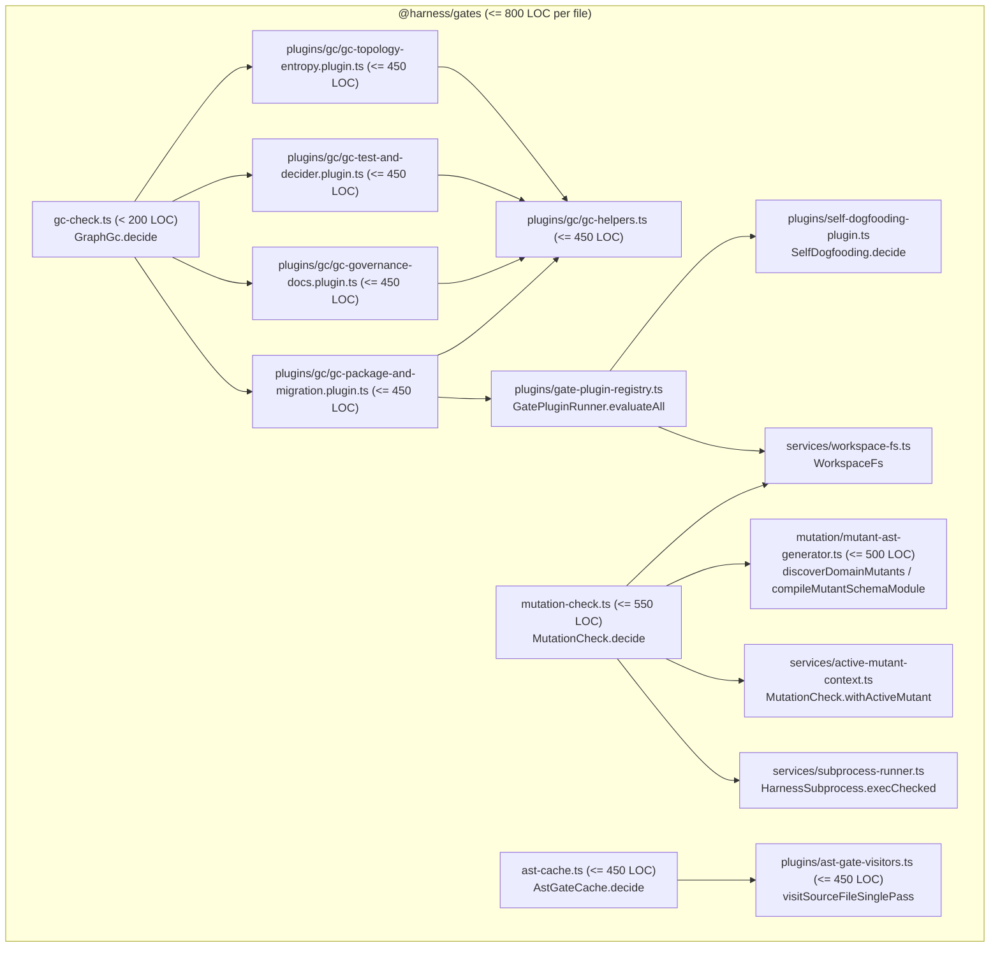

# RFC-0007 Step 2 — Clean-Slate Modular Decomposition of `@harness/gates` Monoliths & Package-Wide 800-Line Budget Enforcement

## Goal Capsule

- **Problem:** Three monolithic files in `@harness/gates` (`libs/harness/gates/src/gc-check.ts` at 2,191 lines, `libs/harness/gates/src/mutation-check.ts` at 1,012 lines, and `libs/harness/gates/src/ast-cache.ts` at 866 lines) exceed the 800-line modular ceiling defined in `RFC-0007` and `harness:ADR-0012`, preventing `SelfDogfooding.decide` (`file-line-budget-exceeded`) from enforcing the 800-line budget across all of `libs/harness/gates/src/**/*.ts`.
- **Target State:**
  1. `libs/harness/gates/src/gc-check.ts` is reduced to a slim `< 200`-line orchestrator for `decideGraphEntropy = Effect.fn("GraphGc.decide")(...)` that delegates to 5 cohesive modules in `libs/harness/gates/src/plugins/gc/` (`gc-topology-entropy.plugin.ts`, `gc-test-and-decider.plugin.ts`, `gc-governance-docs.plugin.ts`, `gc-package-and-migration.plugin.ts`, and `gc-helpers.ts`), each `<= 450` lines.
  2. `libs/harness/gates/src/mutation-check.ts` is split into `libs/harness/gates/src/mutation/mutant-ast-generator.ts` (`<= 500` lines, AST mutant discovery and Mutant Schemata instrumentation) and `libs/harness/gates/src/mutation-check.ts` (`<= 550` lines, `MutationCheck.decide` and `runDomainMutationSuite` wired directly to `ActiveMutantContext`, `WorkspaceFs`, and `HarnessSubprocessRunner`).
  3. `libs/harness/gates/src/ast-cache.ts` is split into `libs/harness/gates/src/plugins/ast-gate-visitors.ts` (`<= 450` lines, single-pass AST visitor rules for `syntax-bans`, `test-integrity`, `migration-safety`, `domain-purity`, and `effect-laws`) and `libs/harness/gates/src/ast-cache.ts` (`<= 450` lines, content-addressable AST cache management and `AstGateCache.decide`).
  4. `SelfDogfooding.decide` (`file-line-budget-exceeded`, `maxPluginFileLines = 800`) is expanded to enforce `<= 800` lines across **every** `.ts` file in `libs/harness/gates/src/**/*.ts`, backed by a deterministic regression test.
- **Success Criteria:**
  - Every `.ts` file in `libs/harness/gates/src/**/*.ts` is `<= 800` lines and passes `SelfDogfooding.decide`.
  - All decomposed modules satisfy their strict line-count targets (`gc-check.ts < 200`, `plugins/gc/*.ts <= 450`, `mutation/mutant-ast-generator.ts <= 500`, `mutation-check.ts <= 550`, `plugins/ast-gate-visitors.ts <= 450`, `ast-cache.ts <= 450`).
  - Zero `any`, zero `as never`, zero `as unknown as`, zero `switch` statements, zero `match().run()`, zero `yield* Effect.void`, and zero nested `Effect.runSync` inside Effect constructors.
  - All `ADR-0001..0012` and `SPEC-0001..0011` `enforced_by` paths and `Deterministic Enforcement` mechanism substrings remain 100% valid (`pnpm harness gc --strict` and `pnpm harness ontology check --strict` exit `0`).

## Product Contract

### Scope & Non-Goals

- **In Scope:**
  - Clean-slate physical decomposition of `libs/harness/gates/src/gc-check.ts`, `libs/harness/gates/src/mutation-check.ts`, and `libs/harness/gates/src/ast-cache.ts`.
  - Direct wiring of `ActiveMutantContext` (`MutationCheck.withActiveMutant`), `WorkspaceFs`, `HarnessSubprocessRunner`, and `GatePluginRegistry` (`GatePluginRunner.evaluateAll`).
  - Expansion of `isModularPluginPath` in `libs/harness/gates/src/plugins/self-dogfooding-plugin.ts` (and corresponding file scanners in `gc-package-and-migration.plugin.ts` and `apps/harness-cli/src/index.ts`) to cover all of `libs/harness/gates/src/**/*.ts`.
  - Updating `harness:SPEC-0011` and `harness:ADR-0012` `enforced_by` frontmatter and enforcement tables with the new modular paths.
- **Out of Scope:**
  - Step 3 (`@harness/graph` `type-extractor.ts` decomposition) and Step 4 (`apps/harness-cli` and `apps/harness-mcp` handler extraction), which are separate milestones in `RFC-0007`.

### Requirements Mapping (`harness:SPEC-0011` & `harness:ADR-0012`)

| Clause   | EARS Pattern       | Summary                                                                                                                                                                            | Enforced Symbols                                                 |
| :------- | :----------------- | :--------------------------------------------------------------------------------------------------------------------------------------------------------------------------------- | :--------------------------------------------------------------- |
| REQ-1.1  | State-driven       | **While** evaluating workspace source files (including all `libs/harness/gates/src/**/*.ts` files) within `maxPluginFileLines` (800), `SelfDogfooding.decide` returns clean report | `SelfDogfooding.decide`                                          |
| REQ-1.2  | Unwanted behaviour | **If** any file in `libs/harness/gates/src/**/*.ts` or `/plugins/`, `/services/`, `/commands/`, `/tools/` exceeds `maxPluginFileLines` (800), fail with `SelfDogfoodingViolationError` | `SelfDogfoodingViolationError`                                   |
| REQ-2.5  | Event-driven       | **When** `MutationCheck.withActiveMutant` executes a mutant test callback, yield `ActiveMutantContext` from `R` and restore mutant state on completion or interruption             | `MutationCheck.withActiveMutant`, `MutationCheck.decide`         |
| REQ-2.6  | Event-driven       | **When** `GatePluginRunner.evaluateAll` executes registered gate plugins during `GraphGc.decide` and `verify`, yield `GatePluginRegistry` and `WorkspaceFs` from `R`               | `GatePluginRunner.evaluateAll`, `GraphGc.decide`                 |

## Planning Contract

### Architecture & Module Boundaries (`@harness/gates`)

### Traceability & Omnigraph Node Key Preservation

- `TypeExtractor` indexes `Effect.fn` spans by their declaration file path (`<relFilePath>#<symbolName>`).
- Keeping `decideGraphEntropy = Effect.fn("GraphGc.decide")` in `libs/harness/gates/src/gc-check.ts`, `decideMutationReport = Effect.fn("MutationCheck.decide")` in `libs/harness/gates/src/mutation-check.ts`, and `decideAstGateCache = Effect.fn("AstGateCache.decide")` (+ category deciders) in `libs/harness/gates/src/ast-cache.ts` preserves all existing Omnigraph node keys and `ADR-0001..0012` / `SPEC-0001..0011` `enforced_by` links.
- Furthermore, `ADR-0004` Row 5 requires `discoverDomainMutants` to appear in `libs/harness/gates/src/mutation-check.ts` and `ADR-0008` Row 2 requires `GraphGc.decide` and `node-sqlite-in-infra` to appear in `libs/harness/gates/src/gc-check.ts`; re-exporting `discoverDomainMutants` from `mutation-check.ts` and keeping `GcFindingKind` (`"node-sqlite-in-infra"`) in `gc-check.ts` preserves all `stale-doc-reference` substring invariants.

## Implementation Units

### Unit 1 (`U1`): Decompose `libs/harness/gates/src/gc-check.ts` into `< 200`-Line Orchestrator + 5 `plugins/gc/` Modules (`<= 450` Lines Each)

- **Files Created / Modified:**
  - `libs/harness/gates/src/plugins/gc/gc-helpers.ts` (`<= 450` lines): Shared types (`GcFindingKind`, `GcFinding`, `GovernanceDocRef`, `GraphGcReport`, `GraphEntropyInput`, `GraphReachabilityContext`), `buildGraphReachabilityContext`, `levenshteinDistance`, `findClosestMatch`, `extractBalancedBraces`, `extractBalancedParens`, `extractTopLevelObjectAnalysis`, `parseGovernanceDocFrontmatter`, `loadGovernanceDocsFromDisk`, and workspace file collection helpers (`collectWorkspaceTsFiles`, `collectWorkspaceSqlFiles`, `collectWorkspaceAllFiles`, `collectModularPluginFiles`).
  - `libs/harness/gates/src/plugins/gc/gc-topology-entropy.plugin.ts` (`<= 450` lines): `evaluateTopologyEntropyPlugin` covering `unused-service`, `unprovided-service`, `dead-tagged-error`, `missing-pattern-doc`, `node-sqlite-in-infra` (from `checkEffectGraph` branching violations), `unused-contract-export`, and `architecture-policy-violation`.
  - `libs/harness/gates/src/plugins/gc/gc-test-and-decider.plugin.ts` (`<= 450` lines): `evaluateTestAndDeciderPlugin` covering `untested-effect-fn`, `missing-decider-property-test`, and `shallow-decider-property-test`.
  - `libs/harness/gates/src/plugins/gc/gc-governance-docs.plugin.ts` (`<= 450` lines): `evaluateGovernanceDocsPlugin` covering `stale-doc-reference`, `ears-spec-lint` (`decideEarsSpecQuality` + `decideEarsConsistency`), `adr-doc-lint` (`decideAdrDocQuality`), and `ontology-invariant` (`decideOntologyInvariants`).
  - `libs/harness/gates/src/plugins/gc/gc-package-and-migration.plugin.ts` (`<= 450` lines): `evaluatePackageAndMigrationPlugin` covering `empty-source-module`, `unused-package-dependency`, `node-sqlite-in-infra` (infra source scan), `untrusted-row-brand-make`, `unmanaged-sql-ddl`, `invalid-migrator-record-key`, `unsafe-sql-migration` (`decideMigrationSafety`), and `GatePluginRunner.evaluateAll` + `AstGateCache.decide` across workspace files.
  - `libs/harness/gates/src/gc-check.ts` (`< 200` lines): Slim orchestrator `decideGraphEntropy = Effect.fn("GraphGc.decide")(...)` composing `buildGraphReachabilityContext`, `evaluateTopologyEntropyPlugin`, `evaluateTestAndDeciderPlugin`, `evaluateGovernanceDocsPlugin`, and `evaluatePackageAndMigrationPlugin`, plus `detectGraphEntropy` and public re-exports.

### Unit 2 (`U2`): Decompose `libs/harness/gates/src/mutation-check.ts` (`<= 550` Lines) + `mutation/mutant-ast-generator.ts` (`<= 500` Lines)

- **Files Created / Modified:**
  - `libs/harness/gates/src/mutation/mutant-ast-generator.ts` (`<= 500` lines): `MutantCategory`, `CodeMutant`, `MutantOutcome`, `MutantSchemaModule`, `getActiveMutantId`, `setActiveMutantId`, `MUTATION_PATTERNS`, `parseGitDiffModifiedLines`, `discoverDomainMutants`, `compileMutantSchemaModule`, and `evaluateMutantSchemaInProcess` (using `withActiveMutantEffect` + `ActiveMutantContextLive`).
  - `libs/harness/gates/src/mutation-check.ts` (`<= 550` lines): `SpanSaturationSpec`, `TraceSpanObservation`, `SaturationViolation`, `MutationEvaluationInput`, `MutationSuiteReport`, `evaluateSpanSaturationViolations`, `normalizePriorMillis`, `isMutantMarkedEquivalent`, `decideMutationReport = Effect.fn("MutationCheck.decide")(...)`, `evaluateMutationOutcomes`, `extractGitDiffModifiedLines`, `findReachingTestFiles`, `collectReachingTestAssertions`, `runDomainMutationSuite` (wired to `ActiveMutantContext`, `WorkspaceFs`, and `HarnessSubprocessRunner`), and re-exports from `./mutation/mutant-ast-generator.js`.

### Unit 3 (`U3`): Decompose `libs/harness/gates/src/ast-cache.ts` (`<= 450` Lines) + `plugins/ast-gate-visitors.ts` (`<= 450` Lines)

- **Files Created / Modified:**
  - `libs/harness/gates/src/plugins/ast-gate-visitors.ts` (`<= 450` lines): Single-pass AST visitor engine `visitSourceFileSinglePass` and AST helpers (`getLineNumber`, `resolveEnclosingSymbol`, `unwrapAstExpression`, `isDummyEffectVoidYield`, `isImpureDomainSpecifier`, `SUSPICIOUS_SQL_DDL_REGEX`, `MIGRATOR_KEY_REGEX`, `SCHEMA_CTORS`) evaluating `syntax-bans`, `test-integrity`, `migration-safety`, `domain-purity`, and `effect-laws`.
  - `libs/harness/gates/src/ast-cache.ts` (`<= 450` lines): Branded AST cache schemas, content-addressable disk/memory cache management (`loadAstGateCacheFromDisk`, `saveAstGateCacheToDisk`, `clearAstGateInMemoryCache`, `resolveDefaultAstGateCachePath`, `evaluateAstGateFiles`), `decideAstGateCache = Effect.fn("AstGateCache.decide")(...)`, category deciders (`decideSyntaxBansGate`, `decideTestIntegrityGate`, `decideDomainPurityGate`, `decideEffectLawsGate`), `AstGateCache` namespace object, and re-exports from `./plugins/ast-gate-visitors.js`.

### Unit 4 (`U4`): Expand `file-line-budget-exceeded` (`<= 800` Lines) Across All of `libs/harness/gates/src/**/*.ts` & Add Regression Tests

- **Files Modified:**
  - `libs/harness/gates/src/plugins/self-dogfooding-plugin.ts`: Update `isModularPluginPath` so any `.ts` file under `libs/harness/gates/src/` (in addition to `/plugins/`, `/services/`, `/commands/`, `/tools/`) is enforced against `maxPluginFileLines = 800`.
  - `libs/harness/gates/src/plugins/gc/gc-helpers.ts` & `apps/harness-cli/src/index.ts`: Include `libs/harness/gates/src` in `collectModularPluginFiles` and `modularDeltaFiles` so `pnpm harness gc --strict` and `pnpm harness verify` evaluate all `libs/harness/gates/src/**/*.ts` files through `GatePluginRunner.evaluateAll`.
  - `libs/harness/gates/src/index.ts`: Export the new modular plugins and mutant AST generator modules.
  - `libs/harness/gates/test/self-dogfooding-plugin-harness.test.ts`: Add deterministic test verifying that every `.ts` file in `libs/harness/gates/src/**/*.ts` has `<= 800` lines (and decomposed modules meet their specific line budgets) and passes `SelfDogfooding.decide` with 0 violations.
  - `libs/harness/docs/specs/2026-11-12-self-dogfooding-and-capability-plugin-harness.md` & `libs/harness/docs/adr/0012-self-dogfooding-and-capability-plugin-harness.md`: Update `enforced_by` frontmatter and enforcement table with the new module paths.

## Verification Contract

1. `node --import ./tools/node-ts-resolver.mjs apps/harness-cli/src/index.ts plan-check` -> exit `0`
2. `pnpm --filter @harness/gates test` -> all unit & property tests green
3. `node --import ./tools/node-ts-resolver.mjs apps/harness-cli/src/index.ts gc --strict` -> exit `0`, `"clean": true`
4. `node --import ./tools/node-ts-resolver.mjs apps/harness-cli/src/index.ts ontology check --strict` -> exit `0`, `"clean": true`
5. `node --import ./tools/node-ts-resolver.mjs apps/harness-cli/src/index.ts mutate --strict` -> exit `0`, `survived === 0`
6. `CI=true node --import ./tools/node-ts-resolver.mjs apps/harness-cli/src/index.ts verify` -> exit `0`, cryptographic `.harness/verify-stamp.json` written
7. `CI=true node --import ./tools/node-ts-resolver.mjs apps/harness-cli/src/index.ts done` -> exit `0`

## Definition of Done

- All 4 implementation units (`U1`–`U4`) completed with zero legacy wrapper shims.
- All 4 specialist code reviewers (`@effect-ears-test-reviewer`, `@effect-adversarial-reviewer`, `@effect-security-reviewer`, `@effect-reliability-reviewer`) completed and all findings resolved.
- Deterministic gates (`plan-check`, `gc --strict`, `ontology check --strict`, `mutate --strict`, `CI=true verify`, `CI=true done`) pass with exit code `0`.
- Pull Request opened via `/ce-commit-push-pr`.
