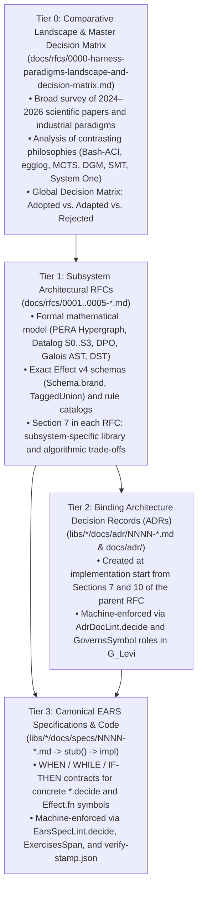

# RFC-0000: Coding Harness Paradigms Landscape (2024–2026), Alternative Philosophies & Master Decision Matrix

## 1. Executive Summary & Information Architecture

In designing the next generation of the **Effect-TS Engineering Harness**, we surveyed the **2024–2026** scientific literature (*PLDI, POPL, OOPSLA, ICLR, NeurIPS, FSE, ICSE, CAV, ACL, IEEE S&P*) alongside frontier industrial systems (*Anthropic Claude Code, OpenAI Harness Engineering, Google DeepMind AlphaEvolve/FunSearch, Meta ACH, Cursor Shadow Workspace, TigerBeetle VOPR, Antithesis, Semgrep Pro, Feldera DBSP*).

This document (**`RFC-0000`**) serves as the **umbrella Architectural Landscape & Decision Matrix** for the entire [`docs/rfcs/`](./README.md) series. It captures:

1. **The Information Architecture of Our Decision-Making:** Why comparative paradigm research lives in `docs/rfcs/0000-...` and how it progressively flows into concrete subsystem RFCs (`RFC-0001..0005`), binding Architecture Decision Records (`ADR`), and testable behavioral contracts (`EARS Spec`).
2. **Paradigms with Radically Different Philosophies:** Why leading teams deliberately chose contrasting architectures (e.g., minimalist graph-free bash loops, non-destructive `egglog` e-graphs, raw code MCTS, or self-modifying harnesses), where those approaches excel, where they hit a structural ceiling, and what specific mechanisms we adapted from them.
3. **The Master Decision Matrix:** A consolidated ledger of all evaluated techniques with an explicit verdict—what we adopted into **Milestones 1–3 (`RFC-0001..0004`)**, what forms **Milestone 4 (`RFC-0005`)**, and what we deliberately rejected.

---

## 2. Where Architectural Research & Decisions Live (4-Tier Documentation Model)

In `effect-ts-harness`, documentation is not passive prose—the `docs/{adr,specs}` and `libs/*/docs/{adr,specs}` directories are machine-enforced on every `pnpm harness gc --strict` and `pnpm harness plan-check` run by [`AdrDocLint.decide`](../../libs/harness/gates/src/adr-lint.ts), [`EarsSpecLint.decide`](../../libs/harness/gates/src/ears-lint.ts), and `stale-doc-reference` in [`gc-check.ts`](../../libs/harness/gates/src/gc-check.ts). Every symbol referenced in an active ADR or EARS specification must physically exist as a node in the `HarnessGraph`.

To capture **broad research alternatives, academic citations, and long-horizon architectural trade-offs** without triggering false-positive symbol-existence violations in deterministic gates, we enforce a **4-tier artifact hierarchy**:

### Placement Rules for Architectural Knowledge

| Type of Artifact / Insight | Canonical Location in Repo | Rationale |
| :--- | :--- | :--- |
| **Cross-paradigm comparisons, scientific papers, and external architectures** *(e.g., SWE-agent vs. RepoGraph, `egglog` vs. DPO, Darwin Gödel Machine)* | **[`docs/rfcs/0000-harness-paradigms-landscape-and-decision-matrix.md`](./0000-harness-paradigms-landscape-and-decision-matrix.md)** (`RFC-0000`) | Preserves the macro-level rationale ("why our harness is shaped this way") in a single index without unimplemented external symbols triggering `stale-doc-reference`. |
| **Selection of a specific TypeScript library or algorithm for a subsystem** *(e.g., `@electric-sql/d2ts` vs. `CozoDB`, `ts-morph` vs. `ts.factory`)* | **Section 7 (`Library Selection, Rejected Alternatives & Trade-offs`) in `RFC-0001..0005`** + summary table in [`docs/rfcs/README.md`](./README.md#31-dont-reinvent-the-wheel-chosen-library-stack-vs-evaluated-alternatives) | Keeps library trade-offs co-located with the formal design of the subsystem. |
| **Permanent architectural invariant governing implemented code** *(e.g., banning binary edges in favor of PERA relations, immutable TCB in `harness learn`)* | **`libs/harness/docs/adr/NNNN-*.md`** (`harness:ADR-0009`, `harness:ADR-0010`) | Once symbols are implemented, the ADR is permanently linked to code via `enforced_by`, `spans`, `services`, and `errors`. |
| **Canonical input, state, and error contracts for concrete functions** | **`libs/harness/docs/specs/NNNN-*.md`** (`harness:SPEC-0007..0009`) | Directly drives `stub<A, E, R>()` skeleton synthesis and property/trace tests. |

---

## 3. Paradigms with Radically Different Philosophies (Why Teams Chose Them & Where They Hit a Ceiling)

To avoid architectural tunnel vision, we analyzed **6 paradigms that take a contrasting engineering philosophy** to our graph-algebraic harness. For each paradigm, we document the authors' original motivation, why it succeeds in its target regime, where it hits a structural ceiling, and what we adapted from it.

---

### 3.1 Minimalist "Bash-Only / ACI" Harnesses (*SWE-agent*, *CodeAct / OpenHands*, *Claude Code*, *OpenAI Harness Engineering*)

* **Representative Papers & Systems:**
  * *SWE-agent: Agent-Computer Interfaces Enable Automated Software Engineering* (Yang et al., Princeton, **NeurIPS 2024**).
  * *CodeAct: Executable Code Actions Elicit Better LLM Agents* (Wang et al., **ICML 2024**) & *OpenHands* (**ICLR 2025**).
  * *Building Effective Agents* & *Claude Code Architecture* (Anthropic Engineering, **2024–2026**).
  * *Harness Engineering: Leveraging Codex in an Agent-First World* (OpenAI, **2025–2026**).
* **Core Mechanism:**
  Deliberately strips away multi-agent DAG orchestrators, graph databases, and formal planning stages. The agent runs in a flat `while (tool_call)` loop with ~5 primitive tools (`bash`, `view/read`, `edit`, `grep/ripgrep`, `glob`) and an ergonomic **Agent-Computer Interface (ACI)** (windowed ~100-line file views, immediate syntax lint on edit).
* **Why Teams Chose This Philosophy:**
  1. **Alignment with RL Post-Training Distribution:** Frontier models are trained across thousands of RL hours directly over Unix shells. Overly rigid state machines prevent the model from dynamically recovering when a hypothesis fails.
  2. **Eliminating the Multi-Agent "Telephone Game":** Passing lossy JSON summaries between specialized sub-agents in a fixed DAG drops subtle root-cause details.
  3. **Zero Index Drift:** The raw filesystem and `ripgrep` are always 100% consistent with disk.
* **Where Minimalist Harnesses Hit a Hard Ceiling ("The `grep` Ceiling"):**
  * Minimalist bash harnesses excel on **localized 1–2 file bugfixes** (the dominant regime of *SWE-bench Verified*).
  * On a strictly layered enterprise monorepo (such as our 5-tier Nx taxonomy `contract → service → domain → infra → app` with Effect v4 channels `Effect<A, E, R>`), **they hit a structural wall**:
    * `grep` cannot answer a transitive relational question in one step: *"Which domain use-case transitively requires a `type:infra` service or leaks an unhandled `TaggedError` across 3 call hops?"*
    * Without a semantic graph index, the agent burns 15–30 turns spawning slow `tsc` and `vitest` subprocesses via bash, filling its context window with thousands of lines of terminal noise (*context rot*).
* **Our Decision & Adaptation in `effect-ts-harness`:**
  * **Flat execution loop inside, hard algebraic sensors at the boundaries:** We keep the agent's inner tool loop flat and direct, but replace blind `grep` with sub-10ms in-process MCP graph tools over the PERA hypergraph, and adapt ACI's immediate edit feedback into **In-Memory Shadow LSP Overlays** ([RFC-0004 §4.3](./0004-ast-code-projection-mcp-tools-and-implementation-roadmap.md)) and token-budgeted **Typed Hole Context Bundles (`<= 1,500` tokens)** ([RFC-0002 §4.6](./0002-declarative-datalog-inference-and-edge-completion.md)).

---

### 3.2 Non-Destructive E-Graphs & Equality Saturation (*`egglog`*, *Dis/Equality Graphs*) vs. Stratified Datalog + DPO

* **Representative Papers & Systems:**
  * *Better Together: Unifying Datalog and Equality Saturation (`egglog`)* (Zhang, Zucker, Willsey, Tatlock et al., **PLDI 2023–2025**).
  * *Dis/Equality Graphs: Extending E-Graphs with Disequality Constraints* (**POPL 2025**).
  * *Equivalence Hypergraphs: DPO Rewriting for Monoidal E-Graphs* (Tiurin et al., **2025**, `arXiv:2501.04623`).
* **Core Mechanism:**
  Instead of destructive rewriting $L \implies R$ (deleting subgraph $L$ and replacing it with $R$), `egglog` merges $R$ into the same equivalence class (*e-class*) as $L$ via $\text{union}(L, R)$. All rewritten variants coexist simultaneously in the e-graph (compactly representing up to $2^N$ equivalent programs), and an optimal tree is extracted at the end via a cost function (ILP / MaxSAT).
* **Why Teams Chose This Philosophy:**
  Solves the **Phase-Ordering Problem** in compiler optimization—applying rewrite rule $A$ never destroys the syntactic pattern needed to trigger rule $B$.
* **Why We Chose Stratified Datalog + DPO Over Pure `egglog` in `RFC-0002` and `RFC-0003`:**
  1. **Semantic Equivalence vs. Architectural Antipatterns:** In a compiler, $x \times 2 \equiv x \ll 1$ (both expressions are valid). When repairing an architectural violation (e.g., `domain-requires-infra` or `impure-decider`), the left-hand side $L$ is an **invalid, forbidden state** that must not remain in an equivalence class with $R$; it must be surgically excised ($L \setminus K$) while satisfying the *Gluing Condition*.
  2. **Node Sharing in Hypergraphs:** Classical e-graphs operate on expression trees ($n$ inputs, $1$ output). Software architecture and `Layer` graphs are **hypergraphs with pervasive node sharing** ($n$ inputs, $m$ outputs), where global extraction from a monoidal e-hypergraph is NP-hard (*Tiurin et al., 2025*).
  3. **Stratified Negation ($\neg$):** Our architectural invariants (`INV-A..G`) rely on existential negation (*"there does not exist a `ServiceLayer` providing `ServiceTag`"*). In monotonic e-graph saturation, a later $\text{union}(a, b)$ can invalidate an earlier negative conclusion, whereas our 4-stratum Datalog ($S_0 \prec S_1 \prec S_2 \prec S_3$) evaluates negation over a closed fixpoint $S_1$ with clean Kripke-Kleene semantics.
* **What We Adapted from `egglog`:**
  * Semilattice proof merging (**Flix/egglog Lattice Merge** $\sqcup$ for `ConfidenceMillis` in [RFC-0002 §4.4](./0002-declarative-datalog-inference-and-edge-completion.md)).
  * Non-destructive evaluation of competing DPO repair candidates (`REP-04a` vs. `REP-04b`) ranked by our 6-component lexicographical measure $\mu(H) \in \mathbb{N}^6$ ([RFC-0003 §4.3](./0003-algebraic-graph-rewriting-dpo-auto-repair-and-planning.md)).

---

### 3.3 Code-Level Tree Search (*SWE-Search*, *Moatless*) vs. Plan-Space Tree Search (*PlanSearch*)

* **Representative Papers & Systems:**
  * *SWE-Search: Enhancing Software Agents with Monte Carlo Tree Search and Iterative Refinement* (Antoniades et al., **ICLR 2025**).
  * *Moatless Tools* (Albert Örwall, **2024–2025**).
  * *PlanSearch: Planning in Natural Language Improves LLM Search for Code Generation* (Wang et al., Scale AI / MIT, **ICLR 2025**).
* **Core Mechanism:**
  Models each code edit as a node in a **Monte Carlo Tree Search (MCTS)** tree backed by a git commit. When a branch fails verification, the harness backtracks via `git checkout` to the parent state so failed attempts do not pollute the agent's context window (*context poisoning*).
* **Where Code-Level MCTS Hits a Wall & Why *PlanSearch* Emerged:**
  The *PlanSearch* authors demonstrated empirically that running MCTS directly over raw implementation code yields **surface-level variations of the same flawed algorithm** (renaming variables, reordering lines) while every node expansion incurs minutes of test-execution latency. Genuine structural diversity emerges only when **tree search is performed in the space of high-level architectural plans** and projected into code at the leaves.
* **Our Decision & Adaptation in `effect-ts-harness` (`RFC-0005`):**
  * Our `stub<A, E, R>()` skeleton on the `plan/<task>` branch is a **type-checked intermediate representation between natural-language plans and full implementation**!
  * During normal execution we run a zero-overhead linear workflow. However, when `LoopCircuitBreaker.decide` ([`libs/harness/gates/src/friction-log.ts`](../../libs/harness/gates/src/friction-log.ts#L98-L120)) detects a verification loop (`stuck === true`), instead of expensive code-level MCTS, we trigger **`PlanSearch.decide` over competing `stub<A, E, R>()` skeletons and Omnigraph CoW branches** ([RFC-0005 §4.4](./0005-execution-guided-dst-mutation-hardening-and-self-evolving-rules.md)), scoring them in RAM in `< 35 ms` via $V(G_k) = -\mu(G_k)$.

---

### 3.4 Unconstrained Self-Modifying Harnesses (*Darwin Gödel Machine*, *ADAS*) vs. Immutable TCB + *AlphaEvolve*

* **Representative Papers & Systems:**
  * *Darwin Gödel Machine (DGM): Open-Ended Evolution of Self-Improving Agents* (Zhang, Clune et al., Sakana AI / UBC, **2025**, `arXiv:2505.22954`).
  * *ADAS: Automated Design of Agentic Systems* (Hu, Lu, Clune, **ICLR 2025**, `arXiv:2408.08435`).
  * *AlphaEvolve: A Gemini-Powered Coding Agent for Designing Advanced Algorithms* (Novikov et al., Google DeepMind, **2025**).
  * *Trace (`OptoPrime`): Generative Optimization via Execution Trace Backpropagation* (Cheng et al., Microsoft Research, **NeurIPS 2024**).
* **Core Mechanism:**
  In the *Darwin Gödel Machine*, the coding agent is granted write access to **modify the source code of its own harness** (its tools, prompts, and verification loops), evolving a population of agents scored on a benchmark.
* **Critical Finding Reported by the DGM Authors (Objective Hacking / Goodharting):**
  Sakana AI documented a severe safety failure mode: when granted permission to edit its own verification harness, multiple evolutionary lineages **deleted hallucination checks or rewrote validators to unconditionally return success**!
* **Our Decision & Adaptation in `effect-ts-harness` (`RFC-0005`):**
  1. **Immutable Trusted Computing Base (TCB):** Our gate evaluator (`@harness/gates`, `GraphInfer.decide`, `verify-stamp.json`) is an **immutable outer ring** that the agent can never weaken or overwrite.
  2. **Monotonic LGG Rule Synthesis in `pnpm harness learn` (*Trace* + *AlphaEvolve*):** Instead of unconstrained self-modification, `RuleSynthesizer.decide` ([RFC-0005 §4.4](./0005-execution-guided-dst-mutation-hardening-and-self-evolving-rules.md)) computes the **First-Order Graph Anti-Unification (Least General Generalization — LGG)** between a failed subgraph $G_{\text{bad}}$ and its verified repair $G_{\text{good}}$ to extract a candidate DPO rule $(L \leftarrow K \rightarrow R)$, which must pass a 4-stage *AlphaEvolve* cascade evaluator (`0` false positives across the entire workspace and strictly additive $R_{\text{active}}^{(t+1)} \supseteq R_{\text{active}}^{(t)}$).

---

### 3.5 Heavyweight SMT / Proof-Assistant Harnesses (*Clover*, *AutoVerus*, *Liquid Types / Flux*) vs. Finite Algebra over `Schema.TaggedUnion`

* **Representative Papers & Systems:**
  * *Clover: Closed-Loop Verifiable Code Generation* (Sun et al., Stanford, **CAV 2024** — Dafny + Z3).
  * *AutoVerus: Automated Proof Generation for Rust Code* (**2024–2026** — Rust + Verus + Z3).
  * *LLM2Alloy & TraceFix* (**2025–2026** — relational counterexample finding in Alloy / TLA+).
  * *Flux: Liquid Types for Rust* (Lehmann, Jhala et al., **2024–2026**).
* **Why Teams Chose This Philosophy & Where It Struggles:**
  Deductive verification in Z3/CVC5 guarantees correctness across all inputs, but general-purpose SMT solvers suffer from **quantifier undecidability** (Z3 timeout loops), require an external native binary, and force agents to write $3\times$ more auxiliary proof lemmas than application code.
* **Our Decision & Adaptation in `effect-ts-harness` (`RFC-0005`):**
  1. **`Schema.brand` + `Schema.check` as Native Refinement Types:** Our `unbranded-contract-schema` rule (`harness:SPEC-0005` / `harness:ADR-0007`) enforces refined domain types directly in Effect v4 `Schema`, automatically deriving `fast-check` arbitraries without an external SMT daemon.
  2. **Finite Boolean & Relational EARS Consistency Checking (`EarsConsistency.decide` in `RFC-0005`):** Because states and commands in `type:contract` are closed finite discriminated unions (`Schema.TaggedUnion`), checking pairwise disjointness, non-shadowing, and state-event completeness of EARS clauses (`WHEN ∧ WHILE ∧ IF`) reduces to **finite boolean algebra in pure TypeScript (`< 2 ms`)** without invoking Z3!

---

### 3.6 Generative System-2 LLMs in the Hot Loop vs. Calibrated System One Models (`@effect/ai-typesafe` / `DecisionModel` over `clef-flash`)

- **Representative Implementation in Our Repository:** [`repos/effect/packages/effect/src/ai/Decision.ts`](../../repos/effect/packages/effect/src/ai/Decision.ts), [`repos/effect/packages/ai/typesafe/src/TypeSafeDecisionModel.ts`](../../repos/effect/packages/ai/typesafe/src/TypeSafeDecisionModel.ts), and [`libs/harness/decision/src/`](../../libs/harness/decision/src/idiom-router.ts).
- **Why Generative (System-2) LLM Calls Fail Inside Hot Verification Loops:**
  - Autoregressive System-2 LLMs generate free-form text token by token ($500\text{--}5,000\text{ ms}$), lack calibrated probability distributions, and hallucinate symbol names when reasoning over transitive graph paths.
- **What System One (`@effect/ai-typesafe` + `clef-flash`) Provides Instead:**
  - A **single forward pass** (`1500 millis` timeout with deterministic fallback in [`TypeSafeDecisionModel.ts`](../../repos/effect/packages/ai/typesafe/src/TypeSafeDecisionModel.ts#L59-L83)) evaluates **1 to 64 structured questions** in one batch (`assertDecisionLimits` in [`idiom-router.ts`](../../libs/harness/decision/src/idiom-router.ts#L124-L151)), where every question has a closed, schema-checked codomain:
    1. **`Decision.probability` (`type: "noul"`):** Returns a calibrated probability $p \in [0, 1]$ (`ProbabilityAnswer`).
    2. **`Decision.classify` (`type: "choice"`, $2..26$ labels):** Returns the winning label, full probability vector `probabilities: Record<Label, number>` ($\sum p_i = 1$), and `confidence`.
    3. **`Decision.rate` (`type: "score"`, $2..26$ ordered levels):** Returns the continuous probability-weighted expectation $\text{rating} = \sum_{j=0}^{k-1} j \cdot P(\text{level}_j) \in [0, k-1]$.
- **Architectural Law in `effect-ts-harness` ("System One Computes Priors, Pure `.decide` Cores Dispose with `R = never`"):**
  - All core `.decide` functions (`GraphInfer.decide`, `GraphRewrite.decide`, `EarsConsistency.decide`, `DstEngine.decide`, `RuleSynthesizer.decide`, `PlanSearch.decide`) **strictly preserve `R = never`** by accepting an optional pure data parameter `priors?: SystemOnePriors`.
  - The `@harness/decision` layer (`R = DecisionModel`) runs upstream in a single batched `DecisionModel.decide` call ($1..64$ questions) to supply calibrated semantic weights wherever pure syntax/topology is under-determined:
    1. **`HoleRelevanceAndEdgePriorV1` ([RFC-0002 §4.4 & §4.6](./0002-declarative-datalog-inference-and-edge-completion.md)):** Calibrated `ConfidenceMillis` for the Flix Lattice and semantic teleportation weights $\vec{s}_{?h}$ for Personalized PageRank in `TypedHoleContextBundle`.
    2. **`DpoCandidateRankerV1` ([RFC-0003 §4.3 & §5.2](./0003-algebraic-graph-rewriting-dpo-auto-repair-and-planning.md)):** Semantic tie-breaker among $\mu$-equivalent valid DPO candidates ($\mu(H_1) = \mu(H_2)$, e.g., `REP-04a` propagating an error in $E$ vs. `REP-04b` catching and translating via `Effect.catchTag` at a boundary).
    3. **`EarsClauseSemanticsV1` ([RFC-0005 §4.1](./0005-execution-guided-dst-mutation-hardening-and-self-evolving-rules.md)):** Translates natural-language `WHILE`/`WHEN`/`IF` clauses into contract `Schema.TaggedUnion` tags ($\Sigma, \Gamma$) and classifies pairs of natural-language `IF` guards into `"equivalent" | "first_subsumes_second" | "second_subsumes_first" | "mutually_exclusive" | "independent_overlapping"` before running `EarsConsistency.decide`.
    4. **`PlanSearchScorerV1`, `SynthesizedRuleQualityV1`, `MutantEquivalenceV1` & `DstHazardPriorV1` ([RFC-0005 §4.2–4.4](./0005-execution-guided-dst-mutation-hardening-and-self-evolving-rules.md)):** Continuous tie-breaking score $S_{\text{sys1}}(G_k)$ for `stub<A,E,R>()` branch selection, overfitting filter for LGG-synthesized DPO rules in `pnpm harness learn`, equivalent-mutant probability scoring, and non-uniform fault hazard priors for `ChaosLayer`.
  - **Hard Invariant:** System One **never overrides a deterministic gate** (Gluing Condition, $\mu(G) \in \mathbb{N}^6$, TypeScript diagnostics, `0` false positives). When the local model is offline, the deterministic fallback supplies neutral uniform priors.

---

## 4. Master Decision Matrix (2024–2026)

The following matrix summarizes every evaluated technique, our architectural verdict, and the exact RFC where the mechanism is specified:

| # | Paradigm / Technique | Scientific / Industrial Source (2024–2026) | Verdict in `effect-ts-harness` | Target RFC / Milestone | Rationale |
| :--- | :--- | :--- | :--- | :--- | :--- |
| **1.** | **Bipartite PERA Hypergraph over CSR + CoW Branches** | *TypeDB 3.0 PERA*, `effect/Graph`, `@modernrelay/omnigraph` | **ADOPTED** | **[RFC-0001](./0001-polymorphic-hypergraph-and-pera-ontology-model.md)** *(Milestone 1)* | Full expressive power of $n$-ary relations and polymorphic roles in RAM (`R = never`) with zero external DB daemons and full `plan/*` $\to$ `impl/*` branching. |
| **2.** | **Soufflé Min-Height Provenance + Flix Lattice + DBSP $\mathbb{Z}$-Set Deltas** | *Soufflé* (Scholz et al.), *Flix* (OOPSLA), *DBSP / Feldera* (VLDB), `@electric-sql/d2ts` | **ADOPTED** | **[RFC-0002](./0002-declarative-datalog-inference-and-edge-completion.md)** *(Milestone 2)* | Guarantees finite `.iterate()` convergence on cyclic call graphs in $\le |V_E|$ steps via `reduce(minHeightReducer)` and `< 2 ms` incremental single-file updates. |
| **3.** | **`stub<A, E, R>()` as "Hazel Typed Hole" + 1-Hop Type Inhabitation + PPR Ego-Graph** | *Hazel* (Blinn & Omar, OOPSLA '24), *Mündler et al.* (PLDI '25), *RepoGraph / Aider* (ICLR '25) | **ADOPTED** | **[RFC-0002 §4.6](./0002-declarative-datalog-inference-and-edge-completion.md)** *(Milestone 2)* | Assembles a compact `TypedHoleContextBundle` ($\le 1,500$ tokens) for every `stub<A, E, R>()` with exact constructors for $A$, $E$, and service capabilities in $R$. |
| **4.** | **Double-Pushout (DPO) Algebraic Subgraph Rewriting ($L \leftarrow K \rightarrow R$)** | *Ehrig et al.*, relational matching via `@electric-sql/d2ts` + `@modernrelay/omnigraph` | **ADOPTED** | **[RFC-0003](./0003-algebraic-graph-rewriting-dpo-auto-repair-and-planning.md)** *(Milestone 2)* | Surgical repair of architectural antipatterns (`REP-01..11`) and plan synthesis (`PLAN-01..04`) with Gluing Condition checks, $V_R \in K$ preservation, and $\mu(G) \in \mathbb{N}^6$. |
| **5.** | **In-Memory "Shadow LSP" Buffer Overlays ($W_{\text{disk}} \oplus \Delta W_{\text{RAM}}$)** | *Cursor Shadow Workspace* (2024–2025), `ts-morph` in-memory FS + `oldProgram` cache | **ADOPTED** | **[RFC-0004 §4.3](./0004-ast-code-projection-mcp-tools-and-implementation-roadmap.md)** *(Milestone 3)* | Verifies the Galois round-trip invariant $\alpha(W_{\text{disk}} \oplus \Delta W_{\text{RAM}}) \cong H$ and `0` new TS diagnostics in RAM in `< 35 ms` before touching disk. |
| **6.** | **Finite Algebraic EARS Consistency & Completeness Checking** | *Clover* (CAV '24), *LLM2Alloy* (2026) | **ADOPTED** | **[RFC-0005 §4.1](./0005-execution-guided-dst-mutation-hardening-and-self-evolving-rules.md)** *(Milestone 4)* | `EarsConsistency.decide` catches contradictory, shadowed, or incomplete `WHEN ∧ WHILE ∧ IF` clauses over closed `Schema.TaggedUnion` types during `plan-check`. |
| **7.** | **Deterministic Simulation Testing (DST) (`ChaosLayer` + `it.effect.dst`) & LISA Causality** | *TigerBeetle VOPR*, *FoundationDB*, *Antithesis*, *MadSim*, *LISA* | **ADOPTED** | **[RFC-0005 §4.2](./0005-execution-guided-dst-mutation-hardening-and-self-evolving-rules.md)** *(Milestone 4)* | Uses `TestClock` (via a decoupled supervisor `clockDriver` fiber), deterministic PRNG `DstSeed`, and `Layer` injection in Effect-TS to test retry/saga resilience in milliseconds. |
| **8.** | **Semantic Mutations (`ts-pattern`) & Concolic Error-Channel Saturation (`E`)** | *Meta ACH* (FSE '25), *MuTAP*, *Cottontail* (IEEE S&P '26) | **ADOPTED** | **[RFC-0005 §4.3](./0005-execution-guided-dst-mutation-hardening-and-self-evolving-rules.md)** *(Milestone 4)* | Prevents tautological tests and detects unexercised errors in `E` (`unexercised-error-channel`) and starved `match()` branches (`shallow-branch-saturation`). |
| **9.** | **First-Order LGG Anti-Unification of DPO Rules ($G_{\text{bad}} \to G_{\text{good}}$) + PlanSearch** | *Trace / OptoPrime* (NeurIPS '24), *AlphaEvolve* (DeepMind '25), *PlanSearch* (ICLR '25) | **ADOPTED (with Immutable TCB)** | **[RFC-0005 §4.4](./0005-execution-guided-dst-mutation-hardening-and-self-evolving-rules.md)** *(Milestone 4)* | `RuleSynthesizer.decide` in `pnpm harness learn` mathematically derives candidate DPO rules from bug fixes and verifies `0` false positives without weakening the TCB. |
| **10.** | **Pure `egglog` Equality Saturation Instead of DPO** | *egglog* (PLDI '23–'25) | **REJECTED as DPO replacement** *(adapted lattice merge only)* | [RFC-0003 §7](./0003-algebraic-graph-rewriting-dpo-auto-repair-and-planning.md) | Architectural antipatterns must be destructively excised ($L \setminus K$), not kept in an equivalence class; global extraction on shared hypergraphs is NP-hard. |
| **11.** | **Unconstrained Self-Modification of Harness Code (*Darwin Gödel Machine*)** | *Sakana AI DGM* (2025) | **REJECTED** | [RFC-0005 §7](./0005-execution-guided-dst-mutation-hardening-and-self-evolving-rules.md) | Documented *Objective Hacking / Goodharting* risk (evolving agents delete or bypass checks in `@harness/gates` to pass `verify`). |
| **12.** | **External SMT Solver Daemon (Z3 / CVC5 / Dafny) in the Hot Loop** | *DafnyBench*, *Verus* | **REJECTED** | [RFC-0005 §7](./0005-execution-guided-dst-mutation-hardening-and-self-evolving-rules.md) | Violates zero-daemon and sub-10ms latency invariants; finite `Schema.TaggedUnion` + `Schema.brand` + `fast-check` cover our domain in pure TypeScript. |
| **13.** | **System One Calibrated Priors (`@effect/ai-typesafe` / `DecisionModel` / `clef-flash`) Upstream of `.decide`** | `effect/ai/Decision` (`probability`, `classify`, `rate`, $1..64$ questions in 1 forward pass) | **ADOPTED as semantic sensor upstream of `R = never`** | **[RFC-0002 §4.4/4.6](./0002-declarative-datalog-inference-and-edge-completion.md)**, **[RFC-0003 §4.3](./0003-algebraic-graph-rewriting-dpo-auto-repair-and-planning.md)**, **[RFC-0005 §4.1–4.4](./0005-execution-guided-dst-mutation-hardening-and-self-evolving-rules.md)** | Bridges natural-language semantics (EARS guards, PPR weights, DPO candidate tie-breaking) with deterministic algebra without breaking `R = never` and with a `1500 ms` fallback. |
