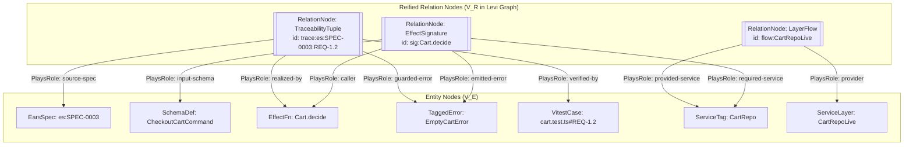

# RFC-0001: Polymorphic Hypergraph & PERA Ontology Model over `effect/Graph` and Omnigraph (Without TypeDB)

## 1. Executive Summary

This document proposes upgrading the graph core in `@harness/graph` from a legacy directed binary graph to a **pure typed polymorphic hypergraph built on the PERA (Polymorphic Entity-Relation-Attribute) model** with a **Clean-Slate / Zero Backward Compatibility** cutover—inspired by the type theory of **TypeDB 3.0**, but implemented **100% in-process in pure Effect-TS v4 (`R = never`)** over `effect/Graph` and synchronized to the local `@modernrelay/omnigraph` store.

The core mechanism of the design is a **pure bipartite incidence representation of the hypergraph (the Levi graph $G\_{\text{Levi}} = (V_E \sqcup V_R, E\_{\text{role}})$)** with zero legacy binary edges ($E_{\text{bin}} = \emptyset$), zero shadow-parity modes, and zero compatibility bridges:

- $V_E$ is the finite set of entity nodes (`EntityNode`: `EffectFn`, `ServiceTag`, `ServiceLayer`, `TaggedError`, `SchemaDef`, `VitestCase`, `PatternDoc`, `AdrDoc`, `EarsSpec`).
- $V_R$ is the finite set of reified $k$-ary relation nodes (`RelationNode`: `EffectSignature`, `LayerFlow`, `TraceabilityTuple`, `HttpEndpointTuple`, `MigrationTuple`).
- $E_{\text{role}}$ consists exclusively of typed role-incidence edges `PlaysRoleEdge` (`_tag: "PlaysRole"`, `relationId`, `entityKey`, `role`, `archimateRelation`).

Simultaneously, we introduce a formal subtyping lattice (`sub`) and role polymorphism (`plays`), completely eliminating synthetic `node Any` placeholders and legacy binary edges from `schema.pg`. This foundation unlocks deductive Datalog inference in [RFC-0002](./0002-declarative-datalog-inference-and-edge-completion.md) and Double-Pushout (DPO) graph rewriting in [RFC-0003](./0003-algebraic-graph-rewriting-dpo-auto-repair-and-planning.md), while preserving sub-millisecond in-memory execution (`effect/Graph` CSR matrices) and native Git-like branching in Omnigraph.

---

## 2. Motivation & Empirical Gap Analysis

The legacy binary graph implementation in `libs/harness/graph` hits three structural limitations when performing multi-hop architectural verification and automated planning:

### 2.1 Absence of Role Polymorphism and Artificial `node Any` Placeholders in Omnigraph

In [`libs/harness/graph/schema.pg`](../../libs/harness/graph/schema.pg) and [`libs/harness/graph/src/omnigraph-sync.ts`](../../libs/harness/graph/src/omnigraph-sync.ts), governance edges such as `GovernsSymbol` (from `AdrDoc`) and `SpecifiesSymbol` (from `EarsSpec`) must target _any_ governed code symbol (`EffectFn`, `ServiceTag`, `ServiceLayer`, `TaggedError`, `SchemaDef`). Because a flat Labeled Property Graph (LPG) requires a single concrete source label and target label per edge declaration without type inheritance, the legacy code fabricates **duplicate shadow nodes `type: "Any"`** (`id: "Any:<targetKey>"`).

- **Consequence:** Every `ingest` pollutes the graph with synthetic shadow nodes, traversing from an `AdrDoc` to a real `EffectFn` requires indirect hops, and adding a new governed concept (`SchemaDef`, `AggregateRoot`) requires manual workarounds.

### 2.2 Context Loss When Flattening $n$-ary Relationships into Binary Edges

Key architectural relationships in Effect-TS + Cloudflare are intrinsically **$n$-ary ($n \ge 3$)** rather than binary:

1. **Contextual Service Wiring (`EffectSignature` + `LayerFlow`):** The fact that `CallerFn` requires a `ServiceTag` port, which is satisfied in production by `LiveLayer` (requiring `SqlClient`) and in tests by `TestLayer`, was previously shattered into 4 disconnected binary edges (`RequiresService`, `ProvidesService`, `LayerRequires`, `ExercisesSpan`).
2. **Event-Sourcing Command Pipeline (`AggregateCommandFlow`):** In `libs/es`, handling a command forms an indivisible tuple: `(CommandSchema, DeciderFn, DomainEventSchema, EvolveFn, AggregateStore, Outbox)`. Binary edges cannot express _which specific `CommandSchema` flows through which `DeciderFn` into which `DomainEventSchema` and `EvolveFn`_.
3. **EARS Requirement Realization Chain (`TraceabilityTuple`):** Every row of an EARS table (`REQ-X.Y`) binds 5 elements: `(EarsSpec, RequirementId, EarsClauseKind, TargetSymbol, GuardedError / VerifyingVitestCase)`. Flattening this into a binary `SpecifiesSymbolEdge(specId, targetKey, targetKind)` discards the specific `REQ-X.Y` identifier and EARS clause kind (`WHEN`, `WHILE`, `IF/THEN`, `WHERE`).

### 2.3 String Regex Heuristics Instead of First-Class Node Subtypes and Roles

In [`libs/harness/graph/src/policy-check.ts`](../../libs/harness/graph/src/policy-check.ts), critical architectural roles were previously inferred via brittle `RegExp` and `endsWith` checks on symbol names:

- `isCloudBinding(node)`: `/^(Cloudflare|Alchemy|Drizzle|Provider|Binding)\b/.test(node.tagId)`
- `isDeciderSpan(spanName)`: `spanName.endsWith(".decide") || spanName === "decide"`
- `isReducerSpan(spanName)`: `spanName.endsWith(".evolve") || spanName.endsWith(".fold")`
- `isAggregateFnNode(node)`: `node.spanName.startsWith("Aggregate.") || ...`

Representing `SchemaDef`, `EffectFnRole` (`decider`, `reducer`, `use-case`, `aggregate-handler`, `outbox-relay`), and `ServiceTagRole` as first-class typed attributes and role edges eliminates string guessing.

---

## 3. Goals, Non-Goals & Hard Invariants

### 3.1 Goals

1. Introduce a formal **PERA (Polymorphic Entity-Relation-Attribute)** metamodel in `@harness/graph` supporting:
   - **concept subtyping (`ConceptLattice.decide`)**,
   - **polymorphic role contracts (`RoleContract` / `plays`)**,
   - **reified $k$-ary hyperedges (`RelationNode`)** represented via a bipartite Levi incidence graph $G_{\text{Levi}} = (V_E \sqcup V_R, E_{\text{role}})$.
2. Extend entity nodes with `SchemaDefNode` and explicit behavioral roles (`EffectFnRole`, `ServiceTagRole`).
3. Eliminate `node Any` shadow nodes and all legacy binary edges in Omnigraph `schema.pg` in favor of `PlaysRoleEdge`.
4. Maintain 100% compatibility with `effect/Graph` (`Graph.DirectedGraph`) CSR algorithms and `@modernrelay/omnigraph` CoW branching.

### 3.2 Non-Goals

1. **No external TypeDB 3.0 server daemon:** We do not run any external database process outside Node.js and the local `omnigraph` store.
2. **No modifications to `repos/effect`:** We build the hypergraph as a mathematically isomorphic layer atop `Graph.DirectedGraph`.
3. **No breaking changes to ADR and EARS Markdown authoring formats:** We enrich what the extractor projects from existing Markdown tables into $G_{\text{Levi}}$.

### 3.3 Hard Invariants

- **Pure Core (`R = never`):** Constructing the hypergraph, checking the subtyping lattice, validating role contracts, and converting between $\mathcal{H}$ and $G_{\text{Levi}}$ must be pure functions with `R = never`.
- **Bipartite Incidence Invariant:** Every `PlaysRoleEdge` in $E_{\text{role}}$ strictly connects a `RelationNode` ($r \in V_R$) to an `EntityNode` ($u \in V_E$). Direct edges $V_E \to V_E$ or $V_R \to V_R$ are forbidden.
- **Branded Domain Types (`harness:SPEC-0005` / `harness:ADR-0007`):** All node keys, relation IDs, and role names use `Schema.brand`.
- **Exhaustive Pattern Matching (`harness:ADR-0002`):** Dispatching over node tags, relation kinds, and roles uses `match(...).with(...).exhaustive()` from `ts-pattern`.

---

## 4. Formal Mathematical & Type-Theoretic Model

### 4.1 The PERA Metamodel as an Ordered 7-Tuple

Let our architectural ontology space be defined by the tuple:

$$\mathcal{M}_{\text{PERA}} = \left(\mathcal{T}_E,\; \mathcal{T}_R,\; \mathcal{K}_{\text{abs}},\; \preceq,\; \mathcal{R}_{\text{role}},\; \text{relates},\; \text{plays}\right)$$

where:

1. **$\mathcal{T}\_E$ (Concrete Entity Types):** Finite set of disjoint entity node tags:
   $$\mathcal{T}_E = \{\text{EffectFn},\; \text{ServiceTag},\; \text{ServiceLayer},\; \text{TaggedError},\; \text{SchemaDef},\; \text{VitestCase},\; \text{PatternDoc},\; \text{AdrDoc},\; \text{EarsSpec}\}$$
2. **$\mathcal{T}\_R$ (Reified $k$-ary Relation Types):** Finite set of relation node tags:
   $$\mathcal{T}_R = \{\text{EffectSignature},\; \text{LayerFlow},\; \text{TraceabilityTuple},\; \text{HttpEndpointTuple},\; \text{MigrationTuple}\}$$
3. **$\mathcal{K}\_{\text{abs}}$ (Abstract Concept Supertypes / Interfaces):**
   $$\mathcal{K}_{\text{abs}} = \{\text{Concept},\; \text{CodeSymbol},\; \text{TypeContract},\; \text{RuntimeCapability},\; \text{GovernanceArtifact},\; \text{VerificationArtifact}\}$$
4. **$\preceq$ (Subtyping Lattice):** A reflexive, antisymmetric, transitive partial order over $(\mathcal{T}_E \cup \mathcal{T}_R \cup \mathcal{K}_{\text{abs}})$:
   - $\text{EffectFn}, \text{ServiceTag}, \text{ServiceLayer}, \text{TaggedError}, \text{SchemaDef} \preceq \text{CodeSymbol} \preceq \text{Concept}$
   - $\text{SchemaDef}, \text{TaggedError} \preceq \text{TypeContract} \preceq \text{CodeSymbol}$
   - $\text{ServiceTag}, \text{ServiceLayer} \preceq \text{RuntimeCapability} \preceq \text{CodeSymbol}$
   - $\text{AdrDoc}, \text{EarsSpec}, \text{PatternDoc} \preceq \text{GovernanceArtifact} \preceq \text{Concept}$
   - $\text{VitestCase} \preceq \text{VerificationArtifact} \preceq \text{Concept}$
5. **$\mathcal{R}\_{\text{role}}$ (Typed Role Names):** e.g., `caller`, `callee`, `required-service`, `provided-service`, `emitted-error`, `input-schema`, `output-schema`, `source-spec`, `source-adr`, `governed-target`, `specified-target`, `realized-by`, `guarded-error`, `verified-by`, `endpoint-handler`, `migrated-table`.
6. **$\text{relates}: \mathcal{T}_R \to \mathcal{P}(\mathcal{R}_{\text{role}} \times \text{Card})$:** Maps each relation type to its permitted roles and cardinalities ($\text{Card} \in \{1, 0..1, 1..\infty, 0..\infty\}$).
7. **$\text{plays} \subseteq (\mathcal{T}_E \cup \mathcal{K}_{\text{abs}}) \times \mathcal{R}\_{\text{role}}$:** Defines which entity concepts may play a given role, satisfying **covariant role inheritance along the subtyping lattice**:
   $$\forall \tau_1, \tau_2 \in \mathcal{T}_E \cup \mathcal{K}_{\text{abs}},\; \forall \rho \in \mathcal{R}_{\text{role}}:\quad (\tau_1 \preceq \tau_2 \;\land\; \text{plays}(\tau_2, \rho)) \implies \text{plays}(\tau_1, \rho)$$

> [!IMPORTANT]
> By role inheritance $\tau_1 \preceq \text{CodeSymbol} \land \text{plays}(\text{CodeSymbol}, \texttt{governed-target})$, **every** current and future subtype of `CodeSymbol` can automatically participate as the target of an `AdrDoc` or `EarsSpec` in a `TraceabilityTuple` without creating fake `Any` nodes!

---

### 4.2 Pure Bipartite Levi Incidence Graph $G_{\text{Levi}} = (V_E \sqcup V_R, E_{\text{role}})$

Under our **Clean-Slate / Zero Backward Compatibility** architecture, legacy binary edges ($E_{\text{bin}}$), shadow parity, and dual-write adapters are completely removed. The directed hypergraph is modeled **strictly as a bipartite incidence graph (Levi graph)**:

$$G_{\text{Levi}} = \left(V_E \;\sqcup\; V_R,\;\; E_{\text{role}}\right)$$

1. **Vertices of $G\_{\text{Levi}}$ are the disjoint union of entities and reified relations:**
   - **$V_E$ (`EntityNode`):** `EffectFn`, `ServiceTag`, `ServiceLayer`, `TaggedError`, `SchemaDef`, `VitestCase`, `PatternDoc`, `AdrDoc`, `EarsSpec`.
   - **$V_R$ (`RelationNode`):** `EffectSignature`, `LayerFlow`, `TraceabilityTuple`, `HttpEndpointTuple`, `MigrationTuple`. Each $k$-ary tuple becomes a distinct relation vertex $r \in V_R$ with a deterministic primary key `relationId`.
2. **Edges of $G\_{\text{Levi}}$ consist exclusively of role-incidence edges:**
   - **$E\_{\text{role}}$:** Consists solely of `PlaysRoleEdge` (`_tag: "PlaysRole"`, `relationId`, `entityKey`, `role`, `archimateRelation`) connecting a relation node $r \in V_R$ to an entity node $u \in V_E$ playing role $\rho \in \mathcal{R}_{\text{role}}$.
   - **Zero Binary Edges ($E\_{\text{bin}} = \emptyset$):** There are no direct entity-to-entity edges (`EffectFn -> ServiceTag`). All structural relationships are reified via $V_R$, and transitive closures (`EffectiveRequires`, `EffectiveFailsWith`, `LayerDependsOn`) are derived declaratively via Datalog in [RFC-0002](./0002-declarative-datalog-inference-and-edge-completion.md).



#### Mathematical Guarantees of the Levi Transformation $\Lambda$:

- **Bijectivity & Losslessness ($\Lambda^{-1} \circ \Lambda = \text{id}$):** The original hypergraph $\mathcal{H}$ can be reconstructed uniquely from $G_{\text{Levi}}$ in $O(|V_R| + |E_{\text{role}}|)$ time with zero semantic loss.
- **Canonical Deterministic Relation Key (`relationId`):** Every relation node $r \in V_R$ has a deterministic primary key $\text{key}(r) = \tau_R(r) \mathbin{\Vert} \text{sort}(\{(\rho, \text{key}(u)) \mid (r \xrightarrow{\rho} u) \in E_{\text{role}}\})$. Consequently, `Graph.difference(implGraph, planGraph)` in `effect/Graph` and branch diffs in Omnigraph compare structural changes deterministically across branches!

---

## 5. Detailed Technical Design in Effect-TS v4 Idioms

All schemas comply with branded type rules (`Schema.brand` per `harness:ADR-0007`) and closed discriminated unions (`Schema.TaggedStruct` / `Schema.TaggedUnion` per `harness:ADR-0002`).

### 5.1 Branded Identifiers & Concept Taxonomy (`libs/harness/graph/src/model.ts` & `concept-lattice.ts`)

```typescript
import { Schema } from "effect"
import { match } from "ts-pattern"

// 1. Branded scalar identifiers (Branded Domain Types)
export const NodeKey = Schema.NonEmptyString.pipe(Schema.brand("NodeKey"))
export type NodeKey = typeof NodeKey.Type

export const RelationId = Schema.NonEmptyString.pipe(Schema.brand("RelationId"))
export type RelationId = typeof RelationId.Type

export const RoleName = Schema.Literals([
  "caller",
  "callee",
  "required-service",
  "provided-service",
  "provider",
  "emitted-error",
  "input-schema",
  "output-schema",
  "governed-target",
  "specified-target",
  "source-spec",
  "source-adr",
  "realized-by",
  "guarded-error",
  "verified-by",
  "endpoint-handler",
  "migrated-table",
]).pipe(Schema.brand("RoleName"))
export type RoleName = typeof RoleName.Type

export const RequirementId = Schema.NonEmptyString.pipe(
  Schema.check(Schema.isPattern(/^REQ-\d+\.\d+$/)),
  Schema.brand("RequirementId"),
)
export type RequirementId = typeof RequirementId.Type

export const EarsClauseKind = Schema.Literals([
  "ubiquitous",
  "event-driven",
  "state-driven",
  "unwanted-behavior",
  "optional-feature",
  "complex",
])
export type EarsClauseKind = typeof EarsClauseKind.Type

export const EffectFnRole = Schema.Literals([
  "use-case",
  "decider",
  "reducer",
  "aggregate-handler",
  "outbox-relay",
  "projector-handler",
  "http-endpoint",
  "upcaster",
  "helper",
])
export type EffectFnRole = typeof EffectFnRole.Type

export const ServiceTagRole = Schema.Literals([
  "domain-port",
  "repository-port",
  "cloud-binding",
  "event-bus",
  "outbox-store",
  "aggregate-store",
])
export type ServiceTagRole = typeof ServiceTagRole.Type
```

### 5.2 Extended Entity Nodes (`EntityNode`) and Reified Hyperedges (`RelationNode`)

```typescript
export const SchemaDefNodeSchema = Schema.TaggedStruct("SchemaDef", {
  schemaName: NodeKey,
  packageTag: Schema.Literals(["contract", "domain", "service", "infra", "app"]),
  schemaKind: Schema.Literals(["command", "domain-event", "read-model", "value-object", "dto"]),
  versionTag: Schema.OptionFromNullOr(Schema.Int),
  isBranded: Schema.Boolean,
  file: Schema.NonEmptyString,
  line: Schema.Int,
})
export type SchemaDefNode = typeof SchemaDefNodeSchema.Type

// Reified k-ary Relation Nodes (V_R in the Levi incidence graph)
export const EffectSignatureRelationSchema = Schema.TaggedStruct("EffectSignature", {
  relationId: RelationId,
  signatureQualname: NodeKey,
  isStub: Schema.Boolean,
  file: Schema.NonEmptyString,
  line: Schema.Int,
})
export type EffectSignatureRelation = typeof EffectSignatureRelationSchema.Type

export const LayerFlowRelationSchema = Schema.TaggedStruct("LayerFlow", {
  relationId: RelationId,
  layerQualname: NodeKey,
  layerRole: Schema.Literals(["live", "test", "mock"]),
  file: Schema.NonEmptyString,
})
export type LayerFlowRelation = typeof LayerFlowRelationSchema.Type

export const TraceabilityTupleRelationSchema = Schema.TaggedStruct("TraceabilityTuple", {
  relationId: RelationId,
  specId: NodeKey,
  requirementId: RequirementId,
  clauseKind: EarsClauseKind,
})
export type TraceabilityTupleRelation = typeof TraceabilityTupleRelationSchema.Type

export const HttpEndpointTupleRelationSchema = Schema.TaggedStruct("HttpEndpointTuple", {
  relationId: RelationId,
  endpointQualname: NodeKey,
  method: Schema.Literals(["GET", "POST", "PUT", "DELETE", "PATCH"]),
  routePattern: Schema.NonEmptyString,
})
export type HttpEndpointTupleRelation = typeof HttpEndpointTupleRelationSchema.Type

export const MigrationTupleRelationSchema = Schema.TaggedStruct("MigrationTuple", {
  relationId: RelationId,
  migrationKey: Schema.NonEmptyString,
  migrationKind: Schema.Literals(["sqlite-migrator", "d1-drizzle"]),
  targetTable: NodeKey,
})
export type MigrationTupleRelation = typeof MigrationTupleRelationSchema.Type

export const RelationNodeSchema = Schema.Union([
  EffectSignatureRelationSchema,
  LayerFlowRelationSchema,
  TraceabilityTupleRelationSchema,
  HttpEndpointTupleRelationSchema,
  MigrationTupleRelationSchema,
])
export type RelationNode = typeof RelationNodeSchema.Type

export type EntityNodeTag =
  | "EffectFn"
  | "ServiceTag"
  | "ServiceLayer"
  | "TaggedError"
  | "SchemaDef"
  | "VitestCase"
  | "PatternDoc"
  | "AdrDoc"
  | "EarsSpec"

export type RelationNodeTag =
  | "EffectSignature"
  | "LayerFlow"
  | "TraceabilityTuple"
  | "HttpEndpointTuple"
  | "MigrationTuple"
```

### 5.3 Incidence Role Edges (`PlaysRoleEdge`) and Subtyping Lattice (`ConceptLattice.decide`)

```typescript
export const ArchimateRelationTag = Schema.Literals([
  "AccessRelation",
  "AggregationRelation",
  "AssignmentRelation",
  "AssociationRelation",
  "CompositionRelation",
  "FlowRelation",
  "InfluenceRelation",
  "RealizationRelation",
  "ServingRelation",
  "SpecializationRelation",
  "TriggeringRelation",
])
export type ArchimateRelationTag = typeof ArchimateRelationTag.Type

export const PlaysRoleEdgeSchema = Schema.TaggedStruct("PlaysRole", {
  relationId: RelationId,
  entityKey: NodeKey,
  role: RoleName,
  archimateRelation: Schema.OptionFromNullOr(ArchimateRelationTag),
})
export type PlaysRoleEdge = typeof PlaysRoleEdgeSchema.Type

export type ConceptSupertype =
  | "Concept"
  | "CodeSymbol"
  | "TypeContract"
  | "RuntimeCapability"
  | "GovernanceArtifact"
  | "VerificationArtifact"

/** Pure subtyping check (nodeTag <= supertype) using exhaustive ts-pattern matching (R = never). */
export const isConceptSubtypeOf = (nodeTag: EntityNodeTag, supertype: ConceptSupertype): boolean =>
  match(supertype)
    .with("Concept", () => true)
    .with("CodeSymbol", () =>
      match(nodeTag)
        .with("EffectFn", "ServiceTag", "ServiceLayer", "TaggedError", "SchemaDef", () => true)
        .with("VitestCase", "PatternDoc", "AdrDoc", "EarsSpec", () => false)
        .exhaustive(),
    )
    .with("TypeContract", () =>
      match(nodeTag)
        .with("SchemaDef", "TaggedError", () => true)
        .with(
          "EffectFn",
          "ServiceTag",
          "ServiceLayer",
          "VitestCase",
          "PatternDoc",
          "AdrDoc",
          "EarsSpec",
          () => false,
        )
        .exhaustive(),
    )
    .with("RuntimeCapability", () =>
      match(nodeTag)
        .with("ServiceTag", "ServiceLayer", () => true)
        .with(
          "EffectFn",
          "TaggedError",
          "SchemaDef",
          "VitestCase",
          "PatternDoc",
          "AdrDoc",
          "EarsSpec",
          () => false,
        )
        .exhaustive(),
    )
    .with("GovernanceArtifact", () =>
      match(nodeTag)
        .with("AdrDoc", "EarsSpec", "PatternDoc", () => true)
        .with(
          "EffectFn",
          "ServiceTag",
          "ServiceLayer",
          "TaggedError",
          "SchemaDef",
          "VitestCase",
          () => false,
        )
        .exhaustive(),
    )
    .with("VerificationArtifact", () =>
      match(nodeTag)
        .with("VitestCase", () => true)
        .with(
          "EffectFn",
          "ServiceTag",
          "ServiceLayer",
          "TaggedError",
          "SchemaDef",
          "PatternDoc",
          "AdrDoc",
          "EarsSpec",
          () => false,
        )
        .exhaustive(),
    )
    .exhaustive()
```

### 5.4 Mapping to Omnigraph `schema.pg` Without `node Any` or Binary Edges

In `libs/harness/graph/schema.pg`, the untyped `node Any` placeholder and binary edges are absent. Because Omnigraph PG-Schema requires concrete endpoint vertex labels on edge types when `node Any` is absent, `schema.pg` declares concrete labels for `EntityNode` and `RelationNode` together with role-specific `Plays*Role` incidence edges (`PlaysCallerRole`, `PlaysCalleeRole`, `PlaysRequiresServiceRole`, `PlaysFailsWithRole`, `PlaysInputSchemaRole`, `PlaysOutputSchemaRole`, `PlaysSpecifiedTargetRole`, etc.) mapped deterministically from `PlaysRoleEdge` via `mapPlaysRoleToOmnigraphEdgeName`:

```graphql
# ==============================================================================
# Omnigraph PG-Schema (schema.pg) — PERA Bipartite Levi Incidence Model
# ==============================================================================

# --- 1. EntityNode Labels (V_E) ---

node EffectFn {
  qualname: String @key
  packageTag: enum(contract, domain, service, infra, app) @index
  fnRole: enum(use_case, decider, reducer, aggregate_handler, outbox_relay, projector_handler, http_endpoint, upcaster, helper) @index
  isStub: Bool @index
  file: String @index
  line: I32
}

node ServiceTag {
  tagId: String @key
  packageTag: enum(contract, domain, service, infra, app) @index
  serviceRole: enum(domain_port, repository_port, cloud_binding, event_bus, outbox_store, aggregate_store) @index
  file: String @index
}

node ServiceLayer {
  layerQualname: String @key
  packageTag: enum(contract, domain, service, infra, app) @index
  layerRole: enum(live, test, mock) @index
  file: String @index
}

node TaggedError {
  errorTag: String @key
  packageTag: enum(contract, domain, service, infra, app) @index
  file: String @index
}

node SchemaDef {
  schemaName: String @key
  packageTag: enum(contract, domain, service, infra, app) @index
  schemaKind: enum(command, domain_event, read_model, value_object, dto) @index
  versionTag: I32?
  isBranded: Bool @index
  file: String @index
}

node VitestCase {
  testId: String @key
  file: String @index
  isE2e: Bool @index
}

node PatternDoc {
  docId: String @key
  file: String @index
}

node AdrDoc {
  adrId: String @key
  status: enum(proposed, accepted, rejected, superseded) @index
  file: String @index
}

node EarsSpec {
  specId: String @key
  status: enum(proposed, draft, approved, implemented) @index
  file: String @index
}

# --- 2. Reified k-ary RelationNode Labels (V_R) ---

node EffectSignature {
  relationId: String @key
  signatureQualname: String @index
  isStub: Bool @index
  file: String @index
}

node LayerFlow {
  relationId: String @key
  layerQualname: String @index
  layerRole: enum(live, test, mock) @index
  file: String @index
}

node TraceabilityTuple {
  relationId: String @key
  specId: String @index
  requirementId: String @index
  clauseKind: enum(ubiquitous, event_driven, state_driven, unwanted_behavior, optional_feature, complex) @index
}

node HttpEndpointTuple {
  relationId: String @key
  endpointQualname: String @index
  method: enum(GET, POST, PUT, DELETE, PATCH) @index
  routePattern: String @index
}

node MigrationTuple {
  relationId: String @key
  migrationKey: String @index
  migrationKind: enum(sqlite_migrator, d1_drizzle) @index
  targetTable: String @index
}

# --- 3. Role-Specific Incidence Edges (E_role) ---
# Concrete endpoint signatures without 'node Any':

edge PlaysCallerRole (EffectSignature -> EffectFn) {
  role: String @index
  archimateRelation: String? @index
}
# ... (28 concrete Plays*Role edge definitions in libs/harness/graph/schema.pg)
```

---

## 6. Relation Node Catalog & End-to-End Walkthroughs

### 6.1 Walkthrough 1: `EffectSignature` and `LayerFlow` for `Cart.decide` in `libs/es`

Consider a domain function `Cart.decide` in an Event Sourcing domain. During AST extraction (`type-extractor.ts`), the system constructs a pure bipartite representation:

1. **Reified relation node `EffectSignature` ($V_R$):**
   - **`relationId`**: `"sig:Cart.decide"`
   - **Role players (`PlaysRole` $\in E\_{\text{role}}$):**
     - `caller` $\rightarrow$ `EffectFn("Cart.decide")`
     - `input-schema` $\rightarrow$ `SchemaDef("CheckoutCartCommand")`
     - `emitted-error` $\rightarrow$ `TaggedError("EmptyCartError")`
     - `required-service` $\rightarrow$ `ServiceTag("CartRepo")`

2. **Reified relation node `LayerFlow` ($V_R$):**
   - **`relationId`**: `"flow:CartRepoLive"`
   - **Role players (`PlaysRole` $\in E\_{\text{role}}$):**
     - `provider` $\rightarrow$ `ServiceLayer("CartRepoLive")`
     - `provided-service` $\rightarrow$ `ServiceTag("CartRepo")`

There is no direct binary edge `Cart.decide -> CartRepo` or `CartRepoLive -> CartRepo`. The transitive relationship between caller and service provider is derived purely declaratively via Stratum $S_1$ of Datalog (`INF-01` and `INF-03` in [RFC-0002](./0002-declarative-datalog-inference-and-edge-completion.md)).

### 6.2 Walkthrough 2: `TraceabilityTuple` for EARS Requirement `REQ-2.1`

Given requirement `REQ-2.1` in `es:SPEC-0004`:

> `| REQ-2.1 | Unwanted behaviour | **If** a persisted v1 event payload fails upcast decoding, **then** the EventUpcaster.upcast function **shall** fail with EventUpcastDecodeError. | EventUpcaster.upcast | UnitTest |`

The extractor creates a reified `TraceabilityTuple` relation node:

- `relationId`: `"trace:es:SPEC-0004:REQ-2.1"`
- `clauseKind`: `"unwanted-behavior"`
- **Role players (`PlaysRole` $\in E\_{\text{role}}$):**
  - `source-spec` $\rightarrow$ `EarsSpec("es:SPEC-0004")`
  - `realized-by` $\rightarrow$ `EffectFn("EventUpcaster.upcast")`
  - `guarded-error` $\rightarrow$ `TaggedError("EventUpcastDecodeError")`
  - `verified-by` $\rightarrow$ `VitestCase("libs/es/core/test/evolution.test.ts::REQ-2.1 ...")`

This relation node directly feeds **automated edge completion (`COMP-01..06`)** in [RFC-0002](./0002-declarative-datalog-inference-and-edge-completion.md) and **skeleton synthesis via DPO rules `PLAN-01..04`** in [RFC-0003](./0003-algebraic-graph-rewriting-dpo-auto-repair-and-planning.md).

---

## 7. Library Selection, Rejected Alternatives & Trade-offs

To avoid writing low-level graph data structures and algorithms from scratch in `@harness/graph`, we evaluated existing solutions in the TypeScript ecosystem:

| Evaluated Approach                                                                             | Architecture                                                                                                                                                                                             | Advantages                                                                                                                                                                                                                                                                                                                                                                                                                                                                                                                                                                                                                                                       | Disadvantages & Verdict                                                                                                                                                                                                                                                                                                                                                                                                          |
| :--------------------------------------------------------------------------------------------- | :------------------------------------------------------------------------------------------------------------------------------------------------------------------------------------------------------- | :--------------------------------------------------------------------------------------------------------------------------------------------------------------------------------------------------------------------------------------------------------------------------------------------------------------------------------------------------------------------------------------------------------------------------------------------------------------------------------------------------------------------------------------------------------------------------------------------------------------------------------------------------------------- | :------------------------------------------------------------------------------------------------------------------------------------------------------------------------------------------------------------------------------------------------------------------------------------------------------------------------------------------------------------------------------------------------------------------------------- |
| **1. `effect/Graph` (`effect@4.0.0`) + `@modernrelay/omnigraph` (`0.14.0`) — CHOSEN SOLUTION** | Bipartite Levi incidence graph $G_{\text{Levi}} = (V_E \sqcup V_R, E_{\text{role}})$ represented directly over `effect/Graph` (in-memory) and mirrored to `@modernrelay/omnigraph` (Lance CoW branches). | • **Already installed in the repository** (0 new dependencies for `RFC-0001`).<br/>• [`effect/Graph`](../../repos/effect/packages/effect/src/Graph.ts) (8,700 lines in Effect v4) uses a cache-friendly **CSR (_Compressed Sparse Row_) matrix over `Uint32Array`** ([`graphCsr.ts`](../../repos/effect/packages/effect/src/internal/graphCsr.ts)) and provides ready-made algorithms: `stronglyConnectedComponents` (Tarjan), `isAcyclic`, `toposort`, `dijkstra`, `bellmanFord`, `floydWarshall`, `bfs`, `dfs`, `dfsPostOrder`, `externals`, `filterMap`, and `toMermaid`.<br/>• Native integration with `Equal`, `Hash`, `Option`, and `Effect<A, E, never>`. | Requires reifying $k$-ary relations as bipartite incidence vertices `RelationNode` ($V_E \sqcup V_R$), which mathematically preserves 100% of the hypergraph information (bijection $\mathcal{H} \leftrightarrow G_{\text{Levi}}$).                                                                                                                                                                                              |
| **2. `graphology` (`graphology-operators`, `graphology-traversal`)**                           | General-purpose TypeScript/JavaScript library for directed attributed multigraphs.                                                                                                                       | • Ecosystem of packages for community detection (Louvain) and subgraph operators (`subgraph`, `union`).                                                                                                                                                                                                                                                                                                                                                                                                                                                                                                                                                          | **Rejected as primary store:** Uses a mutable OOP model with exceptions and untyped/`any` attributes, lacks Effect `Equal`/`Data` integration, and would duplicate 8,700 lines of CSR algorithms already built into `effect/Graph`.                                                                                                                                                                                              |
| **3. External TypeDB 3.0 Server (`@typedb/driver`)**                                           | Native polymorphic PERA database running as a standalone Rust daemon (gRPC/HTTP).                                                                                                                        | • Native PERA schema and nested role polymorphism inside the DB engine.                                                                                                                                                                                                                                                                                                                                                                                                                                                                                                                                                                                          | **Rejected:**<br/>1. **Loss of Git-like branching (`plan/<task>` $\rightarrow$ `impl/<task>` $\rightarrow$ `main`):** TypeDB 3.0 lacks Copy-on-Write branches and branch diffing required by `harness plan-check` and `harness done` in Omnigraph.<br/>2. **Violates `R = never` and Zero-Daemon invariants:** Requires an external process and async network I/O, breaking pure sub-millisecond unit tests in `@harness/gates`. |
| **4. Custom Hypergraph Class and Traversal Algorithms from Scratch**                           | Hand-rolled adjacency maps and custom Tarjan/BFS/toposort over $n$-ary hyperedges.                                                                                                                       | • Direct representation of hyperedges as $k$-tuples without reified vertices.                                                                                                                                                                                                                                                                                                                                                                                                                                                                                                                                                                                    | **Rejected:** Unnecessary wheel-reinvention and high maintenance burden for cycle/traversal algorithms already solved and tested in `effect/Graph`.                                                                                                                                                                                                                                                                              |

---

## 8. Ecosystem Impact & Omnigraph PG-Schema Architecture

- **Pure Bipartite Levi Hypergraph:** The workspace architecture graph is modeled strictly as a bipartite Levi incidence hypergraph:
  $$G_{\text{Levi}} = (V_E \sqcup V_R, E_{\text{role}})$$
- **Omnigraph PG-Schema (`schema.pg`):** `schema.pg` contains concrete labels for `EntityNode` and `RelationNode` connected by role-specific `Plays*Role` edges without `node Any`.
- **Time and Space Complexity:** For a monorepo with $|V_E| \approx 500$ entity nodes and $|V_R| \approx 200$ relation nodes, constructing and traversing $G_{\text{Levi}}$ in `effect/Graph` (CSR matrix) takes $O(|V_E| + |V_R| + |E_{\text{role}}|) < 2\text{ ms}$ and $< 1\text{ MB}$ of RAM.
- **Native Hypergraph Tooling:** Existing queries and MCP tools (`harness_callers`, `harness_callees`, `harness_tests_reaching`, `gq-queries.ts`, `type-extractor.ts`, `graph-engine.ts`, `policy-check.ts`) query $G_{\text{Levi}}$ directly via stratified Datalog (`GraphInfer.decide`).

---

## 9. Open Questions & Future Work

1. **Nested Relations ($V_R \to V_R$):** The PERA model in TypeDB 3.0 allows a relation itself to play a role in another relation. While $G_{\text{Levi}}$ supports this naturally (since $V_R$ are vertices in `effect/Graph`), in Milestone 1/2 we enforce strict bipartite edges $V_R \to V_E$ (`PlaysRoleEdge`).
2. **Optional TypeQL 3.0 Exporter (`.tql`):** For external visualization in TypeDB Studio, we can add a one-way serializer `toTypeQlDump(harnessGraph): string`.

---

## 10. Rollout & Decomposition Plan

This RFC forms the foundation of **Milestones 1 & 2** under our Clean-Slate rollout:

1. **`libs/harness/docs/adr/0009-bipartite-pera-hypergraph-and-datalog-algebra.md` (`harness:ADR-0009`)** — binding architectural decision establishing the pure bipartite PERA representation $G_{\text{Levi}} = (V_E \sqcup V_R, E_{\text{role}})$ without a TypeDB server and without legacy binary edges ($E_{\text{bin}}$).
2. **`libs/harness/docs/specs/2026-11-XX-pera-hypergraph-and-datalog-inference.md` (`harness:SPEC-0007`)** — EARS requirements `REQ-1.1` through `REQ-1.5` for `ConceptLattice.decide`, `EntityNode`, `RelationNode`, and `PlaysRoleEdge`.
