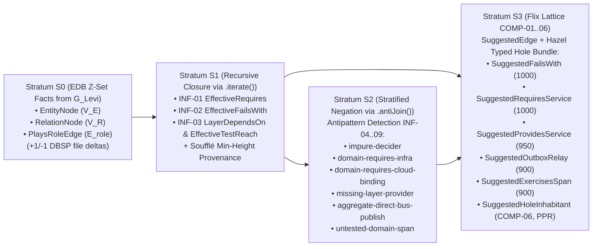
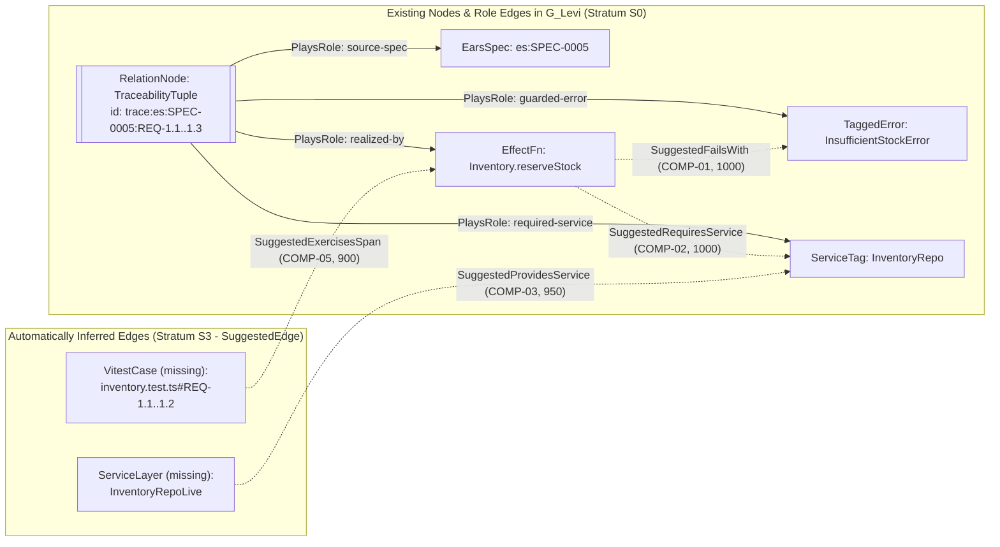

# RFC-0002: Declarative Relation Inference (`GraphInfer.decide`), Stratified Datalog & Automated Edge Completion (`SuggestedEdge`)

## 1. Executive Summary

This document specifies **`GraphInfer.decide`**—a pure, deterministic, in-memory **Stratified Datalog and Differential Dataflow Inference Engine (`R = never`)** operating over the polymorphic PERA hypergraph from [RFC-0001](./0001-polymorphic-hypergraph-and-pera-ontology-model.md). The design captures the core expressive power of **TypeDB 3.0 TypeQL Functions (`define fun ...`)**, **Soufflé Provenance**, **Flix Lattice Datalog**, and **DBSP**—strictly separating stored base facts (Extensional Database, EDB) from recursively derived relations (Intensional Database, IDB) with recursion, stratified negation (`antiJoin`), and semilattice aggregation—implemented natively in TypeScript/Effect-TS over `@electric-sql/d2ts` with zero external database daemons.

`GraphInfer.decide` fulfills three foundational roles in `effect-ts-harness`:

1. **Declarative Architectural Antipattern Detection:** Replaces hand-written imperative `for` loops and ad-hoc BFS traversals in [`libs/harness/graph/src/policy-check.ts`](../../libs/harness/graph/src/policy-check.ts) and [`libs/harness/graph/src/archimate-ontology.ts`](../../libs/harness/graph/src/archimate-ontology.ts) with composable rules that automatically attach a minimal-height **derivation proof tree (`DerivationProof`)** to every violation.
2. **Automated Edge Completion (`SuggestedEdge`) as Active Implementation Guidance:** Given an incomplete graph (e.g., after authoring an EARS specification or partial `stub<A, E, R>()` skeleton), it forward-chains missing relations implied by architectural rules, ADRs, and EARS clauses (`COMP-01..06`), merged via a Flix-style upper semilattice (`ConfidenceMillis`) and optionally calibrated by System One priors (`HoleRelevanceAndEdgePriorV1`).
3. **Hazel-Style Bidirectional Typed Hole Context Bundles (`TypedHoleContextBundle`):** Treats every `stub<A, E, R>()` node (`isStub: true`) as a formal typed hole $\Gamma(G_{\text{Levi}}) \vdash ?h : \text{Effect}\langle A, E, R\rangle$, combining 1-hop type inhabitation with Personalized PageRank (PPR) ego-graph ranking to assemble a self-contained context bundle within a strict $\le 1,500$-token budget.

---

## 2. Motivation & Empirical Gap Analysis

### 2.1 Brittleness of Imperative Loops in `policy-check.ts` and `archimate-ontology.ts`

Previously, architectural checks in [`libs/harness/graph/src/policy-check.ts`](../../libs/harness/graph/src/policy-check.ts) were implemented as procedural `for` loops, local `Map`/`Set` accumulators, and single-purpose BFS traversals:

- Each rule (`domain-requires-infra`, `impure-decider`, `layer-cycle`, `unmapped-spec-symbol`, `aggregate-direct-bus-publish`) rebuilt its own auxiliary lookup indices from scratch.
- Rules were **non-composable**: the output of one rule (e.g., transitive dependency of function $f$ on service $s$ across call chains) was not exposed as a reusable relation for downstream rules or MCP queries.
- **No unified provenance (`DerivationProof`)**: when a rule failed, it returned a manually concatenated string array `path: ReadonlyArray<string>` without the inference rule ID, stratum level, or structured premises.

### 2.2 Absence of Forward-Chaining Edge Completion (Passive Gate vs. Active Advisor)

A traditional linter acts solely as an **ex-post passive gate**:

- It tells the agent that a rule was violated after the fact, but **cannot forward-chain missing edges** as positive architectural guidance during planning and implementation.
- For example, when an agent adds `WHEN CheckoutCartCommand ...` and `IF cart is empty THEN fail with EmptyCartError` to an `EarsSpec`, or declares `Cart.checkout` requiring `CartRepo` in `type:domain`, a passive linter cannot proactively infer:
  1. that `Cart.checkout`'s `EffectSignature` must include an `emitted-error` role pointing to `EmptyCartError` (`COMP-01`),
  2. that `CartRepo` is missing a `LayerFlow` relation providing `CartRepoLive` in `type:infra` and `CartRepoTest` in tests (`COMP-03`),
  3. which existing constructors and service methods in the workspace inhabit the target types $A$, $E$, and $R$ of an active `stub<A, E, R>()` hole (`COMP-06`).

---

## 3. Goals, Non-Goals & Hard Invariants

### 3.1 Goals

1. Design a pure in-memory **Stratified Differential Dataflow Datalog Engine (`GraphInfer.decide`, `R = never`)** computing the least fixpoint of derived relations directly over the bipartite Levi hypergraph $G_{\text{Levi}} = (V_E \sqcup V_R, E_{\text{role}})$.
2. Partition inference into **4 strictly ordered strata ($S_0 \prec S_1 \prec S_2 \prec S_3$) over `@electric-sql/d2ts`**:
   - **$S_0$ (EDB — Extensional Base Facts):** Base facts extracted directly from `EntityNode` ($V_E$), `RelationNode` ($V_R$), and `PlaysRoleEdge` ($E_{\text{role}}$).
   - **$S_1$ (IDB — Recursive Positive Closure via `.iterate()`):** Transitive closures: `INF-01` (`EffectiveRequires`), `INF-02` (`EffectiveFailsWith`), and `INF-03` (`LayerDependsOn` and `EffectiveTestReach`).
   - **$S_2$ (IDB — Stratified Negation via `.antiJoin()`):** Declarative detection of architectural antipatterns `INF-04..09` (`impure-decider`, `domain-requires-infra`, `domain-requires-cloud-binding`, `missing-layer-provider`, `aggregate-direct-bus-publish`, `untested-domain-span`).
   - **$S_3$ (IDB — Normative Edge Completion `COMP-01..06`):** Generation of `SuggestedEdge` facts with `ConfidenceMillis` (reduced via a Flix upper semilattice) and `DerivationProof` DAGs.
3. Attach **Soufflé-style minimal-height provenance (`MinHeightProvenanceAnnotation` $\to$ `DerivationProof`)** via `reduce(minHeightReducer)`, guaranteeing termination in $\le |V_E|$ iterations even on cyclic call graphs and $O(h)$ witness path reconstruction.
4. Provide **`DatalogSession` (`Context.Service`)** using **DBSP $\mathbb{Z}$-set incremental deltas (`+1` insertion / `-1` retraction)** in `@electric-sql/d2ts` so single-file edits in IDE/MCP update $S_1 \dots S_3$ in **$< 2\text{ ms}$** ($O(|\Delta|)$ work).
5. Formalize every `stub<A, E, R>()` node (`isStub: true`) as a **Hazel Bidirectional Typed Hole (`?hole : Effect<A, E, R>`)** and compute a **1-hop Type Inhabitation + Personalized PageRank (PPR) Ego-Graph Context Bundle (`TypedHoleContextBundle`)** capped at $\le 1,500$ tokens.

### 3.2 Non-Goals

1. **No string parser for full TypeQL/Prolog syntax:** Rules are authored as strongly typed TypeScript dataflow pipelines over `@electric-sql/d2ts`, guaranteeing compile-time type safety with zero string-parsing overhead.
2. **`GraphInfer.decide` does not mutate the input graph or disk files:** It returns an immutable `GraphInferenceResult`. Subgraph mutation is performed by `GraphRewrite.decide` ([RFC-0003](./0003-algebraic-graph-rewriting-dpo-auto-repair-and-planning.md)).

### 3.3 Hard Invariants

- **Guaranteed Termination & Determinism (Soufflé Min-Height Fixpoint):** Because the relational key `(callerKey, targetKey)` in $S_1$ is separated from the provenance annotation and reduced via `reduce(minHeightReducer)` (selecting the lexicographical minimum `(proofHeight, witnessRelationId)`), `.iterate()` **always converges in $\le |V_E|$ steps** even on recursive call cycles and produces a unique canonical model independent of input edge ordering.
- **Latency Budget:** Full batch evaluation of all 4 strata ($S_0 \dots S_3$) across the workspace completes in **$< 10\text{ ms}$**, and incremental DBSP $\Delta$-stepping in `DatalogSession` completes in **$< 2\text{ ms}$** per edited file.

---

## 4. Formal Mathematical & Type-Theoretic Model

### 4.1 Syntax & Semantics of Stratified Datalog over the Levi Hypergraph

A program $\mathcal{P}$ in `GraphInfer` is a finite set of stratified Horn clauses with stratified negation:

$$r:\quad H(\vec{X}) \;\longleftarrow\; L_1(\vec{Y}_1) \;\land\; \dots \;\land\; L_k(\vec{Y}_k) \;\land\; \neg N_1(\vec{Z}_1) \;\land\; \dots \;\land\; \neg N_m(\vec{Z}_m) \;\land\; \phi(\vec{X}, \vec{Y}, \vec{Z})$$

where:

- $H(\vec{X})$ is the **head atom** (derived IDB predicate),
- $L_1, \dots, L_k$ are **positive body literals**,
- $\neg N_1, \dots, \neg N_m$ are **negated body literals (Negation as Failure)**,
- $\phi$ is a pure boolean guard predicate over node/edge attributes (e.g., `fn.packageTag === "domain"`),
- **Range-Restriction / Safety Condition:** Every variable in $\vec{X}$ and every variable in a negated literal $\vec{Z}_j$ must appear in at least one positive body literal $L_i$.

### 4.2 Stratification & Unique Least Fixpoint

We partition $\mathcal{P} = \mathcal{P}_1 \sqcup \mathcal{P}_2 \sqcup \mathcal{P}_3$ via a stratification function $\sigma: \text{Pred} \to \{0, 1, 2, 3\}$ such that for every rule with head $H$:

- For every positive literal $L_i$ in the body, $\sigma(\text{pred}(L_i)) \le \sigma(\text{pred}(H))$.
- For every negated literal $\neg N_j$ in the body, **$\sigma(\text{pred}(N_j)) < \sigma(\text{pred}(H))$** (strict inequality!).



Within each stratum $s \in \{1, 2, 3\}$, the least fixpoint is computed via **Semi-Naive / Differential Dataflow evaluation** ($\Delta$-iteration), joining only newly derived facts $\Delta I_s^{(t)}$ at step $t+1$:

$$\Delta I_s^{(0)} = \Delta T_{\mathcal{P}_s}\!\left(\mathcal{M}_{s-1}, \emptyset\right), \qquad I_s^{(t)} = I_s^{(t-1)} \cup \Delta I_s^{(t)}, \qquad \Delta I_s^{(t+1)} = \Delta T_{\mathcal{P}_s}\!\left(\mathcal{M}_{s-1} \cup I_s^{(t)},\; \Delta I_s^{(t)}\right) \setminus I_s^{(t)}$$

### 4.3 Soufflé-Style Min-Height Provenance Annotations in `@electric-sql/d2ts` (Stratum $S_1$)

Storing full witness paths directly inside the tuple key during a recursive `.iterate()` loop causes non-termination or exponential blowup on cyclic call graphs. We adopt **Soufflé Provenance Evaluation** (*Scholz et al.*) combined with semilattice reduction:

1. **Separating the Relational Key from the Provenance Annotation:** Every recursive fact in $S_1$ (e.g., `EffectiveRequires`) is represented in `@electric-sql/d2ts` as a keyed pair `(pairKey, annotation)`:
   $$\text{pairKey} = \texttt{"\$\{callerKey\}->\$\{targetKey\}"}, \qquad \text{annotation} = (h: \mathbb{N},\; r: \text{InferenceRuleId},\; w: \text{NodeKey},\; \text{via}: \text{Option}\langle\text{NodeKey}\rangle)$$
   where $h$ is the **proof tree height (`proofHeight`)**:
   - for a base rule (direct 1-hop relation): $h = 1,\; \text{via} = \text{None}$,
   - for an inductive step $u \to v \to^* t$: $h = 1 + h(v, t),\; \text{via} = \text{Some}(v)$.
2. **Semilattice Reduction via `reduce(minHeightReducer)` (Ban on `distinct()` / `consolidate()` over Annotated Values):**
   > [!CAUTION]
   > In `@electric-sql/d2ts`, the `distinct()` and `consolidate()` operators group records by `JSON.stringify([key, val])`. If `proofHeight` is part of the value `val`, a cycle $A \to B \to A$ produces a new height ($h = 1, 3, 5, \dots$) on every iteration that `distinct()` treats as a distinct record, causing `FeedbackOperator` inside `.iterate()` to loop forever (infinite loop and OOM)!
   Therefore, the stream inside `.iterate()` **must be keyed exclusively by `pairKey = "${callerKey}->${targetKey}"` (`KeyValue<string, MinHeightProvenanceAnnotation>`) and reduced via `reduce(minHeightReducer)`**:
   $$(h_1, r_1, w_1, \text{via}_1) \sqcap_{\text{height}} (h_2, r_2, w_2, \text{via}_2) = \min_{\text{lex}}\big((h_1, w_1, \text{via}_1, r_1),\; (h_2, w_2, \text{via}_2, r_2)\big)$$
   ```typescript
   import { reduce } from "@electric-sql/d2ts"

   export const minHeightReducer = (
     vals: ReadonlyArray<readonly [MinHeightProvenanceAnnotation, number]>,
   ): Array<[MinHeightProvenanceAnnotation, number]> => {
     let best: MinHeightProvenanceAnnotation | null = null
     for (const [ann, multiplicity] of vals) {
       if (multiplicity <= 0) continue
       if (
         best === null ||
         ann.proofHeight < best.proofHeight ||
         (ann.proofHeight === best.proofHeight && ann.witnessRelationId < best.witnessRelationId)
       ) {
         best = ann
       }
     }
     return best !== null ? [[best, 1]] : []
   }
   ```
3. **Guaranteed Convergence & $O(h)$ Witness Reconstruction:** When a cycle produces a longer path ($h = 3 > 1$), `minHeightReducer` retains the existing minimum $h = 1$. `ReduceOperator` in `d2ts` emits an empty delta (`0` changes), so `FeedbackOperator` in `.iterate()` converges in at most $|V_E|$ iterations. The complete shortest `witnessPath` in `DerivationProof` is reconstructed at output time by following $\text{via}$ backpointers in $O(h)$ steps.

### 4.4 Flix-Style Lattice Predicates for `ConfidenceMillis` & Calibrated System One Priors (`HoleRelevanceAndEdgePriorV1` — Stratum $S_3$)

In Stratum $S_3$, the same candidate edge `SuggestedEdge(fromKey, toKey, suggestionKind)` may be derived from multiple independent rules (e.g., from an EARS `IF/THEN` clause via `COMP-01` **and** from a callee's error channel via `EffectiveFailsWith`). Following **Flix Lattice Datalog** (*Madsen et al., OOPSLA*), we model `SuggestedEdge` as a lattice predicate over a bounded upper semilattice $(L_{\text{conf}}, \sqsubseteq, \sqcup, \bot)$ reduced via `reduce(flixConfidenceReducer)`:

$$(c_1, P_1) \;\sqcup\; (c_2, P_2) \;=\; \Big(\max(c_1, c_2),\; \text{dedupSort}(P_1 \cup P_2)\Big)$$

- **System One Integration (`@effect/ai-typesafe` / `DecisionModel` in `@harness/decision`):**
  While structural rules `COMP-01..05` carry deterministic base scores (`1000`, `950`, `900`), for semantic candidate edges (e.g., which existing `ServiceTag` ports in the workspace semantically match an informal `WHERE` clause in `EarsSpec`, or which candidate symbols in `COMP-06` best realize a typed hole `?h`), `@harness/decision` runs a single batched call to **`HoleRelevanceAndEdgePriorV1`** (`1..64` `Decision.probability` and `Decision.rate` questions in one `clef-flash` forward pass with a `1500 ms` fallback).
  The calibrated probability $p_i \in [0, 1]$ is mapped to `ConfidenceMillis = Math.round(1000 * p_i)` and passed into the Flix semilattice join $\sqcup$ via the pure optional parameter `priors?: SemanticEdgePriors` without breaking `R = never` in `GraphInfer.decide`.

### 4.5 DBSP $\mathbb{Z}$-Set Incremental $\Delta$-Propagation on File Edits (`DatalogSession`)

By the **DBSP** algebra (*Budiu et al., VLDB Best Paper*) underlying `@electric-sql/d2ts`, every relation is a $\mathbb{Z}$-set $R: \text{Tuple} \to \mathbb{Z}$ where weight $+1$ represents fact insertion and $-1$ represents fact retraction.
- **Pure Batch Mode (`GraphInfer.decide`, `R = never`):** For one-shot CLI gates (`plan-check`, `gc`, `verify`), builds and runs the dataflow graph synchronously in memory in a single pass.
- **Incremental MCP Mode (`DatalogSession` `Context.Service` in `apps/harness-mcp`):** Because `@electric-sql/d2ts` does not allow sending new data into an input stream after `.finalize()` is called, the `DatalogSession` service keeps an unfinalized `D2` graph instance open alongside a mapping $\text{FileFacts}: \text{FilePath} \to \text{ReadonlyArray}\langle\text{EdbFact}\rangle$:

$$\Delta S_0(\text{file}, \text{newFacts}) \;=\; \sum_{f \in \text{oldFacts}(\text{file})} (-1) \cdot [f] \;+\; \sum_{f' \in \text{newFacts}} (+1) \cdot [f']$$

Sending $\Delta S_0$ via `input.sendData(version++, new MultiSet(deltas))` + `input.sendFrontier(version)` and calling `graph.step()` updates all transitive closures ($S_1$), antipatterns ($S_2$), and suggested edges ($S_3$) in $O(|\Delta|)$ time (**$< 2\text{ ms}$** when editing a single TypeScript file).

### 4.6 `stub<A, E, R>()` as a Formal "Hazel Typed Hole" & System-One-Seeded Personalized PageRank Ego-Graph

Following **Live Bidirectional Typed Holes (Hazel)** (*Blinn & Omar, OOPSLA 2024*) and **Type-Constrained Code Generation** (*Mündler et al., PLDI 2025*), every `EffectFnNode` with `isStub: true` on a `plan/<task>` branch is a formal **typed hole**:

$$\Gamma(G_{\text{Levi}}) \;\vdash\; ?h_{\text{span}} \;:\; \text{Effect}\langle A, E, R\rangle$$

So that an implementing subagent (`executing-effect-stubs`) never has to blindly grep files or guess constructor/method shapes, `GraphInfer.decide` (rule **`COMP-06`**) and MCP tool `harness_graph_complete` assemble a deterministic **`TypedHoleContextBundle`** for every hole `?h`:

1. **Target Signature Decomposition (`EffectSignature` $V_R$):**
   - Target success type $A$ and its canonical constructors (`Schema.make`, `Schema.TaggedStruct` variants),
   - Closed list of allowed errors $E = E_1 \cup \dots \cup E_k$ with exact constructor field names `new E_i({ ... })`,
   - Required service ports $R = S_1 \cup \dots \cup S_m$ with exact capability method signatures.
2. **1-Hop Type Inhabitation Search (`COMP-06: SuggestedHoleInhabitant`):**
   - Via relational join in `@electric-sql/d2ts`, finds all pure `.decide` / `evolve` functions, domain constructors, and service methods in $\Gamma(G_{\text{Levi}})$ whose return type $A'$ or error channel $E'$ inhabits (by `ConceptLattice` / `NodeKey` match) the target $A$ or $E$.
3. **Personalized PageRank (PPR) Ego-Graph Ranking with System One Teleportation Seed (*Aider / RepoGraph, ICLR 2025* + `@effect/ai-typesafe`):**
   - Over the neighborhood of hole `?h` in $G_{\text{Levi}}$, computes the stationary distribution of **Personalized PageRank** with teleportation seed vector $\vec{s}_{?h}$ (damping $\alpha_{\text{PPR}} = 0.85$, 10 power iterations over the `effect/Graph` CSR matrix):
     $$\vec{\pi}^{(t+1)} = (1 - \alpha_{\text{PPR}})\,\vec{s}_{?h} + \alpha_{\text{PPR}}\,P^{\top}\vec{\pi}^{(t)}$$
   - **Calibrating $\vec{s}_{?h}$ via `HoleRelevanceAndEdgePriorV1`:** When System One priors are available (`Decision.rate` with levels `["irrelevant", "tangential", "helpful", "essential"]` evaluated in a single batch for up to 64 candidates), the teleportation weight of node $v_i$ in $\vec{s}_{?h}$ is proportional to its continuous expected rating $\text{rating}(v_i) \in [0, 3]$ (normalized so $\sum_i s_{?h}(v_i) = 1$). In offline/deterministic mode without `DecisionModel`, a uniform seed $\vec{s}_{?h}(v) = 1 / |U_{\text{seed}}|$ over direct neighbors $\{u_{\text{fn}}, u_A\} \cup U_E \cup U_R$ is used.
   - Candidate symbols and signatures are sorted descending by $\pi(v)$ and packed via binary search into a strict budget of **$\le 1,500$ tokens** (signatures, schemas, and `REALIZES` bindings only—never unrelated function bodies).

---

## 5. Detailed Technical Design in Effect-TS v4 Idioms

### 5.1 Schemas for Inferred Facts, Soufflé Provenance, Suggested Edges & Typed Hole Bundles (`libs/harness/graph/src/datalog-engine.ts`)

```typescript
import { Effect, Schema } from "effect"
import { NodeKey } from "./model.js"

export const InferenceRuleId = Schema.NonEmptyString.pipe(Schema.brand("InferenceRuleId"))
export type InferenceRuleId = typeof InferenceRuleId.Type

export const StratumLevel = Schema.Literals([0, 1, 2, 3])
export type StratumLevel = typeof StratumLevel.Type

export const ProofHeight = Schema.Int.pipe(
  Schema.check(Schema.isGreaterThanOrEqualTo(1)),
  Schema.brand("ProofHeight"),
)
export type ProofHeight = typeof ProofHeight.Type

// Soufflé-style min-height annotation guaranteeing convergence inside .iterate()
export const MinHeightProvenanceAnnotationSchema = Schema.Struct({
  proofHeight: ProofHeight,
  ruleId: InferenceRuleId,
  witnessRelationId: NodeKey,
  viaIntermediateKey: Schema.OptionFromNullOr(NodeKey),
})
export type MinHeightProvenanceAnnotation = typeof MinHeightProvenanceAnnotationSchema.Type

// Reconstructed O(proofHeight) derivation proof tree
export const DerivationProofSchema = Schema.Struct({
  ruleId: InferenceRuleId,
  stratum: StratumLevel,
  proofHeight: ProofHeight,
  premises: Schema.Array(Schema.NonEmptyString),
  witnessPath: Schema.Array(NodeKey),
  explanation: Schema.NonEmptyString,
})
export type DerivationProof = typeof DerivationProofSchema.Type

// Stratum 1: Derived transitive relations
export const EffectiveRequiresFactSchema = Schema.TaggedStruct("EffectiveRequiresFact", {
  callerQualname: NodeKey,
  serviceTagId: NodeKey,
  isDirect: Schema.Boolean,
  proof: DerivationProofSchema,
})

export const EffectiveFailsWithFactSchema = Schema.TaggedStruct("EffectiveFailsWithFact", {
  callerQualname: NodeKey,
  errorTag: NodeKey,
  isDirect: Schema.Boolean,
  proof: DerivationProofSchema,
})

export const EffectiveTestReachFactSchema = Schema.TaggedStruct("EffectiveTestReachFact", {
  testId: NodeKey,
  targetQualname: NodeKey,
  receiverLayer: Schema.OptionFromNullOr(NodeKey),
  proof: DerivationProofSchema,
})

// Stratum 2: Declaratively derived architectural antipatterns
export const DerivedAntipatternFactSchema = Schema.TaggedStruct("DerivedAntipatternFact", {
  violationRule: Schema.NonEmptyString,
  primaryNode: NodeKey,
  relatedNodes: Schema.Array(NodeKey),
  severity: Schema.Literals(["error", "warning"]),
  proof: DerivationProofSchema,
})

// Stratum 3: Normative suggested edges (Flix Lattice COMP-01..06)
export const ConfidenceMillis = Schema.Int.pipe(
  Schema.check(Schema.isBetween(0, 1000)),
  Schema.brand("ConfidenceMillis"),
)
export type ConfidenceMillis = typeof ConfidenceMillis.Type

export const SuggestedEdgeKindSchema = Schema.Literals([
  "SuggestedFailsWith",
  "SuggestedRequiresService",
  "SuggestedProvidesService",
  "SuggestedOutboxRelay",
  "SuggestedExercisesSpan",
  "SuggestedHoleInhabitant",
])
export type SuggestedEdgeKind = typeof SuggestedEdgeKindSchema.Type

export const SuggestedEdgeFactSchema = Schema.TaggedStruct("SuggestedEdgeFact", {
  suggestionKind: SuggestedEdgeKindSchema,
  fromKey: NodeKey,
  toKey: NodeKey,
  targetPackageTag: Schema.Literals(["contract", "domain", "service", "infra", "app"]),
  targetFileHint: Schema.OptionFromNullOr(Schema.NonEmptyString),
  codeSnippetHint: Schema.NonEmptyString,
  confidence: ConfidenceMillis,
  proof: DerivationProofSchema,
})
export type SuggestedEdgeFact = typeof SuggestedEdgeFactSchema.Type

// Hazel Typed Hole + Personalized PageRank (PPR) Context Bundle for stub<A, E, R>()
export const PageRankScoreMillis = Schema.Int.pipe(
  Schema.check(Schema.isBetween(0, 1000)),
  Schema.brand("PageRankScoreMillis"),
)
export type PageRankScoreMillis = typeof PageRankScoreMillis.Type

export const InhabitingSymbolCandidateSchema = Schema.Struct({
  symbolKey: NodeKey,
  inhabitsChannel: Schema.Literals(["A", "E", "R", "decider-delegate"]),
  signatureSummary: Schema.NonEmptyString,
  pprScore: PageRankScoreMillis,
})
export type InhabitingSymbolCandidate = typeof InhabitingSymbolCandidateSchema.Type

export const TypedHoleContextBundleSchema = Schema.Struct({
  holeQualname: NodeKey,
  spanName: Schema.NonEmptyString,
  successTypeSignature: Schema.NonEmptyString,
  allowedErrorConstructors: Schema.Array(Schema.NonEmptyString),
  requiredServiceCapabilities: Schema.Array(Schema.NonEmptyString),
  inhabitingCandidates: Schema.Array(InhabitingSymbolCandidateSchema),
  estimatedTokens: Schema.Int,
})
export type TypedHoleContextBundle = typeof TypedHoleContextBundleSchema.Type

// Optional semantic priors computed upstream by @harness/decision (HoleRelevanceAndEdgePriorV1)
export const SemanticEdgePriorsSchema = Schema.Struct({
  edgeConfidenceOverrides: Schema.Record({
    key: Schema.NonEmptyString,
    value: ConfidenceMillis,
  }),
  holeTeleportationWeights: Schema.Record({
    key: NodeKey,
    value: PageRankScoreMillis,
  }),
})
export type SemanticEdgePriors = typeof SemanticEdgePriorsSchema.Type

// DBSP Z-Set incremental delta weight on file edit (+1 insert / -1 retract)
export const ZSetWeight = Schema.Literals([-1, 1])
export type ZSetWeight = typeof ZSetWeight.Type

export const InferredFactSchema = Schema.Union([
  EffectiveRequiresFactSchema,
  EffectiveFailsWithFactSchema,
  EffectiveTestReachFactSchema,
  DerivedAntipatternFactSchema,
  SuggestedEdgeFactSchema,
])
export type InferredFact = typeof InferredFactSchema.Type

export const GraphInferenceResultSchema = Schema.Struct({
  effectiveRequires: Schema.Array(EffectiveRequiresFactSchema),
  effectiveFailsWith: Schema.Array(EffectiveFailsWithFactSchema),
  effectiveTestReach: Schema.Array(EffectiveTestReachFactSchema),
  antipatterns: Schema.Array(DerivedAntipatternFactSchema),
  suggestedEdges: Schema.Array(SuggestedEdgeFactSchema),
  typedHoleBundles: Schema.Array(TypedHoleContextBundleSchema),
  iterations: Schema.Int,
  durationMs: Schema.Number,
})
export type GraphInferenceResult = typeof GraphInferenceResultSchema.Type
```

### 5.2 Execution Engine over `@electric-sql/d2ts` (Differential Dataflow / DBSP in TypeScript) & `GraphInfer.decide` Signature

Instead of writing a custom semi-naive Datalog evaluator and join planner from scratch, `GraphInfer.decide` builds on **`@electric-sql/d2ts`**:
- **Stratum $S_0$ (EDB $\mathbb{Z}$-Set Facts directly from $G_{\text{Levi}}$):** All base facts are extracted from the bipartite Levi hypergraph $G_{\text{Levi}} = (V_E \sqcup V_R, E_{\text{role}})$:
  - `EntityFact`: entity vertices $V_E$,
  - `RelationFact`: reified relation vertices $V_R$,
  - `RoleFact`: role-incidence edges $E_{\text{role}}$ (`PlaysRole`: `relationId`, `entityKey`, `role`, `archimateRelation`).
- **Stratum $S_1$ (Recursive Positive Closure via `.iterate()` + Soufflé Min-Height Provenance):** Transitive closures (`INF-01` `EffectiveRequires`, `INF-02` `EffectiveFailsWith`, `INF-03` `LayerDependsOn` and `EffectiveTestReach`) use `@electric-sql/d2ts`'s `.iterate()`, `.join()`, `.map()`, `.filter()`, and `.reduce(minHeightReducer)` keyed strictly on `"${callerKey}->${targetKey}"` (§4.3), guaranteeing convergence in $\le |V_E|$ steps.
- **Strata $S_2$ and $S_3$ (Stratified Negation via `.antiJoin()`, Flix Lattice `SuggestedEdge` & Hazel Typed Holes):** Antipattern detection rules `INF-04..09` and edge-completion rules `COMP-01..06` use `.antiJoin()` over the converged $S_1$ streams, semilattice reduction $\sqcup$ for `ConfidenceMillis` (§4.4), and Personalized PageRank for `TypedHoleContextBundle` (§4.6).

```typescript
import { D2 } from "@electric-sql/d2ts"

export const decideGraphInference = Effect.fn("GraphInfer.decide")(function* (
  graph: HarnessGraph,
  priors?: SemanticEdgePriors,
): Effect.fn.Return<GraphInferenceResult, never, never> {
  // 1. Initialize a pure in-memory D2 graph (@electric-sql/d2ts) and populate Stratum 0 from G_Levi (EntityNode, RelationNode, PlaysRole)
  // 2. Build recursive pipelines in d2ts using .iterate(), .join(), and Soufflé min-height .reduce(minHeightReducer) for Stratum 1 (INF-01..03)
  // 3. Build .antiJoin() pipelines for Stratum 2 (antipatterns INF-04..09) and Stratum 3 (COMP-01..06 SuggestedEdge with Flix lattice join + priors?.edgeConfidenceOverrides)
  // 4. Compute TypedHoleContextBundle (1-hop Type Inhabitation + Personalized PageRank seeded with priors?.holeTeleportationWeights <= 1500 tokens) for all isStub: true nodes
  // 5. Synchronously evaluate d2ts.run() -> deterministically sorted GraphInferenceResult with R = never
})
```

---

## 6. Rule Catalog & End-to-End Walkthroughs

All rules in `GraphInfer.decide` operate **directly over the pure bipartite Levi hypergraph $G_{\text{Levi}} = (V_E \sqcup V_R, E_{\text{role}})$** with zero legacy binary edges ($E_{\text{bin}} = \emptyset$).

### 6.1 Stratum 1 Rule Catalog (Recursive Positive Closure via `.iterate()`)

| Rule ID | Datalog / TypeQL-like Definition over $G_{\text{Levi}}$ | Semantic Meaning |
| :--- | :--- | :--- |
| **`INF-01`** (Transitive Calls & Services) | `EffectiveRequires(Caller, Svc) :- EffectSignature(Sig), PlaysRole(Sig, Caller, "caller"), PlaysRole(Sig, Svc, "required-service").`<br/>`EffectiveRequires(Caller, Svc) :- EffectSignature(Sig), PlaysRole(Sig, Caller, "caller"), PlaysRole(Sig, Callee, "callee"), EffectiveRequires(Callee, Svc), Caller != Callee.` | Recursive closure of service requirements in channel `R` across `EffectSignature` ($V_R$) call chains (reduced via $\min \text{proofHeight}$). |
| **`INF-02`** (Transitive Errors) | `EffectiveFailsWith(Fn, Err) :- EffectSignature(Sig), PlaysRole(Sig, Fn, "caller"), PlaysRole(Sig, Err, "emitted-error").`<br/>`EffectiveFailsWith(Caller, Err) :- EffectSignature(Sig), PlaysRole(Sig, Caller, "caller"), PlaysRole(Sig, Callee, "callee"), EffectiveFailsWith(Callee, Err), not CatchesError(Caller, Err).` | Recursive propagation of unhandled typed errors in channel `E` across call chains. |
| **`INF-03`** (Layer Closure & Test Reach) | `LayerDependsOn(L1, L2) :- LayerFlow(F1), PlaysRole(F1, L1, "provider"), PlaysRole(F1, Svc, "required-service"), LayerFlow(F2), PlaysRole(F2, L2, "provider"), PlaysRole(F2, Svc, "provided-service").`<br/>`LayerDependsOn(L1, L3) :- LayerDependsOn(L1, L2), LayerDependsOn(L2, L3).`<br/>`EffectiveTestReach(Test, Target) :- TraceabilityTuple(Trace), PlaysRole(Trace, Test, "verified-by"), PlaysRole(Trace, Target, "realized-by").`<br/>`EffectiveTestReach(Test, Callee) :- EffectiveTestReach(Test, Caller), EffectSignature(Sig), PlaysRole(Sig, Caller, "caller"), PlaysRole(Sig, Callee, "callee").` | Dependency graph of `ServiceLayer` providers and transitive reachability from `VitestCase` tests to exercised symbols. |

---

### 6.2 Stratum 2 Rule Catalog (Antipattern Detection via Stratified Negation `.antiJoin()`)

| Rule ID | Antipattern Name | Declarative Rule (Stratum 2 over $G_{\text{Levi}}$) |
| :--- | :--- | :--- |
| **`INF-04`** | `impure-decider` | `Antipattern("impure-decider", D, Svc) :- EffectFn(D, role: "decider"), EffectiveRequires(D, Svc).` |
| **`INF-05`** | `domain-requires-infra` | `Antipattern("domain-requires-infra", Fn, Svc) :- EffectFn(Fn, pkg: "domain"), EffectiveRequires(Fn, Svc), ServiceTag(Svc, pkg: "infra").` |
| **`INF-06`** | `domain-requires-cloud-binding` | `Antipattern("domain-requires-cloud-binding", Fn, Svc) :- EffectFn(Fn, pkg: "domain"), EffectiveRequires(Fn, Svc), ServiceTag(Svc, role: "cloud-binding").` |
| **`INF-07`** | `missing-layer-provider` | `Antipattern("missing-layer-provider", Fn, Svc) :- EffectFn(Fn), EffectiveRequires(Fn, Svc), not HasLayerProvider(Svc).`<br/>*where* `HasLayerProvider(Svc) :- LayerFlow(F), PlaysRole(F, _, "provider"), PlaysRole(F, Svc, "provided-service").` |
| **`INF-08`** | `aggregate-direct-bus-publish` | `Antipattern("aggregate-direct-bus-publish", Fn, Bus) :- EffectFn(Fn, role: "aggregate-handler"), EffectiveRequires(Fn, Bus), ServiceTag(Bus, role: "event-bus").` |
| **`INF-09`** | `untested-domain-span` | `Antipattern("untested-domain-span", Fn) :- EffectFn(Fn, pkg: "domain", isStub: false), not EffectiveTestReach(_, Fn).` |

---

### 6.3 Stratum 3 Rule Catalog (Normative Edge Completion `COMP-01..06` / `SuggestedEdge` & Typed Hole Inhabitation)

| Rule ID | Derived `SuggestedEdge` | Datalog Condition over $G_{\text{Levi}}$ | Base `ConfidenceMillis` | Actionable Guidance (`codeSnippetHint`) |
| :--- | :--- | :--- | :--- | :--- |
| **`COMP-01`** | `SuggestedFailsWith(Fn, Err)` | `TraceabilityTuple(Trace), PlaysRole(Trace, Spec, "source-spec"), PlaysRole(Trace, Fn, "realized-by"), PlaysRole(Trace, Err, "guarded-error"), Trace.clauseKind == "unwanted-behavior", not EffectiveFailsWith(Fn, Err)` | `1000` | *"Spec `Spec` (`IF/THEN` clause) requires `Fn` to fail with `Err`. Add `Err` to channel `E` in `stub<A, E \| Err, R>()` or `return yield* new Err(...)`."* |
| **`COMP-02`** | `SuggestedRequiresService(Fn, Svc)` | `TraceabilityTuple(Trace), PlaysRole(Trace, Spec, "source-spec"), PlaysRole(Trace, Fn, "realized-by"), PlaysRole(Trace, Svc, "required-service"), EffectFn(Fn, role: "use-case"), not EffectiveRequires(Fn, Svc)` | `1000` | *"Spec `Spec` declares service `Svc` for use-case `Fn`, but no span requires it. Add `const svc = yield* Svc` (or add `Svc` to `R` in `stub<A, E, Svc>()`)."* |
| **`COMP-03`** | `SuggestedProvidesService(LayerHint, Svc)` | `ServiceTag(Svc), EffectiveRequires(_, Svc), not HasLayerProvider(Svc)` | `950` | *"Service `Svc` is required in channel `R`, but no `LayerFlow` provides it. Create `export const SvcLive = Layer.effect(Svc, ...)` in `type:infra` and `SvcTest` for tests."* |
| **`COMP-04`** | `SuggestedOutboxRelay(HandlerFn, OutboxSvc)` | `EffectFn(HandlerFn, role: "aggregate-handler"), EventProjector(Proj, scope: "cross-aggregate-d1"), not EffectiveRequires(HandlerFn, OutboxSvc)` | `900` | *"Aggregate has a cross-aggregate D1 projector `Proj`. Per `es:ADR-0003`, `HandlerFn` must require transactional `Outbox` and trigger `Outbox.relay`."* |
| **`COMP-05`** | `SuggestedExercisesSpan(TestHint, Fn)` | `TraceabilityTuple(Trace), PlaysRole(Trace, Spec, "source-spec"), PlaysRole(Trace, Fn, "realized-by"), not EffectiveTestReach(_, Fn)` | `900` | *"Requirement on `Fn` lacks a `verified-by` test link. Add `it.effect("REQ-...", ...)` exercising `Fn` under `runWithTestTracer`."* |
| **`COMP-06`** | `SuggestedHoleInhabitant(HoleFn, CandidateSym)` | `EffectFn(HoleFn, isStub: true), EffectSignature(HoleSig), PlaysRole(HoleSig, HoleFn, "caller"), PlaysRole(HoleSig, TargetType, Role), InhabitsType(CandidateSym, TargetType), HoleFn != CandidateSym` | `950` | *"Typed hole `HoleFn` (`stub<A, E, R>()`) can be inhabited by delegating to pure decider / constructor / service method `CandidateSym` (ranked by Personalized PageRank in `TypedHoleContextBundle`)."* |

### 6.4 Visual Walkthrough: Edge Completion for a New Use Case over $G_{\text{Levi}}$

Suppose a developer authors `es:SPEC-0005` for `Inventory.reserveStock`, and the extractor creates the entity nodes and `TraceabilityTuple` relation node:



When an agent invokes `harness_graph_complete("Inventory.reserveStock")`, it receives the deterministic list of suggested edges along with exact type signatures, `ConfidenceMillis`, `DerivationProof` DAGs, and the `TypedHoleContextBundle`.

---

## 7. Library Selection, Rejected Alternatives & Trade-offs

We evaluated available TypeScript / JavaScript / WASM libraries for Datalog and incremental dataflow:

| Evaluated Library / Approach | Architecture | Advantages | Disadvantages & Verdict |
| :--- | :--- | :--- | :--- |
| **1. `@electric-sql/d2ts` (*Differential Dataflow in TypeScript*) — CHOSEN SOLUTION** | Pure TypeScript implementation of *Differential Dataflow / DBSP* (developed by ElectricSQL and used in TanStack DB). | • **100% pure TypeScript** (zero native C++/Rust binaries, zero WASM serialization overhead).<br/>• **Full static type safety:** Operators (`join`, `antiJoin`, `iterate`, `map`, `filter`, `reduce`, `concat`) preserve exact TypeScript fact types.<br/>• **Native recursive fixpoint (`iterate`) and stratified negation (`antiJoin`):** Directly covers Strata $S_1$, $S_2$, and $S_3$.<br/>• **Incremental DBSP $\Delta$-propagation:** Recomputes only changed facts on single-file edits in $< 2\text{ ms}$.<br/>• **Synchronous in-memory execution:** Preserves `Effect<GraphInferenceResult, never, never>` (`R = never`). | Rules are written as compositional TypeScript dataflow pipelines rather than untyped text strings—which is a major advantage under our strict `harness(syntax-bans)` rules. |
| **2. `cozo-lib-wasm` / `cozo-node` (CozoDB)** | Transactional relational-graph Datalog database in Rust with Node.js N-API and WASM bindings. | • Full stratified Datalog (CozoScript) with recursion, negation, and built-in graph algorithms. | **Rejected as primary engine:**<br/>1. Rules are untyped CozoScript text strings invisible to `tsc` / `effect-tsgo`.<br/>2. Async FFI/WASM boundary and full-graph JSON serialization on every call violate synchronous purity and sub-millisecond latency in `*.decide`. |
| **3. `datascript`** | Immutable in-memory EAV (Entity-Attribute-Value) database with a Datomic Datalog engine compiled from ClojureScript to JS. | • Mature in-memory Datalog engine with recursive rules. | **Rejected:**<br/>1. EAV triples and Clojure EDN/JS query arrays lack native TypeScript typing for our `Schema.TaggedStruct` nodes.<br/>2. Lacks DBSP incremental $\Delta$-propagation. |
| **4. Writing a Custom Semi-Naive Datalog Evaluator from Scratch** | Hand-rolled hash joins, delta tables $\Delta I_s^{(t)}$, and stratification planner in `@harness/graph`. | • Zero external dependencies. | **Rejected:** Unnecessary re-implementation of relational joins, multiset indices, and fixpoint loops already solved and tested in `@electric-sql/d2ts`. |
| **5. Using a Generative LLM to Guess Missing Graph Edges** | Sending a subgraph prompt to a generative LLM. | • Flexible on informal prose. | **Rejected for structural inference:** Generative LLMs hallucinate symbol names on transitive paths and incur 400–5,000 ms latency. Instead, we use Stratified Datalog (`< 5 ms`, `R = never`) for structural inference and use calibrated **System One (`HoleRelevanceAndEdgePriorV1`)** strictly for semantic prior weights (§4.4 & §4.6). |

---

## 8. Ecosystem Impact, Performance & Clean-Slate Cutover

- **Evaluation Complexity:**
  - $S_1$ (transitive closure over call and layer graphs): $O(|V_E \sqcup V_R| \cdot |E_{\text{role}}|)$, which for $|V| \approx 1,000, |E| \approx 3,000$ performs at most $3 \times 10^6$ in-memory operations ($\approx 2\text{--}4\text{ ms}$ in V8).
  - $S_2$ and $S_3$ (non-recursive `.antiJoin()` over indexed $S_1$ maps): $O(|V| + |E_{\text{inferred}}|) < 1\text{ ms}$.
- **Direct Cutover in `policy-check.ts` (Zero Shadow Parity):** `libs/harness/graph/src/policy-check.ts` delegates directly to `GraphInfer.decide` (`libs/harness/graph/src/datalog-engine.ts`), enriching violations with `DerivationProof` and `SuggestedEdge` from Stratum $S_3$.

---

## 9. Open Questions & Future Work

1. **Analogical Pattern Recommendations (Stratum 4):** Extending Datalog with Stratum 4 to match idioms in `agent-patterns/*.md` (e.g., automatically suggesting `SqliteMigrator` when a Durable Object uses `SqlClient`).
2. **Incremental Streaming into Omnigraph:** Streaming $\Delta$-changes from Stratum $S_3$ directly into the Omnigraph transaction log for live IDE visualization.

---

## 10. Rollout & Decomposition Plan

This RFC is a core pillar of **Milestones 1 & 2**:

1. **`libs/harness/docs/adr/0009-bipartite-pera-hypergraph-and-datalog-algebra.md` (`harness:ADR-0009`)** — architectural rule mandating that all graph policies be expressed as stratified rules in `GraphInfer.decide` with `DerivationProof` over $G_{\text{Levi}}$.
2. **`libs/harness/docs/specs/2026-11-XX-pera-hypergraph-and-datalog-inference.md` (`harness:SPEC-0007`)** — EARS requirements for `GraphInfer.decide`, stratified evaluation $S_0 \dots S_3$ (`INF-01..09`), `SuggestedEdge` (`COMP-01..06`), `TypedHoleContextBundle`, and `HoleRelevanceAndEdgePriorV1`.
