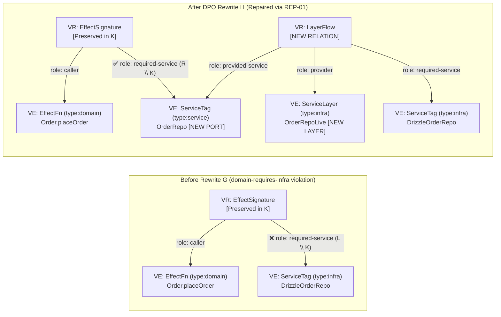

# RFC-0003: Graph Algebra, Double-Pushout (DPO) Subgraph Rewriting (`GraphRewrite.decide`), Automated Antipattern Repair & Generative Planning

## 1. Executive Summary

This document specifies **`GraphRewrite.decide`**—a pure functional **Algebraic Graph Rewriting Engine (`R = never`)** grounded in the **Double-Pushout (DPO)** approach in the category of typed hypergraphs $\mathbf{HGraph}_T$. While `GraphInfer.decide` ([RFC-0002](./0002-declarative-datalog-inference-and-edge-completion.md)) deductively derives transitive relations, antipatterns, and suggested edges (`SuggestedEdge`), **`GraphRewrite.decide` applies algebraic graph productions $p: L \xleftarrow{l} K \xrightarrow{r} R$ with Negative Application Conditions ($\text{NAC}$) to surgically transform one subgraph into another**.

This mechanism unlocks two capabilities in `effect-ts-harness`:

1. **Automated Architectural & Code Hygiene Repair ($\mathcal{R}\_{\text{repair}}$ — `REP-01..11`):** When an architectural or hygiene violation is detected (`domain-requires-infra`, `impure-decider`, `aggregate-direct-bus-publish`, `missing-layer-provider`, `unhandled-error`, `untraced-decider`, `unbranded-contract-schema`, `discriminant-branching`, `untrusted-row-brand-make`, `unmanaged-sql-ddl`, `unused-service`), the engine applies a DPO rewrite step $G \xRightarrow{p, m} H$ that repairs the violation in the graph (e.g., extracting a `ServiceTag` port in `type:service` and rewiring role edges, splitting an impure `.decide` into a pure core and use-case orchestrator, or inserting a transactional `Outbox` + `Outbox.relay`), verifies the validity of $H$, and returns the exact structural diff **`GraphPatch`**.
2. **Generative Plan Synthesis from EARS Specifications ($\mathcal{G}\_{\text{plan}}$ — `PLAN-01..04`):** Given an initial graph containing a new `EarsSpec` node (with parsed `WHEN`, `WHILE`, `IF/THEN`, `WHERE` clauses), it applies forward graph-grammar productions to a fixpoint $G_{\text{plan}}$. The result is a complete, deterministically verified plan topology for the `plan/<task>` branch ready for direct projection into TypeScript `stub<A, E, R>()` skeletons via [RFC-0004](./0004-ast-code-projection-mcp-tools-and-implementation-roadmap.md).

---

## 2. Motivation & Empirical Gap Analysis

### 2.1 The Gap Between Violation Detection and Architectural Repair

When `harness plan-check` or `harness verify` detects a policy violation in [`libs/harness/graph/src/policy-check.ts`](../../libs/harness/graph/src/policy-check.ts), it currently emits a flat diagnostic string:

> `[domain-requires-infra] Domain function 'Order.placeOrder' requires infra service 'DrizzleOrderRepo' (Order.placeOrder -> DrizzleOrderRepo)`

The agent or developer must mentally synthesize how to restructure the graph without breaking other invariants. In practice, LLMs frequently take shortcuts that trigger secondary violations (e.g., moving a file or deleting a type annotation instead of extracting an `OrderRepo` port in `type:service` and wiring `OrderRepoLive` in `type:infra`).

### 2.2 Manual Plan Topology Construction from EARS Clauses

In step 2 of our workflow (`planning-effect-skeletons`), mapping EARS clauses to Effect v4 building blocks is currently a prose instruction in [`agent-patterns/planning.md`](../../agent-patterns/planning.md):

- `WHEN` $\rightarrow$ input `Schema` and success type `A`
- `IF/THEN` $\rightarrow$ `Schema.TaggedErrorClass` in channel `E`
- `WHILE` $\rightarrow$ pure `.decide` (`R = never`) + stateful service in `R`
- `WHERE` $\rightarrow$ `Context.Service` and `Layer` in `R`

Because this mapping is a **homomorphism from the requirement subgraph to the architectural subgraph**, we formalize it as a **deterministic DPO graph grammar $\mathcal{G}\_{\text{plan}}$** rather than relying on LLM attention alone.

---

## 3. Goals, Non-Goals & Hard Invariants

### 3.1 Goals

1. Introduce a formal **Double-Pushout (DPO) algebraic graph rewriting engine (`GraphRewrite.decide`, `R = never`)** over `HarnessGraph`.
2. Enforce the **Gluing Condition (Dangling Condition + Identification Condition)** and the **Bipartite Levi Relation Preservation Law ($V_R \in K$)** on every rewrite step so no transformation can leave dangling role edges.
3. Prove and programmatically enforce **finite termination** via a 6-component lexicographical measure $\mu(G) \in \mathbb{N}^6$ and 4-phase stratification ($\text{PLAN} \prec \text{REPAIR\_ARCH} \prec \text{REPAIR\_CODE} \prec \text{CLEANUP}$).
4. For multi-strategy repairs (where the same antipattern has multiple valid DPO productions with identical $\mu(H)$), compute all valid `RewriteCandidate` solutions and rank ties using calibrated System One priors (`DpoCandidateRankerV1`).

### 3.2 Non-Goals

1. **No silent background mutation of production files:** `GraphRewrite.decide` is a pure mathematical function returning a target graph $H$ and a structured `GraphPatch` ($\Delta G = (\text{Delete } L \setminus K,\; \text{Insert } R \setminus K)$). Physical file projection is handled by [RFC-0004](./0004-ast-code-projection-mcp-tools-and-implementation-roadmap.md).
2. **No general NP-hard subgraph isomorphism for arbitrary large graphs:** Left-hand sides $L$ are anchored on typed nodes from `GraphInfer.decide` ($|V_L| \le 6$), and matching $m: L \hookrightarrow G$ is delegated to relational `join` + `antiJoin` in `@electric-sql/d2ts` in $< 1\text{ ms}$.

---

## 4. Formal Mathematical & Type-Theoretic Model

### 4.1 Category $\mathbf{HGraph}_T$ and DPO Productions

We work in the category of directed typed graphs (representing the Levi incidence graph $G_{\text{Levi}} = (V_E \sqcup V_R, E_{\text{role}})$ from [RFC-0001](./0001-polymorphic-hypergraph-and-pera-ontology-model.md)) with injective homomorphisms preserving node types, role edges, and the subtyping lattice $\preceq$.

A **DPO production (rewrite rule)** is a 4-tuple:

$$p = \left(L \xleftarrow{\;l\;} K \xrightarrow{\;r\;} R,\;\; \text{NAC}\right)$$

where:

- **$L$ (Left-Hand Side):** Pattern subgraph describing either an architectural antipattern or an unrealized EARS specification clause.
- **$K$ (Interface / Gluing Graph):** Common interface (nodes and edges from $L$ that are **preserved** during the rewrite and serve as gluing anchors for the new structure).
- **$R$ (Right-Hand Side):** Target subgraph replacing $L$.
- **$\text{NAC} = \{n_i: L \hookrightarrow N_i\}\_{i=1}^k$ (Negative Application Conditions):** Set of forbidden contexts. A match $m: L \hookrightarrow G$ satisfies $\text{NAC}$ iff there is no $i$ with an injective extension $q_i: N_i \hookrightarrow G$ such that $q_i \circ n_i = m$.

### 4.2 Double-Pushout Diagram, Gluing Condition & The Bipartite Levi Relation Preservation Law

Applying production $p$ to host graph $G$ at injective match $m: L \hookrightarrow G$ constructs two categorical pushout squares (Pushout Complement $D$ and Pushout $H$):

$$ \begin{array}{ccccc}
L & \xleftarrow{\quad l \quad} & K & \xrightarrow{\quad r \quad} & R \\
\Big\downarrow\vcenter{\rlap{\scriptstyle m}} & \text{(1) Delete} & \Big\downarrow\vcenter{\rlap{\scriptstyle k}} & \text{(2) Glue/Insert} & \Big\downarrow\vcenter{\rlap{\scriptstyle m^*}} \\
G & \xleftarrow[\quad f \quad]{} & D & \xrightarrow[\quad g \quad]{} & H
\end{array}$$

1. **Gluing Condition ($\text{GC}$) & The Bipartite Levi Relation Preservation Law ($V_R \in K$):** The intermediate graph $D$ (Pushout Complement) exists and is unique iff the **Dangling Condition ($\text{DC}$)** holds:
   $$\text{Dangling}(m) = \left\{ v \in m(V_L \setminus l(V_K)) \;\middle|\; \exists e \in E_G \setminus m(E_L): \text{src}(e) = v \lor \text{dst}(e) = v \right\} = \emptyset$$
   > [!IMPORTANT]
   > **Critical Rule for the Bipartite Levi Hypergraph $G_{\text{Levi}} = (V_E \sqcup V_R, E_{\text{role}})$:**
   > A reified relation node $rel \in V_R$ (such as `EffectSignature`) has $k$ incident `PlaysRoleEdge`s in real code (`caller`, `input-schema`, `output-schema`, multiple `emitted-error` and `required-service` edges). When a rule modifies or removes **a single role edge** $e \in E_{\text{role}}$ (e.g., `REP-01` or `REP-04a`), the relation node $rel \in V_R$ **MUST remain in the gluing interface $K$ ($rel \in V_K$)**, and only the deleted role edge $e \in E_L \setminus l(E_K)$ is placed in $L \setminus K$! If $rel$ were placed in $V_L \setminus l(V_K)$, all other role edges incident to $rel$ would violate $\text{Dangling}(m) = \emptyset$. A relation node $rel \in V_R$ may be placed in $V_L \setminus l(V_K)$ only when deleting the entire relation and matching all of its incident edges in $L$.
2. **Step 1 — Deletion ($G \to D$):**
   $$V_D = V_G \setminus m(V_L \setminus l(V_K)), \qquad E_D = E_G \setminus m(E_L \setminus l(E_K))$$
3. **Step 2 — Gluing / Insertion ($D \to H$):**
   $$V_H = V_D \;\sqcup\; \text{instantiate}(V_R \setminus r(V_K),\, m|_K), \qquad E_H = E_D \;\sqcup\; \text{instantiate}(E_R \setminus r(E_K),\, m|_K)$$
   where $\text{instantiate}$ deterministically derives keys for newly inserted nodes from the anchored nodes in $m(K)$ (e.g., deriving port `OrderRepo` in `type:service` from `DrizzleOrderRepo` in `type:infra`).

---

### 4.3 Termination Proof via Lexicographical Measure $\mu(G) \in \mathbb{N}^6$, 4-Phase Stratification & System One Tie-Breaking

To guarantee 100% mathematical termination of any rewrite sequence $G_0 \Rightarrow G_1 \Rightarrow G_2 \Rightarrow \dots$ and prevent oscillation between code hygiene rules (`REP-05..10`), orphan-service pruning (`REP-11`), and generative planning (`PLAN-01..04`), we enforce:

1. **6-Component Lexicographical Measure $\mu(G) \in (\mathbb{N}^6, <_{\text{lex}})$:**

$$\mu(G) = \Big(\; v_{\text{arch}}(G),\;\; u_{\text{spec}}(G),\;\; v_{\text{hygiene}}(G),\;\; m_{\text{layer}}(G),\;\; u_{\text{test}}(G),\;\; s_{\text{edge}}(G) \;\Big) \in \mathbb{N}^6$$

where:
- $v_{\text{arch}}(G)$: count of hard layer-boundary and purity violations (`impure-decider`, `domain-requires-infra`, `domain-requires-cloud-binding`, `aggregate-direct-bus-publish` per `INF-04..08`),
- $u_{\text{spec}}(G)$: count of EARS requirements and symbols in `EarsSpec` lacking a realizing node in the graph (`unmapped-spec-symbol`),
- $v_{\text{hygiene}}(G)$: count of local AST/contract hygiene violations repaired by `REP-05..10` (`untraced-decider`, `unbranded-contract-schema`, `discriminant-branching`, `untrusted-row-brand-make`, `unmanaged-sql-ddl`, `stale-doc-reference`),
- $m_{\text{layer}}(G)$: count of `ServiceTag` nodes required in $R$ lacking a `LayerFlow` provider (`INF-07`),
- $u_{\text{test}}(G)$: count of domain `EffectFn` nodes lacking a `verified-by` test link in `TraceabilityTuple` (`INF-09`),
- $s_{\text{edge}}(G)$: count of remaining unrealized `SuggestedEdge` facts from Stratum $S_3$ (`COMP-01..06`).

2. **4-Phase Rewrite Stratification (Preventing `PLAN-02` $\leftrightarrow$ `REP-11` Oscillation):**
   Rules are partitioned into 4 strictly ordered phases:
   $$\text{Phase 1: PLAN } (\texttt{PLAN-01..04}) \;\prec\; \text{Phase 2: REPAIR\_ARCH } (\texttt{REP-01..04b}) \;\prec\; \text{Phase 3: REPAIR\_CODE } (\texttt{REP-05..10}) \;\prec\; \text{Phase 4: CLEANUP } (\texttt{REP-11})$$
   Rule `REP-11` (`unused-service` prune) never runs during the `PLAN` phase and additionally carries a semantic Negative Application Condition $\text{NAC}_{\text{spec}}$: a service port may never be pruned if referenced by an `EarsSpec` (`WHERE` clause), `AdrDoc`, or active `stub<A, E, R>()` skeleton!

3. **Semantic Tie-Breaker for $\mu$-Equivalent Repair Candidates via System One (`DpoCandidateRankerV1` in `@harness/decision`):**
   When two valid DPO productions $p_1, p_2$ for the same antipattern yield an **identical measure decrease $\mu(H_1) = \mu(H_2)$ in $\mathbb{N}^6$** (e.g., `REP-04a` propagating an error in caller channel $E$ vs. `REP-04b` catching and translating via `Effect.catchTag` at an HTTP/RPC boundary, or splitting methods across ports in `REP-01`), `@harness/decision` runs a batched **`DpoCandidateRankerV1`** call (`Decision.classify` with options `["propagate_in_E", "catch_and_translate_at_boundary", "convert_to_defect"]` and `Decision.rate` for port cohesion).
   The resulting score $S_{\text{sys1}}(H_k) \in [0, 1000]$ is passed into the pure `GraphRewrite.decide` core via the optional map `candidatePriors?: DpoCandidatePriors` (`R = never`), acting strictly as the **7th tie-breaking component** among $\mu$-equivalent candidates.

**Termination Theorem:**
Every production $p$ in Phases 1–3 strictly decreases $\mu(H) <_{\text{lex}} \mu(G)$ in $(\mathbb{N}^6, <_{\text{lex}})$, and Phase 4 (`CLEANUP`) strictly decreases $|V_E(H)| < |V_E(G)|$ without increasing $\mu(G)$. Because $(\mathbb{N}^6 \times \mathbb{N}, <_{\text{lex}})$ is well-founded (has no infinite descending chains), rewriting always terminates in finitely many steps at a normal form $G^*$.

---

## 5. Detailed Technical Design in Effect-TS v4 Idioms

### 5.1 Schemas for Rewrite Rules, `GraphPatch`, and Candidates (`libs/harness/graph/src/graph-rewrite.ts`)

```typescript
import { Effect, Schema } from "effect"
import { NodeKey } from "./model.js"

export const RewriteRuleId = Schema.NonEmptyString.pipe(Schema.brand("RewriteRuleId"))
export type RewriteRuleId = typeof RewriteRuleId.Type

export const RewritePhase = Schema.Literals([
  "PLAN",
  "REPAIR_ARCH",
  "REPAIR_CODE",
  "CLEANUP",
])
export type RewritePhase = typeof RewritePhase.Type

export const GraphMeasureSchema = Schema.Struct({
  archViolations: Schema.Int,
  unmappedSpecSymbols: Schema.Int,
  codeHygieneViolations: Schema.Int,
  missingLayerProviders: Schema.Int,
  untestedDomainSpans: Schema.Int,
  unresolvedSuggestedEdges: Schema.Int,
})
export type GraphMeasure = typeof GraphMeasureSchema.Type

// Structured bipartite graph diff ΔG = (Delete L \ K, Insert R \ K) over G_Levi
export const GraphPatchSchema = Schema.Struct({
  ruleId: RewriteRuleId,
  phase: RewritePhase,
  ruleCategory: Schema.Literals(["auto-plan", "auto-repair", "cleanup"]),
  description: Schema.NonEmptyString,
  preservedInterfaceKeys: Schema.Array(NodeKey), // K (including preserved V_R nodes!)
  deletedEntityKeys: Schema.Array(NodeKey),       // V_E in L \ K
  deletedRelationIds: Schema.Array(NodeKey),      // V_R in L \ K (only when deleting an entire relation)
  deletedRoleEdges: Schema.Array(Schema.NonEmptyString), // E_role in L \ K
  insertedEntityNodes: Schema.Array(Schema.Unknown),   // V_E in R \ K (EntityNode[])
  insertedRelationNodes: Schema.Array(Schema.Unknown), // V_R in R \ K (RelationNode[])
  insertedRoleEdges: Schema.Array(Schema.Unknown),     // E_role in R \ K (PlaysRoleEdge[])
  beforeMeasure: GraphMeasureSchema,
  afterMeasure: GraphMeasureSchema,
})
export type GraphPatch = typeof GraphPatchSchema.Type

export const SystemOneScoreMillis = Schema.Int.pipe(
  Schema.check(Schema.isBetween(0, 1000)),
  Schema.brand("SystemOneScoreMillis"),
)
export type SystemOneScoreMillis = typeof SystemOneScoreMillis.Type

export const DpoCandidatePriorsSchema = Schema.Record({
  key: Schema.NonEmptyString, // "${primaryNodeKey}::${ruleId}"
  value: SystemOneScoreMillis,
})
export type DpoCandidatePriors = typeof DpoCandidatePriorsSchema.Type

export const RewriteCandidateSchema = Schema.Struct({
  rank: Schema.Int,
  rationale: Schema.NonEmptyString,
  patches: Schema.Array(GraphPatchSchema),
  finalMeasure: GraphMeasureSchema,
  systemOneTieBreaker: SystemOneScoreMillis,
  isPolicyClean: Schema.Boolean,
})
export type RewriteCandidate = typeof RewriteCandidateSchema.Type

export const GraphRewriteResultSchema = Schema.Struct({
  mode: Schema.Literals(["auto-plan", "auto-repair", "cleanup", "full"]),
  initialMeasure: GraphMeasureSchema,
  recommendedCandidate: Schema.OptionFromNullOr(RewriteCandidateSchema),
  alternativeCandidates: Schema.Array(RewriteCandidateSchema),
})
export type GraphRewriteResult = typeof GraphRewriteResultSchema.Type
```

### 5.2 Delegating $L + \text{NAC}$ Pattern Matching to `@electric-sql/d2ts` / `@modernrelay/omnigraph` & DPO Applicator over `effect/Graph`

Instead of writing a custom NP-hard subgraph isomorphism algorithm (VF2 / Ullmann) from scratch, we exploit a fundamental mathematical identity:
- **Finding all injective matches $m: L \hookrightarrow G$ satisfying Negative Application Conditions $\text{NAC} = \{N_1, \dots, N_k\}$ is isomorphic to a conjunctive relational query with anti-joins (`join` for edges in $L$ + `antiJoin` for edges in $N_i \setminus L$)!**
- In in-memory mode (`R = never`), all valid matches $m: L \hookrightarrow G$ are returned directly by **`@electric-sql/d2ts`** (the same engine used in [RFC-0002](./0002-declarative-datalog-inference-and-edge-completion.md)), and when querying remote Omnigraph branches, directly by GQL **`match { ... not { ... } }`** in **`@modernrelay/omnigraph`**.
- The DPO rewrite step itself (checking the *Dangling Condition* + deleting $L \setminus K$ + inserting $R \setminus K$) is a compact (~80-line) pure function over **`effect/Graph`** (`Graph.mutate`, `Graph.removeEdge`, `Graph.removeNode`, `Graph.addNode`, `Graph.addEdge`).

```typescript
/** Pure verification of strict decrease in (N^6, <_lex) guaranteeing rewrite termination (R = never). */
export const isStrictlyDecreasingMeasure = (
  before: GraphMeasure,
  after: GraphMeasure,
): boolean => {
  const pairs: ReadonlyArray<readonly [number, number]> = [
    [before.archViolations, after.archViolations],
    [before.unmappedSpecSymbols, after.unmappedSpecSymbols],
    [before.codeHygieneViolations, after.codeHygieneViolations],
    [before.missingLayerProviders, after.missingLayerProviders],
    [before.untestedDomainSpans, after.untestedDomainSpans],
    [before.unresolvedSuggestedEdges, after.unresolvedSuggestedEdges],
  ]
  for (const [b, a] of pairs) {
    if (a < b) return true
    if (a > b) return false
  }
  return false
}

export const decideGraphRewrite = Effect.fn("GraphRewrite.decide")(function* (
  graph: HarnessGraph,
  mode: "auto-plan" | "auto-repair" | "cleanup" | "full",
  candidatePriors?: DpoCandidatePriors,
): Effect.fn.Return<
  {
    readonly result: GraphRewriteResult
    readonly targetGraph: HarnessGraph
  },
  never,
  never
> {
  // 1. Run GraphInfer.decide(graph) (@electric-sql/d2ts) and compute initial measure mu(G_0) in N^6
  // 2. Following phase order (PLAN -> REPAIR_ARCH -> REPAIR_CODE -> CLEANUP), find matches m: L -> G with NAC
  // 3. Verify Dangling Condition (rel_1 in V_R stays in K when modifying a role edge!) and apply DPO pushout
  // 4. When multiple rules for the same violation produce identical mu(H) (e.g., REP-04a vs REP-04b),
  //    rank them using candidatePriors (DpoCandidateRankerV1 from System One) and return in alternativeCandidates.
})
```

---

## 6. Graph Algebra Rule Catalog & Visual DPO Transformations

All algebraic rules in the pure bipartite model $G_{\text{Levi}} = (V_E \sqcup V_R, E_{\text{role}})$ operate **exclusively over entity nodes $V_E$, reified relation nodes $V_R$, and role edges $E_{\text{role}}$** ($E_{\text{bin}} = \emptyset$).

---

### 6.1 Repair Productions Catalog ($\mathcal{R}_{\text{repair}}$ — `REP-01..11`)

#### Rule `REP-01`: Repairing `domain-requires-infra` (Dependency Inversion / Port Extraction)
- **Problem:** A domain function $fn \in V_E$ (`packageTag: "domain"`) is linked via reified relation node $rel_1 \in V_R$ (`EffectSignature`) with a `required-service` role edge directly to an infrastructure service $infraSvc \in V_E$ (`packageTag: "infra"`).
- **DPO Production $L \leftarrow K \to R$:**
  - **$L$:**
    - Nodes $fn \in V_E$ (`domain`), $infraSvc \in V_E$ (`infra`),
    - Relation node $rel_1 \in V_R$ (`EffectSignature`),
    - Role edges $e_1 = \text{PlaysRoleEdge}(rel_1 \to fn, \text{role}: \text{"caller"})$, $e_2 = \text{PlaysRoleEdge}(rel_1 \to infraSvc, \text{role}: \text{"required-service"})$.
  - **$K$ (Gluing Interface):** Nodes $fn, infraSvc$, **reified relation node $rel_1 \in V_R$**, and role edge $e_1$ (preserving all other role edges on $rel_1$ for `input-schema`, `output-schema`, and `emitted-error`!).
  - **$\text{NAC}$:** There does not already exist a port node $portSvc \in V_E$ (`packageTag: "service"`) and layer relation $rel_{\text{layer}} \in V_R$ (`LayerFlow`) providing $portSvc$.
  - **$L \setminus K$ (Delete):** Only the single role edge $e_2 = \text{PlaysRoleEdge}(rel_1 \to infraSvc, \text{role}: \text{"required-service"})$.
  - **$R \setminus K$ (Insert):**
    1. New port entity node $portSvc \in V_E$ (`ServiceTag`, `packageTag: "service"`),
    2. New layer entity node $infraLayer \in V_E$ (`ServiceLayer`, `packageTag: "infra"`),
    3. New role edge $e_{\text{port}} = \text{PlaysRoleEdge}(rel_1 \to portSvc, \text{role}: \text{"required-service"})$ attached to existing relation $rel_1$,
    4. New reified relation node $rel_{\text{layer}} \in V_R$ (`LayerFlow`) with role edges `provider` ($\to infraLayer$), `provided-service` ($\to portSvc$), and `required-service` ($\to infraSvc$).



---

#### Rule `REP-02`: Repairing `impure-decider` (Splitting into Pure Core and Use-Case Orchestrator)
- **Problem:** A function $d \in V_E$ with `fnRole: "decider"` (`*.decide`, which must have $R = \text{never}$ per `es:ADR-0001`) has a `required-service` role edge in $rel_1 \in V_R$ pointing to a stateful service $svc \in V_E$.
- **DPO Production $L \leftarrow K \to R$:**
  - **$K$:** Nodes $d$, $svc$, and relation $rel_1 \in V_R$ with $\text{caller}(rel_1, d)$.
  - **$L \setminus K$ (Delete):** Role edge $\text{PlaysRoleEdge}(rel_1 \to svc, \text{required-service})$ (restoring $R = \text{never}$ on $d$).
  - **$R \setminus K$ (Insert):** New orchestrator node $useCase \in V_E$ (`fnRole: "use-case"`) and its `EffectSignature` $rel_{\text{uc}} \in V_R$ requiring $svc$ and calling $d$ (`callee`).

---

#### Rule `REP-03`: Repairing `aggregate-direct-bus-publish` (Wiring via Transactional Outbox)
- **Problem:** Aggregate handler $handlerFn \in V_E$ directly requires `EventBus` in signature $rel_1 \in V_R$ without a transactional `Outbox` bridge (`es:ADR-0003`).
- **DPO Production $L \leftarrow K \to R$:**
  - **$L \setminus K$ (Delete):** Role edge $\text{PlaysRoleEdge}(rel_1 \to bus, \text{required-service})$.
  - **$R \setminus K$ (Insert):** `OutboxStore` port $outboxStore \in V_E$, role edge $\text{PlaysRoleEdge}(rel_1 \to outboxStore, \text{required-service})$, and relay worker $outboxRelay \in V_E$ bridging $outboxStore \to bus$.

---

#### Rules `REP-04a` vs. `REP-04b`: Multi-Candidate Resolution of `unhandled-error`
When $caller \in V_E$ calls $callee \in V_E$ (via $rel_{\text{caller}} \in V_R$), where $callee$ emits error $err \in V_E$, but $rel_{\text{caller}}$ neither emits nor catches $err$:
1. **Candidate 1 (`REP-04a: PropagateErrorToCaller`):** Inserts $\text{PlaysRoleEdge}(rel_{\text{caller}} \to err, \text{role}: \text{"emitted-error"})$ (widening channel $E$). *Ranked #1 by `DpoCandidateRankerV1` when $caller$ is an internal domain use-case and $err$ is declared in `EarsSpec`.*
2. **Candidate 2 (`REP-04b: CatchAndHandleErrorAtBoundary`):** Inserts $\text{PlaysRoleEdge}(rel_{\text{caller}} \to err, \text{role}: \text{"caught-error"})$ (projected to AST as `Effect.catchTag`). *Ranked #1 by `DpoCandidateRankerV1` when $caller$ is an HTTP endpoint, RPC handler, or Outbox relay boundary.*

---

#### Rules `REP-05` to `REP-11`: Code Hygiene & Cleanup DPO Productions (`Phase 3: REPAIR_CODE` & `Phase 4: CLEANUP`)

| Rule ID | Phase | Repaired Violation | DPO Graph Transformation ($L \leftarrow K \rightarrow R$) |
| :--- | :--- | :--- | :--- |
| **`REP-05`** | `REPAIR_CODE` | `untraced-decider` | Updates `EffectFn` attribute `isTraced: false` $\to$ `isTraced: true` and attaches canonical `EffectSignature` span name (`<Scope>.decide`). |
| **`REP-06`** | `REPAIR_CODE` | `unbranded-contract-schema` | Updates `SchemaDef` in `type:contract` from `isBranded: false` $\to$ `isBranded: true` (projected via `.pipe(Schema.brand("<Name>"))`). |
| **`REP-07`** | `REPAIR_CODE` | `discriminant-branching` | Replaces ad-hoc discriminant branch marker on `EffectFn` with exhaustive `ts-pattern` `match(...).exhaustive()` AST rewrite marker. |
| **`REP-08`** | `REPAIR_CODE` | `untrusted-row-brand-make` | Replaces raw `<Brand>.make(row.col)` in `type:infra` with `Schema.decodeUnknownEffect(<Schema>)` error edge in `EffectSignature`. |
| **`REP-09`** | `REPAIR_CODE` | `unmanaged-sql-ddl` | Wraps unmanaged DDL statement in `type:infra` into a numbered `MigrationTuple` ($V_R$, key `"1_init_tables"`) under `SqliteMigrator.fromRecord`. |
| **`REP-10`** | `REPAIR_CODE` | `stale-doc-reference` | Updates stale symbol reference in `TraceabilityTuple` when a unique renamed target exists in the same package. |
| **`REP-11`** | `CLEANUP` | `unused-service` | Deletes an unreferenced `ServiceTag` $s \in V_E$ **only if** $\text{NAC}_{\text{spec}}$ holds (not referenced by any `EffectSignature`, `LayerFlow`, `EarsSpec`, `AdrDoc`, or active `stub<A,E,R>()`). |

---

### 6.2 Generative Planning Productions ($\mathcal{G}_{\text{plan}}$ — `PLAN-01..04` in `Phase 1: PLAN`)

When an `EarsSpec` node ($V_E$) with `status: "proposed"` is processed by `GraphRewrite.decide(graph, "auto-plan")`, the following DPO productions fire to fixpoint $G_{\text{plan}}$:

- **`PLAN-01` (`WHEN` Clause $\to$ Input `SchemaDef` + Use-Case `EffectFn` Stub):** Inserts `SchemaDef` (`packageTag: "contract"`), `EffectFn` (`fnRole: "use-case"`, `isStub: true`, `packageTag: "domain"`), `EffectSignature` ($V_R$), and `TraceabilityTuple` ($V_R$).
- **`PLAN-02` (`WHILE` Clause $\to$ Pure `.decide` + `evolve` Skeleton):** Inserts pure `EffectFn` (`fnRole: "decider"`, `isStub: true`, $R = \text{never}$) and `EffectFn` (`fnRole: "reducer"`) linked to `TraceabilityTuple`.
- **`PLAN-03` (`IF/THEN` Clause $\to$ `TaggedError` + `emitted-error` Role):** Inserts `TaggedError` (`packageTag: "contract"`) and attaches $\text{PlaysRoleEdge}(rel_{\text{fn}} \to err, \text{role}: \text{"emitted-error"})$ to the use-case/decider `EffectSignature` ($rel_{\text{fn}} \in K$).
- **`PLAN-04` (`WHERE` Clause $\to$ `ServiceTag` Port + `Live`/`Test` `ServiceLayer` + `VitestCase`):** Inserts `ServiceTag` (`packageTag: "service"`), attaches `required-service` to $rel_{\text{fn}} \in K$, creates `ServiceLayer` (`live` and `test`) with `LayerFlow` ($V_R$), and creates a `VitestCase` linked via `verified-by`.

---

## 7. Library Selection, Rejected Alternatives & Trade-offs

| Evaluated Approach | Architecture | Advantages | Disadvantages & Verdict |
| :--- | :--- | :--- | :--- |
| **1. `@electric-sql/d2ts` (`join` + `antiJoin`) + `@modernrelay/omnigraph` (`match / not`) + `effect/Graph` (`Graph.mutate`) — CHOSEN SOLUTION** | Subgraph matching $m: L \hookrightarrow G_{\text{Levi}}$ with $\text{NAC}$ is delegated to relational `join` / `antiJoin` operators in `@electric-sql/d2ts` (in-memory) and GQL `match { ... not { ... } }` in `@modernrelay/omnigraph`; the DPO pushout step executes over `effect/Graph`. | • **Zero custom subgraph isomorphism code:** Every typed pattern $L$ with $\text{NAC}$ is a conjunctive query over $V_E, V_R, E_{\text{role}}$ streams in `d2ts`.<br/>• **Incremental recomputation after each rewrite:** Sending $\Delta G_{\text{Levi}}$ into `d2ts` immediately updates $\mu(H)$ and remaining matches.<br/>• The DPO applicator (*Dangling Condition* check + `Graph.mutate`) is ~80 lines of pure TypeScript. | Requires expressing $L$ and $\text{NAC}$ as conjunctive patterns over $V_E, V_R, E_{\text{role}}$ (which matches all rules `PLAN-01..04` and `REP-01..11`). |
| **2. Custom VF2 / Ullmann Subgraph Isomorphism from Scratch** | Hand-written backtracking search with candidate sets and tree pruning. | • Handles untyped homogeneous graphs. | **Rejected:** Overkill (300–500 error-prone lines) for a strongly typed architectural graph where relational `join` + `antiJoin` in `@electric-sql/d2ts` solves matching declaratively. |
| **3. Single-Pushout (SPO) with Cascading Edge Deletion** | Algebraic rewriting via partial morphisms where deleting a vertex silently deletes all incident edges. | • No *Dangling Condition* check needed. | **Rejected:** In a code architecture graph, SPO would silently delete call edges from unrelated modules. DPO enforces the *Dangling Condition* (*fail-closed*). |
| **4. Imperative Ad-Hoc Graph Mutations Without $L \leftarrow K \to R$** | Procedural functions mutating nodes and edges in a loop. | • Fast to write a single rule. | **Rejected:** Imperative mutations easily oscillate in infinite loops. Formal DPO rules with interface $K$, $\text{NAC}$, 4-phase stratification, and strict decrease in $\mu(G) \in \mathbb{N}^6$ mathematically guarantee termination. |

---

## 8. Ecosystem Impact, Performance & Compatibility

- **Time Complexity of Planning and Repair:** Because initial measure $\mu(G_0)$ has component sum $\le 50$ for a typical task and each DPO step with incremental `@electric-sql/d2ts` update takes $< 0.2\text{ ms}$, reaching normal form $G_0 \Rightarrow^* G^*$ completes in **$< 15\text{ ms}$**.
- **Deterministic Rule Ordering:** Matches are ordered lexicographically by `(phase, ruleId, primaryNodeKey)` (with $\mu$-ties broken by `DpoCandidateRankerV1`), making `GraphRewrite.decide` 100% reproducible and testable with `fast-check`.
- **Zero Backward Compatibility:** All rules consume and emit canonical `PlaysRoleEdge` and reified $V_R$ nodes exclusively.

---

## 9. Open Questions & Future Work

1. **Sequential DPO Rule Composition ($p_1 ; p_2$):** Adding an algebraic composition operator over shared intermediate graphs to synthesize macro-refactorings (e.g., migrating a synchronous service into an Event-Sourced Durable Object in a single composite DPO step).

---

## 10. Rollout & Decomposition Plan

This RFC is implemented in **Milestone 2** (`GraphRewrite.decide` engine) and **Milestone 3** (AST projection & gate consolidation):

1. **`libs/harness/docs/adr/0009-bipartite-pera-hypergraph-and-datalog-algebra.md` (`harness:ADR-0009`)** — formal rules for DPO rewriting, the Bipartite Levi Relation Preservation Law ($V_R \in K$), and termination guarantees via $\mu(G) \in \mathbb{N}^6$.
2. **`libs/harness/docs/specs/2026-11-XX-dpo-graph-rewriting-and-ast-projection.md` (`harness:SPEC-0008`)** — EARS requirements for `GraphRewrite.decide`, $\mathcal{G}_{\text{plan}}$ (`PLAN-01..04`), $\mathcal{R}_{\text{repair}}$ (`REP-01..11`), and `DpoCandidateRankerV1`.
$$
