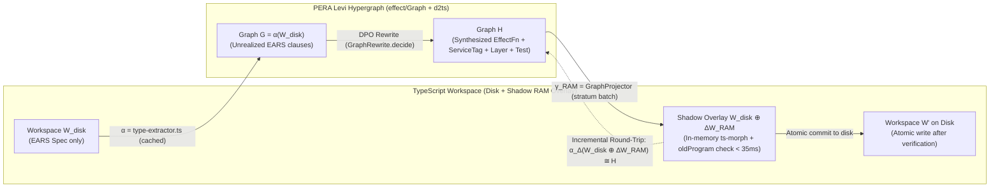

# RFC-0004: Bidirectional Projection $\Delta G \leftrightarrow \text{TypeScript AST}$ (`GraphProjector.decide`), MCP/CLI Interfaces & Rollout Plan

## 1. Executive Summary

Documents [RFC-0001](./0001-polymorphic-hypergraph-and-pera-ontology-model.md), [RFC-0002](./0002-declarative-datalog-inference-and-edge-completion.md), and [RFC-0003](./0003-algebraic-graph-rewriting-dpo-auto-repair-and-planning.md) define our polymorphic PERA hypergraph ($G_{\text{Levi}}$ over `effect/Graph`), stratified Datalog/Differential Dataflow engine (`GraphInfer.decide` over `@electric-sql/d2ts`), and Double-Pushout (DPO) algebraic graph rewriting engine (`GraphRewrite.decide`). One foundational engineering question remains:

> **When `GraphRewrite.decide` transforms graph $G$ into $H$ via structural diff $\Delta G = (\text{Delete } L \setminus K,\; \text{Insert } R \setminus K)$, how is that graph transformation projected back into compilable TypeScript source files—given that the TypeScript AST on disk is the primary source of truth in our repository?**

This document resolves the bidirectional projection between graph and code via **`GraphProjector.decide`** (`R = never`), which builds on two libraries **already installed in [`libs/harness/graph/package.json`](../../libs/harness/graph/package.json)**:
1. **[`ts-morph` (`28.0.0`)](../../libs/harness/graph/package.json#L19):** High-level typed API over the TypeScript compiler for synthesizing `stub<A, E, R>(...args)` skeletons, `Schema.brand`, `Schema.TaggedErrorClass`, `Context.Service` ports, `Layer.effect` providers, Nx barrel re-exports (`src/index.ts`), and automatic import organization (`organizeImports`).
2. **[`@ast-grep/napi` (`0.51.0`)](../../libs/harness/graph/package.json#L16):** Native Rust structural AST search-and-rewrite engine for repairing existing code in `"auto-repair"` mode (`REP-01..10`).

Additionally, this RFC specifies the **In-Memory "Shadow LSP" Buffer Overlays ($W_{\text{disk}} \oplus \Delta W_{\text{RAM}}$)** with incremental `oldProgram: ts.Program` caching (`< 35 ms`), new MCP tools (`harness_graph_infer`, `harness_graph_complete`, `harness_graph_rewrite`), CLI commands (`pnpm harness plan-synth`, `pnpm harness repair`), and the template for **`harness:ADR-0009`**.

---

## 2. Motivation & Empirical Gap Analysis

### 2.1 Source-of-Truth Asymmetry (TypeScript AST vs. Derived `HarnessGraph`)

In `effect-ts-harness`, TypeScript source files (`*.ts`) and governance documents in `docs/{adr,specs}/*.md` are the **primary source of truth**, whereas `HarnessGraph` in `@harness/graph` and Omnigraph is a **derived semantic index** reconstructed by [`type-extractor.ts`](../../libs/harness/graph/src/type-extractor.ts).

If `GraphRewrite.decide` mutated only the in-memory graph $G \Rightarrow H$ (or the Omnigraph `plan/<task>` branch) without projecting $\Delta G$ back into `*.ts` files:
1. The next run of `harness plan-check`, `harness gc`, or `harness verify` would re-parse the unchanged `*.ts` files and overwrite $H$ back to $G$.
2. `tsc --noEmit` and `effect-tsgo` typecheck physical TypeScript declarations, not JSON graph snapshots.

### 2.2 Why General Graph-to-Code Generation Fails, Yet Works 100% Deterministically in Effect-TS + `stub<A, E, R>()`

Synthesizing arbitrary imperative function bodies from a high-level architecture graph is undecidable in general. However, **Effect-TS combined with our `stub<A, E, R>()` planning protocol has a unique algebraic property**:
- During the planning phase (`plan/<task>`, `HARNESS_PLAN_CHECK=1`), the entire architecture of a feature is **100% determined by its boundary type declarations**:
  - Branded schemas (`Schema.brand`, `Schema.Struct`, `Schema.TaggedUnion`) in `type:contract`,
  - Typed errors (`Schema.TaggedErrorClass<Self>()("Tag", { ... })`) in `type:contract`,
  - Service ports (`Context.Service<Self, Shape>()("Pkg/Service")`) in `type:service`,
  - Domain use-case and decider signatures (`export const fn = Effect.fn("...")((input: In): Effect.Effect<A, E, R> => stub<A, E, R>(input))`) in `type:domain` / `type:core`,
  - Layer constructors (`export const Live = Layer.effect(Service, stub<Shape, E, RIn>())`) in `type:infra`,
  - Test scaffolds (`it.effect("REQ-...", ...)`) in `test/*.test.ts`.
- Every single one of these elements in a `plan/<task>` skeleton is **one-to-one isomorphic with the nodes, roles, and hyperedges in our PERA hypergraph $G_{\text{Levi}}$**.

---

## 3. Goals, Non-Goals & Hard Invariants

### 3.1 Goals

1. Define a pure projection engine **`GraphProjector.decide` (`R = never`)** translating `GraphPatch` ($\Delta G$) from [RFC-0003](./0003-algebraic-graph-rewriting-dpo-auto-repair-and-planning.md) and `SuggestedEdge` from [RFC-0002](./0002-declarative-datalog-inference-and-edge-completion.md) into deterministic `AstCodeModOperation` items executed via `ts-morph` and `@ast-grep/napi`.
2. Guarantee the **Round-Trip Commutative Invariant ($\alpha(\gamma(W, \Delta G)) \cong H$)** across all planning productions `PLAN-01..04` and repair rules `REP-01..11`.
3. Introduce **In-Memory "Shadow LSP" Buffer Overlays (*Cursor Shadow Workspace*)** with incremental `oldProgram: ts.Program` AST caching for `GraphProjector.decide`, `type-extractor.ts` ($\alpha$), and MCP tool `harness_lsp_diagnostics`, verifying speculative AST edits and $\alpha(W_{\text{disk}} \oplus \Delta W_{\text{RAM}}) \cong H$ purely in RAM in **$< 35\text{ ms}$** before writing a single byte to disk.
4. Expose the hypergraph, Datalog, Typed Hole, and DPO subsystems via three in-process MCP tools in `apps/harness-mcp` and two CLI commands in `apps/harness-cli`.

### 3.2 Non-Goals

1. **No custom TypeScript codegen or parser from scratch:** All declaration and import manipulation is performed by `ts-morph` (`28.0.0`), and structural expression rewrites are performed by `@ast-grep/napi` (`0.51.0`).
2. **No guessing of domain business logic inside function bodies:** `GraphProjector.decide` generates type-complete `stub<A, E, R>()` skeletons and exact architectural boundary repairs (`E`, `R`, `Layer`, `ServiceTag`); the domain implementation inside the function body is authored during `executing-effect-stubs`.

---

## 4. Formal Mathematical & Type-Theoretic Model

### 4.1 Galois Connection Between TypeScript AST and the Levi Hypergraph ($\alpha \dashv \gamma$)

We formalize the relationship between the workspace TypeScript AST ($\mathbf{AST}$) and the category of PERA Levi hypergraphs ($\mathbf{LeviGraph}$) as a pair of adjoint functors (abstraction $\alpha$ and concretization / projection $\gamma$):

$$\mathbf{AST} \underset{\gamma \text{ (GraphProjector + ts-morph / ast-grep)}}{\overset{\alpha \text{ (type-extractor.ts)}}{\rightleftarrows}} \mathbf{LeviGraph}$$

where:
- **$\alpha = \text{extractWorkspaceGraph} : \mathbf{AST} \to \mathbf{LeviGraph}$** parses the TypeScript AST (`ts.TypeChecker`) and EARS Markdown tables into `HarnessGraph` $G$.
- **$\gamma = \text{GraphProjector.apply} : (\mathbf{AST} \times \Delta\mathbf{LeviGraph}) \to \mathbf{AST}$** applies the algebraic `GraphPatch` $\Delta G = (G \xleftarrow{f} D \xrightarrow{g} H)$ to workspace $W$ using `ts-morph` and `@ast-grep/napi`, yielding updated workspace $W' = \gamma(W, \Delta G)$.

### 4.2 Bidirectional Commutativity Law (Round-Trip Put-Get Invariant)

For every valid DPO rewrite $G \xRightarrow{p, m} H$, the projection operator $\gamma$ must satisfy:

$$\alpha(\gamma(W, \Delta G)) \cong H$$

That is: when `GraphProjector.decide` synthesizes or modifies TypeScript files $W' = \gamma(W, \Delta G)$ from `GraphPatch` and we re-run the extractor $\alpha$ (`harness plan-check`), the extracted graph $\alpha(W')$ is isomorphic to target graph $H$ and passes both TypeScript compilation and `PlanCheck.decide` with zero errors.

### 4.3 In-Memory "Shadow LSP" Buffer Overlays (*Cursor Shadow Workspace* Architecture)

Writing speculative edits directly to disk during repair search or plan synthesis would trigger file watchers, dirty the git worktree on compilation failure, and add disk I/O latency. Following **Cursor's Shadow Workspace**, we introduce an in-memory overlay operator $\oplus$:

$$W_{\text{shadow}} \;=\; W_{\text{disk}} \;\oplus\; \Delta W_{\text{RAM}}, \qquad \Delta W_{\text{RAM}} \in \text{ReadonlyRecord}\langle\text{TargetFilePath}, \text{string}\rangle$$

1. **Pure In-Memory Projection ($\gamma_{\text{RAM}}$):** `GraphProjector.decide` runs all `ts-morph` (`{ useInMemoryFileSystem: true }`) and `@ast-grep/napi` transformations over in-memory file copies and returns unsaved file buffers $\Delta W_{\text{RAM}}$.
2. **Shadow Verification Before Touching Disk:** Both `extractWorkspaceTypeAwareGraph` (`type-extractor.ts`) and MCP tool `harness_lsp_diagnostics` accept an optional `overlays?: Readonly<Record<string, string>>` parameter:
   - If a path $p$ exists in `overlays[p]`, the compiler host and `oxc-parser` read the in-memory buffer from RAM instead of disk, while all unmodified files and `node_modules` declarations reuse the cached TypeScript `Program`.
   - `GraphProjector.decide` verifies **purely in RAM in $< 35\text{ ms}$**:
     1. that $\alpha(W_{\text{disk}} \oplus \Delta W_{\text{RAM}}) \cong H$ (Round-Trip commutativity),
     2. that $W_{\text{disk}} \oplus \Delta W_{\text{RAM}}$ produces `0` new diagnostics in `tsc` / `effect-tsgo` / `oxc-parser`.
   - **Incremental `ts.CompilerHost` with `oldProgram` AST Cache (Preventing 2,000 ms Cold Re-Parses):**
     > [!IMPORTANT]
     > Instantiating a cold `new Project(...)` in `ts-morph` across the monorepo takes ~2,000 ms because it re-parses all `node_modules` `.d.ts` files. To keep Shadow verification under $< 35\text{ ms}$, `type-extractor.ts` caches the previous `oldProgram: ts.Program` and wraps `ts.CompilerHost` via `createOverlayCompilerHost(options, overlays, oldProgram)`:
     > - if `fileName` is in `overlays`, it parses a fresh `ts.createSourceFile(fileName, overlays[fileName]!, ...)`,
     > - if `fileName` is not in `overlays`, it returns the existing AST node `oldProgram.getSourceFile(fileName)` in $O(1)$ time!
   - Only after both checks pass in the Shadow Workspace are the buffers in $\Delta W_{\text{RAM}}$ atomically committed to disk (when `--write` is passed).

### 4.4 Stratum-Boundary Batch Shadow LSP Verification & $O(\log k)$ Binary-Search Fault Isolation

When `GraphRewrite.decide` executes a multi-step rewrite sequence $G_0 \xRightarrow{p_1} G_1 \xRightarrow{p_2} \dots \xRightarrow{p_k} G_k = H$ across $k$ steps (e.g., $k = 12$ repairs across a module), running `createOverlayCompilerHost` and $\alpha(W_{\text{disk}} \oplus \Delta W_{\text{RAM}}^{(i)})$ after **every micro-step $i \in \{1 \dots k\}$** would multiply compiler verification cost by $k$ ($12 \times 35\text{ ms} = 420\text{ ms}$).

To guarantee sub-50 ms end-to-end projection latency:
1. **Batch Verification at Stratum/Fixpoint Boundaries:** `GraphProjector.decide` folds the sequence of `GraphPatch` operations within a rewrite phase into a single composite overlay $\Delta W_{\text{RAM}}^{(k)}$ and executes the Shadow LSP + Round-Trip check $\alpha(W_{\text{disk}} \oplus \Delta W_{\text{RAM}}^{(k)}) \cong G_k$ **once at the phase normal form $G_k$**.
2. **Lazy $O(\log k)$ Binary-Search Isolation on Failure:** Only if the composite normal form $\Delta W_{\text{RAM}}^{(k)}$ fails TypeScript compilation or Round-Trip isomorphism does `GraphProjector.decide` bisect the prefix overlays $\Delta W_{\text{RAM}}^{(\lfloor k/2 \rfloor)}$ in at most $\lceil \log_2 k \rceil$ checks to pinpoint and discard the exact offending rewrite step $p_j$.

### 4.5 Incremental Per-File Delta Re-Extraction ($\alpha_{\Delta}$) & Unified In-Memory `harness_lsp_diagnostics`

1. **Incremental Round-Trip Verification ($\alpha_{\Delta}$ + `DatalogSession`):**
   Because $\Delta W_{\text{RAM}}$ typically modifies only $1..4$ files out of hundreds of workspace files, verifying $\alpha(W_{\text{disk}} \oplus \Delta W_{\text{RAM}}) \cong H$ does **not** re-run AST extraction over untouched files. Using the content-addressable `FileGraphFragment` cache from [RFC-0006](./0006-sub-second-incremental-harness-caching-and-performance-architecture.md), $\alpha_{\Delta}$ re-extracts only the files in $\text{dom}(\Delta W_{\text{RAM}})$ (plus direct importers if exported signatures changed), splices their `EntityNode` and `RelationNode` fragments into the cached base graph, and steps `DatalogSession` with the $+1/-1$ `PlaysRoleEdge` $\mathbb{Z}$-set deltas in **$< 10\text{ ms}$**.
2. **Eliminating `spawnSync("effect-tsgo")` in `harness_lsp_diagnostics`:**
   Previously, `runDefaultLspDiagnostics` in [`apps/harness-mcp/src/server.ts`](../../apps/harness-mcp/src/server.ts#L251-L360) spawned a cold child process `node_modules/.bin/effect-tsgo` on every MCP call (`1,000–3,000 ms`). By routing `harness_lsp_diagnostics` through the warm in-memory `createOverlayCompilerHost(options, overlays, oldProgram)` with the `@effect/language-service` plugin attached in RAM, single-file and overlay diagnostics execute in **$< 35\text{ ms}$** with zero subprocess overhead.



---

## 5. Detailed Technical Design in Effect-TS v4 Idioms

### 5.1 Schemas for Projection Operations & Shadow Overlays (`libs/harness/graph/src/graph-projector.ts`)

```typescript
import { Effect, Schema } from "effect"
import { NodeKey } from "./model.js"
import { RewriteRuleId } from "./graph-rewrite.js"

export const TargetFilePath = Schema.NonEmptyString.pipe(Schema.brand("TargetFilePath"))
export type TargetFilePath = typeof TargetFilePath.Type

export const TypeScriptSnippet = Schema.NonEmptyString.pipe(Schema.brand("TypeScriptSnippet"))
export type TypeScriptSnippet = typeof TypeScriptSnippet.Type

export const CodeModEngineKind = Schema.Literals(["ts-morph", "ast-grep"])
export type CodeModEngineKind = typeof CodeModEngineKind.Type

export const CodeModActionKind = Schema.Literals([
  "CreateOrUpdateContractSchema",
  "CreateOrUpdateTaggedError",
  "CreateOrUpdateServicePort",
  "CreateOrUpdateStubFunction",
  "CreateOrUpdateServiceLayer",
  "AppendVitestScaffold",
  "UpdateBarrelIndexExport",
  "AstGrepStructuralRewrite",
]).pipe(Schema.brand("CodeModActionKind"))
export type CodeModActionKind = typeof CodeModActionKind.Type

export const AstCodeModOperationSchema = Schema.Struct({
  action: CodeModActionKind,
  engine: CodeModEngineKind,
  targetFile: TargetFilePath,
  targetNodeKey: NodeKey,
  sourceRuleId: RewriteRuleId,
  /** For engine === "ast-grep": structural search and rewrite pattern */
  astGrepPattern: Schema.OptionFromNullOr(
    Schema.Struct({
      pattern: Schema.NonEmptyString,
      rewrite: Schema.NonEmptyString,
    }),
  ),
  /** For engine === "ts-morph": structured declaration / generated TypeScript snippet */
  codeSnippet: TypeScriptSnippet,
  rationale: Schema.NonEmptyString,
})
export type AstCodeModOperation = typeof AstCodeModOperationSchema.Type

export const ShadowFileOverlaySchema = Schema.Struct({
  targetFile: TargetFilePath,
  content: Schema.String,
})
export type ShadowFileOverlay = typeof ShadowFileOverlaySchema.Type

export const AstProjectionResultSchema = Schema.Struct({
  operations: Schema.Array(AstCodeModOperationSchema),
  shadowOverlays: Schema.Array(ShadowFileOverlaySchema),
  roundTripVerified: Schema.Boolean,
  affectedPackages: Schema.Array(Schema.NonEmptyString),
  isFullyAutomatable: Schema.Boolean,
})
export type AstProjectionResult = typeof AstProjectionResultSchema.Type
```

### 5.2 Mapping `GraphPatch` Elements to `ts-morph` and `@ast-grep/napi` Operations (Including Mandatory Nx Barrel `index.ts` Co-Projection)

> [!IMPORTANT]
> **Mandatory Co-Projection of Nx Barrel Files (`libs/<scope>/<tier>/src/index.ts`):**
> Because `tsconfig.base.json` maps `@<scope>/contract` to `libs/<scope>/contract/src/index.ts`, adding a new declaration to `schemas.ts`, `errors.ts`, or `ports.ts` without updating the corresponding `src/index.ts` causes `TS2305: Module '"@<scope>/contract"' has no exported member '...'` when typechecking imports in `type:domain`. Therefore, whenever `GraphProjector.decide` adds an exported symbol, it automatically co-projects the updated re-export in `libs/<scope>/<tier>/src/index.ts` into $\Delta W_{\text{RAM}}$.

| Added / Modified Element in `GraphPatch` ($H \setminus D$) | Target Nx Tier & File | Engine | Concrete Operation (`ts-morph` / `@ast-grep/napi`) |
| :--- | :--- | :--- | :--- |
| `SchemaDefNode` ($s$) | `libs/<scope>/contract/src/schemas.ts` (+ `src/index.ts`) | **`ts-morph`** | `sourceFile.addVariableStatement(...)` + `sourceFile.addTypeAlias(...)` for `.pipe(Schema.brand("<Name>"))` + re-export in `index.ts` |
| `TaggedErrorNode` ($e$) | `libs/<scope>/contract/src/errors.ts` (+ `src/index.ts`) | **`ts-morph`** | `sourceFile.addClass({ name: "<Err>", isExported: true, extends: "Schema.TaggedErrorClass<...>()" })` + re-export in `index.ts` |
| `ServiceTagNode` ($p$) | `libs/<scope>/service/src/ports.ts` (+ `src/index.ts`) | **`ts-morph`** | `sourceFile.addClass({ name: "<Svc>", isExported: true, extends: "Context.Service<...>()" })` + re-export in `index.ts` |
| `EffectFnNode` ($f$, `isStub: true`) | `libs/<scope>/domain/src/<use-case>.ts` (+ `src/index.ts`) | **`ts-morph`** | `sourceFile.addVariableStatement` with `Effect.fn("<spanName>")((input: <In>): Effect.Effect<<Out>, <ErrUnion>, <ReqUnion>> => stub<<Out>, <ErrUnion>, <ReqUnion>>(input))` |
| `EffectFnNode` ($d$, `fnRole: "decider"`) | `libs/<scope>/domain/src/<decider>.ts` (+ `src/index.ts`) | **`ts-morph`** | `sourceFile.addVariableStatement` with pure signature `Effect.Effect<<Out>, <ErrUnion>, never>` ($R = \text{never}$) |
| `ServiceLayerNode` ($l$) | `libs/<scope>/infra/src/<svc>-live.ts` (+ `src/index.ts`) | **`ts-morph`** | `sourceFile.addVariableStatement` for `Layer.effect(<Svc>, stub<<Svc>["Service"], never, <Deps>>())` |
| `VitestCaseNode` ($t$) | `libs/<scope>/domain/test/<use-case>.test.ts` | **`ts-morph`** | Appending `it.effect("<REQ-ID>: ...", ...)` inside the `describe(...)` block |
| Repairing violations in `REP-01..10` | Existing `libs/<scope>/*/src/*.ts` | **`@ast-grep/napi`** + **`ts-morph`** | Structural AST rewrite (`yield* InfraService` $\to$ `yield* PortService`, `if/switch (_tag)` $\to$ `match(...).exhaustive()`, wrapping DDL in `SqliteMigrator.fromRecord`) + `sourceFile.organizeImports()` |

---

## 6. New MCP Tools (`apps/harness-mcp`) & CLI Commands (`apps/harness-cli`)

### 6.1 In-Process MCP Tools (`apps/harness-mcp/src/server.ts`)

Following our **MCP-First Tooling Preference** (`AGENTS.md`), we add 3 MCP tools and extend `harness_lsp_diagnostics` with in-memory Shadow LSP overlays:

1. **`harness_graph_infer`**
   - Runs `GraphInfer.decide` (`@electric-sql/d2ts` with DBSP incremental $\Delta$-propagation via `DatalogSession`, Strata $S_1 + S_2$) and returns derived transitive dependencies (`EffectiveRequires`, `EffectiveFailsWith`) and detected antipatterns with minimal-height `DerivationProof` trees.
2. **`harness_graph_complete`**
   - Runs Stratum $S_3$ (`COMP-01..06`) for a target symbol or `EarsSpec` ID and returns:
     - missing **`SuggestedEdge`** recommendations (merged via the Flix `ConfidenceMillis` semilattice) with TypeScript snippet hints,
     - for every `stub<A, E, R>()` typed hole, a complete **`TypedHoleContextBundle`** (1-hop Type Inhabitation candidates + Personalized PageRank ego-graph within $\le 1,500$ tokens per [RFC-0002 §4.6](./0002-declarative-datalog-inference-and-edge-completion.md)).
3. **`harness_graph_rewrite`**
   - Runs `GraphRewrite.decide` + `GraphProjector.decide` in `"auto-plan"`, `"auto-repair"`, or `"cleanup"` mode. Returns ranked `RewriteCandidate` solutions (ordered by $\mu(G) \in \mathbb{N}^6$ and `DpoCandidateRankerV1`), `AstCodeModOperation` items, and the in-memory Shadow Round-Trip verification status $\alpha(W_{\text{disk}} \oplus \Delta W_{\text{RAM}}) \cong H$.
4. **Extending `harness_lsp_diagnostics` with `overlays?: Readonly<Record<string, string>>` (Shadow LSP)**
   - Allows agents to submit unsaved in-memory file buffers and receive diagnostics from `tsgo` / `oxc-parser` / PERA extractor in $< 35\text{ ms}$ without touching disk.

### 6.2 CLI Commands (`apps/harness-cli/src/index.ts`)

1. **`pnpm harness plan-synth <spec-id> [--write]`**
   - Parses EARS specification `<spec-id>`, runs `GraphRewrite.decide(graph, "auto-plan")` (`PLAN-01..04`), verifies $\alpha(W_{\text{disk}} \oplus \Delta W_{\text{RAM}}) \cong H$ in memory via `GraphProjector.decide` (`ts-morph`), and prints or atomically writes compilable `stub<A, E, R>()` skeleton files ready for `pnpm harness plan-check`.
2. **`pnpm harness repair [--rule <R-ID>] [--write]`**
   - Runs `GraphInfer.decide` + `GraphRewrite.decide(graph, "auto-repair")` (`REP-01..11`), verifies the AST projection in the Shadow Workspace, and previews (or applies with `--write`) the architectural/code repair.

---

## 7. Library Selection, Rejected Alternatives & Trade-offs

| Evaluated Library / Approach | Architecture | Advantages | Disadvantages & Verdict |
| :--- | :--- | :--- | :--- |
| **1. `ts-morph` (`28.0.0`) + `@ast-grep/napi` (`0.51.0`) — CHOSEN SOLUTION** | High-level AST wrapper over the TypeScript Compiler API (`ts-morph`) for declarations/imports combined with Rust structural AST rewriter (`@ast-grep/napi`) for expression rewrites. | • **Both libraries are already installed in [`libs/harness/graph/package.json`](../../libs/harness/graph/package.json#L16-L19)** (0 new dependencies).<br/>• `ts-morph` safely manipulates classes, functions, type channels, and barrel exports, and resolves import collisions via `sourceFile.organizeImports()`.<br/>• `@ast-grep/napi` performs declarative meta-variable AST rewrites in sub-millisecond time. | Uses `{ useInMemoryFileSystem: true }` and `createOverlayCompilerHost(..., oldProgram)` for pure in-memory evaluation (`R = never`). |
| **2. Raw TypeScript Compiler API (`ts.factory.create*` + `ts.createPrinter`)** | Direct AST node construction via `ts.factory` and printing via `ts.Printer`. | • Built into `typescript`. | **Rejected:** Extremely verbose and strips blank lines and original comment formatting when printing existing files. |
| **3. `jscodeshift` / `@babel/parser` + `@babel/generator`** | Facebook codemod toolkit over Babel AST. | • Familiar in legacy React codebases. | **Rejected:** Introduces a second incompatible parser without access to `ts.TypeChecker` and is orders of magnitude slower than `@ast-grep/napi` (Rust). |
| **4. Raw String Concatenation / Regex Replace** | String templates and regex replacements on existing `.ts` files. | • Trivial for empty files. | **Rejected for modifying existing files:** Regexes break syntax and duplicate imports when extending an existing `E` union or adding declarations to non-empty modules. |

---

## 8. Ecosystem Impact, Performance & Gate Consolidation

- **Projection Performance:** Generating `AstProjectionResult` in memory (`ts-morph` with `useInMemoryFileSystem: true` + `@ast-grep/napi`) and verifying the Shadow overlay via `createOverlayCompilerHost(..., oldProgram)` completes in **$< 35\text{ ms}$** for a typical `GraphPatch`.
- **Gate Consolidation (Deleting ~2,500 Lines of Manual Loops):** Once `GraphInfer.decide`, `GraphRewrite.decide`, and `GraphProjector.decide` are active in Milestone 3, the manual procedural graph loops in `libs/harness/gates/src/gc-check.ts`, `ontology-invariants.ts`, and `branch-diff.ts` are replaced by declarative Stratum $S_2$ queries and subgraph monomorphism checks over $G_{\text{Levi}}$.

---

## 9. Open Questions & Future Work

1. **Interactive Candidate Selection in MCP (`RewriteCandidate`):** When `GraphRewrite.decide` returns multiple competing repairs in `alternativeCandidates` (`REP-04a` vs. `REP-04b`), `harness_graph_rewrite` exposes `candidateRank` so the agent or human can select an alternative strategy.

---

## 10. Prepared `ADR-0009` Template & Rollout Plan

### 10.1 Template for `libs/harness/docs/adr/0009-bipartite-pera-hypergraph-and-datalog-algebra.md` (`harness:ADR-0009`)

```markdown
# ADR-0009: Bipartite PERA Hypergraph, Stratified Datalog (@electric-sql/d2ts), and DPO Graph Algebra

## Status
Accepted

## Context
`effect-ts-harness` must model n-ary semantic relationships (binding Effect<A, E, R> channels, EARS requirements, and Event Sourcing flows), deductively infer transitive dependencies, antipatterns, and missing edges (`SuggestedEdge`), and algebraically rewrite subgraphs for automated repair and `stub<A, E, R>()` skeleton synthesis. Deploying an external TypeDB 3.0 server would require an external daemon, break `R = never` purity in `@harness/gates`, and lose Copy-on-Write branching (`plan/<task>` -> `impl/<task>`) in Omnigraph. At the same time, we must avoid writing low-level Datalog, subgraph isomorphism, or AST manipulation engines from scratch.

## Decision
We adopt a 4-layer functional graph architecture in `@harness/graph` and `@harness/gates` built over proven TypeScript libraries with a Clean-Slate cutover (zero backward compatibility):
1. **PERA Polymorphic Hypergraph (`ConceptLattice.decide` over `effect/Graph` and `@modernrelay/omnigraph`):** We reify n-ary relationships as `RelationNode` vertices in a bipartite Levi incidence graph $G_{\text{Levi}} = (V_E \sqcup V_R, E_{\text{role}})$ with `PlaysRoleEdge` edges and a static subtyping lattice, completely eliminating legacy binary edges ($E_{\text{bin}} = \emptyset$) and `node Any` from `schema.pg`.
2. **Stratified Datalog Inference (`GraphInfer.decide` over `@electric-sql/d2ts`):** We use `@electric-sql/d2ts` (`iterate`, `join`, `antiJoin`, `reduce(minHeightReducer)`) across 4 strata ($S_0$ EDB, $S_1$ transitive closures with Soufflé min-height provenance, $S_2$ antipattern detection, $S_3$ Flix-lattice `SuggestedEdge` and Hazel `TypedHoleContextBundle`) with `R = never` and `< 2ms` incremental updates via `DatalogSession`.
3. **Algebraic DPO Rewriting (`GraphRewrite.decide`):** We delegate $L + \text{NAC}$ pattern matching to relational `join`/`antiJoin` streams in `@electric-sql/d2ts` and execute Double-Pushout steps ($L \leftarrow K \rightarrow R$) over `effect/Graph`, enforcing the Bipartite Levi Relation Preservation Law ($V_R \in K$), 4-phase stratification, and strict decrease of $\mu(G) \in \mathbb{N}^6$.
4. **Bidirectional Shadow AST Projection (`GraphProjector.decide` over `ts-morph` and `@ast-grep/napi`):** We project `GraphPatch` diffs into in-memory Shadow LSP Overlays ($W_{\text{disk}} \oplus \Delta W_{\text{RAM}}$) with mandatory Nx barrel (`src/index.ts`) co-projection and incremental `oldProgram` caching (`< 35ms`), verifying $\alpha(W_{\text{disk}} \oplus \Delta W_{\text{RAM}}) \cong H$ before writing to disk.

## Consequences
- All graph inference, antipattern detection, and DPO rewrites remain 100% pure (`Effect<A, E, never>`), deterministic, and execute in memory in `< 35ms` (`< 2ms` for incremental single-file deltas).
- Zero legacy binary edges or dual-write adapters are maintained.

## Enforced By
- `harness:SPEC-0007` (`ConceptLattice.decide`, `GraphInfer.decide`)
- `harness:SPEC-0008` (`GraphRewrite.decide`, `GraphProjector.decide`)
```
