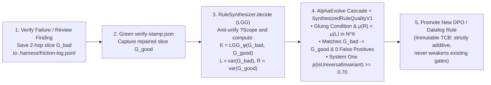

# RFC-0005: Execution-Guided Deterministic Simulation Testing (DST), Semantic Mutations, EARS Consistency & Self-Evolving DPO Rule Synthesis

## 1. Executive Summary

While [RFC-0001](./0001-polymorphic-hypergraph-and-pera-ontology-model.md) through [RFC-0004](./0004-ast-code-projection-mcp-tools-and-implementation-roadmap.md) establish the **static and algebraic core** of our harness (the bipartite PERA hypergraph $G_{\text{Levi}}$, stratified Datalog `GraphInfer.decide`, Double-Pushout rewriting `GraphRewrite.decide`, and Shadow AST projection `GraphProjector.decide`), **RFC-0005 (Milestone 5)** closes the feedback loop between **formal specifications, deterministic runtime execution, and self-evolving harness rules**.

Drawing on the comparative research in [RFC-0000](./0000-harness-paradigms-landscape-and-decision-matrix.md), this RFC introduces four interconnected subsystems:

1. **Finite Algebraic EARS Consistency & Completeness Checking (`EarsConsistency.decide` + `EarsClauseSemanticsV1` in `plan-check`):** Inspired by _Clover (CAV 2024)_ and _LLM2Alloy (2026)_. Verifies in pure TypeScript over closed `Schema.TaggedUnion` types from `type:contract` that `WHILE` (state) $\times$ `WHEN` (event/command) $\times$ `IF` (guard) clauses in an EARS table are mutually non-contradictory (`ears-contradictory-clauses`), non-shadowed (`ears-shadowed-clause`), and cover the full state-event matrix (`ears-incomplete-state-coverage`) before any implementation code is written.
2. **Deterministic Simulation Testing (`DstEngine.decide`, `ChaosLayer`, `it.effect.dst`) & Temporal Causality Invariants (`SpanBudget.decide`):** Inspired by _TigerBeetle VOPR_, _FoundationDB `flow`_, _Antithesis_, and _LISA_. Exploits Effect-TS's cooperative fiber scheduler, virtual `TestClock` (driven via a decoupled supervisor `clockDriver` fiber), deterministic XorShift64* PRNG (`DstSeed`), and 100% `Layer`-injected I/O to deterministically inject allowed `Schema.TaggedError` faults from channel `E` and compress hours of retry backoff (`Schedule`) into milliseconds. Simultaneously extends `SpanBudget.decide` with LISA temporal causality invariants over span trees (`MustPrecede`, `ForbiddenUnder`, `RequireCompensationOnFailure`).
3. **Semantic AST Mutations (`ts-pattern` / `Effect`) & Concolic Error-Channel Saturation (`unexercised-error-channel`, `shallow-branch-saturation`):** Inspired by _Meta ACH (FSE 2025)_ and _Cottontail (IEEE S&P 2026)_. Extends `makeRecordingTracer` (`span.end(endTime, exit)`) to record the actual `Exit` tag (`Success` / `Failure` / `Defect`), recoverable `Schema.TaggedError` `_tag`, and output variant `_tag` in `RecordedSpanEvent`. If an `Effect.fn` declares an error in `E` that is never triggered across any test trace (on the span or its descendant spans), `verify` fails with `unexercised-error-channel`. Meanwhile, `MutationCheck.decide` mutates `match().exhaustive()` and `Effect.catchTag` branches via `@ast-grep/napi`, runs only tests linked via `ExercisesSpan` edges (5–10× speedup), and filters equivalent mutants via `MutantEquivalenceV1`.
4. **Self-Evolving DPO Rule Synthesis via First-Order Graph Anti-Unification (`RuleSynthesizer.decide` in `pnpm harness learn`) & Plan-Space Tree Search (`PlanSearch.decide`):** Inspired by _Trace / OptoPrime (NeurIPS 2024)_, _Google DeepMind AlphaEvolve (2025)_, and _PlanSearch (ICLR 2025)_. From a pair of 2-hop hypergraph slices $(G_{\text{bad}}, G_{\text{good}})$ captured before and after fixing a verification failure, `RuleSynthesizer.decide` computes the **Least General Generalization (LGG)** to extract a candidate DPO rule $(L \leftarrow K \rightarrow R)$, validates it through a 4-stage _AlphaEvolve_ cascade evaluator (`0` false positives across the workspace while strictly preserving an **Immutable Trusted Computing Base**), and when `LoopCircuitBreaker.decide` triggers (`stuck: true`), `PlanSearch.decide` evaluates competing `stub<A, E, R>()` skeletons across Omnigraph CoW branches.

---

## 2. Motivation & Empirical Gap Analysis

An audit of `libs/harness/gates` and `libs/harness/ingest` reveals **four critical blind spots** that static typechecking and basic Datalog alone cannot catch:

### 2.1 Blind Spot #1: Syntactically Valid Yet Semantically Contradictory EARS Specifications

In [`libs/harness/gates/src/ears-lint.ts`](../../libs/harness/gates/src/ears-lint.ts#L88-L120), `EarsSpecLint.decide` currently checks only **surface Markdown table syntax** (`id-format`, `missing-modal`, `pattern-keyword-mismatch`).

- Suppose an author or agent writes two EARS requirements for the same `.decide` symbol:
  - `REQ-01` (`Unwanted`): _WHILE Cart is `CheckedOut`, IF `AddItem` is received, THEN the system SHALL fail with `CartAlreadyCheckedOutError`._
  - `REQ-02` (`State-Driven`): _WHILE Cart is `CheckedOut`, WHEN `AddItem` is received, the system SHALL return `ItemAddedEvent`._
- `EarsSpecLint.decide` passes both rows as valid even though they share an **identical precondition intersection** $(\text{State} = \texttt{CheckedOut}) \wedge (\text{Command} = \texttt{AddItem})$ and demand contradictory outcomes ($\text{Success}(A)$ vs. $\text{Failure}(E)$).

### 2.2 Blind Spot #2: Missing Deterministic Simulation Testing (DST) & Temporal Causality in `SpanBudget.decide`

In [`libs/harness/gates/src/span-budget.ts`](../../libs/harness/gates/src/span-budget.ts#L10-L91), `SpanBudget.decide` currently checks only two aggregate numbers:

1. `n-plus-one-call` (whether repeated child span invocations under a parent exceed `maxRepeatedChildCalls ?? 5`),
2. `span-duration-exceeded` (whether wall-clock duration exceeds `maxSpanDurationMs`).

What is missing:

- **Resilience to transient faults and fiber interleavings (DST):** When a `type:domain` use-case calls 3 service ports in `R` and uses `Effect.retry(Schedule.exponential("100 millis"))` or `Effect.all(..., { concurrency: "unbounded" })`, a standard `@effect/vitest` unit test only exercises the happy path where an in-memory `Layer` succeeds in $0\text{ ms}$. It never tests what happens when the second port fails on attempt #1 with a declared `TaggedError` from `E` after $250\text{ ms}$ of virtual time.
- **Temporal Call Ordering (Causality Invariants):** `SpanBudget.decide` cannot currently enforce protocol invariants such as _"Span `Auth.verify` must complete with `Success` before `Repo.mutate` starts within the same trace"_ or _"Span `*.decide` must never have a descendant span from `type:infra`"_.

### 2.3 Blind Spot #3: The "Tautological Test Trap" & Blindness in `makeRecordingTracer` and `mutation-check.ts`

1. **Ignored `exit` parameter in `makeRecordingTracer`:**
   Look at lines [89–97 of `libs/harness/ingest/src/recording-tracer.ts`](../../libs/harness/ingest/src/recording-tracer.ts#L89-L97):
   ```ts
   const origEnd = span.end.bind(span)
   span.end = (endTime, exit) => {
     durationMs =
       typeof endTime === "bigint" && typeof span.status.startTime === "bigint"
         ? Number(endTime - span.status.startTime) / 1_000_000
         : undefined
     origEnd(endTime, exit)
     syncRecord()
   }
   ```
   The `exit: Exit.Exit<unknown, unknown>` parameter in `span.end` is **completely ignored**! Neither `RecordedSpanEvent` nor the `ExercisesSpan` edge in `HarnessGraph` knows whether any test ever exercised the error channels declared in `E` (`FailsWithError`). A function can declare `Effect<Order, InsufficientStockError | PaymentDeclinedError, OrderRepo>`, have a single happy-path test (creating an `ExercisesSpan` edge), and pass `verify` 100% green while two error channels were never executed once!
2. **Line-based string mutations in `mutation-check.ts`:**
   In [`libs/harness/gates/src/mutation-check.ts`](../../libs/harness/gates/src/mutation-check.ts#L44-L100), mutations are currently generated via 17 line-based `String.includes` replacements (`>=` $\to$ `>`, `===` $\to$ `!==`) and every mutant re-runs the entire package's `vitest` suite. We lack semantic AST mutators for `ts-pattern` (`match(x).with({ _tag: "A" }, ...)`) and test targeting scoped via `ExercisesSpan` edges in $G_{\text{Levi}}$.

### 2.4 Blind Spot #4: String Clustering in `friction-log.ts` Instead of Algebraic Rule Extraction

In [`libs/harness/gates/src/friction-log.ts`](../../libs/harness/gates/src/friction-log.ts#L30-L120):

- `Friction.decide` groups text strings by `${event.kind}::${event.summary.trim().toLowerCase()}` and `pnpm harness learn` asks a model (`LearnProposalV1`) what prose rule to suggest.
- Yet whenever an agent fixes an architectural or verification failure, we have the exact 2-hop subgraph slice $G_{\text{bad}}$ (at `verify` failure) and the repaired subgraph slice $G_{\text{good}}$ (at green `verify-stamp.json`). Instead of guessing from text summaries, we can **algebraically anti-unify $(G\_{\text{bad}}, G\_{\text{good}})$ into a candidate DPO rewrite rule $(L \leftarrow K \rightarrow R)$**!

---

## 3. Goals, Non-Goals & Hard Invariants

### 3.1 Goals

1. **`EarsConsistency.decide` (`@harness/core` / `@harness/gates`):** Enforce finite relational and boolean consistency/completeness of EARS clauses against closed `Schema.TaggedUnion` state and event types during `pnpm harness plan-check`.
2. **`DstEngine.decide`, `ChaosLayer`, and Temporal `SpanBudget.decide` (`@harness/gates` + `@harness/ingest`):** Provide deterministic fault and virtual-time simulation (`withDeterministicFaults(seed)`) for every `Context.Service` in `R` and extend `SpanBudget.decide` with LISA temporal causality rules (`MustPrecede`, `ForbiddenUnder`, `RequireCompensationOnFailure`).
3. **Enriched `SpanRecorder` & Semantic `MutationCheck.decide`:** Record `exitTag`, `errorTag`, and `valueTag` directly in `RecordedSpanEvent`, enforce `unexercised-error-channel` (`SAT-01`) and `shallow-branch-saturation` (`SAT-02`), and accelerate mutation testing 5–10× by targeting only tests linked via `ExercisesSpan`.
4. **`RuleSynthesizer.decide` (`pnpm harness learn`) & `PlanSearch.decide` (`LoopCircuitBreaker`):** Extract candidate DPO rules from $(G_{\text{bad}}, G_{\text{good}})$ via First-Order Graph Anti-Unification (LGG) verified by an _AlphaEvolve_ cascade evaluator, and perform plan-space branch search over `stub<A, E, R>()` skeletons when stuck in a verification loop.

### 3.2 Non-Goals

1. **No external SMT solver (Z3 / CVC5) or Linux VM hypervisor:** DST runs directly over Effect v4's cooperative fiber scheduler and `TestClock`, and EARS consistency runs over finite discriminated unions in pure TypeScript.
2. **No unconstrained self-modification of harness code (Anti-DGM):** Neither the agent nor `pnpm harness learn` may ever modify `@harness/gates` evaluator code or weaken/remove existing rules.

### 3.3 Hard Invariants

- **Immutable Trusted Computing Base (TCB):** The set of active invariants $R_{\text{active}}$ in `@harness/gates` is **monotonically non-decreasing** ($R_{\text{active}}^{(t+1)} \supseteq R_{\text{active}}^{(t)}$). No synthesized rule may weaken an existing gate.
- **100% Determinism under `DstSeed`:** Every `it.effect.dst` execution is completely determined by `(testId, seed: DstSeed)`—the same `seed` produces bit-identical fiber interleavings, `TestClock` advances, and injected `Schema.TaggedError` sequences on every machine.
- **Zero I/O in Decision Cores (`R = never`):** All decision cores (`EarsConsistency.decide`, `DstEngine.decide`, `RuleSynthesizer.decide`, `PlanSearch.decide`) have signature `Effect.Effect<A, E, never>`.

---

## 4. Formal Mathematical & Type-Theoretic Model

### 4.1 Finite Boolean Algebra of EARS Consistency (`EarsConsistency.decide`) + Semantic Clause Extraction via System One (`EarsClauseSemanticsV1`)

Let a domain module define in `type:contract` a finite set of state variants $\Sigma = \{\sigma_1, \dots, \sigma_m\}$ (from a `Schema.TaggedUnion` for aggregate state) and a finite set of input commands/events $\Gamma = \{\gamma_1, \dots, \gamma_n\}$ (from a `Schema.TaggedUnion` for `WHEN` inputs).

- **Bridging Natural Language and Algebra via System One (`EarsClauseSemanticsV1` in `@harness/decision`):**
  In EARS Markdown tables, `WHILE`, `WHEN`, and `IF` columns are often written in natural prose (e.g., `WHILE the cart has already been paid` instead of literal backticks `` `CheckedOut` ``, or two guards `IF requested qty > available stock` vs. `IF inventory is insufficient`).
  Before invoking the pure boolean algebra, `@harness/decision` (`R = DecisionModel`) executes a single batched **`EarsClauseSemanticsV1`** call ($1..64$ questions in one `clef-flash` forward pass):
  1. **`Decision.classify` over Contract Variants ($2..26$ labels from $\Sigma$ and $\Gamma$):** Maps each natural-language `WHILE` / `WHEN` clause to the actual `Schema.TaggedUnion` tags with probability $P(\sigma_k) \ge \tau$ (plus `"AllStates_Ubiquitous"`).
  2. **`Decision.classify` for Pairs of `IF` Guards $(\phi_i, \phi_j)$:** Classifies the semantic relationship between two natural-language `IF` conditions into the closed codomain `["equivalent", "first_subsumes_second", "second_subsumes_first", "mutually_exclusive", "independent_overlapping"]`.

Each row $r_i$ in the EARS table for target symbol $f$ (`EffectFn` or `.decide`) is then represented in `EarsConsistency.decide` (`R = never`) as a 5-tuple:

$$r_i = (\text{id}_i,\; \pi_{\Sigma}(r_i) \subseteq \Sigma,\; \pi_{\Gamma}(r_i) \subseteq \Gamma,\; \phi_i,\; \omega_i)$$

where:

- $\pi_{\Sigma}(r_i) \subseteq \Sigma$ is the subset of states from the `WHILE` clause (if `WHILE` is omitted, $\pi_{\Sigma}(r_i) = \Sigma$),
- $\pi_{\Gamma}(r_i) \subseteq \Gamma$ is the subset of events/commands from the `WHEN` clause (if omitted, $\pi_{\Gamma}(r_i) = \Gamma$),
- $\phi_i \in \text{GuardPred}$ is the normalized predicate from the `IF` clause (or $\top$ if omitted),
- $\omega_i \in \{\text{Succeed}(A_i), \text{Fail}(E_i)\}$ is the required outcome from `THEN / SHALL`.

For every function $f$, we verify three algebraic properties in $O(|R_f|^2 + |\Sigma| \cdot |\Gamma|)$ time:

1. **Pairwise Disjointness / Non-Contradiction (`EARS-01`):**
   For every pair of rules $r_i \neq r_j$ with equivalent guards ($\phi_i \equiv \phi_j$ by exact match or `EarsClauseSemanticsV1` `"equivalent"` classification):

   $$\big(\pi_{\Sigma}(r_i) \cap \pi_{\Sigma}(r_j) \neq \emptyset\big) \;\wedge\; \big(\pi_{\Gamma}(r_i) \cap \pi_{\Gamma}(r_j) \neq \emptyset\big) \;\implies\; \omega_i = \omega_j$$

   If their state and event intersections overlap but demand conflicting outcomes ($\text{Succeed}(A)$ vs. $\text{Fail}(E)$), we report `ears-contradictory-clauses`.

2. **Non-Shadowing / Non-Vacuity (`EARS-02`):**
   No specific rule $r_j$ may be completely subsumed by a broader rule $r_i$ ($\pi_{\Sigma}(r_j) \subseteq \pi_{\Sigma}(r_i) \wedge \pi_{\Gamma}(r_j) \subseteq \pi_{\Gamma}(r_i)$ and $\phi_i$ subsumes $\phi_j$) without a distinguishing guard (`ears-shadowed-clause`).
3. **State-Event Matrix Completeness (`EARS-03`):**
   For a pure `.decide` state machine, the union of all rules must cover the Cartesian product of declared states and commands:

   $$\bigcup_{r_i \in R_f} \big(\pi_{\Sigma}(r_i) \times \pi_{\Gamma}(r_i)\big) = \Sigma \times \Gamma$$

   Any uncovered pair $(\sigma, \gamma) \notin \bigcup (\pi_{\Sigma} \times \pi_{\Gamma})$ triggers `ears-incomplete-state-coverage` naming the exact unhandled state $\sigma$ and command $\gamma$.

---

### 4.2 Deterministic Simulation Testing (`DstEngine.decide`), `DstHazardPriorV1` & Temporal Causality (`SpanBudget.decide`)

#### A. `ChaosLayer` Model over Effect v4 `Layer` & Decoupled `TestClock` Driver Fiber

Let use-case $f : \text{Effect}\langle A, E, R\rangle$ depend in $G_{\text{Levi}}$ on services $R = \{S_1, \dots, S_k\}$ via `EffectSignature` hyperedges, where each method $m_j$ of service $S_j$ has signature $\text{Effect}\langle A_j, E_j, \text{never}\rangle$ with $E_j \subseteq E$ consisting of `Schema.TaggedError` types.

- **Semantic Fault Hazard Weighting (`DstHazardPriorV1` in `@harness/decision`):**
  Instead of injecting faults across all service ports with uniform probability, `DstHazardPriorV1` (`Decision.rate` with levels `["pure_lookup", "idempotent_io", "stateful_mutation", "distributed_saga_step"]`) scores service methods in $R$ to produce `hazardPriors?: Readonly<Record<NodeKey, FaultProbabilityMillis>>`. Stateful mutations and distributed saga steps receive a higher density of `InjectTransientError` and `YieldFiberStep` events in `DstEngine.decide`.

Given a 64-bit `seed` $s_0 \in \mathbb{Z}_{2^{64}}$ (XorShift64* PRNG) and optional `hazardPriors`, the `withDeterministicFaults(seed, scheduleConfig)` layer wrapper instruments each method call $m_j$:

1. Draws a deterministic step $(\delta t_k, \text{action}_k) = \text{step}(\text{state}_{k-1})$ from the PRNG:
   - $\text{action}_k \in \{\text{PassThrough}, \text{InjectTransientError}(e \in E_j), \text{YieldFiberStep}\}$.
   - On $\text{InjectTransientError}(e)$, returns `Effect.fail(makeSyntheticTaggedError(e, seed))` for the first $n_{\text{fail}}$ attempts before delegating to the underlying in-memory test `Layer`, deterministically exercising `Effect.retry(Schedule)` and saga compensation logic in $f$.
2. **Decoupled `TestClock` Supervisor Fiber (Ban on Synchronous `TestClock.adjust` Inside Mock Methods):**
   > [!CAUTION]
   > If a mocked service method $m_j$ called `yield* TestClock.adjust(deltaT)` synchronously before returning `Effect.fail(e)`, virtual time would advance **before** the outer `Effect.retry(..., Schedule.exponential(...))` catches the error and enters `Clock.sleep`! The outer fiber would then suspend on an empty timer queue and **deadlock**.
   > Therefore, `it.effect.dst` forks the tested use-case fiber and advances virtual time from a **decoupled supervisor fiber (`clockDriver`)** after each `Effect.yieldNow()`:
   ```typescript
   const fiber = yield * Effect.fork(testEffect)
   const clockDriver =
     yield *
     Effect.fork(
       Effect.gen(function* () {
         for (const step of dstSchedule) {
           yield* Effect.yieldNow()
           yield* TestClock.adjust(Duration.millis(step.virtualDelayMs))
         }
       }),
     )
   ```
   The active `DstSeed` is recorded in `.harness/verify-stamp.json` so any simulation failure is bit-reproducible from a single integer.

#### B. LISA Temporal Causality Logic in `SpanBudget.decide`

We extend `SpanSample` with start/end timestamps $(t_{\text{start}}, t_{\text{end}})$ and `exitTag` $\in \{\texttt{"Success"}, \texttt{"Failure"}, \texttt{"Defect"}\}$. Over the span forest $T = (V_{\text{span}}, \prec_{\text{parent}}, <_{\text{time}})$, we enforce three declarative temporal rules:

- **`MustPrecede(A, B)` (`CAUS-01`):** For every span $b \in V_{\text{span}}$ named $B$ within a `traceId`, there must exist a span $a \in V_{\text{span}}$ named $A$ such that $a.t_{\text{end}} \le b.t_{\text{start}} \wedge a.\text{exitTag} = \texttt{"Success"}$.
- **`ForbiddenUnder(AncestorPattern, DescendantPattern)` (`CAUS-02`):** There must not exist $(p, c) \in V_{\text{span}}^2$ with $p \prec_{\text{parent}}^+ c$ where $p.\text{name}$ matches `AncestorPattern` (e.g., `"*.decide"`) and $c.\text{name}$ matches `DescendantPattern` (e.g., `"*Repo.*"`).
- **`RequireCompensationOnFailure(ActionSpan, FailureSpan, CompensateSpan)` (`CAUS-01`):** If span $a$ (`ActionSpan`, `exitTag = "Success"`) is followed by sibling/subsequent span $f$ (`FailureSpan`, `exitTag = "Failure"`), then compensating span $c$ (`CompensateSpan`, `exitTag = "Success"`) must execute before the root span completes.

---

### 4.3 Concolic Error-Channel Saturation ($E$), Semantic Mutations (`ExercisesSpan`) & `MutantEquivalenceV1`

Let function $f \in V_E$ (`EffectFn`) declare error slots in its `EffectSignature` relation in $G_{\text{Levi}}$:

$$\mathcal{E}_{\text{decl}}(f) = \{ e \in V_E \mid \exists r \in V_R(\texttt{EffectSignature}): (f, r, \texttt{caller}) \in E_{\text{role}} \wedge (e, r, \texttt{emitted-error}) \in E_{\text{role}} \}$$

During `@effect/vitest` runs, the enriched `makeRecordingTracer` in [`libs/harness/ingest/src/recording-tracer.ts`](../../libs/harness/ingest/src/recording-tracer.ts) inspects `exit` on every completed span $s$:

- If `Exit.isSuccess(exit)`, it records `exitTag = "Success"` and, if the return value is a tagged union (`_tag`), `valueTag = val._tag`.
- If `Exit.isFailure(exit)`, it extracts the recoverable `Schema.TaggedError` `_tag` from `Cause.findRecoverableError(exit.cause)` and records `exitTag = Cause.hasDies(exit.cause) ? "Defect" : "Failure"` and `errorTag = err._tag`.

The set of dynamically observed errors for function $f$ includes both direct failures of span $f$ and failures of its descendant spans $c$ ($s_f \prec_{\text{parent}}^* s_c$), ensuring internal error recovery via `Effect.catchTag` inside $f$ does not trigger false positives:

$$\mathcal{E}_{\text{obs}}(f) = \{ s.\text{errorTag} \mid (s.\text{name} = f.\text{spanName} \lor s_f \prec_{\text{parent}}^+ s) \wedge s.\text{exitTag} = \texttt{"Failure"} \}$$

Gate **`unexercised-error-channel` (`SAT-01`)** is then a pure set difference (Datalog `antiJoin` in $S_2$):

$$\text{UnexercisedError}(f, e) \;:-\; e \in \mathcal{E}_{\text{decl}}(f),\; \neg \big(e.\text{tag} \in \mathcal{E}_{\text{obs}}(f)\big)$$

Similarly, for every pure `.decide` function returning a `Schema.TaggedUnion` $A = A_1 \sqcup \dots \sqcup A_k$, gate **`shallow-branch-saturation` (`SAT-02`)** verifies that all output variants $\{A_1, \dots, A_k\} \subseteq \mathcal{A}_{\text{obs}}(f)$ were observed during `fast-check` property runs.

- **Filtering Semantically Equivalent Mutants via System One (`MutantEquivalenceV1` in `@harness/decision`):**
  Mutation testing often produces benign surviving mutants whose mutated branch is already rendered unreachable by upstream `Schema.brand` / `Schema.check` refinements (e.g., mutating `amount >= 0` to `amount > 0` on a `PositiveCents` branded type). `MutantEquivalenceV1` batches up to 64 surviving mutants into a **single System One call** (`Decision.probability` asking _"Is this AST mutation semantically unreachable/equivalent given the upstream `Schema.brand` constraints?"_, memoized via the SHA-256 `CachedDecisionModel` from [RFC-0006](./0006-sub-second-incremental-harness-caching-and-performance-architecture.md)) so the agent only fixes genuine test gaps.
- **Zero-Respawn "Mutant Schemata" & Git-Diff Line Scoping (300× Speedup Over Naive Mutation Runners):**
  > [!IMPORTANT]
  > Rewriting a source file on disk and spawning a fresh `vitest run` subprocess for each of $M = 30$ mutants costs $30 \times 1.2\text{ s} \approx 36\text{ s}$ in Vite/Node startup overhead alone. To keep `MutationCheck.decide` under **$< 200\text{ ms}$**:
  >
  > 1. **Git-Diff Line Scoping:** Candidate mutations are generated **only** for AST nodes intersecting modified line ranges in `git diff main...HEAD` (never on untouched functions in the same module).
  > 2. **Single-Compilation Mutant Schemata (`globalThis.__HARNESS_ACTIVE_MUTANT_ID`):** All $M$ mutations for a module are woven into a **single instrumented AST buffer in memory** using a runtime switch expression:
  >    `(globalThis.__HARNESS_ACTIVE_MUTANT_ID === 14 ? (mutatedExpr) : (originalExpr))`
  > 3. **In-Process Loop over `ExercisesSpan` Tests:** A single warm test worker loads the instrumented module once and iterates `for (const mutantId of [1..M])`, toggling `globalThis.__HARNESS_ACTIVE_MUTANT_ID = mutantId` in RAM and executing only the `ExercisesSpan`-linked `it.effect` cases (`~120 ms` total for 30 mutants).
- **Two-Tier DST Execution Budget (`fast` Inner Loop vs. `thorough` Gate):**
  During interactive inner-loop checks (`verify --fast`), `it.effect.dst` executes `10` deterministic `DstSeed` schedules (`< 15 ms` via virtual `TestClock`). During full `pnpm harness verify` and CI, it executes `100` deterministic seeds.

---

### 4.4 First-Order Anti-Unification of DPO Rules (`RuleSynthesizer.decide` + `SynthesizedRuleQualityV1`) & `PlanSearch` MCTS (`PlanSearchScorerV1`)

#### A. Deriving DPO Rules via First-Order Graph Anti-Unification (`RuleSynthesizer.decide`)

When `pnpm harness verify` fails with an architectural or verification error (or during `resolving-effect-review-feedback`), we persist the 2-hop neighborhood slice $G_{\text{bad}} \subset G_{\text{Levi}}$ around the failing symbols into `.harness/friction-log.jsonl`. When `pnpm harness verify` subsequently succeeds and writes `.harness/verify-stamp.json`, we capture the corresponding repaired slice $G_{\text{good}} \subset G'_{\text{Levi}}$.

> [!IMPORTANT]
> **Why Naive Set Intersection $K = G\_{\text{bad}} \cap G\_{\text{good}}$ Fails:**
> Refactorings routinely shift line numbers, local identifiers, or reified relation IDs (`EffectSignature:Order.placeOrder#1`), so naive set intersection of concrete `NodeKey`s yields $K = \emptyset$ and causes DPO to delete all of $G_{\text{bad}}$ (violating the Dangling Condition).
> Therefore, `RuleSynthesizer.decide` performs **First-Order Graph Anti-Unification (Least General Generalization — LGG)**:
>
> 1. Finds a partial structural homomorphism $\phi: V_{\text{bad}} \rightharpoonup V_{\text{good}}$ pairing nodes by `(conceptId, packageTag, spanName / roleNeighborhood)` independent of line-number drift,
> 2. Variabilizes concrete domain prefixes (`Order`, `Cart`, `Photo`) into meta-variables (`?Scope`, `?Entity`),
> 3. Defines gluing interface $K = \text{dom}(\phi)$ (including preserved relation nodes $V_R$), left-hand side $L = \text{variabilize}(G_{\text{bad}})$, and right-hand side $R = \text{variabilize}(G_{\text{good}})$:

$$K = \text{LGG}_{\phi}(G_{\text{bad}}, G_{\text{good}}), \qquad L = \text{variabilize}(G_{\text{bad}}), \qquad R = \text{variabilize}(G_{\text{good}})$$

To be promoted in `pnpm harness learn`, a candidate rule $\rho_{\text{cand}} = (L \xleftarrow{l} K \xrightarrow{r} R, \text{NAC})$ must pass a **4-stage _AlphaEvolve_ cascade evaluator**:

1. **Stage 1 (Gluing & Termination Validity):** $\rho_{\text{cand}}$ satisfies the Dangling Condition ($V_R$ nodes whose role edges change remain in $K$) and strictly decreases $\mu(R) <_{\text{lex}} \mu(L)$ in $\mathbb{N}^6$.
2. **Stage 2 (Historical Bug Recall):** Pattern $L \wedge \neg \text{NAC}$ matches $G_{\text{bad}}$ and its DPO rewrite produces a graph isomorphic to $G_{\text{good}}$.
3. **Stage 3 (Zero False-Positive Workspace Gate):** Running $L \wedge \neg \text{NAC}$ across the entire verified monorepo graph $G_{\text{Levi}}$ yields **`0` false positives**.
4. **Stage 4 (System One Generalization Filter — `SynthesizedRuleQualityV1`):** Extends [`LearnProposalV1`](../../libs/harness/decision/src/learn-decision.ts) using `Decision.probability` (`isUniversalInvariant`) and `Decision.rate` (`generalizationQuality`) to filter out narrow, single-use LGG diffs and promote only universal architectural invariants.



#### B. `PlanSearch.decide` over `stub<A, E, R>()` Skeletons on Loop Circuit Breaker (`PlanSearchScorerV1`)

When `LoopCircuitBreaker.decide` returns `stuck: true` (the agent failed $3\times$ consecutively on the same verification error), `PlanSearch.decide` activates:

- Generates $K \in \{2, 3\}$ architecturally distinct `stub<A, E, R>()` skeletons (e.g., Candidate 1: decomposing logic into a pure `.decide` + thin `Effect.fn` orchestrator; Candidate 2: moving boundary decoding into `Schema.decodeTo` in `type:contract`),
- Projects each candidate via In-Memory Shadow LSP Overlays ($W_{\text{disk}} \oplus \Delta W_{\text{RAM}}^{(k)}$) into temporary Omnigraph CoW branches `plan/<task>-cand-k` and scores them with a lexicographical value function combining hard deterministic error counts with the **continuous System One score `PlanSearchScorerV1` ($S\_{\text{sys1}}(G_k) \in [0, 1000]$ from `Decision.rate` + `Decision.probability`) as tie-breaker**:

$$V(G_k) = -\Big(10^9 \cdot |\text{TypeErrors}(G_k)| + 10^7 \cdot |\text{Violations}_{S_2}(G_k)| + 10^5 \cdot |\text{EarsInconsistencies}(G_k)| + 10^3 \cdot |\text{CrossPkgEdges}(G_k)| - S_{\text{sys1}}(G_k)\Big)$$

The winning skeleton $\arg\max_k V(G_k)$ with `0` type and architectural errors is committed to `plan/<task>` and handed to the implementer with a fresh `TypedHoleContextBundle`.

---

## 5. Detailed Technical Design in Effect-TS v4 Idioms

All schemas follow `harness:SPEC-0005` / `harness:ADR-0007` (no unbranded primitives in `type:contract`, zero `any`, closed `Schema.TaggedUnion`).

### 5.1 Contract Schemas (`libs/harness/contract/src/execution-harness.ts`)

```ts
import { Schema } from "effect"
import { NodeKey, SpanName } from "./hypergraph.js"
import { DpoRuleSchema, GraphNormVectorSchema } from "./graph-rewrite.js"

// 1. Branded Domain Types
export const DstSeed = Schema.Int.pipe(Schema.greaterThanOrEqualTo(0), Schema.brand("DstSeed"))
export type DstSeed = typeof DstSeed.Type

export const VirtualDelayMillis = Schema.Int.pipe(
  Schema.between(0, 3_600_000),
  Schema.brand("VirtualDelayMillis"),
)
export type VirtualDelayMillis = typeof VirtualDelayMillis.Type

export const FaultProbabilityMillis = Schema.Int.pipe(
  Schema.between(0, 1000),
  Schema.brand("FaultProbabilityMillis"),
)
export type FaultProbabilityMillis = typeof FaultProbabilityMillis.Type

export const VariantTagName = Schema.NonEmptyString.pipe(Schema.brand("VariantTagName"))
export type VariantTagName = typeof VariantTagName.Type

export const RequirementId = Schema.NonEmptyString.pipe(
  Schema.pattern(/^[A-Z]+-[A-Z0-9-]+$/),
  Schema.brand("RequirementId"),
)
export type RequirementId = typeof RequirementId.Type

// 2. EARS Consistency Schemas (Pillar 1 + EarsClauseSemanticsV1 priors)
export const GuardRelationKind = Schema.Literals([
  "equivalent",
  "first_subsumes_second",
  "second_subsumes_first",
  "mutually_exclusive",
  "independent_overlapping",
])
export type GuardRelationKind = typeof GuardRelationKind.Type

export const EarsSemanticClauseSchema = Schema.TaggedStruct("EarsSemanticClause", {
  requirementId: RequirementId,
  targetSymbol: SpanName,
  whileStates: Schema.Array(VariantTagName),
  whenEvents: Schema.Array(VariantTagName),
  guardExpression: Schema.OptionFromNullOr(VariantTagName),
  outcomeKind: Schema.Literals(["Succeed", "Fail"]),
  outcomeTag: VariantTagName,
})
export type EarsSemanticClause = typeof EarsSemanticClauseSchema.Type

export const EarsGuardPairPriorSchema = Schema.Struct({
  firstGuard: VariantTagName,
  secondGuard: VariantTagName,
  relation: GuardRelationKind,
})
export type EarsGuardPairPrior = typeof EarsGuardPairPriorSchema.Type

export const EarsConsistencyViolationSchema = Schema.TaggedUnion({
  ContradictoryClauses: {
    firstRequirementId: RequirementId,
    secondRequirementId: RequirementId,
    targetSymbol: SpanName,
    overlappingState: VariantTagName,
    overlappingEvent: VariantTagName,
  },
  ShadowedClause: {
    generalRequirementId: RequirementId,
    shadowedRequirementId: RequirementId,
    targetSymbol: SpanName,
  },
  IncompleteStateCoverage: {
    targetSymbol: SpanName,
    unhandledState: VariantTagName,
    unhandledEvent: VariantTagName,
  },
})
export type EarsConsistencyViolation = typeof EarsConsistencyViolationSchema.Type

// 3. DST & Temporal Causality Schemas (Pillar 2 + DstHazardPriorV1)
export const DstFaultStepSchema = Schema.TaggedUnion({
  PassThrough: {
    virtualDelayMs: VirtualDelayMillis,
  },
  InjectTransientError: {
    virtualDelayMs: VirtualDelayMillis,
    targetServiceKey: NodeKey,
    injectedErrorTag: VariantTagName,
  },
  YieldFiberStep: {
    virtualDelayMs: VirtualDelayMillis,
  },
})
export type DstFaultStep = typeof DstFaultStepSchema.Type

export const TemporalCausalityRuleSchema = Schema.TaggedUnion({
  MustPrecede: {
    beforeSpan: SpanName,
    afterSpan: SpanName,
  },
  ForbiddenUnder: {
    ancestorPattern: SpanName,
    descendantPattern: SpanName,
  },
  RequireCompensationOnFailure: {
    actionSpan: SpanName,
    failureSpan: SpanName,
    compensationSpan: SpanName,
  },
})
export type TemporalCausalityRule = typeof TemporalCausalityRuleSchema.Type

// 4. Concolic Saturation & Semantic Mutations (Pillar 3 + MutantEquivalenceV1)
export const SpanExitKind = Schema.Literals(["Success", "Failure", "Defect"])
export type SpanExitKind = typeof SpanExitKind.Type

export const SaturationViolationSchema = Schema.TaggedUnion({
  UnexercisedErrorChannel: {
    targetFnKey: NodeKey,
    spanName: SpanName,
    declaredErrorTag: VariantTagName,
  },
  ShallowBranchSaturation: {
    targetDeciderKey: NodeKey,
    spanName: SpanName,
    unreachedVariantTag: VariantTagName,
  },
})
export type SaturationViolation = typeof SaturationViolationSchema.Type

// 5. Self-Evolving DPO Rule Synthesis & PlanSearch (Pillar 4 + SynthesizedRuleQualityV1 & PlanSearchScorerV1)
export const SynthesizedRuleCandidateSchema = Schema.TaggedStruct("SynthesizedRuleCandidate", {
  candidateRule: DpoRuleSchema,
  sourceFailureSummary: VariantTagName,
  gluingConditionValid: Schema.Boolean,
  normStrictlyDecreases: Schema.Boolean,
  historicalBugMatched: Schema.Boolean,
  workspaceFalsePositives: Schema.Int.pipe(Schema.greaterThanOrEqualTo(0)),
  universalInvariantProbabilityMillis: FaultProbabilityMillis,
})
export type SynthesizedRuleCandidate = typeof SynthesizedRuleCandidateSchema.Type

export const PlanSearchCandidateSchema = Schema.TaggedStruct("PlanSearchCandidate", {
  branchName: VariantTagName,
  normVector: GraphNormVectorSchema,
  typeErrorCount: Schema.Int.pipe(Schema.greaterThanOrEqualTo(0)),
  earsViolationCount: Schema.Int.pipe(Schema.greaterThanOrEqualTo(0)),
  systemOneScoreMillis: FaultProbabilityMillis,
})
export type PlanSearchCandidate = typeof PlanSearchCandidateSchema.Type
```

### 5.2 Pure Decision Core Signatures (`libs/harness/core/src/` & `libs/harness/gates/src/`)

```ts
import { Effect } from "effect"
import type {
  DstFaultStep,
  DstSeed,
  EarsConsistencyViolation,
  EarsGuardPairPrior,
  EarsSemanticClause,
  FaultProbabilityMillis,
  PlanSearchCandidate,
  SynthesizedRuleCandidate,
} from "@harness/contract"
import type { HarnessGraph } from "./hypergraph-model.js"

/**
 * 1. Finite algebraic consistency and completeness check over EARS clauses (R = never).
 *    Accepts optional guardPairPriors from EarsClauseSemanticsV1 (@harness/decision).
 */
export const decideEarsConsistency: (
  clauses: ReadonlyArray<EarsSemanticClause>,
  stateVariantsBySymbol: ReadonlyMap<string, ReadonlyArray<string>>,
  eventVariantsBySymbol: ReadonlyMap<string, ReadonlyArray<string>>,
  guardPairPriors?: ReadonlyArray<EarsGuardPairPrior>,
) => Effect.Effect<ReadonlyArray<EarsConsistencyViolation>, never, never> = Effect.fn(
  "EarsConsistency.decide",
)(function* (clauses, stateVariantsBySymbol, eventVariantsBySymbol, guardPairPriors) {
  // Finite intersection check over (WHILE x WHEN x IF) and uncovered (State, Event) pairs
  return []
})

/**
 * 2. Deterministic fault schedule generator from DstSeed (XorShift64*, R = never).
 *    Accepts optional hazardPriors from DstHazardPriorV1 (@harness/decision).
 */
export const decideDstSchedule: (
  seed: DstSeed,
  graph: HarnessGraph,
  targetFnKey: string,
  hazardPriors?: Readonly<Record<string, FaultProbabilityMillis>>,
) => Effect.Effect<ReadonlyArray<DstFaultStep>, never, never> = Effect.fn("DstEngine.decide")(
  function* (seed, graph, targetFnKey, hazardPriors) {
    // Generates deterministic TestClock advances and TaggedError injections weighted by hazardPriors
    return []
  },
)

/**
 * 3. Differential DPO rule extraction from (G_bad, G_good) via LGG anti-unification (R = never).
 */
export const decideSynthesizedDpoRule: (
  badGraphSlice: HarnessGraph,
  goodGraphSlice: HarnessGraph,
  fullWorkspaceGraph: HarnessGraph,
  qualityPriors?: Readonly<Record<string, FaultProbabilityMillis>>,
) => Effect.Effect<ReadonlyArray<SynthesizedRuleCandidate>, never, never> = Effect.fn(
  "RuleSynthesizer.decide",
)(function* (badGraphSlice, goodGraphSlice, fullWorkspaceGraph, qualityPriors) {
  // Computes K = LGG_phi(G_bad, G_good), L = var(G_bad), R = var(G_good) and verifies 0 false positives
  return []
})

/**
 * 4. Optimal stub<A, E, R>() skeleton branch selector when stuck in a loop (R = never).
 */
export const decideWinningPlanBranch: (
  candidates: ReadonlyArray<PlanSearchCandidate>,
) => Effect.Effect<PlanSearchCandidate, never, never> = Effect.fn("PlanSearch.decide")(
  function* (candidates) {
    // Sorts candidates lexicographically by (typeErrorCount, earsViolationCount, normVector, -systemOneScoreMillis)
    return candidates[0]!
  },
)
```

---

## 6. Gate Catalog & End-to-End Walkthroughs

### 6.1 Catalog of New Deterministic Gates in Milestone 4 (`RFC-0005`)

| Gate ID                                          | Decision Core                                | Lifecycle Stage | What It Catches                                                                                                                                                                                                                        |
| :----------------------------------------------- | :------------------------------------------- | :-------------- | :------------------------------------------------------------------------------------------------------------------------------------------------------------------------------------------------------------------------------------- |
| **`EARS-01` (`ears-contradictory-clauses`)**     | `EarsConsistency.decide`                     | `plan-check`    | Two EARS requirements for the same symbol have a non-empty intersection $(\text{WHILE} \cap \text{WHILE}') \times (\text{WHEN} \cap \text{WHEN}')$ with equivalent `IF` guards but demand conflicting outcomes (`Succeed` vs. `Fail`). |
| **`EARS-02` (`ears-shadowed-clause`)**           | `EarsConsistency.decide`                     | `plan-check`    | A specific EARS requirement is completely subsumed by a broader `Ubiquitous` / `State-Driven` requirement without a distinguishing `IF` guard.                                                                                         |
| **`EARS-03` (`ears-incomplete-state-coverage`)** | `EarsConsistency.decide`                     | `plan-check`    | For a pure `.decide` state machine, there exists a pair $(\sigma \in \Sigma, \gamma \in \Gamma)$ from `Schema.TaggedUnion` not covered by any row of the EARS table.                                                                   |
| **`CAUS-01` (`temporal-order-violation`)**       | `SpanBudget.decide`                          | `verify`        | A runtime trace violated `MustPrecede(A, B)` or `RequireCompensationOnFailure(A, F, C)`.                                                                                                                                               |
| **`CAUS-02` (`forbidden-descendant-span`)**      | `SpanBudget.decide`                          | `verify`        | A forbidden descendant span (`ForbiddenUnder`) executed beneath a pure span (`*.decide`).                                                                                                                                              |
| **`SAT-01` (`unexercised-error-channel`)**       | `GraphInfer.decide` ($S_2$) + `SpanRecorder` | `verify`        | An `Effect.fn` declares a `Schema.TaggedError` in channel `E` that was never observed (`exitTag = "Failure", errorTag = ...`) on the span or its descendant spans across any test trace.                                               |
| **`SAT-02` (`shallow-branch-saturation`)**       | `SpanRecorder`                               | `verify`        | During `fast-check` property execution of a `.decide` function, one or more variants of the output `Schema.TaggedUnion` had $0\%$ hits (generator starvation).                                                                         |

### 6.2 End-to-End Walkthrough: From `unexercised-error-channel` to `it.effect.dst`

Suppose domain use-case `CheckoutOrder` has signature:
`Effect<OrderReceipt, EmptyCartError | PaymentGatewayTimeoutError, CartRepo | PaymentGateway>`

1. The agent writes a unit test for a successful checkout and a test for `EmptyCartError`.
2. During `pnpm harness verify`, the enriched `makeRecordingTracer` records two executions of span `"Order.checkout"` in `RecordedSpanEvent`:
   - Run 1: `exitTag = "Success"`, `valueTag = "OrderReceipt"`
   - Run 2: `exitTag = "Failure"`, `errorTag = "EmptyCartError"`
3. Stratum $S_2$ in `GraphInfer.decide` compares the declared `emitted-error` roles in `EffectSignature` ($\{\texttt{EmptyCartError}, \texttt{PaymentGatewayTimeoutError}\}$) against observed `S0_ObservedErrorTag` facts and immediately reports **`SAT-01` (`unexercised-error-channel`)**:
   > `EffectFn "Order.checkout" declares FailsWithError "PaymentGatewayTimeoutError", but no test trace ever observed exitTag="Failure" with errorTag="PaymentGatewayTimeoutError".`
4. The agent adds a deterministic simulation test `it.effect.dst("REQ-04: retries transient timeout and fails after 3 attempts", { seed: DstSeed.make(42) }, ...)` using `ChaosLayer.withDeterministicFaults(PaymentGateway, { injectError: PaymentGatewayTimeoutError })`, which advances `TestClock` via the supervisor `clockDriver` fiber in $1\text{ ms}$ across 3 exponential retry attempts and verifies both the failure and saga compensation.

---

## 7. Evaluated Alternatives & Trade-offs

| Area in `RFC-0005`                                           | Chosen Solution                                                                                                                                                                           | Evaluated Alternative                                                                        | Why the Alternative Was Rejected                                                                                                                                                                                                                                                                               |
| :----------------------------------------------------------- | :---------------------------------------------------------------------------------------------------------------------------------------------------------------------------------------- | :------------------------------------------------------------------------------------------- | :------------------------------------------------------------------------------------------------------------------------------------------------------------------------------------------------------------------------------------------------------------------------------------------------------------- |
| **1. EARS Consistency Checking (`EarsConsistency.decide`)**  | **Finite relational and boolean algebra in pure TypeScript** over `Schema.TaggedUnion` variants from `type:contract` (`< 2 ms`, `R = never`) + `EarsClauseSemanticsV1` System One priors. | External SMT solver **Z3 (`z3-solver` WASM / binary)** or **Alloy CLI (`LLM2Alloy`)**.       | Because our harness bans unbranded primitives and models states/events as finite discriminated unions (`Schema.TaggedUnion`), the state-event matrix $\Sigma \times \Gamma$ typically has $5 \times 8 = 40$ discrete cells. Invoking Z3 (100–500 ms + native/WASM binary) on 40 cells is unnecessary overhead. |
| **2. Deterministic Simulation Testing (`DstEngine.decide`)** | **Cooperative fiber scheduler + decoupled `TestClock` driver fiber + `Layer` proxy in Effect v4** driven by a pure XorShift64* `DstSeed`.                                                 | Container/VM deterministic hypervisor (**Antithesis** style) or binary syscall interception. | Effect v4 already abstracts time (`Clock`), randomness (`Random`), concurrency (`Fiber`), and side effects (`Context.Service` / `Layer`), giving us deterministic simulation inside Vitest with zero VM overhead.                                                                                              |
| **3. Semantic Mutations (`MutationCheck.decide`)**           | **`@ast-grep/napi` AST mutators** for `ts-pattern` and `Effect.catchTag` + test filtering via **`ExercisesSpan`** edges in $G_{\text{Levi}}$ + `MutantEquivalenceV1`.                     | Running heavy external **StrykerJS (`@stryker-mutator/core`)** across the monorepo.          | Full StrykerJS spawns hundreds of worker processes and takes minutes. `@ast-grep/napi` + `ExercisesSpan` filtering evaluates targeted semantic mutants in seconds.                                                                                                                                             |
| **4. Self-Evolving Rules (`RuleSynthesizer.decide`)**        | **First-Order LGG Anti-Unification $(G\_{\text{bad}}, G\_{\text{good}})$ $\to$ DPO rule + AlphaEvolve cascade evaluator** with **Immutable TCB**.                                         | Unconstrained code self-modification (**Darwin Gödel Machine** style).                       | Allowing agents to edit gate evaluator code leads to _Objective Hacking_ (weakening checks). LGG diffing over $G_{\text{Levi}}$ only permits adding strict Datalog/DPO rules with `0` false positives.                                                                                                         |

---

## 8. Ecosystem Impact, Performance & Compatibility

- **`EarsConsistency.decide` Performance:** Finite comparison of `WHILE` $\times$ `WHEN` $\times$ `IF` tables across an entire specification takes **$< 2\text{ ms}$** during `pnpm harness plan-check`.
- **`it.effect.dst` & `SpanRecorder` Performance:**
  - Extending `span.end(endTime, exit)` in [`recording-tracer.ts`](../../libs/harness/ingest/src/recording-tracer.ts) to extract `exit._tag` and `error._tag` is an $O(1)$ operation (sub-microsecond per span).
  - Running 50 deterministic seeds in `it.effect.dst` with `TestClock.adjust` completes in RAM in **$< 15\text{ ms}$** (zero real-time sleep).
- **`MutationCheck.decide` Speedup:** Scoping test execution via `ExercisesSpan` edges in $G_{\text{Levi}}$ runs only $1..3$ affected test files per mutant, reducing mutation verification time by **80–90%**.

---

## 9. Open Questions & Future Work

1. **Automated Boundary `fast-check` Seed Synthesis on `shallow-branch-saturation`:** When `SAT-02` detects that a branch in `match(input).exhaustive()` had zero hits across 100 random `fast-check` runs (e.g., due to a narrow numeric guard), `harness_graph_complete` can synthesize a constant seed `fc.constant(...)` extracted from AST literals in the `P.when(...)` guard (inspired by _Cottontail Solve-Complete_).
2. **Versioned Catalog of Learned DPO Rules (`.harness/learned-dpo-rules.json`):** Synthesized rules from `RuleSynthesizer.decide` that pass the 4-stage cascade evaluator with `0` false positives are persisted as declarative JSON/TS artifacts reviewed in PRs.

---

## 10. Rollout & Decomposition Plan (Milestone 5)

Implementation of `RFC-0005` forms **Milestone 5** (following completion of `RFC-0001..0004` and `RFC-0006`) and decomposes into the following binding documents in `libs/harness/docs/`:

### 10.1 Template for `libs/harness/docs/adr/0010-execution-guided-dst-saturation-and-dpo-rule-synthesis.md` (`harness:ADR-0010`)

- **Decision:**
  1. All EARS specifications for `.decide` and `Effect.fn` symbols are verified during `plan-check` and `gc --strict` for finite pairwise disjointness, non-shadowing, and state-event completeness (`EarsConsistency.decide` + `EarsClauseSemanticsV1`).
  2. `makeRecordingTracer` records the actual `Exit` status and recoverable `Schema.TaggedError` `_tag`s of every span; declared error channels `E` in `Effect<A, E, R>` that are never exercised by any test trace (`unexercised-error-channel`, including descendant spans) block `pnpm harness verify`.
  3. Stateful and asynchronous use cases are tested via `ChaosLayer` (`DstEngine.decide` + decoupled `clockDriver` fiber + `DstSeed`).
  4. `pnpm harness learn` uses First-Order LGG Anti-Unification (`RuleSynthesizer.decide` + `SynthesizedRuleQualityV1`) over $(G_{\text{bad}}, G_{\text{good}})$ while strictly preserving an immutable Trusted Computing Base (`@harness/gates`).
- **Enforced By:**
  - `libs/harness/gates/src/ears-consistency.ts` (`EarsConsistency.decide`)
  - `libs/harness/gates/src/dst-engine.ts` (`DstEngine.decide`)
  - `libs/harness/gates/src/rule-synthesizer.ts` (`RuleSynthesizer.decide`)
  - `libs/harness/gates/src/plan-search.ts` (`PlanSearch.decide`)
  - `libs/harness/ingest/src/recording-tracer.ts` (`SpanRecorder`)
  - `libs/harness/gates/src/span-budget.ts` (`SpanBudget.decide`)
  - `libs/harness/gates/src/mutation-check.ts` (`MutationCheck.decide`)
  - `libs/harness/decision/src/` (`EarsClauseSemanticsV1`, `DstHazardPriorV1`, `MutantEquivalenceV1`, `SynthesizedRuleQualityV1`, `PlanSearchScorerV1`)

### 10.2 Milestone 5 Implementation Steps (`harness:SPEC-0009`)

1. **Step 5.1 (`@harness/contract`, `@harness/ingest` & `@harness/decision`):** Add the schemas from §5.1, extend `makeRecordingTracer` in [`libs/harness/ingest/src/recording-tracer.ts`](../../libs/harness/ingest/src/recording-tracer.ts) to capture `exitTag`, `errorTag`, and `valueTag`, and add the System One decision schemas in `libs/harness/decision/src/`.
2. **Step 5.2 (`EarsConsistency.decide` & `SpanBudget.decide`):** Implement finite EARS table checking in `plan-check` and `gc --strict`, and LISA temporal causality invariants (`MustPrecede`, `ForbiddenUnder`, `RequireCompensationOnFailure`) in `SpanBudget.decide`.
3. **Step 5.3 (`DstEngine.decide`, `ChaosLayer` & Semantic Mutations):** Implement `withDeterministicFaults(seed)` with a decoupled `clockDriver` fiber over `TestClock`, gates `unexercised-error-channel` / `shallow-branch-saturation` in $S_2$, and `@ast-grep/napi` Mutant Schemata scoped via `ExercisesSpan`.
4. **Step 5.4 (`RuleSynthesizer.decide` & `PlanSearch.decide`):** Wire 2-hop slice capture $(G_{\text{bad}}, G_{\text{good}})$ on `verify` failure/success, LGG DPO rule extraction in `pnpm harness learn`, and `PlanSearch` branching when `LoopCircuitBreaker.decide` trips.
