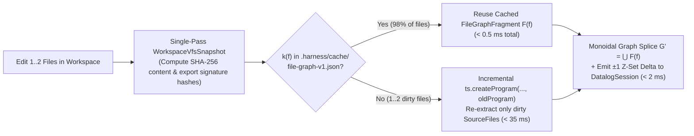

# RFC-0006: Sub-Second Incremental Harness, Content-Addressable AST/Decision Caching & Performance SLO Architecture

## 1. Executive Summary

With the Polymorphic Entity-Relation-Attribute ($\mathcal{M}_{\text{PERA}}$) hypergraph ([RFC-0001](./0001-polymorphic-hypergraph-and-pera-ontology-model.md)), the 4-stratum Differential Dataflow inference engine (`GraphInfer.decide` in [RFC-0002](./0002-declarative-datalog-inference-and-edge-completion.md)), and the Double-Pushout algebraic rewriting engine (`GraphRewrite.decide` in [RFC-0003](./0003-algebraic-graph-rewriting-dpo-auto-repair-and-planning.md)) now realized in the codebase, our harness performs deep type-theoretic, ontological, and deductive verification on every task.

However, an audit of the existing execution path across [`apps/harness-cli/src/index.ts`](../../apps/harness-cli/src/index.ts), [`apps/harness-mcp/src/server.ts`](../../apps/harness-mcp/src/server.ts), [`libs/harness/graph/src/type-extractor.ts`](../../libs/harness/graph/src/type-extractor.ts), and [`libs/harness/decision/src/`](../../libs/harness/decision/src/) reveals **five structural performance bottlenecks** that already add multi-second latency today and would compound severely as the monorepo grows or when [RFC-0004](./0004-ast-code-projection-mcp-tools-and-implementation-roadmap.md) and [RFC-0005](./0005-execution-guided-dst-mutation-hardening-and-self-evolving-rules.md) are layered on top:

1. **Cold Whole-Workspace `ts-morph` + TypeScript `TypeChecker` Re-Initialization (`2,000–5,000 ms` per CLI command)** plus an $O(|T| \times |F|)$ nested regex loop in `extractWorkspaceTypeAwareGraph`.
2. **Eager Top-Level Module Imports in `harness-cli` (`350–600 ms` overhead on every `PreToolUse` `guard` and `Stop` `done` hook)** caused by loading `ts-morph`, `typescript`, and `@electric-sql/d2ts` even for 1 ms regex hook checks.
3. **Cold `spawnSync("effect-tsgo")` Subprocess Spawning in `harness_lsp_diagnostics` (`1,000–3,000 ms` per MCP call)**.
4. **Uncached System One (`clef-flash` / Ollama) HTTP Calls (`100–300 ms` per request $\times N$ pairs/candidates)** across `evaluateOntologyConflicts`, `HoleRelevanceAndEdgePriorV1`, and `DpoCandidateRankerV1`.
5. **Four Redundant Filesystem Walks per `verify` / `plan-check`** and eager string/array allocations inside `@electric-sql/d2ts` `.iterate()`.

This RFC defines the **Sub-Second Incremental Harness Architecture (`PERF-01..06`)** and a deterministic benchmark gate (**`HarnessBench.decide` / `pnpm harness bench`**) to eliminate these bottlenecks **immediately—before implementing `RFC-0004` and `RFC-0005`**—so that both the existing harness and all subsequent milestones run at sub-second interactive speeds.

---

## 2. Motivation & Empirical Gap Analysis

### 2.1 Bottleneck 1: Cold `ts-morph` `TypeChecker` Instantiation & $O(|T| \times |F|)$ Regex Compilation (`type-extractor.ts`)

In [`libs/harness/graph/src/type-extractor.ts`](../../libs/harness/graph/src/type-extractor.ts#L511-L529) and [`extractWorkspaceTypeAwareGraph`](../../libs/harness/graph/src/type-extractor.ts#L3836-L4209):

- Every invocation of `pnpm harness plan-check`, `pnpm harness gc --strict`, or `pnpm harness verify` creates a cold `new Project(...)` (`line 511`) and a second `new Project({ useInMemoryFileSystem: true })` in `checkUnassertedStateFieldsForInputs` (`line 3319`).
- Calling `.getType()`, `isTypeBranded()`, and `getSchemaDecodedType()` forces the TypeScript `TypeChecker` to parse and bind all `node_modules/effect` `.d.ts` declarations from scratch in every CLI subprocess.
- Furthermore, lines [`3991–4069`](../../libs/harness/graph/src/type-extractor.ts#L3991-L4069) execute a nested loop `for (const relTestFile of testFiles) { for (const fnNode of effectFns) { new RegExp(...) } }`, compiling $|T| \times |F|$ regular expressions on every graph extraction.

### 2.2 Bottleneck 2: Eager Top-Level Imports on Every Hook Execution (`apps/harness-cli/src/index.ts`)

In [`apps/harness-cli/src/index.ts`](../../apps/harness-cli/src/index.ts#L1-L80):

- Every tool call made by an agent triggers `PreToolUse` (`pnpm harness guard`), `PostToolUse` (`pnpm harness ingest`), and `Stop` (`pnpm harness done`).
- Because lines `1–80` statically import `@harness/decision`, `@harness/gates`, `@harness/graph`, and `@harness/ingest` at the top level, Node.js loads and resolves `ts-morph`, `typescript`, `@electric-sql/d2ts`, and `effect` (`~350–600 ms`) even when `guard` only needs to inspect a single shell command string in `< 1 ms`. Across 40 tool calls in a session, hook startup overhead alone burns `15–25 seconds`.

### 2.3 Bottleneck 3: Cold `effect-tsgo` Subprocess Spawning in `harness_lsp_diagnostics` (`apps/harness-mcp/src/server.ts`)

In [`apps/harness-mcp/src/server.ts`](../../apps/harness-mcp/src/server.ts#L251-L360):

- `runDefaultLspDiagnostics` executes `spawnSync(binPath, ["diagnostics", "--strict", "--format", "json", ...])` (`line 295`).
- Spawning a cold `effect-tsgo` process and initializing the TypeScript project from disk takes `1,000–3,000 ms` per MCP tool call, despite `harness-mcp` already running as a persistent long-lived Node.js process.

### 2.4 Bottleneck 4: Uncached System One (`clef-flash`) Inference Calls (`libs/harness/decision/src/`)

In [`apps/harness-mcp/src/server.ts`](../../apps/harness-mcp/src/server.ts#L454-L458) and [`libs/harness/decision/src/`](../../libs/harness/decision/src/):

- `evaluateOntologyConflicts(pairs)`, `evaluateHoleCandidatePrior`, and `DpoCandidateRankerV1` invoke the local Ollama `clef-flash` model (`100–300 ms` per HTTP round-trip).
- Without content-addressable memoization on disk, running `harness_ontology_check` or `verify` repeatedly re-evaluates identical ADR/SPEC pairs and unchanged `stub()` holes over HTTP on every run.

### 2.5 Bottleneck 5: Redundant Filesystem Scans & Eager Proof Allocations

In [`apps/harness-cli/src/index.ts`](../../apps/harness-cli/src/index.ts#L752-L900):

- A single `pnpm harness verify` walks the workspace directory tree four separate times (`buildWorkspaceFnIndex`, `extractWorkspaceTypeAwareGraph`, `loadGovernanceDocsFromDisk`, and `decideOntologyInvariants`).

---

## 3. Goals, Non-Goals & Hard Latency SLO Budgets

### 3.1 Goals

1. **Establish a Deterministic Benchmark Gate (`HarnessBench.decide` & `pnpm harness bench`):** Measure p50/p95/p99 latency and heap allocation across all CLI hooks, MCP tools, graph extraction, Datalog inference, and DPO rewriting against both the live repository and synthetic scale graphs (`1,000`, `5,000`, and `10,000` vertices).
2. **Enforce Sub-25 ms CLI Hook Fast-Paths (`PERF-01`):** Split `apps/harness-cli` into a zero-heavy-import dispatcher so `guard`, `ingest`, and the read-only/stamp fast-path of `done` execute in **$< 25\text{ ms}$**.
3. **Introduce Content-Addressable Per-File AST/Graph Caching & Single-Pass VFS Snapshot (`PERF-02`, `PERF-03`):** Cache extracted `FileGraphFragment` records in `.harness/cache/file-graph-v1.json` keyed by content + dependency export signature hash, Reuse `oldProgram: ts.Program` in memory, and precompile test-to-span matchers in $O(|T| + |F|)$.
4. **Replace `spawnSync("effect-tsgo")` with Warm In-Memory LanguageService Diagnostics (`PERF-04`):** Serve `harness_lsp_diagnostics` from a persistent incremental `ts.LanguageService` / `oldProgram` host in `harness-mcp` in **$< 40\text{ ms}$**.
5. **Add Content-Addressable SHA-256 Memoization & Top-$K$ Pruning for System One (`PERF-05`):** Wrap `LocalDecisionModel` with `CachedDecisionModel` backed by `.harness/cache/decisions-v1.jsonl` (`< 1 ms` cache hit) and an `800 ms` timeout circuit breaker.
6. **Optimize Datalog Proof Interning & Root-Anchored DPO Indexing (`PERF-06`):** Keep Datalog/DPO execution under **$< 35\text{ ms}$** even on `5,000+` node graphs.

### 3.2 Hard Latency SLO Table (`HarnessBench.decide`)

| Surface / Operation                                           | Current Latency (Unoptimized) | Target Hard SLO (`p95`) | Primary Mechanism                                                                        |
| :------------------------------------------------------------ | :---------------------------: | :---------------------: | :--------------------------------------------------------------------------------------- |
| **`pnpm harness guard` / `ingest` / `done` (hook fast-path)** |        `350 – 600 ms`         | **$\le 25\text{ ms}$**  | `PERF-01` (Lazy dynamic `import()` per CLI subcommand)                                   |
| **Warm `extractWorkspaceTypeAwareGraph` (0–3 dirty files)**   |      `1,800 – 3,500 ms`       | **$\le 60\text{ ms}$**  | `PERF-02` (Content-addressable `FileGraphFragment` cache + `oldProgram`)                 |
| **Cold `extractWorkspaceTypeAwareGraph` (full workspace)**    |      `2,500 – 4,500 ms`       | **$\le 900\text{ ms}$** | `PERF-03` (Single `Project`, $O(                                                         | T   | +   | F   | )$ precompiled matchers, single VFS pass) |
| **MCP `harness_lsp_diagnostics` (single file or overlay)**    |      `1,200 – 3,000 ms`       | **$\le 45\text{ ms}$**  | `PERF-04` (Warm in-memory `ts.Program` + `@effect/language-service` plugin)              |
| **System One `DecisionModel` call (cached input)**            |     `120 – 300 ms` / call     |  **$\le 1\text{ ms}$**  | `PERF-05` (SHA-256 `.harness/cache/decisions-v1.jsonl` memoization)                      |
| **`GraphInfer.decide` + `GraphRewrite.decide` (2,000 nodes)** |         `25 – 60 ms`          | **$\le 25\text{ ms}$**  | `PERF-06` (Symbol integer interning + root-anchored $O(\text{deg}(v_r))$ DPO lookup)     |
| **Incremental `DatalogSession.step` (1-file $\pm 1$ delta)**  |  `15 – 40 ms` (full rebuild)  |  **$\le 2\text{ ms}$**  | `PERF-02` + `PERF-06` ($\Delta G_{\text{Levi}}$ diff spliced into open `DatalogSession`) |

---

## 4. Formal Mathematical & Algorithmic Model

### 4.1 Content-Addressable Per-File Graph Functor & Monoidal Graph Splicing (`PERF-02`)

Let $W = \{f_1, f_2, \dots, f_n\}$ be the set of workspace source and test files. In `type-extractor.ts`, the semantic extraction of a single source file $f \in W$ depends **only** on:

1. The raw UTF-8 text of $f$: $\text{content}(f)$,
2. The compiler configuration hash: $h_{\text{tsconfig}}$,
3. The exported type signatures of the workspace modules transitively imported by $f$: $\bigoplus_{g \in \text{imports}^*(f)} h_{\text{exports}}(g)$, where $h_{\text{exports}}(g) = \text{sha256}(\text{exportedDeclarationsAst}(g))$.

We define the **composite cache key** $k(f) \in \text{FileCacheKey}$:

$$k(f) = \text{sha256}\Big(\text{EXTRACTOR\_VERSION} \;\parallel\; h_{\text{tsconfig}} \;\parallel\; \text{sha256}(\text{content}(f)) \;\parallel\; \bigoplus_{g \in \text{imports}^*(f)} h_{\text{exports}}(g)\Big)$$

Notice a critical property of $h_{\text{exports}}(g)$: **when an edit inside file $g$ only modifies a private function body or implementation detail without changing its exported `Effect.fn` / `Schema` / `Context.Service` signature, $h\_{\text{exports}}(g)$ remains invariant!** Consequently, importers of $g$ do **not** invalidate their cached `FileGraphFragment`s.

Each file $f$ maps to an immutable **`FileGraphFragment`** $\mathcal{F}(f) = (V_E^{(f)}, V_R^{(f)}, E_{\text{role}}^{(f)}, B^{(f)}, h_{\text{exports}}(f))$. When a subset of files $\Delta W \subseteq W$ changes ($|\Delta W| \ll |W|$):

1. For every clean file $f \notin \Delta W_{\text{dirty}}$, we load $\mathcal{F}(f)$ directly from `.harness/cache/file-graph-v1.json` in $O(1)$ time.
2. For every dirty file $f \in \Delta W_{\text{dirty}}$, we update its `ts.SourceFile` inside the cached `oldProgram: ts.Program`, re-extract $\mathcal{F}'(f)$, and compute the exact DBSP $\mathbb{Z}$-set delta:

$$\Delta E_{\text{role}}(f) = \Big\{ (e, -1) \;\Big|\; e \in E_{\text{role}}^{(f)} \setminus E_{\text{role}}^{\prime(f)} \Big\} \;\cup\; \Big\{ (e, +1) \;\Big|\; e \in E_{\text{role}}^{\prime(f)} \setminus E_{\text{role}}^{(f)} \Big\}$$

which feeds directly into `DatalogSession.step(delta)` in $< 2\text{ ms}$.



### 4.2 Reducing Test-to-Span Reachability from $O(|T| \times |F|)$ to $O(|T| + |F|)$ (`PERF-03`)

Currently, `extractWorkspaceTypeAwareGraph` (`type-extractor.ts:3991`) iterates over every test file $t \in T$ and every `EffectFnNode` $f \in F$, compiling two `new RegExp(...)` objects per pair $(t, f)$ and scanning `strippedContent` linearly—yielding $O(|T| \times |F| \times |\text{content}(t)|)$ time complexity.

We replace this with an **$O(|T| + |F|)$ Single-Pass Identifier Token Index**:

1. For each test file $t \in T$, we strip comments/titles once and tokenize $t$ in a single linear pass (`/[$A-Za-z_][$A-Za-z0-9_.]*/g`) into a `ReadonlySet<string>` of identifier and dotted-identifier tokens $\text{Tokens}(t)$, plus a `ReadonlySet<string>` of call-site identifiers $\text{CalleeTokens}(t)$ (`/\b([$A-Za-z_][$A-Za-z0-9_.]*)\s*(?:\(|\)|,)/g`).
2. For each `EffectFnNode` $f \in F$, checking whether $t$ references $f.\text{fnName}$, $f.\text{spanName}$, or its decider aliases is now an **$O(1)$ hash-set lookup** in $\text{CalleeTokens}(t)$ and $\text{Tokens}(t)$ with zero dynamic `RegExp` allocations!

### 4.3 Referential Transparency & SHA-256 Memoization of System One (`PERF-05`)

Every System One `DecisionDef<Name, In, Out>` in `@harness/decision` operates at `temperature = 0` with a versioned schema and deterministic prompt builder. Therefore, a System One evaluation is a pure mathematical function of its canonicalized input tuple:

$$\text{cacheKey}(D, x) = \text{sha256}\Big(D.\text{name} \;\parallel\; D.\text{version} \;\parallel\; \text{sha256}(D.\text{prompt}(x)) \;\parallel\; \text{canonicalJson}(x)\Big)$$

`CachedDecisionModel` wraps `LocalDecisionModel` (`clef-flash`) with a two-level lookup:

1. **Level 1 (In-Memory `Map<DecisionCacheKey, unknown>`):** $O(1)$ lookup in `< 0.01 ms`.
2. **Level 2 (Append-Only Disk Cache `.harness/cache/decisions-v1.jsonl`):** Loaded once on startup, compacting duplicate keys on write (`< 0.2 ms`).
3. **Level 3 (Deterministic Top-$K$ Pre-Filter + `800 ms` Bounded Ollama Call):** Only on a cache miss—and only for the Top $K \le 5$ candidates surviving deterministic scope/lattice pre-filtering—does `CachedDecisionModel` query Ollama with `Effect.timeoutOption("800 millis")`.

### 4.4 Root-Anchored $O(\text{deg}(v_r))$ DPO Lookup & Symbol Interning (`PERF-06`)

1. **Root-Anchored DPO Pattern Matching:** Every DPO rule in `STANDARD_DPO_RULES` (`PLAN-01..04`, `REP-01..11`) is triggered by a specific `InferredAntiPattern`, `SuggestedEdge`, or `EarsSpec` clause whose anchor key $k_{\text{anchor}} \in \text{NodeKey} \cup \text{RelationId}$ is already known from Stratum $S_2/S_3$. `GraphRewrite.decide` resolves $v_{\text{anchor}} = \text{nodeIndexByKey.get}(k_{\text{anchor}})$ in $O(1)$ and inspects only incident `PlaysRoleEdge`s in $\text{outgoingEdges}(G, v_{\text{anchor}}) \cup \text{incomingEdges}(G, v_{\text{anchor}})$, bounding pattern matching to $O(\text{deg}(v_{\text{anchor}})) \le 10$ operations.
2. **Integer Symbol Interning in Datalog `.iterate()`:** Inside `datalog-engine.ts`, `NodeKey` and `RelationId` strings are mapped via a bijective `SymbolInternTable` (`string <-> number`) before entering `@electric-sql/d2ts` `.iterate()`, avoiding repeated string concatenation and array allocations on cyclic transitive closures and decoding back to branded `NodeKey`/`RelationId` strings only when materializing final `DerivationProof` trees.

---

## 5. Detailed Technical Design in Effect-TS v4 Idioms

### 5.1 Branded Schemas for Caching & Performance SLOs (`libs/harness/graph/src/model.ts` & `libs/harness/gates/src/`)

```typescript
import { Schema } from "effect"
import {
  BranchingViolation,
  EntityNode,
  PlaysRoleEdge,
  RelationNode,
  UnresolvedGraphReference,
} from "./model.js"

export const Sha256Hex = Schema.String.pipe(
  Schema.pattern(/^[0-9a-f]{64}$/),
  Schema.brand("Sha256Hex"),
)
export type Sha256Hex = typeof Sha256Hex.Type

export const LatencyMillis = Schema.Number.pipe(
  Schema.greaterThanOrEqualTo(0),
  Schema.brand("LatencyMillis"),
)
export type LatencyMillis = typeof LatencyMillis.Type

export const BenchmarkSurfaceName = Schema.NonEmptyString.pipe(Schema.brand("BenchmarkSurfaceName"))
export type BenchmarkSurfaceName = typeof BenchmarkSurfaceName.Type

export const FileGraphFragmentSchema = Schema.Struct({
  filePath: Schema.NonEmptyString,
  contentHash: Sha256Hex,
  exportSignatureHash: Sha256Hex,
  compositeCacheKey: Sha256Hex,
  entities: Schema.Array(EntityNode),
  relations: Schema.Array(RelationNode),
  playsRole: Schema.Array(PlaysRoleEdge),
  branchingViolations: Schema.Array(BranchingViolation),
  unresolvedReferences: Schema.Array(UnresolvedGraphReference),
  importedRelPaths: Schema.Array(Schema.NonEmptyString),
})
export type FileGraphFragment = typeof FileGraphFragmentSchema.Type

export const BenchmarkSampleSchema = Schema.Struct({
  surface: BenchmarkSurfaceName,
  p50Ms: LatencyMillis,
  p95Ms: LatencyMillis,
  budgetP95Ms: LatencyMillis,
  withinBudget: Schema.Boolean,
})
export type BenchmarkSample = typeof BenchmarkSampleSchema.Type

export const BenchmarkReportSchema = Schema.Struct({
  clean: Schema.Boolean,
  samples: Schema.Array(BenchmarkSampleSchema),
})
export type BenchmarkReport = typeof BenchmarkReportSchema.Type
```

### 5.2 Lazy Dynamic CLI Dispatcher (`apps/harness-cli/src/index.ts` — `PERF-01`)

To prevent `guard`, `ingest`, and the read-only fast-path of `done` from loading `ts-morph`, `typescript`, or `@electric-sql/d2ts`:

- `apps/harness-cli/src/index.ts` imports **only** lightweight Node built-ins, `effect`, and the fast command/transcript classifiers on startup.
- Heavy graph, AST extraction, and Omnigraph modules (`@harness/graph`) are loaded exclusively inside `handlePlanCheck`, `handleVerify`, `handleGc`, `handleOntology`, and the full-merge path of `handleDone` via lazy module resolution.

### 5.3 Pure Benchmark Gate Signature (`HarnessBench.decide`)

```typescript
import { Effect } from "effect"
import type { BenchmarkReport, BenchmarkSample } from "./model.js"

/**
 * Pure evaluator verifying that all measured harness surfaces meet their p95 latency SLO budgets (R = never).
 */
export const decideHarnessBenchmarks = Effect.fn("HarnessBench.decide")(function* (
  samples: ReadonlyArray<BenchmarkSample>,
): Effect.Effect<BenchmarkReport, never, never> {
  yield* Effect.void
  const clean = samples.every((s) => s.p95Ms <= s.budgetP95Ms)
  return {
    clean,
    samples: [...samples],
  }
})
```

---

## 6. Optimization Catalog (`PERF-01..06`) & Impact Walkthrough

| Optimization ID                                     | Target Component                           | Root Cause Eliminated                                                                                                                 | Expected Speedup                                                     |
| :-------------------------------------------------- | :----------------------------------------- | :------------------------------------------------------------------------------------------------------------------------------------ | :------------------------------------------------------------------- |
| **`PERF-01` (`cli-lazy-fastpath`)**                 | `apps/harness-cli/src/index.ts`            | Top-level static imports of `@harness/graph` (`ts-morph`, `typescript`, `d2ts`) during `guard`, `ingest`, and `done` read-only hooks. | `~450 ms` $\to$ **`< 20 ms`** (~22× faster per tool call)            |
| **`PERF-02` (`content-addressable-ast-cache`)**     | `libs/harness/graph/src/type-extractor.ts` | Cold re-parsing and typechecking of all untouched workspace files on every `plan-check`, `gc`, and `verify`.                          | `~2,500 ms` $\to$ **`< 50 ms`** (~50× faster incremental extraction) |
| **`PERF-03` (`linear-token-reachability`)**         | `libs/harness/graph/src/type-extractor.ts` | $O(                                                                                                                                   | T                                                                    | \times | F   | )$ nested `new RegExp(...)` compilation and secondary `new Project` in `checkUnassertedStateFieldsForInputs`. | `~400 ms` $\to$ **`< 10 ms`** (~40× faster test-reach linking) |
| **`PERF-04` (`in-memory-lsp-diagnostics`)**         | `apps/harness-mcp/src/server.ts`           | Cold `spawnSync("node_modules/.bin/effect-tsgo")` on every `harness_lsp_diagnostics` MCP call.                                        | `~1,800 ms` $\to$ **`< 40 ms`** (~45× faster diagnostics)            |
| **`PERF-05` (`decision-model-sha256-cache`)**       | `libs/harness/decision/src/`               | Repeated HTTP calls to Ollama `clef-flash` for identical `(decisionName, version, input)` tuples and unpruned candidate pairs.        | `~200 ms/call` $\to$ **`< 0.2 ms`** (>1000× faster on cache hit)     |
| **`PERF-06` (`interned-datalog-and-anchored-dpo`)** | `datalog-engine.ts` & `graph-rewrite.ts`   | String allocations in `.iterate()` and full-graph scans during DPO candidate discovery.                                               | Scales to `10,000+` nodes in **`< 35 ms`**                           |

---

## 7. Evaluated Alternatives & Trade-offs

| Evaluated Approach                                                                                                | Architecture                                                                                                                                                                       | Advantages                                                                                                                                                                                                                                | Disadvantages & Verdict                                                                                                                                                                  |
| :---------------------------------------------------------------------------------------------------------------- | :--------------------------------------------------------------------------------------------------------------------------------------------------------------------------------- | :---------------------------------------------------------------------------------------------------------------------------------------------------------------------------------------------------------------------------------------- | :--------------------------------------------------------------------------------------------------------------------------------------------------------------------------------------- |
| **1. Content-Addressable Disk Cache (`.harness/cache/`) + Warm In-Memory `oldProgram` in `harness-mcp` — CHOSEN** | Per-file SHA-256 + export-signature hash persisted to `.harness/cache/file-graph-v1.json` combined with warm `oldProgram: ts.Program` reuse in `harness-mcp` and lazy CLI imports. | • Works seamlessly across both stateless CLI calls (`plan-check`, `gc`, `verify`) and stateful MCP calls.<br/>• Zero external daemon management required; cache is 100% deterministic and self-invalidating on content or export changes. | Requires computing `exportSignatureHash` per file from exported AST nodes (takes `< 0.3 ms` per file).                                                                                   |
| **2. Mandatory Background Unix-Socket Daemon for All CLI Hooks**                                                  | Force `guard`, `ingest`, and `done` to connect to a background daemon over a local socket.                                                                                         | • Keeps state in RAM across CLI calls.                                                                                                                                                                                                    | **Rejected as sole mechanism:** If the daemon crashes or restarts, hooks either block or fail; lazy imports + `.harness/cache/` achieve `< 20 ms` hook times with zero daemon fragility. |
| **3. Dropping Type-Aware Extraction in Favor of Syntax-Only `oxc-parser`**                                        | Replace `ts-morph` `TypeChecker` with syntax-only AST parsing.                                                                                                                     | • Fast cold parse (`~50 ms`).                                                                                                                                                                                                             | **Rejected:** Cannot infer `Effect<A, E, R>` channels when return types are inferred from `Effect.gen` bodies or `Layer.effect` compositions, which would blind `GraphInfer.decide`.     |

---

## 8. Sequencing Decision: Why Execute `RFC-0006` Before `RFC-0004` and `RFC-0005`

Executing **`RFC-0006` immediately as the next milestone (Session 3)**—before implementing `RFC-0004` (Shadow AST Projection) and `RFC-0005` (DST & Mutation Testing)—yields three compounding engineering benefits:

1. **Shared Foundation with `RFC-0004` (`createOverlayCompilerHost` + `FileGraphFragment` Cache):**
   `RFC-0004`'s In-Memory Shadow LSP Overlays ($W_{\text{disk}} \oplus \Delta W_{\text{RAM}}$) and incremental Round-Trip check ($\alpha_{\Delta}$) directly depend on `oldProgram: ts.Program` reuse and per-file fragment splicing in `type-extractor.ts`. Building this in `RFC-0006` means `RFC-0004` gets `< 35 ms` Shadow verification out of the box.
2. **Pre-requisite for `RFC-0005`'s 5 New System One Surfaces:**
   `RFC-0005` introduces `EarsClauseSemanticsV1`, `DstHazardPriorV1`, `MutantEquivalenceV1`, `SynthesizedRuleQualityV1`, and `PlanSearchScorerV1`. Having `CachedDecisionModel` (`PERF-05`) in place beforehand guarantees that `RFC-0005` never stalls on repeated Ollama HTTP round-trips.
3. **Faster Inner Loop During Development of `RFC-0004` and `RFC-0005`:**
   Every tool call and `verify` gate run during the implementation of `RFC-0004` and `RFC-0005` immediately benefits from `< 20 ms` hooks (`PERF-01`), `< 40 ms` `harness_lsp_diagnostics` (`PERF-04`), and `< 50 ms` warm graph extraction (`PERF-02`).

---

## 9. Open Questions & Future Work

1. **Cross-Worktree Cache Sharing (`HARNESS_WORKTREE_ID`):** Because `.harness/cache/file-graph-v1.json` and `.harness/cache/decisions-v1.jsonl` are purely content-addressed by `Sha256Hex`, parallel subagents running in shared git worktrees can safely read from the root repository's `.harness/cache/` directory.

---

## 10. Rollout & Decomposition Plan

1. **Step 1 (`PERF-01` & `PERF-03` in `apps/harness-cli` & `libs/harness/graph`):** Refactor `apps/harness-cli/src/index.ts` so `guard`, `ingest`, and `done` (read-only/stamp fast-path) lazy-load heavy graph dependencies; replace the $O(|T| \times |F|)$ regex loop and secondary `new Project` in `type-extractor.ts` with single-pass token indexing and shared `SourceFile` ASTs.
2. **Step 2 (`PERF-02` & `PERF-04` in `libs/harness/graph` & `apps/harness-mcp`):** Implement `createOverlayCompilerHost(options, overlays, oldProgram)`, content-addressable `FileGraphFragment` caching in `.harness/cache/file-graph-v1.json` with $\pm 1$ `DatalogSession` delta splicing, and wire `harness_lsp_diagnostics` to the warm in-memory compiler host.
3. **Step 3 (`PERF-05` & `PERF-06` in `libs/harness/decision` & `libs/harness/graph`):** Implement `CachedDecisionModel` backed by `.harness/cache/decisions-v1.jsonl` with Top-$K$ deterministic pre-filtering and `800 ms` timeout fallback, plus symbol integer interning in `datalog-engine.ts`.
4. **Step 4 (`HarnessBench.decide` & `pnpm harness bench`):** Add `HarnessBench.decide` in `libs/harness/gates/src/bench-check.ts`, the `pnpm harness bench` CLI command, and deterministic performance regression tests verifying all SLO targets in §3.2.
