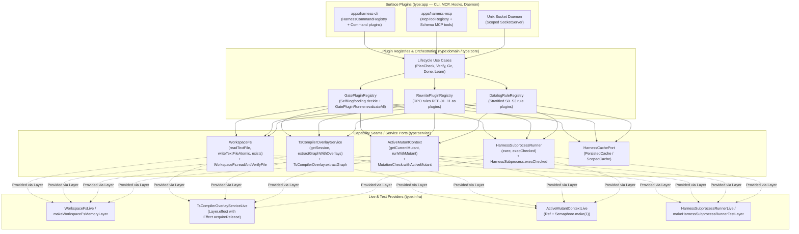

# RFC-0007 Appendix A: Comprehensive `effect-ts-harness` Architecture Audit Report

> [!IMPORTANT]
> **Verdict (`ce-pov` — Migrate / Modularize):** Prior to `RFC-0007`, the source code of the harness itself (`apps/harness-cli`, `apps/harness-mcp`, `libs/harness/*`, `tools/*`, `libs/*/scripts/*.mjs`) suffered from **"The Cobbler's Children Paradox"**. While we enforced a strict 5-layer architecture, `Context.Service` + `Layer` Dependency Injection, exhaustive `ts-pattern` matching, and zero imperative I/O on user domain code (`libs/sample`, `libs/es`), the harness explicitly exempted itself from its own rules via `isInternalHarnessFile` in [`tools/oxlint/syntax-bans.js`](../../tools/oxlint/syntax-bans.js) and `isHarnessInternal` in [`libs/harness/gates/src/ast-cache.ts`](../../libs/harness/gates/src/ast-cache.ts). This resulted in **1,600 to 5,603-line monolithic God-files**, **"Effect-washing"** (wrapping synchronous imperative code inside `Effect.fn` with `R = never` and zero DI), and global mutable state (`new Map()`) instead of `Scope`, `Cache`, and `Layer`.

Companion document to **[RFC-0007: Self-Dogfooding Audit, Effect-TS v4 Paradigm Alignment & Modular Plugin Harness Architecture](./0007-self-dogfooding-audit-and-modular-plugin-harness-architecture.md)**.

---

## 1. Quantitative Diagnosis Summary (Project Grounding)

A full-repository audit across all packages revealed a stark contrast between the standards enforced on application/framework domains and how the harness itself was written prior to `RFC-0007`:

| Metric / Architectural Indicator | Required by `AGENTS.md` / Effect v4 | Pre-RFC-0007 Reality in `libs/harness/*` & `apps/harness-*` | Code Evidence |
| :--- | :--- | :--- | :--- |
| **File Size (God-Files)** | Small, single-responsibility modules separated by `contract / service / domain / infra` | **11 source files > 800 LOC**, largest reaching **5,603 LOC** | [`type-extractor.ts`](../../libs/harness/graph/src/type-extractor.ts) (5,603 LOC), [`apps/harness-cli/src/index.ts`](../../apps/harness-cli/src/index.ts) (3,759 LOC), [`datalog-engine.ts`](../../libs/harness/graph/src/datalog-engine.ts) (3,255 LOC) |
| **`Context.Service` Ports (DI)** | Every I/O or stateful capability is a `Context.Service` tracked in the `R` channel | Only **4 services** across all of `libs/harness/*`, **0 services** in `apps/harness-cli` and `apps/harness-mcp` (before `RFC-0007`) | `SpanRecorder`, `ChaosFaultController`, `DatalogSession`, `OmnigraphSync` vs. **277 `Effect.fn` declarations** (almost all with `R = never`) |
| **Platform Services (`effect/FileSystem`, `effect/process`, `effect/cli`)** | `FileSystem`, `Path`, `ChildProcess`, `Command.make`, `PersistedCache` | **0 usages** across `libs/harness/*` and `apps/harness-*`; instead **45x `node:fs`** and **12x `node:child_process`** | [`apps/harness-cli/src/index.ts`](../../apps/harness-cli/src/index.ts), [`type-extractor.ts`](../../libs/harness/graph/src/type-extractor.ts), [`gc-check.ts`](../../libs/harness/gates/src/gc-check.ts) |
| **Lifecycle & Cache Management (`Scope`, `Cache`, `PersistedCache`)** | `Layer.effect` (with `Effect.acquireRelease`) + `Cache.make` / `PersistedCache.make` | **Module-level mutable `new Map()` singletons** and `let counter = 0` | [`ast-cache.ts`](../../libs/harness/gates/src/ast-cache.ts), [`cached-decision-model.ts`](../../libs/harness/decision/src/cached-decision-model.ts), [`type-extractor.ts`](../../libs/harness/graph/src/type-extractor.ts) |
| **Runtime Execution (`Effect.runSync` / `Effect.runPromise`)** | Single `NodeRuntime.runMain` at the application boundary (`type:app`) | **49 calls to `Effect.runSync` / `Effect.runPromise`**, including calling `Effect.runSync` *inside* `Layer.effect` and `.decide`! | [`ast-cache.ts`](../../libs/harness/gates/src/ast-cache.ts), [`cached-decision-model.ts`](../../libs/harness/decision/src/cached-decision-model.ts), [`server.ts`](../../apps/harness-mcp/src/server.ts) |
| **Boundary Validation (`Schema` vs. `zod`)** | Exclusively `effect/Schema` | `apps/harness-mcp` imports **`zod`** (`4.6.5`) for MCP schemas instead of `Schema` | [`apps/harness-mcp/package.json`](../../apps/harness-mcp/package.json), [`apps/harness-mcp/src/server.ts`](../../apps/harness-mcp/src/server.ts) |
| **Self-Rule Exemptions** | Uniform enforcement across the entire monorepo | `isInternalHarnessFile` disabled bans on `switch`, `if/else-if`, discriminant `if`, `Schema.brand`, and inline object types for `libs/harness` and `apps/harness-*` | [`tools/oxlint/syntax-bans.js`](../../tools/oxlint/syntax-bans.js), [`libs/harness/gates/src/ast-cache.ts`](../../libs/harness/gates/src/ast-cache.ts) |

---

## 2. Detailed Analysis of the 7 Core Architectural Weaknesses

### 2.1 "Effect-Washing" — Wrapping Imperative Procedures in `Effect.fn` with `R = never`

Much of the pre-RFC-0007 code in `libs/harness/*` was not written in the Effect paradigm at all—it was procedural TypeScript wrapped inside `Effect.fn("...")(function* () { return yield* Effect.succeed(...) })` merely to satisfy span-naming checks.

Key examples identified in the audit:
- **Fake `Effect.fn` wrappers over synchronous I/O in [`libs/harness/gates/src/ast-cache.ts`](../../libs/harness/gates/src/ast-cache.ts):**
  ```ts
  export const decideAstGateCache = Effect.fn("AstGateCache.decide")(function* (
    input: AstGateEvaluationInput,
  ): Effect.fn.Return<AstGateDecisionReport> {
    return yield* Effect.succeed(evaluateAstGateFiles(input))
  })
  ```
  The underlying `evaluateAstGateFiles(input)` function is a synchronous procedure that mutates global `inMemoryGateCache: Map`, reads files via `readFileSync`, writes to disk via `writeFileSync` + `renameSync`, and calls `Effect.runSync(Effect.try(...).pipe(Effect.ignore))`. Externally, however, it declared `Effect<AstGateDecisionReport, never, never>` (`R = never`, `E = never`)—misleading the type system into treating it as a pure, side-effect-free decider.
- **The same anti-pattern in [`libs/harness/graph/src/type-extractor.ts`](../../libs/harness/graph/src/type-extractor.ts) and [`libs/harness/graph/src/graph-projector.ts`](../../libs/harness/graph/src/graph-projector.ts):**
  `extractWorkspaceTypeAwareGraph` (`TypeExtractor.extractWorkspace`) declared `Effect<HarnessGraph, never, never>` despite executing hundreds of `fs.readFileSync`, `fs.readdirSync`, and `fs.writeFileSync` calls, instantiating a `ts-morph` `Project`, and mutating a module-global `warmProgramSessions = new Map<string, TypeScriptProgramSession>()`.
- **Dummy generators with `yield* Effect.void` and synchronous `.runSync` wrappers (resolved in `RFC-0007`):**
  Because the body of many gates was written as 100% synchronous procedural code, generators began with an artificial `yield* Effect.void` solely to silence the linter's `require-yield` rule, followed by a synchronous wrapper calling `Effect.runSync` at the bottom of the file:
  - [`libs/harness/gates/src/gc-check.ts`](../../libs/harness/gates/src/gc-check.ts): 828-line function `decideGraphEntropy = Effect.fn("GraphGc.decide")(function* (input) { ... })`.
  - [`libs/harness/gates/src/adr-lint.ts`](../../libs/harness/gates/src/adr-lint.ts): 570-line function ending with `export const lintAdrDocMarkdown = (...) => Effect.runSync(decideAdrDocQuality(...))`.
  - [`libs/harness/gates/src/ontology-invariants.ts`](../../libs/harness/gates/src/ontology-invariants.ts): 587-line function ending with `export const checkOntologyInvariants = (...) => Effect.runSync(decideOntologyInvariants(...))`.
- **Mutating `globalThis` instead of `FiberRef` / `Context.Service` in [`libs/harness/gates/src/mutation-check.ts`](../../libs/harness/gates/src/mutation-check.ts) (resolved via `ActiveMutantContext` in `RFC-0007`):**
  Instead of clean contextual propagation via `Context.Service` / `Ref` / `Semaphore`, `mutation-check.ts` stored the active mutant directly on `(globalThis as GlobalWithMutantId).__HARNESS_ACTIVE_MUTANT_ID = mutantId` and overwrote files on disk via `writeFileSync` + `spawnSync("pnpm", ["vitest", ...])`.
- **Nested `Effect.runSync` inside `Effect.sync` and at module import time (resolved in `RFC-0007`):**
  - In [`libs/harness/ingest/src/fn-index.ts`](../../libs/harness/ingest/src/fn-index.ts), `buildWorkspaceFnIndex` ran inside `Effect.sync(() => { ... })`, inside which a `for` loop called `Effect.runSync(Effect.try(() => fs.readFileSync(...)))`.
  - In [`libs/harness/graph/src/graph-engine.ts`](../../libs/harness/graph/src/graph-engine.ts), `const PERA_CONCEPT_LATTICE_RESULT = Effect.runSync(decideConceptLattice(...))` ran at top-level module evaluation time.
  - In [`libs/harness/graph/src/graph-engine.ts`](../../libs/harness/graph/src/graph-engine.ts), `deserializeGraphSnapshotEffect` was immediately unwrapped via `Effect.runSyncExit` and thrown with `// oxlint-disable-next-line -- synchronous boundary`.
- **Violation of `*.decide` semantics:** According to `AGENTS.md`, `*.decide` must be a mathematically pure function (`R = never`, zero I/O, deterministic input $\to$ output). In several harness files, `*.decide` was used as a naming convention for stateful or I/O functions to satisfy `enforced_by` / `spans` checks in the ADR linter.

### 2.2 Underutilization of Dependency Injection (`Context.Service` + `Layer`) and Multi-Role Nx Tags

In `libs/harness/{gates,graph,ingest,decision}/package.json`, all 4 libraries were tagged simultaneously as `["type:contract", "type:service"]` (with `graph` also tagged `"type:core"`). This tag combination bypassed `@nx/enforce-module-boundaries`, allowing a single package to mix:
1. Contract schemas (`Schema.Struct`, `Schema.TaggedUnion`),
2. Pure domain computations (Datalog rules, Levenshtein distance, EARS parser),
3. Infrastructure adapters (`node:fs`, `node:child_process`, `node:net`, `ts-morph`, `@ast-grep/napi`, HTTP calls to Omnigraph).

Because `Context.Service` ports were initially absent for core harness capabilities:
- Functions passed raw `repoRoot: string` across 15 call levels instead of yielding `WorkspaceFs` or `TsCompilerOverlayService`.
- `decisionLayer: Layer.Layer<DecisionModel.DecisionModel>` in [`apps/harness-cli/src/index.ts`](../../apps/harness-cli/src/index.ts) was passed manually as a **function parameter** (`handleGuard(argv, options, decisionLayer)`, `handleVerify(options, decisionLayer)`, `handleDone(argv, options, decisionLayer)`) instead of handlers declaring `DecisionModel` in their `R` channel and providing the `Layer` once at the CLI boundary via `Effect.provide(MainLayer)`.

### 2.3 Neglect of Built-In Effect v4 Modules (`effect/cli`, `effect/FileSystem`, `effect/process`, `effect/persistence`)

Inspecting `repos/effect/packages/effect/src/` and `repos/effect/packages/platform/node/src/NodeServices.ts` shows that our pinned `effect@4.0.0` + `@effect/platform-node@4.0.0` already include the exact primitives that were previously hand-rolled in the harness:

1. **`effect/cli` (`Command`, `Flag`, `Argument`, `CliOutput`, `HelpDoc`, `Prompt`):**
   Instead of a declarative command tree via `Command.make("harness").pipe(Command.withSubcommands([...]))` or a typed `HarnessCommandRegistry` (`RFC-0007`), [`apps/harness-cli/src/index.ts`](../../apps/harness-cli/src/index.ts) previously used a manual `switch (requested)` and dozens of ad-hoc `argv.includes("--strict")`, `argv.indexOf("--rule")`, and `argv.find(a => a.startsWith("--format="))` checks.
2. **`effect/process` (`ChildProcess`, `ChildProcessSpawner`) / `HarnessSubprocessRunner` (`RFC-0007`):**
   Instead of a typed subprocess capability (`HarnessSubprocessRunner` / `ChildProcessSpawner`, mockable in tests via `Layer.succeed`), CLI and MCP code called blocking `execFileSync` and `spawnSync` directly.
3. **`effect/FileSystem` and `effect/Path` (`NodeServices.layer`) / `WorkspaceFs` (`RFC-0007`):**
   45 files with `node:fs` called `existsSync`, `readFileSync`, `writeFileSync`, `mkdirSync`, and `rmSync` directly. Effect v4 provides `FileSystem.FileSystem` in core (and `RFC-0007` introduced `WorkspaceFs` with `WorkspaceFsLive` and `makeWorkspaceFsMemoryLayer`).
4. **`effect/Cache`, `effect/ScopedCache`, and `effect/persistence/PersistedCache`:**
   In [`libs/harness/decision/src/cached-decision-model.ts`](../../libs/harness/decision/src/cached-decision-model.ts), 414 lines of custom request coalescing (`Map<Key, Deferred>`), custom TTL expiration (`Date.now() + ttlMillis`), and JSON persistence were hand-rolled instead of composing `effect/Cache` and `effect/persistence/PersistedCache`.

### 2.4 Monolithic God-Files (1,000 to 5,603 LOC)

The largest files in the repository mix multiple orthogonal responsibilities:

| File | LOC | Orthogonal Responsibilities Mixed Together |
| :--- | ---: | :--- |
| [`libs/harness/graph/src/type-extractor.ts`](../../libs/harness/graph/src/type-extractor.ts) | **5,603** | (1) `ts-morph` Project/Program session management, (2) SHA-256 content & declaration hashing, (3) disk serialization `.harness/cache/file-graph-v1.json`, (4) AST extraction of `Effect.fn`, `Context.Service`, `Layer`, `Schema.TaggedError`, `Schema.brand`, (5) TypeScript `TypeChecker` unwrapping for `A, E, R` channels, (6) domain and infra boundary checks (`unbranded-primitive-boundary`, `node-sqlite`), (7) token index for `VitestCase` test reachability, (8) Markdown frontmatter parsing for ADR and EARS documents. |
| [`apps/harness-cli/src/index.ts`](../../apps/harness-cli/src/index.ts) | **3,759** | 15 CLI commands (`guard`, `route`, `plan-check`, `plan-synth`, `repair`, `verify`, `done`, `learn`, `gc`, `mutate`, `bench`, `ingest`, `session`, `doctor`, `ontology`, `report`), Unix socket daemon client, git operations, Omnigraph process manager, `nx` subprocess execution, hook formatting for Claude Code vs. Antigravity, telemetry. |
| [`libs/harness/graph/src/datalog-engine.ts`](../../libs/harness/graph/src/datalog-engine.ts) | **3,255** | Datalog schema definitions, 4 stratified rule layers ($S_0 \dots S_3$), `@electric-sql/d2ts` differential engine, PageRank computation, `TypedHoleContextBundle` synthesis, and `DatalogSession` service. |
| [`libs/harness/graph/src/graph-rewrite.ts`](../../libs/harness/graph/src/graph-rewrite.ts) | **2,957** | Categorical DPO (Double-Pushout) algebra, catalog of all rewrite rules (`REP-01..11`, `PLAN-01..04`), gluing condition checker, confluence solver, and plan synthesizer. |
| [`libs/harness/graph/src/graph-engine.ts`](../../libs/harness/graph/src/graph-engine.ts) | **2,590** | Hypergraph construction, snapshot serialization, path traversal (`findCallers`, `findCallees`, `findTestsReaching`), graph diffing, and git head metadata tracking. |
| [`libs/harness/gates/src/gc-check.ts`](../../libs/harness/gates/src/gc-check.ts) | **2,142** | 21 independent GC rules (from `unused-service` and `shallow-decider-property-test` to `package.json` dependency scanner, Levenshtein typo matcher, and EARS/ADR/SQL migration checks) in a single procedural file. |
| [`apps/harness-mcp/src/server.ts`](../../apps/harness-mcp/src/server.ts) | **1,645** | Registration of 15 MCP tools, Zod schemas, per-tool handler logic, `@effect/tsgo` LSP subprocess spawning, and the `node:net` Unix socket daemon server. |

### 2.5 Triple Duplication of AST Rules (`syntax-bans.js` vs. `ast-cache.ts` vs. `type-extractor.ts`)

Three parallel AST linters inspect overlapping rules across three different files:
1. [`tools/oxlint/syntax-bans.js`](../../tools/oxlint/syntax-bans.js) — **2,400-line** JavaScript file over ESTree AST for `oxlint`.
2. [`libs/harness/gates/src/ast-cache.ts`](../../libs/harness/gates/src/ast-cache.ts) — TypeScript file over `ts.SourceFile` AST for `AstGateCache.decide`.
3. [`libs/harness/graph/src/type-extractor.ts`](../../libs/harness/graph/src/type-extractor.ts) — inside `extractTypeAwareGraphFromSource`, a third manual AST visitor checks `any`, `as never`, double assertions, `Date.now()`, `Math.random()`, and unbranded boundaries, including hardcoded path checks for `@harness/sample-*`.

### 2.6 Double Standards (`isInternalHarnessFile`), No-Op `verify` Scripts, and Raw `.mjs` Scripts Outside Effect

1. **Global bypass in [`tools/oxlint/syntax-bans.js`](../../tools/oxlint/syntax-bans.js) and [`libs/harness/gates/src/ast-cache.ts`](../../libs/harness/gates/src/ast-cache.ts):**
   ```js
   function isInternalHarnessFile(filename) {
     return /(^|\/)(libs\/harness|apps\/harness-[^/]+)\//.test(filename)
   }
   ```
   Called 20 times in `syntax-bans.js` and previously in `ast-cache.ts` (removed in `RFC-0007` for `SwitchStatement`, `match(...).run()`, and `effect-fn-dummy-void`), this helper exempted `libs/harness/*` and `apps/harness-*` from:
   - bans on `switch` and `if / else if` chains (`ts-pattern` `.exhaustive()`),
   - bans on `if (x._tag === ...)` and `if (Option.isSome(x))`,
   - mandatory branded types (`Schema.brand`) and bans on inline object types (`type X = { ... }`),
   - bans on `as BrandedType` casts,
   - precise test assertion rules (`imprecise-failure-assert`, `vacuous-property-assert`).
2. **No-op `"verify": "node -e \"\""` in `package.json` of harness packages:**
   While domain packages run verification checks (`openapi:check`, `migration:check`, `check-event-schemas.mjs`), the 6 harness packages (`apps/harness-cli`, `apps/harness-mcp`, `libs/harness/gates`, `libs/harness/graph`, `libs/harness/decision`, `libs/harness/ingest`) have `"verify": "node -e \"\""`.
3. **Raw imperative `.mjs` scripts in `tools/` and `libs/*/scripts/`:**
   - [`tools/scenario/run.mjs`](../../tools/scenario/run.mjs) (693 LOC): raw imperative Node.js script (`async/await`, `fetch`, `try/catch`, `execSync`, `readFileSync`, `JSON.parse`) that duplicates `resolveHarnessStateDir` and `callClef` logic instead of importing `@harness/gates` and `@harness/decision`.
   - [`libs/sample/contract/scripts/check-openapi.mjs`](../../libs/sample/contract/scripts/check-openapi.mjs) (148 LOC) and [`libs/sample/infra/scripts/check-migrations.mjs`](../../libs/sample/infra/scripts/check-migrations.mjs) (90 LOC): written outside Effect; `check-migrations.mjs` includes `// oxlint-disable-next-line @nx/enforce-module-boundaries`.

### 2.7 Architectural Smells in Reference Libraries (`libs/es` and `libs/sample`)

While `libs/es/core` and `libs/sample/domain` follow `syntax-bans` (branded types, `Decider`, `ts-pattern`), four smells were noted in the audit:
1. **350+ line mega-functions in `libs/es/infra`:**
   - In [`libs/es/infra/src/projector.ts`](../../libs/es/infra/src/projector.ts) (866 LOC), `ingestPublishedEvent` is **367 LOC**, `rebuildProjectorFromArchive` is **190 LOC**, and `checkProjectorCatchUp` is **220 LOC**.
   - In [`libs/es/infra/src/aggregate.ts`](../../libs/es/infra/src/aggregate.ts) (692 LOC), `handleAggregateCommand` is **368 LOC**—combining command deduplication, stream loading, decider invocation, event persistence, projections, and outbox handling in a single generator.
2. **Complex 698-line `SharedArrayBuffer` + `Atomics.wait` bridge in [`libs/es/infra/src/memory.ts`](../../libs/es/infra/src/memory.ts):**
   Contains `const unsafeCast = <T>(value: unknown): T => value as T` and blocks the main thread via `Atomics.wait`.
3. **`Layer.build` without explicit `Scope` composition** in [`libs/es/infra/src/index.ts`](../../libs/es/infra/src/index.ts) and [`libs/es/infra/src/memory.ts`](../../libs/es/infra/src/memory.ts):
   Calling `Layer.build` inside `Layer.effect` instead of `Layer.provide` / `Layer.map`.
4. **Double wrapping `Effect.fn` + `Effect.gen` and dummy generators in `libs/sample`:**
   - In [`libs/sample/infra/src/index.ts`](../../libs/sample/infra/src/index.ts), `Effect.fn("PhotoRepo.insert")((input) => Effect.gen(function* () { ... }))` wraps `Effect.gen` inside `Effect.fn`.
   - In [`libs/sample/domain/src/index.ts`](../../libs/sample/domain/src/index.ts), `greet` previously contained an artificial `yield* Effect.void` (removed in `RFC-0007`).

---

## 3. Inspiration from DeepSeek Harness (`dsh` / Cordis) + Canonical Effect-TS v4 Plugin System

### 3.1 How DeepSeek Harness (`dsh` + Cordis) Works

DeepSeek Harness (`@deepseek-ai/dsh`, built on the **Cordis** plugin kernel) solves the monolithic agent-framework problem through three principles:
1. **"Everything is a Plugin" (No Privileged Monolithic Core):** Every subsystem (execution loop, git watcher, linter/gate, session persistence, subagent router, MCP bridge) is an independent plugin with an explicit lifecycle.
2. **Three-Role Capability Seams:**
   - **Role 1 — Service Definition (Port):** Abstract capability contract (e.g., `WorkspaceGraphService`, `GatePluginRegistry`, `HarnessSubprocessRunner`).
   - **Role 2 — Service Provider (Backend Plugin):** Swappable implementation (e.g., local `ts-morph` provider vs. remote Unix-socket daemon provider; `WorkspaceFsLive` vs. `makeWorkspaceFsMemoryLayer`).
   - **Role 3 — Consumer (Surface Plugin):** Consumer that declares the service in its `R` environment (CLI command, MCP tool, Hook handler) without knowing which provider backs it.
3. **Spatiotemporal Composability & Reversible Effects (`ctx.effect`):** When a plugin loads, it registers its rules, CLI commands, or MCP tools as a **reversible effect** bound to the plugin's scope. When the scope closes (or a layer is swapped in a test), all registered resources, sockets, and caches are deterministically released with zero global mutable state (`new Map()`).

### 3.2 Why Effect-TS v4 Is an Even Stronger Foundation Than Cordis

In TypeScript, Cordis had to implement manually:
- dynamic runtime arrays `export const inject = ['greeter']`,
- global `declare module '@deepseek-ai/cordis' { interface Context { ... } }` augmentations,
- custom `ctx.effect()` disposer callbacks.

**In Effect-TS v4, all three concepts exist natively in the type system with 100% compile-time guarantees:**

| Concept in DeepSeek Harness (Cordis) | Native Equivalent in Effect-TS v4 (`effect@4.0.0`) | Effect v4 Advantage |
| :--- | :--- | :--- |
| `class MyService extends Service` + `interface Context` | `class MyService extends Context.Service<MyService, Shape>()("harness/MyService")` | Zero global module augmentation; full support for generics and branded types. |
| `export const inject = ['fs', 'graph']` (runtime check) | Type channel `R` in `Effect<A, E, R>` and `Layer<ROut, E, RIn>` | Missing plugin/provider is caught at compile time by `tsc` + `checkEffectGraph` (`unprovided-service`), never at runtime. |
| `ctx.effect(disposer)` (reversible plugin registration) | `Effect.acquireRelease` + `Layer.effect` (`Scope.Scope`) + `FiberMap` / `ScopedCache` | Guaranteed cleanup on fiber interruption, isolated parallel worktrees, and zero memory leaks across tests. |
| Dynamic runtime loading & eviction of plugins | `LayerMap.Service` (`lookup: (pluginId) => Layer`, `idleTimeToLive`, `LayerMap.invalidate`) + `Layer.unwrap` | Keyed dynamic layer management with automatic TTL eviction of idle plugins and warm compiler sessions in `effect/LayerMap`. |
| Plugin Registry (registering Gate / Rewrite / CLI / MCP plugins) | `GatePluginRegistry`, `HarnessCommandRegistry`, `McpToolRegistry` as `Context.Service` populated via `Layer` | Each rule or command plugin is a self-contained module (< 200–800 LOC) providing a `Layer`. |

---

## 4. Target Architecture: Harness as the Flagship Effect-TS v4 Project



---

## 5. Monolithic File Decomposition Map (Target Roadmap)

| Monolithic File | LOC (Pre-RFC-0007) | Target Decomposition (max ~350–800 LOC per file) |
| :--- | ---: | :--- |
| `libs/harness/graph/src/type-extractor.ts` | 5,603 | Split into cohesive modules: `services/ts-compiler-overlay-service.ts` (`RFC-0007` scoped compiler session), `ast-node-extractors.ts` (`Effect.fn`, `Service`, `Layer`, `Error`), `type-channel-resolver.ts` (`TypeChecker` `A/E/R` unwrapping), `boundary-policy-visitor.ts` (brand & SQLite checks), `test-reachability-index.ts` ($O(\|T\|+\|F\|)$ token index), `governance-frontmatter-parser.ts` (ADR/EARS parser), `fragment-cache.service.ts`. |
| `apps/harness-cli/src/index.ts` | 3,759 | `commands/command-registry.ts` (`RFC-0007` `HarnessCommandRegistry` + `HarnessCli.dispatchCommand`), `src/middleware/telemetry.ts`, `src/services/omnigraph-process.service.ts`, `src/services/daemon-client.service.ts`, + modular command handlers in `src/commands/*.command.ts`. |
| `libs/harness/graph/src/datalog-engine.ts` | 3,255 | `datalog/schema.ts`, `datalog/stratum-s0-extensional.ts`, `datalog/stratum-s1-reachability.ts`, `datalog/stratum-s2-invariants.ts`, `datalog/stratum-s3-pagerank.ts`, `datalog/hole-bundle-builder.ts`, `datalog/datalog-session.service.ts`. |
| `libs/harness/graph/src/graph-rewrite.ts` | 2,957 | `rewrite/dpo-engine.ts` (pushout & gluing condition), `rewrite/confluence-ranker.ts`, `rewrite/rules/rep-01-extract-port.ts` .. `rep-11-*.ts` (each rule an independent plugin), `rewrite/plan-synthesizer.ts`. |
| `libs/harness/graph/src/graph-engine.ts` | 2,590 | `engine/hypergraph-builder.ts`, `engine/traversal-queries.ts` (`findCallers`, `findCallees`, `findTestsReaching`), `engine/graph-diff.ts`, `engine/snapshot-codec.ts`, `engine/git-head-reconciler.ts`. |
| `libs/harness/graph/src/graph-projector.ts` | 2,246 | `projector/ast-patch-applier.ts`, `projector/service-port-generator.ts`, `projector/layer-wiring-generator.ts`, `projector/overlay-verifier.ts`, `projector/bisection-engine.ts`. |
| `libs/harness/gates/src/gc-check.ts` | 2,142 | `plugins/gate-plugin-registry.ts` (`RFC-0007` `GatePluginRegistry`), `plugins/self-dogfooding-plugin.ts` (`RFC-0007` `SelfDogfooding.decide`), + domain-specific GC plugins in `gc/plugins/`: `topology-entropy.plugin.ts`, `decider-property-test.plugin.ts`, `package-hygiene.plugin.ts`, `governance-doc-sync.plugin.ts`, `sql-migration-hygiene.plugin.ts`. |
| `apps/harness-mcp/src/server.ts` | 1,645 | `tools/tool-registry.ts` (`RFC-0007` `McpToolRegistry` + `HarnessMcp.dispatchTool`), `src/daemon/socket-server.service.ts`, and modular tool plugins in `src/tools/*.tool.ts`. |

---

## 6. Phased Remediation Roadmap & Resolution Table (Strangler-Fig Migration)

### 6.1 Audit Finding Resolution Table (Phase 1 Completed vs. Phases 2–4 Scheduled)

| Audit Finding / Architectural Refactoring Item | Remediation Phase | Status | Concrete Implementation & Evidence |
| :--- | :--- | :--- | :--- |
| **Elimination of all 15 `yield* Effect.void` dummy yields** | **Phase 1** | **COMPLETED (`PR #24`)** | Removed all 15 dummy yields across `adr-lint.ts`, `ears-lint.ts`, `friction-log.ts` (2), `migration-check.ts`, `mutation-check.ts`, `session-handoff.ts`, `span-budget.ts`, `telemetry.ts`, `ontology-invariants.ts`, `gc-check.ts`, `cluster-resolver.ts`, `apps/harness-cli/src/index.ts` (2), and `libs/sample/domain`. Enforced by `effect-fn-dummy-void` in `SelfDogfooding.decide`. |
| **Elimination of all 4 banned `switch` statements** | **Phase 1** | **COMPLETED (`PR #24`)** | Replaced `switch` statements with exhaustive `match(...)` in `ears-lint.ts:439`, `apps/harness-cli/src/index.ts` (lines 2934, 3594), and `apps/harness-mcp/src/server.ts:482`. Enforced by `harness-switch-statement` and `ast-cache.ts`. |
| **Removal of nested `Effect.runSync` / `Effect.runPromise` anti-patterns** | **Phase 1** | **COMPLETED (`PR #24`)** | Converted `buildWorkspaceFnIndex` (`fn-index.ts`), `loadStoreIntoMapEffect` / `persistMapToDiskEffect` (`cached-decision-model.ts`), `ast-cache.ts` write-atomic, and module-scope evaluation in `graph-engine.ts:245` to idiomatic Effect generators. Enforced by `nested-effect-run-sync`. |
| **7 Cordis-Inspired Capability Services & Registries Wired into Production Callers** | **Phase 1** | **COMPLETED (`PR #24`)** | Created `WorkspaceFs`, `HarnessSubprocessRunner`, `ActiveMutantContext`, `GatePluginRegistry`, `TsCompilerOverlayService`, `HarnessCommandRegistry`, and `McpToolRegistry` (`Context.Service` + `Layer.effect` with `Effect.acquireRelease`) and wired directly into `harness-cli`, `harness-mcp`, `gc-check.ts`, and `mutation-check.ts`. |
| **Deterministic `DEFAULT_MAX_PLUGIN_FILE_LINES = 800` Ceiling on Modular Plugins** | **Phase 1** | **COMPLETED (`PR #24`)** | Enforced by `file-line-budget-exceeded` in `SelfDogfooding.decide` for all files under `/plugins/`, `/services/`, `/commands/`, `/tools/`. |
| **Clean-Slate Decomposition of `@harness/gates` Monoliths (`gc-check.ts` 2,141 LOC, `mutation-check.ts` 1,063 LOC, `ast-cache.ts` 835 LOC)** | **Phase 2 (Step 2)** | **SCHEDULED** | Split `gc-check.ts` into 5 cohesive `GatePlugin` modules (`<= 350` LOC each); split `mutation-check.ts` into generator and decider (`<= 500` LOC each); split `ast-cache.ts` into AST visitors and cache manager (`<= 450` LOC each). Tracked in Playbook Step 2. |
| **Removal of Synchronous `.runSync` Gate Wrappers (`lintAdrDocMarkdown`, `lintEarsSpecMarkdown`, etc.)** | **Phase 2 (Step 2)** | **SCHEDULED** | Direct yield of pure `Effect.fn` deciders inside caller generators, eliminating synchronous `.runSync` shims. Tracked in Playbook Step 2. |
| **Clean-Slate Decomposition of `@harness/graph` God-Files (`type-extractor.ts` 5,603 LOC, `datalog-engine.ts` 3,255 LOC, `graph-rewrite.ts` 2,957 LOC, `graph-engine.ts` 2,590 LOC, `graph-projector.ts` 2,246 LOC)** | **Phase 3 (Step 3)** | **SCHEDULED** | Decompose the 5 legacy graph monoliths (`~16,650` LOC total) into focused submodules under `< 600–750` LOC each (`< 500` LOC for sub-extractors). Tracked in Playbook Step 3. |
| **Removal of Synchronous Snapshot Wrappers (`deserializeGraphSnapshot` / `loadGraphSnapshot`)** | **Phase 3 (Step 3)** | **SCHEDULED** | Replace synchronous unwrap helpers with Effect-native snapshot deserialization in `@harness/graph`. Tracked in Playbook Step 3. |
| **Clean-Slate Decomposition of CLI & MCP Monoliths (`apps/harness-cli` 3,758 LOC, `apps/harness-mcp` 1,654 LOC)** | **Phase 4 (Step 4)** | **SCHEDULED** | Move all 15 CLI command implementations into `apps/harness-cli/src/commands/*.command.ts` (`<= 650` LOC) and MCP tool implementations into `apps/harness-mcp/src/tools/*.tool.ts` (`<= 650` LOC) dispatched via `HarnessCommandRegistry` and `McpToolRegistry`. Tracked in Playbook Step 4. |
| **Replace `zod` with `effect/Schema` in MCP Tool Schemas** | **Phase 4 (Step 4)** | **SCHEDULED** | Remove `zod` (`4.6.5`) from `apps/harness-mcp/package.json` and decode tool arguments purely via `effect/Schema` (`JsonSchema`). Tracked in Playbook Step 4. |
| **Removal of Remaining `isInternalHarnessFile` Exemptions in `syntax-bans.js`** | **Phase 4 (Step 4)** | **SCHEDULED** | Remove all remaining `isInternalHarnessFile` exemptions in `tools/oxlint/syntax-bans.js` after monolith decomposition is complete. Tracked in Playbook Step 4. |
| **Repo-Wide Enforcement of Line Budget Gate (`<= 800` LOC hard ceiling with `< 600` LOC target)** | **Phase 4 (Step 4)** | **SCHEDULED** | Expand `file-line-budget-exceeded` across **every** production `.ts` file monorepo-wide once all 15 legacy monoliths are split. Tracked in Playbook Step 4. |

### 6.2 Phased Remediation Roadmap

1. **Phase 1 (`COMPLETED in PR #24` — `SPEC-0011` / `ADR-0012`):** Core capability services (`WorkspaceFs`, `HarnessSubprocessRunner`, `ActiveMutantContext`, `TsCompilerOverlayService`), plugin registries (`GatePluginRegistry`, `HarnessCommandRegistry`, `McpToolRegistry`), elimination of all 15 `yield* Effect.void` statements, all 4 `switch` statements, nested `Effect.runSync` calls in `fn-index.ts`, `cached-decision-model.ts`, `ast-cache.ts`, and `graph-engine.ts:245`, and self-dogfooding enforcement with `DEFAULT_MAX_PLUGIN_FILE_LINES = 800` ceiling on modular plugin files.
2. **Phase 2 (`Step 2` in Playbook):** Clean-slate decomposition of `@harness/gates` monoliths (`gc-check.ts`, `mutation-check.ts`, `ast-cache.ts`), removal of synchronous `.runSync` gate wrapper shims, and expanding line budget checks across `@harness/gates`.
3. **Phase 3 (`Step 3` in Playbook):** Clean-slate decomposition of `@harness/graph` god-files (`type-extractor.ts`, `datalog-engine.ts`, `graph-rewrite.ts`, `graph-engine.ts`, `graph-projector.ts`), removal of synchronous snapshot wrappers, and expanding line budget checks across `@harness/graph`.
4. **Phase 4 (`Step 4` in Playbook):** Clean-slate decomposition of `apps/harness-cli` and `apps/harness-mcp`, replacing `zod` with `effect/Schema`, removing remaining `isInternalHarnessFile` exemptions in `syntax-bans.js`, porting `.mjs` scripts, and repo-wide line budget enforcement.
