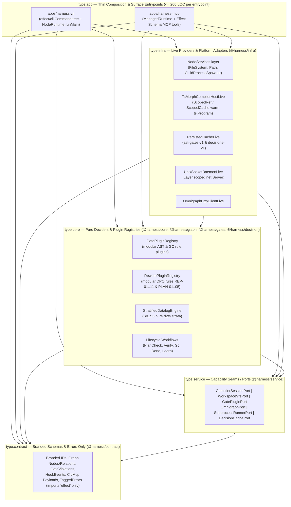

# RFC-0007: Self-Dogfooding Audit, Effect-TS v4 Paradigm Alignment & Modular Plugin Harness Architecture

> **Companion Audit Report (Appendix A):** For the complete initial architectural audit report—including additional diagnostics on `libs/es/infra`, `libs/sample`, `tools/scenario/run.mjs`, and the full target decomposition map of all monolithic files—see **[RFC-0007 Appendix A: Comprehensive Harness Architecture Audit Report](./0007-appendix-a-harness-architecture-audit-report.md)**.

## 1. Executive Summary

Across `RFC-0001` through `RFC-0006`, the **Effect-TS Engineering Harness** built a rigorous verification engine capable of enforcing strict architectural boundaries (`type:contract` $\rightarrow$ `type:service` $\rightarrow$ `type:domain`/`type:core` $\rightarrow$ `type:infra` $\rightarrow$ `type:app`), nominal domain branding (`Schema.brand`), exhaustive pattern matching (`ts-pattern` `.exhaustive()`), pure functional decision cores (`*.decide` with `R = never`), and fine-grained Dependency Injection (`Context.Service` + `Layer`) on application and framework domains (`libs/sample/*`, `libs/es/*`).

However, a comprehensive codebase-wide audit of the **harness's own source code** (`apps/harness-cli`, `apps/harness-mcp`, `libs/harness/*`, `tools/*`, and `libs/*/scripts/*.mjs` — totaling over `35,000` lines of code) reveals a severe **"Cobbler's Children Paradox"**: the harness explicitly exempted itself from its own rules via `isInternalHarnessFile` in [`tools/oxlint/syntax-bans.js`](../../tools/oxlint/syntax-bans.js#L66-L68) and `isHarnessInternal` in [`libs/harness/gates/src/ast-cache.ts`](../../libs/harness/gates/src/ast-cache.ts#L288-L289). As a direct consequence, the harness codebase accumulated:

1. **Monolithic God-Files (`1,600` to `5,603` LOC per file)** packing up to 8 orthogonal responsibilities into single functions thousands of lines long.
2. **Pervasive "Effect-Washing"**: wrapping synchronous, imperative TypeScript (`for` loops, `fs.readFileSync`, `execFileSync`, mutable `Map`s) inside `Effect.fn("*.decide")` generators with `R = never` and dummy `yield* Effect.void` statements solely to satisfy span-naming checks.
3. **Zero Dependency Injection (`Context.Service` / `Layer`) in CLI & MCP Applications**: passing `Layer` instances manually as function parameters instead of through Effect's `R` environment channel, and calling `Effect.runSync` / `Effect.runPromise` 49+ times across the codebase (including inside `Layer.effect`, inside `Effect.sync` loops, and at module evaluation time).
4. **Complete Neglect of Native Effect v4 Platform & Runtime Primitives**: ignoring `effect/cli` (`Command`, `Flag`, `Argument`), `effect/FileSystem`, `effect/Path`, `effect/process` (`ChildProcess`, `ChildProcessSpawner`), `effect/ScopedCache`, `effect/persistence/PersistedCache`, `effect/LayerMap`, and `effect/FiberMap` in favor of raw `node:fs`, `node:child_process`, `node:net`, manual `process.argv` `switch` statements, and module-level mutable `new Map()` singletons.

This RFC records the complete empirical audit of every architectural anti-pattern found in the repository so these mistakes are permanently documented and never repeated, and defines the **Modular Plugin Harness Architecture**—combining the **"Everything is a Plugin" & Three-Role Capability Seam** philosophy of **DeepSeek Harness (`dsh` / Cordis)** with native **Effect-TS v4** `Context.Service`, `Layer.scoped`, `LayerMap.Service`, `ScopedCache`, and `effect/cli`.

---

## 2. Motivation & Empirical Audit of Mistakes Made in the Codebase

### 2.1 Quantitative Summary of the Audit (`Project Grounding`)

| Architectural Dimension | Standard Required by `AGENTS.md` & Effect v4 | Reality in `libs/harness/*`, `apps/harness-*` & `tools/*` | Primary Code Evidence |
| :--- | :--- | :--- | :--- |
| **File Size & Cohesion (SRP)** | Focused, single-responsibility modules (`< 400–500` LOC) separated by `contract / service / core / infra / app` | **11 production files exceed `800` LOC**; top 6 files span `1,645` to `5,603` LOC each | [`type-extractor.ts`](../../libs/harness/graph/src/type-extractor.ts#L1-L5603) (`5,603` LOC), [`apps/harness-cli/src/index.ts`](../../apps/harness-cli/src/index.ts#L1-L3759) (`3,759` LOC), [`datalog-engine.ts`](../../libs/harness/graph/src/datalog-engine.ts#L1-L3255) (`3,255` LOC), [`graph-rewrite.ts`](../../libs/harness/graph/src/graph-rewrite.ts#L1-L2957) (`2,957` LOC), [`graph-engine.ts`](../../libs/harness/graph/src/graph-engine.ts#L1-L2590) (`2,590` LOC), [`graph-projector.ts`](../../libs/harness/graph/src/graph-projector.ts#L1-L2246) (`2,246` LOC), [`gc-check.ts`](../../libs/harness/gates/src/gc-check.ts#L1-L2142) (`2,142` LOC) |
| **`Context.Service` & `Layer` Dependency Injection** | Every I/O, compiler, process, or stateful capability is a `Context.Service` required in `R` and provided via `Layer` | **0 services and 0 layers** in `apps/harness-cli` and `apps/harness-mcp`; only **4 services** across all `28,000+` LOC of `libs/harness/*` vs. **277 `Effect.fn` declarations** (almost all with `R = never`) | `SpanRecorder` ([`recording-tracer.ts#L127`](../../libs/harness/ingest/src/recording-tracer.ts#L127)), `ChaosFaultController` ([`dst-engine.ts#L379`](../../libs/harness/gates/src/dst-engine.ts#L379)), `DatalogSession` ([`datalog-engine.ts#L3020`](../../libs/harness/graph/src/datalog-engine.ts#L3020)), `OmnigraphSync` ([`omnigraph-sync.ts#L489`](../../libs/harness/graph/src/omnigraph-sync.ts#L489)) |
| **Platform Abstraction (`NodeServices.layer`)** | `effect/FileSystem`, `effect/Path`, `effect/process/ChildProcessSpawner`, `effect/cli/Command` | **0 usages** in `libs/harness/*` and `apps/harness-*`; **45 files import `node:fs`** (`82+` calls in `apps/harness-*` alone) and **12 files import `node:child_process`** | [`apps/harness-cli/src/index.ts#L1-L5`](../../apps/harness-cli/src/index.ts#L1-L5), [`apps/harness-mcp/src/server.ts#L1-L5`](../../apps/harness-mcp/src/server.ts#L1-L5), [`type-extractor.ts#L1-L4`](../../libs/harness/graph/src/type-extractor.ts#L1-L4), [`gc-check.ts#L1-L2`](../../libs/harness/gates/src/gc-check.ts#L1-L2) |
| **State & Cache Lifecycle (`Scope`, `Cache`, `FiberRef`)** | `Layer.scoped`, `ScopedCache.make`, `PersistedCache.make`, `SynchronizedRef`, `FiberRef` | **Module-level mutable `new Map()` singletons**, `let totalSourceFileParses = 0`, and untyped properties mutated on `globalThis` | [`ast-cache.ts#L110-L116`](../../libs/harness/gates/src/ast-cache.ts#L110-L116), [`cached-decision-model.ts#L90-L94`](../../libs/harness/decision/src/cached-decision-model.ts#L90-L94), [`type-extractor.ts#L417`](../../libs/harness/graph/src/type-extractor.ts#L417), [`mutation-check.ts#L88-L97`](../../libs/harness/gates/src/mutation-check.ts#L88-L97) |
| **Runtime Execution Discipline (`NodeRuntime.runMain`)** | Single `NodeRuntime.runMain` at the `type:app` entrypoint | **49+ ad-hoc `Effect.runSync` / `Effect.runPromise` calls**, including `Effect.runSync` inside `Effect.sync`, inside `Layer.effect`, and at top-level module evaluation | [`fn-index.ts#L170`](../../libs/harness/ingest/src/fn-index.ts#L170), [`graph-engine.ts#L245`](../../libs/harness/graph/src/graph-engine.ts#L245), [`ast-cache.ts#L135-L180`](../../libs/harness/gates/src/ast-cache.ts#L135-L180), [`cached-decision-model.ts#L154-L200`](../../libs/harness/decision/src/cached-decision-model.ts#L154-L200) |
| **Boundary Schema Validation** | Exclusively `effect/Schema` (`JsonSchema` derivation) | `apps/harness-mcp` depends on **`zod` (`4.6.5`)** for MCP tool schemas alongside `effect/Schema` | [`apps/harness-mcp/package.json#L22`](../../apps/harness-mcp/package.json#L22), [`apps/harness-mcp/src/server.ts#L8`](../../apps/harness-mcp/src/server.ts#L8) |
| **Self-Exemption from Linter & Verify Gates** | Uniform enforcement across every package in the workspace | `isInternalHarnessFile` disables **20 AST checks** for `libs/harness` & `apps/harness-*`; all 6 harness packages have `"verify": "node -e \"\""` (no-op) | [`tools/oxlint/syntax-bans.js#L66-L68`](../../tools/oxlint/syntax-bans.js#L66-L68), [`apps/harness-cli/package.json#L13`](../../apps/harness-cli/package.json#L13), [`libs/harness/gates/package.json#L14`](../../libs/harness/gates/package.json#L14) |

---

### 2.2 Mistake Category 1: "Effect-Washing" — Wrapping Imperative Code in `Effect.fn` with `R = never`

Instead of designing effectful workflows around composable `Context.Service` capabilities in the `R` channel and typed `Schema.TaggedError` failures in the `E` channel, the harness codebase systematically wrapped 100% synchronous, imperative TypeScript procedures inside `Effect.fn("...")(function* () { ... })` with `R = never` solely to satisfy span-registration conventions.

#### Concrete Evidence in the Repository

1. **Dummy `yield* Effect.void` Generators with Synchronous `.runSync` Wrappers:**
   Because the function bodies perform no Effect operations and require no services (`R = never`), authors inserted `yield* Effect.void` on the first line of the generator just to appease generator lint rules, followed by hundreds of lines of imperative loops:
   - [`libs/harness/gates/src/gc-check.ts#L171-L999`](../../libs/harness/gates/src/gc-check.ts#L171-L999): `decideGraphEntropy = Effect.fn("GraphGc.decide")(function* (input: GraphEntropyInput) { yield* Effect.void ... })` — an **828-line** synchronous function.
   - [`libs/harness/gates/src/adr-lint.ts#L159-L732`](../../libs/harness/gates/src/adr-lint.ts#L159-L732): `decideAdrDocQuality = Effect.fn("AdrDocLint.decide")(function* (input: AdrDocLintInput) { yield* Effect.void ... })` — a **573-line** synchronous function that is immediately unwrapped on line 731 via `export const lintAdrDocMarkdown = (...) => Effect.runSync(decideAdrDocQuality(...))`.
   - [`libs/harness/gates/src/ontology-invariants.ts#L98-L685`](../../libs/harness/gates/src/ontology-invariants.ts#L98-L685): `decideOntologyInvariants = Effect.fn("OntologyInvariants.decide")(function* (input) { yield* Effect.void ... })` — a **587-line** synchronous function immediately unwrapped on line 684 via `Effect.runSync(decideOntologyInvariants(input))`.
   - [`libs/harness/gates/src/mutation-check.ts#L574-L578`](../../libs/harness/gates/src/mutation-check.ts#L574-L578) and [`libs/harness/graph/src/cluster-resolver.ts#L219-L230`](../../libs/harness/graph/src/cluster-resolver.ts#L219-L230): identical `yield* Effect.void` generator wrappers.

2. **Hiding Impure Disk I/O and Global Cache Mutation Behind `Effect<A, never, never>` (`R = never`):**
   - In [`libs/harness/gates/src/ast-cache.ts#L723-L751`](../../libs/harness/gates/src/ast-cache.ts#L723-L751):
     ```ts
     export const decideAstGateCache = Effect.fn("AstGateCache.decide")(function* (
       input: AstGateEvaluationInput,
     ): Effect.fn.Return<AstGateDecisionReport> {
       return yield* Effect.succeed(evaluateAstGateFiles(input))
     })
     ```
     The type signature claims `AstGateCache.decide` is a pure decider (`Effect<AstGateDecisionReport, never, never>`). In reality, `evaluateAstGateFiles` ([`ast-cache.ts#L649-L721`](../../libs/harness/gates/src/ast-cache.ts#L649-L721)) reads `.harness/cache/ast-gates-v1.json` via `readFileSync`, mutates module-level `inMemoryGateCache` and `inMemorySourceFileCache` maps, increments a global `let totalSourceFileParses` counter, and writes temporary files to disk via `writeFileSync` and `renameSync` wrapped in `Effect.runSync` ([`ast-cache.ts#L135-L180`](../../libs/harness/gates/src/ast-cache.ts#L135-L180))!
   - In [`libs/harness/graph/src/type-extractor.ts#L5015-L5039`](../../libs/harness/graph/src/type-extractor.ts#L5015-L5039): `extractTypeGraph` and `extractWorkspaceTypeAwareGraph` (`TypeExtractor.extractWorkspace`) declare `R = never`, while synchronously walking the disk with `fs.readdirSync` / `fs.readFileSync`, instantiating `ts-morph` `Project` instances, and mutating the global `warmSessionsByRoot` map ([`type-extractor.ts#L417`](../../libs/harness/graph/src/type-extractor.ts#L417)).

3. **Calling `Effect.runSync` Inside `Effect.sync`, Inside `Layer.effect`, and at Module Import Time:**
   - **Inside `Effect.sync` ([`libs/harness/ingest/src/fn-index.ts#L166-L177`](../../libs/harness/ingest/src/fn-index.ts#L166-L177)):**
     ```ts
     export const buildWorkspaceFnIndex = (repoRoot: string): Effect.Effect<WorkspaceFnIndex> =>
       Effect.sync(() => {
         // ...
         for (const file of files) {
           const content = Effect.runSync(
             Effect.try({
               try: () => fs.readFileSync(fullPath, "utf-8"),
               catch: () => null,
             }).pipe(Effect.orElseSucceed(() => null)),
           )
     ```
   - **At top-level module evaluation time ([`libs/harness/graph/src/graph-engine.ts#L245-L247`](../../libs/harness/graph/src/graph-engine.ts#L245-L247)):**
     ```ts
     const PERA_CONCEPT_LATTICE_RESULT = Effect.runSync(
       decideConceptLattice(HARNESS_PERA_CONCEPT_LATTICE_CONFIG),
     )
     ```
   - **Inside `Layer.effect` and synchronous helpers ([`libs/harness/decision/src/cached-decision-model.ts#L147-L201`](../../libs/harness/decision/src/cached-decision-model.ts#L147-L201)):** `loadStoreIntoMap` and `persistMapToDisk` execute `Effect.runSync(Effect.try(() => { readFileSync(...); writeFileSync(...); }).pipe(Effect.ignore))` synchronously from inside a `DecisionModel` layer!

---

### 2.3 Mistake Category 2: Fake Dependency Injection & Manual Layer Threading

In [`apps/harness-cli/src/index.ts`](../../apps/harness-cli/src/index.ts) (`3,759` lines) and [`apps/harness-mcp/src/server.ts`](../../apps/harness-mcp/src/server.ts) (`1,645` lines), there are **zero `Context.Service` definitions and zero `Layer` definitions**.

Instead of declaring required services in the `R` channel of command handlers and providing a single composed `MainLive` layer at the entrypoint, `apps/harness-cli/src/index.ts` passes `decisionLayer: Layer.Layer<DecisionModel.DecisionModel>` manually as a function argument through 9 different handler functions ([`index.ts#L318, L576, L1011, L1687, L2256, L2803, L2927, L3553, L3726`](../../apps/harness-cli/src/index.ts#L318)) and calls `Effect.provide(decisionLayer)` ad-hoc on individual expressions:
- [`apps/harness-cli/src/index.ts#L481`](../../apps/harness-cli/src/index.ts#L481): `yield* decideGuardCommand(command).pipe(Effect.provide(decisionLayer))`
- [`apps/harness-cli/src/index.ts#L580`](../../apps/harness-cli/src/index.ts#L580): `yield* routeStep(step).pipe(Effect.provide(decisionLayer))`
- [`apps/harness-cli/src/index.ts#L1215`](../../apps/harness-cli/src/index.ts#L1215): `yield* triageFailure(subprocessErr).pipe(Effect.provide(decisionLayer))`
- [`apps/harness-cli/src/index.ts#L1784`](../../apps/harness-cli/src/index.ts#L1784): `yield* checkPlanStepCoverage(step).pipe(Effect.provide(decisionLayer))`
- [`apps/harness-cli/src/index.ts#L2823`](../../apps/harness-cli/src/index.ts#L2823): `yield* proposeLearningAction(input).pipe(Effect.provide(decisionLayer))`

Similarly, in [`apps/harness-mcp/src/server.ts#L1065-L1415`](../../apps/harness-mcp/src/server.ts#L1065-L1415), every one of the 15 registered MCP tool handlers calls `Effect.runPromise(executeToolEffect(...))` independently instead of running within a managed Effect runtime.

---

### 2.4 Mistake Category 3: Monolithic God-Files & Mixed Architectural Concerns

Eleven source files in the repository exceed `800` lines of code, with the top seven files mixing completely orthogonal responsibilities:

1. **[`libs/harness/graph/src/type-extractor.ts`](../../libs/harness/graph/src/type-extractor.ts#L1-L5603) (`5,603` LOC; single function `extractTypeAwareGraphFromSource` is `3,584` LOC at `L872–4456`):**
   Mixes (a) `ts-morph` `Project` & `CompilerHost` setup (including hardcoded sample package paths `@harness/sample-*` at `L909–913`), (b) SHA-256 content and declaration signature hashing (`declHash`), (c) `.harness/cache/file-graph-v1.json` disk persistence, (d) duplicate AST syntax-ban linting (`L1290–1410`, `L2250–2450`, `L3080–3420`), (e) `Context.Service` and `Layer` extraction, (f) `Effect.fn` and `Decider` extraction, (g) `Schema` and `Brand` extraction, (h) ADR/EARS markdown frontmatter regex parsing, and (i) bipartite Levi hypergraph assembly.
2. **[`apps/harness-cli/src/index.ts`](../../apps/harness-cli/src/index.ts#L1-L3759) (`3,759` LOC):**
   Contains all 15 CLI subcommands (`guard`, `route`, `plan-check`, `plan-synth`, `repair`, `verify`, `done`, `learn`, `gc`, `mutate`, `bench`, `ingest`, `session`, `doctor`, `ontology`, `report`), a manual `switch (requested)` router (`L3594–3638`), a 348-line transcript parser (`L1336–1683`), a 300-line Omnigraph daemon process manager (`L1872–2171`), an Ollama process spawner (`L2172–2252`), and a `node:net` Unix socket client (`L960–1008`).
3. **[`libs/harness/graph/src/datalog-engine.ts`](../../libs/harness/graph/src/datalog-engine.ts#L1-L3255) (`3,255` LOC; single function `decideGraphInference` is `2,311` LOC at `L439–2750`):**
   Combines provenance semirings, Flix confidence lattices, rule catalog metadata, Stratum 0 EDB fact extraction, Stratum 1 reachability closures, Stratum 2 architectural anti-pattern joins, Stratum 3 candidate synthesis, PageRank, Hazel `TypedHoleContextBundle` assembly, and the stateful `DatalogSession` service.
4. **[`libs/harness/graph/src/graph-rewrite.ts`](../../libs/harness/graph/src/graph-rewrite.ts#L1-L2957) (`2,957` LOC):**
   Combines DPO rule definitions, Lyapunov convergence measures $\mu(G) \in \mathbb{N}^6$, gluing condition checkers, hypergraph patch application, and four massive phase-specific rule matchers (`findPhase1PlanPatches`, `findPhase2ArchRepairBranches`, `findPhase3CodeRepairPatches`, `findPhase4CleanupPatches`).
5. **[`libs/harness/graph/src/graph-engine.ts`](../../libs/harness/graph/src/graph-engine.ts#L1-L2590) (`2,590` LOC):**
   Combines `buildHarnessGraph` (`913` LOC), traversal queries (`findCallers`, `findCallees`, `findTestsReaching`), Mermaid diagram rendering, Omnigraph NDJSON serialization, snapshot disk I/O, graph diffing, and a 400-line backtracking `verifySubgraphMonomorphism` solver.
6. **[`libs/harness/graph/src/graph-projector.ts`](../../libs/harness/graph/src/graph-projector.ts#L1-L2246) (`2,246` LOC):**
   Combines string-template TypeScript code generation, `@ast-grep/napi` + `ts-morph` codemods (`REP-05`, `REP-07`, `REP-08`, `REP-11`), shadow workspace simulation, and $O(\log k)$ probe bisection.
7. **[`libs/harness/gates/src/gc-check.ts`](../../libs/harness/gates/src/gc-check.ts#L1-L2142) (`2,142` LOC):**
   Packs 21 distinct GC rules (graph topology checks, property-test depth inspection, `package.json` dependency scanning, Levenshtein typo suggestions, EARS/ADR doc synchronization, and SQL migration checks) into a single file.
8. **[`apps/harness-mcp/src/server.ts`](../../apps/harness-mcp/src/server.ts#L1-L1645) (`1,645` LOC):**
   Combines a 577-line `executeToolEffect` dispatcher (`L474–1050`), 368 lines of Zod MCP tool registrations (`L1057–1424`), a `spawnSync` LSP runner (`L301–473`), and a 178-line `node:net` Unix domain socket server (`L1425–1602`).

---

### 2.5 Mistake Category 4: Triple AST Linter Duplication & Raw `.mjs` Scripts Outside Effect

1. **Three Separate AST Linters Maintaining Overlapping Rules:**
   - [`tools/oxlint/syntax-bans.js`](../../tools/oxlint/syntax-bans.js#L1-L2400) (`2,400` LOC in plain JavaScript over ESTree AST).
   - [`libs/harness/gates/src/ast-cache.ts`](../../libs/harness/gates/src/ast-cache.ts#L281-L647) (`784` LOC in TypeScript over `ts.SourceFile` AST).
   - [`libs/harness/graph/src/type-extractor.ts`](../../libs/harness/graph/src/type-extractor.ts#L1290-L1410) (`L1290–1410`, `L2250–2450`, `L3080–3420` over `ts-morph` AST).
   Every syntax or boundary rule (`node-sqlite-in-infra`, `unmanaged-sql-ddl`, `discriminant-if`, `unbranded-primitive-boundary`) had to be implemented and maintained across two or three separate AST walkers.
2. **Untyped Imperative `.mjs` Scripts Duplicating Harness Logic:**
   - [`tools/scenario/run.mjs`](../../tools/scenario/run.mjs#L1-L693) (`693` LOC): written in raw imperative JavaScript (`async/await`, `fetch`, `try/catch`, `execSync`, `readFileSync`, `JSON.parse`), duplicating `resolveStateDir` (`L45–53`) and `callClef` (`L129–150`) instead of importing `@harness/gates` and `@harness/decision`.
   - [`libs/sample/contract/scripts/check-openapi.mjs`](../../libs/sample/contract/scripts/check-openapi.mjs#L1-L148) (`148` LOC) and [`libs/sample/infra/scripts/check-migrations.mjs`](../../libs/sample/infra/scripts/check-migrations.mjs#L1-L90) (`90` LOC): raw Node scripts using `execSync`, `spawnSync`, `JSON.parse`, and `// oxlint-disable-next-line @nx/enforce-module-boundaries` ([`check-migrations.mjs#L11`](../../libs/sample/infra/scripts/check-migrations.mjs#L11)).

---

### 2.6 Mistake Category 5: Self-Exemption Double Standards (`isInternalHarnessFile` & Fake Nx Tags)

1. **The 20 Linter Exemptions in [`tools/oxlint/syntax-bans.js#L66-L68`](../../tools/oxlint/syntax-bans.js#L66-L68):**
   ```javascript
   function isInternalHarnessFile(filename) {
     return /(^|\/)(libs\/harness|apps\/harness-[^/]+)\//.test(filename)
   }
   ```
   Because `isInternalHarnessFile(filename)` short-circuits 20 checks in `syntax-bans.js` (and `isHarnessInternal` short-circuits `ast-cache.ts#L288`), the harness codebase accumulated violations of its own rules:
   - **Banned `switch` statements:** [`apps/harness-cli/src/index.ts#L3594-L3638`](../../apps/harness-cli/src/index.ts#L3594-L3638).
   - **Banned `if / else if` and ternary `? :` on discriminants (`_tag`, `role`, `status`):** [`archimate-ontology.ts#L537-L554`](../../libs/harness/graph/src/archimate-ontology.ts#L537-L554), [`graph-projector.ts#L553-L572`](../../libs/harness/graph/src/graph-projector.ts#L553-L572), [`type-extractor.ts#L5238-L5244`](../../libs/harness/graph/src/type-extractor.ts#L5238-L5244), [`graph-engine.ts#L1423, L2098-L2136`](../../libs/harness/graph/src/graph-engine.ts#L1423).
   - **Unbranded contract schemas & raw string union types:** [`trace-format.ts#L5-L32`](../../libs/harness/ingest/src/trace-format.ts#L5-L32), [`gc-check.ts#L31-L59`](../../libs/harness/gates/src/gc-check.ts#L31-L59), [`telemetry.ts#L8-L50`](../../libs/harness/gates/src/telemetry.ts#L8-L50), [`fn-index.ts#L6`](../../libs/harness/ingest/src/fn-index.ts#L6).
   - **Inline object type aliases:** [`graph-rewrite.ts#L357-L364`](../../libs/harness/graph/src/graph-rewrite.ts#L357-L364), [`apps/harness-cli/src/index.ts#L156-L176`](../../apps/harness-cli/src/index.ts#L156-L176).
2. **Dual-Tagging Nx Boundary Bypass:**
   `libs/harness/{gates,graph,ingest,decision}/package.json` were tagged simultaneously as `["type:contract", "type:service"]` (and `"type:core"` in `graph`), bypassing `@nx/enforce-module-boundaries` and allowing `type:contract` packages to import heavy infrastructure libraries (`ts-morph`, `@ast-grep/napi`, `@electric-sql/d2ts`, `@modernrelay/omnigraph`, `node:fs`).
3. **Smells in Reference Packages (`libs/es/infra` & `libs/sample`):**
   - `libs/es/infra/src/projector.ts` (`866` LOC) and `libs/es/infra/src/aggregate.ts` (`692` LOC) contain `367`-line and `368`-line monolithic generator functions (`ingestPublishedEvent` at `projector.ts#L87–454` and `handleAggregateCommand` at `aggregate.ts#L324–692`).
   - `libs/es/infra/src/index.ts#L54–60` and `libs/es/infra/src/memory.ts#L689–696` call `yield* Layer.build(...)` inside `Layer.effect` instead of composing layers via `Layer.provide` / `Layer.map`.
   - `libs/sample/infra/src/index.ts#L40–54` double-wraps `Effect.fn("PhotoRepo.insert")((input) => Effect.gen(function* () { ... }))`, and `libs/sample/domain/src/index.ts#L14–17` wraps pure string formatting (`greet`) in an `Effect.fn` generator with `yield* Effect.void`.

---

## 3. Goals, Non-Goals & Hard Invariants

### 3.1 Goals

1. **Eliminate the Self-Exemption Double Standard (`Zero-Exemption Dogfooding`):** Remove `isInternalHarnessFile` and `isHarnessInternal` so the harness codebase obeys the exact same architectural, branding, pattern-matching, and purity gates as application code.
2. **Adopt Native Effect v4 Platform, CLI, and Caching Modules:**
   - Replace manual `process.argv` parsing in `apps/harness-cli` with declarative `effect/cli` (`Command.make`, `Flag`, `Argument`, `Command.withSubcommands`).
   - Replace direct `node:fs`, `node:path`, and `node:child_process` calls with `FileSystem.FileSystem`, `Path.Path`, and `ChildProcessSpawner.ChildProcessSpawner` provided via `NodeServices.layer` from `@effect/platform-node`.
   - Replace module-level mutable `new Map()` singletons and `globalThis` mutations with `ScopedCache`, `PersistedCache`, `SynchronizedRef`, `LayerMap.Service`, and `FiberRef`.
3. **Architect the Harness as a Modular Plugin System (DeepSeek Harness / Cordis + Effect v4):**
   - Model every AST/graph gate rule, GC check, DPO rewrite rule, CLI subcommand, and MCP tool as a self-contained plugin (`< 250` LOC) wired via **Three-Role Capability Seams** (`Service Definition` in `type:service`, `Service Provider Layer` in `type:infra`, `Consumer` in `type:core` / `type:app`).
4. **Decompose All God-Files Under a Hard `600` LOC Ceiling:** Split the 7 monolithic files (`type-extractor.ts`, `apps/harness-cli/src/index.ts`, `datalog-engine.ts`, `graph-rewrite.ts`, `graph-engine.ts`, `graph-projector.ts`, `gc-check.ts`, `apps/harness-mcp/src/server.ts`) into cohesive, single-responsibility modules enforced by a deterministic `max-file-lines` gate.
5. **Unify AST Gate Definitions:** Eliminate the triple duplication between `tools/oxlint/syntax-bans.js`, `libs/harness/gates/src/ast-cache.ts`, and `libs/harness/graph/src/type-extractor.ts`.

### 3.2 Non-Goals

- Changing the mathematical semantics of the PERA hypergraph (`RFC-0001`), 4-stratum Differential Dataflow inference (`RFC-0002`), Double-Pushout rewriting (`RFC-0003`), or sub-second incremental caching (`RFC-0006`).
- Introducing dynamic untyped runtime plugin loading (`eval` or unverified third-party npm dynamic imports); all plugins remain statically typed Effect `Layer`s.

### 3.3 Hard Invariants

1. **True Purity of `*.decide` (`R = never` Means Zero I/O):** Any function named `*.decide` or residing in `type:core` / `type:domain` must be 100% free of `node:fs`, `node:child_process`, `Effect.runSync`, `Effect.runPromise`, and module-level mutable state.
2. **Zero `yield* Effect.void` Dummy Generators:** Pure synchronous transformations must not be wrapped in fake `function* () { yield* Effect.void ... }` generators; use `Effect.fn` only when yielding genuine Effect operations/services or use `Effect.succeed` / pure functions where appropriate.
3. **Single Runtime Entrypoint:** `Effect.runSync` and `Effect.runPromise` are banned in `type:contract`, `type:service`, `type:core`, `type:domain`, and `type:infra`. Only `type:app` entrypoints (`NodeRuntime.runMain`) and foreign SDK callback boundaries (e.g., MCP request handlers bridged via a `ManagedRuntime`) may run effects.
4. **File Size Cap (`<= 600` LOC):** No production `.ts` file in `libs/**` or `apps/**` may exceed `600` lines.

---

## 4. Modular Plugin Architecture: Synthesizing DeepSeek Harness (Cordis) with Effect-TS v4

### 4.1 Architectural Insights from DeepSeek Harness (`dsh` / Cordis)

**DeepSeek Harness (`@deepseek-ai/dsh`)** is built on the **Cordis** plugin kernel, which replaces monolithic agent frameworks with three foundational mechanisms:

1. **"Everything is a Plugin" (Zero Privileged Monolith):** Neither the command router, the gate runner, the session logger, nor the MCP bridge is a hardcoded monolith; each capability is a modular plugin mounted into a shared context.
2. **Three-Role Capability Seams:** Every subsystem is factored into three strictly separated roles:
   - **Role 1 — Service Definition (Port):** Declares the abstract capability contract (e.g., `WorkspaceGraphPort`, `GatePluginRegistry`, `SubprocessSandbox`).
   - **Role 2 — Service Provider (Backend Plugin):** Implements the capability (e.g., warm `ts-morph` provider vs. Unix-socket daemon provider; `NodeFileSystem.layer` vs. in-memory `FileSystem.layerNoop`).
   - **Role 3 — Consumer (Surface Plugin):** Declares its required services and invokes them without knowing which provider is active.
3. **Spatiotemporal Composability & Reversible Effects (`ctx.effect`):** Registering a tool, gate rule, watcher, or socket server is a reversible effect bound to the plugin's scope; unloading or swapping a plugin automatically unwinds all disposers and leaves zero orphaned global state.

### 4.2 Mapping Cordis Primitives to Type-Safe Effect-TS v4 Building Blocks

While Cordis relies on runtime `inject: ['serviceName']` arrays and TypeScript `declare module` global interface merging, **Effect-TS v4 (`effect@4.0.0`)** provides every one of these capabilities natively with **compile-time verification**:

| DeepSeek Harness (Cordis) Concept | Canonical Effect-TS v4 Equivalent (`effect@4.0.0`) | Compile-Time & Runtime Guarantee in Effect v4 |
| :--- | :--- | :--- |
| `class MyService extends Service` + `declare module` | `class MyService extends Context.Service<MyService, Shape>()("@harness/MyService")` | Nominal service tag with zero global namespace pollution; zero-arg effects declared as `readonly prop: Effect.Effect<A, E, R>`. |
| `export const inject = ['fs', 'graph']` | Environment channel `R` in `Effect<A, E, R>` and `Layer<ROut, E, RIn>` | Missing service providers fail at compile time (`tsc`) and during `checkEffectGraph` (`unprovided-service`), never at runtime. |
| `ctx.effect(disposer)` (reversible plugin lifecycle) | `Layer.scoped` + `Effect.acquireRelease` + `FiberMap.make` + `ScopedCache.make` | Deterministic finalizer execution on scope close or fiber interruption; zero leaked child processes, sockets, or memory caches. |
| Dynamic on-demand plugin loading & TTL eviction | `LayerMap.Service` (`lookup: (id) => Layer`, `idleTimeToLive`) + `Layer.unwrap` | Keyed dynamic layer provisioning with automatic idle TTL teardown built into `effect/LayerMap`. |
| Durable + in-memory content-addressable caching | `PersistedCache.make` (`effect/persistence/PersistedCache`) + `Cache.make` | Built-in request coalescing (replacing manual `Map<Key, Deferred>`), TTL expiration, capacity bounds, and backing-store persistence. |
| Declarative CLI command plugin tree | `Command.make`, `Command.withSharedFlags`, `Command.withSubcommands` (`effect/cli`) | Typed flag/argument decoding via `Schema`, automatic `--help` generation, and seamless `R` environment propagation to subcommands. |

---

## 5. Detailed Technical Design in Effect-TS v4 Idioms

### 5.1 Package Taxonomy Alignment for `libs/harness/*`

To eliminate the dual-tag `["type:contract", "type:service"]` workaround, the harness libraries follow the exact 5-tier Nx taxonomy enforced across the workspace:



### 5.2 Core Plugin & Capability Seam Contracts (`type:contract` & `type:service`)

```ts
// libs/harness/contract/src/plugin.ts
import { Schema } from "effect"

export const PluginId = Schema.NonEmptyString.pipe(Schema.brand("PluginId"))
export type PluginId = typeof PluginId.Type

export const GateRuleId = Schema.NonEmptyString.pipe(Schema.brand("GateRuleId"))
export type GateRuleId = typeof GateRuleId.Type

export const GateCategory = Schema.Literals([
  "syntax-bans",
  "test-integrity",
  "migration-safety",
  "domain-purity",
  "effect-laws",
  "graph-gc",
  "ontology-invariant",
]).pipe(Schema.brand("GateCategory"))
export type GateCategory = typeof GateCategory.Type

export class GatePluginExecutionError extends Schema.TaggedError<GatePluginExecutionError>()(
  "GatePluginExecutionError",
  {
    pluginId: PluginId,
    ruleId: GateRuleId,
    message: Schema.NonEmptyString.pipe(Schema.brand("ErrorMessage")),
  },
) {}
```

```ts
// libs/harness/service/src/gate-registry.ts
import { Context, type Effect } from "effect"
import type {
  AstGateFileInput,
  GateCategory,
  GatePluginExecutionError,
  GateRuleId,
  GateViolation,
  GcFinding,
  HarnessGraph,
} from "@harness/contract"

export interface GateRulePlugin {
  readonly ruleId: GateRuleId
  readonly category: GateCategory
  readonly checkAstFile?: (file: AstGateFileInput) => ReadonlyArray<GateViolation>
  readonly checkGraph?: (graph: HarnessGraph) => ReadonlyArray<GcFinding>
}

export class GatePluginRegistry extends Context.Service<
  GatePluginRegistry,
  {
    readonly plugins: ReadonlyArray<GateRulePlugin>
    readonly evaluateAstFiles: (
      files: ReadonlyArray<AstGateFileInput>,
    ) => Effect.Effect<ReadonlyArray<GateViolation>, GatePluginExecutionError>
    readonly evaluateGraph: (
      graph: HarnessGraph,
    ) => Effect.Effect<ReadonlyArray<GcFinding>, GatePluginExecutionError>
  }
>()("@harness/GatePluginRegistry") {}
```

### 5.3 Scoped Compiler & Cache Layers Replacing Module-Level Global `Map`s (`type:infra`)

Instead of `const warmSessionsByRoot = new Map()` in `type-extractor.ts`, `const inMemoryGateCache = new Map()` in `ast-cache.ts`, and `const globalDecisionMemoryCache = new Map()` in `cached-decision-model.ts`, all stateful caches use `Layer.scoped` with `ScopedCache` / `SynchronizedRef` and `FileSystem.FileSystem`:

```ts
// libs/harness/infra/src/ast-gate-cache-live.ts
import { Effect, FileSystem, Layer, Path, SynchronizedRef } from "effect"
import { GatePluginRegistry, AstGateCachePort } from "@harness/service"
import type { AstGateCacheEntry, AstGateDecisionReport, AstGateEvaluationInput } from "@harness/contract"

export const AstGateCacheLive: Layer.Layer<
  AstGateCachePort,
  never,
  FileSystem.FileSystem | Path.Path | GatePluginRegistry
> = Layer.scoped(
  AstGateCachePort,
  Effect.gen(function* () {
    const fs = yield* FileSystem.FileSystem
    const path = yield* Path.Path
    const registry = yield* GatePluginRegistry
    const cacheRef = yield* SynchronizedRef.make(new Map<string, AstGateCacheEntry>())

    // Cleanly flushes dirty entries or releases memory when the Scope closes
    yield* Effect.addFinalizer(() =>
      SynchronizedRef.update(cacheRef, () => new Map()),
    )

    return AstGateCachePort.of({
      evaluate: Effect.fn("AstGateCachePort.evaluate")(function* (
        input: AstGateEvaluationInput,
      ): Effect.fn.Return<AstGateDecisionReport> {
        // Purely effectful FileSystem + SynchronizedRef lookup; zero Effect.runSync or node:fs
        const violations = yield* registry.evaluateAstFiles(input.files)
        // ...
      }),
    })
  }),
)
```

### 5.4 Declarative CLI Subcommand Tree via `effect/cli` (`apps/harness-cli`)

Instead of a 3,759-line `index.ts` with a 15-branch `switch (requested)` and manual `argv` slicing, `apps/harness-cli` is structured as modular `Command.make` plugins composed at the entrypoint:

```ts
// apps/harness-cli/src/main.ts
import { Command, Flag } from "effect/cli"
import { NodeRuntime, NodeServices } from "@effect/platform-node"
import { Effect, Layer } from "effect"
import { guardCommand } from "./commands/guard.command.js"
import { planCheckCommand } from "./commands/plan-check.command.js"
import { gcCommand } from "./commands/gc.command.js"
import { verifyCommand } from "./commands/verify.command.js"
import { doneCommand } from "./commands/done.command.js"
import { HarnessLive } from "./layers/harness-live.js"

export const harnessRootCommand = Command.make("harness").pipe(
  Command.withSharedFlags({
    format: Flag.Choice("format", ["text", "json", "antigravity", "claude"]).pipe(
      Flag.withDefault("text"),
    ),
  }),
  Command.withSubcommands([
    guardCommand,
    planCheckCommand,
    gcCommand,
    verifyCommand,
    doneCommand,
    // ...remaining modular command plugins
  ]),
)

const MainLayer = HarnessLive.pipe(Layer.provideMerge(NodeServices.layer))

Command.run(harnessRootCommand, { version: "2.0.0" }).pipe(
  Effect.provide(MainLayer),
  NodeRuntime.runMain,
)
```

---

## 6. Target File Decomposition Map (`<= 500` LOC per Module)

| Current Monolithic File | Current LOC | Target Modular Decomposition (`<= 350–500` LOC per file) |
| :--- | ---: | :--- |
| [`libs/harness/graph/src/type-extractor.ts`](../../libs/harness/graph/src/type-extractor.ts) | `5,603` | `extractor/compiler-session.service.ts` (`ScopedCache` warm `ts.Program`, dynamic workspace package discovery without hardcoded `@harness/sample-*`), `extractor/fragment-cache.service.ts`, `extractor/schema-extractor.ts`, `extractor/service-layer-extractor.ts`, `extractor/effect-fn-extractor.ts`, `extractor/governance-doc-extractor.ts`, `extractor/test-reachability-index.ts`, `extractor/hypergraph-assembler.ts`. |
| [`apps/harness-cli/src/index.ts`](../../apps/harness-cli/src/index.ts) | `3,759` | `src/main.ts` (`< 100` LOC), `src/middleware/telemetry.middleware.ts`, `src/services/omnigraph-daemon.service.ts`, `src/services/ollama-daemon.service.ts`, `src/services/transcript-analyzer.ts`, plus 15 dedicated command files under `src/commands/<cmd>.command.ts` (`100–220` LOC each). |
| [`libs/harness/graph/src/datalog-engine.ts`](../../libs/harness/graph/src/datalog-engine.ts) | `3,255` | `datalog/semirings.ts`, `datalog/rule-catalog.ts`, `datalog/stratum-0-edb.ts`, `datalog/stratum-1-reachability.ts`, `datalog/stratum-2-antipatterns.ts`, `datalog/stratum-3-synthesis.ts`, `datalog/hole-context-bundle.ts`, `datalog/datalog-session.service.ts`. |
| [`libs/harness/graph/src/graph-rewrite.ts`](../../libs/harness/graph/src/graph-rewrite.ts) | `2,957` | `rewrite/dpo-engine.ts` (gluing condition & pushout), `rewrite/lyapunov-measure.ts`, `rewrite/plugins/phase1-plan.plugin.ts`, `rewrite/plugins/phase2-arch-repair.plugin.ts`, `rewrite/plugins/phase3-code-repair.plugin.ts`, `rewrite/plugins/phase4-gc.plugin.ts`, `rewrite/orchestrator.ts`. |
| [`libs/harness/graph/src/graph-engine.ts`](../../libs/harness/graph/src/graph-engine.ts) | `2,590` | `engine/hypergraph-builder.ts`, `engine/traversal-queries.ts`, `engine/snapshot-codec.ts`, `engine/graph-diff.ts`, `engine/subgraph-monomorphism.ts`, `engine/formatters/mermaid.ts`, `engine/formatters/omnigraph-ndjson.ts`. |
| [`libs/harness/graph/src/graph-projector.ts`](../../libs/harness/graph/src/graph-projector.ts) | `2,246` | `projector/templates/{schema,service,layer,effect-fn,test}.ts`, `projector/codemods/{rep05,rep07,rep08,rep11}.ts`, `projector/shadow-workspace.service.ts`, `projector/bisection-verifier.ts`. |
| [`libs/harness/gates/src/gc-check.ts`](../../libs/harness/gates/src/gc-check.ts) | `2,142` | `gc/gc-orchestrator.ts` + modular plugins in `gc/plugins/`: `topology-entropy.plugin.ts`, `decider-property-test.plugin.ts`, `package-hygiene.plugin.ts`, `governance-doc-sync.plugin.ts`, `sql-migration-hygiene.plugin.ts`. |
| [`apps/harness-mcp/src/server.ts`](../../apps/harness-mcp/src/server.ts) | `1,645` | `src/main.ts` (`ManagedRuntime`), `src/daemon/unix-socket-server.service.ts` (`Layer.scoped`), `src/lsp/tsgo-diagnostics.service.ts`, and 15 modular tool files under `src/tools/<tool>.tool.ts` using `effect/Schema` (`JsonSchema`) instead of `zod`. |

---

## 7. New Self-Enforcement Gates ("Closing the Loop")

To guarantee the harness never regresses into procedural God-files or "Effect-washing", we introduce four new deterministic checks enforced across **all** workspace packages (including `libs/harness/*` and `apps/harness-*`):

1. **`no-internal-harness-exemption`:** Delete `isInternalHarnessFile` from [`tools/oxlint/syntax-bans.js`](../../tools/oxlint/syntax-bans.js) and `isHarnessInternal` from [`libs/harness/gates/src/ast-cache.ts`](../../libs/harness/gates/src/ast-cache.ts).
2. **`max-file-lines` (`<= 600` LOC):** Any production source file (`src/**/*.ts`) exceeding `600` lines triggers a deterministic gate violation in `pnpm harness gc --strict` and `pnpm harness verify`.
3. **`no-effect-washing`:**
   - Bans `yield* Effect.void` dummy statements at the start of `Effect.fn` / `Effect.gen` generators.
   - Bans calling `Effect.runSync` or `Effect.runPromise` inside any `Effect.fn`, `Effect.gen`, `Effect.sync`, or `Layer.*` body, or at top-level module scope outside `type:app` entrypoints.
   - Bans importing `node:fs`, `node:child_process`, or `node:net` in `type:contract`, `type:service`, `type:core`, or `type:domain` packages, or inside any function with `R = never`.
4. **`no-global-mutable-cache`:** Bans top-level module declarations of `new Map()`, `new Set()`, or `let` variables in `src/**/*.ts` (requiring `Layer.scoped` + `Ref` / `SynchronizedRef` / `Cache` / `ScopedCache` / `FiberRef` instead).

---

## 8. Phased Rollout Plan (Strangler-Fig Migration Without Breaking `verify`)

Each phase is executed as an isolated, verify-stamped task (`plan-check` $\rightarrow$ `gc --strict` $\rightarrow$ `verify` $\rightarrow$ `done`):

- **Phase 1 — Foundation Services & Elimination of Global Mutable Caches (`@harness/contract`, `@harness/service`, `@harness/infra`):**
  - Introduce `NodeServices.layer` (`FileSystem`, `Path`, `ChildProcessSpawner`) across the harness packages.
  - Refactor `ast-cache.ts`, `cached-decision-model.ts`, `mutation-check.ts` (`globalThis.__HARNESS_ACTIVE_MUTANT_ID` $\rightarrow$ `FiberRef`), and `fn-index.ts` to use `Context.Service` + `Layer.scoped` / `SynchronizedRef` / `PersistedCache` and remove all nested `Effect.runSync` calls.
- **Phase 2 — Unified `GatePluginRegistry` & Elimination of Triple AST Linter Duplication:**
  - Extract the 21 GC rules from `gc-check.ts` and the AST rules from `ast-cache.ts` / `syntax-bans.js` / `type-extractor.ts` into modular `GateRulePlugin` files (`< 200` LOC each).
- **Phase 3 — Decomposition of `@harness/graph` God-Files:**
  - Split `type-extractor.ts` (`5,603` LOC), `datalog-engine.ts` (`3,255` LOC), `graph-rewrite.ts` (`2,957` LOC), `graph-engine.ts` (`2,590` LOC), and `graph-projector.ts` (`2,246` LOC) into their target submodule directories (`extractor/`, `datalog/`, `rewrite/`, `engine/`, `projector/`), separating pure graph/Datalog/DPO algebra (`type:core`) from `ts-morph` and disk I/O (`type:infra`).
- **Phase 4 — Declarative `effect/cli` & Modular MCP Server (`apps/harness-cli`, `apps/harness-mcp`, `tools/*.mjs`):**
  - Decompose `apps/harness-cli/src/index.ts` (`3,759` LOC) into `effect/cli` `Command.make` modules.
  - Decompose `apps/harness-mcp/src/server.ts` (`1,645` LOC) into modular tool plugins using `ManagedRuntime` and `effect/Schema` (removing the `zod` dependency).
  - Migrate `tools/scenario/run.mjs`, `check-openapi.mjs`, `check-migrations.mjs`, and `check-event-schemas.mjs` into typed Effect CLI subcommands.
- **Phase 5 — Removal of `isInternalHarnessFile` & Activation of Self-Dogfooding Gates (`harness:ADR-0012`):**
  - Delete `isInternalHarnessFile` from `syntax-bans.js` and `ast-cache.ts`.
  - Decompose the large functions in `libs/es/infra/src/{projector,aggregate}.ts`.
  - Enable `max-file-lines`, `no-effect-washing`, and `no-global-mutable-cache` gates across the entire monorepo.
