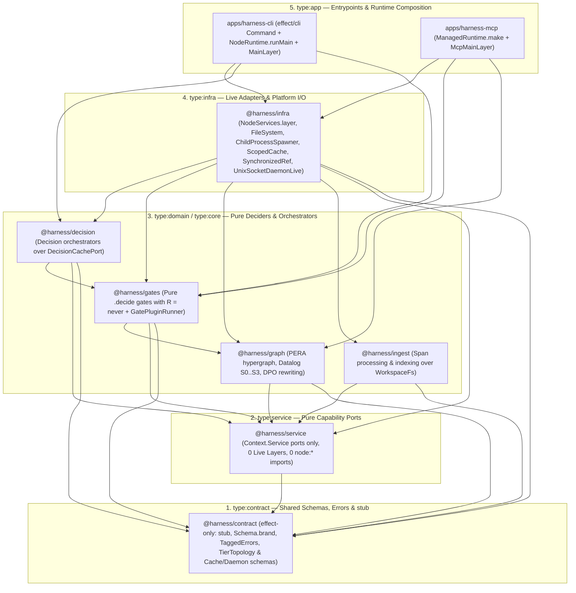

# RFC-0008: True Five-Tier Hexagonal Harness Closure, Native Effect-TS v4 Platform Runtime & Zero-Exemption Self-Dogfooding

> [!NOTE]
> **RFC Status & Phased Implementation:**
> **Status:** `implemented` (Phases 5A–5D and the Zero-Backward-Compatibility Canonicalization Pass are all implemented and verified).
> - **Phase 5A (Hexagon Foundation & End of Dual-Tagging):** Created [`@harness/contract`](../../libs/harness/contract/src/index.ts) (`type:contract`, `effect`-only) and [`@harness/service`](../../libs/harness/service/src/index.ts) (`type:service`, `effect` + `@harness/contract`), assigned `type:core` to `libs/harness/{gates,graph,ingest,decision}`, added batched `WorkspaceFs.statAndReadAll`, and enforced package boundaries via [`HarnessTierTopology.decide`](../../libs/harness/gates/src/plugins/harness-tier-topology.ts).
> - **Phase 5B (Native Effect v4 `@harness/infra` & Pure `.decide` Cores):** Created [`@harness/infra`](../../libs/harness/infra/src/index.ts) (`type:infra`) over `@effect/platform-node` (`NodeServices.layer`, `FileSystem.FileSystem`, `Path.Path`, `ChildProcessSpawner`, `ScopedCache`, `SynchronizedRef`, `Effect.acquireRelease`), eliminated all Node host I/O imports (`node:fs`, `node:child_process`, `node:net`, `node:os`, `node:http`, `node:https`) from non-infra `libs/harness/*/src/**`, replaced global mutable `Map` / `let` caches with scoped `AstGateCacheLive` and `DecisionCacheLive`, and restored true `R = never` purity to `AstGateCache.decide` and `GraphGc.decide`.
> - **Phase 5C (Declarative `effect/cli`, `ManagedRuntime` MCP & Zero Production `Effect.runSync`):** Migrated [`apps/harness-cli`](../../apps/harness-cli/src/index.ts) to declarative `effect/cli` (`Command.make`, `Flag`, `Argument`) + `NodeRuntime.runMain` with typed `check-openapi`, `check-migrations`, `check-event-schemas`, `benchmark`, and `scenario` subcommands; migrated [`apps/harness-mcp`](../../apps/harness-mcp/src/managed-runtime.ts) to a scoped `ManagedRuntime` (`HarnessMcp.executeManagedTool`); deleted production `Effect.runSync` calls and legacy synchronous wrapper shims; and cleaned up `Layer.build`-inside-`Layer.effect` and double-wrapped `Effect.fn` in [`libs/es/infra`](../../libs/es/infra/src/memory.ts) and [`libs/sample/infra`](../../libs/sample/infra/src/index.ts).
> - **Phase 5D (Zero-Exemption Closure & Permanent Gates):** Deleted `isHarnessInternal` from [`ast-gate-visitors.ts`](../../libs/harness/gates/src/plugins/ast-gate-visitors.ts), expanded `isEnforcedWorkspaceFile` in [`tools/oxlint/syntax-bans.js`](../../tools/oxlint/syntax-bans.js) uniformly across `libs/harness/*` and `apps/harness-*` (retaining only the documented single-file `SqlStorage` bridge in [`libs/es/infra/src/memory.ts`](../../libs/es/infra/src/memory.ts)), and locked permanent `SelfDogfooding.decide` hexagonal rules (`no-global-mutable-cache`, `no-node-builtins-outside-infra`, `no-layer-build-in-layer-effect`, `no-double-wrapped-effect-fn`, `test-env-branch-in-src`).
> - **Zero-Shim Canonicalization Pass:** Removed all transitional backward-compatibility re-export shims (`@harness/gates/src/stub.ts`, transitional `@harness/gates` re-exports, dead `@harness/contract` schema aliases, duplicate `*NodeLive` layer aliases, `isRepoWideAstRule`, `__harnessActiveMutant`, and imperative `run`/`runCli`/`executeTool` wrappers in `src/`).

---

## 1. Executive Summary

[RFC-0007](./0007-self-dogfooding-audit-and-modular-plugin-harness-architecture.md) successfully eliminated every monolithic God-file in the repository (`0` production files above `800` LOC, down from `11` monoliths peaking at `5,603` LOC), eradicated `yield* Effect.void` dummy generators, eliminated `switch` statements in favor of `ts-pattern` `.exhaustive()`, and replaced `zod` in `apps/harness-mcp` with `effect/Schema`. However, a rigorous post-RFC-0007 architectural audit revealed that the harness itself had only achieved roughly **65%** of its intended five-tier hexagonal architecture: the dedicated `@harness/contract`, `@harness/service`, and `@harness/infra` packages were never created, `node:fs` remained in `40` production source files, `61` `Effect.runSync` calls persisted in `src/`, and `isHarnessInternal` continued to exempt `libs/harness/*` and `apps/harness-*` from `discriminant-branching` and `unscoped-effect-run`.

**RFC-0008** closes every remaining architectural gap across four coordinated phases (**Phases 5A–5D**) plus a **Zero-Backward-Compatibility Canonicalization Pass**, codified in [`harness:ADR-0013`](../../libs/harness/docs/adr/0013-hexagonal-harness-package-tiers-and-native-runtime.md) and [`harness:SPEC-0012`](../../libs/harness/docs/specs/2026-11-14-hexagonal-harness-tiers-and-native-runtime.md). The harness now conforms to the exact same five-tier hexagonal lattice (`type:contract` $\rightarrow$ `type:service` $\rightarrow$ `type:domain`/`type:core` $\rightarrow$ `type:infra` $\rightarrow$ `type:app`) that it enforces on application and framework domains.

---

## 2. Motivation & Post-RFC-0007 Empirical Gap Analysis

After RFC-0007 Phase 4 landed, an empirical cross-check of the live codebase against RFC-0007 §5.1 exposed **7 concrete architectural gaps** and their root causes:

### 2.1 The 7 Post-RFC-0007 Architectural Gaps

1. **Gap 1 — Missing `@harness/{contract,service,infra}` Packages & Dual `type:contract + type:service` Nx Tags:**
   - *Empirical state:* Only `libs/harness/{decision,gates,graph,ingest}` existed. [`libs/harness/gates/package.json`](../../libs/harness/gates/package.json), [`libs/harness/graph/package.json`](../../libs/harness/graph/package.json), and [`libs/harness/ingest/package.json`](../../libs/harness/ingest/package.json) declared dual `["type:contract", "type:service"]` tags, allowing `@harness/graph` to masquerade as `type:contract` while importing `ts-morph`, `@ast-grep/napi`, `@electric-sql/d2ts`, and `@modernrelay/omnigraph`. All `11` `Context.Service` ports co-located their `Live` `Layer` implementations in the same files.
   - *Why it occurred:* Because `stub<A, E, R>()` lived inside `@harness/gates` (which depended on `@harness/graph`), `type:core` and `type:domain` libraries (`libs/sample/domain`, `libs/es/core`) needed `gates` and `graph` to remain tagged `type:contract` under [`.oxlintrc.json`](../../.oxlintrc.json) module-boundary rules.

2. **Gap 2 — Zero Native Effect v4 `NodeServices` Adoption (`40` `node:fs` & `7` `node:child_process` Production Files):**
   - *Empirical state:* Across `libs/harness/*/src` and `apps/harness-*/src`, there were `0` usages of `FileSystem`, `Path`, `ChildProcessSpawner`, `NodeServices`, `NodeRuntime`, `ManagedRuntime`, `ScopedCache`, or `PersistedCache`. `WorkspaceFs` was used in only `7` files and `HarnessSubprocessRunner` in `3`, while `40` production `src/` files imported `node:fs` directly and `7` imported `node:child_process`. Of `67` `Effect.fn` declarations, `41` still carried `R = never` while performing hidden I/O.
   - *Why it occurred:* `effect@4.0.0` and `@effect/platform-node@4.0.0` were installed in `node_modules`, but RFC-0007 deferred migrating synchronous `fs.readFileSync` call-graphs to `FileSystem.FileSystem` as a scope shortcut.

3. **Gap 3 — Impure `R = never` `.decide` Functions, Global Mutable Caches & `61` Production `Effect.runSync` Calls:**
   - *Empirical state:* [`AstGateCache.decide`](../../libs/harness/gates/src/ast-cache.ts) claimed `R = never` while mutating module-global maps (`inMemoryGateCache`, `inMemorySourceFileCache`, `let totalSourceFileParses`) and performing disk I/O via `node:fs` + `Effect.runSync`. `GraphGc.decide` ([`gc-check.ts`](../../libs/harness/gates/src/gc-check.ts)) claimed `R = never` while triggering [`gc-package-and-migration.plugin.ts`](../../libs/harness/gates/src/plugins/gc/gc-package-and-migration.plugin.ts) to read disk and call `Effect.runSync`. A total of `61` `Effect.runSync` calls remained in production `src/`, including 5 synchronous wrapper shims in [`adr-lint.ts`](../../libs/harness/gates/src/adr-lint.ts), [`ears-lint.ts`](../../libs/harness/gates/src/ears-lint.ts), [`ontology-invariants.ts`](../../libs/harness/gates/src/ontology-invariants.ts), [`span-budget.ts`](../../libs/harness/gates/src/span-budget.ts), and [`gc-check.ts`](../../libs/harness/gates/src/gc-check.ts).
   - *Why it occurred:* Synchronous wrapper shims were preserved to avoid converting legacy callers and tests to Effect signatures.

4. **Gap 4 — Remaining `isHarnessInternal` & `isTierOrSampleAppFile` Self-Exemptions:**
   - *Empirical state:* [`ast-gate-visitors.ts`](../../libs/harness/gates/src/plugins/ast-gate-visitors.ts) retained `isHarnessInternal`, disabling `discriminant-branching` and `unscoped-effect-run` for `libs/harness/*` and `apps/harness-*`. In [`tools/oxlint/syntax-bans.js`](../../tools/oxlint/syntax-bans.js), `isTierOrSampleAppFile` only matched `libs/<pkg>/(contract|domain|core|service|infra)` and `apps/sample`, silently skipping `libs/harness/{gates,graph,ingest,decision}` and `apps/harness-{cli,mcp}`.
   - *Why it occurred:* Enabling `unscoped-effect-run` and `node:fs` bans on `libs/harness/*` before removing the 61 `Effect.runSync` calls and 40 `node:fs` imports would have immediately broken the build.

5. **Gap 5 — Manual CLI `argv`/`decisionLayer` Threading, Missing MCP `ManagedRuntime` & Imperative Unix Socket Daemon:**
   - *Empirical state:* [`apps/harness-cli/src/index.ts`](../../apps/harness-cli/src/index.ts) parsed `process.argv` manually and threaded `decisionLayer` as a function parameter across command handlers with ad-hoc `Effect.provide(decisionLayer)` calls. [`apps/harness-mcp/src/server.ts`](../../apps/harness-mcp/src/server.ts) rebuilt `makeLiveMcpToolRegistryLayer` and ran `Effect.runPromiseExit` on every request instead of sharing a warm `ManagedRuntime`, and [`unix-socket-daemon.ts`](../../apps/harness-mcp/src/daemon/unix-socket-daemon.ts) used imperative `node:net` and `node:fs` callbacks instead of `Layer.effect` + `Effect.acquireRelease`.
   - *Why it occurred:* Phase 4 focused on splitting large files below `650` LOC rather than redesigning runtime composition at the `type:app` edge.

6. **Gap 6 — Triple AST Walker Duplication & Uncovered `.mjs` Scripts:**
   - *Empirical state:* Three separate AST walkers existed (`syntax-bans.js` at `2,511` LOC over ESTree, `ast-cache.ts` + `ast-gate-visitors.ts` at `1,080` LOC over `ts.SourceFile`, and `ast-policy-extractor.ts` at `468` LOC over `ts-morph`), while standalone `.mjs` scripts (`tools/scenario/run.mjs`, `check-migrations.mjs`, `check-openapi.mjs`, `check-event-schemas.mjs`) lived outside `effect/cli` and `SelfDogfooding.decide`.
   - *Why it occurred:* Oxlint requires a synchronous JS ESTree plugin for editor/lint speed whereas graph extraction requires TypeScript's type checker; repository check scripts had not yet been ported into typed CLI subcommands.

7. **Gap 7 — Residual Anti-Patterns in Reference Packages (`libs/es` & `libs/sample`):**
   - *Empirical state:* [`libs/es/infra/src/index.ts`](../../libs/es/infra/src/index.ts) and [`libs/es/infra/src/memory.ts`](../../libs/es/infra/src/memory.ts) called `yield* Layer.build(...)` directly inside `Layer.effect`, and [`libs/sample/infra/src/index.ts`](../../libs/sample/infra/src/index.ts) double-wrapped `Effect.fn("...")((input) => Effect.gen(...))`.
   - *Why it occurred:* Both files were below the `650`/`800` LOC ceiling and lacked deterministic AST rules banning those idioms.

### 2.2 Architectural Scorecard: Before RFC-0007 vs. Post-RFC-0007 vs. Post-RFC-0008

| Architectural Dimension | Before RFC-0007 | Post-RFC-0007 (Phase 4) | Post-RFC-0008 (Phases 5A–5D + Canonicalization) |
| :--- | :--- | :--- | :--- |
| **Max file size in `libs/` & `apps/`** | `11` monoliths (up to `5,603` LOC) | `0` files `> 800` LOC (max `730` LOC) | `0` files `> 800` LOC, tiered caps (`250`/`499`/`650`/`700`/`750`/`800`) |
| **`yield* Effect.void`, `switch`, `zod` in MCP** | `15` void, `4` switch, `zod` in MCP | `0` void, `0` switch, `100%` `effect/Schema` | `0` void, `0` switch, `100%` `effect/Schema` |
| **Physical `@harness/{contract,service,infra}` tiers** | Mixed + dual `contract+service` tags | Still mixed + dual `contract+service` tags | Dedicated `@harness/contract`, `@harness/service`, `@harness/infra` |
| **Port vs. `Live` `Layer` separation** | `4` services, co-located with `Live` | `11` services, co-located with `Live` | Ports in `type:service`, `Live` `Layer`s in `type:infra` |
| **Native Effect v4 `NodeServices` I/O** | `0` usages (`node:fs` everywhere) | `0` usages (`40` `node:fs` `src/` files) | `FileSystem`, `Path`, `ChildProcessSpawner`, `ScopedCache` |
| **`.decide` purity (`R = never`) & single runtime** | Hidden `fs` + `49+` `Effect.runSync` | Hidden `fs`/global `Map` + `61` `Effect.runSync` | Pure `.decide`, `0` prod `Effect.runSync`, `NodeRuntime` / `ManagedRuntime` |
| **Linter / gate exemptions for harness** | `isInternalHarnessFile` (`20` exemptions) | `isHarnessInternal` (`3` exemptions) + path regexes | `0` harness exemptions (only `libs/es/infra/src/memory.ts` `SqlStorage` bridge) |
| **Transitional backward-compat shims** | N/A | `stub` in `@harness/gates`, 5 `.runSync` wrappers | `0` shims (`@harness/gates/src/stub.ts`, 60+ re-exports & aliases deleted) |

---

## 3. Goals, Non-Goals & Hard Invariants

### 3.1 Goals

1. Establish physical `@harness/contract` (`type:contract`), `@harness/service` (`type:service`), and `@harness/infra` (`type:infra`) packages and assign every `libs/harness/*` package a single canonical Nx tier tag.
2. Migrate all filesystem, path, subprocess, caching, and Unix socket daemon I/O in `@harness/infra` to native Effect v4 primitives (`NodeServices.layer`, `FileSystem.FileSystem`, `Path.Path`, `ChildProcessSpawner`, `ScopedCache`, `SynchronizedRef`, `Effect.acquireRelease`).
3. Eliminate all `61` production `Effect.runSync` calls, replace manual `argv` / `decisionLayer` threading in `apps/harness-cli` with `effect/cli` + `NodeRuntime.runMain`, and run `apps/harness-mcp` on a single scoped `ManagedRuntime`.
4. Delete `isHarnessInternal`, enforce `syntax-bans.js` and `SelfDogfooding.decide` uniformly across `libs/harness/*` and `apps/harness-*`, and add 4 permanent hexagonal hygiene rules.
5. Port repository check scripts and scenario runner into typed `effect/cli` subcommands (`check-openapi`, `check-migrations`, `check-event-schemas`, `benchmark`, `scenario`).

### 3.2 Non-Goals

- Splitting `libs/sample/*` or `libs/es/*` packages (they already separate `contract`, `service`, `domain`/`core`, and `infra`).
- Removing the Oxlint ESTree plugin (`tools/oxlint/syntax-bans.js`): fast synchronous editor/CLI syntax checks remain in Oxlint while semantic/type-checked gates live in `GatePluginRegistry`.
- Keeping any transitional backward-compatibility re-export shims or deprecated aliases.

### 3.3 Hard Invariants

1. **Zero Transitional Backward-Compatibility Shims:** Every consumer imports schemas/errors/`stub` directly from `@harness/contract`, service ports directly from `@harness/service`, and live layers directly from `@harness/infra`. No re-export bridges or `*NodeLive` aliases may exist.
2. **Zero `isHarnessInternal` Exemptions:** Harness code is subject to the exact same `discriminant-branching`, `unscoped-effect-run`, `no-global-mutable-cache`, and `no-node-builtins-outside-infra` rules as domain/application code.
3. **Zero Production `Effect.runSync`:** `Effect.runSync` is banned in `libs/*/src/**` and `apps/*/src/**` (the sole documented exception is the synchronous Cloudflare Durable Object `SqlStorage` callback bridge in [`libs/es/infra/src/memory.ts`](../../libs/es/infra/src/memory.ts)), and `Effect.runPromise` is absent from `libs/*/src/**` and `apps/harness-cli/src/**` while `apps/harness-mcp` bridges only the foreign `@modelcontextprotocol/sdk` Promise callback boundary via `ManagedRuntime.runPromiseExit`.
4. **Single Canonical Nx Tier Tag per Package:** Every package declares a single canonical `type:*` tag (`@harness/contract` as `type:contract`, `@harness/service` as `type:service`, `@harness/{gates,graph,decision,ingest}` as `type:core`, and `@harness/infra` as `type:infra`).

---

## 4. Formal Package-Tier Lattice & Dependency Invariants

We formalize the workspace package architecture as a strict five-tier partial order:

$$\text{type:contract} \prec \text{type:service} \prec \{ \text{type:core}, \text{type:domain} \} \prec \text{type:infra} \prec \text{type:app}$$

### 4.1 Allowed Import Morphism Matrix

| Source Package Tier | Allowed Internal Workspace Targets | Allowed External Runtime Dependencies | `R` Channel Discipline |
| :--- | :--- | :--- | :--- |
| **`type:contract`** (`@harness/contract`) | `type:contract` only | `effect` only | Pure data schemas, branded types, `TaggedError`s, `stub<A, E, R>()` |
| **`type:service`** (`@harness/service`) | `type:contract`, `type:service` | `effect` only (`0` `node:*` imports, `0` `Layer.*`) | `Context.Service` ports returning `Effect<A, E, never>` (plus `SyncHostIo` for synchronous `ts.CompilerHost` callbacks) |
| **`type:core` / `type:domain`** (`@harness/{gates,graph,decision,ingest}`) | `type:contract`, `type:service`, `type:core`, `type:domain` | Pure TS/AST libraries (`ts-morph`, `@electric-sql/d2ts`, `@modernrelay/omnigraph`, `ts-pattern`; pure `node:path`/`node:crypto`/`node:url` helpers permitted, `0` Node host I/O built-ins) | `.decide` functions have `R = never`; orchestrators satisfy $R \subseteq \text{ServicePorts}$ |
| **`type:infra`** (`@harness/infra`) | Any lower tier | `@effect/platform-node`, `node:*` (only inside `type:infra`) | Provides `Layer<Port, E, Platform>` adapters |
| **`type:app`** (`harness-cli`, `harness-mcp`) | Any tier | `@effect/platform-node` (`NodeRuntime`, `NodeServices`) | Composes `MainLayer` once at the edge; executes via `NodeRuntime.runMain` or `ManagedRuntime` |

### 4.2 Five-Tier Package Topology Diagram

---

## 5. Detailed Technical Design in Effect-TS v4 Idioms

### 5.1 `@harness/contract` (`libs/harness/contract`)

- **Dependencies:** Exclusively `"effect": "4.0.0"`.
- **Modules:**
  - [`stub.ts`](../../libs/harness/contract/src/stub.ts): Exports `stub<A, E, R>(...args: ReadonlyArray<unknown>): Effect.Effect<A, E, R>` so `type:domain` and `type:core` packages import `stub` during planning without pulling in `@harness/gates` or `@harness/graph`.
  - [`ast-and-gate-primitives.ts`](../../libs/harness/contract/src/ast-and-gate-primitives.ts): Branded gate primitives (`PluginId`, `GateRuleId`, `AstSourceFilePath`, `ContentSha256`, `SelfDogfoodingReport`, `SelfDogfoodingViolation`, `SelfDogfoodingViolationError`).
  - [`workspace-and-process.ts`](../../libs/harness/contract/src/workspace-and-process.ts): Branded workspace/process/CLI/MCP schemas and `Schema.TaggedErrorClass` definitions (`WorkspaceFsError`, `HarnessSubprocessError`, `TsCompilerOverlayError`, `CliCommandNotFoundError`, `UnknownToolError`).
  - [`tier-topology.ts`](../../libs/harness/contract/src/tier-topology.ts): `HarnessTierTopologyInput`, `HarnessTierTopologyReport`, `HarnessTierTopologyViolation`, `TierTopologyRuleId`, `NxTierTag`.
  - [`cache-and-daemon.ts`](../../libs/harness/contract/src/cache-and-daemon.ts): `AstGateFileBatchInput`, `AstGateEvaluationReport`, `DecisionCacheKey`, `DecisionCacheStatsSnapshot`, `DaemonSocketPath`, `DaemonServerInfo`, `DaemonServerError`.

### 5.2 `@harness/service` (`libs/harness/service`)

- **Dependencies:** Exclusively `"effect": "4.0.0"` and `"@harness/contract": "workspace:*"`.
- **Canonical Ports (`Context.Service`):**
  - [`index.ts`](../../libs/harness/service/src/index.ts): `WorkspaceFs` (`"@harness/service/WorkspaceFs"`), `HarnessSubprocessRunner` (`"@harness/service/HarnessSubprocessRunner"`), `ActiveMutantContext` (`"@harness/service/ActiveMutantContext"`).
  - [`cache-and-daemon-ports.ts`](../../libs/harness/service/src/cache-and-daemon-ports.ts): `AstGateCachePort` (`"@harness/service/AstGateCachePort"`), `DecisionCachePort` (`"@harness/service/DecisionCachePort"`), `UnixSocketDaemonPort` (`"@harness/service/UnixSocketDaemonPort"`).
  - [`host-io.ts`](../../libs/harness/service/src/host-io.ts): `SyncHostIo` and `ExtendedHostIo` port interfaces for compiler overlay and Omnigraph sync adapters without importing `node:*` in `@harness/graph`.

### 5.3 `@harness/infra` (`libs/harness/infra`)

- **Dependencies:** `@effect/platform-node` (`NodeServices.layer`, `NodeFileSystem`, `NodePath`, `NodeChildProcessSpawner`) alongside `@harness/service` and `@harness/contract`.
- **Live Adapters:**
  - [`workspace-fs-live.ts`](../../libs/harness/infra/src/workspace-fs-live.ts): `WorkspaceFsLive` backed by `FileSystem.FileSystem` and `Path.Path`.
  - [`subprocess-runner-live.ts`](../../libs/harness/infra/src/subprocess-runner-live.ts): `HarnessSubprocessRunnerLive` backed by `ChildProcess.make` and `ChildProcessSpawner.ChildProcessSpawner`.
  - [`ast-gate-cache-live.ts`](../../libs/harness/infra/src/ast-gate-cache-live.ts): `AstGateCacheLive` / `makeAstGateCacheLayer` backed by `ScopedCache` + `SynchronizedRef` + `FileSystem.FileSystem`, replacing all module-global `Map` and `let` counters.
  - [`decision-cache-live.ts`](../../libs/harness/infra/src/decision-cache-live.ts): `DecisionCacheLive` / `makeDecisionCacheLayer` backed by `ScopedCache` + `SynchronizedRef` + `FileSystem.FileSystem`.
  - [`unix-socket-daemon-live.ts`](../../libs/harness/infra/src/unix-socket-daemon-live.ts): `UnixSocketDaemonLive` / `startScopedUnixSocketDaemon` using `Layer.effect` + `Effect.acquireRelease` to bind a `0600` Unix domain socket and deterministically unlink it on scope finalization, failing with `DaemonServerError`.
  - [`index.ts`](../../libs/harness/infra/src/index.ts): Exports `HarnessInfraLive` merging all live layers.

### 5.4 `apps/harness-cli` & `apps/harness-mcp` (`type:app`)

- **`apps/harness-cli`:**
  - [`declarative-cli.ts`](../../apps/harness-cli/src/commands/declarative-cli.ts) defines the root `harness` command and subcommands via `effect/cli` (`Command.make`, `Flag`, `Argument`, `Command.withSubcommands`), executed once at [`apps/harness-cli/src/index.ts`](../../apps/harness-cli/src/index.ts) via `NodeRuntime.runMain` with a single composed `MainLayer` (`HarnessInfraLive` + `NodeServices.layer`).
  - [`repo-checks.command.ts`](../../apps/harness-cli/src/commands/repo-checks.command.ts) and [`scenario.command.ts`](../../apps/harness-cli/src/commands/scenario.command.ts) expose typed subcommands `check-openapi`, `check-migrations`, `check-event-schemas`, `benchmark`, and `scenario` (`HarnessCli.checkOpenApi`, `HarnessCli.checkMigrations`, `HarnessCli.checkEventSchemas`, `HarnessCli.runScenario`).
- **`apps/harness-mcp`:**
  - [`managed-runtime.ts`](../../apps/harness-mcp/src/managed-runtime.ts) creates a long-lived `ManagedRuntime` (`HarnessMcp.executeManagedTool`) sharing warm `TsCompilerOverlayService`, `AstGateCachePort`, and `NodeServices.layer` across MCP tool invocations and disposing cleanly on shutdown.

---

## 6. Deterministic Gate Rule Catalog

### 6.1 `HarnessTierTopology.decide` (`libs/harness/gates/src/plugins/harness-tier-topology.ts`)

| Rule ID | Condition Checked | Purpose |
| :--- | :--- | :--- |
| `dual-contract-tier-tag` | Any workspace `project.json` / `package.json` declares multiple `type:*` tags | Prevents bypassing `@nx/enforce-module-boundaries` via dual tags |
| `forbidden-contract-dependency` | Any `type:contract` package declares a dependency outside `effect` and `type:contract` | Keeps `@harness/contract` 100% pure and dependency-free |
| `forbidden-service-dependency` | Any `type:service` package declares a dependency outside `effect`, `type:contract`, and `type:service` | Prevents service ports from pulling in `core`, `domain`, `gates`, `graph`, or `infra` |
| `forbidden-core-dependency` | Any `type:core` / `type:domain` package declares a dependency on `type:infra` or `type:app` | Prevents pure core/domain engines from importing live adapters |
| `impure-service-tier-import` | Any `type:service` source file imports `node:*`, `Layer.*`, `type:core`, `type:domain`, or `type:infra` modules | Keeps `Context.Service` definitions free of runtime I/O and layer implementations |

### 6.2 `SelfDogfooding.decide` Phase 5D Rules (`libs/harness/gates/src/plugins/self-dogfooding-plugin.ts`)

| Rule ID | Condition Checked | Purpose |
| :--- | :--- | :--- |
| `no-global-mutable-cache` | Module-scope `let` declarations, empty/Weak module-scope `Map`/`Set`/`WeakMap`/`WeakSet`, or module-scope `.set`/`.add`/`.delete`/`.clear` calls in `src/` | Enforces scoped state (`ScopedCache`, `SynchronizedRef`) over global singletons |
| `no-node-builtins-outside-infra` | Static or dynamic imports of `node:fs`, `node:child_process`, `node:net`, `node:os`, `node:http`, `node:https` (and bare aliases) outside `type:infra` | Enforces `WorkspaceFs` / `HarnessSubprocessRunner` / `NodeServices` seams |
| `no-layer-build-in-layer-effect` | `Layer.build(...)` invoked inside `Layer.effect(...)` | Enforces idiomatic `Layer.unwrap` / `Layer.provide` composition |
| `no-double-wrapped-effect-fn` | `Effect.fn(...)((...) => Effect.gen(...))` or `Effect.fnUntraced(...)((...) => Effect.gen(...))` | Enforces direct generator bodies `Effect.fn("name")(function* (input) { ... })` |
| `test-env-branch-in-src` | `process.env.VITEST` inspected in production `src/` files | Enforces explicit injected test options over environment sniffing |

### 6.3 Uniform AST Enforcement Without `isHarnessInternal`

- [`ast-gate-visitors.ts`](../../libs/harness/gates/src/plugins/ast-gate-visitors.ts) removed `isHarnessInternal` completely. `discriminant-branching` and `unscoped-effect-run` run uniformly across `libs/harness/*` and `apps/harness-*`.
- [`tools/oxlint/syntax-bans.js`](../../tools/oxlint/syntax-bans.js) expanded `isEnforcedWorkspaceFile` to cover `libs/harness/*` and `apps/harness-*`, retaining only the explicitly documented single-file synchronous Cloudflare Durable Object `SqlStorage` callback bridge in [`libs/es/infra/src/memory.ts`](../../libs/es/infra/src/memory.ts).

---

## 7. Library Selection, Rejected Alternatives & Trade-offs

1. **Dedicated `@harness/contract`, `@harness/service`, `@harness/infra` vs. Dual-Tagged Packages:** Rejected dual `["type:contract", "type:service"]` tags because they disabled Nx module-boundary enforcement and forced `type:core`/`type:domain` packages to depend on `@harness/gates` just for `stub`.
2. **Modular Five-Tier Packages vs. Single Monolithic `@harness/core`:** Rejected collapsing all harness packages into one package because it would erase compile-time tier boundaries, degrade `nx affected` caching, and mix pure `R = never` deciders with stateful `Layer` providers.
3. **Typed `effect/cli` Subcommands vs. Standalone `.mjs` Scripts:** Rejected leaving `check-openapi.mjs`, `check-migrations.mjs`, and `run.mjs` as untyped `.mjs` scripts because they bypassed `Schema` validation, `NodeServices`, and `SelfDogfooding.decide`.
4. **Zero Transitional Backward-Compatibility Shims vs. Re-Export Aliases (Critical Trade-off):** We initially considered keeping re-export shims in `@harness/gates` and duplicate `*NodeLive` aliases in `@harness/infra` to minimize import churn. We **rejected** shims completely:
   - *Empirical proof:* Immediately after deleting the 60+ transitional re-exports from `@harness/gates`, `GraphGc.decide` (`unused-contract-export`) was able to see the true consumer graph and caught **5 dead contract schema aliases** in `@harness/contract` that re-export shims had previously masked!

---

## 8. Ecosystem Impact, Performance & Clean-Slate Canonicalization

The Zero-Shim Canonicalization Pass removed all transitional compatibility artifacts in a single clean cutover:

- Deleted `@harness/gates/src/stub.ts` and `60+` transitional re-exports of `@harness/contract` / `@harness/service` symbols from `@harness/gates/src/index.ts`.
- Deleted `5` dead contract schema aliases uncovered by `GraphGc.decide` (`unused-contract-export`) in `@harness/contract`.
- Removed duplicate `*NodeLive` layer aliases in `@harness/infra`, canonicalizing on `WorkspaceFsLive` and `HarnessSubprocessRunnerLive`.
- Canonicalized `Context.Service` tag IDs to `@harness/service/*` (`@harness/service/WorkspaceFs`, `@harness/service/HarnessSubprocessRunner`, `@harness/service/ActiveMutantContext`, `@harness/service/AstGateCachePort`, `@harness/service/DecisionCachePort`, `@harness/service/UnixSocketDaemonPort`).
- Removed `isRepoWideAstRule` dead branching and `__harnessActiveMutant` legacy globals.
- Removed imperative `Effect.runPromise` wrapper helpers (`run`, `runCli`, `executeTool`) from `apps/harness-cli/src/` and `apps/harness-mcp/src/`.

---

## 9. Open Questions & Future Work

1. **Incremental AST Walker Consolidation (`tools/oxlint` vs. `GatePluginRegistry`):** Purely syntactic rules remain in `tools/oxlint/syntax-bans.js` for sub-50ms Oxlint feedback, while type-aware and graph-aware rules run in `GatePluginRegistry`. Long term, shared rule metadata can be generated from `@harness/contract` to keep rule IDs synchronized without duplicating AST traversal logic.
2. **Full `ts-morph` Compiler Session Sharing:** Now that `apps/harness-mcp` runs on a single `ManagedRuntime`, future work can persist incremental `oldProgram` snapshots across `harness_lsp_diagnostics` and `harness_verify` daemon requests.

---

## 10. Rollout & Decomposition Record (ADRs, EARS Specs & Milestones)

| Phase / Deliverable | Governed By | Key Enforcing Files & Symbols |
| :--- | :--- | :--- |
| **Phase 5A:** `@harness/contract` + `@harness/service`, zero dual Nx tags, `WorkspaceFs.statAndReadAll` | [`harness:ADR-0013`](../../libs/harness/docs/adr/0013-hexagonal-harness-package-tiers-and-native-runtime.md), [`harness:SPEC-0012`](../../libs/harness/docs/specs/2026-11-14-hexagonal-harness-tiers-and-native-runtime.md) (`REQ-1.1..1.5`, `REQ-2.1..2.4`) | `libs/harness/contract/src/*`, `libs/harness/service/src/*`, `HarnessTierTopology.decide` |
| **Phase 5B:** `@harness/infra` (`NodeServices.layer`, `ScopedCache`, `SynchronizedRef`, `Effect.acquireRelease`), pure `.decide` cores | `harness:ADR-0013`, `harness:SPEC-0012` (`REQ-3.1..3.4`) | `libs/harness/infra/src/*`, `AstGateCache.evaluateCached`, `DecisionCache.lookupOrCompute`, `UnixSocketDaemon.startScoped` |
| **Phase 5C:** `effect/cli` + `NodeRuntime.runMain`, `ManagedRuntime` MCP, `0` prod `Effect.runSync`, `libs/es` & `libs/sample` cleanup | `harness:ADR-0013`, `harness:SPEC-0012` (`REQ-4.1..4.6`) | `apps/harness-cli/src/commands/declarative-cli.ts`, `repo-checks.command.ts`, `scenario.command.ts`, `apps/harness-mcp/src/managed-runtime.ts` |
| **Phase 5D:** Delete `isHarnessInternal`, expand `isEnforcedWorkspaceFile`, permanent hexagonal `SelfDogfooding.decide` rules | `harness:ADR-0013`, `harness:SPEC-0012` (`REQ-5.1..5.6`) | `SelfDogfooding.decide`, `AstGateCache.decide`, `tools/oxlint/syntax-bans.js` |
| **Canonicalization Pass:** Zero transitional shims, zero dead contract exports, canonical `@harness/service/*` & `*Live` names | `harness:ADR-0013` (Option 4 rejected, Rule 11) | `@harness/contract`, `@harness/service`, `@harness/infra`, `@harness/gates`, `apps/harness-cli` |
