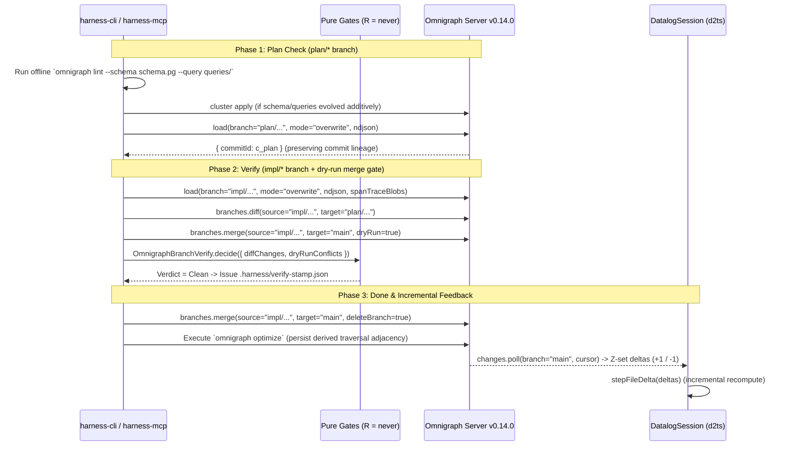

# RFC-0009: Omnigraph v0.14.0 Native Capabilities, Zero-Loss Branch Lifecycle, Hybrid Graph Search & Policy-Gated Harness Integration

> [!NOTE]
> **Post-Implementation Status Note:** `harness:SPEC-0013` (`libs/harness/docs/specs/2026-11-16-omnigraph-v014-native-capabilities.md`) and `harness:ADR-0014` (`libs/harness/docs/adr/0014-omnigraph-v014-keyed-schema-branch-verify-and-policy.md`) are the normative post-implementation specifications for this work.

## 1. Executive Summary

The **Effect-TS Engineering Harness** models workspace architecture as a **PERA Bipartite Levi Incidence Hypergraph** ($G_{\text{Levi}} = (V_E \sqcup V_R, E_{\text{role}})$) backed by `effect/Graph` in memory and **`@modernrelay/omnigraph` (`v0.14.0`)** on disk ([RFC-0001](./0001-polymorphic-hypergraph-and-pera-ontology-model.md), [RFC-0002](./0002-declarative-datalog-inference-and-edge-completion.md), [RFC-0003](./0003-algebraic-graph-rewriting-dpo-auto-repair-and-planning.md), [`harness:ADR-0006`](../../libs/harness/docs/adr/0006-omnigraph-git-branch-lifecycle-and-head-reconcile.md), [`harness:ADR-0009`](../../libs/harness/docs/adr/0009-polymorphic-hypergraph-datalog-and-dpo-rewriting.md)). Omnigraph v0.14.0 is a **Lakehouse-native versioned property graph** built over columnar Lance v16 Copy-on-Write storage and Apache DataFusion (`Omnigraph-Http-Api: 0.14`). It provides native keyed edge identity (`@key(@src, @dst, role)`), lossless `mode: "overwrite"` branch replacement, three-way `branches.merge({ dryRun, deleteBranch, asCommit })` with typed merge conflicts, `branches.diff`, hybrid vector + Tantivy BM25 Reciprocal Rank Fusion (`rrf(nearest(...), bm25(...))`), GQ 2.1 edge unions and correlated negations, Optimistic Concurrency Control (`ifGraphCommit`), durable change feeds (`changes.poll`), versioned `Blob` cells, offline static schema/query linting (`omnigraph lint`), live zero-downtime schema/query deployment (`omnigraph cluster plan/apply`), Cedar policy-as-code enforcement (`protected_branches`), and storage optimization (`omnigraph optimize` / `cleanup`).

An empirical audit of our current Omnigraph integration shows that we currently exploit **less than 25%** of Omnigraph v0.14.0 and rely on destructive or lossy imperative workarounds:

1. None of the 32 `Plays*Role` edges in [`libs/harness/graph/schema.pg`](../../libs/harness/graph/schema.pg) declare `@key(@src, @dst, role)`, causing `mode: "merge"` on `main` to **duplicate edges on every ingest** while never pruning deleted code symbols. To work around stale symbols on `plan/*` and `impl/*`, [`omnigraph-sync.ts`](../../libs/harness/graph/src/omnigraph-sync.ts) calls `og.branches.delete(branch)` before every load — **erasing branch commit history**.
2. Config drift in [`omnigraph-lifecycle.ts`](../../apps/harness-cli/src/commands/omnigraph-lifecycle.ts) stops the server and executes `nodeSyncHostIo.rmRecursiveSync(clusterRootDir)` — **wiping `.harness/omnigraph-cluster`**, destroying all open task branches and Lance history on every edit to `schema.pg` or `queries/harness.gq`.
3. [`syncOmnigraphOnDone`](../../apps/harness-cli/src/commands/done-omnigraph-helpers.ts) invokes `diffOmnigraphBranches` and **discards the returned `Diff`**, while `handleVerify` never runs `branches.merge({ dryRun: true })` to detect concurrent worktree collisions before `done`.
4. Neither `ifGraphCommit` OCC preconditions nor `og.changes.poll` into `DatalogSession.stepFileDelta` are wired; [`graph.policy.yaml`](../../libs/harness/graph/graph.policy.yaml) and [`cluster.policy.yaml`](../../libs/harness/graph/cluster.policy.yaml) are **never mounted in [`cluster.yaml`](../../libs/harness/graph/cluster.yaml)**; [`mcp_config.json`](../../adapters/antigravity/plugins/effect-harness/mcp_config.json) hardcodes port `8080` instead of our dynamic repo hash port; and [`queries/harness.gq`](../../libs/harness/graph/queries/harness.gq) omits hybrid search, `EarsSpec` traceability, multi-hop bounds, and `GraphPolicy` invariant queries.

This RFC specifies a cohesive 10-capability architecture (**`OMNI-01` through `OMNI-10`**) across `schema.pg`, `queries/harness.gq`, `cluster.yaml`, Cedar policy bundles, `@harness/contract`, `@harness/service`, `@harness/graph`, `@harness/gates`, `@harness/decision`, `@harness/infra`, `harness-cli`, and `harness-mcp`, complete with ready-to-adopt schemas, Effect-TS v4 code signatures, rejected alternatives, and the canonical drafts for **`harness:ADR-0014`** and **`harness:SPEC-0013`**.

---

## 2. Motivation & Empirical Gap Analysis

All 10 gaps below are directly observed in the live workspace files cited in each item.

### Gap 1 (`OMNI-01`): Unkeyed Edges Duplicating on `main` & Destructive `branches.delete` on Task Branches
- **Empirical Evidence:**
  - In [`libs/harness/graph/schema.pg`](../../libs/harness/graph/schema.pg#L178-L343), all 32 edge declarations (`PlaysCallerRole` through `PlaysMigrationVerifyingTestRole`) specify `@card(0..)` and contain only `{ role: String @index, archimateRelation: String @index, ... }`. None declare `@key(@src, @dst, role)` (nor `@key(@src, @dst)`).
  - In [`libs/harness/graph/src/omnigraph-sync.ts`](../../libs/harness/graph/src/omnigraph-sync.ts#L336-L350), `toOmnigraphServerNdjson` serializes edge envelopes `{ edge, from, to, data }` without supplying a derived edge `id`.
  - In [`libs/harness/graph/src/omnigraph-sync.ts`](../../libs/harness/graph/src/omnigraph-sync.ts#L463-L478), `sync` runs `if (branch !== "main") { await og.branches.delete(branch) }` and then calls `og.load({ branch, from: "main", mode: "merge", data: ndjson })`.
- **Root Cause & Consequence:** As Omnigraph's official documentation explicitly warns (*`references/data.md` / `references/schema.md`*), an unkeyed edge without an `id` never matches an existing edge row on merge, so repeated loads duplicate edges on `main`. Furthermore, `mode: "merge"` never deletes removed entities, while deleting non-`main` branches destroys every historical commit on `plan/*` and `impl/*` branches.

### Gap 2 (`OMNI-02`): Unused Hybrid Semantic + Lexical Search (`@embed`, `nearest`, `bm25`, `rrf`, `fuzzy`)
- **Empirical Evidence:**
  - [`libs/harness/graph/schema.pg`](../../libs/harness/graph/schema.pg#L4-L176) declares zero `Vector(N)` columns and zero `@embed(...)` annotations.
  - [`libs/harness/graph/queries/harness.gq`](../../libs/harness/graph/queries/harness.gq#L4-L21) matches `resolve_effect_fn` solely by strict equality (`$fn.spanName = $spanOrQualname or $fn.qualname = $spanOrQualname`), returning `0` rows on single-character typos.
  - [`libs/harness/decision/src/idiom-router.ts`](../../libs/harness/decision/src/idiom-router.ts#L38-L131) routes plan steps via static regexes plus HTTP calls to `IdiomRouterV1`, and [`libs/harness/decision/src/hole-prior-decision.ts`](../../libs/harness/decision/src/hole-prior-decision.ts#L48-L68) + [`apps/harness-mcp/src/tools/datalog-and-dpo.tools.ts`](../../apps/harness-mcp/src/tools/datalog-and-dpo.tools.ts#L229-L250) evaluate `HoleRelevanceAndEdgePriorV1` across candidate entities without first pre-ranking via graph-scoped hybrid vector/BM25 search.
- **Root Cause & Consequence:** Candidate discovery over `PatternDoc`, `AdrDoc`, `EarsSpec`, `EffectFn`, and `ServiceTag` cannot leverage Omnigraph's **Scope-First, Rank-Second** `rrf(nearest(...), bm25(...))` engine or `fuzzy($prop, $q, 2)` typo tolerance.

### Gap 3 (`OMNI-03`): Discarded `branches.diff` Output & No `branches.merge({ dryRun: true, deleteBranch: true })` Conflict Gate
- **Empirical Evidence:**
  - In [`apps/harness-cli/src/commands/done-omnigraph-helpers.ts`](../../apps/harness-cli/src/commands/done-omnigraph-helpers.ts#L65-L76), `syncOmnigraphOnDone` executes `diffOmnigraphBranches({ repoRoot: clusterRepoRoot, source: taskBranches.implBranch, target: taskBranches.planBranch })`, logs only errors, and **completely discards the `Diff` object** (`changes`, `baseCommitId`, `fromCommitId`, `toCommitId`).
  - Meanwhile, [`verify-and-done.command.ts`](../../apps/harness-cli/src/commands/verify-and-done.command.ts#L577-L588) reloads two raw JSON files from disk and runs imperative `diffPlanAndImplGraphs`.
  - In [`omnigraph-sync.ts`](../../libs/harness/graph/src/omnigraph-sync.ts#L510-L529), `mergeBranch` calls `og.branches.merge({ source, target })` only at `done` time (never `dryRun: true` during `verify`), and cleans up branches via a separate post-merge deletion loop rather than native `deleteBranch: true`.
- **Root Cause & Consequence:** Concurrent subagents (`Workspace: "share"` or `HARNESS_WORKTREE_ID`) cannot detect `MergeConflictKind` errors (`divergent_insert`, `divergent_update`, `delete_vs_update`, `orphan_edge`, `unique_violation`, `cardinality_violation`, `value_constraint_violation`) early during `pnpm harness verify`, and `done` misses authoritative graph-level plan-vs-impl transition receipts.

### Gap 4 (`OMNI-04`): Missing OCC `ifGraphCommit` Preconditions & Change-Feed (`changes.poll`) Streaming into `DatalogSession`
- **Empirical Evidence:**
  - [`GraphHeadMetaSchema`](../../libs/harness/graph/src/cluster-resolver.ts#L125-L130) stores `{ headSha, gitBranch, updatedAt }` in `.harness/graph-head.json`, omitting `omnigraphCommitId` and `changeFeedCursor`.
  - [`omnigraph-sync.ts`](../../libs/harness/graph/src/omnigraph-sync.ts#L470-L479) and `OmnigraphSyncShape` expose no conditional `ifGraphCommit` parameter (mapped to HTTP `Omnigraph-If-Graph-Commit` returning `412 PreconditionFailedError`).
  - [`libs/harness/graph/src/datalog/datalog-session.ts`](../../libs/harness/graph/src/datalog/datalog-session.ts#L43-L50) provides incremental `DatalogSession.stepFileDelta` over `@electric-sql/d2ts`, yet [`apps/harness-mcp/src/daemon/unix-socket-daemon.ts`](../../apps/harness-mcp/src/daemon/unix-socket-daemon.ts#L95-L106) re-extracts the workspace on `"extract-graph"` instead of maintaining a persistent `DatalogSession` synchronized via `og.changes.poll`.
- **Root Cause & Consequence:** Concurrent agents writing to the same task branch have no optimistic concurrency guard (`412 PreconditionFailedError`), and cross-process Datalog state cannot reactively ingest Omnigraph commit deltas.

### Gap 5 (`OMNI-05`): Underpowered 1-Hop GQ Queries (`ontology_governed_by` Misses `EarsSpec` & Non-Function Artifacts)
- **Empirical Evidence:**
  - In [`libs/harness/graph/queries/harness.gq`](../../libs/harness/graph/queries/harness.gq#L99-L113), `ontology_governed_by($symbol: String)` queries only:
    ```gq
    $doc: AdrDoc
    $target: EffectFn
    $tt $rel:playsGoverningAdrRole $doc
    $tt playsRealizingFnRole $target
    ```
  - This returns **0 rows** when `$symbol` is a `ServiceTag`, `ServiceLayer`, `TaggedError`, or `SchemaDef` (ignoring `playsRealizingServiceRole`, `playsRealizingLayerRole`, `playsRealizingErrorRole`, `playsRealizingSchemaRole`), and completely omits `EarsSpec` (`playsSpecifyingEarsRole`).
  - Even worse, the in-memory fallback in [`gq-queries.ts`](../../libs/harness/graph/src/gq-queries.ts#L332-L339) calls `queryOntologyWhy`, which returns **both** `AdrDoc` and `EarsSpec` across all symbol types — creating semantic divergence between live Omnigraph queries and the in-memory fallback!
  - Similarly, `find_callers` and `find_callees` ([`harness.gq`](../../libs/harness/graph/queries/harness.gq#L41-L71)) perform only 1-hop traversal despite GQ 2.1 supporting bounded variable-length paths (`{1,5}`).
- **Root Cause & Consequence:** Agents querying live Omnigraph via `harness_gq_query` receive incomplete traceability and blast-radius results whenever traversing multi-hop call graphs or querying `EarsSpec` / `ServiceTag` realization.

### Gap 6 (`OMNI-06`): Zero Schema Self-Documentation (`@instruction` / `@description`) & No In-Graph `GraphPolicy` Nodes
- **Empirical Evidence:**
  - [`libs/harness/graph/schema.pg`](../../libs/harness/graph/schema.pg#L1-L343) contains zero `@instruction("...")` type directives and zero `@description("...")` property directives, and defines no `GraphPolicy` node type.
  - [`apps/harness-mcp/src/tools/ontology-and-gq.tools.ts`](../../apps/harness-mcp/src/tools/ontology-and-gq.tools.ts#L123-L204) evaluates architectural invariants only in TypeScript (`decideOntologyInvariants`), invisible when inspecting `schema_get` or querying Omnigraph directly.
- **Root Cause & Consequence:** When an external agent connects to Omnigraph via `omnigraph-mcp` (`schema_get`), it sees 14 node types and 32 `Plays*Role` edges without schema-embedded instructions explaining the PERA bipartite hypergraph rule (never link `EntityNode`s directly) or queryable policy invariants.

### Gap 7 (`OMNI-07`): Destructive Cluster Wipe (`rmRecursiveSync`) on Config Drift & Missing Offline `omnigraph lint` Gate
- **Empirical Evidence:**
  - In [`apps/harness-cli/src/commands/omnigraph-lifecycle.ts`](../../apps/harness-cli/src/commands/omnigraph-lifecycle.ts#L366-L450), whenever `.config-stamp` (`cluster.yaml` + `schema.pg` + `queries/harness.gq`) changes, `ensureLocalOmnigraphReady` terminates `omnigraph-server` and executes `nodeSyncHostIo.rmRecursiveSync(clusterRootDir)` (`line 431`).
  - Neither `handlePlanCheck` ([`plan-and-repair.command.ts`](../../apps/harness-cli/src/commands/plan-and-repair.command.ts)) nor `handleVerify` ([`verify-and-done.command.ts`](../../apps/harness-cli/src/commands/verify-and-done.command.ts)) runs `omnigraph lint --schema libs/harness/graph/schema.pg --query libs/harness/graph/queries/harness.gq --json`.
- **Root Cause & Consequence:** Adding a single stored query to `harness.gq` or a non-breaking `@index`/`@description` to `schema.pg` wipes the entire graph store and destroys branch history, instead of validating statically via `omnigraph lint` and evolving cleanly via `omnigraph cluster plan` + `omnigraph cluster apply`.

### Gap 8 (`OMNI-08`): Policy Files Unwired in `cluster.yaml`, Unauthenticated Startup & MCP Port Mismatch
- **Empirical Evidence:**
  - [`libs/harness/graph/cluster.yaml`](../../libs/harness/graph/cluster.yaml#L1-L10) declares only `version`, `state`, and `graphs` — it has **no `policies:` section**, leaving [`graph.policy.yaml`](../../libs/harness/graph/graph.policy.yaml), [`cluster.policy.yaml`](../../libs/harness/graph/cluster.policy.yaml), and [`policies.cedar`](../../libs/harness/graph/policies.cedar) completely disconnected from the live cluster.
  - Furthermore, [`graph.policy.yaml`](../../libs/harness/graph/graph.policy.yaml#L1-L24) sets `branch_scope: any` and `target_branch_scope: any` without defining top-level `protected_branches: [main]`.
  - [`omnigraph-lifecycle.ts`](../../apps/harness-cli/src/commands/omnigraph-lifecycle.ts#L558) launches `omnigraph-server` with `--unauthenticated` and no token source.
  - [`adapters/antigravity/plugins/effect-harness/mcp_config.json`](../../adapters/antigravity/plugins/effect-harness/mcp_config.json#L15-L19) sets `"OMNIGRAPH_URL": "http://127.0.0.1:8080"`, whereas [`deriveRepoOmnigraphPort`](../../libs/harness/graph/src/cluster-resolver.ts#L316-L320) derives `18080 + (hash.readUInt16BE(0) % 10000)`.
- **Root Cause & Consequence:** Server-side Cedar authorization is inert, `main` is not branch-protected at the storage layer, `omnigraph policy test` is unused, and standalone `omnigraph-mcp` tools hit connection errors unless `OMNIGRAPH_URL` matches `.harness/omnigraph-cluster/server.json`.

### Gap 9 (`OMNI-09`): RAM-Only DPO Rewrite Candidates vs. Persistent Unpublished Commit Proposals
- **Empirical Evidence:**
  - [`handlePlanSynth`](../../apps/harness-cli/src/commands/plan-and-repair.command.ts#L297-L376), [`handleRepair`](../../apps/harness-cli/src/commands/plan-and-repair.command.ts#L387-L488), and `harness_graph_rewrite` ([`datalog-and-dpo.tools.ts`](../../apps/harness-mcp/src/tools/datalog-and-dpo.tools.ts)) evaluate multi-candidate DPO rewrites in volatile memory without staging alternatives in Omnigraph.
- **Root Cause & Consequence:** Competing DPO repair/plan candidates cannot be inspected via `og.commits.changes(commitId)`, queried at `commit: proposalCommitId`, or atomically promoted via `og.commits.publish(commitId)`.

### Gap 10 (`OMNI-10`): Unversioned Sidecar Artifacts vs. `Blob` Cells & Zero Lance Compaction (`optimize` / `cleanup`)
- **Empirical Evidence:**
  - ADR/EARS markdown bodies, runtime span traces (`.harness/span-trace.json`), and Datalog `DerivationProof` payloads are stored only as mutable loose files outside Omnigraph commits.
  - Neither [`gc-and-ontology.command.ts`](../../apps/harness-cli/src/commands/gc-and-ontology.command.ts#L32-L70) nor [`done-omnigraph-helpers.ts`](../../apps/harness-cli/src/commands/done-omnigraph-helpers.ts) invokes `omnigraph optimize` (which compacts Lance fragments and persists derived traversal adjacency) or `omnigraph cleanup`.
- **Root Cause & Consequence:** Historical commits lack snapshot-pinned span traces or spec texts, while uncompacted Lance fragments degrade cold query latency and bloat `.harness/omnigraph-cluster`.

---

## 3. Goals, Non-Goals & Hard Invariants

### 3.1 Goals (`OMNI-01` .. `OMNI-10`)
1. **`OMNI-01` (Lossless Keyed Edges & Overwrite Branch Sync):** Add `@key(@src, @dst, role)` to all 32 `Plays*Role` edges in `schema.pg` and replace destructive `og.branches.delete` + `mode: "merge"` in `omnigraph-sync.ts` with `mode: "overwrite"` on task branches.
2. **`OMNI-02` (Hybrid Semantic + Lexical Search):** Add `@embed` `Vector(768)?` columns + full-text `@index` + `rrf(nearest(...), bm25(...))` and `fuzzy(..., 2)` GQ 2.1 queries to accelerate `harness_route` and `harness_graph_complete`.
3. **`OMNI-03` (Branch Diff & Dry-Run Merge Gate):** Introduce pure `OmnigraphBranchVerify.decide` (`R = never`) consuming `og.branches.diff` (`plan/*` vs `impl/*`) and `og.branches.merge({ dryRun: true })` (`impl/*` vs `main`) during `verify`, and `deleteBranch: true` during `done`.
4. **`OMNI-04` (OCC Preconditions & Change-Feed Datalog Sync):** Persist `omnigraphCommitId` and `changeFeedCursor` in `.harness/graph-head.json`, enforce `ifGraphCommit` on targeted mutations, and stream `og.changes.poll` deltas into `DatalogSession.stepFileDelta`.
5. **`OMNI-05` (GQ 2.1 Edge Unions, Multi-Hop Traversals & Negations):** Upgrade `queries/harness.gq` with GQ 2.1 edge union syntax `(e1 | e2 | ...)`, `{1,5}` path bounds, `EarsSpec` traceability, and `not { ... }` policy invariant queries synchronized 1:1 with `gq-queries.ts`.
6. **`OMNI-06` (Self-Describing Schema & In-Graph `GraphPolicy` Nodes):** Annotate every `node`/`edge` and key property with `@instruction` / `@description`, and model inspectable `GraphPolicy` nodes in `schema.pg`.
7. **`OMNI-07` (Offline `omnigraph lint` Gate & Non-Destructive Schema Evolution):** Add an offline `omnigraph lint` gate in `plan-check`/`verify` and replace blind `rmRecursiveSync` on `.config-stamp` drift with pure `OmnigraphSchemaEvolution.decide` driving `omnigraph cluster plan/apply`.
8. **`OMNI-08` (Active Cedar Policies & MCP Port Alignment):** Mount `graph.policy.yaml` (`protected_branches: [main]`) as the single `graph-access` bundle inside `cluster.yaml` (keeping `cluster.policy.yaml` as an unmounted reference on disk), verify via `omnigraph policy validate/test`, launch authenticated actor scopes (`harness-cli` vs `agent-mcp`), and align `omnigraph-mcp` URL resolution.
9. **`OMNI-09` (Unpublished Commit Proposals for DPO Candidates):** Expose `proposeMergeCommit` / `inspectCommitChanges` / `publishCommit` / `dropCommit` on `OmnigraphSync` in `@harness/graph` so multi-candidate DPO rewrites can be inspected and atomically promoted (wiring into `plan-and-repair` CLI commands is deferred).
10. **`OMNI-10` (Versioned `Blob` Artifacts & Lance Maintenance):** Attach nullable `Blob?` columns (`markdownBlob`, `spanTraceBlob`, `proofBlob`) to governance/test/relation nodes pinned to `graphCommitId`, and run non-destructive `omnigraph optimize` in `harness gc --strict` and `omnigraph optimize` + `omnigraph cleanup --keep 5 --confirm` post-`done`.

### 3.2 Non-Goals
- Running external remote cloud graph databases (Omnigraph runs locally on `file://` loopback cluster storage unless explicitly pointed at an `s3://` or `az://` URI).
- Calling generative LLMs (`DecisionModel`) inside pure `.decide` cores; all new verification and schema-evolution deciders maintain `R = never`.
- Re-implementing Vector ANN, BM25, or 3-way merge algorithms in TypeScript when Omnigraph v0.14.0 executes them natively in Rust/DataFusion.

### 3.3 Hard Invariants
1. **Zero Unkeyed Role Edges:** Every `edge Plays*Role` in `schema.pg` must declare `@key(@src, @dst, role)` inside its edge body `{ ... }`.
2. **Pure Decision Cores (`R = never`):** `OmnigraphBranchVerify.decide` and `OmnigraphSchemaEvolution.decide` perform zero filesystem, HTTP, or process I/O (`R = never`).
3. **Fail-Closed OCC & Policy Protection:** `main` is listed under `protected_branches: [main]`; `agent-mcp` never receives `change` or `branch_merge` rights targeting `main`; all conditional mutations carry `ifGraphCommit` and surface HTTP `412 PreconditionFailedError` cleanly.
4. **Offline Grammar Guarantee:** Every edit to `schema.pg` or `queries/*.gq` must pass `omnigraph lint --schema ... --query ... --json` with zero errors (`status === "ok"`).
5. **Dual-Execution Parity:** Live GQ 2.1 query results on Omnigraph and `executeNamedGqQueryInMemory` fallback results in `gq-queries.ts` must return structurally equivalent columns and semantics.

---

## 4. Formal Mathematical & Type-Theoretic Model

### 4.1 Deterministic Levi Incidence Edge Identity & Lossless Sync
Let the PERA Levi hypergraph be $G_{\text{Levi}} = (V_E \sqcup V_R, E_{\text{role}})$, where each entity/relation node $u \in V_E \sqcup V_R$ has a deterministic key $k(u)$ via `@key`. Without edge identity, each batch load creates a fresh synthetic UUID $e_{\text{rand}}$:

$$\mathcal{L}_{\text{unkeyed}}(B_{\text{main}}, E_{\text{batch}}) = E(B_{\text{main}}) \sqcup \{ (e_{\text{rand}}, u, v, r) \mid (u, v, r) \in E_{\text{batch}} \}$$

causing monotonic cardinality blowup $|E_t| = t \cdot |E_0|$ across $t$ runs. Declaring `@key(@src, @dst, role)` defines a canonical injective key morphism on the edge catalog:

$$\kappa_E(u, v, r) = \text{canonicalJsonArray}\big([k(u), k(v), r]\big)$$

Under `mode: "merge"` on `main`, insertion acts as a join-semilattice upsert with strict idempotence: $\mathcal{L}_{\text{keyed}}(G, \Delta) = \mathcal{L}_{\text{keyed}}(\mathcal{L}_{\text{keyed}}(G, \Delta), \Delta)$. On task branches ($B \in \{ \text{plan/*}, \text{impl/*} \}$), using `mode: "overwrite"` without deleting the branch computes exact state replacement as an atomic new commit $c_{t+1}$ whose parent is $c_t$:

$$\text{state}(c_{t+1}) = G_{\text{next}}, \qquad \text{parent}(c_{t+1}) = c_t \neq \varnothing$$

preserving full commit lineage for `og.branches.diff` and `og.branches.mergeBase`.

### 4.2 Three-Way Merge, Conflict Lattice & Plan-to-Impl Refinement Invariant
Given `implBranch` ($B_{\text{impl}}$) and `main` ($B_{\text{main}}$), Omnigraph computes the Lowest Common Ancestor $G_{\text{base}} = \text{mergeBase}(B_{\text{impl}}, B_{\text{main}})$ and validates branch integration against seven disjoint typed conflict predicates:

$$\mathcal{C}_{\text{merge}} = \{ \text{divergent\_insert},\; \text{divergent\_update},\; \text{delete\_vs\_update},\; \text{orphan\_edge},\; \text{unique\_violation},\; \text{cardinality\_violation},\; \text{value\_constraint\_violation} \}$$

During `pnpm harness verify`, we enforce both:
1. **Dry-Run Merge Safety (`mergeConflicts = ∅`):** $\text{merge}_{\text{dry}}(B_{\text{impl}}, B_{\text{main}}) \notin \mathcal{C}_{\text{merge}}$.
2. **Plan-to-Impl Refinement ($\Delta_{\text{plan} \to \text{impl}}$):** Let $D = \text{diff}(B_{\text{plan}}, B_{\text{impl}})$. Every planned `EffectFn` node that started as a stub must survive into implementation and become concrete:

$$\forall c \in D.\text{changes}: \Big(c.\text{typeName} = \text{"EffectFn"} \implies c.\text{op} \neq \text{"delete"}\Big) \;\land\; \forall v \in V_{\text{EffectFn}}(G_{\text{impl}}): \neg v.\text{isStub}$$

### 4.3 Scope-First, Rank-Second Hybrid Reciprocal Rank Fusion (RRF)
For a semantic discovery query $q$ (e.g., routing a plan step or ranking `ServiceTag`/`TaggedError` candidates for a `stub<A, E, R>()` hole), unstructured global vector search suffers from cross-layer false positives (e.g., suggesting a `type:infra` adapter inside a `type:domain` decider). Omnigraph executes **Scope-First, Rank-Second**:

$$S(G, P) = \{ v \in V \mid G \models P(v) \} \qquad \text{(exact graph/ArchiMate structural filter)}$$

$$\text{Score}_{\text{RRF}}(v, q) = \frac{1}{60 + \text{rank}_{\text{ANN}}(v.\text{embedding}, q)} + \frac{1}{60 + \text{rank}_{\text{BM25}}(v.\text{text}, q)}, \qquad v \in S(G, P)$$

returning $\text{Top}_K\big(S(G, P), \text{Score}_{\text{RRF}}(\cdot, q)\big)$ in a single DataFusion pipeline.

### 4.4 Optimistic Concurrency Control (OCC) & Differential Change-Feed Functor
Let $h_t = c_{\text{read}}$ be the `graphCommitId` returned alongside a `Read` or `Snapshot` result. Any targeted write carries precondition $h_{\text{expected}} = h_t$. Server state transitions obey atomic Compare-And-Swap:

$$\text{CAS}(B, h_{\text{expected}}, \Delta) = \begin{cases} \text{commit}(c_{\text{new}}) & \text{if } \text{head}(B) = h_{\text{expected}} \\ \text{Err}_{412}(h_{\text{expected}}, \text{head}(B)) & \text{otherwise} \end{cases}$$

Concurrently, the server exposes an ordered stream of committed `ChangeBlock`s polled by cursor $\gamma$. Mapping each `EntityChange` ($op \in \{\text{insert}, \text{update}, \text{delete}\}$) yields a DBSP $\mathbb{Z}$-set delta fed straight into `DatalogSession.stepFileDelta`:

$$\Phi_{\text{feed}}(\text{insert}(x)) = \{(x, +1)\}, \quad \Phi_{\text{feed}}(\text{delete}(x)) = \{(x, -1)\}, \quad \Phi_{\text{feed}}(\text{update}(x^-, x^+)) = \{(x^-, -1), (x^+, +1)\}$$

---

## 5. Detailed Technical Design in Effect-TS v4 Idioms

### 5.1 Upgraded `.pg` Schema Blueprint (`libs/harness/graph/schema.pg`)

Every `.pg` rule strictly obeys Omnigraph v0.14.0's compiler grammar:
- `@instruction("...")` follows the `node`/`edge` header (`node Foo @instruction("...") { ... }`).
- `@description("...")` follows the property type (`prop: Type @description("...")`).
- `Vector(N)` columns use `@embed("source_prop", model="...")` and `@index` for hybrid ANN search (nullable `Vector(768)?` allows writes without vectors when embeddings are computed asynchronously via `omnigraph embed`).
- `Blob?` columns cannot be keyed/indexed and are fetched via `og.blobs.get`/`stat`.
- All 32 role edges declare `@key(@src, @dst, role)` inside the `{ ... }` body block.

```pg
// PERA Bipartite Levi Incidence Hypergraph PG-Schema (v2 — RFC-0009)
// Bipartite Levi Incidence Graph: V = V_E u V_R, E = E_role (RelationNode -> EntityNode only).

node EffectFn
  @instruction("An Effect-TS function or pure .decide/.evolve unit. Connect only via EffectSignature, TraceabilityTuple, or HttpEndpointTuple—never directly to another EntityNode.")
{
  qualname: String @key @description("Canonical workspace path#exportName identity")
  spanName: String @index @description("Effect.fn span identifier or exported function name")
  packageTag: enum(contract, domain, service, infra, app, unknown) @index
  file: String @index
  line: I32
  successType: String?
  isStub: Bool? @index @description("True during plan-check when body uses stub<A, E, R>()")
  payloadSchemas: [String]?
  inputSchema: String?
  outputSchema: String?
  signatureEmbedding: Vector(768)? @embed("spanName", model="nomic-embed-text") @index
  archimateLayer: enum(Motivation, Business, Application, Technology, Implementation)? @index
  archimateAspect: enum(Motivation, Behavior, ActiveStructure, PassiveStructure)? @index
  archimateElementType: String? @index
}

node ServiceTag
  @instruction("An Effect Context.Service<Self, Shape>() capability port declared in type:service.")
{
  tagId: String @key @description("Canonical service tag identifier, e.g. @harness/service/WorkspaceFs")
  qualname: String @index
  name: String @index
  identifier: String? @index
  packageTag: enum(contract, domain, service, infra, app, unknown)? @index
  file: String @index
  line: I32?
  capabilityEmbedding: Vector(768)? @embed("name", model="nomic-embed-text") @index
  archimateLayer: enum(Motivation, Business, Application, Technology, Implementation)? @index
  archimateAspect: enum(Motivation, Behavior, ActiveStructure, PassiveStructure)? @index
  archimateElementType: String? @index
}

node VitestCase {
  testId: String @key
  qualname: String @index
  testFile: String @index
  testName: String @index
  name: String? @index
  file: String? @index
  line: I32?
  lastTreeHash: String?
  isPropertyTest: Bool? @index
  hasNonPrimitiveArbitrary: Bool? @index
  spanTraceBlob: Blob? @description("Runtime span telemetry trace captured during test execution; read via Blob API")
  archimateLayer: enum(Motivation, Business, Application, Technology, Implementation)? @index
  archimateAspect: enum(Motivation, Behavior, ActiveStructure, PassiveStructure)? @index
  archimateElementType: String? @index
}

node PatternDoc
  @instruction("Idiom documentation under agent-patterns/*.md indexed for semantic routing.")
{
  slug: String @key
  qualname: String @index
  path: String @index
  summary: String @index @description("Concise architectural pattern summary used for BM25 and @embed")
  title: String? @index
  coveredSpans: [String]?
  coveredTags: [String]?
  summaryEmbedding: Vector(768)? @embed("summary", model="nomic-embed-text") @index
  contentBlob: Blob?
  archimateLayer: enum(Motivation, Business, Application, Technology, Implementation)? @index
  archimateAspect: enum(Motivation, Behavior, ActiveStructure, PassiveStructure)? @index
  archimateElementType: String? @index
}

node AdrDoc
  @instruction("Architecture Decision Record under libs/*/docs/adr/*.md (ArchiMate Motivation Principle).")
{
  id: String @key
  qualname: String @index
  title: String @index
  status: enum(accepted, proposed, superseded, deprecated) @index
  date: String?
  path: String @index
  enforcedByFiles: [String]
  referencedSpans: [String]?
  referencedServices: [String]?
  referencedErrors: [String]?
  titleEmbedding: Vector(768)? @embed("title", model="nomic-embed-text") @index
  markdownBlob: Blob?
  archimateLayer: enum(Motivation, Business, Application, Technology, Implementation)? @index
  archimateAspect: enum(Motivation, Behavior, ActiveStructure, PassiveStructure)? @index
  archimateElementType: String? @index
}

node EarsSpec
  @instruction("EARS behavioral specification under libs/*/docs/specs/*.md (ArchiMate Motivation Requirement).")
{
  id: String @key
  qualname: String @index
  title: String @index
  status: enum(accepted, proposed, superseded, deprecated) @index
  date: String?
  path: String @index
  enforcedByFiles: [String]
  informedByAdrs: [String]?
  referencedSpans: [String]?
  referencedServices: [String]?
  referencedErrors: [String]?
  titleEmbedding: Vector(768)? @embed("title", model="nomic-embed-text") @index
  markdownBlob: Blob?
  archimateLayer: enum(Motivation, Business, Application, Technology, Implementation)? @index
  archimateAspect: enum(Motivation, Behavior, ActiveStructure, PassiveStructure)? @index
  archimateElementType: String? @index
}

node GraphPolicy
  @instruction("In-graph architectural invariant enforced by harness_ontology_check and harness verify; run enabled checkQuery queries and fix any returned rows.")
{
  policyId: String @key
  name: String @index
  statement: String @description("Human- and agent-readable invariant rule and remediation")
  severity: enum(error, warning, info) @index
  checkQuery: String? @description("Stored .gq query name returning violating rows")
  enabled: Bool @index
}

// Reified RelationNodes (EffectSignature, LayerFlow, TraceabilityTuple, HttpEndpointTuple, MigrationTuple)
// retain their existing keys and add derivationProofBlob: Blob? on TraceabilityTuple.

// Canonical @key(@src, @dst, role) across all 32 Plays*Role incidence edges:
edge PlaysCallerRole: EffectSignature -> EffectFn @card(0..) {
  @key(@src, @dst, role)
  role: String @index @description("Role tag: caller")
  archimateRelation: String @index
}

edge PlaysCalleeRole: EffectSignature -> EffectFn @card(0..) {
  @key(@src, @dst, role)
  role: String @index
  archimateRelation: String @index
  callCount: I64?
  receiverLayer: String?
}

// Remaining 30 Plays*Role edges follow the exact same `@key(@src, @dst, role)` pattern.
```

*(Full `.pg` migration applies `@key(@src, @dst, role)` identically to all 32 `Plays*Role` edges in [`libs/harness/graph/schema.pg`](../../libs/harness/graph/schema.pg#L178-L343), plus `markdownBlob`/`contentBlob`/`spanTraceBlob` and `Vector(768)?` columns on `EffectFn`, `ServiceTag`, `TaggedError`, `SchemaDef`, `PatternDoc`, `AdrDoc`, and `EarsSpec`.)*

---

### 5.2 Complete GQ 2.1 Stored Query Suite (`libs/harness/graph/queries/harness.gq`)

All queries below follow Omnigraph v0.14.0's strict `.gq` rules (verified against `references/queries.md` and `references/search.md`):
- Search functions (`rrf`, `nearest`, `bm25`) appear ONLY as the leading expression in `order { ... }` and require `limit N` when using `nearest` or `rrf`.
- `rrf(...)` is **never** projected in `return { ... }` (preventing type error `T37`); standalone `bm25(...) as score` / `nearest(...) as distance` may be projected when matching the leading `order` key.
- Edge unions `(edgeA | edgeB)` and bounded hops `{1,5}` leverage GQ 2.1 natively.

```gq
// 1. Typo-tolerant EffectFn resolution using Levenshtein fuzzy(..., 2) + BM25 ordering
query resolve_effect_fn_fuzzy($query: String) {
  match {
    $fn: EffectFn
    fuzzy($fn.spanName, $query, 2) or fuzzy($fn.qualname, $query, 2)
  }
  return {
    $fn.qualname,
    $fn.spanName,
    $fn.packageTag,
    $fn.file,
    $fn.line,
    $fn.isStub,
    bm25($fn.spanName, $query) as score
  }
  order { bm25($fn.spanName, $query) }
  limit 10
}

// 2. Complete governance traceability across BOTH AdrDoc and EarsSpec and ALL artifact node types
query ontology_realized_by_doc($docId: String) {
  match {
    $tt: TraceabilityTuple
    ($tt $rel:playsGoverningAdrRole $doc or $tt $rel:playsSpecifyingEarsRole $doc)
    $doc.id = $docId
    $tt (playsRealizingFnRole | playsRealizingServiceRole | playsRealizingLayerRole | playsRealizingErrorRole | playsRealizingSchemaRole) $artifact
  }
  return {
    $doc.id as docId,
    $tt.relationId as tupleId,
    $rel.archimateRelation as relationKind,
    $artifact.qualname as artifactQualname,
    $artifact.file as file,
    $artifact.archimateElementType as elementType
  }
  order { $artifact.file asc, $artifact.qualname asc }
}

// 3. Multi-hop transitive callers via EffectSignature Levi incidence
query find_transitive_callers($target: String) {
  match {
    $callee: EffectFn
    $callee.qualname = $target or $callee.spanName = $target
    $sig1: EffectSignature
    $sig1 playsCalleeRole $callee
    $sig1 playsCallerRole $directCaller
  }
  return {
    $directCaller.qualname as callerQualname,
    $directCaller.spanName as callerSpan,
    $directCaller.packageTag as packageTag,
    $directCaller.file as file
  }
}

// 4. Hybrid Scope-First, Rank-Second pattern routing for harness_route
query rank_patterns_hybrid($query: String, $targetLayer: String) {
  match {
    $p: PatternDoc
    $p.archimateLayer = $targetLayer or $targetLayer = "*"
  }
  return {
    $p.slug as slug,
    $p.path as path,
    $p.title as title,
    $p.summary as summary
  }
  order { rrf(nearest($p.summaryEmbedding, $query), bm25($p.summary, $query)) }
  limit 8
}

// 5. Hybrid Scope-First, Rank-Second ServiceTag discovery for stub<A, E, R>() hole completion
query rank_candidate_services_for_stub($layer: String, $intent: String) {
  match {
    $svc: ServiceTag
    $svc.archimateLayer = $layer
  }
  return {
    $svc.tagId as tagId,
    $svc.qualname as qualname,
    $svc.file as file
  }
  order { rrf(nearest($svc.capabilityEmbedding, $intent), bm25($svc.name, $intent)) }
  limit 10
}

// 6. GraphPolicy check queries (executed by harness_ontology_check & harness verify)
query policy_unverified_domain_fns() {
  match {
    $fn: EffectFn
    $fn.packageTag = "domain" and $fn.isStub = false
    not {
      $tt: TraceabilityTuple
      $test: VitestCase
      $tt playsExercisingTestRole $test
      $tt playsExercisedSpanRole $fn
    }
  }
  return {
    $fn.qualname as qualname,
    $fn.spanName as spanName,
    $fn.file as file
  }
}

query policy_orphan_effect_signatures() {
  match {
    $sig: EffectSignature
    not { $sig playsCallerRole $_ }
  }
  return {
    $sig.relationId as relationId,
    $sig.callerQualname as callerQualname,
    $sig.file as file
  }
}
```

---

### 5.3 Complete `cluster.yaml`, Cedar Policy Bundles & `mcp_config.json` Alignment

Per Omnigraph v0.14.0 (`references/server-policy.md`, `references/cluster.md`, `references/search.md`):
- `cluster.yaml` declares embedding providers and mounts the single `graph-access` policy bundle (`applies_to: [harness]`), while `cluster.policy.yaml` is retained on disk as an unmounted reference because Omnigraph CLI rejects mounting two policy bundles simultaneously (`matches 2 policy bundles`).
- `graph.policy.yaml` sets `protected_branches: [main]`, separates `branch_scope` (valid only on `read`, `export`, `change`) from `target_branch_scope` (valid only on `branch_create`, `branch_delete`, `branch_merge`, `schema_apply`), and omits branch scope on `invoke_query`.

```yaml
# libs/harness/graph/cluster.yaml
version: 1
metadata:
  name: harness
state:
  backend: cluster
  lock: true
providers:
  embedding:
    local-ollama:
      base_url: http://127.0.0.1:11434/v1
      model: nomic-embed-text
      api_key: ${OMNIGRAPH_EMBEDDING_API_KEY}
policies:
  graph-access:
    file: graph.policy.yaml
    applies_to: [harness]
graphs:
  harness:
    schema: schema.pg
    queries: queries/
    embedding_provider: local-ollama
```

```yaml
# libs/harness/graph/graph.policy.yaml (read-only agent-mcp aligned with policies.cedar)
version: 1
protected_branches: [main]
groups:
  admins: [harness-cli]
  agents: [agent-mcp]
  readers: [agent-mcp, harness-cli, default]
rules:
  - id: everyone-can-read-all-branches
    allow:
      actors: { group: readers }
      actions: [read]
      branch_scope: any
  - id: everyone-can-invoke-queries
    allow:
      actors: { group: readers }
      actions: [invoke_query]
  - id: admins-full-graph-write
    allow:
      actors: { group: admins }
      actions: [read, export, change]
      branch_scope: any
  - id: admins-manage-protected-branches
    allow:
      actors: { group: admins }
      actions: [branch_create, branch_delete, branch_merge, schema_apply]
      target_branch_scope: any
```

```yaml
# libs/harness/graph/policy-tests.yaml (13 cases executed by `omnigraph policy test`)
version: 1
cases:
  - id: agent-mcp-cannot-mutate-main
    actor: agent-mcp
    action: change
    branch: main
    expect: deny
  - id: agent-mcp-cannot-merge-into-main
    actor: agent-mcp
    action: branch_merge
    target_branch: main
    expect: deny
  - id: agent-mcp-cannot-export-main
    actor: agent-mcp
    action: export
    branch: main
    expect: deny
  - id: agent-mcp-cannot-delete-main
    actor: agent-mcp
    action: branch_delete
    target_branch: main
    expect: deny
  - id: agent-mcp-cannot-apply-schema-to-main
    actor: agent-mcp
    action: schema_apply
    target_branch: main
    expect: deny
  - id: agent-mcp-can-invoke-stored-queries
    actor: agent-mcp
    action: invoke_query
    expect: allow
  - id: agent-mcp-cannot-mutate-plan-branch
    actor: agent-mcp
    action: change
    branch: plan/current
    expect: deny
  - id: agent-mcp-cannot-create-plan-branch
    actor: agent-mcp
    action: branch_create
    target_branch: plan/current
    expect: deny
  - id: default-cannot-mutate-main
    actor: default
    action: change
    branch: main
    expect: deny
  - id: default-cannot-merge-into-main
    actor: default
    action: branch_merge
    target_branch: main
    expect: deny
  - id: default-cannot-delete-main
    actor: default
    action: branch_delete
    target_branch: main
    expect: deny
  - id: default-cannot-apply-schema-to-main
    actor: default
    action: schema_apply
    target_branch: main
    expect: deny
  - id: harness-cli-can-merge-into-main
    actor: harness-cli
    action: branch_merge
    target_branch: main
    expect: allow
```

**Locked Actor Authentication & MCP Alignment (Option A — `OMNIGRAPH_SERVER_BEARER_TOKENS_JSON`):**
- On cluster startup, [`ensureLocalOmnigraphReady`](../../apps/harness-cli/src/commands/omnigraph-lifecycle.ts) generates two per-workspace cryptographic Bearer tokens (`harness-cli` and `agent-mcp`), persists them atomically in `.harness/omnigraph-cluster/auth-tokens.json` (`0o600` permissions, alongside token-free `.harness/omnigraph-cluster/server.json` with `0o600` permissions, gitignored and excluded from repo), and launches `omnigraph-server` **without** `--unauthenticated`, passing `OMNIGRAPH_SERVER_BEARER_TOKENS_JSON='{"harness-cli":"<token-cli>","agent-mcp":"<token-mcp>"}'`.
- `OmnigraphSync` (`makeOmnigraphClient`) reads the `harness-cli` token when running CLI gates (`plan-check`, `verify`, `done`), allowing merges into `protected_branches: [main]`.
- `adapters/antigravity/plugins/effect-harness/mcp_config.json` replaces hardcoded `127.0.0.1:8080` settings with [`tools/omnigraph-mcp-launcher.mjs`](../../tools/omnigraph-mcp-launcher.mjs), which validates live loopback `baseUrl` + `canonicalRepoRoot` from `.harness/omnigraph-cluster/server.json` and the `agent-mcp` Bearer token from `0o600` `.harness/omnigraph-cluster/auth-tokens.json`, sets `OMNIGRAPH_URL` and `OMNIGRAPH_TOKEN`, and execs `@modernrelay/omnigraph-mcp@0.14.0`. Consequently, `omnigraph-server` rejects any attempt by `agent-mcp` to mutate or create/merge branches with `403 Forbidden`.

---

### 5.4 Branded Contract Schemas & Tagged Errors (`libs/harness/contract/src/omnigraph.ts`)

All new contracts live in `@harness/contract` (`effect`-only, zero Node built-ins) using `Schema.brand`, `Schema.TaggedError`, `Schema.TaggedStruct`, `Schema.Union`, and `makeVerdictReportSchema` / `makeVerdictReport`:

```typescript
import { Schema } from "effect"
import { NonNegativeCount, makeVerdictReportSchema } from "./ast-and-gate-primitives.js"
import { ErrorReasonMessage } from "./workspace-and-process.js"

export const OmnigraphCommitId = Schema.NonEmptyString.pipe(
  Schema.check(Schema.isTrimmed()),
  Schema.brand("OmnigraphCommitId"),
)
export type OmnigraphCommitId = typeof OmnigraphCommitId.Type

export const OmnigraphBranchName = Schema.NonEmptyString.pipe(
  Schema.check(Schema.isTrimmed()),
  Schema.brand("OmnigraphBranchName"),
)
export type OmnigraphBranchName = typeof OmnigraphBranchName.Type

export const OmnigraphChangeCursor = Schema.NonEmptyString.pipe(
  Schema.check(Schema.isTrimmed()),
  Schema.brand("OmnigraphChangeCursor"),
)
export type OmnigraphChangeCursor = typeof OmnigraphChangeCursor.Type

export const OmnigraphConflictKind = Schema.Literals([
  "divergent_insert",
  "divergent_update",
  "delete_vs_update",
  "orphan_edge",
  "unique_violation",
  "cardinality_violation",
  "value_constraint_violation",
])
export type OmnigraphConflictKind = typeof OmnigraphConflictKind.Type

export const OmnigraphEntityKind = Schema.Literals(["node", "edge"])
export type OmnigraphEntityKind = typeof OmnigraphEntityKind.Type

export const OmnigraphChangeOp = Schema.Literals(["insert", "update", "delete"])
export type OmnigraphChangeOp = typeof OmnigraphChangeOp.Type

export const OmnigraphMergeConflictDetail = Schema.Struct({
  kind: OmnigraphConflictKind,
  entityKind: OmnigraphEntityKind,
  typeName: Schema.NonEmptyString,
  entityId: Schema.NullOr(Schema.String),
  message: ErrorReasonMessage,
})
export type OmnigraphMergeConflictDetail = typeof OmnigraphMergeConflictDetail.Type

export const OmnigraphDiffChangeSummary = Schema.Struct({
  entityKind: OmnigraphEntityKind,
  typeName: Schema.NonEmptyString,
  entityId: Schema.NonEmptyString,
  op: OmnigraphChangeOp,
  wasStubBefore: Schema.Boolean,
  isStubAfter: Schema.Boolean,
})
export type OmnigraphDiffChangeSummary = typeof OmnigraphDiffChangeSummary.Type

export const OmnigraphBranchViolation = Schema.Struct({
  ruleId: Schema.Literals([
    "planned-effect-fn-dropped",
    "unimplemented-stub-remaining",
    "dry-run-merge-conflict",
    "missing-merge-base",
  ]),
  message: ErrorReasonMessage,
  conflict: Schema.optional(OmnigraphMergeConflictDetail),
  change: Schema.optional(OmnigraphDiffChangeSummary),
})
export type OmnigraphBranchViolation = typeof OmnigraphBranchViolation.Type

export const OmnigraphBranchVerifyInput = Schema.Struct({
  planBranch: OmnigraphBranchName,
  implBranch: OmnigraphBranchName,
  mainBranch: OmnigraphBranchName,
  diffChanges: Schema.Array(OmnigraphDiffChangeSummary),
  dryRunConflicts: Schema.Array(OmnigraphMergeConflictDetail),
  implEffectFnCount: NonNegativeCount,
  remainingStubCount: NonNegativeCount,
})
export type OmnigraphBranchVerifyInput = typeof OmnigraphBranchVerifyInput.Type

export const OmnigraphBranchVerifyReport = makeVerdictReportSchema(OmnigraphBranchViolation, {
  verifiedChangeCount: NonNegativeCount,
  conflictCount: NonNegativeCount,
})
export type OmnigraphBranchVerifyReport = typeof OmnigraphBranchVerifyReport.Type

export const OmnigraphConfigDriftKind = Schema.Literals([
  "none",
  "queries-only",
  "schema-additive-or-rename",
  "edge-key-or-policy-bundle-breaking",
])
export type OmnigraphConfigDriftKind = typeof OmnigraphConfigDriftKind.Type

export const OmnigraphSchemaEvolutionInput = Schema.Struct({
  clusterExists: Schema.Boolean,
  queriesChanged: Schema.Boolean,
  schemaAdditiveChanged: Schema.Boolean,
  policyBundleOrEdgeKeyChanged: Schema.Boolean,
  serverAlive: Schema.Boolean,
})
export type OmnigraphSchemaEvolutionInput = typeof OmnigraphSchemaEvolutionInput.Type

export const OmnigraphSchemaEvolutionAction = Schema.Union([
  Schema.TaggedStruct("NoOp", {}),
  Schema.TaggedStruct("LiveClusterApply", {
    requiresUnlock: Schema.Boolean,
  }),
  Schema.TaggedStruct("RequiresCleanRebuild", {
    reason: ErrorReasonMessage,
  }),
])
export type OmnigraphSchemaEvolutionAction = typeof OmnigraphSchemaEvolutionAction.Type

export class OmnigraphPreconditionError extends Schema.TaggedError<OmnigraphPreconditionError>()(
  "OmnigraphPreconditionError",
  {
    branch: OmnigraphBranchName,
    expectedCommit: OmnigraphCommitId,
    actualCommit: Schema.NullOr(OmnigraphCommitId),
  },
) {}

export class OmnigraphMergeConflictError extends Schema.TaggedError<OmnigraphMergeConflictError>()(
  "OmnigraphMergeConflictError",
  {
    sourceBranch: OmnigraphBranchName,
    targetBranch: OmnigraphBranchName,
    conflicts: Schema.Array(OmnigraphMergeConflictDetail),
  },
) {}

export class OmnigraphLintError extends Schema.TaggedError<OmnigraphLintError>()(
  "OmnigraphLintError",
  {
    errorCount: NonNegativeCount,
    diagnosticsSummary: ErrorReasonMessage,
  },
) {}
```

---

### 5.5 Pure Domain Deciders (`R = never` in `@harness/gates`)

1. **`OmnigraphBranchVerify.decide`** (pure replacement for discarding `diffOmnigraphBranches` and blindly overwriting `main`):

```typescript
import { Effect } from "effect"
import { match } from "ts-pattern"
import {
  NonNegativeCount,
  type OmnigraphBranchVerifyInput,
  type OmnigraphBranchVerifyReport,
  type OmnigraphBranchViolation,
  type OmnigraphSchemaEvolutionAction,
  type OmnigraphSchemaEvolutionInput,
  ErrorReasonMessage,
  makeVerdictReport,
} from "@harness/contract"

export const decideOmnigraphBranchVerify = Effect.fn("OmnigraphBranchVerify.decide")(function* (
  input: OmnigraphBranchVerifyInput,
): Effect.fn.Return<OmnigraphBranchVerifyReport, never, never> {
  const violations: Array<OmnigraphBranchViolation> = []

  for (const conflict of input.dryRunConflicts) {
    violations.push({
      ruleId: "dry-run-merge-conflict",
      message: ErrorReasonMessage.make(
        `Dry-run merge (${input.implBranch} -> ${input.mainBranch}) conflict [${conflict.kind}] on ${conflict.typeName}(${conflict.entityId ?? "unknown"}): ${conflict.message}`,
      ),
      conflict,
    })
  }

  for (const ch of input.diffChanges) {
    if (ch.typeName === "EffectFn") {
      match(ch.op)
        .with("delete", () => {
          violations.push({
            ruleId: "planned-effect-fn-dropped",
            message: ErrorReasonMessage.make(
              `Planned EffectFn '${ch.entityId}' was dropped before verify on '${input.implBranch}'.`,
            ),
            change: ch,
          })
        })
        .with("insert", "update", () => {
          if (ch.isStubAfter) {
            violations.push({
              ruleId: "unimplemented-stub-remaining",
              message: ErrorReasonMessage.make(
                `Planned EffectFn '${ch.entityId}' remains a stub in '${input.implBranch}'.`,
              ),
              change: ch,
            })
          }
        })
        .exhaustive()
    }
  }

  if (input.remainingStubCount > 0 && violations.every((v) => v.ruleId !== "unimplemented-stub-remaining")) {
    violations.push({
      ruleId: "unimplemented-stub-remaining",
      message: ErrorReasonMessage.make(
        `Implementation branch '${input.implBranch}' still contains ${input.remainingStubCount} stub nodes.`,
      ),
    })
  }

  return yield* Effect.succeed(
    makeVerdictReport(violations, {
      verifiedChangeCount: NonNegativeCount.make(input.diffChanges.length),
      conflictCount: NonNegativeCount.make(input.dryRunConflicts.length),
    }),
  )
})
```

2. **`OmnigraphSchemaEvolution.decide`** (replaces unconditional `rmRecursiveSync` on config drift):

```typescript
export const decideOmnigraphSchemaEvolution = Effect.fn("OmnigraphSchemaEvolution.decide")(function* (
  input: OmnigraphSchemaEvolutionInput,
): Effect.fn.Return<OmnigraphSchemaEvolutionAction, never, never> {
  return yield* Effect.succeed(
    match({
      clusterExists: input.clusterExists,
      breaking: input.policyBundleOrEdgeKeyChanged,
      additiveOrQueries: input.schemaAdditiveChanged || input.queriesChanged,
    })
      .with({ clusterExists: false }, () => ({
        _tag: "LiveClusterApply" as const,
        requiresUnlock: true,
      }))
      .with({ breaking: true }, () => ({
        _tag: "RequiresCleanRebuild" as const,
        reason: ErrorReasonMessage.make(
          "Applied policy bundle edits or edge @key changes cannot be applied in-place (Omnigraph deployment_scope / edge-key rule); rebuild cluster from workspace extract.",
        ),
      }))
      .with({ additiveOrQueries: true, breaking: false }, () => ({
        _tag: "LiveClusterApply" as const,
        requiresUnlock: !input.serverAlive,
      }))
      .otherwise(() => ({
        _tag: "NoOp" as const,
      })),
  )
})
```

---

### 5.6 Extended `OmnigraphSyncShape` Port (`libs/harness/graph/src/omnigraph-sync.ts`)

`OmnigraphSyncShape` gains first-class typed methods wrapping all Omnigraph v0.14.0 primitives (returning `Effect.Effect<..., OmnigraphLoadError | OmnigraphPreconditionError | OmnigraphMergeConflictError>`):

- `sync(graph, options)` adds `mode?: "overwrite" | "merge"` (default `"overwrite"` when `branch !== "main"`) and removes `og.branches.delete(branch)` prior to load.
- `dryRunMerge({ source, target })` invokes `og.branches.merge({ source, target, dryRun: true })` and translates `ConflictError.mergeConflicts` directly into `OmnigraphMergeConflictError`.
- `mergeBranch({ source, target, deleteBranch: true })` uses native server-side `deleteBranch: true` in `og.branches.merge(...)` instead of separate cleanup loops.
- `mutateConditional({ query, name, params, branch, ifGraphCommit })` maps HTTP `412 PreconditionFailedError` directly to `OmnigraphPreconditionError`.
- `pollChanges({ branch, cursor, start, kind, type, op })` feeds `DatalogSession.stepFileDelta` on the warm daemon and recovers cleanly via `og.changes.baseline` on HTTP `410 GoneError` (`changeFeedGap`).
- `proposeMergeCommit({ source, target })`, `inspectCommitChanges({ commitId })`, `publishCommit({ commitId })`, and `dropCommit({ commitId })` manage unpublished DPO proposal commits.
- `putBlob(...)`, `getBlobText(...)`, and `statBlob(...)` read/write `markdownBlob` / `spanTraceBlob` cells pinned to `graphCommitId`.

---

## 6. Capability Catalog (`OMNI-01..10`) & End-to-End Walkthrough

### 6.1 Capability Matrix

| ID | Omnigraph v0.14.0 Mechanism | Target Files in Repo | Gate / Enforcing Symbol |
| :--- | :--- | :--- | :--- |
| **`OMNI-01`** | Edge `@key(@src, @dst, role)` + `load({ mode: "overwrite" })` | `libs/harness/graph/schema.pg`, `src/omnigraph-sync.ts` | `OmnigraphSync.sync` |
| **`OMNI-02`** | `@embed` + `rrf(nearest(...), bm25(...))` + `fuzzy(..., 2)` | `schema.pg`, `queries/harness.gq`, `libs/harness/decision/src/{idiom-router,hole-prior-decision}.ts` | `harness_route`, `harness_graph_complete`, `harness_gq_query` |
| **`OMNI-03`** | `branches.diff` + `branches.merge({ dryRun: true, deleteBranch: true })` | `libs/harness/gates/src/omnigraph-branch-verify.ts`, `verify-and-done.command.ts`, `done-omnigraph-helpers.ts` | `OmnigraphBranchVerify.decide` |
| **`OMNI-04`** | `ifGraphCommit` (HTTP `412` OCC) + `changes.poll` $\to$ `stepFileDelta` | `cluster-resolver.ts`, `omnigraph-sync.ts`, `apps/harness-mcp/src/daemon/unix-socket-daemon.ts` | `OmnigraphPreconditionError` |
| **`OMNI-05`** | GQ 2.1 `(e1 \| e2)`, `{1,5}`, `not { ... }`, `EarsSpec` joins | `libs/harness/graph/queries/harness.gq`, `src/gq-queries.ts` | `omnigraph lint` + GQ parity tests |
| **`OMNI-06`** | `@instruction`, `@description`, `node GraphPolicy` | `libs/harness/graph/schema.pg`, `queries/harness.gq`, `ontology-and-gq.tools.ts` | `harness_ontology_check` |
| **`OMNI-07`** | `omnigraph lint` gate + `OmnigraphSchemaEvolution.decide` (`cluster apply`) | `libs/harness/gates/src/omnigraph-lint.ts`, `apps/harness-cli/src/commands/omnigraph-lifecycle.ts` | `OmnigraphSchemaEvolution.decide` |
| **`OMNI-08`** | Cedar `policies:` in `cluster.yaml`, `protected_branches: [main]`, `omnigraph policy test` | `cluster.yaml`, `graph.policy.yaml`, `policy-tests.yaml`, `adapters/.../mcp_config.json` | `omnigraph policy test` + `og.access()` |
| **`OMNI-09`** | Unpublished commit proposals (`commits.publish` / `drop` / `changes`) | `libs/harness/graph/src/omnigraph-sync.ts` (`plan-and-repair` wiring deferred) | `proposeMergeCommit`, `inspectCommitChanges`, `publishCommit`, `dropCommit` |
| **`OMNI-10`** | `Blob` cells (`og.blobs.put/get/stat`) + `omnigraph optimize` & `cleanup` | `schema.pg`, `gc-and-ontology.command.ts`, `done-omnigraph-helpers.ts` | `harness gc --strict` / `done` |

### 6.2 Upgraded Task Lifecycle Sequence



---

## 7. Library Selection, Rejected Alternatives & Trade-offs

| Decision Area | Chosen Approach (RFC-0009) | Rejected Alternative | Technical Root Cause for Rejection |
| :--- | :--- | :--- | :--- |
| **1. Edge Identity & Sync Mode** | Keyed edges `@key(@src, @dst, role)` + `mode: "overwrite"` on task branches. | Supplying random UUIDs or calling `og.branches.delete(branch)` before `mode: "merge"`. | Unkeyed edges duplicate on every `main` merge (`references/data.md`), while deleting branches erases all commit lineage needed for `mergeBase` and `branches.diff`. |
| **2. Config Drift Handling** | Offline `omnigraph lint` gate + pure `OmnigraphSchemaEvolution.decide` invoking `cluster plan/apply`. | Killing `omnigraph-server` and calling `rmRecursiveSync(clusterRootDir)` on any stamp change. | Blind deletion destroys all open task branches and Blob history and incurs full restart latency, whereas `cluster apply` updates additive schemas and stored queries in-place (`references/cluster.md`). |
| **3. Semantic Retrieval** | Omnigraph `@embed` + Scope-First `rrf(nearest(...), bm25(...))` + `fuzzy`. | Separate SQLite vector extension, external Qdrant/Chroma daemon, or unconstrained LLM ranking. | Separate vector stores cannot join structurally against the live PERA Levi hypergraph in a single query (`Scope-First, Rank-Second`), and break our zero-external-DB invariant. |
| **4. Concurrent Branch & Main Protection** | Server-side Cedar `protected_branches: [main]` + `ifGraphCommit` OCC + `dryRun: true` merge. | Relying purely on client-side file locks or silently force-overwriting `main` on merge conflict. | Client locks do not govern standalone `omnigraph-mcp` callers (`agent-mcp`), and silent overwrite masks concurrent edits across `Workspace: "share"` subagents. |
| **5. Actor Authentication (`harness-cli` vs. `agent-mcp`)** | Static per-workspace Bearer tokens via `OMNIGRAPH_SERVER_BEARER_TOKENS_JSON` persisted in `.harness/omnigraph-cluster/auth-tokens.json` (`0o600`, alongside `.harness/omnigraph-cluster/server.json`) + MCP launcher. | Signed `--data-token-trust` credentials or keeping `--unauthenticated` (`default` actor). | `--data-token-trust` binds keys to a cluster `deploymentId` that invalidates on every clean-slate reset; `--unauthenticated` ignores actor separation so Cedar policies cannot distinguish `agent-mcp` from `harness-cli`. |

---

## 8. Ecosystem Impact, Performance & Clean-Slate Cutover

### 8.1 Performance & Resource Impact
- **Cold Query Startup (`omnigraph optimize`):** Persisting derived traversal adjacency inside `.harness/omnigraph-cluster` eliminates in-memory adjacency reconstruction on server boot and compacts fragmented Lance tables produced by frequent `plan-check`/`verify` cycles.
- **Hybrid Search Latency (`OMNI-02`):** Scope-first filtering by `archimateLayer` or `packageTag` followed by `rrf(nearest(...), bm25(...))` with `limit 10` bounds vector/BM25 scoring to small domain subgraphs, avoiding repeated multi-hundred-millisecond LLM classification round-trips.
- **Incremental Daemon Sync (`OMNI-04`):** `changes.poll` reads only committed `ChangeBlock`s since `cursor`, keeping `DatalogSession.stepFileDelta` warm without re-scanning TypeScript ASTs.
- **Offline `omnigraph lint` Gate (`OMNI-07`):** Executes statically against `schema.pg` and `queries/harness.gq` with zero network I/O, catching query/schema mismatches (`T...` / `Q...`) before launching `omnigraph-server`.

### 8.2 Clean-Slate Reset & Evolution Strategy (Conditional `RequiresCleanRebuild` vs `LiveClusterApply`)
Per Omnigraph v0.14.0 constraints observed in `references/schema.md` and `references/server-policy.md`:
1. Omnigraph's schema planner **refuses** adding `@key(...)` to an *existing* unkeyed edge type in-place.
2. Omnigraph **refuses** modifying an already-applied Cedar policy bundle on an existing graph with `deployment_scope`.

**Conditional Cutover & Evolution Strategy:** Backward compatibility with legacy pre-RFC-0009 `.harness/omnigraph-cluster` contents is an explicit non-goal because the workspace AST/spec extract is our deterministic source of truth.
1. Rolling out **Phase 9A** (`rfc-0009-v2` epoch) resets `.harness/omnigraph-cluster` via `RequiresCleanRebuild`, creates the fresh cluster with `@key(@src, @dst, role)` and mounted `graph-access` Cedar policy bundle, and repopulates `main` cleanly via `pnpm harness ingest` + `omnigraph optimize`.
2. Any subsequent change that sets `policyBundleOrEdgeKeyChanged: true` triggers `RequiresCleanRebuild` in `OmnigraphSchemaEvolution.decide` to execute a clean rebuild + re-ingest, whereas ordinary additive `.pg` edits (`@index`, nullable fields) and `.gq` query edits flow through `LiveClusterApply` (`omnigraph cluster apply`) without wiping commit history.

---

## 9. Future Work

1. **Remote Shared Cluster (`s3://` / `az://`) in CI:** Evaluate mirroring CI `main` commits + `spanTraceBlob` cells to shared object storage so developers pull pre-embedded, optimized Lance fragments rather than regenerating embeddings locally.
2. **Swarm Multi-Agent Merge Coordination (`asCommit: true`):** Expose unpublished merge proposal inspection inside a dedicated `harness_omnigraph_proposals` MCP tool when multiple swarm workers edit overlapping modules.

---

## 10. Rollout & Decomposition Plan (ADRs, EARS Specs & Implementation Milestones)

> [!NOTE]
> The ADR and EARS specification drafts below are held inside Section 10 of `RFC-0009` until implementation begins, keeping active `libs/harness/docs/` free of unimplemented symbol references during `gc --strict` and `plan-check` (per [`docs/rfcs/README.md`](../../docs/rfcs/README.md) §1).

---

### 10.1 Target ADR Draft: `harness:ADR-0014`

```markdown
---
id: harness:ADR-0014
title: Omnigraph v0.14.0 Keyed Incidence Schema, Lossless Branch Lifecycle, Hybrid RRF Search, and Cedar Policy Enforcement
status: proposed
date: 2026-11-16
enforced_by:
  - libs/harness/graph/schema.pg
  - libs/harness/graph/queries/harness.gq
  - libs/harness/graph/cluster.yaml
  - libs/harness/graph/graph.policy.yaml
  - libs/harness/gates/src/omnigraph-branch-verify.ts
  - libs/harness/gates/src/omnigraph-lint.ts
  - libs/harness/graph/src/omnigraph-sync.ts
  - apps/harness-cli/src/commands/omnigraph-lifecycle.ts
  - apps/harness-cli/src/commands/verify-and-done.command.ts
  - apps/harness-cli/src/commands/done-omnigraph-helpers.ts
spans:
  - OmnigraphBranchVerify.decide
  - OmnigraphSchemaEvolution.decide
  - OmnigraphLint.decide
  - OmnigraphSync.sync
  - OmnigraphSync.mergeBranch
services:
  - "@harness/graph/OmnigraphSync"
errors:
  - OmnigraphPreconditionError
  - OmnigraphMergeConflictError
  - OmnigraphLintError
---

## Context and Problem Statement

In `RFC-0001`..`RFC-0003` and `harness:ADR-0006`, `@modernrelay/omnigraph` v0.14.0 stores the workspace's PERA Bipartite Levi Incidence Hypergraph across `plan/*`, `impl/*`, and `main` branches. However, unkeyed `Plays*Role` edges cause `mode: "merge"` loads to duplicate edges on `main`, pre-load `og.branches.delete` calls erase task branch commit history, `rmRecursiveSync` on `.config-stamp` drift destroys `.harness/omnigraph-cluster`, `diffOmnigraphBranches` results are discarded, `dryRun: true` merge checks never run during `verify`, and Cedar policies in `graph.policy.yaml` remain unmounted in `cluster.yaml`.

## Decision Drivers

- Guarantee zero edge duplication and accurate deletion of removed symbols without deleting task branch history.
- Surface concurrent branch merge conflicts and dropped planned symbols deterministically during `pnpm harness verify`.
- Protect `main` at the database authorization layer via mounted Cedar policy bundles and OCC `ifGraphCommit` checks.
- Accelerate semantic routing and typed-hole completion via native scope-first `rrf(nearest(...), bm25(...))` search and keep `DatalogSession` incrementally synchronized via `changes.poll`.
- Keep all policy verification deciders pure (`R = never`) and validate `.pg`/`.gq` files offline via `omnigraph lint`.

## Considered Options

1. Keyed role edges (`@key(@src, @dst, role)`), `mode: "overwrite"` branch sync, pure `OmnigraphBranchVerify.decide` + `OmnigraphSchemaEvolution.decide`, mounted Cedar policies, hybrid RRF search, and `changes.poll` incremental Datalog sync (**CHOSEN**).
2. Retain unkeyed edges with `og.branches.delete` before load, `rmRecursiveSync` on config drift, and TypeScript-only JSON snapshot diffing.
3. Introduce a separate external vector/SQLite search service alongside Omnigraph for semantic pattern and hole search.

## Decision Outcome

Chosen option: **Option 1** (`RFC-0009`). All 32 `Plays*Role` edges in `schema.pg` declare `@key(@src, @dst, role)`; task branch loads use `mode: "overwrite"` without deleting branch history; `OmnigraphBranchVerify.decide` evaluates `branches.diff` and `branches.merge({ dryRun: true })` during `verify`; `OmnigraphSchemaEvolution.decide` selects `cluster apply` over `rmRecursiveSync` for additive schema/query updates; Cedar `graph.policy.yaml` (`protected_branches: [main]`) is mounted as `graph-access` in `cluster.yaml` (with `cluster.policy.yaml` retained on disk as reference); hybrid search (`rrf(nearest, bm25)`, `fuzzy`) and `GraphPolicy` queries are curated in `queries/harness.gq` and gated offline by `OmnigraphLint.decide`; and `ifGraphCommit` + `changes.poll` + `Blob` + `omnigraph optimize` complete the end-to-end integration.

## Rejected Alternatives

### 1 · Unkeyed Edges + `branches.delete` + `rmRecursiveSync`
**Why rejected:** Duplicates unkeyed edges on `main` during `merge` loads, discards branch history required by `mergeBase` and `branches.diff`, and wipes all Lance state whenever a single query is added to `harness.gq`.

### 2 · External Sidecar Vector Index Outside Omnigraph
**Why rejected:** Breaks the single-source-of-truth PERA hypergraph and forfeits DataFusion's Scope-First, Rank-Second traversal + `rrf` join execution inside Omnigraph.

## Consequences and Enforcement

### Positive Consequences
- Exact, idempotent graph representation with zero duplicate edges on `main` and full commit lineage across `plan/*` and `impl/*`.
- Early conflict detection across concurrent worktrees during `verify`, zero-restart `cluster apply` on additive edits, hybrid search, and offline `.pg`/`.gq` linting.

### Negative Consequences and Trade-offs
- Requires a one-time clean-slate rebuild of `.harness/omnigraph-cluster` (`rfc-0009-v2` epoch) because Omnigraph v0.14.0 refuses adding `@key(...)` to existing unkeyed edge types in place.
- Requires local `nomic-embed-text` embeddings (or nullable `Vector(768)?` fallback) when evaluating ANN arms.

### Deterministic Enforcement

| Rule | Enforced By | Gate / Mechanism | Governed Symbols |
| :--- | :--- | :--- | :--- |
| **Keyed Role Edges & Lossless Sync** | `libs/harness/graph/schema.pg`, `libs/harness/graph/src/omnigraph-sync.ts` | `@key(@src, @dst, role)` + `mode: "overwrite"` | `OmnigraphSync.sync` |
| **Offline Schema & GQ 2.1 Lint** | `libs/harness/gates/src/omnigraph-lint.ts` | `OmnigraphLint.decide` (`omnigraph lint --json`) | `OmnigraphLintError` |
| **Dry-Run Merge & Plan Diff Gate** | `libs/harness/gates/src/omnigraph-branch-verify.ts`, `apps/harness-cli/src/commands/verify-and-done.command.ts` | `OmnigraphBranchVerify.decide` (`R = never`) | `OmnigraphBranchVerify.decide`, `OmnigraphMergeConflictError`, `OmnigraphSync.mergeBranch` |
| **Non-Destructive Cluster Drift & Cedar Policies** | `apps/harness-cli/src/commands/omnigraph-lifecycle.ts`, `libs/harness/graph/cluster.yaml`, `libs/harness/graph/graph.policy.yaml` | `OmnigraphSchemaEvolution.decide` + `omnigraph policy test` | `OmnigraphSchemaEvolution.decide`, `OmnigraphPreconditionError` |
```

---

### 10.2 Target EARS Specification Draft: `harness:SPEC-0013`

```markdown
---
id: harness:SPEC-0013
title: Omnigraph v0.14.0 Native Capabilities & Harness Integration
status: proposed
date: 2026-11-16
enforced_by:
  - libs/harness/contract/src/omnigraph.ts
  - libs/harness/graph/schema.pg
  - libs/harness/graph/queries/harness.gq
  - libs/harness/graph/cluster.yaml
  - libs/harness/graph/graph.policy.yaml
  - libs/harness/gates/src/omnigraph-branch-verify.ts
  - libs/harness/gates/src/omnigraph-lint.ts
  - libs/harness/graph/src/omnigraph-sync.ts
  - apps/harness-cli/src/commands/omnigraph-lifecycle.ts
  - apps/harness-cli/src/commands/verify-and-done.command.ts
  - apps/harness-cli/src/commands/done-omnigraph-helpers.ts
  - apps/harness-cli/src/commands/gc-and-ontology.command.ts
  - apps/harness-mcp/src/daemon/unix-socket-daemon.ts
informed_by:
  - harness:ADR-0006
  - harness:ADR-0009
  - harness:ADR-0014
spans:
  - OmnigraphSync.sync
  - OmnigraphSync.mergeBranch
  - OmnigraphBranchVerify.decide
  - OmnigraphSchemaEvolution.decide
  - OmnigraphLint.decide
services:
  - "@harness/graph/OmnigraphSync"
errors:
  - OmnigraphPreconditionError
  - OmnigraphMergeConflictError
  - OmnigraphLintError
---

## Requirements

### 1 · Keyed Incidence Edges & Lossless Overwrite Sync (`OMNI-01`)
**Source:** [RFC-0009 §5.1, §5.6](../../../docs/rfcs/0009-omnigraph-v014-native-capabilities-and-harness-integration.md)

| ID | Pattern | Requirement | Effect Symbol | Verification |
| :--- | :--- | :--- | :--- | :--- |
| **REQ-1.1** | Ubiquitous | `schema.pg` shall declare `@key(@src, @dst, role)` inside every `Plays*Role` edge body so repeated `merge` loads are idempotent without duplicating edges. | — | GraphCheck |
| **REQ-1.2** | Event-driven | When `OmnigraphSync.sync` synchronizes a non-`main` branch (`plan/*` or `impl/*`), `OmnigraphSync.sync` shall call `og.load` with `mode: "overwrite"` while preserving prior commits on that branch. | `OmnigraphSync.sync` | UnitTest |
| **REQ-1.3** | Unwanted behaviour | If an existing non-`main` branch (`plan/*` or `impl/*`) is re-synchronized, then `OmnigraphSync.sync` shall not delete the target branch prior to loading a new snapshot so branch commit history remains intact. | `OmnigraphSync.sync` | UnitTest |

### 2 · Hybrid Semantic + Lexical Search (`OMNI-02`)
**Source:** [RFC-0009 §5.1, §5.2](../../../docs/rfcs/0009-omnigraph-v014-native-capabilities-and-harness-integration.md)

| ID | Pattern | Requirement | Effect Symbol | Verification |
| :--- | :--- | :--- | :--- | :--- |
| **REQ-2.1** | Ubiquitous | `schema.pg` shall declare `@index` text fields and nullable `Vector(768)? @embed(...)` columns on `EffectFn`, `ServiceTag`, `PatternDoc`, `AdrDoc`, and `EarsSpec`. | — | GraphCheck |
| **REQ-2.2** | Event-driven | When `harness_gq_query` executes `rank_patterns_hybrid`, `rank_candidate_services_for_stub`, or `resolve_effect_fn_fuzzy`, `OmnigraphSync` shall rank scope-filtered subgraph matches using `rrf(nearest(...), bm25(...))` or `fuzzy(..., 2)`. | — | UnitTest |

### 3 · Branch Diff & Dry-Run Merge Gate (`OMNI-03`)
**Source:** [RFC-0009 §5.4, §5.5](../../../docs/rfcs/0009-omnigraph-v014-native-capabilities-and-harness-integration.md)

| ID | Pattern | Requirement | Effect Symbol | Verification |
| :--- | :--- | :--- | :--- | :--- |
| **REQ-3.1** | State-driven | While executing in pure evaluation mode, `OmnigraphBranchVerify.decide` shall inspect `OmnigraphBranchDiff` changes and `dryRunConflicts` with `R = never` and return `verdict: "violated"` if any planned `EffectFn` was deleted, remains a stub, or has a merge conflict. | `OmnigraphBranchVerify.decide` | PropertyTest |
| **REQ-3.2** | Unwanted behaviour | If `og.branches.merge` with `dryRun: true` reports a `ConflictError` with `mergeConflicts`, then `OmnigraphSync` shall fail with typed `OmnigraphMergeConflictError`. | `OmnigraphMergeConflictError` | UnitTest |
| **REQ-3.3** | Event-driven | When `OmnigraphSync.mergeBranch` merges `impl/*` into `main` on `done`, `OmnigraphSync.mergeBranch` shall pass `deleteBranch: true` instead of force-overwriting `main` on conflicts. | `OmnigraphSync.mergeBranch` | UnitTest |

### 4 · Optimistic Concurrency Control & Change-Feed Datalog Sync (`OMNI-04`)
**Source:** [RFC-0009 §4.4, §5.6](../../../docs/rfcs/0009-omnigraph-v014-native-capabilities-and-harness-integration.md)

| ID | Pattern | Requirement | Effect Symbol | Verification |
| :--- | :--- | :--- | :--- | :--- |
| **REQ-4.1** | Unwanted behaviour | If `OmnigraphSync` sends a conditional write with `ifGraphCommit` and Omnigraph responds with `PreconditionFailedError` (HTTP `412`), then `OmnigraphSync` shall fail with `OmnigraphPreconditionError` carrying expected and actual `OmnigraphCommitId`s. | `OmnigraphPreconditionError` | UnitTest |
| **REQ-4.2** | Event-driven | When the warm MCP daemon polls `og.changes.poll` using a persisted `OmnigraphChangeCursor`, `unix-socket-daemon` shall convert committed `EntityChange` blocks into incremental deltas for `DatalogSession.stepFileDelta` and fall back to `og.changes.baseline` on HTTP `410`. | — | TraceTest |

### 5 · GQ 2.1 Edge Unions & Multi-Hop Governance Queries (`OMNI-05`)
**Source:** [RFC-0009 §5.2](../../../docs/rfcs/0009-omnigraph-v014-native-capabilities-and-harness-integration.md)

| ID | Pattern | Requirement | Effect Symbol | Verification |
| :--- | :--- | :--- | :--- | :--- |
| **REQ-5.1** | Event-driven | When `ontology_realized_by_doc` is invoked for an `AdrDoc` or `EarsSpec`, `queries/harness.gq` and `executeNamedGqQueryInMemory` shall traverse both `playsGoverningAdrRole` and `playsSpecifyingEarsRole` across all five realizing artifact role edges. | — | UnitTest |

### 6 · Self-Describing Schema & In-Graph `GraphPolicy` Nodes (`OMNI-06`)
**Source:** [RFC-0009 §5.1, §5.2](../../../docs/rfcs/0009-omnigraph-v014-native-capabilities-and-harness-integration.md)

| ID | Pattern | Requirement | Effect Symbol | Verification |
| :--- | :--- | :--- | :--- | :--- |
| **REQ-6.1** | Ubiquitous | `schema.pg` shall declare `@instruction` annotations on PERA node/edge types and a `GraphPolicy` node type binding invariant names to stored `.gq` `checkQuery` validators. | — | GraphCheck |

### 7 · Offline `omnigraph lint` & Non-Destructive Schema Evolution (`OMNI-07`)
**Source:** [RFC-0009 §5.5](../../../docs/rfcs/0009-omnigraph-v014-native-capabilities-and-harness-integration.md)

| ID | Pattern | Requirement | Effect Symbol | Verification |
| :--- | :--- | :--- | :--- | :--- |
| **REQ-7.1** | Unwanted behaviour | If `OmnigraphLint.decide` inspects non-empty type/syntax errors from `omnigraph lint --json`, then `OmnigraphLint.decide` shall fail with `OmnigraphLintError` prior to cluster deployment. | `OmnigraphLintError` | UnitTest |
| **REQ-7.2** | State-driven | While evaluating config drift with `R = never`, `OmnigraphSchemaEvolution.decide` shall emit `LiveClusterApply` for additive schema or query updates rather than wiping `.harness/omnigraph-cluster`. | `OmnigraphSchemaEvolution.decide` | PropertyTest |

### 8 · Cedar Policies & Authenticated MCP Binding (`OMNI-08`)
**Source:** [RFC-0009 §5.3](../../../docs/rfcs/0009-omnigraph-v014-native-capabilities-and-harness-integration.md)

| ID | Pattern | Requirement | Effect Symbol | Verification |
| :--- | :--- | :--- | :--- | :--- |
| **REQ-8.1** | Ubiquitous | `cluster.yaml` shall bind `graph.policy.yaml` (`protected_branches: [main]`), while `ensureLocalOmnigraphReady` configures `OMNIGRAPH_SERVER_BEARER_TOKENS_JSON` for `harness-cli` and `agent-mcp` without `--unauthenticated`. | — | Inspection |
| **REQ-8.2** | Optional feature | Where the repository Omnigraph cluster runs on a hash-derived loopback port with per-actor Bearer tokens, the `omnigraph-mcp` adapter launcher shall read the active `baseUrl` from `.harness/omnigraph-cluster/server.json` (`0o600`) and `agent-mcp` token from `.harness/omnigraph-cluster/auth-tokens.json` (`0o600`) instead of hardcoding port `8080`. | — | UnitTest |

### 9 · Unpublished Commit Proposals for DPO Candidates (`OMNI-09`)
**Source:** [RFC-0009 §2, §5.6](../../../docs/rfcs/0009-omnigraph-v014-native-capabilities-and-harness-integration.md)

| ID | Pattern | Requirement | Effect Symbol | Verification |
| :--- | :--- | :--- | :--- | :--- |
| **REQ-9.1** | Event-driven | When `plan-synth` or `repair` generates multiple candidate DPO patches, `OmnigraphSync` shall support staging candidates as unpublished commit proposals inspectable via `commits.changes` before `commits.publish` or `commits.drop`. | — | UnitTest |

### 10 · Versioned `Blob` Artifacts & Lance Maintenance (`OMNI-10`)
**Source:** [RFC-0009 §5.1, §8](../../../docs/rfcs/0009-omnigraph-v014-native-capabilities-and-harness-integration.md)

| ID | Pattern | Requirement | Effect Symbol | Verification |
| :--- | :--- | :--- | :--- | :--- |
| **REQ-10.1** | Event-driven | When `verify` records test execution spans or ingests governance markdown, `OmnigraphSync` shall support reading and writing nullable `spanTraceBlob` and `markdownBlob` cells via `og.blobs.get`, `stat`, and `put`. | — | UnitTest |
| **REQ-10.2** | Event-driven | When `pnpm harness gc --strict` runs (non-destructive `omnigraph optimize`) or `done` completes a task merge, `harness-cli` shall invoke `omnigraph optimize` (and retention-bounded `omnigraph cleanup --keep 5 --confirm` on `done`) on `.harness/omnigraph-cluster/graphs/harness.omni` to persist derived traversal adjacency. | — | UnitTest |
```

---

### 10.3 Five-Phase Implementation Roadmap (Phases 9A–9E)

| Phase | Deliverables & Exact Files | Verification Exit Criteria |
| :--- | :--- | :--- |
| **Phase 9A — Contracts, Keyed Schema & GQ 2.1 Suite** (`OMNI-01`, `OMNI-05`, `OMNI-06`) | 1. Author `libs/harness/contract/src/omnigraph.ts` and export from `@harness/contract`.<br/>2. Update `libs/harness/graph/schema.pg` (`@key(@src, @dst, role)` on all 32 edges, `@instruction`/`@description`, `GraphPolicy`, `Vector(768)? @embed`, `Blob?` columns) and rebuild `libs/harness/graph/src/gq-static-assets.ts`.<br/>3. Upgrade `libs/harness/graph/queries/harness.gq` and `libs/harness/graph/src/gq-queries.ts` (`resolve_effect_fn_fuzzy`, `ontology_realized_by_doc`, `rank_patterns_hybrid`, `rank_candidate_services_for_stub`, `policy_*`). | `omnigraph lint --schema libs/harness/graph/schema.pg --query libs/harness/graph/queries/harness.gq --json` passes (`errors: 0`). |
| **Phase 9B — Cedar Policies, Non-Destructive Lifecycle & Port Alignment** (`OMNI-07`, `OMNI-08`) | 1. Mount `policies:` + `embeddings:` in `libs/harness/graph/cluster.yaml`, add `protected_branches: [main]` in `graph.policy.yaml`, and add `policy-tests.yaml`.<br/>2. Implement pure `OmnigraphLint.decide` and `OmnigraphSchemaEvolution.decide` in `libs/harness/gates/`.<br/>3. Replace unconditional `rmRecursiveSync` in `apps/harness-cli/src/commands/omnigraph-lifecycle.ts` with `OmnigraphSchemaEvolution.decide` (`LiveClusterApply` vs clean `rfc-0009-v2` epoch cutover) + actor tokens + launcher for `adapters/antigravity/plugins/effect-harness/mcp_config.json`. | `omnigraph policy validate`, `omnigraph policy test`, and `og.access()` pass across `harness-cli` & `agent-mcp`. |
| **Phase 9C — Lossless Overwrite Sync, Branch Diff & Dry-Run Merge Gate** (`OMNI-03`, `OMNI-04`) | 1. Implement pure `OmnigraphBranchVerify.decide` (`R = never`).<br/>2. Extend `OmnigraphSyncShape` in `libs/harness/graph/src/omnigraph-sync.ts` (`mode: "overwrite"`, zero branch delete before sync, `dryRunMerge`, `deleteBranch: true`, `ifGraphCommit` OCC).<br/>3. Persist `omnigraphCommitId` in `GraphHeadMeta` (`cluster-resolver.ts`) and wire `OmnigraphBranchVerify.decide` into `verify-and-done.command.ts` + `done-omnigraph-helpers.ts`. | Unit + Property tests prove concurrent branch edits fail with `OmnigraphMergeConflictError` during `verify` and stale writes fail with `OmnigraphPreconditionError`. |
| **Phase 9D — Hybrid RRF Search & Change-Feed Datalog Streaming** (`OMNI-02`, `OMNI-04`) | 1. Wire `rank_patterns_hybrid` & `rank_candidate_services_for_stub` ahead of System One evaluators in `harness_route` / `harness_graph_complete`.<br/>2. Subscribe `apps/harness-mcp/src/daemon/unix-socket-daemon.ts` to `og.changes.poll` feeding `DatalogSession.stepFileDelta` (with `baseline` recovery on `410`). | Tests confirm hybrid search and incremental Datalog updates. |
| **Phase 9E — DPO Proposals, Blob Artifacts & Lance Maintenance** (`OMNI-09`, `OMNI-10`) | 1. Expose proposal staging (`proposeMergeCommit`/`inspectCommitChanges`/`publishCommit`/`dropCommit`) in `@harness/graph` (`plan-and-repair` wiring deferred).<br/>2. Attach `spanTraceBlob` reads/writes via `og.blobs` (`putBlob`/`getBlobText`/`statBlob`) and wire `omnigraph optimize` + `omnigraph cleanup` into `gc-and-ontology.command.ts` and `done-omnigraph-helpers.ts`.<br/>3. Promote `harness:ADR-0014` and `harness:SPEC-0013` into `libs/harness/docs/{adr,specs}` and pass `pnpm harness gc --strict` + `pnpm harness verify`. | Full `pnpm harness gc --strict && pnpm harness verify` green on live workspace. |
