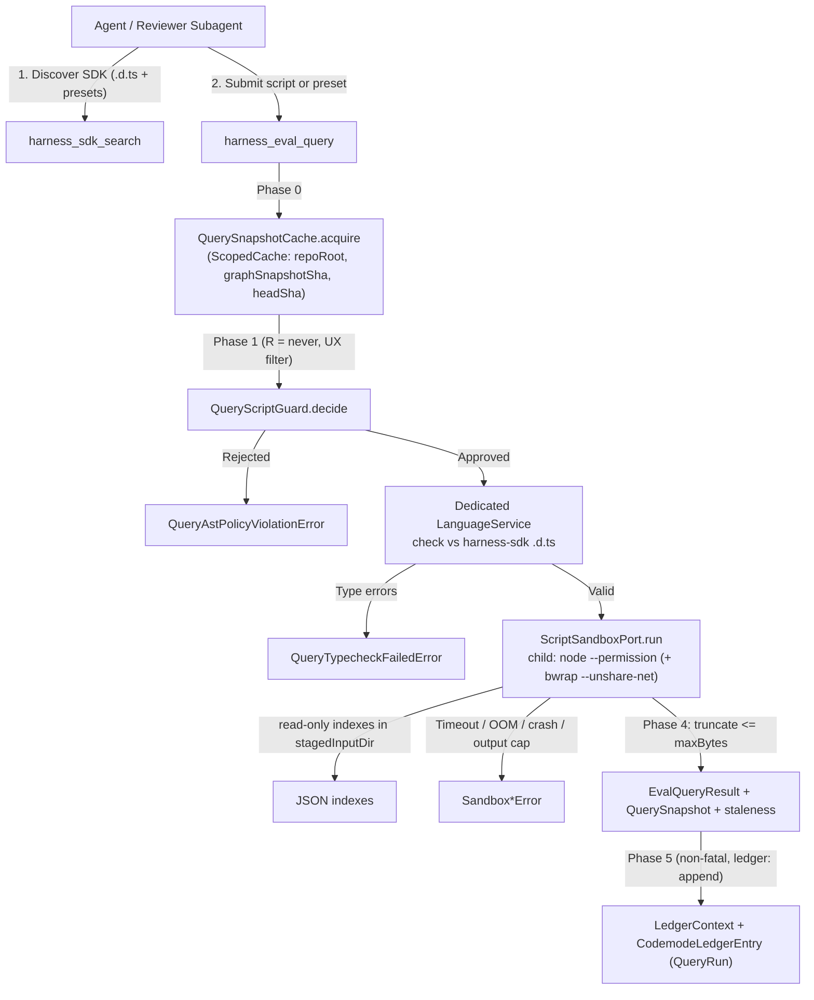

# RFC-0011: Sandboxed Read-Only Graph Code Mode (`harness_eval_query`) & Progressive SDK Disclosure in `harness-mcp`

> Supporting evidence: [independent review of RFC-0011..0014](./reviews/2026-11-16-rfc-0011-0014-review.md).

## 1. Executive Summary

Across [RFC-0001](./0001-polymorphic-hypergraph-and-pera-ontology-model.md) through [RFC-0009](./0009-true-hexagonal-closure-and-effect-v4-runtime.md), `harness-mcp` accumulated **16 MCP tools** across four plugin modules (`CANONICAL_MCP_TOOL_NAMES` in `libs/harness/contract/src/workspace-and-process.ts`; descriptors assembled in [`buildLiveMcpToolDescriptors`](../../apps/harness-mcp/src/tools/tool-registry.ts#L62)). Point lookups (`harness_resolve`, `harness_lsp_diagnostics`) are cheap, but **compound architectural questions** (multi-hop reachability joins, Stage 4 security/reliability audits, unexercised-error triangulation) trap autonomous agents in an **$N+1$ MCP round-trip loop**: every intermediate node list, callee array and ontology trace flows through the LLM context before the next call filters it.

Inspired by **Cloudflare Code Mode** (a typed SDK plus model-written code) and **Anthropic's _Code execution with MCP_**, this RFC adds **read-only Code Mode** to `harness-mcp` as two new tools (16 → 18):

1. **`harness_sdk_search`:** returns minimal TypeScript ambient declarations (`.d.ts`) for requested namespaces (`graph`, `datalog`, `ontology`, `ast`) of `HarnessQuerySdk`, plus the names of any promoted query presets, so tool prompts stay small until an agent needs a compound query.
2. **`harness_eval_query`:** accepts either an ad-hoc TypeScript query script or a named `preset` with `params` (presets are promoted by [RFC-0014](./0014-voyager-skill-and-plugin-promotion-loop.md); promotion adds no new MCP tool). A script passes (1) an AST guard that is a **UX filter, not a security boundary**, (2) a typecheck against the SDK `.d.ts` in a dedicated small `LanguageService`, (3) execution in a **separate, permission-restricted Node child process** behind the shared `ScriptSandboxPort` (`ChildProcessScriptSandboxLive`), and (4) deterministic truncation. The query runs over read-only JSON indexes staged from a cached `QuerySnapshot`, and every result reports the snapshot, its staleness and the resolved repo root.

`harness_eval_query` **complements** the fast O(1) tools and does not orchestrate external MCP servers. Completed runs append a `CodemodeLedgerEntry` (`QueryRun`, with a `LedgerContext` resolved by the tool; `ledger: "skip"` opts out) to the shared ledger consumed by RFC-0014. The sandbox port is deliberately generic: [RFC-0012](./0012-transactional-shadow-lsp-ast-codemods.md) reuses it (v2, `tsmorph-codemod`) instead of building a second one.

---

## 2. Motivation & Empirical Gap Analysis

### 2.1 The $N+1$ Round-Trip & Intermediate Token Bloat Bottleneck

The 16 registered tools are partitioned into four modules under [`apps/harness-mcp/src/tools/`](../../apps/harness-mcp/src/tools/tool-registry.ts#L62):

| Module                       | Current MCP Tools                                                                                                                                       | Limitation Under Compound Analysis                                                                                                                                                                 |
| :--------------------------- | :------------------------------------------------------------------------------------------------------------------------------------------------------ | :------------------------------------------------------------------------------------------------------------------------------------------------------------------------------------------------- |
| `graph-navigation.tools.ts`  | `harness_resolve`, `harness_callers`, `harness_callees`, `harness_tests_reaching`, `harness_structural_search`, `harness_route`, `harness_review_route` | Each takes a single symbol or span; checking 12 handlers needs 12 serialized round-trips per relation.                                                                                             |
| `ontology-and-gq.tools.ts`   | `harness_ontology_why`, `harness_ontology_impact`, `harness_ontology_check`, `harness_gq_query`                                                         | `harness_gq_query` accepts only the fixed `HARNESS_GQ_QUERY_NAMES` tuple of Omnigraph `.gq` presets (`libs/harness/graph/src/gq-queries.ts`); ad-hoc relational filters need full JSON extraction. |
| `lsp-and-telemetry.tools.ts` | `harness_lsp_diagnostics`, `harness_telemetry_report`                                                                                                   | Returns whole diagnostic payloads instead of projected `(file, line, code)` tuples.                                                                                                                |
| `datalog-and-dpo.tools.ts`   | `harness_graph_infer`, `harness_graph_complete`, `harness_graph_rewrite`                                                                                | Exposes strata and DPO rewriting, but joining `EffectiveRequires` / `EffectiveFailsWith` facts with endpoint tuples or AST matches has no server-side combinator.                                  |

### 2.2 Concrete Evidence from Multi-Lens Code Reviews and Audits

During Stage 4 reviews and class-fix investigations, agents routinely ask **relational join questions**, for example:

> _"For every HTTP endpoint, which error tags can its handler transitively fail with that the endpoint does not declare, and is that handler flagged as untested?"_

Today this takes one `harness_gq_query` for endpoints, then K calls to `harness_graph_infer` / `harness_callees` and `harness_tests_reaching` (K is the number of endpoints), then manual intersection of JSON arrays inside the model's context. Even if each call is cheap, pushing tens of KB of unjoined JSON through 15–20 model turns costs wall-clock time and risks context exhaustion. With `harness_eval_query` the agent submits one short script and receives a small sorted findings array. The latency of that path is a **target to be benchmarked (`PERF-07`), not a measured fact** (see §8.1).

**What the server holds today.** `harness-mcp` does not hold a warm graph: each tool call runs `resolveGraphWithStatus` ([`mcp-helpers.ts#L215`](../../apps/harness-mcp/src/tools/mcp-helpers.ts#L215)), which loads `graph-snapshot.json` or `plan-graph-snapshot.json` from disk (and re-extracts when the recorded `graph-head.json` SHA differs from the current HEAD), and `harness_graph_infer` re-runs `decideGraphInference` on every call. No `DatalogSession` is used in `apps/harness-mcp`. `harness_lsp_diagnostics` builds a fresh `createTypeScriptProgramSession` per call. A snapshot cache is therefore a **prerequisite** of this RFC (milestone CM-0, §5.3), not an assumed property. Because `resolveGraphWithStatus` reads only the committed snapshot while `ast-grep` reads the live working tree, results must also report staleness (§4.1).

### 2.3 External Evidence & Caution

- Cloudflare's _Code Mode_ (Sep 2025) turns tool schemas into a TypeScript API and has the model write code that runs in a V8-isolate Dynamic Worker. Its _Code Mode MCP_ post (Feb 2026) exposes the Cloudflare API through only `search()` and `execute()` and reports a 99.9% input-token reduction (≈1.17M → ≈1k tokens) on a very large API. That figure measures schema-size collapse, not our N+1 savings. `@cloudflare/codemode`'s `DynamicWorkerExecutor` requires the Workers runtime, so only the pattern transfers to a local Node server.
- Anthropic's _Code execution with MCP_ (2025-11-04) reports 150k → 2k tokens (98.7%); _Programmatic Tool Calling_ (2025-11-24) reports a 37% token reduction (43,588 → 27,297) on complex research tasks, with Python running in Anthropic's hosted sandbox. Both stress "sandboxing, resource limits, monitoring"; neither uses or endorses `node:vm`.
- CodeAct (Wang et al., 2024, arXiv:2402.01030) reports up to 20% higher success than JSON/text actions in general tool use, not for graph joins.

These are upper bounds on very large tool surfaces, not expectations for a 16-tool server; the harness must benchmark its own tool. They also show that an unguarded `eval` endpoint would violate the **Immutable TCB** spirit of [RFC-0000 §3.4](./0000-harness-paradigms-landscape-and-decision-matrix.md) and node process isolation, so confinement must be real, not nominal (§4.2).

---

## 3. Goals, Non-Goals & Hard Invariants

### 3.1 Goals

- **G1 — Single-Roundtrip Server-Side Joins:** let agents join graph traversals, Datalog-derived relations, ontology classifications and structural matches in one script (latency is a `PERF-07` target, §8.1).
- **G2 — Progressive `.d.ts` SDK Disclosure:** `harness_sdk_search` returns declarations filtered by namespace so token usage scales with the surfaces actually needed.
- **G3 — Process-Level Least Privilege:** untrusted scripts run with no filesystem writes, no subprocesses, no worker threads, no environment secrets and filesystem reads limited to a staged read-only input directory; network is blocked when `bwrap` is available and is a documented residual risk otherwise (§4.2).
- **G4 — Strict Output & Compute Budgeting:** bound wall-clock time, old-space heap, host RPC count, raw child output and the returned payload, with deterministic truncation metadata.
- **G5 — Honest Provenance:** every result carries `QuerySnapshot`, `staleness` and `resolvedRepoRoot`; successful runs append a `CodemodeLedgerEntry` (`QueryRun`, §5.5) as an _index of candidates_ for [RFC-0014](./0014-voyager-skill-and-plugin-promotion-loop.md), which must re-derive results and never trust the ledger.

### 3.2 Non-Goals

- **NG1 — Source Code Mutation:** `harness_eval_query` never writes files or mutates `HarnessGraph`/Omnigraph. Multi-file transformations belong to [RFC-0012](./0012-transactional-shadow-lsp-ast-codemods.md).
- **NG2 — Deleting Fast Granular Tools:** `harness_resolve`, `harness_route`, `harness_lsp_diagnostics` stay registered.
- **NG3 — Replacing `.gq` Presets or Adding Tools per Promotion:** `HARNESS_GQ_QUERY_NAMES` stays a fixed tuple of Omnigraph `.gq` presets and cannot host TypeScript scripts. Promoted queries are **named presets of `harness_eval_query`** (`preset` + `params`), discoverable through `harness_sdk_search`. Tool-selection accuracy degrades as tool count grows, so promotion must not add MCP tools.
- **NG4 — Caller-Side Orchestration of External MCP Servers:** out of scope.
- **NG5 — `branch` Selection:** no `branch` argument in v1. Omnigraph branches only affect `harness_gq_query`; they do not affect `HarnessGraph`, Datalog or `ast-grep`.

### 3.3 Hard Architectural Invariants

1. **Process-Level Least Privilege:** untrusted code runs only in a child process started by `ChildProcessScriptSandboxLive` with the Node permission model (§5.3). The host never shares memory with it; the bridge carries JSON strings only. Neither the AST guard nor `node:vm` is relied on for confinement.
2. **Pure Admission Core (`R = never`):** `QueryScriptGuard.decide` is an `Effect.fn` with `R = never`, exhaustive `ts-pattern` matching, no `any`, no `switch`.
3. **Secret & State Confidentiality (distinct from the Immutable TCB of RFC-0000 §3.4):** the child can read only the staged input directory and the runner directory, and starts with a scrubbed environment (no tokens). `IMMUTABLE_TCB_PATHS` (`libs/harness/gates/src/rule-synthesizer.ts`, 8 files) protects harness sources against self-modification; the sandbox cannot write at all, so it neither relies on nor affects that list. Write protection of `.harness/**` and the ledger directory is owned by the harness mutation policy in RFC-0012 §3.4 and only referenced here.
4. **Budgeted Modular Plugin Compliance (RFC-0007):** new tool descriptors live in `apps/harness-mcp/src/tools/eval-query.tools.ts` (`<= 650` LOC, the RFC-0007 tier for `apps/harness-mcp/src/tools`; target `<= 400`).
5. **Snapshot Honesty:** no result is returned without its `QuerySnapshot`, `staleness` and `resolvedRepoRoot`.

---

## 4. Formal Model: Snapshot, Pipeline & Security Argument

### 4.1 Read-Only Snapshot and Staleness

A query runs over a `QuerySnapshot = { repoRoot, headSha, graphSnapshotSha, dirty, builtAt }` (§5.3). Its content is a set of read-only JSON indexes derived from one `graph-snapshot.json` at one `headSha`:

- **graph index:** node summaries (`EffectFn`, `ServiceTag`, `TaggedError`, `VitestCase`, ...), resolved `HttpEndpointTuple` rows (handler resolved through `PlaysEndpointHandlerRole`), and caller/callee adjacency derived from `EffectSignature` relations;
- **datalog index:** the `decideGraphInference` output rows (`effectiveRequires`, `effectiveFailsWith`, `effectiveTestReach`, `antiPatterns`);
- **ontology index:** per-node ArchiMate layer classification and the precomputed `decideOntologyInvariants` violations.

`ast.searchStructural` is not an index: `@ast-grep/napi` reads the **live working tree** (default `subDirs` `["libs","apps"]`, `repos/` skipped, at most `MAX_STRUCTURAL_SEARCH_MATCHES = 200` matches per call), served by the host through a budgeted RPC (§5.3). Because the graph comes from a snapshot while `ast` reads the working tree, the two can disagree; `dirty` and `staleness` exist so the agent can see that.

```text
staleness = Fresh                                  when dirty = false and the snapshot degradedReason is absent
          = Stale { reason: "dirty-working-tree" } when dirty = true
          = Stale { reason: "snapshot-degraded" }  when resolveGraphWithStatus reported degraded
          = Stale { reason: "head-unavailable" }   when headSha is null
```

All SDK functions are pure projections over these indexes plus the one RPC. The indexes are immutable inside the child (§4.2) and discarded with it.

### 4.2 Threat Model, Security Argument & Residual Risks

**Adversary.** The attacker is not only a confused agent. **Prompt injection from repository content** (comments, docs, fixtures, dependency READMEs, tool output) can cause an agent to submit a hostile script. We assume arbitrary JavaScript chosen by the attacker executes inside the sandbox, running as the developer's OS user on the developer's machine. We do **not** defend against a V8 or kernel zero-day chain by a determined attacker; we reduce what ordinary escapes can reach.

**Why not `worker_threads` + `node:vm`.** Node's documentation states that `node:vm` "is not a security mechanism" and must not run untrusted code. On Node 24.14.1 an injected host function, a host-realm return value or a thrown host `Error` yielded `x['con'+'structor']('return process')()` and from there `child_process.execSync('id')`; `codeGeneration: { strings: false }` only restricts code compiled _inside_ the context; computed property names defeat any AST blacklist; and a `worker_threads` Worker still has `process`, `require` and `process.getBuiltinModule('fs')`. A claim of the form "no accepted script can affect the host" therefore cannot be made for that design.

**Layers, in order of what we rely on:**

| #   | Layer                                                                                                                                                                                 | What it provides                                                                                               | What it does **not** provide                                                                                                                                                       |
| :-- | :------------------------------------------------------------------------------------------------------------------------------------------------------------------------------------ | :------------------------------------------------------------------------------------------------------------- | :--------------------------------------------------------------------------------------------------------------------------------------------------------------------------------- |
| L1  | **Separate child process**, JSON-only stdio bridge, scrubbed env, single-use recycling (§5.3)                                                                                         | No shared heap with the host; a crash, OOM or hang kills only the child; no host secrets in memory or env.     | Same OS user and kernel.                                                                                                                                                           |
| L2  | **Node permission model** (`--permission`, `--allow-fs-read` for two directories, no `--allow-fs-write`, `--allow-child-process`, `--allow-worker`, `--allow-addons`, `--allow-wasi`) | Denies fs writes, fs reads outside the grants, subprocesses, workers, addons, WASI (`ERR_ACCESS_DENIED`).      | **Node documents it as not a security sandbox.** It does not restrict the network, follows symlinks, existing file descriptors bypass it, and a determined attacker may bypass it. |
| L3  | **`bwrap --unshare-net`** when `bwrap` is available                                                                                                                                   | Removes network access (and, with `--ro-bind`, can shrink the visible filesystem).                             | Absent on some hosts. When absent the child **keeps network access**; `SandboxRunResult` reports `networkIsolation: "none"`.                                                       |
| L4  | **`vm` context** (`codeGeneration: { strings: false, wasm: false }`, `microtaskMode: "afterEvaluate"`, `timeout`)                                                                     | Fresh globals without `process`/`require`; bounds synchronous loops and microtask loops.                       | **No security guarantee.** Host-realm functions injected for the bridge are an escape hatch; we assume an attacker can reach the child's own `process`.                            |
| L5  | **AST guard** (`QueryScriptGuard.decide`)                                                                                                                                             | Fast, actionable feedback for the common mistakes of a well-meaning agent; computes the alpha-normalized hash. | **Not a boundary.** It is bypassable (e.g. `obj['con'+'structor']`).                                                                                                               |
| L6  | **Parent watchdog:** wall-clock `SIGKILL`, `--max-old-space-size`, output byte cap, host RPC budget                                                                                   | Bounds time and JS heap; kills the child on timeout.                                                           | `--max-old-space-size` does not cover `ArrayBuffer`/native memory; a global OOM can still abort the child (reported as `SandboxCrashError`/`SandboxMemoryError`).                  |

**Security argument (what we claim).** If an attacker achieves arbitrary JavaScript execution in the child (L4/L5 bypassed), then, assuming Node's permission model is enforced as documented: it cannot write any file, cannot spawn processes, cannot read outside the staged index directory and the runner directory, finds no secrets in the environment, and — with `bwrap` — cannot reach the network. The only data it can read are the read-only indexes it was already entitled to query through the SDK. Because the child is single-use (recycled after every run), a compromised run cannot falsify the results of a later query. We do **not** claim isolation against: a bypass of the permission model, kernel/V8 vulnerabilities, network exfiltration when `bwrap` is missing, native-memory exhaustion before the parent kills the child, or `process._debugProcess`-style signalling of other same-user Node processes.

**Residual risks (explicit).**

1. **Network when `bwrap` is unavailable:** exfiltration of the staged indexes (which contain source-derived symbol data) is possible. Mitigation: report `networkIsolation: "none"` in every result and log it to telemetry; an installation-time check (`pnpm harness doctor`) should warn; a stricter mode may refuse to run without isolation (open question 3).
2. **Permission model is "not a sandbox":** treat L2 as defense in depth, not a proof.
3. **Same OS user:** a separate OS user or container is the stronger option and is deferred (open question 3).
4. **Sensitive content in indexes:** the staged indexes hold symbol names, file paths and messages from the repo; they hold no `.env*` content, but a hostile script can still read them all.

### 4.3 Phase Pipeline & Truncation Law

```text
request ─▶ Phase 0: QuerySnapshotCache.acquire ─▶ Phase 1: QueryScriptGuard.decide (UX filter, R = never)
        ─▶ Phase 2: typecheck vs harness-sdk .d.ts (dedicated small LanguageService)
        ─▶ Phase 3: ScriptSandboxPort.run (child process, limits) ─▶ Phase 4: truncate (<= maxBytes)
        ─▶ Phase 5: LedgerContext + CodemodeLedgerEntry append (skipped when ledger: "skip"; best effort, non-fatal)
```

- **Phase 0:** acquire the cached snapshot handle for the resolved repo root (warm hit or rebuild, §5.3) and compute `staleness`.
- **Phase 1 (`R = never`):** parse with `@ast-grep/napi` (`Lang.TypeScript`); reject dynamic `import()`/`require`, `process`, `globalThis`, `Buffer`, `eval`, `new Function`, `Proxy`, `Reflect`, `WebAssembly`, `__proto__` and syntactic `.constructor` chains, and AST depth `> 40`. The script-size bound (`16_384` bytes) is enforced at schema decode. Rejections return precise line numbers so the agent self-corrects. Because this phase is bypassable it carries no security weight.
- **Phase 2:** wrap the body in `async function __harnessQuery(sdk: HarnessQuerySdk): Promise<unknown> { ... }` and compute diagnostics in a **dedicated small `LanguageService`** whose host serves only the SDK `.d.ts`, the wrapper file and a minimal `lib` (`skipLibCheck`, `types: []`). The existing `TsCompilerOverlayService`/`evaluateOverlayDiagnostics` are **not** reused: they work on repo paths rather than `virtual://` files and filter `.d.ts` out of the root files (`libs/harness/graph/src/extractor/compiler-session.ts`). Type errors fail before any process is spawned. Measured on TypeScript 5.9.3 with a ~1 KB `.d.ts`: cold ≈100 ms, warm p50 ≈2.6 ms, worst ≈10 ms; the workspace compiler is the one bundled by `ts-morph` 28 (TypeScript 6.0.2), so CM-2 must re-measure with realistic SDK types.
- **Phase 3:** run in the sandbox (§5.3).
- **Phase 4 (bounded output):** serialize with deterministic sorted-key JSON. If `byteLength <= maxBytes` (default `24_576`), return `EvalQuerySuccess`; otherwise `EvalQueryTruncated` with `originalBytes` and a `cut` variant: `ArrayPrefix { keptItems, totalItems }` when the payload is an array (prefix kept at item boundaries) and `OpaquePrefix` for any other payload shape (a byte-prefix preview).
- **Phase 5:** unless the request says `ledger: "skip"`, resolve the `LedgerContext` (§5.5) and append one `QueryRun`; an unresolvable context or a failed append (`LedgerAppendError`) is reported as a warning, never as a query failure.

---

## 5. Detailed Technical Design in Effect-TS v4 Idioms

### 5.1 Sandbox Contract (F1): `@harness/contract` & `@harness/service`

`ScriptSandboxPort` is the **single** untrusted-code port of the harness. It is defined here and reused by RFC-0012 (`scriptKind: "tsmorph-codemod"`, v2).

```typescript
import { Context, Effect, Schema } from "effect"

export const SandboxScriptKind = Schema.Literals(["query", "tsmorph-codemod"])
export type SandboxScriptKind = typeof SandboxScriptKind.Type

export const SandboxScript = Schema.NonEmptyString.pipe(
  Schema.check(Schema.isBetweenLength(1, 16_384)),
  Schema.brand("SandboxScript"),
)
export type SandboxScript = typeof SandboxScript.Type

export const SandboxInputJson = Schema.String.pipe(Schema.brand("SandboxInputJson"))
export type SandboxInputJson = typeof SandboxInputJson.Type

export const SandboxOutputJson = Schema.String.pipe(Schema.brand("SandboxOutputJson"))
export type SandboxOutputJson = typeof SandboxOutputJson.Type

export const StagedInputDir = Schema.NonEmptyString.pipe(Schema.brand("StagedInputDir"))
export type StagedInputDir = typeof StagedInputDir.Type

export const SandboxTimeoutMillis = Schema.Int.pipe(
  Schema.check(Schema.isBetween({ minimum: 10, maximum: 2_000 })),
  Schema.brand("SandboxTimeoutMillis"),
)
export type SandboxTimeoutMillis = typeof SandboxTimeoutMillis.Type

export const SandboxMaxOldSpaceMb = Schema.Int.pipe(
  Schema.check(Schema.isBetween({ minimum: 16, maximum: 256 })),
  Schema.brand("SandboxMaxOldSpaceMb"),
)
export type SandboxMaxOldSpaceMb = typeof SandboxMaxOldSpaceMb.Type

export const SandboxOutputByteLimit = Schema.Int.pipe(
  Schema.check(Schema.isBetween({ minimum: 1_024, maximum: 1_048_576 })),
  Schema.brand("SandboxOutputByteLimit"),
)
export type SandboxOutputByteLimit = typeof SandboxOutputByteLimit.Type

export const SandboxHostCallBudget = Schema.Int.pipe(
  Schema.check(Schema.isBetween({ minimum: 0, maximum: 200 })),
  Schema.brand("SandboxHostCallBudget"),
)
export type SandboxHostCallBudget = typeof SandboxHostCallBudget.Type

export const SandboxLimits = Schema.Struct({
  timeoutMs: SandboxTimeoutMillis, // default 500
  maxOldSpaceMb: SandboxMaxOldSpaceMb, // default 64, passed as --max-old-space-size
  maxOutputBytes: SandboxOutputByteLimit, // hard cap on raw child output, default 262_144
  maxHostCalls: SandboxHostCallBudget, // host RPC budget (ast.searchStructural), default 20
})
export type SandboxLimits = typeof SandboxLimits.Type

export const SandboxRunRequest = Schema.Struct({
  scriptKind: SandboxScriptKind,
  script: SandboxScript,
  inputJson: SandboxInputJson, // parameters; the large read-only indexes live in stagedInputDir
  stagedInputDir: StagedInputDir, // the only directory the child may read (besides the runner)
  limits: SandboxLimits,
})
export type SandboxRunRequest = typeof SandboxRunRequest.Type

export const SandboxNetworkIsolation = Schema.Literals(["bwrap-unshare-net", "none"])
export type SandboxNetworkIsolation = typeof SandboxNetworkIsolation.Type

export const SandboxRunResult = Schema.TaggedUnion({
  SandboxCompleted: {
    outputJson: SandboxOutputJson,
    durationMicros: ExecutionDurationMicros,
    hostCallCount: Schema.Natural.pipe(Schema.brand("SandboxHostCallCount")),
    networkIsolation: SandboxNetworkIsolation,
  },
  SandboxScriptThrew: {
    // the script itself threw: a domain outcome, not an infrastructure failure
    message: Schema.NonEmptyString.pipe(Schema.brand("SandboxThrownMessage")),
    durationMicros: ExecutionDurationMicros,
    networkIsolation: SandboxNetworkIsolation,
  },
})
export type SandboxRunResult = typeof SandboxRunResult.Type

export class SandboxTimeoutError extends Schema.TaggedError<SandboxTimeoutError>()(
  "SandboxTimeoutError",
  { timeoutMs: SandboxTimeoutMillis },
) {}

export class SandboxMemoryError extends Schema.TaggedError<SandboxMemoryError>()(
  "SandboxMemoryError",
  { maxOldSpaceMb: SandboxMaxOldSpaceMb },
) {}

export class SandboxCrashError extends Schema.TaggedError<SandboxCrashError>()(
  "SandboxCrashError",
  {
    exitDescription: Schema.NonEmptyString.pipe(Schema.brand("SandboxExitDescription")),
    stderrTail: Schema.String.pipe(Schema.brand("SandboxStderrTail")),
  },
) {}

export class SandboxOutputLimitError extends Schema.TaggedError<SandboxOutputLimitError>()(
  "SandboxOutputLimitError",
  { limitBytes: SandboxOutputByteLimit },
) {}

export interface ScriptSandboxPortShape {
  readonly run: (
    request: SandboxRunRequest,
  ) => Effect.Effect<
    SandboxRunResult,
    SandboxTimeoutError | SandboxMemoryError | SandboxCrashError | SandboxOutputLimitError
  >
}

export class ScriptSandboxPort extends Context.Service<ScriptSandboxPort, ScriptSandboxPortShape>()(
  "@harness/service/ScriptSandboxPort",
) {}
```

`ExecutionDurationMicros` is the branded `Schema.Natural` scalar of §5.4. Contract-tier schemas live in `@harness/contract`; the `Context.Service` lives in `@harness/service`.

**Host RPC.** The only host call a query may make is `ast.searchStructural`. The child sends `{ id, method, argsJson }` on stdout; the host answers with a JSON string on stdin. Calls are served by a second small port, `SandboxHostBridge.serve(stagedInputDir, call)` (`Context.Service` in `@harness/service`), which resolves the repo root from the cache entry that owns `stagedInputDir` (never from child-supplied data), runs `decideStructuralSearch` with the match budget, and returns plain JSON. Calls beyond `maxHostCalls` return an error reply to the child.

### 5.2 Pure Admission Core (`QueryScriptGuard.decide`, `R = never`)

`QueryScriptGuard` lives in **`@harness/graph`** (`libs/harness/graph/src/query-script-guard.ts`), because `@ast-grep/napi` is a dependency of `@harness/graph` and not of `@harness/gates`. `@harness/graph` is `type:core`; parsing is synchronous and performs no I/O, so `R = never` holds.

```typescript
import { Effect, Schema } from "effect"
import { match } from "ts-pattern"
import { EvalQueryScript, GuardedScriptPlan, QueryAstPolicyViolationError } from "@harness/contract"
import { inspectQueryAstPure } from "./query-script-inspection.js"

export const decideQueryScriptGuard = Effect.fn("QueryScriptGuard.decide")(function* (
  script: EvalQueryScript,
): Effect.fn.Return<GuardedScriptPlan, QueryAstPolicyViolationError> {
  // Pure: parse with @ast-grep/napi, scan for banned nodes, alpha-normalize to
  // (normalizedTemplate, params), hash to AlphaAstHash, collect referenced namespaces.
  const inspection = inspectQueryAstPure(script)
  return yield* match(inspection)
    .with({ _tag: "Approved" }, (approved) => Effect.succeed(approved.plan))
    .with({ _tag: "Rejected" }, (rejected) => Effect.fail(rejected.error))
    .exhaustive()
})
```

`GuardedScriptPlan` (`script`, `alphaAstHash`, `normalizedTemplate`, `params`, `referencedNamespaces`) is a `Schema.Struct` in `@harness/contract` (it is a contract type, so it is not defined in the guard module). Alpha-normalization renames local identifiers sequentially (`v0`, `v1`, ...) and abstracts string and numeric literals into ordered parameter slots; RFC-0014 owns the anti-unification over these templates.

### 5.3 Live Sandbox, Snapshot Cache & Tools

#### 5.3.1 `ChildProcessScriptSandboxLive` (`@harness/infra`)

`libs/harness/infra/src/child-process-script-sandbox-live.ts` implements `ScriptSandboxPort`, built on the `effect/process` `ChildProcess`/`ChildProcessSpawner` already used by `subprocess-runner-live.ts` (whether its stdin streaming covers the NDJSON protocol is confirmed in the CM-3 spike; the fallback is a `node:child_process` use confined to `@harness/infra`, the tier where such builtins are allowed). A pure function `buildSandboxSpawnPlan(request, bwrapAvailable)` produces the argv, env and `networkIsolation`, so the privileges are unit-testable without spawning:

```text
[bwrap --unshare-net --ro-bind / / --dev /dev]      only when bwrap is available
node --permission
     --allow-fs-read=<stagedInputDir> --allow-fs-read=<runnerDir>
     --max-old-space-size=<limits.maxOldSpaceMb>
     <runnerDir>/sandbox-runner.mjs
env: {}                                              no tokens, no PATH-derived secrets
```

It never passes `--allow-fs-write`, `--allow-child-process`, `--allow-worker`, `--allow-addons` or `--allow-wasi`. `<runnerDir>` is the package-owned directory holding the small, dependency-free `sandbox-runner.mjs` (read access to it is required to load the entry script). `<runnerDir>` is the fixed package directory `libs/harness/infra/sandbox-runner/` and the entry script is `libs/harness/infra/sandbox-runner/sandbox-runner.mjs`; this exact path is listed in the ADR "Enforced By" section (§10.1) and is added to `IMMUTABLE_TCB_PATHS` by RFC-0012 TX-0, because a modified runner would defeat the in-child layers. The permission-model behavior (no grants → `ERR_ACCESS_DENIED` on `child_process`, directory-scoped reads) was confirmed on Node 24.14.1, which also confirmed the model does not restrict the network.

**Inside the child.** The runner loads the staged JSON indexes once, then waits for one run message. For the run it creates a `vm` context (`Object.create(null)`, `codeGeneration: { strings: false, wasm: false }`, `microtaskMode: "afterEvaluate"`, `timeout`) whose bridge exchanges **JSON strings only**, parsed by the context's own `JSON`. The vm is L4 in §4.2: defense in depth, not the boundary.

**Lifecycle.** The Live layer keeps a **standby child per staged directory** (permissions are fixed at spawn, so a child is bound to one snapshot entry) managed with `Effect.acquireRelease`. A run consumes the standby and a replacement is started in the background, so latency does not include process start and **no child serves two runs**. On timeout the host sends `SIGKILL`. A non-zero exit with a heap-OOM message maps to `SandboxMemoryError`, any other abnormal exit to `SandboxCrashError`, and raw output above `maxOutputBytes` to `SandboxOutputLimitError`. The cost of a recycled standby (process start plus index load) is a `PERF-07` measurement (§8.1).

#### 5.3.2 `QuerySnapshotCache` (F2, milestone CM-0)

```typescript
import { Context, Effect, Schema } from "effect"

// Canonical brands, owned by this RFC (`libs/harness/contract/src/repo-identity.ts`, exported from
// `@harness/contract`). RFC-0012 and RFC-0013 import `AbsoluteRepoRoot` and `GitCommitSha` and define no copies.
export const AbsoluteRepoRoot = Schema.NonEmptyString.pipe(
  Schema.check(Schema.isPattern(/^\/[^\0]*$/)),
  Schema.brand("AbsoluteRepoRoot"),
)
export type AbsoluteRepoRoot = typeof AbsoluteRepoRoot.Type

// SHA-1 object format only (`{40}`); a SHA-256 repository (64 hex) fails decoding until this brand is widened here.
export const GitCommitSha = Schema.String.pipe(
  Schema.check(Schema.isPattern(/^[0-9a-f]{40}$/)),
  Schema.brand("GitCommitSha"),
)
export type GitCommitSha = typeof GitCommitSha.Type

export const GraphSnapshotSha = Schema.String.pipe(
  Schema.check(Schema.isPattern(/^[0-9a-f]{64}$/)),
  Schema.brand("GraphSnapshotSha"),
)
export type GraphSnapshotSha = typeof GraphSnapshotSha.Type

export const SnapshotBuiltAtMillis = Schema.Natural.pipe(Schema.brand("SnapshotBuiltAtMillis"))
export type SnapshotBuiltAtMillis = typeof SnapshotBuiltAtMillis.Type

export const QuerySnapshot = Schema.Struct({
  repoRoot: AbsoluteRepoRoot,
  headSha: Schema.NullOr(GitCommitSha),
  graphSnapshotSha: GraphSnapshotSha, // sha256 of the graph-snapshot.json bytes
  dirty: Schema.Boolean, // working tree differs from HEAD
  builtAt: SnapshotBuiltAtMillis,
})
export type QuerySnapshot = typeof QuerySnapshot.Type

export const StalenessReason = Schema.Literals([
  "dirty-working-tree",
  "snapshot-degraded",
  "head-unavailable",
])
export type StalenessReason = typeof StalenessReason.Type

export const SnapshotStaleness = Schema.TaggedUnion({
  Fresh: {},
  Stale: { reason: StalenessReason },
})
export type SnapshotStaleness = typeof SnapshotStaleness.Type

export class QuerySnapshotUnavailableError extends Schema.TaggedError<QuerySnapshotUnavailableError>()(
  "QuerySnapshotUnavailableError",
  {
    repoRoot: AbsoluteRepoRoot,
    reason: Schema.NonEmptyString.pipe(Schema.brand("SnapshotUnavailableReason")),
  },
) {}

export const QuerySnapshotHandle = Schema.Struct({
  snapshot: QuerySnapshot,
  staleness: SnapshotStaleness,
  stagedInputDir: StagedInputDir,
})
export type QuerySnapshotHandle = typeof QuerySnapshotHandle.Type

export interface QuerySnapshotCacheShape {
  readonly acquire: (
    repoRoot: AbsoluteRepoRoot,
  ) => Effect.Effect<QuerySnapshotHandle, QuerySnapshotUnavailableError>
}

export class QuerySnapshotCache extends Context.Service<
  QuerySnapshotCache,
  QuerySnapshotCacheShape
>()("@harness/service/QuerySnapshotCache") {}
```

`QuerySnapshotCacheLive` is added to `apps/harness-mcp` (daemon side) and is built on `ScopedCache.make` (capacity small, e.g. 4; TTL configurable) with a branded string key `QuerySnapshotKey = repoRoot + graphSnapshotSha + headSha` (a string, because `ScopedCache` keys are compared by `Equal`/`Hash`). Per call, `acquire` (1) resolves the repo root, (2) probes `headSha` and the snapshot file hash, (3) calls `ScopedCache.get(key)`. On a miss the `lookup` runs the existing `resolveGraphWithStatus`/`decideGraphInference`/`decideOntologyInvariants` once, writes the JSON indexes into a fresh `0700` directory as a **scoped resource** (the directory is removed when the entry is evicted or the scope closes), and records `builtAt`. Entries for superseded keys age out by TTL/capacity; a changed snapshot hash or HEAD yields a new key, so staleness against the _graph_ cannot be served silently. `dirty` is probed per request through the existing subprocess runner, memoized for a short TTL; its cost is a `PERF-07` item. Cache and staged directories are per `harness-mcp` process; subagents in sibling worktrees share the server, which is why the key includes `repoRoot`.

**Repo root (F3, referenced).** `harness_sdk_search` and `harness_eval_query` accept an optional absolute `repoRoot` (like `datalog-and-dpo.tools.ts`) and fall back to the existing `resolveDefaultRepoRoot` behavior. Because the server is shared and that fallback can follow `.harness/active-workspace.json`, **every result returns `resolvedRepoRoot`** and the `QuerySnapshot`, so the agent can see what the query ran against. The strict worktree-verified rules apply to _writing_ tools (RFC-0012) and are not repeated here.

#### 5.3.3 Tools (`eval-query.tools.ts`)

Two descriptors are added via a new `buildEvalQueryToolDescriptors` spread into `buildLiveMcpToolDescriptors` (`tool-registry.ts`), and the two names are appended to `CANONICAL_MCP_TOOL_NAMES` (16 to 18). Later RFCs raise the list further (RFC-0012 to 19 with `harness_shadow_codemod`, RFC-0013 to 20 with `harness_workflow_plan`); each milestone updates `apps/harness-mcp/test/tool-registry.test.ts`.

### 5.4 Branded Query Contracts, Preset Resolution & Errors (`@harness/contract`)

```typescript
import { Schema } from "effect"

export const EvalQueryScript = Schema.NonEmptyString.pipe(
  Schema.check(Schema.isBetweenLength(1, 16_384)),
  Schema.brand("EvalQueryScript"),
)
export type EvalQueryScript = typeof EvalQueryScript.Type

export const EvalOutputByteLimit = Schema.Int.pipe(
  Schema.check(Schema.isBetween({ minimum: 1_024, maximum: 65_536 })),
  Schema.brand("EvalOutputByteLimit"),
)
export type EvalOutputByteLimit = typeof EvalOutputByteLimit.Type

export const SdkNamespace = Schema.Literals(["graph", "datalog", "ontology", "ast"])
export type SdkNamespace = typeof SdkNamespace.Type

export const ExecutionDurationMicros = Schema.Natural.pipe(Schema.brand("ExecutionDurationMicros"))
export type ExecutionDurationMicros = typeof ExecutionDurationMicros.Type

// `AlphaAstHash` is defined and exported by `codemode-ledger.ts` (§5.5) and imported here.

/** Per-request ledger switch. RFC-0014 verification replays and corpus runs use "skip" so they never pollute the ledger. */
export const LedgerWriteMode = Schema.Literals(["append", "skip"])
export type LedgerWriteMode = typeof LedgerWriteMode.Type

export const QueryPresetName = Schema.NonEmptyString.pipe(
  Schema.check(Schema.isPattern(/^[a-z][a-z0-9_]{2,63}$/)),
  Schema.brand("QueryPresetName"),
)
export type QueryPresetName = typeof QueryPresetName.Type

export const QueryParamName = Schema.NonEmptyString.pipe(Schema.brand("QueryParamName"))
export type QueryParamName = typeof QueryParamName.Type

export const QueryParamText = Schema.String.pipe(Schema.brand("QueryParamText"))
export type QueryParamText = typeof QueryParamText.Type

export const QueryParamNumber = Schema.Finite.pipe(Schema.brand("QueryParamNumber"))
export type QueryParamNumber = typeof QueryParamNumber.Type

export const QueryParamValue = Schema.TaggedUnion({
  TextParam: { value: QueryParamText },
  NumberParam: { value: QueryParamNumber },
})
export type QueryParamValue = typeof QueryParamValue.Type

export const GuardedScriptPlan = Schema.Struct({
  script: EvalQueryScript,
  alphaAstHash: AlphaAstHash,
  normalizedTemplate: Schema.NonEmptyString.pipe(Schema.brand("NormalizedQueryTemplate")),
  params: Schema.Array(QueryParamValue),
  referencedNamespaces: Schema.Array(SdkNamespace),
})
export type GuardedScriptPlan = typeof GuardedScriptPlan.Type

// The MCP argument decodes into this closed union; "both" or "neither" of script/preset is rejected.
export const EvalQueryRequest = Schema.TaggedUnion({
  AdhocQuery: { script: EvalQueryScript, ledger: LedgerWriteMode },
  PresetQuery: {
    preset: QueryPresetName,
    params: Schema.Record(QueryParamName, QueryParamValue),
    ledger: LedgerWriteMode,
  },
})
export type EvalQueryRequest = typeof EvalQueryRequest.Type

// Wire shape of the MCP argument. Optional fields exist only at this boundary and are decoded into the closed
// `EvalQueryRequest` plus tool-level inputs (`repoRoot`, `taskSlug` for the LedgerContext, limits).
export const EvalQueryToolInput = Schema.Struct({
  script: Schema.optional(EvalQueryScript),
  preset: Schema.optional(QueryPresetName),
  params: Schema.optional(Schema.Record(QueryParamName, QueryParamValue)),
  repoRoot: Schema.optional(AbsoluteRepoRoot),
  taskSlug: Schema.optional(LedgerTaskSlug),
  ledger: Schema.optional(LedgerWriteMode), // default "append"
  timeoutMs: Schema.optional(SandboxTimeoutMillis),
  maxBytes: Schema.optional(EvalOutputByteLimit),
})
export type EvalQueryToolInput = typeof EvalQueryToolInput.Type

export const EvalQueryInputProblem = Schema.Literals([
  "both-script-and-preset",
  "neither-script-nor-preset",
  "params-without-preset",
])
export type EvalQueryInputProblem = typeof EvalQueryInputProblem.Type

export class InvalidEvalQueryInputError extends Schema.TaggedError<InvalidEvalQueryInputError>()(
  "InvalidEvalQueryInputError",
  { problem: EvalQueryInputProblem },
) {}

// How a truncated payload was cut: a state, so a closed union instead of optional counters.
export const TruncationCut = Schema.TaggedUnion({
  ArrayPrefix: {
    keptItems: Schema.Natural.pipe(Schema.brand("EvalKeptItems")),
    totalItems: Schema.Natural.pipe(Schema.brand("EvalTotalItems")),
  },
  OpaquePrefix: {},
})
export type TruncationCut = typeof TruncationCut.Type

export const EvalQueryResult = Schema.TaggedUnion({
  EvalQuerySuccess: {
    alphaAstHash: AlphaAstHash,
    namespacesUsed: Schema.Array(SdkNamespace),
    durationMicros: ExecutionDurationMicros,
    payloadJson: Schema.String.pipe(Schema.brand("EvalSerializedJson")),
    snapshot: QuerySnapshot,
    staleness: SnapshotStaleness,
    resolvedRepoRoot: AbsoluteRepoRoot,
    networkIsolation: SandboxNetworkIsolation,
  },
  EvalQueryTruncated: {
    alphaAstHash: AlphaAstHash,
    namespacesUsed: Schema.Array(SdkNamespace),
    durationMicros: ExecutionDurationMicros,
    originalBytes: Schema.Natural.pipe(Schema.brand("EvalOriginalBytes")),
    cut: TruncationCut,
    previewJson: Schema.String.pipe(Schema.brand("EvalPreviewJson")),
    snapshot: QuerySnapshot,
    staleness: SnapshotStaleness,
    resolvedRepoRoot: AbsoluteRepoRoot,
    networkIsolation: SandboxNetworkIsolation,
  },
  EvalQueryScriptThrew: {
    alphaAstHash: AlphaAstHash,
    message: Schema.NonEmptyString.pipe(Schema.brand("EvalThrownMessage")),
    snapshot: QuerySnapshot,
    staleness: SnapshotStaleness,
    resolvedRepoRoot: AbsoluteRepoRoot,
    networkIsolation: SandboxNetworkIsolation,
  },
})
export type EvalQueryResult = typeof EvalQueryResult.Type

export const EvalQueryViolationRule = Schema.Literals([
  "banned-global-identifier",
  "dynamic-code-eval",
  "prototype-escape-attempt",
  "dynamic-import-or-require",
  "ast-depth-exceeded",
])
export type EvalQueryViolationRule = typeof EvalQueryViolationRule.Type

export class QueryAstPolicyViolationError extends Schema.TaggedError<QueryAstPolicyViolationError>()(
  "QueryAstPolicyViolationError",
  {
    rule: EvalQueryViolationRule,
    snippet: Schema.NonEmptyString.pipe(Schema.brand("ViolationSnippet")),
    line: Schema.Int.pipe(
      Schema.check(Schema.isGreaterThanOrEqualTo(1)),
      Schema.brand("SourceLine"),
    ),
  },
) {}

export class QueryTypecheckFailedError extends Schema.TaggedError<QueryTypecheckFailedError>()(
  "QueryTypecheckFailedError",
  {
    diagnosticSummary: Schema.NonEmptyString.pipe(Schema.brand("TypeDiagnosticSummary")),
    errorCount: Schema.Int.pipe(
      Schema.check(Schema.isGreaterThan(0)),
      Schema.brand("TypeErrorCount"),
    ),
  },
) {}

export class QueryPresetNotFoundError extends Schema.TaggedError<QueryPresetNotFoundError>()(
  "QueryPresetNotFoundError",
  { preset: QueryPresetName },
) {}
```

`EvalQueryRequest` is derived from `EvalQueryToolInput` by the pure function `decodeEvalQueryRequest`; an argument with both or neither of `script`/`preset`, or `params` without `preset`, fails with `InvalidEvalQueryInputError` (a `Schema.TaggedError` that the tool maps to an MCP input error). There is **no `branch` field**. Sandbox failures surface as the four `Sandbox*Error` types of §5.1.

**Presets.** A `QueryPresetRegistry` (`Context.Service` in `@harness/service`: `resolve(name)` returns the preset's script template and parameter slots; `list` returns names and one-line descriptions) is empty in v1 core and is populated by the manifest that RFC-0014 emits. A `PresetQuery` is instantiated by substituting the `params` as JSON literals into the template and then follows **exactly the same pipeline** (guard, typecheck, sandbox, truncation); a preset is never a trusted bypass. `harness_sdk_search` lists preset names beside the declarations.

### 5.5 Shared Ledger (F5): `CodemodeLedgerEntry`

The ledger is one versioned union, written by this RFC (`QueryRun`) and RFC-0012 (`CodemodRun`) and read by RFC-0014. This section owns its symbols, in `libs/harness/contract/src/codemode-ledger.ts`. The module exports **exactly** `CodemodeLedgerEntry`, `QueryRun`, `CodemodRun`, `LedgerTaskSlug`, `LedgerNormalizedTemplate`, `LedgerParams`, `AlphaAstHash`, `LedgerOutcome` and `LedgerContext`, all re-exported from `@harness/contract`; RFC-0012 and RFC-0014 import precisely these names and nothing else from the module. Every other constant below is module-private.

```typescript
import { Schema } from "effect"
import { GitCommitSha } from "./repo-identity.js"
import { GraphSnapshotSha } from "./query-snapshot.js" // CM-0 brands (§5.3.2)
import {
  ExecutionDurationMicros,
  QueryParamValue,
  QueryPresetName,
  SdkNamespace,
} from "./eval-query.js" // §5.4

export const AlphaAstHash = Schema.String.pipe(
  Schema.check(Schema.isPattern(/^[0-9a-f]{64}$/)),
  Schema.brand("AlphaAstHash"),
)
export type AlphaAstHash = typeof AlphaAstHash.Type

export const LedgerTaskSlug = Schema.NonEmptyString.pipe(Schema.brand("LedgerTaskSlug"))
export type LedgerTaskSlug = typeof LedgerTaskSlug.Type

export const LedgerNormalizedTemplate = Schema.NonEmptyString.pipe(
  Schema.brand("LedgerNormalizedTemplate"),
)
export type LedgerNormalizedTemplate = typeof LedgerNormalizedTemplate.Type

export const LedgerParams = Schema.Array(QueryParamValue)
export type LedgerParams = typeof LedgerParams.Type

const LedgerSchemaVersion = Schema.Literal(1)
const LedgerWorktreeId = Schema.NonEmptyString.pipe(Schema.brand("LedgerWorktreeId"))
const LedgerOutputHash = Schema.String.pipe(
  Schema.check(Schema.isPattern(/^[0-9a-f]{64}$/)),
  Schema.brand("LedgerOutputHash"),
)
const LedgerSource = Schema.Literals(["mcp-tool", "cli"])

// Outcome is per variant: a query can succeed, be truncated or throw; a codemod row exists only if it committed.
const QueryRunOutcome = Schema.Literals(["success", "truncated", "script-error"])
const CodemodRunOutcome = Schema.Literal("committed")
export const LedgerOutcome = Schema.Union([QueryRunOutcome, CodemodRunOutcome])
export type LedgerOutcome = typeof LedgerOutcome.Type

/** Who ran what, resolved by the MCP tool or CLI (never by the sandbox or the engine) and passed to `append`. */
export const LedgerContext = Schema.Struct({
  taskSlug: LedgerTaskSlug,
  worktreeId: LedgerWorktreeId,
  source: LedgerSource, // which entry point wrote the row; used for telemetry, not persisted in the line
})
export type LedgerContext = typeof LedgerContext.Type

const ledgerCommonFields = {
  schemaVersion: LedgerSchemaVersion,
  alphaAstHash: AlphaAstHash,
  normalizedTemplate: LedgerNormalizedTemplate,
  params: LedgerParams,
  outputHash: LedgerOutputHash,
  baseCommitSha: Schema.NullOr(GitCommitSha),
  graphSnapshotSha: GraphSnapshotSha,
  taskSlug: LedgerTaskSlug,
  worktreeId: LedgerWorktreeId,
  durationMicros: ExecutionDurationMicros,
}

export const CodemodeLedgerEntry = Schema.TaggedUnion({
  QueryRun: {
    ...ledgerCommonFields,
    outcome: QueryRunOutcome,
    namespacesUsed: Schema.Array(SdkNamespace),
    preset: Schema.NullOr(QueryPresetName), // null = ad-hoc script; RFC-0014 clusters only ad-hoc rows
  },
  CodemodRun: {
    ...ledgerCommonFields,
    outcome: CodemodRunOutcome,
    touchedFileCount: Schema.Natural.pipe(Schema.brand("LedgerTouchedFileCount")),
    mode: Schema.Literal("atomic-commit"), // dry-runs are never logged (RFC-0012)
  },
})
export type CodemodeLedgerEntry = typeof CodemodeLedgerEntry.Type

export const QueryRun = CodemodeLedgerEntry.cases.QueryRun
export const CodemodRun = CodemodeLedgerEntry.cases.CodemodRun
```

`QueryRun` carries the F5 fields plus `namespacesUsed` and `preset`; `CodemodRun` carries the F5 fields plus `touchedFileCount` and `mode` (RFC-0012 refines its variant only through this union). **`CodemodRun` is written only on a successful commit** (outcome `"committed"`); dry-runs, rejected transactions and rolled-back commits are never logged.

**Ledger errors** (`libs/harness/contract/src/codemode-ledger-errors.ts`, exported from `@harness/contract`, not part of the module above):

```typescript
import { Schema } from "effect"

export const LedgerAppendFailure = Schema.Literals([
  "lock-timeout",
  "io-failure",
  "invalid-entry",
  "context-mismatch",
])
export type LedgerAppendFailure = typeof LedgerAppendFailure.Type

export class LedgerAppendError extends Schema.TaggedError<LedgerAppendError>()(
  "LedgerAppendError",
  {
    failure: LedgerAppendFailure,
    detail: Schema.NonEmptyString.pipe(Schema.brand("LedgerAppendDetail")),
  },
) {}

export const LedgerContextProblem = Schema.Literals([
  "no-task-slug-and-branch-is-not-impl-or-plan",
  "worktree-id-unavailable",
])
export type LedgerContextProblem = typeof LedgerContextProblem.Type

export class LedgerContextUnresolvedError extends Schema.TaggedError<LedgerContextUnresolvedError>()(
  "LedgerContextUnresolvedError",
  { problem: LedgerContextProblem },
) {}
```

**Context resolution.** `LedgerContextResolver` (`Context.Service` in `@harness/service`, Live in `@harness/infra`) exposes `resolve(repoRoot, taskSlugInput)` and fails with `LedgerContextUnresolvedError`. `taskSlug` is the optional `taskSlug` tool/CLI input; when absent it is taken from the current branch `impl/<task>` or `plan/<task>` of `repoRoot` (`git branch --show-current`); on any other branch without an input there is no task and the row is not written (the tool reports a warning, REQ-1.11). `worktreeId` is `HARNESS_WORKTREE_ID` (through `sanitizeWorktreeIdSegment`) when set, otherwise the first 16 hex characters of the SHA-256 of the realpath of `repoRoot`. `source` is `"mcp-tool"` or `"cli"` according to the caller. RFC-0012 resolves its context the same way.

**Storage.** `<git-common-dir>/harness/codemode-ledger.jsonl`, one JSON object per line, shared by **all worktrees** of the repository. `resolveHarnessStateDir` (`libs/harness/gates/src/worktree.ts`) is per worktree and per `HARNESS_WORKTREE_ID`, and Route D slice worktrees are deleted after each wave, so a per-worktree ledger would lose exactly the cross-task support RFC-0014 needs. A new `resolveHarnessCommonDir(repoRoot)` helper is built on the `commonGitDir` that `libs/harness/graph/src/cluster-resolver.ts` already derives for linked worktrees (that function is currently private and must be exported or reimplemented).

**Locking and port.** `CodemodLedgerPort` (`Context.Service` in `@harness/service`, Live in `@harness/infra`) has `append(repoRoot, entry, context)` and `readAll(repoRoot)`; `readAll` is the **only** reader (RFC-0014 reads through it and has no reader of its own). `append` first checks that `entry.taskSlug` and `entry.worktreeId` equal `context.taskSlug` and `context.worktreeId` (`LedgerAppendError` with `context-mismatch` otherwise), then acquires `<dir>/codemode-ledger.lock` with exclusive creation (`O_EXCL`) under an `Effect.acquireRelease` scope with a bounded `Schedule` retry and a stale-lock timeout, writes exactly one validated line, then releases the lock. Line size is bounded by the 16 KiB script limit. `readAll` decodes each line with `Schema.decodeUnknownEffect(CodemodeLedgerEntry)` and returns the decoded entries together with a count of malformed lines (it reports rather than throws on them). A failed append raises `LedgerAppendError`, which the tool converts to a warning (REQ-1.11).

**Deny rule.** The ledger directory is covered by the harness mutation policy owned by RFC-0012 §3.4 (`<git-common-dir>/harness/**` and `.harness/**` are `deny` for the `agent-edit`, `codemod` and `promotion` actors). Only `CodemodLedgerPort`'s Live writes it. **Until RFC-0012 TX-0 lands this protection does not exist**: `classifyFileWrite` is default-allow, so an agent edit can still write the ledger, and RFC-0014 must not be enabled in that state. CM-3 therefore recommends landing TX-0 before CM-3 (§10.3).

**Trust.** The ledger is **not anonymized** (it stores the normalized script template) and **not trusted**: it indexes candidates, and RFC-0014 re-derives every result before promoting anything.

### 5.6 Progressive `.d.ts` SDK Surface (`HarnessQuerySdk`)

`HarnessQuerySdk` is authored once as TypeScript interfaces in `libs/harness/graph/src/query-sdk/` (one interface per namespace); the `.d.ts` text served by `harness_sdk_search` is produced by declaration emit, snapshot-tested, and asserted against the runner's implementation so the two cannot drift. The SDK types are plain aliases (scripts are untrusted wire-level code), not repo-boundary types. Keys follow the real `getNodeKey` formats (`EffectFn:<qualname>`, `ServiceTag:<tagId>`, `TaggedError:<errorTag>`).

```typescript
// Disclosed by harness_sdk_search({ namespaces: ["graph", "datalog"] })
export interface HarnessQuerySdk {
  readonly graph: {
    readonly nodes: (filter?: {
      readonly kind?: NodeKind
      readonly packageTag?: string
    }) => ReadonlyArray<NodeSummary>
    readonly endpoints: () => ReadonlyArray<EndpointSummary>
    readonly callers: (fnKey: string) => ReadonlyArray<NodeSummary>
    readonly callees: (fnKey: string) => ReadonlyArray<NodeSummary>
  }
  readonly datalog: {
    readonly effectiveRequires: (fnKey: string) => ReadonlyArray<EffectiveRequiresRow>
    readonly effectiveFailsWith: (fnKey: string) => ReadonlyArray<EffectiveFailsWithRow>
    readonly testReach: (fnKey: string) => ReadonlyArray<TestReachRow>
    readonly antipatterns: (ruleId?: DatalogAntipatternRuleId) => ReadonlyArray<AntipatternRow>
  }
  readonly ontology: {
    readonly layerOf: (nodeKey: string) => ArchimateLayer | null
    readonly invariants: () => ReadonlyArray<OntologyViolationRow>
  }
  readonly ast: {
    readonly searchStructural: (
      pattern: string,
      options?: { readonly subDirs?: ReadonlyArray<"libs" | "apps">; readonly maxMatches?: number },
    ) => Promise<ReadonlyArray<StructuralMatchSummary>>
  }
}
// EndpointSummary = { endpointGroup, endpointName, method, path, handlerKey: string | null,
//                     errorTags: ReadonlyArray<string>, file, line }   (HttpEndpointTuple + PlaysEndpointHandlerRole)
// AntipatternRow  = { ruleId, datalogRuleId, nodeKey, message }       (INF-04..INF-09 ids)
```

`NodeKind` mirrors the node tags of `libs/harness/graph/src/model.ts` (for example `EffectFn`, `ServiceTag`, `TaggedError`, `VitestCase`). `ontology.why/impact` and `datalog` suggested edges / typed-hole bundles are **not** in v1 (they are traversals or not index-shaped; see open question 4).

---

## 6. Capability Catalog & End-to-End Walkthrough

### 6.1 MCP Plugin Registration (`eval-query.tools.ts`)

| Tool Name                | Input Schema (`effect/Schema`)                                                                                                  | Latency Target (p95, to benchmark) | Purpose                                                                                                         |
| :----------------------- | :------------------------------------------------------------------------------------------------------------------------------ | :--------------------------------- | :-------------------------------------------------------------------------------------------------------------- |
| **`harness_sdk_search`** | `{ namespaces?: SdkNamespace[], filter?: string, repoRoot?: string }`                                                           | `< 2 ms` target                    | Disclose compact `.d.ts` for selected namespaces and list available presets.                                    |
| **`harness_eval_query`** | `EvalQueryToolInput`: `{ script?, preset?, params?, repoRoot?, taskSlug?, ledger?: "append" \| "skip", timeoutMs?, maxBytes? }` | `< 100 ms` target (see §8.1)       | Guard, typecheck, sandbox-execute a read-only join over a `QuerySnapshot`; return bounded JSON with provenance. |



### 6.2 End-to-End Walkthrough: Stage 4 Reliability Audit of HTTP Endpoints

Consider `effect-reliability-reviewer` auditing HTTP endpoints. The question: which endpoint handlers can transitively fail with error tags the endpoint does not declare, are flagged as untested (INF-09), or require an infrastructure service from the domain layer (INF-04)?

1. **Discovery (1 call):** `harness_sdk_search({ namespaces: ["graph", "datalog"] })` returns the typed signatures above.
2. **Compound execution (1 call):**

   ```typescript
   const untested = new Set(sdk.datalog.antipatterns("INF-09").map((row) => row.nodeKey))
   const infraLeaks = new Set(sdk.datalog.antipatterns("INF-04").map((row) => row.nodeKey))

   return sdk.graph.endpoints().flatMap((endpoint) => {
     if (endpoint.handlerKey === null) {
       return [
         {
           route: `${endpoint.method} ${endpoint.path}`,
           file: endpoint.file,
           problem: "no-handler",
         },
       ]
     }
     const declared = new Set(endpoint.errorTags.map((tag) => `TaggedError:${tag}`))
     const undeclared = sdk.datalog
       .effectiveFailsWith(endpoint.handlerKey)
       .map((row) => row.errorKey)
       .filter((errorKey) => !declared.has(errorKey))
     const findings = {
       route: `${endpoint.method} ${endpoint.path}`,
       file: endpoint.file,
       undeclaredErrors: undeclared,
       untested: untested.has(endpoint.handlerKey),
       infraLeak: infraLeaks.has(endpoint.handlerKey),
     }
     return undeclared.length > 0 || findings.untested || findings.infraLeak ? [findings] : []
   })
   ```

   The script uses only real model elements: `HttpEndpointTuple` rows (`endpointGroup`, `endpointName`, `method`, `path`, `errorTags`, `file`) with the handler resolved through `PlaysEndpointHandlerRole` to an `EffectFn` key; `effectiveFailsWith` keyed by `EffectFn` nodes; and the Datalog antipattern rules `INF-09` (untested domain span) and `INF-04` (domain requires infra). (`SAT-01` is a mutation-check rule in `libs/harness/gates/src/mutation-check.ts`, not a Datalog antipattern, and is deliberately not used.)

3. **Result:** the agent receives a short findings array plus `snapshot`, `staleness` (for example `Stale { reason: "dirty-working-tree" }` after uncommitted edits) and `resolvedRepoRoot`. If the same shape recurs across tasks, RFC-0014 may promote it into a named preset invoked as `harness_eval_query({ preset, params })`, with no new MCP tool.

---

## 7. Library Selection, Rejected Alternatives & Trade-offs

The decision is driven by the threat model of §4.2: the boundary must be process-level, not a JavaScript-level object barrier.

| Evaluated runtime                                                                           | Isolation                                                                                                                     | Fit (Node >= 24, local MCP)                                                                                                                                                                             | Verdict                                                                                                                                                |
| :------------------------------------------------------------------------------------------ | :---------------------------------------------------------------------------------------------------------------------------- | :------------------------------------------------------------------------------------------------------------------------------------------------------------------------------------------------------ | :----------------------------------------------------------------------------------------------------------------------------------------------------- |
| **1. Child process + Node `--permission` + JSON bridge (+ `bwrap --unshare-net`) — CHOSEN** | OS process boundary; fs/child-process/worker denial from the permission model; network denial only with `bwrap`               | Built in (permission model stable since Node 22.13 / 23.5); no native addon; Node documents it as not a sandbox and it does not block the network.                                                      | **Chosen:** zero new dependencies, real process boundary, kill-on-timeout; residual risks stated openly (§4.2).                                        |
| **2. `isolated-vm`**                                                                        | Dedicated V8 isolate in-process                                                                                               | Maintenance mode; native addon needing a toolchain; Node >= 20 needs `--no-node-snapshot`; Node 24 is supported (6.x/5.x). Its README itself recommends a separate process for critical infrastructure. | **Not chosen:** native build and maintenance-mode risk; "breaks on Node 24-26" would be overstated. Reconsider if process spawn cost misses `PERF-07`. |
| **3. `quickjs-emscripten` (WASM)**                                                          | WASM memory isolation; memory limit and interrupt handler available                                                           | Pure JS/WASM, no native build; README states it is unaudited and pre-1.0; marshaling cost **unmeasured** (no number is claimed); interpreter is much slower than V8 JIT for compute.                    | **Open:** attractive if we need an in-process boundary; decide after benchmarking JSON marshaling of realistic indexes.                                |
| **4. Deno subprocess with explicit permissions**                                            | Default-deny fs/net/run/env at runtime; Deno itself recommends OS-level layering for untrusted code                           | Extra binary dependency; blocks the network natively (unlike Node's model).                                                                                                                             | **Deferred:** strongest "no extra OS tooling" option for network denial; revisit if `bwrap` availability is poor.                                      |
| **5. Cloudflare `workerd` / Dynamic Workers (`@cloudflare/codemode`)**                      | V8 isolate with capability bindings                                                                                           | `DynamicWorkerExecutor` requires the Workers runtime; running `workerd` locally is possible but heavy; IPC cost unmeasured.                                                                             | **Deferred:** optional `ScriptSandboxPort` Layer if `harness-mcp` ever runs as a shared remote server.                                                 |
| **6. SES / Hardened JavaScript (`lockdown()` + `Compartment`)**                             | Same-realm capability model; solves the constructor-chain class only if endowments are hardened primitives                    | Pure JS; does **not** bound CPU or memory; a V8 bug is an escape.                                                                                                                                       | **Possible add-on** inside the child (L4); not a replacement for the process boundary.                                                                 |
| **7. `ShadowRealm`**                                                                        | Intended realm isolation                                                                                                      | TC39 proposal at stage 2.7; not shipped as a stable Node/V8 feature.                                                                                                                                    | **Not usable.**                                                                                                                                        |
| **8. `worker_threads` + frozen `node:vm` (not a security boundary)**                        | None as a boundary: workers expose `process`/`require`; `vm` is "not a security mechanism"; escape reproduced on Node 24.14.1 | Built in                                                                                                                                                                                                | **Rejected.**                                                                                                                                          |
| **9. Raw `eval` / unsandboxed `node:vm` on the main event loop**                            | None                                                                                                                          | Built in                                                                                                                                                                                                | **Rejected:** `Immutable TCB` hazard; a `while (true)` also stalls the warm host.                                                                      |

**Typecheck alternative.** Reusing `TsCompilerOverlayService`/`evaluateOverlayDiagnostics` was rejected (§4.3 Phase 2); a dedicated `LanguageService` over a fixed in-memory file set is smaller and warm.

---

## 8. Ecosystem Impact, Performance & Clean-Slate Cutover

### 8.1 Performance Targets (`RFC-0006` `HarnessBench.decide` Alignment)

`PERF-07` is **introduced by this RFC** (it extends RFC-0006 `PERF-01..06`) and is wired through `HarnessBench.decide`. Apart from the TypeScript check, **no figure below has been measured**; each is a design target that CM-3 must benchmark before it becomes an enforced SLO.

| Operation                                                               | Status                                                                           | Target (p50 / p95)                                                                |
| :---------------------------------------------------------------------- | :------------------------------------------------------------------------------- | :-------------------------------------------------------------------------------- |
| `harness_sdk_search`                                                    | unmeasured                                                                       | `< 1 ms` / `2 ms` (static `.d.ts` cache)                                          |
| `QuerySnapshotCache.acquire`, warm hit                                  | unmeasured                                                                       | benchmark (includes snapshot hash probe and `dirty` probe)                        |
| `QuerySnapshotCache.acquire`, miss (graph + Datalog fixpoint + staging) | unmeasured                                                                       | benchmark; budget set after measurement                                           |
| `QueryScriptGuard.decide`                                               | unmeasured                                                                       | `< 1 ms` / `3 ms`                                                                 |
| Typecheck, dedicated `LanguageService`, warm                            | **measured** on TS 5.9.3, ~1 KB `.d.ts`: p50 ≈2.6 ms, worst ≈10 ms; cold ≈100 ms | re-measure on `ts-morph`'s TS 6.0.2 with realistic SDK types; budget 15–25 ms p95 |
| Sandbox run with a warm standby child                                   | unmeasured                                                                       | benchmark; includes JSON bridge and a typical 12–40 endpoint join                 |
| Standby replacement (process start + index load)                        | unmeasured                                                                       | benchmark; runs in the background                                                 |
| End-to-end `harness_eval_query`, typical join                           | unmeasured                                                                       | working target `< 100 ms` p95; replaces the earlier `< 15 ms` claim               |

### 8.2 Compatibility & Token Impact

- **`branch`:** removed from v1. Omnigraph branches (`main`, `plan/<task>`, `impl/<task>`) affect only `harness_gq_query` (via `invokeOmnigraphNamedQuery`); `resolveGraphWithStatus` takes no branch and always loads the local snapshot. A future `sdk.omnigraph` namespace could expose branch-scoped queries (open question 5). The earlier idea of auditing an unmerged `plan/<task>` hypergraph through a `branch` argument was incorrect and is dropped.
- **Worktrees:** one server is shared by subagents in sibling worktrees; hence `resolvedRepoRoot` in every result and `repoRoot` in the cache key (§5.3.2).
- **Cutover:** purely additive. `CANONICAL_MCP_TOOL_NAMES` (`libs/harness/contract/src/workspace-and-process.ts`) grows from `16` to `18` (`harness_sdk_search`, `harness_eval_query`); the descriptors are spread into `buildLiveMcpToolDescriptors` and `apps/harness-mcp/test/tool-registry.test.ts` (which asserts the registry 1:1 against the canonical names) is updated. No existing tool changes. Later RFCs take the same list to 19 (RFC-0012, `harness_shadow_codemod`) and 20 (RFC-0013, `harness_workflow_plan`) and update the same test; RFC-0014 leaves the count unchanged.

---

## 9. Open Questions & Future Work

1. **TypeScript version for Phase 2:** `ts-morph` 28 bundles TypeScript 6.0.2 while the workspace root pins `typescript` 7.0.2. CM-2 must confirm which compiler the dedicated `LanguageService` uses and re-measure.
2. **Index size and staging cost:** how large are the staged JSON indexes for this repository, and does per-run loading in a single-use standby child fit the target? If not: a shared multi-run child (rejected for integrity reasons), `isolated-vm`, or `quickjs-emscripten` (benchmark first).
3. **Stricter isolation tiers:** refuse to run without `bwrap`, run under a separate OS user or container, or switch to a Deno backend. Whether to make network isolation mandatory is a policy decision once `pnpm harness doctor` can report availability.
4. **SDK scope after v1:** `ontology.why/impact` (traversals over the live graph), suggested edges and typed-hole bundles are not index-shaped; they could be served as additional budgeted host RPCs.
5. **`sdk.omnigraph` namespace** for branch-scoped queries, subject to the Cedar policy of RFC-0010 (the `agent-mcp` subject may only `read` and `invoke_query`).
6. **Ledger growth:** rotation or compaction of `codemode-ledger.jsonl`, and the retention policy RFC-0014 needs for eviction.
7. **Telemetry:** measure per-session token savings in `harness telemetry` once Stage 4 specialist reviewers default to `harness_eval_query`.

---

## 10. Rollout & Decomposition Plan (ADRs, EARS Specs & Milestones)

### 10.1 Prepared MADR Template for `libs/harness/docs/adr/0016-sandboxed-readonly-graph-codemode.md` (`harness:ADR-0016`)

```markdown
---
id: harness:ADR-0016
title: Sandboxed Read-Only Graph Code Mode (harness_eval_query) over a Process-Level Script Sandbox
status: proposed
date: 2026-11-17
---

# ADR-0016: Sandboxed Read-Only Graph Code Mode (`harness_eval_query`) over a Process-Level Script Sandbox

## Context

Compound graph queries across `HarnessGraph`, Datalog strata, the ontology projection and `@ast-grep/napi` currently force agents into N+1 MCP round-trips. `harness-mcp` holds no warm graph today, and `node:vm` / `worker_threads` are not security boundaries (escape reproduced on Node 24.14.1). Repository content can carry prompt injection, so generated scripts are untrusted.

## Decision

1. Add `harness_sdk_search` and `harness_eval_query` (optional `preset` + `params`) in `apps/harness-mcp/src/tools/eval-query.tools.ts`; MCP tool count 16 to 18; no per-promotion tools.
2. Execute scripts only through `ScriptSandboxPort`, implemented by `ChildProcessScriptSandboxLive`: a child `node --permission` process with read access limited to the staged index and runner directories, scrubbed environment, `--max-old-space-size`, JSON-only bridge, single-use recycling, and `bwrap --unshare-net` when available (network is a documented residual risk otherwise). `vm` and the AST guard are defense in depth / UX only.
3. Serve queries from a cached `QuerySnapshot` (`ScopedCache` keyed by `(repoRoot, graphSnapshotSha, headSha)`); every result reports the snapshot, `staleness` and `resolvedRepoRoot`. No `branch` argument in v1.
4. Record completed runs as `CodemodeLedgerEntry` (`QueryRun`, with a tool-resolved `LedgerContext`; `ledger: "skip"` opts out) in `<git-common-dir>/harness/codemode-ledger.jsonl` under a lock file; the ledger indexes candidates and is never trusted.

## Consequences

- Compound audits shrink from many turns to one call; latency is benchmarked under `PERF-07`, not assumed.
- The security argument is stated with its limits: Node documents its permission model as not a sandbox, and the network is open when `bwrap` is missing.
- RFC-0012 reuses the same port for its v2 Mode B instead of adding a second sandbox.

## Enforced By

- `libs/harness/graph/src/query-script-guard.ts` (`QueryScriptGuard.decide`, UX filter)
- `libs/harness/infra/src/child-process-script-sandbox-live.ts` (`buildSandboxSpawnPlan`, `ChildProcessScriptSandboxLive`)
- `libs/harness/infra/sandbox-runner/sandbox-runner.mjs` (the child entrypoint; RFC-0012 TX-0 adds it to `IMMUTABLE_TCB_PATHS`)
- `libs/harness/contract/src/codemode-ledger.ts` (`CodemodeLedgerEntry`, `LedgerContext`)
- `apps/harness-mcp/src/tools/eval-query.tools.ts` (`harness_eval_query`, `harness_sdk_search`)
```

### 10.2 Prepared EARS Specification Outline (`harness:SPEC-0015`)

| ID       | Pattern            | Requirement                                                                                                                                                                                                                                                                                                                                                                                                                                                                                 | Effect Symbol                                                        | Verification                           |
| :------- | :----------------- | :------------------------------------------------------------------------------------------------------------------------------------------------------------------------------------------------------------------------------------------------------------------------------------------------------------------------------------------------------------------------------------------------------------------------------------------------------------------------------------------ | :------------------------------------------------------------------- | :------------------------------------- |
| REQ-1.1  | Event-driven       | **When** `QueryScriptGuard.decide` receives an `EvalQueryScript` containing a banned global, dynamic import, `eval`/`new Function` or syntactic `.constructor` chain, it **shall** fail with `QueryAstPolicyViolationError` carrying the rule and line, with `R = never`.                                                                                                                                                                                                                   | `QueryScriptGuard.decide`                                            | `UnitTest` + `PropertyTest`            |
| REQ-1.2  | Unwanted behaviour | **If** a script fails the typecheck against the SDK `.d.ts`, **then** `harness_eval_query` **shall** fail with `QueryTypecheckFailedError` and `ScriptSandboxPort.run` **shall not** be invoked.                                                                                                                                                                                                                                                                                            | `QueryTypecheckFailedError`                                          | `UnitTest` (spy on `run`)              |
| REQ-1.3  | Unwanted behaviour | **If** a run exceeds `SandboxLimits.timeoutMs`, **then** `ChildProcessScriptSandboxLive` **shall** `SIGKILL` the child, fail with `SandboxTimeoutError`, and serve the next run from a fresh child.                                                                                                                                                                                                                                                                                         | `ChildProcessScriptSandboxLive`                                      | `UnitTest` + `TraceTest`               |
| REQ-1.4  | Unwanted behaviour | **If** the child exits from heap exhaustion under `--max-old-space-size`, **then** the port **shall** fail with `SandboxMemoryError`; **if** it exits abnormally otherwise, with `SandboxCrashError`; **if** raw output exceeds `maxOutputBytes`, with `SandboxOutputLimitError`.                                                                                                                                                                                                           | `SandboxMemoryError`, `SandboxCrashError`, `SandboxOutputLimitError` | `UnitTest`                             |
| REQ-1.5  | Ubiquitous         | `buildSandboxSpawnPlan` **shall** include `--permission` and exactly the two `--allow-fs-read` grants (`stagedInputDir`, runner directory), **shall not** include `--allow-fs-write`, `--allow-child-process`, `--allow-worker`, `--allow-addons` or `--allow-wasi`, and **shall** produce an empty environment.                                                                                                                                                                            | `buildSandboxSpawnPlan`                                              | `UnitTest`                             |
| REQ-1.6  | State-driven       | **While** `bwrap` is available, `buildSandboxSpawnPlan` **shall** wrap the command with `--unshare-net` and results **shall** report `networkIsolation: "bwrap-unshare-net"`; **otherwise** results **shall** report `networkIsolation: "none"`.                                                                                                                                                                                                                                            | `SandboxNetworkIsolation`                                            | `UnitTest`                             |
| REQ-1.7  | Event-driven       | **When** an accepted script attempts a host escape (the `x['con'+'structor']('return process')()` chain, `process.getBuiltinModule('child_process')`, an fs write, or a worker spawn), the run **shall** produce no host side effect (no file created, no process spawned) and end as `SandboxScriptThrew` or a `Sandbox*Error`.                                                                                                                                                            | `ScriptSandboxPort.run`                                              | `UnitTest` (escape corpus, real child) |
| REQ-1.8  | Event-driven       | **When** serialized output exceeds `EvalOutputByteLimit`, `harness_eval_query` **shall** return `EvalQueryTruncated` with `originalBytes` and a `cut`: `ArrayPrefix` with `keptItems` and `totalItems` (cut at item boundaries) for an array payload, `OpaquePrefix` otherwise.                                                                                                                                                                                                             | `EvalQueryResult`                                                    | `UnitTest`                             |
| REQ-1.9  | Ubiquitous         | Every `EvalQueryResult` **shall** contain `snapshot` (`QuerySnapshot`), `staleness` (`SnapshotStaleness`) and `resolvedRepoRoot`; **when** `dirty` is true, `staleness` **shall** be `Stale` with reason `dirty-working-tree`.                                                                                                                                                                                                                                                              | `QuerySnapshot`, `SnapshotStaleness`                                 | `UnitTest`                             |
| REQ-1.10 | Event-driven       | **When** `QuerySnapshotCache.acquire` is called twice with an unchanged `(repoRoot, graphSnapshotSha, headSha)`, the snapshot loader **shall** run once; **when** the key changes it **shall** run again and the superseded staged directory **shall** be removable by scope close.                                                                                                                                                                                                         | `QuerySnapshotCache`                                                 | `UnitTest` (loader call counter)       |
| REQ-1.11 | Event-driven       | **When** a run completes and `ledger` is not `"skip"`, `CodemodLedgerPort.append` **shall** receive the `LedgerContext` resolved by the tool and write one valid `CodemodeLedgerEntry` (`QueryRun`) line under the lock file; N concurrent appends **shall** yield N intact lines; **if** the context cannot be resolved or the append fails (`LedgerAppendError`), the tool **shall** still return its result with a warning; **when** `ledger` is `"skip"`, no line **shall** be written. | `CodemodLedgerPort`, `CodemodeLedgerEntry`                           | `UnitTest` + `PropertyTest`            |
| REQ-1.12 | Event-driven       | **When** `harness_eval_query` receives `preset` and `params`, it **shall** instantiate the template and run the same guard, typecheck and sandbox pipeline; an unknown preset **shall** fail with `QueryPresetNotFoundError`; both or neither of `script`/`preset` **shall** fail with `InvalidEvalQueryInputError`.                                                                                                                                                                        | `EvalQueryRequest`, `QueryPresetNotFoundError`                       | `UnitTest`                             |
| REQ-1.13 | Ubiquitous         | `CANONICAL_MCP_TOOL_NAMES` **shall** contain `harness_sdk_search` and `harness_eval_query`, the registry test (`tool-registry.test.ts`) **shall** match the canonical list 1:1, and the `harness_eval_query` input schema **shall** have no `branch` field.                                                                                                                                                                                                                                 | `CANONICAL_MCP_TOOL_NAMES`                                           | `UnitTest` (`tool-registry.test.ts`)   |

### 10.3 Independent Implementation Milestones

1. **Milestone CM-0 (warm snapshot cache, `@harness/contract`, `harness-mcp` + `@harness/service`):** the shared brands `AbsoluteRepoRoot` and `GitCommitSha` (`repo-identity.ts`), `StagedInputDir` and the snapshot brands (`GraphSnapshotSha`, `SnapshotBuiltAtMillis`, `QuerySnapshotKey`), `QuerySnapshot`, `SnapshotStaleness`, `QuerySnapshotCache` with `QuerySnapshotCacheLive` on `ScopedCache`, index staging into scoped `0700` directories, and the `PERF-07` baseline benchmark for hit/miss. Useful on its own to existing tools (`harness_graph_infer` can stop re-running inference).
2. **Milestone CM-1 (`@harness/contract` & `@harness/service`, after CM-0):** the remaining branded schemas, `SandboxRunRequest`/`SandboxRunResult` (using CM-0's `StagedInputDir`), the four sandbox errors, `ScriptSandboxPort`, `SandboxHostBridge`, `EvalQueryToolInput`/`EvalQueryRequest`/`EvalQueryResult`, `InvalidEvalQueryInputError`, `codemode-ledger.ts` (`CodemodeLedgerEntry`, `LedgerContext`, ...), the ledger errors, `QueryPresetRegistry`, `CodemodLedgerPort`, `LedgerContextResolver`.
3. **Milestone CM-2 (`@harness/graph`):** `QueryScriptGuard.decide` with alpha-normalization, `HarnessQuerySdk` interfaces and snapshot-tested `.d.ts` emit, and the dedicated small `LanguageService` typecheck (including re-measurement on the bundled compiler).
4. **Milestone CM-3 (`@harness/infra` & `harness-mcp`):** `buildSandboxSpawnPlan` and `ChildProcessScriptSandboxLive` (with `sandbox-runner.mjs`, standby child, escape-corpus tests), `CodemodLedgerPort` and `LedgerContextResolver` Lives with lock file and `resolveHarnessCommonDir`, `eval-query.tools.ts` registered in `buildLiveMcpToolDescriptors`, `CANONICAL_MCP_TOOL_NAMES` 16 to 18 and the `tool-registry.test.ts` update, and `PERF-07` SLOs validated through `pnpm harness verify`. **Ordering note:** until RFC-0012 TX-0 lands, the ledger path is writable by `agent-edit` (`classifyFileWrite` is default-allow), so TX-0 should land before CM-3 (CM-0..CM-2 do not depend on it).
