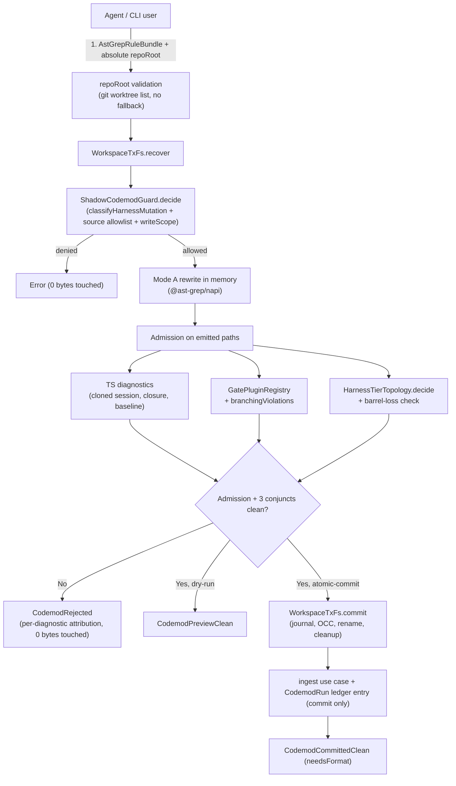

# RFC-0012: Transactional Multi-File AST Codemods in Shadow LSP (`harness_shadow_codemod`) with Crash-Consistent Commit and Harness Mutation Policy

> Supporting evidence: [independent review of RFC-0011..0014](./reviews/2026-11-16-rfc-0011-0014-review.md).

## 1. Executive Summary

During Stage 4 code-review fixes (`class-fix`), API contract evolution, and Effect v4 idiom refactors, autonomous agents routinely need to transform **5 to 25 correlated TypeScript files in lockstep**: for example replacing legacy `if (event._tag === ...)` chains with `match(...).exhaustive()` across handlers, or migrating `Effect.fn` return annotations to `Effect.fn.Return<A, E, R>`. Today the harness offers only two extremes:

1. **Static DPO Rewrite Templates (`GraphProjector.decide` in [RFC-0004](./0004-ast-code-projection-mcp-tools-and-implementation-roadmap.md)):** fixed structural recipes (`PLAN-*`, `REP-*`, see [`graph-projector.ts`](../../libs/harness/graph/src/graph-projector.ts)); cannot express ad-hoc cross-cutting refactors.
2. **Sequential line-by-line edits (`edit_file` / `replace_file_content`):** the model applies N separate edits, `tsc` is red between edits `1..K-1`, and passing full file texts through [`harness_lsp_diagnostics` `overlays`](../../apps/harness-mcp/src/tools/lsp-and-telemetry.tools.ts) burns output tokens.

This RFC introduces **Transactional Shadow AST Codemods (`harness_shadow_codemod` and `pnpm harness codemod`)**. An agent submits a **declarative `@ast-grep/napi` rule bundle (Mode A, the only mode in v1)**. The rewrite is computed in memory, verified over the overlay $W_{\text{disk}} \oplus \Delta W_{\text{RAM}}$ with four conjuncts (admission, TypeScript diagnostics with baseline subtraction, AST gates, tier topology and barrel integrity), and then either rejected with zero bytes written, or committed through an **on-disk journal with compare-before-rename optimistic concurrency control and startup recovery**. The guarantee is _crash-consistent with journal recovery_: after a crash and recovery the tree is entirely pre-state or entirely post-state, but a concurrent observer can see a mixed state while the renames run. The RFC also defines the **Harness Mutation Policy** (`classifyHarnessMutation`), which closes the gap that `classifyFileWrite` is default-allow and that the harness's own guards are not protected from codemods and promotions. A type-aware Mode B (`ts-morph`) is deferred to v2 and will run inside RFC-0011's `ScriptSandboxPort`.

All latencies in this document are **design targets** (`PERF-08`), not measurements.

---

## 2. Motivation & Empirical Gap Analysis

### 2.1 Existing Shadow Infrastructure Stops Halfway

The codebase already contains most building blocks, with limits that this RFC must state precisely:

1. [`TsCompilerOverlayService`](../../libs/harness/graph/src/services/ts-compiler-overlay-service.ts) hands out scoped `TypeScriptProgramSession`s via `getSession`. Its `Semaphore(1)` serialises only `extractGraphWithOverlays`; `getSession` returns a shared mutable session.
2. `evaluateOverlayDiagnostics` ([`compiler-session.ts:455`](../../libs/harness/graph/src/extractor/compiler-session.ts)) accepts `overlays: Readonly<Record<string, string>>` and builds a plain `ts.createProgram` over **only the overlay keys as roots**. It produces tsc syntactic and semantic diagnostics only (no `@effect/language-service`), performs no baseline comparison, does not use `reverseImportsByFile`, and assigns `session.oldProgram = program` (`compiler-session.ts:520`), so a "dry run" that passes a session mutates it. The MCP tool `harness_lsp_diagnostics` builds a fresh `createTypeScriptProgramSession` per call, so the "warm" latency is a design target inherited from RFC-0004, not an in-repo measurement.
3. [`shadow-bisection-verifier.ts`](../../libs/harness/graph/src/projector/shadow-bisection-verifier.ts) `isolateFirstOffendingPatchIndex` (`:275`) is a prefix binary search over an ordered `GraphPatch` list that assumes monotone prefixes and returns one first-bad index. It is not a subset or file-set bisection and is not reused here.
4. [`@ast-grep/napi`](../../libs/harness/graph/src/structural-search.ts) (0.51.0) is already a dependency of `@harness/graph`; `findAll`, `replace(text): Edit` and `commitEdits(edits): string` are its in-memory rewrite surface.

Two ergonomic barriers remain:

- **Passive overlays burn output tokens:** the agent must transmit the complete text of every modified file instead of a 10-line rewrite rule.
- **No commit protocol:** after an overlay is approved the agent re-types each file with `edit_file`, introducing transcription drift between the verified overlay and what lands on disk, and the existing per-file `writeTextFileAtomic` offers no multi-file consistency and no concurrency check.

### 2.2 Concrete Multi-File Refactor Scenarios That Fail Under Sequential Edits

- **`ts-pattern` exhaustiveness migration (`class-fix`):** replacing 14 legacy `if (event._tag === ...)` branches with `match(event).with(...).exhaustive()` and adding the `match` import in every touched module.
- **`Effect.fn` annotation migration:** changing `function* (...): Effect.Effect<A, E, R>` to `function* (...): Effect.fn.Return<A, E, R>` across a package (review X14: the former does not compile under `Effect.fn`).
- **Mechanical symbol renames expressible as syntax patterns** (for example `Schema.TaggedError` argument shape updates) where intermediate states do not typecheck.

Type-aware refactors that need symbol resolution (rename a declaration and all references, branded-type promotion that threads a new type through signatures) are **Mode B** scope and are v2.

---

## 3. Goals, Non-Goals & Hard Invariants

### 3.1 Goals

- **G1 - Transactional RAM-first refactoring:** compute rewrites inside an ephemeral overlay $W_{\text{disk}} \oplus \Delta W_{\text{RAM}}$, defaulting to `mode: "dry-run"` (preview only).
- **G2 - Four-conjunct commit gate:** permit `mode: "atomic-commit"` if and only if admission, TypeScript diagnostics (no new errors versus baseline), AST gates, and tier topology plus barrel integrity all hold (§4.2).
- **G3 - Declarative authoring (v1):** `@ast-grep/napi` multi-rule bundles (Mode A). Mode B (`ts-morph`) is v2 and runs inside `ScriptSandboxPort` (§5.4).
- **G4 - Compact diff and per-diagnostic attribution:** unified diffs (preview capped at 24 KiB), per-file diagnostic counts, and attribution of every new diagnostic to the delta file that introduced it (§4.3).
- **G5 - Provenance for Voyager promotion:** append one `CodemodRun` variant of `CodemodeLedgerEntry` (schema and location owned by RFC-0011, F5) per **committed** transaction, as an index of candidates for [RFC-0014](./0014-voyager-skill-and-plugin-promotion-loop.md); dry-runs and rejected or rolled-back transactions are never logged, and RFC-0014 never trusts the ledger.
- **G6 - Harness Mutation Policy:** one pure function `classifyHarnessMutation(relPath, actor)` that all automation (codemod, promotion) and the agent edit guard consult (§3.4).
- **G7 - Write-set confinement:** an optional write scope (`allowedWriteGlobs`, whose entries are exact paths or globs) restricts output paths to a work unit's write set (RFC-0013, review X12). The agent supplies it; RFC-0013 `complete` is the backstop.

### 3.2 Non-Goals

- **NG1 - Bypassing plan/verify lifecycle:** `harness_shadow_codemod` does not create `.harness/verify-stamp.json` and does not replace `pnpm harness verify`. A committed codemod still requires standard verification.
- **NG2 - No external processes inside the transform:** Mode A is declarative data executed in process by the native `@ast-grep/napi` engine; no `tsc`, `git`, `oxfmt` or shell is spawned by the transform. Formatting is **not** performed (D8): the report carries `needsFormat` and the agent runs `pnpm format` in the LLM phase of the canonical order (F6). (Infra code outside the transform spawns `git worktree list` and `git ls-files` through the existing subprocess runner, §5.3.)
- **NG3 - No mutation of governance subtrees:** codemods cannot touch anything `classifyHarnessMutation(p, "codemod")` does not return `allow` for (§3.4). In particular codemods cannot modify the harness itself (`libs/harness/**`, `apps/harness-*/**`, `adapters/**`).
- **NG4 - No file creation, deletion or rename in v1:** $\operatorname{dom}(\Delta W_{\text{RAM}}) \subseteq \operatorname{dom}(W_{\text{disk}})$. Mode A rewrites existing files only.
- **NG5 - No Effect language-service diagnostics on the overlay in v1:** see §4.2 (conjunct 2). Running `@effect/tsgo` on overlays would add a subprocess and break the latency target.

### 3.3 Hard Architectural Invariants

1. **Crash-consistent commit, not POSIX-atomic:** `rename(2)` is atomic per file only. A multi-file commit therefore proceeds through an on-disk journal (§4.4): after any crash, `WorkspaceTxFs.recover` restores the pre-state or reports a conflict; it never leaves a silently half-applied tree. During the rename phase a concurrent reader can observe a mixed state (no isolation guarantee). In `"dry-run"` mode, or when any conjunct fails, zero files are created, deleted or modified.
2. **Optimistic concurrency control (OCC):** every file's on-disk SHA-256 is compared with `sha256Before` immediately before its rename; any mismatch fails the whole transaction with `CodemodStaleBaseError` and rolls back. The compare-to-rename window cannot be closed against a writer that takes no lock; it is narrowed to one file's read-hash-rename and documented as residual risk.
3. **Admission before and after the transform:** every candidate path and every emitted path passes `ShadowCodemodGuard.decide` (§5.2), which wraps `classifyHarnessMutation(p, "codemod")`, containment (`resolveContainedRelPath` in `@harness/graph`, which resolves symlinks), the source-path allowlist, and the write scope (`allowedWriteGlobs`).
4. **Pure cores (`R = never`):** `classifyHarnessMutation`, `ShadowCodemodGuard.decide` and the attribution function have `R = never`, branded schemas, `match(...).exhaustive()` over unions, no `any`, no `switch`.
5. **Strict mutation ceiling:** `maxTouchedFiles <= 64`, `maxRules <= 32`, `maxFileBytes <= 1 MiB`, `maxAttributionProbes = 16` (ddmin fallback only), `maxDurationMs = 1_500` (checked cooperatively between files; a single native `parse`/`findAll` call cannot be interrupted, so inputs are size-bounded instead).
6. **Explicit `repoRoot`:** `harness_shadow_codemod` requires an explicit absolute `repoRoot`, validates it against `git worktree list --porcelain`, and refuses any fallback to `process.cwd()` or `.harness/active-workspace.json` (F3, review X5; the existing `resolveDefaultRepoRoot` in `apps/harness-mcp/src/tools/mcp-helpers.ts` (~line 120) falls back and is not used). The validation is the exported `validateWorktreeRepoRoot` (TX-2), reused by RFC-0013 `complete`.

### 3.4 Harness Mutation Policy (`classifyHarnessMutation`, review F4)

`classifyFileWrite` ([`policy.ts:619`](../../libs/harness/gates/src/policy.ts)) is default-allow. It denies only `repos/effect|alchemy`, `.harness/verify-stamp.json` and secret files, and returns `ask` for `.oxlintrc.json`, `tools/oxlint/*` and `*.cedar`. `IMMUTABLE_TCB_PATHS` ([`rule-synthesizer.ts:49`](../../libs/harness/gates/src/rule-synthesizer.ts)) lists 8 files and does not cover the harness's own guards, hooks, sandbox implementations or registries. Codemods and skill promotions could therefore rewrite their own guards. This section defines the single replacement authority. It is owned by this RFC and consumed by RFC-0014 (`actor: "promotion"`).

**Signature.** `classifyHarnessMutation(relPath: string, actor: HarnessMutationActor): HarnessMutationDecision` in `libs/harness/gates/src/harness-mutation-policy.ts`, with `actor` in `agent-edit | codemod | promotion` and `verdict` in `allow | ask | deny`. It is pure and synchronous and composes (most restrictive wins) with `classifyFileWrite`; it never weakens it. `relPath` deliberately stays a raw `string`: it is the documented exception of review F4, because the function must classify arbitrary, possibly malformed or escaping paths from hook payloads and must not fail on decode (a branded `WorkspaceRelPath` would reject exactly the inputs it has to deny).

**Evaluation order** (first match decides; `relPath` is normalised with `path.posix.normalize`, backslashes folded, leading `./` stripped):

| #   | Rule id              | Matches                                                                                                                                                                                                                                                                                                                                                                        | `agent-edit`                                                             | `codemod`, `promotion`                        |
| :-- | :------------------- | :----------------------------------------------------------------------------------------------------------------------------------------------------------------------------------------------------------------------------------------------------------------------------------------------------------------------------------------------------------------------------- | :----------------------------------------------------------------------- | :-------------------------------------------- |
| 1   | `path-escape`        | empty, `.`, absolute, `..` or `../*` after normalisation                                                                                                                                                                                                                                                                                                                       | `deny`                                                                   | `deny`                                        |
| 2   | `hard-deny`          | `.git/**`, `node_modules/**` (any depth), `pnpm-lock.yaml`, `.harness/**` (includes `.harness/worktrees/<id>/**` and `.harness/codemod-tx/**`). The shared ledger and workflow backups under `<git-common-dir>/harness/**` (F5, RFC-0013) is outside the worktree for linked worktrees (fails rule 1/containment) and under `.git/` for the main worktree (matches this rule). | `deny`                                                                   | `deny`                                        |
| 3   | `file-write-policy`  | `classifyFileWrite(p).verdict === "deny"`                                                                                                                                                                                                                                                                                                                                      | `deny`                                                                   | `deny`                                        |
| 4   | `tcb`                | `isImmutableTcbPath(p)` over the extended list below                                                                                                                                                                                                                                                                                                                           | `ask`                                                                    | `deny` (escalated)                            |
| 4b  | `promotion-emission` | `libs/harness/synthesized/src/generated/**` and `libs/harness/synthesized/src/manifest.ts` (RFC-0014 emission)                                                                                                                                                                                                                                                                 | `ask`                                                                    | `deny` for `codemod`; `allow` for `promotion` |
| 5   | `harness-ask`        | `libs/harness/**`, `apps/harness-*/**`, `adapters/**`, `tools/oxlint/**`, or `classifyFileWrite(p).verdict === "ask"`                                                                                                                                                                                                                                                          | `allow` (today's behaviour; only `classifyFileWrite` `ask` paths prompt) | `deny` (escalated, F4)                        |
| 6   | `default`            | everything else                                                                                                                                                                                                                                                                                                                                                                | `allow`                                                                  | `allow`                                       |

Rule 4b is the only `allow` for automation inside harness-owned paths: `promotion` may write generated modules and the generated manifest, and `pnpm harness learn --promote-skills` itself refuses to run outside a `learn/<date>` branch (RFC-0014). Activating a `proposed` entry is a manual `agent-edit`/human change and therefore prompts. Rule 5 keeps `agent-edit` at `allow` so day-to-day work on the harness does not prompt; for interactive edits only the TCB (rule 4) and the existing `classifyFileWrite` `ask` paths prompt.

For automation actors `ask` never reaches the caller: it is returned as `deny` with `ruleId` suffixed `-escalated`, so those paths are unreachable by automation by construction.

**Extended `IMMUTABLE_TCB_PATHS`.** In addition to the existing 8 entries, TX-0 adds:

- `libs/harness/gates/src/harness-mutation-policy.ts` and `libs/harness/gates/src/shadow-codemod-guard.ts` (this RFC);
- the query guard and sandbox files introduced by RFC-0011, exactly as listed in its ADR-0016 "Enforced By" section: `libs/harness/graph/src/query-script-guard.ts`, `libs/harness/infra/src/child-process-script-sandbox-live.ts` and the child entrypoint `libs/harness/infra/sandbox-runner/sandbox-runner.mjs` (the runner is what the Node permission model confines, so an edited runner would defeat the in-child layers);
- `libs/harness/infra/src/workspace-tx-fs-live.ts` (journal and recovery, this RFC) and `libs/harness/gates/src/plugins/gate-plugin-registry.ts` and `libs/harness/gates/src/plugins/harness-tier-topology.ts` (verification conjuncts depend on them);
- `adapters/claude-code/hooks.json` and `adapters/antigravity/plugins/effect-harness/hooks.json`;
- `apps/harness-cli/src/commands/guard-and-route.command.ts` (`guard`) and `apps/harness-cli/src/commands/verify-and-done.command.ts` (`done`).

Editing `rule-synthesizer.ts` itself is a TCB change and requires human review; it is part of TX-0, not of any automated path.

**Wiring.** `guard-and-route.command.ts` (`classifyFileWrite` call sites at lines 331 and 347) additionally calls `classifyHarnessMutation(p, "agent-edit")` and maps `ask` to the existing prompt path. `ShadowCodemodGuard.decide` (§5.2) uses `actor: "codemod"`. RFC-0014 uses `actor: "promotion"`.

**Hook matchers (X4).** MCP tool calls bypass the existing hooks, which match only `Bash` and `Edit|Write|MultiEdit` (Claude Code) and `run_command` and `replace_file_content|multi_replace_file_content|write_to_file` (Antigravity). Both adapters gain a `PostToolUse` entry that runs the same `ingest` command for the codemod tool: in `adapters/claude-code/hooks.json` with `"matcher": "mcp__harness-mcp__harness_shadow_codemod"`, and in `adapters/antigravity/plugins/effect-harness/hooks.json` with the matcher naming the same MCP tool under Antigravity's MCP tool naming (to be confirmed against the Antigravity runtime, §9). This is the second line of defence; the primary path is the in-process ingest of §5.3.

---

## 4. Formal Model

### 4.1 Shadow Workspace Overlay Algebra

Let $W_{\text{disk}}: \text{RelPath} \rightharpoonup \text{SourceText}$ be the workspace file map under the validated `repoRoot`. A Mode A transform $T$ yields $\Delta W_{\text{RAM}}$ with $\operatorname{dom}(\Delta W_{\text{RAM}}) \subseteq \operatorname{dom}(W_{\text{disk}})$ (NG4) and every entry byte-different from disk. The overlay operator is

$$
(W_{\text{disk}} \oplus \Delta W_{\text{RAM}})(p) = \begin{cases} \Delta W_{\text{RAM}}(p) & p \in \operatorname{dom}(\Delta W_{\text{RAM}}) \\ W_{\text{disk}}(p) & \text{otherwise} \end{cases}
$$

Verification evaluates programs over $W_{\text{disk}} \oplus \Delta W_{\text{RAM}}$ in a **cloned** `TypeScriptProgramSession` (never the shared warm session), so neither dry-run nor a rejected commit leaves residue in warm state (today `evaluateOverlayDiagnostics` mutates `session.oldProgram`).

### 4.2 Four-Conjunct Commit Predicate and What Exists Today

Let $\Delta = \operatorname{dom}(\Delta W_{\text{RAM}})$. The predicate is "1 admission + 3 verification conjuncts":

$$
\text{CanCommit} \iff \mathcal{P}_{\text{allow}}(\Delta) \land (\mathcal{D}_{\text{TS}} = \emptyset) \land (\mathcal{G}_{\text{AST}} = \emptyset) \land (\mathcal{T}_{\text{Nx}} = \emptyset)
$$

Each conjunct states what exists in the repository today and what is new work in this RFC:

| Conjunct                                  | Definition                                                                                                                                                                                                                                                                                                                                             | Exists today                                                                                                                                                                                                                                                                                                                                               | New work (milestone)                                                                                                                                                                                                                                                                                                                                                                                                                                                                                       |
| :---------------------------------------- | :----------------------------------------------------------------------------------------------------------------------------------------------------------------------------------------------------------------------------------------------------------------------------------------------------------------------------------------------------- | :--------------------------------------------------------------------------------------------------------------------------------------------------------------------------------------------------------------------------------------------------------------------------------------------------------------------------------------------------------- | :--------------------------------------------------------------------------------------------------------------------------------------------------------------------------------------------------------------------------------------------------------------------------------------------------------------------------------------------------------------------------------------------------------------------------------------------------------------------------------------------------------- |
| $\mathcal{P}_{\text{allow}}$ (admission)  | $\forall p \in \Delta$: contained in `repoRoot` (symlinks resolved), `classifyHarnessMutation(p, "codemod").verdict = "allow"`, source-path allowlist `^(libs\|apps)/.+\.(ts\|tsx\|mts)$`, within the write scope (`allowedWriteGlobs` entries: exact path or glob) when restricted, and $\lvert\Delta\rvert \le$ `maxTouchedFiles`.                   | `classifyFileWrite`, `isImmutableTcbPath`, `resolveContainedRelPath` (`@harness/graph`).                                                                                                                                                                                                                                                                   | `classifyHarnessMutation` and extended TCB (TX-0); `ShadowCodemodGuard.decide` (TX-2).                                                                                                                                                                                                                                                                                                                                                                                                                     |
| $\mathcal{D}_{\text{TS}}$ (TypeScript)    | $\text{Errors}(W_{\text{disk}} \oplus \Delta W_{\text{RAM}}) \setminus \text{Errors}(W_{\text{disk}}) = \emptyset$ over roots $R = \Delta \cup \text{ReverseClosure}(\Delta)$, keys $(\text{file}, \text{code}, \text{normalizedMessage})$ (line and column excluded). `regressionPolicy: "zero-errors"` instead requires $\text{Errors} = \emptyset$. | `evaluateOverlayDiagnostics` (tsc syntactic and semantic only); `reverseImportsByFile` in the session (used only for graph re-extraction).                                                                                                                                                                                                                 | (a) **Root closure:** add every transitive reverse importer of $\Delta$ (disk content) to the roots, because today roots are the overlay keys only. (b) **Baseline:** evaluate the same roots on disk content once and subtract; this is a second program build (cached by the sha256 of the root contents). (c) **Cloned session** per run. (d) **No Effect language-service rules** in v1 (NG5): `effecttsgo/*` diagnostics are not evaluated; `pnpm harness verify` after commit remains the authority. |
| $\mathcal{G}_{\text{AST}}$ (AST gates)    | No new violations (keyed `(file, ruleId, normalizedMessage)`) from `GatePluginRegistry.evaluateFiles` on the $\Delta$ buffers, plus no new `branchingViolations` (`discriminant-branching`, `unbranded-contract-schema`, `unbranded-primitive-boundary`) from `extractTypeAwareGraphFromSource`.                                                       | `GatePluginRegistry.evaluateFiles(files: ReadonlyArray<SelfDogfoodingFileInput>)` works on in-memory buffers (`{filePath, content}` with branded `AstSourceFilePath` and `AstSourceContent`); the registry ships one plugin, `self-dogfooding-core`; `switch` is flagged there. `branchingViolations` come from the graph extractor (`type-extractor.ts`). | Adapter from $\Delta W_{\text{RAM}}$ to `SelfDogfoodingFileInput`. The `any` and `as never` bans live only in the oxlint plugin (`tools/oxlint/syntax-bans.js`) and are **not** evaluated on buffers in v1; they are enforced by `pnpm harness verify` after commit (residual risk, §9).                                                                                                                                                                                                                   |
| $\mathcal{T}_{\text{Nx}}$ (tiers, barrel) | No new tier-boundary violation per AGENTS.md (below) over the overlay import graph, and no barrel export loss: for every barrel (`src/index.ts`) in $\Delta$, every export name that exists on disk and is imported by a file in `ReverseClosure(\Delta)` still exists.                                                                                | `HarnessTierTopology.decide` (`decideHarnessTierTopology`, `gates/src/plugins/harness-tier-topology.ts`) consumes `ServiceTierSourceInput` and `PackageTierManifestInput` records; oxlint `@nx/enforce-module-boundaries` enforces tiers from package tags. `checkEffectGraph` has **no** tier-boundary rule. `coProjectBarrelExports` only adds exports.  | Adapter that feeds overlay sources to `HarnessTierTopology.decide`; **barrel-loss detection is entirely new** (export-set diff of barrel modules between baseline and overlay programs, restricted to names with importers in the closure).                                                                                                                                                                                                                                                                |

Tier rules checked (AGENTS.md): `type:contract` imports nothing from the workspace (`effect` only; forbidden `service`, `core`, `domain`, `infra`, `app`); `type:service` -/-> `core|domain|infra|app`; `type:core` -/-> `domain|infra|app`; `type:domain` -/-> `infra|app` and `alchemy` and `@effect/sql-*`; `type:infra` -/-> `app`; `scope:web` imports `type:contract` and UI libraries only.

### 4.3 Fault Isolation by Per-Diagnostic Attribution

When $\text{CanCommit}$ fails, the verifier does **not** probe subsets. For each **new** diagnostic or violation $d$ in file $f$ (after baseline subtraction by `(file, code, normalizedMessage)`):

1. if $f \in \Delta$, attribute $d$ to $f$;
2. otherwise breadth-first search the forward import graph from $f$ and attribute $d$ to the nearest file in $\Delta$ (ties broken lexicographically);
3. if no delta file is reachable, mark $d$ `unattributed`.

This costs one graph traversal and zero additional program builds. Subset bisection is not used: the existing `isolateFirstOffendingPatchIndex` assumes monotone prefixes over an ordered patch list, and for interdependent edits (a rename in one file plus updated callers in others) subset probing is not well defined. Delta Debugging (Zeller and Hildebrandt, "Simplifying and Isolating Failure-Inducing Input", IEEE TSE 28(2), 2002) is an optional fallback for **AST-gate violations only**; it yields a 1-minimal failing subset and needs $O(k^2)$ verification runs in the worst case, so it is capped by `maxAttributionProbes` and never used for TypeScript diagnostics.

`normalizedMessage` is the flattened diagnostic message chain with `repoRoot` replaced by `<root>` and whitespace collapsed.

### 4.4 Journaled Commit and Recovery

State directory: `<resolveHarnessStateDir(repoRoot)>/codemod-tx/` (by default `.harness/codemod-tx/`, per worktree). It is `deny` for agents and codemods (§3.4 rule 2) and written only by `WorkspaceTxFs`.

`WorkspaceTxFs.commit` (all steps under the exclusive lock):

1. **Lock:** create `codemod-tx/.lock` with `O_EXCL`, containing `{pid, txId, startedAt}`. A lock whose pid is not alive is stale and is taken over after recovery; otherwise fail with `CodemodLockHeldError`. Recovery (below) runs before every commit.
2. **Prepare:** create `codemod-tx/<txId>/`; copy each target's current content to `originals/<n>` and `fsync` each file and the directory.
3. **Manifest:** write `manifest.json` (`state: "prepared"`, entries `{relPath, sha256Before, sha256After, tmpName}`) by tmp-write plus rename; `fsync` file and directory.
4. **OCC pre-check:** for every entry re-read disk and require `sha256(disk) == sha256Before`; else remove the journal, release the lock and fail with `CodemodStaleBaseError` (nothing was written to the workspace).
5. **Stage:** write each `sha256After` content to a sibling `<relPath>.harness-tx-<txId>.tmp` (same directory, hence same filesystem) and `fsync` it.
6. **Mark committing:** rewrite `manifest.json` with `state: "committing"` and `fsync`. From here a crash is recoverable only through the journal.
7. **Rename phase:** for each entry, re-check `sha256(disk) == sha256Before` immediately before `rename(tmp, target)`. A mismatch aborts: already-renamed files are restored from `originals/`, the journal is removed and the result is `CodemodStaleBaseError` (or `CodemodCommitFailedError` with `recovery: "rolled-back"` for I/O errors). After all renames `fsync` each parent directory.
8. **Finish:** write `state: "committed"`, delete `codemod-tx/<txId>/` and the lock.

`WorkspaceTxFs.recover(repoRoot)` inspects every journal directory:

| Journal `state`       | Action                                                                                                                                                                                                                                                                                                                          |
| :-------------------- | :------------------------------------------------------------------------------------------------------------------------------------------------------------------------------------------------------------------------------------------------------------------------------------------------------------------------------ |
| missing or `prepared` | No target was renamed; delete tmp files and the journal.                                                                                                                                                                                                                                                                        |
| `committing`          | For each entry: disk `== sha256After` -> restore from `originals/`; disk `== sha256Before` -> nothing to do; any other hash -> leave the file, mark the journal `conflict`, report `RecoveryConflict`. Roll-back is chosen over roll-forward because the pre-state is known-good and the agent never received a success report. |
| `committed`           | Delete the leftover journal.                                                                                                                                                                                                                                                                                                    |
| `conflict`            | Left untouched; reported again on every recovery until a human resolves it; commits fail with `CodemodLockHeldError` while a conflict journal exists.                                                                                                                                                                           |

**Recovery triggers:** (1) the `harness session` hook (`SessionStart`, `handleSession` in `session-learn-report.command.ts`) for the session's `repoRoot`; (2) `harness-mcp` server start for the server's checkout; (3) lazily before every commit for the call's explicit `repoRoot` (the MCP server serves several worktrees, so (2) alone is insufficient).

**What this protocol does not give:** isolation (readers can see a mixed state during step 7), protection against a non-cooperating writer between a compare and its rename, or atomicity on filesystems that do not honour `fsync`. The alternative of committing into a temporary git worktree and fast-forwarding (§7) is not adopted in v1.

---

## 5. Detailed Technical Design in Effect-TS v4 Idioms

All snippets follow AGENTS.md: branded schemas at every boundary, `Schema.TaggedError<Self>()`, `Context.Service<Self, Shape>()("key")`, `Effect.fn("Name")(function* (...): Effect.fn.Return<A, E, R> {...})`, `match(...).exhaustive()`, no `any`, no `switch`. Snippets assume `effect@4.x` as pinned in the workspace; the workspace (`effect@4.0.0`) and `repos/effect` (4.0.6) versions differ (review X14), so every API below was checked against `repos/effect` and must be re-checked against the workspace pin during TX-1.

### 5.1 Branded Schemas, Transform, Report and Errors (`@harness/contract`)

```typescript
import { Schema } from "effect"
// Canonical brands owned by RFC-0011; this RFC defines no copies.
import { AbsoluteRepoRoot } from "./repo-identity.js" // RFC-0011 §5.3.2 (`^/` pattern)
import { LedgerContext } from "./codemode-ledger.js" // RFC-0011 §5.5

export const CodemodId = Schema.NonEmptyString.pipe(Schema.brand("CodemodId"))
export type CodemodId = typeof CodemodId.Type

export const CodemodTxId = Schema.NonEmptyString.pipe(
  Schema.check(Schema.isPattern(/^[a-z0-9-]{8,64}$/)),
  Schema.brand("CodemodTxId"),
)
export type CodemodTxId = typeof CodemodTxId.Type

export const WorkspaceRelPath = Schema.NonEmptyString.pipe(
  Schema.check(Schema.isBetweenLength(1, 512)),
  Schema.brand("WorkspaceRelPath"),
)
export type WorkspaceRelPath = typeof WorkspaceRelPath.Type

/** Glob over workspace-relative paths: `*` (no `/`), `**` (any depth). No other metacharacters. */
export const WorkspaceGlob = Schema.NonEmptyString.pipe(
  Schema.check(Schema.isBetweenLength(1, 512)),
  Schema.check(Schema.isPattern(/^[A-Za-z0-9_.\-/*@]+$/)),
  Schema.brand("WorkspaceGlob"),
)
export type WorkspaceGlob = typeof WorkspaceGlob.Type

/**
 * One write-scope entry. `ExactPath` matches a single workspace path verbatim, so owned paths that contain
 * glob-hostile characters (`[id]`, `(group)`, `a+b`; all rejected by `WorkspaceGlob`) are expressible; `Glob` matches a pattern.
 */
export const WriteScopeEntry = Schema.TaggedUnion({
  ExactPath: { path: WorkspaceRelPath },
  Glob: { glob: WorkspaceGlob },
})
export type WriteScopeEntry = typeof WriteScopeEntry.Type

export const FileSha256Hex = Schema.NonEmptyString.pipe(
  Schema.check(Schema.isPattern(/^[0-9a-f]{64}$/)),
  Schema.brand("FileSha256Hex"),
)
export type FileSha256Hex = typeof FileSha256Hex.Type

export const AstGrepPatternText = Schema.NonEmptyString.pipe(
  Schema.check(Schema.isBetweenLength(1, 4_096)),
  Schema.brand("AstGrepPatternText"),
)
export type AstGrepPatternText = typeof AstGrepPatternText.Type

export const AstGrepFixTemplate = Schema.String.pipe(
  Schema.check(Schema.isBetweenLength(0, 8_192)),
  Schema.brand("AstGrepFixTemplate"),
)
export type AstGrepFixTemplate = typeof AstGrepFixTemplate.Type

export const ModuleSpecifier = Schema.NonEmptyString.pipe(Schema.brand("ModuleSpecifier"))
export type ModuleSpecifier = typeof ModuleSpecifier.Type

export const NamedImportSymbol = Schema.NonEmptyString.pipe(Schema.brand("NamedImportSymbol"))
export type NamedImportSymbol = typeof NamedImportSymbol.Type

export const MaxTouchedFilesLimit = Schema.Int.pipe(
  Schema.check(Schema.isBetween({ minimum: 1, maximum: 64 })),
  Schema.brand("MaxTouchedFilesLimit"),
)
export type MaxTouchedFilesLimit = typeof MaxTouchedFilesLimit.Type

export const UnifiedDiffText = Schema.String.pipe(
  Schema.check(Schema.isMaxLength(24_576)),
  Schema.brand("UnifiedDiffText"),
)
export type UnifiedDiffText = typeof UnifiedDiffText.Type

export const CodemodDurationMicros = Schema.Int.pipe(
  Schema.check(Schema.isGreaterThanOrEqualTo(0)),
  Schema.brand("CodemodDurationMicros"),
)
export type CodemodDurationMicros = typeof CodemodDurationMicros.Type

export const DiagnosticCount = Schema.Int.pipe(
  Schema.check(Schema.isGreaterThanOrEqualTo(0)),
  Schema.brand("DiagnosticCount"),
)
export type DiagnosticCount = typeof DiagnosticCount.Type

export const DiagnosticCode = Schema.NonEmptyString.pipe(Schema.brand("DiagnosticCode"))
export type DiagnosticCode = typeof DiagnosticCode.Type

export const NormalizedDiagnosticMessage = Schema.NonEmptyString.pipe(
  Schema.brand("NormalizedDiagnosticMessage"),
)
export type NormalizedDiagnosticMessage = typeof NormalizedDiagnosticMessage.Type

export const PolicyDenialReason = Schema.NonEmptyString.pipe(Schema.brand("PolicyDenialReason"))
export type PolicyDenialReason = typeof PolicyDenialReason.Type

export const HarnessMutationRuleId = Schema.NonEmptyString.pipe(
  Schema.brand("HarnessMutationRuleId"),
)
export type HarnessMutationRuleId = typeof HarnessMutationRuleId.Type

export const CodemodLimitValue = Schema.Int.pipe(
  Schema.check(Schema.isGreaterThanOrEqualTo(0)),
  Schema.brand("CodemodLimitValue"),
)
export type CodemodLimitValue = typeof CodemodLimitValue.Type

// ---- Harness Mutation Policy (§3.4) -------------------------------------------------

export const HarnessMutationActor = Schema.Literals(["agent-edit", "codemod", "promotion"])
export type HarnessMutationActor = typeof HarnessMutationActor.Type

export const HarnessMutationVerdict = Schema.Literals(["allow", "ask", "deny"])
export type HarnessMutationVerdict = typeof HarnessMutationVerdict.Type

export const HarnessMutationDecision = Schema.Struct({
  verdict: HarnessMutationVerdict,
  ruleId: HarnessMutationRuleId,
  reason: PolicyDenialReason,
})
export type HarnessMutationDecision = typeof HarnessMutationDecision.Type

// ---- Transform (v1: Mode A only; Mode B adds a `TsMorphShadowScript` case in v2) ------------

export const AstGrepRewriteRule = Schema.Struct({
  ruleId: CodemodId,
  pattern: AstGrepPatternText,
  fix: AstGrepFixTemplate,
  ensureImports: Schema.Array(
    Schema.Struct({ moduleSpecifier: ModuleSpecifier, namedImport: NamedImportSymbol }),
  ),
})
export type AstGrepRewriteRule = typeof AstGrepRewriteRule.Type

export const ShadowCodemodTransform = Schema.TaggedUnion({
  AstGrepRuleBundle: {
    rules: Schema.NonEmptyArray(AstGrepRewriteRule),
    scopeGlobs: Schema.NonEmptyArray(WorkspaceGlob),
  },
})
export type ShadowCodemodTransform = typeof ShadowCodemodTransform.Type

export type AstGrepRuleBundle = Extract<
  ShadowCodemodTransform,
  { readonly _tag: "AstGrepRuleBundle" }
>

export const CodemodCommitMode = Schema.Literals(["dry-run", "atomic-commit"])
export type CodemodCommitMode = typeof CodemodCommitMode.Type

export const CodemodRegressionPolicy = Schema.Literals(["no-new-errors", "zero-errors"])
export type CodemodRegressionPolicy = typeof CodemodRegressionPolicy.Type

/**
 * Exclusive states: no optional properties. `Restricted` is mandatory inside an RFC-0013 work unit.
 * `allowedWriteGlobs` keeps its historical name; its entries are exact paths or globs.
 */
export const CodemodWriteScope = Schema.TaggedUnion({
  RepoWide: {},
  Restricted: { allowedWriteGlobs: Schema.NonEmptyArray(WriteScopeEntry) },
})
export type CodemodWriteScope = typeof CodemodWriteScope.Type

/**
 * Ledger behaviour of a commit. `Append` carries the `LedgerContext` that the MCP tool or CLI resolved
 * (RFC-0011 §5.5) before the transaction starts; `Skip` is the wire value `ledger: "skip"` (replays, corpus runs).
 */
export const CodemodLedgerPolicy = Schema.TaggedUnion({
  Append: { context: LedgerContext },
  Skip: {},
})
export type CodemodLedgerPolicy = typeof CodemodLedgerPolicy.Type

export const ShadowCodemodRequest = Schema.Struct({
  repoRoot: AbsoluteRepoRoot,
  transform: ShadowCodemodTransform,
  mode: CodemodCommitMode,
  maxTouchedFiles: MaxTouchedFilesLimit,
  regressionPolicy: CodemodRegressionPolicy,
  writeScope: CodemodWriteScope,
  ledger: CodemodLedgerPolicy, // only a committed transaction is ever logged; "dry-run" never writes a row
})
export type ShadowCodemodRequest = typeof ShadowCodemodRequest.Type

// ---- Report: success and verification-rejected outcomes are values, not errors -------

export const CodemodFileDiffSummary = Schema.Struct({
  filePath: WorkspaceRelPath,
  sha256Before: FileSha256Hex,
  sha256After: FileSha256Hex,
  unifiedDiff: UnifiedDiffText,
})
export type CodemodFileDiffSummary = typeof CodemodFileDiffSummary.Type

export const CodemodFailedStage = Schema.Literals(["TypeDiagnostics", "AstGates", "TierTopology"])
export type CodemodFailedStage = typeof CodemodFailedStage.Type

export const AttributedDiagnostic = Schema.Struct({
  stage: CodemodFailedStage,
  file: WorkspaceRelPath,
  code: DiagnosticCode,
  normalizedMessage: NormalizedDiagnosticMessage,
  /** Delta file the diagnostic is attributed to (§4.3), or `Unattributed` when no delta file is reachable. */
  attribution: Schema.TaggedUnion({
    DeltaFile: { file: WorkspaceRelPath },
    Unattributed: {},
  }),
})
export type AttributedDiagnostic = typeof AttributedDiagnostic.Type

export const TxRecoveryOutcome = Schema.TaggedUnion({
  RolledBack: { txId: CodemodTxId },
  Discarded: { txId: CodemodTxId },
  Conflict: { txId: CodemodTxId, path: WorkspaceRelPath },
})
export type TxRecoveryOutcome = typeof TxRecoveryOutcome.Type

export const CodemodIngestStatus = Schema.Literals(["ingested", "ingest-failed"])
export type CodemodIngestStatus = typeof CodemodIngestStatus.Type

export const ShadowCodemodReport = Schema.TaggedUnion({
  CodemodPreviewClean: {
    touchedFiles: Schema.Array(CodemodFileDiffSummary),
    diagnosticsCheckedCount: DiagnosticCount,
    baselineSuppressedCount: DiagnosticCount,
    needsFormat: Schema.Boolean,
    durationMicros: CodemodDurationMicros,
  },
  CodemodCommittedClean: {
    txId: CodemodTxId,
    transactionHash: FileSha256Hex,
    touchedFiles: Schema.Array(CodemodFileDiffSummary),
    diagnosticsCheckedCount: DiagnosticCount,
    baselineSuppressedCount: DiagnosticCount,
    needsFormat: Schema.Boolean,
    ingestStatus: CodemodIngestStatus,
    durationMicros: CodemodDurationMicros,
  },
  CodemodRejected: {
    diagnostics: Schema.Array(AttributedDiagnostic),
    offendingFiles: Schema.Array(WorkspaceRelPath),
    perFileDiagnosticCounts: Schema.Array(
      Schema.Struct({ file: WorkspaceRelPath, count: DiagnosticCount }),
    ),
    diagnosticPreview: Schema.String.pipe(
      Schema.check(Schema.isMaxLength(24_576)),
      Schema.brand("CodemodDiagPreview"),
    ),
    durationMicros: CodemodDurationMicros,
  },
})
export type ShadowCodemodReport = typeof ShadowCodemodReport.Type

// ---- Errors: policy, limits, protocol and infrastructure failures ----------------------

export class CodemodPathPolicyDeniedError extends Schema.TaggedError<CodemodPathPolicyDeniedError>()(
  "CodemodPathPolicyDeniedError",
  {
    filePath: WorkspaceRelPath,
    ruleId: HarnessMutationRuleId,
    verdict: Schema.Literals(["deny", "ask-escalated", "out-of-scope"]),
    reason: PolicyDenialReason,
  },
) {}

export class CodemodWriteSetViolationError extends Schema.TaggedError<CodemodWriteSetViolationError>()(
  "CodemodWriteSetViolationError",
  {
    filePath: WorkspaceRelPath,
    allowedWriteGlobs: Schema.NonEmptyArray(WriteScopeEntry),
  },
) {}

export class CodemodRepoRootError extends Schema.TaggedError<CodemodRepoRootError>()(
  "CodemodRepoRootError",
  {
    repoRoot: Schema.String.pipe(Schema.brand("RejectedRepoRootText")),
    reason: Schema.Literals(["not-absolute", "not-a-registered-worktree"]),
  },
) {}

export class CodemodLimitExceededError extends Schema.TaggedError<CodemodLimitExceededError>()(
  "CodemodLimitExceededError",
  {
    limit: Schema.Literals(["maxTouchedFiles", "maxRules", "maxFileBytes", "maxDurationMs"]),
    actual: CodemodLimitValue,
    max: CodemodLimitValue,
  },
) {}

export class CodemodRuleError extends Schema.TaggedError<CodemodRuleError>()("CodemodRuleError", {
  ruleId: CodemodId,
  reason: PolicyDenialReason,
}) {}

export class CodemodEmptyDiffError extends Schema.TaggedError<CodemodEmptyDiffError>()(
  "CodemodEmptyDiffError",
  { reason: Schema.Literals(["no-rule-matched", "all-outputs-byte-identical"]) },
) {}

export class CodemodStaleBaseError extends Schema.TaggedError<CodemodStaleBaseError>()(
  "CodemodStaleBaseError",
  {
    txId: CodemodTxId,
    filePath: WorkspaceRelPath,
    expectedSha256: FileSha256Hex,
    actualSha256: FileSha256Hex,
  },
) {}

export class CodemodLockHeldError extends Schema.TaggedError<CodemodLockHeldError>()(
  "CodemodLockHeldError",
  { holderTxId: CodemodTxId, reason: Schema.Literals(["live-lock", "conflict-journal-present"]) },
) {}

export class CodemodCommitFailedError extends Schema.TaggedError<CodemodCommitFailedError>()(
  "CodemodCommitFailedError",
  {
    txId: CodemodTxId,
    failedFile: WorkspaceRelPath,
    recovery: Schema.Literals(["rolled-back", "journal-retained"]),
    reason: PolicyDenialReason,
  },
) {}
```

### 5.2 Pure Policy and Guard Cores (`@harness/gates`, `R = never`)

`classifyHarnessMutation` is a plain pure function (like `classifyFileWrite`); `ShadowCodemodGuard.decide` is the `Effect` wrapper used by the engine. Imports are package-local (`./policy.js`, `./rule-synthesizer.js`); other packages use the `@harness/gates` barrel.

```typescript
// libs/harness/gates/src/harness-mutation-policy.ts
import * as path from "node:path"
import { match } from "ts-pattern"
import {
  HarnessMutationRuleId,
  PolicyDenialReason,
  type HarnessMutationActor,
  type HarnessMutationDecision,
} from "@harness/contract"
import { classifyFileWrite } from "./policy.js"
import { isImmutableTcbPath } from "./rule-synthesizer.js"

const HARD_DENY: ReadonlyArray<RegExp> = [
  /^\.git(\/|$)/,
  /(^|\/)node_modules(\/|$)/,
  /^pnpm-lock\.yaml$/,
  /^\.harness(\/|$)/,
]

const PROMOTION_EMISSION: ReadonlyArray<RegExp> = [
  /^libs\/harness\/synthesized\/src\/generated\//,
  /^libs\/harness\/synthesized\/src\/manifest\.ts$/,
]

const HARNESS_ASK: ReadonlyArray<RegExp> = [
  /^libs\/harness(\/|$)/,
  /^apps\/harness-[^/]+(\/|$)/,
  /^adapters(\/|$)/,
  /^tools\/oxlint(\/|$)/,
]

const make = (
  verdict: HarnessMutationDecision["verdict"],
  ruleId: string,
  reason: string,
): HarnessMutationDecision => ({
  verdict,
  ruleId: HarnessMutationRuleId.make(ruleId),
  reason: PolicyDenialReason.make(reason),
})

/** `ask` has no human to answer for automation: escalate it to `deny`. */
const escalate = (
  actor: HarnessMutationActor,
  ruleId: string,
  reason: string,
): HarnessMutationDecision =>
  match(actor)
    .with("agent-edit", () => make("ask", ruleId, reason))
    .with("codemod", "promotion", () => make("deny", `${ruleId}-escalated`, reason))
    .exhaustive()

export const classifyHarnessMutation = (
  relPath: string,
  actor: HarnessMutationActor,
): HarnessMutationDecision => {
  const norm = path.posix.normalize(relPath.replace(/\\/g, "/").trim()).replace(/^\.\//, "")
  if (norm === "" || norm === "." || path.posix.isAbsolute(norm) || /^\.\.(\/|$)/.test(norm)) {
    return make("deny", "path-escape", `Path is empty, absolute or escapes repoRoot: ${relPath}`)
  }
  if (HARD_DENY.some((re) => re.test(norm))) {
    return make("deny", "hard-deny", `Path is never writable by harness actors: ${norm}`)
  }
  const fileWrite = classifyFileWrite(norm)
  return match({
    fileWrite: fileWrite.verdict,
    tcb: isImmutableTcbPath(norm),
    harnessOwned: HARNESS_ASK.some((re) => re.test(norm)),
    promotionEmission: PROMOTION_EMISSION.some((re) => re.test(norm)),
  })
    .with({ fileWrite: "deny" }, () =>
      make(
        "deny",
        "file-write-policy",
        fileWrite.reason ?? `Blocked by classifyFileWrite: ${norm}`,
      ),
    )
    .with({ tcb: true }, () => escalate(actor, "tcb", `Immutable TCB path: ${norm}`))
    .with({ promotionEmission: true }, () =>
      match(actor)
        .with("promotion", () => make("allow", "promotion-emission", "RFC-0014 generated artifact"))
        .with("agent-edit", "codemod", () =>
          escalate(actor, "promotion-emission", `Generated promotion artifact: ${norm}`),
        )
        .exhaustive(),
    )
    .with({ fileWrite: "ask" }, () =>
      escalate(actor, "file-write-ask", fileWrite.reason ?? `Requires human review: ${norm}`),
    )
    .with({ harnessOwned: true }, () =>
      match(actor)
        .with("agent-edit", () => make("allow", "harness-owned", "Interactive harness edit"))
        .with("codemod", "promotion", () =>
          make(
            "deny",
            "harness-ask-escalated",
            `Harness-owned path is not writable by automation: ${norm}`,
          ),
        )
        .exhaustive(),
    )
    .otherwise(() => make("allow", "default", "No harness mutation rule matched"))
}
```

```typescript
// libs/harness/gates/src/shadow-codemod-guard.ts
import { Effect } from "effect"
import { match } from "ts-pattern"
import {
  CodemodPathPolicyDeniedError,
  CodemodWriteSetViolationError,
  HarnessMutationRuleId,
  PolicyDenialReason,
  type CodemodWriteScope,
  type WorkspaceGlob,
  type WorkspaceRelPath,
  type WriteScopeEntry,
} from "@harness/contract"
import { classifyHarnessMutation } from "./harness-mutation-policy.js"

const CODEMOD_SOURCE_PATH = /^(libs|apps)\/.+\.(ts|tsx|mts)$/

/** Deterministic micro-glob: `*` matches within a segment, `**` across segments. */
export const matchesWorkspaceGlob = (relPath: string, glob: WorkspaceGlob): boolean =>
  new RegExp(
    `^${glob
      .replace(/[.+?^${}()|[\]\\]/g, "\\$&")
      .replace(/\*\*/g, "\u0000")
      .replace(/\*/g, "[^/]*")
      .replace(/\u0000/g, ".*")}$`,
  ).test(relPath)

const entryAllows = (relPath: WorkspaceRelPath, entry: WriteScopeEntry): boolean =>
  match(entry)
    .with({ _tag: "ExactPath" }, (e) => e.path === relPath)
    .with({ _tag: "Glob" }, (g) => matchesWorkspaceGlob(relPath, g.glob))
    .exhaustive()

const decideWriteScope = (
  relPath: WorkspaceRelPath,
  scope: CodemodWriteScope,
): Effect.Effect<WorkspaceRelPath, CodemodWriteSetViolationError, never> =>
  match(scope)
    .with({ _tag: "RepoWide" }, () => Effect.succeed(relPath))
    .with({ _tag: "Restricted" }, (s) =>
      s.allowedWriteGlobs.some((entry) => entryAllows(relPath, entry))
        ? Effect.succeed(relPath)
        : Effect.fail(
            new CodemodWriteSetViolationError({
              filePath: relPath,
              allowedWriteGlobs: s.allowedWriteGlobs,
            }),
          ),
    )
    .exhaustive()

/** Pure per-path admission, run on every candidate input path and on every emitted output path. */
export const decideCodemodPathAdmission = Effect.fn("ShadowCodemodGuard.decide")(function* (
  relPath: WorkspaceRelPath,
  scope: CodemodWriteScope,
): Effect.fn.Return<
  WorkspaceRelPath,
  CodemodPathPolicyDeniedError | CodemodWriteSetViolationError,
  never
> {
  const decision = classifyHarnessMutation(relPath, "codemod")
  return yield* match(decision)
    .with({ verdict: "allow" }, () =>
      CODEMOD_SOURCE_PATH.test(relPath)
        ? decideWriteScope(relPath, scope)
        : Effect.fail(
            new CodemodPathPolicyDeniedError({
              filePath: relPath,
              ruleId: HarnessMutationRuleId.make("source-allowlist"),
              verdict: "out-of-scope",
              reason: PolicyDenialReason.make(
                `Codemods may only rewrite libs|apps *.ts|tsx|mts files: ${relPath}`,
              ),
            }),
          ),
    )
    .with({ verdict: "ask" }, { verdict: "deny" }, (d) =>
      Effect.fail(
        new CodemodPathPolicyDeniedError({
          filePath: relPath,
          ruleId: d.ruleId,
          verdict: d.ruleId.endsWith("-escalated") ? "ask-escalated" : "deny",
          reason: d.reason,
        }),
      ),
    )
    .exhaustive()
})
```

Containment with symlink resolution (`resolveContainedRelPath`) is an infrastructure step performed by the engine before `decide`, because it needs the filesystem; `decide` itself stays pure.

### 5.3 Ports and the Transaction Engine

```typescript
// @harness/service
import { Context, type Effect } from "effect"
import type {
  AbsoluteRepoRoot,
  CodemodCommitFailedError,
  CodemodEmptyDiffError,
  CodemodLimitExceededError,
  CodemodLockHeldError,
  CodemodPathPolicyDeniedError,
  CodemodRepoRootError,
  CodemodRuleError,
  CodemodStaleBaseError,
  CodemodTxId,
  CodemodWriteSetViolationError,
  FileSha256Hex,
  ShadowCodemodReport,
  ShadowCodemodRequest,
  TxRecoveryOutcome,
  WorkspaceFileContent,
  WorkspaceRelPath,
} from "@harness/contract"

export interface ShadowCodemodPortShape {
  readonly executeTransaction: (
    request: ShadowCodemodRequest,
  ) => Effect.Effect<
    ShadowCodemodReport,
    | CodemodRepoRootError
    | CodemodPathPolicyDeniedError
    | CodemodWriteSetViolationError
    | CodemodLimitExceededError
    | CodemodRuleError
    | CodemodEmptyDiffError
    | CodemodStaleBaseError
    | CodemodLockHeldError
    | CodemodCommitFailedError
  >
}

export class ShadowCodemodPort extends Context.Service<ShadowCodemodPort, ShadowCodemodPortShape>()(
  "@harness/service/ShadowCodemodPort",
) {}

export interface TxCommitEntry {
  readonly relPath: WorkspaceRelPath
  readonly sha256Before: FileSha256Hex
  readonly sha256After: FileSha256Hex
  readonly newContent: WorkspaceFileContent
}

export interface TxCommitReceipt {
  readonly txId: CodemodTxId
  readonly committedPaths: ReadonlyArray<WorkspaceRelPath>
}

/**
 * Multi-file journaled commit (§4.4). `WorkspaceFs` (readTextFile, writeTextFileAtomic, exists)
 * cannot express rename, batch or journal, so this is a new port; the live implementation is built on
 * `SyncHostIo` (`renameSync`, `unlinkSync`, `mkdirRecursiveSync`, `mkdtempSync`, `appendTextSync`).
 */
export interface WorkspaceTxFsShape {
  readonly commit: (
    repoRoot: AbsoluteRepoRoot,
    entries: ReadonlyArray<TxCommitEntry>,
  ) => Effect.Effect<
    TxCommitReceipt,
    CodemodStaleBaseError | CodemodLockHeldError | CodemodCommitFailedError
  >
  readonly recover: (
    repoRoot: AbsoluteRepoRoot,
  ) => Effect.Effect<ReadonlyArray<TxRecoveryOutcome>, CodemodCommitFailedError>
}

export class WorkspaceTxFs extends Context.Service<WorkspaceTxFs, WorkspaceTxFsShape>()(
  "@harness/service/WorkspaceTxFs",
) {}
```

**Execution pipeline in `ShadowCodemodLive` (`@harness/infra`; the Mode A engine and diff builder live in `@harness/graph`, which already depends on `@ast-grep/napi` 0.51.0, so no manifest change is needed):**

1. **`repoRoot` validation (F3):** `validateWorktreeRepoRoot(repoRoot)` rejects non-absolute roots, then runs `git worktree list --porcelain` through the subprocess runner and requires the realpath of `repoRoot` to equal a listed worktree; otherwise `CodemodRepoRootError`. No fallback. The function is exported (TX-2, `libs/harness/infra/src/worktree-repo-root.ts`) so that RFC-0013 `complete` and any other writing path reuse it instead of re-implementing the check.
2. **Recovery:** `WorkspaceTxFs.recover(repoRoot)`; a surviving conflict journal fails the call with `CodemodLockHeldError`.
3. **Candidate resolution and admission:** expand `scopeGlobs` against `git ls-files -z` (tracked files only, so `node_modules/` and ignored files never enter), then run `ShadowCodemodGuard.decide` and symlink containment on every candidate; enforce `maxTouchedFiles`, `maxRules`, `maxFileBytes`.
4. **Transform (Mode A):** per file, for each rule in bundle order: `parse(Lang.TypeScript, text)`, `root.findAll(pattern)`, build `Edit`s with `node.replace(expandedFix)`, apply with `commitEdits`, re-parse between rules so offsets stay valid. `$VAR` metavariables in `fix` are expanded by the engine from `getMatch`/`getMultipleMatches` because `replace(text)` does not expand them. `ensureImports` inserts a missing named import after the last import declaration. No rule executes user code; the transform is data. An invalid pattern raises `CodemodRuleError`; no change at all raises `CodemodEmptyDiffError`.
5. **Admission on outputs:** re-run `ShadowCodemodGuard.decide` on every key of $\Delta W_{\text{RAM}}$.
6. **Verification (§4.2)** in a cloned session over $W_{\text{disk}} \oplus \Delta W_{\text{RAM}}$: tsc diagnostics over $\Delta \cup \text{ReverseClosure}(\Delta)$ minus baseline, `GatePluginRegistry.evaluateFiles` plus `branchingViolations`, `HarnessTierTopology.decide` plus barrel-loss check. Any new diagnostic produces `CodemodRejected` with per-diagnostic attribution (§4.3); disk is untouched.
7. **Result:** `mode: "dry-run"` returns `CodemodPreviewClean` (nothing is written and **no ledger row is appended**). `mode: "atomic-commit"` calls `WorkspaceTxFs.commit` (§4.4).
8. **After commit:** (a) call the **same ingest use case as `harness ingest`** for the committed paths (X4). Today that logic is `handleIngest` in `apps/harness-cli/src/commands/session-learn-report.command.ts` (type:app, CLI-private, returns `CliResult`); TX-3 extracts it into a shared use case consumable by both CLI and `harness-mcp`. An ingest failure does not undo the commit and yields `ingestStatus: "ingest-failed"`. (b) **Ledger, on commit only:** when `request.ledger` is `Append` and the commit succeeded, append one `CodemodRun` (`outcome: "committed"`) via `CodemodLedgerPort.append(repoRoot, entry, context)`, built as in §5.3.1. A dry-run, a `CodemodRejected`, a `CodemodStaleBaseError` or a rolled-back commit appends nothing. The ledger writer bypasses `ShadowCodemodGuard` because the ledger path is `deny` for every actor (F4) and written only by the harness; a `LedgerAppendError` is a warning and never undoes the commit.
9. **`needsFormat`:** in v1 it is `true` for every non-empty $\Delta$: `fix` text is not passed through the formatter (NG2) and the engine cannot prove formatting equivalence. The agent runs `pnpm format` in the LLM phase (F6) because `ship` begins with `format:check`.

The `FileGraphFragment` cache needs no explicit refresh: invalidation is by content hash on the next extraction ([`file-graph-cache.ts`](../../libs/harness/graph/src/extractor/file-graph-cache.ts)).

#### 5.3.1 `CodemodRun` ledger row construction

The entry is a `CodemodRun` of RFC-0011 §5.5 (the module exports exactly `CodemodeLedgerEntry`, `QueryRun`, `CodemodRun`, `LedgerTaskSlug`, `LedgerNormalizedTemplate`, `LedgerParams`, `AlphaAstHash`, `LedgerOutcome` and `LedgerContext`; this RFC imports those names only). Its fields come from:

- **`alphaNormalizeRuleBundle(bundle: AstGrepRuleBundle)`**, a pure function in `libs/harness/graph/src/codemod-alpha-normalize.ts`, returning `{ normalizedTemplate: LedgerNormalizedTemplate, alphaAstHash: AlphaAstHash, params: LedgerParams }`. For each rule in bundle order it takes `{ pattern, fix, ensureImports }` (`ruleId` and `scopeGlobs` are excluded: they are labels and per-task scope), renumbers the `ast-grep` metavariables (`$NAME`, `$$$NAME`) **in first-occurrence order**, scanning `pattern` before `fix` (`$M0`, `$M1`, ...; anonymous `$_` and `$$$` are untouched), and **keeps literals** verbatim. The result is serialized as canonical JSON (sorted keys, no insignificant whitespace) and is the `normalizedTemplate`; `alphaAstHash` is the SHA-256 hex of its UTF-8 bytes. `params` lists the **metavariable-free literal slots** (string and number literals found by parsing `pattern` and `fix` with `Lang.TypeScript`) in first-occurrence order, each as a `TextParam` holding the literal's source text. Because literals stay in the hash, two `CodemodRun` rows share a hash only when their bundles are identical up to metavariable naming.
- `outputHash`: the SHA-256 `transactionHash` of the committed transaction; `touchedFileCount`: $\lvert\Delta\rvert$; `outcome`: `"committed"`; `mode`: `"atomic-commit"`; `durationMicros`: the transaction duration.
- `baseCommitSha`: `HEAD` of `repoRoot` before the commit (`null` on an unborn branch); `graphSnapshotSha`: from `QuerySnapshotCache.acquire(repoRoot)` (RFC-0011 CM-0), taken before the commit because the commit changes the tree.
- **`LedgerContext { taskSlug, worktreeId, source }`**, resolved by the MCP tool or CLI **before** the transaction by RFC-0011's `LedgerContextResolver`: `taskSlug` is the optional `taskSlug` input, else the current `impl/<task>` or `plan/<task>` branch of `repoRoot`; `worktreeId` is `HARNESS_WORKTREE_ID` or a hash of the worktree path; `source` is `"mcp-tool"` or `"cli"`. If the context cannot be resolved for a request with `mode: "atomic-commit"` and `ledger: "append"`, the tool fails with `LedgerContextUnresolvedError` **before any write** (pass `taskSlug` or `ledger: "skip"`). The context travels in `CodemodLedgerPolicy.Append` and is handed to `CodemodLedgerPort.append` together with the entry.

### 5.4 Mode B (v2): `ts-morph` Inside `ScriptSandboxPort`

Mode B is out of v1. A `ts-morph` `Project` cannot be structured-cloned (`DataCloneError`) and exposing one inside a `node:vm` context re-opens the host-realm escape that RFC-0011 closes with a process boundary. v2 therefore uses `ScriptSandboxPort` as defined by RFC-0011 (F1), not a second sandbox: `run({ scriptKind: "tsmorph-codemod", script, inputJson, limits })` where `inputJson` carries the target paths' texts, the `ts-morph` `Project({ useInMemoryFileSystem: true })` is **instantiated inside the child process**, and the output is JSON `path -> text`. The host then treats that output exactly like Mode A's $\Delta W_{\text{RAM}}$ (admission on every key, same four conjuncts, same journal). Mode B starts only after RFC-0011's sandbox milestones land and adds a `TsMorphShadowScript` case to the `ShadowCodemodTransform` `Schema.TaggedUnion`; no other v1 contract changes. File creation, deletion and rename (NG4) remain out of scope for Mode B until the journal supports them.

---

## 6. Capability Catalog & End-to-End Walkthrough

### 6.1 MCP Tool & CLI Command Surface

| Interface                        | Invocation                                                                                                                                                                                                                                                                                                                      | Default Mode | Use case                                                                                                                              |
| :------------------------------- | :------------------------------------------------------------------------------------------------------------------------------------------------------------------------------------------------------------------------------------------------------------------------------------------------------------------------------ | :----------- | :------------------------------------------------------------------------------------------------------------------------------------ |
| **MCP `harness_shadow_codemod`** | `{ repoRoot (absolute, required), transform, mode?: "dry-run" \| "atomic-commit", maxTouchedFiles?, regressionPolicy?, allowedWriteGlobs? (exact paths and globs), taskSlug?, ledger?: "append" \| "skip" }`; the tool maps `allowedWriteGlobs` to `writeScope` and `ledger` plus the resolved context to `CodemodLedgerPolicy` | `"dry-run"`  | Multi-file `class-fix`, `ts-pattern` migration, `Effect.fn` annotation migration. `writeScope` is `Restricted` inside a work unit.    |
| **CLI `pnpm harness codemod`**   | `--repo-root <abs>` (required) `--rule-file <json>` or `--recipe <id>` (promoted RFC-0014 `codemod-recipe`, Mode A) `[--commit]` `[--allow-write <glob>...]` `[--allow-write-path <exact>...]` `[--task-slug <slug>]` `[--ledger skip]`                                                                                         | dry-run      | Developer batch refactors and replay of promoted recipes. `codemod` must be added to `COMMANDS` in `daemon-and-omnigraph.service.ts`. |

Inside an RFC-0013 work unit, the unit brief (the runner prompt in automatic mode, or `harness workflow status` / `harness_workflow_plan` in manual mode) gives the agent the unit's `ownedRelPaths`; **the agent** (not the workflow) passes them to `harness_shadow_codemod` as `allowedWriteGlobs`, each owned path as an exact-path entry (so paths containing `[ ] ( ) +` work) and owned directories as globs, which the tool maps to `writeScope: Restricted`. The authoritative backstop is `harness workflow complete`, which verifies `git diff --name-only` is a subset of `ownedRelPaths` (F7); the codemod-side scope only fails early.



### 6.2 End-to-End Walkthrough: `Effect.fn` Annotation Migration Across 9 Files

The workspace's production libraries are framework libraries without business domains (AGENTS.md archetypes), so the walkthrough uses a mechanical idiom migration. The package path is illustrative.

1. **Dry run (`mode: "dry-run"`):** the agent submits a two-rule bundle over `scopeGlobs: ["libs/<pkg>/**/src/**/*.ts"]` that rewrites `function* (...): Effect.Effect<A, E, R>` returns inside `Effect.fn(...)` calls to `Effect.fn.Return<A, E, R>` (the pattern shown is illustrative; the real pattern must be tested against `@ast-grep/napi` TypeScript grammar). The result is `CodemodPreviewClean` with 9 diffs and `needsFormat: true`.
2. **Rejected variant:** an over-broad first draft also rewrote a non-generator signature. The report is `CodemodRejected`: one new TS diagnostic in a caller file outside the delta is attributed by import distance to the delta file that changed the signature; `baselineSuppressedCount` shows pre-existing errors were ignored. Zero files changed on disk.
3. **Commit (`mode: "atomic-commit"`):** the agent narrows the pattern and resubmits. After verification, `WorkspaceTxFs.commit` journals the 9 originals, compares each hash, renames, and removes the journal. The report is `CodemodCommittedClean` with `ingestStatus: "ingested"`. The agent then runs `pnpm format` and later `pnpm harness verify` (NG1).
4. **Crash case:** if the process dies between renames 4 and 5, the next `harness session` (or the next codemod call for that `repoRoot`) runs `recover`, restores the 4 renamed files from `originals/`, and removes the journal.

---

## 7. Library Selection, Rejected Alternatives & Trade-offs

| Evaluated mechanism                                                                   | Scope and accuracy                                     | Safety and disk integrity                                                                                   | Speed (target)                    | Verdict                                                                                                                                                 |
| :------------------------------------------------------------------------------------ | :----------------------------------------------------- | :---------------------------------------------------------------------------------------------------------- | :-------------------------------- | :------------------------------------------------------------------------------------------------------------------------------------------------------ |
| **1. v1: `@ast-grep/napi` Mode A + overlay verification + journaled commit (CHOSEN)** | Structural syntax rewrites; no symbol resolution       | Declarative data, no code execution; journal + OCC + recovery (crash-consistent)                            | in-memory; verification dominates | **Winner for v1.** `@ast-grep/napi` is already in `@harness/graph`; the engine lives there, so no `@harness/infra` or `@harness/gates` manifest change. |
| **2. v2: Mode B `ts-morph` inside RFC-0011 `ScriptSandboxPort`**                      | Full type-aware symbol, import and barrel manipulation | Process boundary with `node --permission`; `ts-morph` instantiated in the child; JSON bridge                | Process spawn + hydrate cost      | **Deferred to v2.** `ts-morph` 28.0.0 is a `@harness/graph` dependency; sandbox is shared with RFC-0011 (one sandbox, review X13).                      |
| **3. `ts-morph` script in `worker_threads` + `vm` in the harness process**            | Type-aware                                             | `Project` is not structured-cloneable; `vm` is not a security boundary (host-realm escape)                  | Fast                              | **Rejected:** unsafe, and the prompt-injection threat model treats repo content as hostile.                                                             |
| **4. Commit into a temporary git worktree and `merge --ff-only`**                     | Same as 1                                              | Strongest isolation, but verification needs `node_modules` and TS project state that a fresh worktree lacks | Slow (checkout + install links)   | **Not adopted in v1;** revisit if the journal's isolation gap (§4.4) proves to matter.                                                                  |
| **5. Raw `edit_file` / `replace_file_content` per file**                              | Manual per file                                        | Disk broken between edits `1..K-1`                                                                          | `N` LLM turns                     | **Retained for single-file edits only.**                                                                                                                |
| **6. Extend fixed DPO `REP-*` templates in `GraphProjector.decide`**                  | Needs a bespoke DPO + AST template per refactor        | Safe                                                                                                        | Fast                              | **Complementary:** evergreen antipatterns stay in DPO; ad-hoc refactors use this RFC and feed RFC-0014 recipes.                                         |
| **7. `npx jscodeshift` + `git checkout --` rollback**                                 | Babel parser, no `TypeChecker`                         | Destructive rollback can clobber uncommitted user edits                                                     | Seconds (subprocess)              | **Rejected:** unsafe with dirty worktrees and blind to Effect types.                                                                                    |

---

## 8. Ecosystem Impact, Performance & Clean-Slate Cutover

### 8.1 Latency Targets (`PERF-08`)

These are **design targets to be benchmarked in TX-2 and TX-3**, not measurements (no benchmark for the overlay path exists in the repository; the existing "sub-35 ms" figure is a prose target from RFC-0004). They are lower bounds only for warm sessions; the MCP overlay path currently creates a fresh session per call, and baseline subtraction adds a second program build over the same roots.

| Stage                                                                  | p50 target | p95 target | Notes                                                                                  |
| :--------------------------------------------------------------------- | :--------- | :--------- | :------------------------------------------------------------------------------------- |
| Mode A rewrite, 25 files                                               | `< 10 ms`  | `25 ms`    | Native NAPI in-memory; `maxFileBytes` bounded                                          |
| Verification (TS with closure + baseline, gates, tiers), 10-file delta | `< 150 ms` | `400 ms`   | Dominated by two program builds; baseline cached by root-content hash                  |
| Dry-run end to end, 10 files                                           | `< 200 ms` | `500 ms`   | Zero disk writes                                                                       |
| Journaled commit, 10 files                                             | `< 80 ms`  | `200 ms`   | Per-file `fsync` dominates; storage dependent                                          |
| Rejected path (attribution)                                            | `< 5 ms`   | `20 ms`    | Graph traversal only, on top of verification; ddmin fallback excluded and probe-capped |

### 8.2 Workspace & Omnigraph Coexistence

- **`repoRoot` (F3):** parallel subagents in sibling worktrees share one `harness-mcp` server whose root resolution falls back to `process.cwd()` and `.harness/active-workspace.json`. The tool therefore requires an explicit absolute `repoRoot` validated against `git worktree list` and never falls back (X5).
- **Ingest (X4):** MCP calls bypass the `PreToolUse` and `PostToolUse` hooks. The commit path invokes the shared ingest use case itself (§5.3) and both adapters gain the `PostToolUse` matcher (§3.4). Because `handleIngest` re-extracts the workspace regardless of tool outcome, the matcher also fires after a dry run; see §9.
- **Cache:** `FileGraphFragment` invalidation is by content hash (and by `declHash` plus `reverseImportsByFile` fan-out for changed declarations), so no explicit refresh step exists.
- **Ledger:** only committed transactions append a `CodemodRun` to the shared `<git-common-dir>/harness/codemode-ledger.jsonl` defined by RFC-0011 (F5); dry-runs are never logged, and the path is `deny` for agents.
- **Order (F6):** codemods run in the implement phase; `pnpm format` belongs to the LLM phase before `harness workflow ship`.

---

## 9. Open Questions & Future Work

1. **Mode B timing:** start after RFC-0011's sandbox milestones; confirm that `ScriptSandboxPort.run` limits suffice for `ts-morph` hydration of a multi-package project.
2. **Chained dry runs (`shadowSessionId`):** default recommendation stays single-transaction (bounded memory, simpler provenance).
3. **Automatic barrel repair (`autoSyncBarrels`):** optional v2 flag; v1 only detects barrel loss.
4. **Effect language-service diagnostics on overlays:** requires an `@effect/tsgo` subprocess or a plugin-hosted `LanguageService` and conflicts with the latency target; v1 relies on `pnpm harness verify` after commit.
5. **Buffer-level `any` / `as never` bans:** oxlint-only today; a buffer checker or oxlint subprocess on staged temp files is future work.
6. **Antigravity MCP matcher naming:** the exact tool name the Antigravity runtime reports for `harness_shadow_codemod` must be confirmed before the matcher is added.
7. **Dry-run ingest cost:** a matcher cannot distinguish dry-run from commit; options are accepting the redundant ingest or teaching the `ingest` hook to read the tool response `_tag` (new `hook-format.ts` work).
8. **File creation, deletion, rename (NG4):** requires journal entries with an "absent before" state and recovery semantics.
9. **`agent-edit` prompts (resolved 2026-11-17):** `agent-edit` keeps today's behaviour for harness-owned paths (rule 5 `allow`); only the TCB, the promotion emission files and existing `classifyFileWrite` `ask` paths prompt. Automation actors are still denied there.
10. **Effect version skew:** workspace `effect@4.0.0` versus `repos/effect` 4.0.6 (X14); snippet APIs must be re-verified against the pinned version.
11. **Atomicity upgrade:** if the mixed-state window or non-cooperating writers matter in practice, move to the temporary-worktree alternative (§7, row 4).

---

## 10. Rollout & Decomposition Plan (ADRs, EARS Specs & Milestones)

### 10.1 Prepared MADR Template for `libs/harness/docs/adr/0017-transactional-shadow-lsp-ast-codemods.md` (`harness:ADR-0017`)

```markdown
---
id: harness:ADR-0017
title: Transactional Shadow LSP AST Codemods with Crash-Consistent Commit and Harness Mutation Policy
status: proposed
date: 2026-11-17
---

# ADR-0017: Transactional Shadow LSP AST Codemods with Crash-Consistent Commit and Harness Mutation Policy

## Context

Cross-cutting refactors (`class-fix`, idiom migrations) require synchronized edits across 5-25 files. Sequential disk edits break intermediate compilation, and `classifyFileWrite` is default-allow, so automation could rewrite the harness's own guards.

## Decision

1. Introduce `ShadowCodemodPort` (`harness_shadow_codemod` MCP tool, `pnpm harness codemod` CLI) with declarative `@ast-grep/napi` rule bundles (Mode A) in v1. Mode B (`ts-morph`) is v2 and runs inside RFC-0011's `ScriptSandboxPort`.
2. Introduce `classifyHarnessMutation(relPath, actor)` (`allow | ask | deny`; `ask` is `deny` for `codemod` and `promotion`), extend `IMMUTABLE_TCB_PATHS`, and deny `.git/**`, `node_modules/**`, `pnpm-lock.yaml`, `.harness/**`.
3. Commit through `WorkspaceTxFs`: on-disk journal, fsync, lock, compare-before-rename OCC (`CodemodStaleBaseError`) and startup recovery. The guarantee is crash-consistent with journal recovery, not POSIX-atomic across files.
4. Verify four conjuncts (admission, TS diagnostics with baseline subtraction, AST gates, tier topology and barrel integrity) and attribute failures per diagnostic.
5. Require an explicit absolute `repoRoot` validated against `git worktree list` (`validateWorktreeRepoRoot`); support `allowedWriteGlobs` (exact paths and globs, supplied by the agent); return `needsFormat`; ingest through the same use case as `harness ingest`; append a `CodemodRun` ledger row only on commit.

## Consequences

- Multi-file refactors preview diffs and exact diagnostics without touching disk on failure.
- Automation can no longer modify harness-owned paths; humans must change them.
- Mixed on-disk state is observable during the rename phase; recovery restores the pre-state after a crash.

## Enforced By

- `libs/harness/gates/src/harness-mutation-policy.ts` (`classifyHarnessMutation`)
- `libs/harness/gates/src/shadow-codemod-guard.ts` (`ShadowCodemodGuard.decide`)
- `libs/harness/infra/src/workspace-tx-fs-live.ts` (`WorkspaceTxFs` journal and recovery)
- `libs/harness/graph/src/query-script-guard.ts`, `libs/harness/infra/src/child-process-script-sandbox-live.ts`, `libs/harness/infra/sandbox-runner/sandbox-runner.mjs` (RFC-0011 sandbox files, added to the TCB by TX-0)
- `libs/harness/infra/src/shadow-codemod.service.ts` (`ShadowCodemodLive`)
- `apps/harness-mcp/src/tools/shadow-codemod.tools.ts` (`harness_shadow_codemod`)
- `adapters/claude-code/hooks.json`, `adapters/antigravity/plugins/effect-harness/hooks.json`
```

### 10.2 Prepared EARS Specification Outline (`harness:SPEC-0016`)

| ID      | Pattern            | Requirement                                                                                                                                                                                                                                                                                                                                                                                                       | Effect Symbol                          | Verification                   |
| :------ | :----------------- | :---------------------------------------------------------------------------------------------------------------------------------------------------------------------------------------------------------------------------------------------------------------------------------------------------------------------------------------------------------------------------------------------------------------- | :------------------------------------- | :----------------------------- |
| REQ-0.1 | Unwanted behaviour | **If** `classifyHarnessMutation(p, actor)` is called with `actor` equal to `"codemod"` or `"promotion"` and `p` is in the `ask` or `deny` sets of §3.4 (except rule 4b for `"promotion"`), **then** it **shall** return `verdict: "deny"` (never `"ask"`).                                                                                                                                                        | `classifyHarnessMutation`              | `UnitTest` + `PropertyTest`    |
| REQ-0.2 | Unwanted behaviour | **If** `p` matches `.git/**`, `node_modules/**`, `pnpm-lock.yaml` or `.harness/**`, **then** `classifyHarnessMutation` **shall** return `deny` for every actor.                                                                                                                                                                                                                                                   | `classifyHarnessMutation`              | `UnitTest` + `PropertyTest`    |
| REQ-0.3 | Ubiquitous         | The `IMMUTABLE_TCB_PATHS` list **shall** contain the entries enumerated in §3.4 (guard, policy, tx-fs, the RFC-0011 query guard, sandbox live and `sandbox-runner.mjs`, hooks.json of both adapters, `guard` and `done` command files).                                                                                                                                                                           | `IMMUTABLE_TCB_PATHS`                  | `UnitTest`                     |
| REQ-1.1 | Unwanted behaviour | **If** `repoRoot` is not absolute or is not listed by `git worktree list --porcelain`, **then** `ShadowCodemodPort.executeTransaction` **shall** fail with `CodemodRepoRootError` and **shall not** fall back to `process.cwd()` or `.harness/active-workspace.json`.                                                                                                                                             | `ShadowCodemodPort.executeTransaction` | `UnitTest`                     |
| REQ-1.2 | Unwanted behaviour | **If** any candidate or emitted path fails `ShadowCodemodGuard.decide`, **then** the transaction **shall** fail with `CodemodPathPolicyDeniedError` before any disk write.                                                                                                                                                                                                                                        | `ShadowCodemodGuard.decide`            | `UnitTest` + `PropertyTest`    |
| REQ-1.3 | Unwanted behaviour | **If** `writeScope` is `Restricted` and an emitted path equals none of the `ExactPath` entries and matches none of the `Glob` entries of `allowedWriteGlobs`, **then** the transaction **shall** fail with `CodemodWriteSetViolationError`; an `ExactPath` entry containing `[ ] ( ) +` **shall** match that path verbatim.                                                                                       | `ShadowCodemodGuard.decide`            | `UnitTest`                     |
| REQ-1.4 | Unwanted behaviour | **If** touched files, rules, file bytes or elapsed time exceed `maxTouchedFiles`, `maxRules`, `maxFileBytes` or `maxDurationMs`, **then** the transaction **shall** fail with `CodemodLimitExceededError`.                                                                                                                                                                                                        | `ShadowCodemodLive`                    | `UnitTest`                     |
| REQ-2.1 | State-driven       | **While** `mode` equals `"dry-run"`, `executeTransaction` **shall not** write any workspace file and **shall not** modify the shared warm `TypeScriptProgramSession` (`oldProgram` unchanged), **shall not** append a ledger row, and **shall** return `CodemodPreviewClean` when all conjuncts hold.                                                                                                             | `ShadowCodemodLive`                    | `UnitTest` (spy on `HostIo`)   |
| REQ-2.2 | Unwanted behaviour | **If** the overlay introduces a diagnostic whose `(file, code, normalizedMessage)` is absent from the disk baseline, an AST-gate violation, a tier-boundary violation or a barrel export loss, **then** `executeTransaction` **shall** return `CodemodRejected` with each diagnostic attributed per §4.3 and leave disk untouched.                                                                                | `ShadowCodemodLive`                    | `UnitTest` + `TraceTest`       |
| REQ-2.3 | Ubiquitous         | Every non-empty codemod result **shall** carry `needsFormat: true` in v1.                                                                                                                                                                                                                                                                                                                                         | `ShadowCodemodReport`                  | `UnitTest`                     |
| REQ-3.1 | Event-driven       | **When** `mode` equals `"atomic-commit"` and all conjuncts pass, `WorkspaceTxFs.commit` **shall** write and `fsync` the journal manifest and originals before the first rename, compare `sha256(disk)` with `sha256Before` immediately before each rename, and delete the journal after the last rename.                                                                                                          | `WorkspaceTxFs.commit`                 | `UnitTest` (fault-injected IO) |
| REQ-3.2 | Unwanted behaviour | **If** any file's on-disk hash differs from `sha256Before` during `commit`, **then** `WorkspaceTxFs.commit` **shall** fail with `CodemodStaleBaseError`, restore any already-renamed file from `originals/`, and leave the workspace in its pre-state.                                                                                                                                                            | `WorkspaceTxFs.commit`                 | `PropertyTest` + `TraceTest`   |
| REQ-3.3 | Event-driven       | **When** `WorkspaceTxFs.recover` finds a journal in state `committing`, it **shall** restore every file whose hash equals `sha256After` from `originals/`, and **shall** mark the journal `conflict` (touching no file) for any file matching neither hash.                                                                                                                                                       | `WorkspaceTxFs.recover`                | `PropertyTest` (crash points)  |
| REQ-3.4 | Event-driven       | **When** `harness session` starts, `harness-mcp` starts, or a codemod commit is requested, `WorkspaceTxFs.recover` **shall** run for the relevant `repoRoot` before any new journal is created.                                                                                                                                                                                                                   | `handleSession`, `ShadowCodemodLive`   | `UnitTest`                     |
| REQ-3.5 | Event-driven       | **When** a codemod commits and `ledger` is `Append`, the graph **shall** be re-ingested for the touched files through the same use case as `harness ingest`, and one `CodemodRun` (`outcome: "committed"`, `alphaAstHash` and `normalizedTemplate` from `alphaNormalizeRuleBundle`, the resolved `LedgerContext`) **shall** be appended; a dry-run, a rejection or a rolled-back commit **shall** append nothing. | `ShadowCodemodLive`                    | `UnitTest` + `TraceTest`       |
| REQ-3.6 | Ubiquitous         | Both `adapters/claude-code/hooks.json` and `adapters/antigravity/plugins/effect-harness/hooks.json` **shall** declare a `PostToolUse` `ingest` matcher for the `harness_shadow_codemod` MCP tool.                                                                                                                                                                                                                 | adapter `hooks.json` files             | `GraphCheck` (file assertion)  |

### 10.3 Independent Implementation Milestones

1. **Milestone TX-0 - Harness mutation policy (`@harness/contract`, `@harness/gates`, `harness-cli`):** add `HarnessMutation*` schemas; implement `classifyHarnessMutation`; extend `IMMUTABLE_TCB_PATHS` (human-reviewed TCB change, including the RFC-0011 sandbox files `query-script-guard.ts`, `child-process-script-sandbox-live.ts` and `sandbox-runner.mjs`); wire `agent-edit` into the `guard` hook (harness-owned paths stay `allow` for `agent-edit`, §9 item 9). Delivers REQ-0.1..0.3. Usable by RFC-0014 immediately, and it is the recommended predecessor of RFC-0011 CM-3 because it is what makes the ledger path `deny`.
2. **Milestone TX-1 - Contract and service (`@harness/contract`, `@harness/service`):** add `ShadowCodemodRequest`, `ShadowCodemodReport`, `Codemod*Error`, `ShadowCodemodPort` and `WorkspaceTxFs` (`Context.Service`) with test doubles.
3. **Milestone TX-2 - Mode A engine, verification, attribution (`@harness/graph`, `@harness/gates`, `@harness/infra`):** `ShadowCodemodGuard.decide`; the `@ast-grep/napi` rule engine and unified-diff builder; verification conjuncts with root closure, baseline subtraction, cloned session, gate adapter, tier adapter and barrel-loss detection; per-diagnostic attribution (ddmin optional); `repoRoot` validation exported as `validateWorktreeRepoRoot` (`libs/harness/infra/src/worktree-repo-root.ts`, reused by RFC-0013 WF-2 `complete` and by any RFC-0011 write path); `alphaNormalizeRuleBundle` (§5.3.1); `WriteScopeEntry` matching; `needsFormat`; latency benchmark replacing the targets in §8.1. Delivers REQ-1.\* and REQ-2.\*.
4. **Milestone TX-3 - Journal, recovery, MCP/CLI, hooks (`@harness/infra`, `harness-mcp`, `harness-cli`, adapters):** `WorkspaceTxFsLive` (journal, lock, OCC, recovery) with crash-point fault injection; recovery on `harness session` and MCP start; extract the ingest use case; `LedgerContext` resolution and the commit-only ledger append (`CodemodRun`); register `harness_shadow_codemod` (`McpToolRegistry`; `CANONICAL_MCP_TOOL_NAMES` 18 to 19 on top of RFC-0011's 16 to 18, with the `tool-registry.test.ts` update) and `pnpm harness codemod` (`COMMANDS` plus `HarnessCommandRegistry`); add the `PostToolUse` matchers to both `hooks.json` files (**human-reviewed TCB edit**: both files are in the extended TCB list of §3.4, so the edit prompts and must be reviewed by a human, never made by automation); validate with `pnpm harness verify`. Delivers REQ-3.\*.
5. **Milestone TX-4 (v2) - Mode B:** `TsMorphShadowScript` through `ScriptSandboxPort` after RFC-0011's sandbox lands (§5.4).
