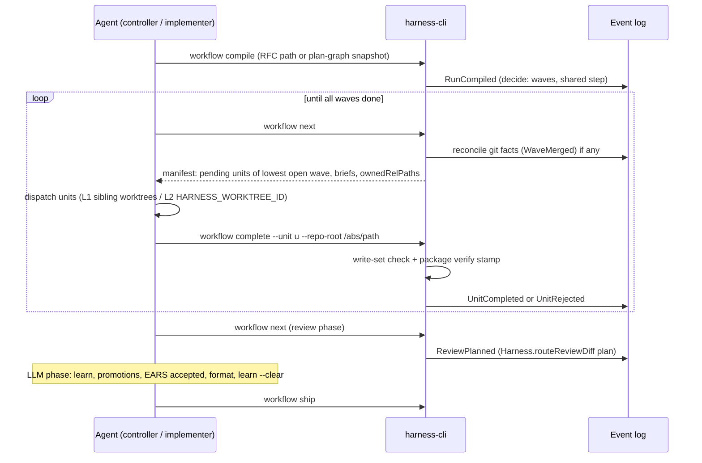
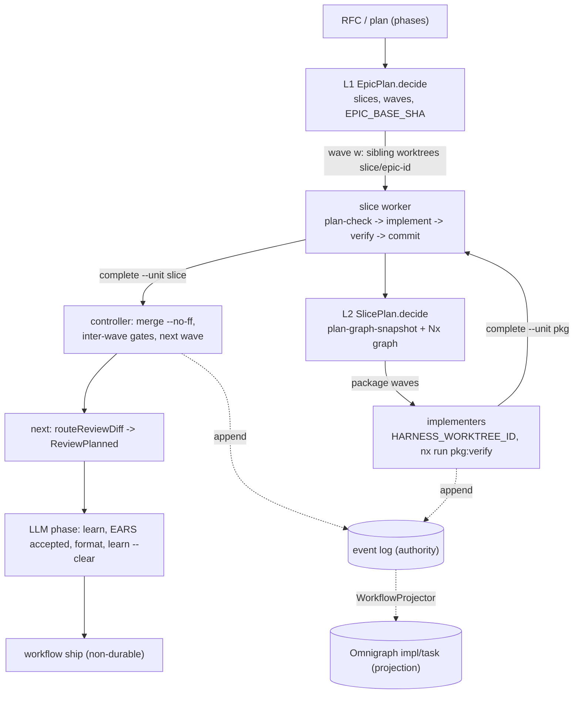

# RFC-0013: Deterministic Workflow-as-Code Orchestration of Route D Epics and Package Waves

> **Revision (2026-11-17):** reworked after independent review ([review](./reviews/2026-11-16-rfc-0011-0014-review.md)); the approved design (review §F6, §F7) replaces the earlier `effect/workflow`-first draft. The RFC now determinizes the existing Route D (it does not replace it), keeps authoritative state in an append-only event log with Omnigraph as a derived projection, defines the protocol between the deterministic CLI and the LLM agent, and turns `ship` into a non-durable, always-from-scratch pipeline. `effect/workflow` with a custom `WorkflowEngine` is retained only as a future option (§7, §9).

## 1. Executive Summary

Autonomous end-to-end execution (`/effect-lfg`) is coordinated today by Markdown prose in `effect-lfg/SKILL.md` ([claude-code](../../adapters/claude-code/skills/effect-lfg/SKILL.md), [antigravity](../../adapters/antigravity/plugins/effect-harness/skills/effect-lfg/SKILL.md)). Route D (PR #30, commit `7cbf806895`) already specifies a topological wave of disjoint slices in sibling worktrees `slice/<epic>-<id>`, a pinned `EPIC_BASE_SHA`, controller-only `git merge --no-ff` and controller-only `harness done` ([`multi-slice-worktree-execution.md`](../../adapters/claude-code/skills/effect-lfg/references/multi-slice-worktree-execution.md)). What is still prose is the _state_ and the _decisions_: which slices or packages form a wave, which unit is done, which unit is pending after `/compact`, and the exact gate order before `done`. This RFC moves those into code, following the workflows-vs-agents distinction of Anthropic's _Building effective agents_ (2024: "workflows are systems where LLMs and tools are orchestrated through predefined code paths") and the blueprint-first design of _Blueprint First, Model Second_ (arXiv:2508.02721: a deterministic engine executes a codified blueprint and the LLM is only a bounded sub-task tool).

The design has five parts:

1. **Two plan levels.** **L1 `EpicPlan`** is Route D: slices derived from RFC phases, executed in sibling worktrees `slice/<epic>-<id>` from `EPIC_BASE_SHA`; the controller alone merges (`--no-ff`) and runs `done`. **L2 `SlicePlan`** lives inside one slice: package waves derived from `plan-graph-snapshot.json` plus the Nx project graph, implemented by subagents with `HARNESS_WORKTREE_ID`.
2. **State is an append-only event log**, `<git-common-dir>/harness/workflows/<runId>.jsonl`, of `WorkflowEvent` values. The state is a pure fold (`WorkflowState.evolve`); decisions come from `PlanWorkflowCompiler.decide` (`R = never`, `Graph.isAcyclic` + `Graph.topo`).
3. **Omnigraph is a projection of the log**, not its owner: `WorkflowProjector` (idempotent) writes `WorkflowRun` / `WorkUnit` / `UnitAttempt` nodes linked to `EffectFn` stubs, `EarsSpec`, `TraceabilityTuple` and `VitestCase`, so planning artifacts become queryable (`workflow_pending_units`, `ears_without_completed_unit`). Only the Cedar subject `harness-cli` writes it.
4. **A CLI/MCP protocol for the LLM**: `harness workflow compile | next | complete --unit <id> | status | ship` plus a read-only MCP tool `harness_workflow_plan`. `complete` runs a runtime write-set check (`git diff --name-only` within `ownedRelPaths`) and verifies a package verify stamp before a unit counts as done.
5. **`harness workflow ship` is a non-durable pipeline** that always runs from scratch in the canonical order `format:check -> gc --strict -> ontology check --strict -> mutate --strict -> verify -> done`. After `mutate` the workspace hash must equal the hash before it; after `verify` starts no non-ignored file may change. Reviewer selection is delegated to `Harness.routeReviewDiff` (ADR-0014); the workflow only records the resulting plan as an event.

---

## 2. Motivation & Empirical Gap Analysis

### 2.1 Failure Modes of Prose-Only Control Flow

Evidence base: [`effect-lfg/SKILL.md`](../../adapters/claude-code/skills/effect-lfg/SKILL.md) (Stages 0–6, Overrides 2 and 4), [`multi-slice-worktree-execution.md`](../../adapters/claude-code/skills/effect-lfg/references/multi-slice-worktree-execution.md) (Steps D0–D5), [`verify-stamp.ts`](../../libs/harness/gates/src/verify-stamp.ts), and the repo check in [`0013-repo-check.md`](./reviews/2026-11-16-rfc-0011-0014-evidence/0013-repo-check.md).

1. **Wave membership is decided by the LLM.** Route D step D1 tells the controller to partition slices into disjoint waves "when in doubt, serialize", and Stage 3 tells it which packages may run in parallel. Both are heuristics applied in context; there is no compiled artifact to inspect, diff or test.
2. **Resume depends on reconstructing state from git history.** Route D resumes by scanning `git log` for `integrate slice/<epic>-<id>` commits and `slice/*` branches (step D0). That works for merged slices, but says nothing about a slice that is half-implemented, an L2 package that already passed its package verify, or an EARS requirement that has no completed unit.
3. **The ship order has four contradictory statements.** `AGENTS.md` says `verify -> done -> learn`; `effect-lfg` (Override 4, Stage 5) says `learn (+ promotions, --clear) -> gc -> ontology -> mutate -> verify -> done` with no format step; RFC-0013 (previous draft) listed two further orders. `format:check` (`oxfmt --check .`) is a root script, not a harness gate.
4. **The stamp model was wrong in the previous draft.** `checkVerifyStamp` compares `computeWorkspaceTreeHash` (`verify-stamp.ts`), a SHA-256 over **all non-ignored files, tracked or not** (ignored: `.git`, `.harness`, `node_modules`, `dist`, `coverage`, `.nx`, `repos`, `.worktrees`, ...). It is not a git tree SHA. `mutate --strict` rewrites tracked sources in place with a backup in `.harness/mutation-backup.json` (`mutation-check.ts`), so it is mutating-with-restore, not read-only.
5. **There is no protocol between a deterministic CLI and an LLM agent.** `harness-cli` is a process the agent runs; it cannot start subagents. Any design that models "implement unit X" as a workflow activity executed by the CLI is not implementable. The CLI can only publish "waiting for unit X", and accept "unit X done" with evidence.

### 2.2 Code Decides the Graph, the LLM Works Inside Bounded Leaves

- **Code decides:** graph compilation, wave partitioning, write-set disjointness, ordering and state transitions, retry budgets, and the ship gate order are deterministic TypeScript (`PlanWorkflowCompiler.decide`, `WorkflowState.evolve`, `ship`).
- **The LLM works in leaves:** each unit receives a bounded brief (the existing 6-part slice brief for L1; for L2 a `TypedHoleContextBundle`, `MAX_HOLE_TOKENS = 1500` in `stratum-3-completion-and-holes.ts`) and returns edits within its `ownedRelPaths`.
- **Why event-sourcing and not an engine.** Temporal's documentation states the same constraint from the other side: a workflow definition must be deterministic to support replay, and non-deterministic work (here: LLM turns and CLI gates) lives outside it, recorded as events. A fold over a recorded event history gives replay-based resumability without an engine and without the idempotency traps documented in §7.

---

## 3. Goals, Non-Goals & Hard Invariants

### 3.1 Goals

- **G1 — Two-level deterministic plan.** Compile an L1 `EpicPlan` (slices) from an RFC/plan and an L2 `SlicePlan` (package waves) from `plan-graph-snapshot.json` + the Nx project graph, each as a stratified wave DAG via `PlanWorkflowCompiler.decide` (`R = never`).
- **G2 — Authoritative, resumable state.** Persist every state transition in an append-only event log shared by all worktrees; the current state is always `fold(evolve)` over the log.
- **G3 — Omnigraph projection.** Project the log idempotently into the planning graph (`impl/<task>`), cross-linked to stubs, EARS specs, traceability tuples and tests, written only by Cedar subject `harness-cli`, rebuildable from the log at any time.
- **G4 — LLM protocol with runtime enforcement.** `compile | next | complete | status | ship` and read-only `harness_workflow_plan`; `complete` verifies the write set at runtime and a package verify stamp.
- **G5 — Canonical, stamp-safe ship.** One non-durable `harness workflow ship` in the F6 order, with a hard restore check after `mutate --strict` and a no-drift rule after `verify` starts.
- **G6 — Reviewer selection by the router.** Delegate to `Harness.routeReviewDiff` (7 lenses, monotonic floor, ADR-0014) and record the plan as an event.

### 3.2 Non-Goals

- **NG1 — Running subagents from the CLI.** `harness-cli` and `harness-mcp` never spawn LLM work; the agent (controller) does. The CLI only compiles, publishes the next units, validates evidence and appends events.
- **NG2 — Replacing Route D.** Slice decomposition rules, `EPIC_BASE_SHA`, sibling worktrees, controller-only merge/`done`, and "never delete slice branches" stay as in `multi-slice-worktree-execution.md`; this RFC compiles and records them.
- **NG3 — Durable gate execution.** Gates are never memoized. `ship` is re-run from scratch every time (§5.6).
- **NG4 — A new workflow engine.** No custom `WorkflowEngine`, no external workflow service. `effect/workflow` stays a documented future option (§7).
- **NG5 — Running LLM-phase steps.** `harness learn` analysis, promotions, EARS `proposed -> accepted`, `pnpm format` and `harness learn --clear` are agent steps before `ship`. Gate wiring into `LoopCircuitBreaker.decide` (today only `verify`, via `verifyFailureWithThrashing`) is new work for `ship` (§10.3 WF-4).

### 3.3 Hard Architectural Invariants

1. **Acyclic plans.** `PlanWorkflowCompiler.decide` rejects a cyclic unit dependency graph with `CyclicPlanWorkflowError` before emitting any wave (`Graph.isAcyclic`; `Graph.topo` throws `GraphError` on cycles and is only called after the check).
2. **Disjoint parallel waves, separately checked.** Level partitioning does **not** imply file disjointness. The compiler splits each level into first-fit sub-waves so that units in one wave have pairwise-disjoint `ownedRelPaths`; paths in the shared set (lockfile, `tsconfig.base.json`, barrels `src/index.ts`, docs/specs) are removed from units and handled in a sequential **shared step** (same rule as Route D step D1). Disjointness is re-checked at runtime by `complete` (invariant 3).
3. **Runtime write-set check.** A unit is accepted only if every changed path is inside its `ownedRelPaths`. For a unit in its own worktree (every L1 slice) the changed set is `git diff --name-only <base>..HEAD` plus untracked files; for L2 units sharing one checkout, paths owned by other in-flight units of the same wave are excluded from the changed set (they are not attributable by diff) and re-attributed when those units complete. Static declaration alone is not enough (CodeCRDT, arXiv:2510.18893, reports 5–10 % semantic conflicts even with coordination). When a unit uses `harness_shadow_codemod` (RFC-0012), **the agent** passes the unit's `ownedRelPaths` (from `workflow next`) as `allowedWriteGlobs`, each as an `ExactPath` entry of RFC-0012's `WriteScopeEntry` (so paths containing `[ ] ( ) +` work), and the codemod is then rejected (`CodemodWriteSetViolationError`) before it writes outside the unit. The workflow does not pass it; `complete` is the authoritative backstop.
4. **Isolation tiers are not conflated.** `HARNESS_WORKTREE_ID` only relocates harness state (`resolveHarnessStateDir` -> `.harness/worktrees/<id>/`); it provides no file isolation. Isolation of whole slices comes from sibling git worktrees with `HARNESS_WORKTREE_ID` unset; L2 implementers use `HARNESS_WORKTREE_ID` only for package-scoped `nx run <project>:verify` in a shared checkout (`AGENTS.md`, Route D reference section 1).
5. **Event log is the single authority.** Nothing else (Omnigraph, `.harness/*.json`, git branches) is read to decide state; git facts (merge commits) are _reconciled into_ the log by `next` (§5.5). Agents have `deny` on the log path (§5.3, F4).
6. **Stamp monotonicity.** Let `H(w)` be `computeWorkspaceTreeHash` of workspace `w`. In `ship`: `H(after mutate) = H(before mutate)` (else `MutationRestoreError`), and `H(at done) = H(at verify start)` (else `ShipTreeDriftError`). Stated over the non-ignored-file hash of `verify-stamp.ts`, not over a git tree.
7. **Ship is never memoized.** No step result of `ship` is reused across invocations.

---

## 4. Formal Model

### 4.1 Plan Compilation

**Inputs.** Extraction is impure and lives in `harness-cli` (R is allowed there): it reads `.harness/plan-graph-snapshot.json`, which contains `EffectFn{isStub, file, packageTag}` nodes and `EarsSpec` nodes but **no** `StubHole` kind, **no** Nx project names and **no** import edges, and combines it with the Nx project graph (`nx graph --file` or nx-mcp) to produce a `CompileInput`: unit drafts (`ownedRelPaths`, `stubKeys`, `earsIds`), dependency edges between units, and the shared-path set. For L1, unit drafts come from the RFC phase table / cumulative spec (Route D step D1) instead.

**Dependency DAG.** $\mathcal{D} = (\mathcal{U}, E_{\mathcal{U}})$ with edge $u \to v$ iff $v$ depends on $u$ (an Nx project import edge for L2; a declared phase/slice dependency for L1).

**Levels.** After `Graph.isAcyclic(D)`, take the order of `Graph.topo(D)` and define

$$
\ell(v) = \begin{cases} 0 & \text{if } \text{pred}_{\mathcal{D}}(v) = \emptyset \\ 1 + \max_{u \to v \in E_{\mathcal{U}}} \ell(u) & \text{otherwise} \end{cases}
$$

`Graph.toposort` does not exist; the API is `Graph.topo` (`repos/effect/packages/effect/src/Graph.ts`).

**Waves.** Level $k$ is split by first-fit over units sorted by `unitId` into sub-waves with pairwise disjoint owned paths; sub-waves keep their level order. Waves $W_0 \prec W_1 \prec \dots \prec W_m$ then satisfy:

- **Dependency soundness:** $u \to v \implies \text{wave}(u) < \text{wave}(v)$.
- **Disjointness (checked, not implied):** $\forall u \neq v \in W_k:\ \text{Owned}(u) \cap \text{Owned}(v) = \emptyset$.

**Optimality claim (corrected).** Level partitioning minimizes the **number of waves** (the critical-path length) under unbounded parallelism and unit-time tasks. It does not minimize makespan with bounded workers or non-uniform durations; a barrier-free list scheduler with critical-path priority is the classical improvement (Hu 1961, _Parallel Sequencing and Assembly Line Problems_; Graham 1966, _Bounds for Certain Multiprocessing Anomalies_, list scheduling within $2 - 1/m$ of optimal). Barriers are kept deliberately: they simplify merge, inter-wave gates and resume.

### 4.2 State as a Fold

Events $e_1, \dots, e_n$ form the log of one run. State and decisions are pure:

$$
s_0 = \text{init}(e_1 = \texttt{RunCompiled}), \qquad s_i = \text{evolve}(s_{i-1}, e_i)
$$

$\text{evolve}$ is total over the closed `WorkflowEvent` union (`ts-pattern` `.exhaustive()`); the reader validates that `seq` is strictly increasing and that the first event is `RunCompiled`, otherwise `WorkflowLogCorruptError`. A torn final line (crash during append) is discarded on read. `PlanWorkflowCompiler.decide` is the only producer of `RunCompiled` content.

**Per-unit state machine.** `Pending -> Dispatched(attempt) -> Completed(attempt, stampHash)`; `UnitRejected` returns a unit to `Pending` and the attempt counter grows (bounded by 3 repair attempts, as in Route D failure handling). A wave is closed when all its units are `Completed` and (L1) its integration merge is recorded as `WaveMerged`.

### 4.3 Ship Pipeline Order (F6, canonical)

```
plan -> skeleton -> plan-check -> implement -> review (router, ADR-0014)
  -> [LLM phase: harness learn + promotions, EARS accepted, pnpm format, harness learn --clear]
  -> harness workflow ship
       = format:check -> gc --strict -> ontology check --strict
         -> mutate --strict (then: H unchanged) -> verify -> done
```

`harness learn --promote-skills` (RFC-0014) runs **outside** `ship` on its own `learn/<date>` branch. The LLM phase is outside the workflow because promotions, spec status flips and formatting are edits made by the agent; the deterministic phase is read-only apart from the restored mutation run and the stamp files under `.harness/` (ignored by the hash).

---

## 5. Detailed Technical Design

### 5.1 Contracts (`@harness/contract`)

Snippets follow `AGENTS.md`: branded scalars, no inline object types at boundaries, closed tagged unions, `Schema.TaggedError`, `Effect.fn("Name")(function* (...): Effect.fn.Return<A, E, R>)`.

```typescript
import { Schema } from "effect"
import { GitCommitSha } from "./repo-identity.js" // canonical brand owned by RFC-0011 §5.3.2 (40 hex); no copy here
import { ReviewRoutingPlan } from "./review-routing.js"

export const WorkflowRunId = Schema.NonEmptyString.pipe(
  Schema.check(Schema.isPattern(/^[a-z0-9][a-z0-9-]{7,63}$/)),
  Schema.brand("WorkflowRunId"),
)
export type WorkflowRunId = typeof WorkflowRunId.Type

export const WorkUnitId = Schema.NonEmptyString.pipe(
  Schema.check(Schema.isPattern(/^[a-z0-9][a-z0-9_.:-]{0,63}$/)),
  Schema.brand("WorkUnitId"),
)
export type WorkUnitId = typeof WorkUnitId.Type

export const EventSeq = Schema.Int.pipe(
  Schema.check(Schema.isGreaterThanOrEqualTo(1)),
  Schema.brand("EventSeq"),
)
export type EventSeq = typeof EventSeq.Type

export const AttemptNumber = Schema.Int.pipe(
  Schema.check(Schema.isBetween({ minimum: 1, maximum: 3 })),
  Schema.brand("AttemptNumber"),
)
export type AttemptNumber = typeof AttemptNumber.Type

export const WaveIndex = Schema.Int.pipe(
  Schema.check(Schema.isGreaterThanOrEqualTo(0)),
  Schema.brand("WaveIndex"),
)
export type WaveIndex = typeof WaveIndex.Type

export const NxProjectName = Schema.NonEmptyString.pipe(Schema.brand("NxProjectName"))
export type NxProjectName = typeof NxProjectName.Type

export const OwnedRelPath = Schema.NonEmptyString.pipe(Schema.brand("OwnedRelPath"))
export type OwnedRelPath = typeof OwnedRelPath.Type

/** Hex SHA-256 produced by `computeWorkspaceTreeHash` (all non-ignored files): the verify-stamp hash only. */
export const WorkspaceTreeHash = Schema.String.pipe(
  Schema.check(Schema.isPattern(/^[0-9a-f]{64}$/)),
  Schema.brand("WorkspaceTreeHash"),
)
export type WorkspaceTreeHash = typeof WorkspaceTreeHash.Type

/** Hex SHA-256 over the contents of one unit's `ownedRelPaths` (path and bytes, sorted by path): the per-unit package stamp. Never compared with a `WorkspaceTreeHash`. */
export const PackageStampHash = Schema.String.pipe(
  Schema.check(Schema.isPattern(/^[0-9a-f]{64}$/)),
  Schema.brand("PackageStampHash"),
)
export type PackageStampHash = typeof PackageStampHash.Type

export const PlanSha256 = Schema.String.pipe(
  Schema.check(Schema.isPattern(/^[0-9a-f]{64}$/)),
  Schema.brand("PlanSha256"),
)
export type PlanSha256 = typeof PlanSha256.Type

export const StubSymbolKey = Schema.NonEmptyString.pipe(Schema.brand("StubSymbolKey"))
export type StubSymbolKey = typeof StubSymbolKey.Type

export const EarsRequirementKey = Schema.NonEmptyString.pipe(Schema.brand("EarsRequirementKey"))
export type EarsRequirementKey = typeof EarsRequirementKey.Type

export const SliceBranchName = Schema.NonEmptyString.pipe(
  Schema.check(Schema.isPattern(/^slice\/[a-z0-9][a-z0-9-]*-[a-z0-9][a-z0-9-]*$/)),
  Schema.brand("SliceBranchName"),
)
export type SliceBranchName = typeof SliceBranchName.Type

export const PackageVerifyCommand = Schema.NonEmptyString.pipe(Schema.brand("PackageVerifyCommand"))
export type PackageVerifyCommand = typeof PackageVerifyCommand.Type

export const WorkflowLevel = Schema.Literals(["epic", "slice"]).pipe(Schema.brand("WorkflowLevel"))
export type WorkflowLevel = typeof WorkflowLevel.Type

export const ShipStage = Schema.Literals([
  "format-check",
  "gc-strict",
  "ontology-check-strict",
  "mutate-strict",
  "verify",
  "done",
]).pipe(Schema.brand("ShipStage"))
export type ShipStage = typeof ShipStage.Type

/** L1 `SliceUnit`: one Route D slice in its own sibling worktree. L2 `PackageUnit`: one Nx project inside a slice (implementer runs with HARNESS_WORKTREE_ID). */
export const CompiledWorkUnit = Schema.TaggedUnion({
  SliceUnit: {
    unitId: WorkUnitId,
    branch: SliceBranchName,
    waveIndex: WaveIndex,
    dependsOn: Schema.Array(WorkUnitId),
    ownedRelPaths: Schema.Array(OwnedRelPath),
    earsKeys: Schema.Array(EarsRequirementKey),
  },
  PackageUnit: {
    unitId: WorkUnitId,
    projectName: NxProjectName,
    waveIndex: WaveIndex,
    dependsOn: Schema.Array(WorkUnitId),
    ownedRelPaths: Schema.Array(OwnedRelPath),
    stubKeys: Schema.Array(StubSymbolKey),
    earsKeys: Schema.Array(EarsRequirementKey),
    packageVerifyCommand: PackageVerifyCommand,
  },
})
export type CompiledWorkUnit = typeof CompiledWorkUnit.Type
export type SliceUnit = typeof CompiledWorkUnit.cases.SliceUnit.Type
export type PackageUnit = typeof CompiledWorkUnit.cases.PackageUnit.Type

export const UnitRejection = Schema.TaggedUnion({
  WriteSetViolation: { offendingPaths: Schema.Array(OwnedRelPath) },
  PackageVerifyFailed: { exitCode: Schema.Int.pipe(Schema.brand("GateExitCode")) },
  StampMissing: {},
})
export type UnitRejection = typeof UnitRejection.Type

const eventBase = { seq: EventSeq, runId: WorkflowRunId } as const

/** Closed, append-only event union (the authoritative record of a run). */
export const WorkflowEvent = Schema.TaggedUnion({
  RunCompiled: {
    ...eventBase,
    level: WorkflowLevel,
    planSha: PlanSha256,
    baseSha: GitCommitSha,
    units: Schema.Array(CompiledWorkUnit),
    sharedStepPaths: Schema.Array(OwnedRelPath),
  },
  UnitDispatched: { ...eventBase, unitId: WorkUnitId, attempt: AttemptNumber },
  UnitCompleted: {
    ...eventBase,
    unitId: WorkUnitId,
    attempt: AttemptNumber,
    changedPaths: Schema.Array(OwnedRelPath),
    packageStampHash: PackageStampHash,
  },
  UnitRejected: {
    ...eventBase,
    unitId: WorkUnitId,
    attempt: AttemptNumber,
    rejection: UnitRejection,
  },
  WaveMerged: { ...eventBase, waveIndex: WaveIndex, mergeSha: GitCommitSha },
  ReviewPlanned: { ...eventBase, plan: ReviewRoutingPlan },
  ShipStageRecorded: {
    ...eventBase,
    stage: ShipStage,
    workspaceHash: WorkspaceTreeHash,
    outcome: Schema.Literals(["passed", "failed"]).pipe(Schema.brand("ShipStageOutcome")),
  },
})
export type WorkflowEvent = typeof WorkflowEvent.Type

export const UnitStatus = Schema.TaggedUnion({
  Pending: {},
  Dispatched: { attempt: AttemptNumber },
  Completed: { attempt: AttemptNumber, packageStampHash: PackageStampHash },
})
export type UnitStatus = typeof UnitStatus.Type

export const UnitProgress = Schema.Struct({
  unit: CompiledWorkUnit,
  status: UnitStatus,
  rejections: Schema.Array(UnitRejection),
})
export type UnitProgress = typeof UnitProgress.Type

/** Review routing is a state, not an optional field. */
export const ReviewState = Schema.TaggedUnion({
  NotPlanned: {},
  Planned: { plan: ReviewRoutingPlan },
})
export type ReviewState = typeof ReviewState.Type

export const WorkflowState = Schema.Struct({
  runId: WorkflowRunId,
  level: WorkflowLevel,
  planSha: PlanSha256,
  baseSha: GitCommitSha,
  units: Schema.Array(UnitProgress),
  mergedWaves: Schema.Array(WaveIndex),
  review: ReviewState,
  lastSeq: EventSeq,
})
export type WorkflowState = typeof WorkflowState.Type

export class CyclicPlanWorkflowError extends Schema.TaggedError<CyclicPlanWorkflowError>()(
  "CyclicPlanWorkflowError",
  {
    cycleUnits: Schema.Array(WorkUnitId),
    reason: Schema.NonEmptyString.pipe(Schema.brand("WorkflowCompileReason")),
  },
) {}

export class DisjointOwnershipViolationError extends Schema.TaggedError<DisjointOwnershipViolationError>()(
  "DisjointOwnershipViolationError",
  { waveIndex: WaveIndex, overlappingPaths: Schema.Array(OwnedRelPath) },
) {}

export class UnitWriteSetViolationError extends Schema.TaggedError<UnitWriteSetViolationError>()(
  "UnitWriteSetViolationError",
  { unitId: WorkUnitId, offendingPaths: Schema.Array(OwnedRelPath) },
) {}

export class WorkflowLogCorruptError extends Schema.TaggedError<WorkflowLogCorruptError>()(
  "WorkflowLogCorruptError",
  { runId: WorkflowRunId, atSeq: EventSeq },
) {}

export class MutationRestoreError extends Schema.TaggedError<MutationRestoreError>()(
  "MutationRestoreError",
  { before: WorkspaceTreeHash, after: WorkspaceTreeHash },
) {}

export class ShipTreeDriftError extends Schema.TaggedError<ShipTreeDriftError>()(
  "ShipTreeDriftError",
  { atVerifyStart: WorkspaceTreeHash, atDone: WorkspaceTreeHash },
) {}

export class ShipGateFailedError extends Schema.TaggedError<ShipGateFailedError>()(
  "ShipGateFailedError",
  {
    stage: ShipStage,
    exitCode: Schema.Int.pipe(Schema.brand("GateExitCode")),
    stderrSummary: Schema.NonEmptyString.pipe(Schema.brand("GateStderrSummary")),
  },
) {}
```

All closed unions use `Schema.TaggedUnion` as `AGENTS.md` requires (`CompiledWorkUnit.cases.SliceUnit` is the L1 case, `.cases.PackageUnit` the L2 case).

### 5.2 Pure Core (`@harness/gates` or `@harness/decision`, `R = never`)

```typescript
import { Effect, Schema } from "effect"
import * as Graph from "effect/Graph"
import { match } from "ts-pattern"
import {
  CompiledWorkUnit,
  CyclicPlanWorkflowError,
  type UnitProgress,
  WaveIndex,
  WorkUnitId,
  WorkflowEvent,
  WorkflowState,
} from "@harness/contract"

export const UnitDependency = Schema.Struct({ from: WorkUnitId, to: WorkUnitId })
export type UnitDependency = typeof UnitDependency.Type

/** Impure extraction (snapshot + Nx graph / RFC phases) happens before this point, in harness-cli. */
export const CompileInput = Schema.Struct({
  units: Schema.Array(CompiledWorkUnit),
  dependencies: Schema.Array(UnitDependency),
})
export type CompileInput = typeof CompileInput.Type

export const CompiledWaves = Schema.Struct({ units: Schema.Array(CompiledWorkUnit) })
export type CompiledWaves = typeof CompiledWaves.Type

/** Longest-path levels over the unit DAG, then first-fit split into write-disjoint waves. */
export const compileWorkflowWaves = Effect.fn("PlanWorkflowCompiler.decide")(function* (
  input: CompileInput,
): Effect.fn.Return<CompiledWaves, CyclicPlanWorkflowError, never> {
  const indexById = new Map<WorkUnitId, Graph.NodeIndex>()
  const graph = Graph.directed<WorkUnitId, null>((mutable) => {
    for (const unit of input.units) indexById.set(unit.unitId, Graph.addNode(mutable, unit.unitId))
    for (const dep of input.dependencies) {
      const from = indexById.get(dep.from)
      const to = indexById.get(dep.to)
      if (from !== undefined && to !== undefined) Graph.addEdge(mutable, from, to, null)
    }
  })

  if (!Graph.isAcyclic(graph)) {
    const cycleUnits = Graph.stronglyConnectedComponents(graph)
      .filter((component) => component.length > 1)
      .flatMap((component) => component.flatMap((index) => unitIdAt(graph, index)))
    return yield* new CyclicPlanWorkflowError({
      cycleUnits,
      reason: cycleReason(cycleUnits),
    })
  }

  // Safe: acyclicity was just established, so Graph.topo cannot throw GraphError.
  const order = Array.from(Graph.values(Graph.topo(graph)))
  const levelOf = assignLevels(order, input.dependencies)
  return { units: splitLevelsIntoDisjointWaves(input.units, levelOf) }
})
```

`unitIdAt`, `cycleReason`, `assignLevels` (the recurrence of §4.1 over `order`) and `splitLevelsIntoDisjointWaves` (first-fit over `unitId`-sorted units per level, producing `WaveIndex` values and re-stamping each unit's `waveIndex`) are total, pure helpers in the same module. A postcondition guard re-checks pairwise disjointness per wave and would fail with `DisjointOwnershipViolationError`; it is unreachable if the splitter is correct and is covered by a property test.

The fold:

```typescript
const withStatus = (
  state: WorkflowState,
  unitId: WorkUnitId,
  next: (progress: UnitProgress) => UnitProgress,
): WorkflowState => ({
  ...state,
  units: state.units.map((progress) =>
    progress.unit.unitId === unitId ? next(progress) : progress,
  ),
})

/** WorkflowState.evolve: total over the closed WorkflowEvent union. */
export const evolveWorkflowState = (state: WorkflowState, event: WorkflowEvent): WorkflowState => {
  const next = match(event)
    .with({ _tag: "RunCompiled" }, () => state)
    .with({ _tag: "UnitDispatched" }, (e) =>
      withStatus(state, e.unitId, (p) => ({
        ...p,
        status: { _tag: "Dispatched", attempt: e.attempt },
      })),
    )
    .with({ _tag: "UnitCompleted" }, (e) =>
      withStatus(state, e.unitId, (p) => ({
        ...p,
        status: { _tag: "Completed", attempt: e.attempt, packageStampHash: e.packageStampHash },
      })),
    )
    .with({ _tag: "UnitRejected" }, (e) =>
      withStatus(state, e.unitId, (p) => ({
        ...p,
        status: { _tag: "Pending" },
        rejections: [...p.rejections, e.rejection],
      })),
    )
    .with({ _tag: "WaveMerged" }, (e) => ({
      ...state,
      mergedWaves: [...state.mergedWaves, e.waveIndex],
    }))
    .with({ _tag: "ReviewPlanned" }, (e) => ({
      ...state,
      review: { _tag: "Planned", plan: e.plan },
    }))
    .with({ _tag: "ShipStageRecorded" }, () => state)
    .exhaustive()
  return { ...next, lastSeq: event.seq }
}
```

`WorkflowState` construction from the leading `RunCompiled` event (with `review: { _tag: "NotPlanned" }`), the "pending units of the lowest unfinished wave" selector used by `next`, and the log validator (`seq` strictly increasing, first event `RunCompiled`, `WorkflowLogCorruptError` otherwise) are pure functions next to `evolve`. `evolve` and `decide` are the only places that interpret events; every other module consumes their results.

### 5.3 Event Log (`@harness/service` port, `@harness/infra` live)

```typescript
import { Context, Effect } from "effect"
import type { WorkflowEvent, WorkflowLogCorruptError, WorkflowRunId } from "@harness/contract"
import type { WorkspaceFsError } from "@harness/service"

export interface WorkflowEventLogShape {
  /** Append under a lock file; assigns the next `seq`. Writer is the CLI process only. */
  readonly append: (
    runId: WorkflowRunId,
    draft: WorkflowEventDraft,
  ) => Effect.Effect<WorkflowEvent, WorkspaceFsError>
  /** Reads and validates the whole log; discards a torn final line. */
  readonly read: (
    runId: WorkflowRunId,
  ) => Effect.Effect<ReadonlyArray<WorkflowEvent>, WorkspaceFsError | WorkflowLogCorruptError>
}

export class WorkflowEventLog extends Context.Service<WorkflowEventLog, WorkflowEventLogShape>()(
  "@harness/service/WorkflowEventLog",
) {}
```

(`WorkflowEventDraft` is the `WorkflowEvent` union without `seq`, defined next to the port.)

- **Location:** `<git-common-dir>/harness/workflows/<runId>.jsonl`, so the controller, every sibling slice worktree and every `HARNESS_WORKTREE_ID` worker see one log; it survives `git worktree prune` and deletion of slice worktrees. `resolveHarnessStateDir` (per worktree) is deliberately not used: Route D slice worktrees are removed after their wave (review X2).
- **Format:** one JSON object per line, schema-validated on every read and write; append with a lock file and `fsync`; `seq` assigned under the lock.
- **Integrity against the agent:** the path is `deny` for agent writes under the harness mutation policy (RFC-0012 §3.4, `classifyHarnessMutation`, review F4: `<git-common-dir>/harness/**` is `deny`). Only the `harness-cli` process appends; the MCP tool is read-only.
- **`repoRoot` (review F3, not redefined here):** every writing entry point (`complete`, `next` when it reconciles) requires an explicit absolute `repoRoot` validated against `git worktree list`, with no fallback to `process.cwd()` or `.harness/active-workspace.json`. The read-only MCP tool accepts an optional `repoRoot` and returns `resolvedRepoRoot`.

### 5.4 Why the Log Is the Source of Truth and Omnigraph a Projection

| Property needed from the store        | Event log (JSONL in `<git-common-dir>`)        | Omnigraph branch `impl/<task>`                                                                                                                                           |
| :------------------------------------ | :--------------------------------------------- | :----------------------------------------------------------------------------------------------------------------------------------------------------------------------- |
| Survives `harness done`               | yes                                            | **no**: `done` reloads the branch with `mode: "overwrite"` from the code snapshot (`done-omnigraph-helpers.ts`, `syncToOmnigraphAndSnapshot(... mode: "overwrite")`)     |
| Survives schema/config change         | yes (own schema, versioned by `WorkflowEvent`) | **no**: a schema digest change gives `RequiresCleanRebuild` (`omnigraph-lifecycle.ts`), which deletes and rebuilds the cluster                                           |
| Works from any worktree, even offline | yes                                            | one canonical **shared** cluster; destructive rebuild from a linked worktree is refused (`HARNESS_ALLOW_WORKTREE_CLUSTER_REBUILD`), the server may be down or restarting |
| Usable in CI / tests without a server | yes                                            | needs `omnigraph-server`                                                                                                                                                 |
| Tamper resistance                     | `deny` for agent writes (F4)                   | Cedar: `agent-mcp` may only `read` / `invoke_query`; `harness-cli` is admin (`graph.policy.yaml`)                                                                        |

The graph is a **derived projection** of code and planning artifacts in this repo, rebuilt on demand; durable run state cannot live in something that `done` overwrites and a schema bump may delete. The log can always regenerate the projection; the reverse is false.

**What Omnigraph adds** (and why a projection is still worth building):

1. **Cross-links to planning artifacts.** A `WorkUnit` is joined to its stub `EffectFn` nodes, the `EarsSpec` it realizes, the `TraceabilityTuple` rows and the `VitestCase` nodes that verify it. A JSONL file cannot answer "which EARS requirements have no completed unit" without re-implementing the graph.
2. **Optimistic concurrency.** Projection writes use `ifGraphCommit` (RFC-0010 / ADR-0015, `OmnigraphPreconditionError`), so two sessions cannot interleave a half-written projection.
3. **Change polling.** Other sessions and `DatalogSession` observe progress through `changes.poll` (RFC-0010) instead of re-reading files.
4. **Cedar integrity.** Only subject `harness-cli` has `change` on `impl/*`; the agent-facing MCP subject cannot write progress into the graph.

### 5.5 Omnigraph Projection (`WorkflowProjector`)

**Schema (additive, `libs/harness/graph/schema.pg`).** New nodes and role edges follow the existing style (`@key`, `Plays*Role`, `@key(@src, @dst, role)`). Nothing existing changes, so the digest change is additive and the projection is rebuilt from the log after a clean cluster rebuild.

```
node WorkflowRun
  @instruction("A deterministic workflow run (L1 EpicPlan or L2 SlicePlan) projected from the event log.")
{
  runId: String @key @description("WorkflowRunId from the event log")
  level: enum(epic, slice) @index
  planSha: String @index
  baseSha: String
  lastSeq: I32
}

node WorkUnit
  @instruction("A compiled slice (L1) or package (L2) unit of a workflow run.")
{
  unitKey: String @key @description("runId/unitId")
  runId: String @index
  unitId: String @index
  kind: enum(slice, package) @index
  waveIndex: I32 @index
  status: enum(pending, dispatched, completed) @index
  ownedRelPaths: [String]
}

node UnitAttempt
  @instruction("One dispatch attempt of a unit with its verdict.")
{
  attemptKey: String @key @description("runId/unitId#attempt")
  attempt: I32
  verdict: enum(dispatched, completed, rejected) @index
  rejection: String?
  packageStampHash: String?
}

edge PlaysRunUnitRole: WorkflowRun -> WorkUnit @card(0..)
  @instruction("Incidence edge from a WorkflowRun to a member WorkUnit.")
{
  @key(@src, @dst, role)
  role: String @index @description("Role tag: run-unit")
  archimateRelation: String @index
}
// The remaining edges repeat the same body (@instruction, @key(@src, @dst, role), role, archimateRelation):
edge PlaysUnitAttemptRole: WorkUnit -> UnitAttempt @card(0..) { ... }   // role: unit-attempt
edge PlaysUnitStubRole: WorkUnit -> EffectFn @card(0..) { ... }          // role: unit-stub
edge PlaysUnitEarsRole: WorkUnit -> EarsSpec @card(0..) { ... }          // role: unit-ears
edge PlaysUnitTraceabilityRole: WorkUnit -> TraceabilityTuple @card(0..) { ... } // role: unit-traceability
edge PlaysAttemptTestRole: UnitAttempt -> VitestCase @card(0..) { ... }  // role: attempt-test
```

**Presets (`libs/harness/graph/queries/harness.gq`, registered in `HARNESS_GQ_QUERY_NAMES` in `gq-queries.ts`, no new MCP tool):**

```
query workflow_pending_units($runId: String) {
  match {
    $run: WorkflowRun
    $run.runId = $runId
    $unit: WorkUnit
    $run playsRunUnitRole $unit
    $unit.status = "pending"
  }
  return { $unit.unitId as unitId, $unit.waveIndex as waveIndex, $unit.kind as kind }
}

query ears_without_completed_unit($runId: String) {
  match {
    $run: WorkflowRun
    $run.runId = $runId
    $spec: EarsSpec
    not {
      $unit: WorkUnit
      $run playsRunUnitRole $unit
      $unit playsUnitEarsRole $spec
      $unit.status = "completed"
    }
  }
  return { $spec.id as specId, $spec.path as path }
}
```

**`WorkflowProjector`** is a `Context.Service` in `@harness/service` (`project(runId)`), implemented in `@harness/infra` over the existing Omnigraph sync layer. Rules:

- **Idempotent:** node/edge identity comes from `@key`; `project` computes the full desired set from `fold(evolve)` and upserts it (OCC via `ifGraphCommit`). Running it twice, or on a stale branch, converges to the same graph.
- **Where:** the task branch `impl/<task>` (never `main` directly). It is projected **again after `done`'s overwrite and before the Omnigraph merge** into `main` (so history lands on `main` through the normal merge), and **again after any cluster rebuild**. `harness workflow status --reproject` triggers it manually.
- **Failure is non-fatal for the workflow:** if the server is down, `done` proceeds; `status` reports `projection: stale`, because the log is authoritative.
- **Writer:** only Cedar subject `harness-cli`; the schema extension needs the same `schema_apply` handling as any digest change.

### 5.6 LLM Protocol and Ship

**Protocol.** The CLI cannot run subagents (NG1), so a run is a loop in which the agent asks "what next" and reports evidence:



| Command / tool                               | Layer                                                                          | Behaviour                                                                                                                                                                                                                                                                                                                           |
| :------------------------------------------- | :----------------------------------------------------------------------------- | :---------------------------------------------------------------------------------------------------------------------------------------------------------------------------------------------------------------------------------------------------------------------------------------------------------------------------------- |
| `pnpm harness workflow compile`              | `apps/harness-cli/src/commands/workflow.command.ts` (`HarnessCommandRegistry`) | Extracts inputs (impure), runs `PlanWorkflowCompiler.decide`, appends `RunCompiled`, prints `runId`. `--level epic\|slice`.                                                                                                                                                                                                         |
| `pnpm harness workflow next`                 | same                                                                           | Reconciles `integrate slice/<epic>-<id>` merge commits into `WaveMerged` (idempotent), prints the manifest of pending units, or the review step; at the review step it calls `Harness.routeReviewDiff` over `git diff main...HEAD` and appends `ReviewPlanned`.                                                                     |
| `pnpm harness workflow complete --unit <id>` | same                                                                           | Requires explicit `--repo-root`. Checks the write set (invariant 3) and the package verify stamp; appends `UnitCompleted` or `UnitRejected` and reprojects.                                                                                                                                                                         |
| `pnpm harness workflow status [--reproject]` | same                                                                           | Folds the log; prints waves, unit statuses, review plan, projection freshness.                                                                                                                                                                                                                                                      |
| `pnpm harness workflow ship`                 | same                                                                           | Runs the non-durable pipeline below (controller only for L1; ephemeral `ship-<taskSlug>-<timestamp>.jsonl` run when none is compiled); appends `ShipStageRecorded` events as an audit trail.                                                                                                                                        |
| `harness_workflow_plan` (MCP, read-only)     | `apps/harness-mcp/src/tools/` (`McpToolRegistry`), `CANONICAL_MCP_TOOL_NAMES`  | Returns the folded state and the next manifest as JSON; optional `repoRoot`, returns `resolvedRepoRoot`. One read-only tool, deliberately small, to keep tool-selection accuracy (review X11); it takes `CANONICAL_MCP_TOOL_NAMES` from 19 to 20 (RFC-0011: 16 to 18, RFC-0012: 18 to 19) and WF-2 updates `tool-registry.test.ts`. |

**Package verify stamp.** `complete` does not trust the agent's claim. It runs the unit's `packageVerifyCommand` itself and records `packageStampHash` (brand `PackageStampHash`: `sha256` over `(relpath, content)` of the unit's `ownedRelPaths`; distinct from the whole-tree `WorkspaceTreeHash` of the verify stamp). For L1 the evidence is stronger: the slice worktree is isolated, so the controller calls `checkVerifyStamp` against the slice worktree's `repoRoot` (the slice worker ended its gates with `CI=true pnpm harness verify`, then committed; slice workers never run `ship` or `done`, matching Route D). A whole-tree stamp cannot be used for L2 units because parallel units edit the same checkout.

**Ship (non-durable, always from scratch).**

```typescript
export const runShipPipeline = Effect.fn("HarnessShip.run")(function* (
  input: ShipInput,
): Effect.fn.Return<
  ShipReceipt,
  ShipGateFailedError | MutationRestoreError | ShipTreeDriftError,
  ShipRuntime
> {
  const gates = yield* ShipGates
  const log = yield* WorkflowEventLog
  yield* gates.run("format-check")
  yield* gates.run("gc-strict")
  yield* gates.run("ontology-check-strict")

  const beforeMutate = yield* gates.workspaceHash()
  yield* gates.run("mutate-strict")
  const afterMutate = yield* gates.workspaceHash()
  yield* assertSameHash(
    beforeMutate,
    afterMutate,
    (before, after) => new MutationRestoreError({ before, after }),
  )

  const atVerifyStart = yield* gates.workspaceHash()
  yield* gates.run("verify")
  yield* gates.run("done")
  const atDone = yield* gates.workspaceHash()
  yield* assertSameHash(
    atVerifyStart,
    atDone,
    (start, done) => new ShipTreeDriftError({ atVerifyStart: start, atDone: done }),
  )
  yield* log.append(input.runId, shipPassedDraft(atDone))
  return { runId: input.runId, verifiedTreeHash: atDone }
})
```

- `ShipInput`, `ShipReceipt`, `ShipRuntime` (the `ShipGates` + `WorkflowEventLog` services), `assertSameHash` and `shipPassedDraft` are small contract/service definitions next to the pipeline; `ShipGates.run` shells out to the existing CLI gates and maps a non-zero exit to `ShipGateFailedError`.
- `ShipGates.workspaceHash` is `computeWorkspaceTreeHash` (non-ignored files, tracked or not); `.harness/**` (stamp, sessions, mutation backup) is outside the hash by definition.
- Each stage failure maps to `ShipGateFailedError` with the CLI exit code and records a `ShipStageRecorded{failed}`; wiring the failure into `LoopCircuitBreaker.decide` (`decideLoopThrashing`, threshold 3, exit code 2) for the new stages is new work.
- `mutate --strict` may leave a mutated tree after a crash; the stage first invokes the existing startup recovery (`recoverStartupBackup`) before hashing. Today `handleMutate` does not parse `--strict` (only `--scope=`), so the flag is a no-op until WF-4 wires it.
- **Run and log of a `ship`:** `harness workflow ship` normally belongs to a compiled run. Without one (a task that never ran `compile`) it creates an **ephemeral run** and logs its `ShipStageRecorded` events to `<git-common-dir>/harness/workflows/ship-<taskSlug>-<timestamp>.jsonl` (the same `deny` path rules apply). For an L1 epic **only the controller ships, once, on `feat/<epic>`** after all waves merged; slice workers never ship: they stop at `verify` plus commit, as in Route D.
- No stage output is cached, no event is consulted to skip a stage. Re-running `ship` after a fix repeats everything; this takes minutes and is deterministic, which is the point.

### 5.7 Reviewer Selection

`Harness.routeReviewDiff` (`libs/harness/decision/src/review-router-decision.ts`) computes signals, applies the pure deterministic floor `ReviewRouter.decideDeterministic` (`R = never`) and merges monotonically with the advisory `ReviewRouterV1` System One decision into a `ReviewRoutingPlan` (`SkipReviewPlan | ActiveReviewPlan`) over 7 lenses (`SPECIALIST_REVIEWER_IDS`). The workflow does **not** define its own reviewer matrix. At the review step `workflow next` calls the router and appends the plan as `ReviewPlanned`; the controller dispatches exactly those reviewers (as `harness_review_route` already instructs in `effect-lfg` Stage 4). Because the router consults a decision model, its output is recorded rather than recomputed on resume.

---

## 6. Capability Catalog & End-to-End Walkthrough

### 6.1 Two Levels



### 6.2 Walkthrough: Resumable Feature Build in `libs/sample`

1. After `pnpm harness plan-check` verifies `stub<A, E, R>()` skeletons across `@harness/sample-contract`, `@harness/sample-service`, `@harness/sample-domain` and `@harness/sample-infra`, the agent runs `pnpm harness workflow compile --level slice`.
2. The compiler reads the Nx project graph. `sample-service` imports `sample-contract`; `sample-domain` imports `sample-contract` and `sample-service`; `sample-infra` imports `sample-contract`, `sample-service` **and `sample-domain`** (`libs/sample/infra/src/index.ts`, `package.json`). It therefore emits four sequential waves: `W0 = [sample-contract]`, `W1 = [sample-service]`, `W2 = [sample-domain]`, `W3 = [sample-infra]`. Infra and domain are never in the same wave. Barrels (`src/index.ts`) and `tsconfig.base.json` go to the sequential shared step.
3. `workflow next` returns `W0`. The implementer completes it; `workflow complete --unit sample-contract --repo-root <abs>` runs `pnpm nx run @harness/sample-contract:verify`, checks `git diff --name-only` is inside `libs/sample/contract/**`, records the stamp and appends `UnitCompleted`. `W1` and `W2` follow the same way.
4. `sample-infra` fails its package verify: `complete` appends `UnitRejected{PackageVerifyFailed}` (attempt 1 of 3) and the unit is `Pending` again. Context compacts. After `/compact`, `workflow status` (or `harness_workflow_plan`) folds the log: `W0..W2 completed`, `W3 pending, 1 rejection`, so only `sample-infra` is redone; no prose reconstruction.
5. All units complete. `workflow next` calls `Harness.routeReviewDiff`, records `ReviewPlanned`, and the controller dispatches exactly the reviewers in that plan.
6. The LLM phase runs (`harness learn`, promotions, EARS `accepted`, `pnpm format`, `harness learn --clear`). Then `pnpm harness workflow ship`: `format:check -> gc --strict -> ontology check --strict -> mutate --strict (hash equal) -> verify -> done`. After `done` overwrote `impl/<task>`, the projector reprojects the run before the Omnigraph merge. `workflow ship` can be re-run after any fix and repeats from `format:check`.

For an L1 Route D epic the same loop runs with slice units: `workflow next` lists the slices of the lowest open wave; each slice runs in `slice/<epic>-<id>` from `EPIC_BASE_SHA`; the controller verifies with `complete --unit <slice> --repo-root <slice worktree>`, merges `--no-ff` and runs the inter-wave gates; `next` then reconciles the `integrate slice/...` commit into `WaveMerged`.

---

## 7. Library Selection, Rejected Alternatives & Trade-offs

| Paradigm                                                        | Runtime                                           | Resume & idempotency                                                                                                                                                                   | Verdict                                                                                                        |
| :-------------------------------------------------------------- | :------------------------------------------------ | :------------------------------------------------------------------------------------------------------------------------------------------------------------------------------------- | :------------------------------------------------------------------------------------------------------------- |
| **1. Append-only event log + pure fold + Omnigraph projection** | `effect` (`Graph`, `Schema`), JSONL, zero daemons | Resume = refold; state decisions are pure; gates never memoized                                                                                                                        | **Chosen.** Smallest correct mechanism; replay-by-fold is the same principle as deterministic workflow replay. |
| **2. `effect/workflow` + custom file-backed `WorkflowEngine`**  | `effect/workflow` (`@stability unstable`)         | Execution id = hash of tag and idempotency key; completed executions (including failures) are not re-run; activity exits are memoized by `executionId/name/attempt`, failures included | **Future option.** See semantics below; an engine is a large piece of new work.                                |
| **3. Markdown checklists only (status quo)**                    | none                                              | none                                                                                                                                                                                   | **Replaced** by the compiled plan; `effect-lfg` becomes a thin caller of `workflow`.                           |
| **4. Temporal / BullMQ / Postgres workflow service**            | external server                                   | strong durability                                                                                                                                                                      | **Rejected:** an external daemon for a local CLI.                                                              |
| **5. Generic LLM state-graph framework (LangGraph-style)**      | extra dependency                                  | own serializer                                                                                                                                                                         | **Rejected:** duplicates Effect `Schema`/`Context.Service`, weak `E`/`R` tracking.                             |

**Verified `effect/workflow` semantics (4.0.6 subtree; the workspace consumes `effect@4.0.0` and has the same memoization):**

- Execution id = `hash("${tag.length}:${tag}:${idempotencyKey(payload)}")` (`Workflow.ts:340-341`); the same payload maps to the same execution.
- A completed execution, success **or failure**, is not re-run; the stored exit is returned (`WorkflowEngine.layerMemory`, `execute`).
- Activity exits are memoized per `${executionId}/${activityName}/${attempt}` and the cache includes failures (`activityExecute`); only suspended results re-run.
- Therefore a key like `taskSlug:planSnapshotSha256` returns a stale `ShipGateFailedError` after a code fix, and a cached `verify` success would skip `verify`. Any future use for gates must put the **workspace tree hash and a run nonce** in the key and in every gate activity's input; the workflow body must be deterministic because it is re-executed on resume.
- `Workflow.withCompensation` only registers finalizers for top-level effects (`Workflow.ts:176-177`).
- The `WorkflowEngine` interface has 10 methods; the only in-tree implementations are `layerMemory` and the cluster engine (`Sharding` + `MessageStorage`). A file-backed engine would have to persist suspended state, deferreds, clocks and compensations.

If adopted later, `WorkflowEvent` is the journal format and `evolve` the replay function; no event schema change is needed.

---

## 8. Ecosystem Impact, Performance & Cutover

### 8.1 Performance Targets (`PERF-09`)

These are **targets**, not measured results; the PERF-09 benchmark (milestone WF-1/WF-2) must measure them before they become gates.

| Operation                                                 | Target p50 | Target p95 | Note                                                                    |
| :-------------------------------------------------------- | :--------- | :--------- | :---------------------------------------------------------------------- |
| `PlanWorkflowCompiler.decide` (<= 50 units, <= 200 edges) | `< 2 ms`   | `< 6 ms`   | Linear in units + edges; excludes Nx graph extraction                   |
| `WorkflowEventLog.append` (lock + fsync)                  | `< 5 ms`   | `< 20 ms`  | Dominated by `fsync`; measure on the CI filesystem                      |
| Log fold for 500 events                                   | `< 5 ms`   | `< 15 ms`  | Pure `evolve`; no I/O                                                   |
| `WorkflowProjector.project` (one run, 50 units)           | `< 300 ms` | `< 1 s`    | Network round trip to the shared cluster; non-blocking for the workflow |
| `complete` (write-set check, excluding package verify)    | `< 100 ms` | `< 300 ms` | `git diff --name-only` + hashing owned files                            |

### 8.2 Coexistence

- All existing commands (`plan-check`, `gc`, `verify`, `done`, `learn`, `mutate`) stay unchanged and callable; `workflow` composes them. `workflow.command.ts` stays within the RFC-0007 command LOC budget (<= 650) by keeping logic in `@harness/gates`, `@harness/decision` and `@harness/infra`.
- `policy.ts` must allow `pnpm harness workflow ...` (and the `node --import ./tools/node-ts-resolver.mjs apps/harness-cli/src/index.ts workflow ...` form), and the harness mutation policy (RFC-0012 §3.4) must list `<git-common-dir>/harness/**` as `deny`.
- Omnigraph: `impl/<task>` carries the projection (§5.5); the schema extension is additive and goes through the normal digest/`schema_apply` path (RFC-0010 / ADR-0015).
- **Cutover (no clean-slate needed):** `AGENTS.md` and both `effect-lfg` adapters are updated to the F6 order and to the `workflow` loop; Route D stays authoritative for slice mechanics.

---

## 9. Open Questions & Future Work

1. **Effect version skew.** `repos/effect` is 4.0.6 while the workspace consumes `effect@4.0.0`; `Graph.topo`, `Graph.isAcyclic`, `Graph.stronglyConnectedComponents` and `Schema.TaggedUnion` (with `.cases`) usage must be checked against 4.0.0 in WF-1.
2. **Barrier-free scheduling.** Replace level barriers by critical-path list scheduling (Hu 1961; Graham 1966) if wave idle time proves material.
3. **L2 attribution in a shared checkout.** Excluding other in-flight units' paths (invariant 3) cannot detect a unit that edits a sibling's file. Option: require sibling worktrees (`Workspace: "share"`) for any L2 wave with more than one unit.
4. **Merge activity.** An optional automated integration check (`git diff --check` plus overlay typecheck) before `WaveMerged`.
5. **`effect/workflow` adoption** (§7) for long-running, multi-day epics, with the key and determinism rules above.
6. **Ship gate wiring into `LoopCircuitBreaker.decide`** for `format-check`, `gc`, `ontology`, `mutate` (today only `verify`).

---

## 10. Rollout & Decomposition Plan (ADRs, EARS Specs & Milestones)

### 10.1 Prepared MADR Template for `libs/harness/docs/adr/0018-deterministic-workflow-event-log-and-ship-pipeline.md` (`harness:ADR-0018`)

```markdown
---
id: harness:ADR-0018
title: Deterministic Workflow Orchestration (Event Log, Omnigraph Projection) & Non-Durable Ship Pipeline
status: proposed
date: 2026-11-17
---

# ADR-0018: Deterministic Workflow Orchestration (Event Log, Omnigraph Projection) & Non-Durable Ship Pipeline

## Context

Route D specifies wave execution in prose. State and decisions (waves, completed units, ship order) live in the agent's context; AGENTS.md and effect-lfg disagree on the ship order; the verify stamp hashes all non-ignored files; harness-cli cannot run subagents.

## Decision

1. Model two levels: L1 EpicPlan (Route D slices) and L2 SlicePlan (package waves from plan-graph-snapshot.json + Nx project graph), compiled by pure `PlanWorkflowCompiler.decide` (`R = never`, `Graph.isAcyclic` + `Graph.topo`).
2. Keep authoritative state in the append-only event log `<git-common-dir>/harness/workflows/<runId>.jsonl` (`WorkflowEvent`), folded by pure `WorkflowState.evolve`; agent writes to it are denied.
3. Project the log idempotently into Omnigraph (`WorkflowRun`/`WorkUnit`/`UnitAttempt`), written only by Cedar subject `harness-cli`, reprojected after `done`'s overwrite, before merge and after cluster rebuild.
4. Provide `harness workflow compile|next|complete --unit|status|ship` and read-only `harness_workflow_plan`; `complete` enforces the runtime write set and a package verify stamp.
5. Run `ship` as a non-durable, from-scratch pipeline in the order `format:check -> gc --strict -> ontology check --strict -> mutate --strict (hash unchanged) -> verify -> done`; delegate reviewer selection to `Harness.routeReviewDiff`.

## Consequences

- Resume is a refold of the log; no gate result is ever memoized.
- AGENTS.md and effect-lfg are changed to the canonical order.
- Omnigraph loss (overwrite, rebuild, downtime) cannot lose run state.

## Enforced By

- `libs/harness/gates/src/plan-workflow-compiler.ts` (`PlanWorkflowCompiler.decide`, `WorkflowState.evolve`)
- `libs/harness/infra/src/workflow-event-log.service.ts` (`WorkflowEventLog`)
- `libs/harness/infra/src/workflow-projector.service.ts` (`WorkflowProjector`)
- `apps/harness-cli/src/commands/workflow.command.ts` (`pnpm harness workflow`)
```

### 10.2 Prepared EARS Specification Outline (`harness:SPEC-0017`)

Symbols: `WorkflowRun` is one compiled run (`RunCompiled` event) at level `epic` or `slice`; `ownedRelPaths` is the declared write set of a unit; `H` is `computeWorkspaceTreeHash` (non-ignored files); `ShipStage` is the closed stage union of §5.1.

| ID       | Pattern            | Requirement                                                                                                                                                                                                                                                                | Effect Symbol                             | Verification                                  |
| :------- | :----------------- | :------------------------------------------------------------------------------------------------------------------------------------------------------------------------------------------------------------------------------------------------------------------------- | :---------------------------------------- | :-------------------------------------------- |
| REQ-1.1  | Unwanted behaviour | **If** the unit dependency graph contains a cycle, **then** `PlanWorkflowCompiler.decide` **shall** fail with `CyclicPlanWorkflowError` listing the units in the cycle and **shall** emit no wave.                                                                         | `PlanWorkflowCompiler.decide`             | `PropertyTest`                                |
| REQ-1.2  | Ubiquitous         | `PlanWorkflowCompiler.decide` **shall** emit waves such that every dependency edge goes from a lower to a higher wave and the `ownedRelPaths` of units within one wave are pairwise disjoint.                                                                              | `PlanWorkflowCompiler.decide`             | `PropertyTest`                                |
| REQ-1.3  | Ubiquitous         | `WorkflowState.evolve` **shall** be total over `WorkflowEvent` and `fold(evolve)` over any prefix of a log **shall** equal the state recorded at that prefix (replay determinism).                                                                                         | `evolveWorkflowState`                     | `PropertyTest`                                |
| REQ-1.4  | Event-driven       | **When** `workflow complete --unit <id>` is invoked, the system **shall** append `UnitCompleted` only if every changed path is within the unit's `ownedRelPaths` and the package verify passes, otherwise `UnitRejected`.                                                  | `completeUnit` (CLI use case)             | `UnitTest` + `TraceTest`                      |
| REQ-1.5  | Unwanted behaviour | **If** a log line is not a valid `WorkflowEvent`, or `seq` is not strictly increasing, **then** reading the log **shall** fail with `WorkflowLogCorruptError`; a torn final line **shall** be discarded.                                                                   | `WorkflowEventLog.read`                   | `UnitTest`                                    |
| REQ-1.6  | Event-driven       | **When** `workflow ship` is invoked, the system **shall** run `ShipStage` values in the order `format-check`, `gc-strict`, `ontology-check-strict`, `mutate-strict`, `verify`, `done`, from scratch, without reusing any prior stage result.                               | `runShipPipeline`                         | `TraceTest` (`SpanBudget`)                    |
| REQ-1.7  | Unwanted behaviour | **If** `H` after `mutate-strict` differs from `H` before it, **then** `ship` **shall** fail with `MutationRestoreError` and **shall not** run `verify`; **if** `H` at `done` differs from `H` at `verify` start, **then** `ship` **shall** fail with `ShipTreeDriftError`. | `runShipPipeline`                         | `UnitTest`                                    |
| REQ-1.8  | Event-driven       | **When** the run reaches its review step, the system **shall** obtain the reviewer set from `Harness.routeReviewDiff` and append it as `ReviewPlanned` without applying a workflow-specific reviewer matrix.                                                               | `routeReviewDiff`, `WorkflowEventLog`     | `UnitTest`                                    |
| REQ-1.9  | Event-driven       | **When** `WorkflowProjector.project` runs for a run, the graph **shall** converge to the projection of `fold(evolve)` regardless of prior graph state, and **shall** be written only by Cedar subject `harness-cli`.                                                       | `WorkflowProjector`                       | `UnitTest` + `GraphCheck` (Cedar policy test) |
| REQ-1.10 | State-driven       | **While** a run has an agent-writable path to its log, the system **shall** deny agent edits to `<git-common-dir>/harness/workflows/**` (harness mutation policy `deny`).                                                                                                  | `classifyHarnessMutation` (RFC-0012 §3.4) | `UnitTest`                                    |

### 10.3 Independent Implementation Milestones

1. **WF-1 — Contract, compiler, evolve (`@harness/contract`, `@harness/gates`):** `WorkflowEvent`, `WorkflowState`, branded scalars and errors; `PlanWorkflowCompiler.decide` (L1 from RFC phases, L2 from snapshot + Nx graph input) with `Graph.isAcyclic` / `Graph.topo`; `WorkflowState.evolve` and the log validator; property tests for REQ-1.1–1.3; PERF-09 benchmark of compile and fold.
2. **WF-2 — Event log, CLI protocol, write-set check (`@harness/service`, `@harness/infra`, `harness-cli`, `harness-mcp`):** `WorkflowEventLog` (lock, fsync, torn-line recovery); `workflow compile | next | complete | status`; runtime write-set check and package verify stamp in `complete`; explicit `repoRoot` validation by reusing RFC-0012 TX-2's exported `validateWorktreeRepoRoot` (review F3; no second implementation); read-only `harness_workflow_plan` (tool count 19 to 20, `tool-registry.test.ts` updated); `policy.ts` allowlist and harness mutation policy `deny` for the log path; REQ-1.4, 1.5, 1.10.
3. **WF-3 — Omnigraph projection, presets, Cedar (`@harness/graph`, `@harness/infra`, `harness-cli`):** additive nodes/edges in `schema.pg`; presets `workflow_pending_units` and `ears_without_completed_unit` in `harness.gq` and `HARNESS_GQ_QUERY_NAMES`; `WorkflowProjector` (idempotent, `ifGraphCommit`), called after `done`'s overwrite, before merge and after cluster rebuild; Cedar check that only `harness-cli` writes; REQ-1.9. Where the projector hook is wired into `apps/harness-cli/src/commands/verify-and-done.command.ts` (`done`'s overwrite), that file is in RFC-0012's extended TCB list: **human-reviewed TCB edit**.
4. **WF-4 — Ship pipeline and skill updates (`harness-cli`, adapters, `AGENTS.md`):** `workflow ship` (F6 order, restore and drift checks, `mutate --strict` parsing, `LoopCircuitBreaker` accounting, router plan event); update `effect-lfg/SKILL.md`, `references/multi-slice-worktree-execution.md` and `references/review-and-shipping.md` in **both** adapters (`adapters/claude-code/skills/effect-lfg`, `adapters/antigravity/plugins/effect-harness/skills/effect-lfg`) to the `compile | next | complete | ship` loop and the F6 order; rewrite the workflow line of `AGENTS.md` (`... -> review -> LLM phase -> harness workflow ship`, removing `learn` after `done`); REQ-1.6–1.8. `ship` invokes `done` and wires `mutate --strict` in `verify-and-done.command.ts`, and any change to the `adapters/*/hooks.json` files, are **human-reviewed TCB edits** (both are in RFC-0012's extended TCB list and prompt); the ship pipeline itself lives in a new non-TCB module and only calls `done`.
