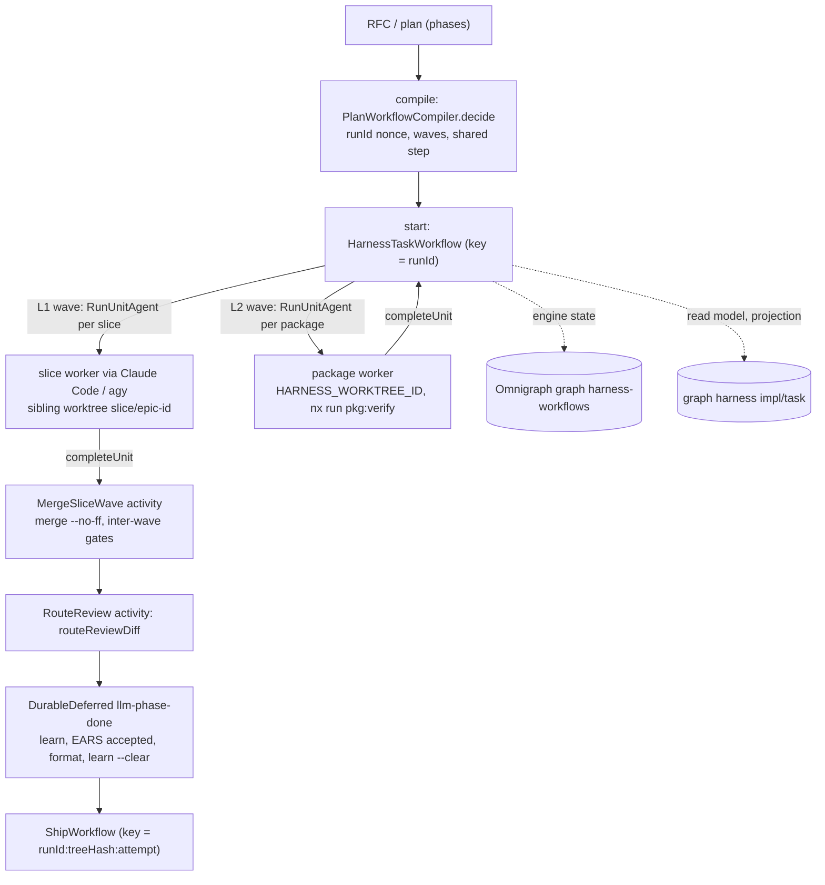

# RFC-0013: Durable Effect v4 Workflow Orchestration of Route D Epics and Package Waves

> **Supporting evidence:** [independent review of RFC-0011..0014](./reviews/2026-11-16-rfc-0011-0014-review.md) (§A cross-RFC findings, §F shared contracts F1-F8, §F9 workflow intent) and [WF-0 spike empirical evidence](./reviews/2026-11-17-rfc-0013-wf0-spike-evidence.md) (8/8 main suites + 4/4 supplementary probes green against real `omnigraph-server 0.14.0`, OS `SIGKILL` workers, `claude -p 2.1.326`, and `agy -p 1.5.10`). This RFC is self-contained; the review and evidence report record verification of the contracts and empirical limits named below.

## 1. Executive Summary

Autonomous end-to-end execution (`/effect-lfg`) is coordinated today by Markdown prose in `effect-lfg/SKILL.md` ([claude-code](../../adapters/claude-code/skills/effect-lfg/SKILL.md), [antigravity](../../adapters/antigravity/plugins/effect-harness/skills/effect-lfg/SKILL.md)). Route D (PR #30, commit `7cbf806895`) already specifies a topological wave of disjoint slices in sibling worktrees `slice/<epic>-<id>`, a pinned `EPIC_BASE_SHA`, controller-only `git merge --no-ff` and controller-only `harness done` ([`multi-slice-worktree-execution.md`](../../adapters/claude-code/skills/effect-lfg/references/multi-slice-worktree-execution.md)). What is still prose is the _control flow and state_: which slices or packages form a wave, which unit is done, which is pending after `/compact`, who launches the implementers, and the exact gate order before `done`.

This RFC makes the orchestration a **real, durable Effect v4 workflow** (`effect/workflow`), with three load-bearing choices:

1. **The control flow is code.** `HarnessTaskWorkflow` (implementation of a compiled plan: waves, units, review, LLM phase) and `ShipWorkflow` (deterministic gates) are `Workflow.make` definitions whose bodies loop over a plan compiled by the pure `PlanWorkflowCompiler.decide` (`R = never`). Units run as `Activity` values; manual hand-offs and the LLM phase are `DurableDeferred` values. Reviewer selection is delegated to `Harness.routeReviewDiff` (ADR-0014).
2. **Durable state lives in Omnigraph and nowhere else.** No SQLite, PGlite or other database (and `node:sqlite` is banned in infra, `AGENTS.md`). The engine is `ClusterWorkflowEngine.layer` over a single-process sharding stack, with a **new `OmnigraphMessageStorage`** that implements the `MessageStorage.Encoded` driver of `effect/cluster` over a dedicated graph `harness-workflows` (main branch only, never touched by `done`). It runs inside the long-lived harness daemon, the only writer.
3. **Agents are launched by the workflow, through exactly two CLI runners:** Claude Code (`claude -p`) and Antigravity (`agy -p`). `AgentRunnerPort` has two live implementations in v1 and no others.

Two plan levels from Route D stay: **L1 `EpicPlan`** (slices in sibling worktrees; the controller alone merges and runs `done`) and **L2 `SlicePlan`** (package waves inside one slice, from `plan-graph-snapshot.json` plus the Nx project graph). The `ship` order is the canonical one (review F6): `format:check -> gc --strict -> ontology check --strict -> mutate --strict (workspace hash unchanged) -> verify -> done`.

**Main technical risk & WF-0 validation status.** `OmnigraphMessageStorage` targets an `@stability unstable` driver contract over an append-heavy MVCC graph store where `omnigraph-server 0.14.0` serializes branch commits and caps actors at **16 in-flight HTTP requests**. Milestone **WF-0 completed with a CONDITIONAL GO verdict** (§10.3; [evidence report](./reviews/2026-11-17-rfc-0013-wf0-spike-evidence.md)): core `effect/workflow` + Omnigraph storage mechanics are verified (no fallback to Alternative D needed), subject to closing the P0 concurrency (`clearReplies` mutex-held CAS, GQ `addresses` filter before `limit`, `writeMutex` backoff discipline), fast `WfWriterLease` (`flock` + PID liveness), same-UID isolation, and `done` CLI-protocol remediations now folded into §5 and §10.3 before WF-1..WF-6 ship. There is no SQL fallback.

A readable projection of runs, units and attempts into the planning graph (`harness`, branch `impl/<task>`, linked to EARS specs, stubs and tests) is derived from engine state and re-projected after `done`; it is never read to make decisions.

---

## 2. Motivation & Empirical Gap Analysis

### 2.1 Failure Modes of Prose-Only Control Flow

Evidence base: [`effect-lfg/SKILL.md`](../../adapters/claude-code/skills/effect-lfg/SKILL.md) (Stages 0-6, Overrides 2 and 4), [`multi-slice-worktree-execution.md`](../../adapters/claude-code/skills/effect-lfg/references/multi-slice-worktree-execution.md) (Steps D0-D5), [`verify-stamp.ts`](../../libs/harness/gates/src/verify-stamp.ts), and [`0013-repo-check.md`](./reviews/2026-11-16-rfc-0011-0014-evidence/0013-repo-check.md).

1. **Wave membership is decided by the LLM.** Route D step D1 tells the controller to partition slices into disjoint waves "when in doubt, serialize", and Stage 3 tells it which packages may run in parallel. There is no compiled artifact to inspect, diff or test.
2. **Resume depends on reconstructing state from git history.** Route D resumes by scanning `git log` for `integrate slice/<epic>-<id>` commits and `slice/*` branches (step D0). That says nothing about a half-implemented slice, an L2 package that already passed package verify, or an EARS requirement with no completed unit.
3. **The ship order has contradictory statements.** `AGENTS.md` says `verify -> done -> learn`; `effect-lfg` (Override 4, Stage 5) says `learn (+ promotions, --clear) -> gc -> ontology -> mutate -> verify -> done` with no format step. `format:check` (`oxfmt --check .`) is a root script, not a harness gate.
4. **The stamp is not a git tree.** `checkVerifyStamp` compares `computeWorkspaceTreeHash` (`verify-stamp.ts`), a SHA-256 over **all non-ignored files, tracked or not** (ignored: `.git`, `.harness`, `node_modules`, `dist`, `coverage`, `.nx`, `repos`, `.worktrees`, ...). `mutate --strict` rewrites tracked sources in place with a backup in `.harness/mutation-backup.json` (`mutation-check.ts`): it is mutating-with-restore, not read-only.
5. **Nobody launches the implementers.** The CLI is a process the agent runs; the controller agent starts subagents by prompt. A restart of the controller (compaction, crash, new session) loses which units were in flight. A workflow that owns the launch (via CLI runners) and the state removes the dependency on a surviving controller context.

### 2.2 Why a Durable Effect Workflow Now

- **Code decides, the LLM works in bounded leaves.** Graph compilation, wave partitioning, write-set disjointness, retry budgets, escalation and the ship order are deterministic TypeScript; each unit receives a bounded brief (the Route D 6-part slice brief for L1; for L2 a `TypedHoleContextBundle`, `MAX_HOLE_TOKENS = 1500` in `stratum-3-completion-and-holes.ts`). This follows the workflows-versus-agents split of Anthropic's _Building effective agents_ (2024) and the blueprint-first design of _Blueprint First, Model Second_ (arXiv:2508.02721).
- **Durable replay, not a hand-rolled log.** `effect/workflow` already provides the semantics this needs and that a bespoke JSONL log would have to re-implement: execution identity from an idempotency key, memoised activity results (failures included), durable waits (`DurableDeferred`), compensation, and resume by re-running the body (§4.2, verified in source). Temporal documents the same constraint (deterministic workflow definition, non-deterministic work in activities).
- **The engine is already in the dependency.** `effect@4.0.0` ships `workflow` and `cluster` (dist directories present in the installed package); the pinned subtree `repos/effect` is 4.0.6. The only missing piece is a storage driver, which is the new code of this RFC.

### 2.3 Why Omnigraph Is Acceptable as the Durable Store

Omnigraph has documented hazards when used for _run state_: it is a derived projection of code, `done` overwrites `impl/<task>` (`done-omnigraph-helpers.ts:494`, `mode: "overwrite"`), a schema or config digest change gives `RequiresCleanRebuild` which `rm -rf`s the whole cluster directory (`omnigraph-lifecycle.ts`, `evaluateClusterConfigDrift` in `omnigraph-auth-and-drift.ts`), the cluster is one shared instance for all worktrees, and the server may be down. Each hazard is neutralised by design:

| Hazard                                                        | Neutralisation                                                                                                                                                                                                                                                                                                                         |
| :------------------------------------------------------------ | :------------------------------------------------------------------------------------------------------------------------------------------------------------------------------------------------------------------------------------------------------------------------------------------------------------------------------------- |
| `done` overwrites `impl/<task>` in graph `harness`            | Run state lives in a **separate graph `harness-workflows`**, branch `main` only. `done` and the existing sync layer only address graph `harness`; WF-2 adds a regression test that `done` never issues a load against `harness-workflows`.                                                                                             |
| `RequiresCleanRebuild` deletes the cluster directory          | A `WorkflowGraphBackup` hook runs before the `rm -rf`: **export** of all `harness-workflows` nodes to `<git-common-dir>/harness/workflow-backups/<ts>.ndjson` and **restore** after rebuild. If export fails, the server is down, or a run is active and unexported, the rebuild is **refused (fail-closed)**.                         |
| Schema change in `harness-workflows` itself                   | Schema is **additive-only** (new node/edge types and optional properties); a CI check (`policy-tests.yaml` style) rejects `@key` changes and removals, so `harness-workflows` never triggers `RequiresCleanRebuild` on its own. The one-time addition of the graph to `cluster.yaml` is a rebuild at a point where the graph is empty. |
| Server down or restarting                                     | Every storage call fails with `PersistenceError`; the engine does not run activities it cannot persist. Runs are **paused, not lost**: in-flight rows keep their claim state and are re-delivered after restart (§5.3.5). `isOmnigraphUnavailableError` classifies the failure for the daemon's retry/backoff.                         |
| Concurrent writers                                            | **Single writer**: only the harness daemon (Cedar subject `harness-cli`) writes `harness-workflows`; a `WfWriterLease` row fences a second daemon. All writes use `ifGraphCommit` OCC (`mapOmnigraphPreconditionError`).                                                                                                               |
| Agents tampering with state                                   | Cedar: `agent-mcp` has only `read`/`invoke_query` on `harness-workflows`; the harness mutation policy keeps `<git-common-dir>/harness/**` (backups) at `deny` (review F4).                                                                                                                                                             |
| Shared canonical cluster, destructive rebuild from a worktree | Unchanged guard (`HARNESS_ALLOW_WORKTREE_CLUSTER_REBUILD`); the daemon runs against the canonical repo root only (§5.7).                                                                                                                                                                                                               |

Residual cost, accepted: Omnigraph write latency is higher than a local database, and every write is a graph commit (history growth is measured in WF-0 and bounded by run retention, §9).

---

## 3. Goals, Non-Goals & Hard Invariants

### 3.1 Goals

- **G1 - Two-level deterministic plan.** Compile an L1 `EpicPlan` and an L2 `SlicePlan` as stratified wave DAGs via `PlanWorkflowCompiler.decide` (`R = never`).
- **G2 - Real durable workflow.** `HarnessTaskWorkflow` and `ShipWorkflow` execute through `effect/workflow`; resume after daemon restart re-runs the body and reuses memoised activity results.
- **G3 - Omnigraph is the only durable store.** `OmnigraphMessageStorage` implements the `MessageStorage.Encoded` driver; graph `harness-workflows`; export/restore across clean rebuilds or fail-closed.
- **G4 - Workflow launches agents.** `RunUnitAgent` activity via `AgentRunnerPort`, with `ClaudeCodeRunnerLive` and `AntigravityRunnerLive` only; a manual mode via `DurableDeferred` and `harness workflow complete`.
- **G5 - Runtime write-set and verify.** `completeUnit` verifies `git diff` within `ownedRelPaths` plus the package verify, in both modes.
- **G6 - Canonical, stamp-safe ship.** `ShipWorkflow` keyed `runId:treeHash:attempt`, gate activities that assert the tree hash, restore check after `mutate --strict`.
- **G7 - Reviewer selection by the router** (`Harness.routeReviewDiff`) and a **readable projection** into graph `harness`.

### 3.2 Non-Goals

- **NG1 - Providers other than Claude Code and Antigravity.** No API-direct agent loop, no other CLI.
- **NG2 - Replacing Route D.** Slice decomposition rules, `EPIC_BASE_SHA`, sibling worktrees, controller-only merge/`done` and "never delete slice branches" stay as in `multi-slice-worktree-execution.md`; this RFC compiles and executes them (abort compensation removes only linked worktree checkout directories via `git worktree remove --force`, preserving `slice/<epic>-<id>` git branches).
- **NG3 - Another database.** No SQLite, PGlite, Postgres, Redis.
- **NG4 - Multi-machine clustering.** Single process, single daemon; `Runners.layerNoop`.
- **NG5 - Durable gate results.** Gate outcomes are never reused across `ship` attempts (invariant 7).
- **NG6 - Running LLM-phase steps from code.** `harness learn` analysis, promotions, EARS `proposed -> accepted`, `pnpm format`, `harness learn --clear` stay agent steps; the workflow waits for them on a `DurableDeferred` (§5.5.3).

### 3.3 Hard Architectural Invariants

1. **Acyclic plans.** `PlanWorkflowCompiler.decide` rejects a cyclic unit graph with `CyclicPlanWorkflowError` before emitting any wave (`Graph.isAcyclic`; `Graph.topo` throws on cycles and is only called after the check).
2. **Disjoint parallel waves, separately checked.** Level partitioning does not imply file disjointness; the compiler splits each level into first-fit sub-waves with pairwise-disjoint `ownedRelPaths`, and paths in the shared set (lockfile, `tsconfig.base.json`, barrels, docs/specs) are removed from units and handled in a sequential shared step (Route D step D1).
3. **Runtime write-set check.** A unit completes only if every changed path is inside its `ownedRelPaths`. For a unit in its own worktree (every L1 slice) the changed set is `git diff --name-only <base>..HEAD` plus untracked files; for L2 units sharing a checkout, paths owned by other in-flight units of the same wave are excluded from the changed set and re-attributed when those units complete. When a unit uses `harness_shadow_codemod` (RFC-0012) the agent passes `ownedRelPaths` as `allowedWriteGlobs` (`ExactPath` entries of `WriteScopeEntry`); `completeUnit` is the authoritative backstop.
4. **Isolation tiers are not conflated.** `HARNESS_WORKTREE_ID` only relocates harness state (`resolveHarnessStateDir`); file isolation comes from sibling git worktrees. L1 slices run with `HARNESS_WORKTREE_ID` unset; L2 implementers use it only for package-scoped `nx run <project>:verify` (Route D reference, section 1).
5. **Engine state is the authority.** Decisions are taken from the workflow body and memoised activity results only. The Omnigraph read model and the `harness` projection are never read to decide.
6. **Deterministic workflow body.** The body is re-executed on every resume (§4.2): no clock, randomness, environment, filesystem or Omnigraph reads outside activities; every tunable (concurrency, retry budget, runner profile, timeouts) is part of the payload.
7. **Ship is never memoised across attempts.** Each `ship` attempt is a new execution (key includes `treeHash` and `attempt`); every gate activity receives `treeHash` and asserts it before running.
8. **Stamp monotonicity.** Let `H(w)` be `computeWorkspaceTreeHash` (non-ignored files, `verify-stamp.ts`). During one ship attempt `H` is constant: each gate asserts `H = treeHash` at its start, `mutate-strict` additionally asserts `H` after its restore (`MutationRestoreError`), and `done` asserts it after completion (`ShipTreeDriftError`).
9. **No `--dangerously-skip-permissions`, ever.** Runner profiles are typed constants; the flag is not representable (§5.6).

---

## 4. Formal Model

### 4.1 Plan Compilation

**Inputs.** Extraction is impure and lives in `harness-cli` (R is allowed there): it reads `.harness/plan-graph-snapshot.json`, which contains `EffectFn{isStub, file, packageTag}` and `EarsSpec` nodes but **no** `StubHole` kind, **no** Nx project names and **no** import edges, and combines it with the Nx project graph (`nx graph --file` or nx-mcp) into a `CompileInput`: unit drafts (`ownedRelPaths`, `stubKeys`, `earsIds`), dependency edges, and the shared-path set. For L1, drafts come from the RFC phase table / cumulative spec (Route D step D1).

**Dependency DAG.** $\mathcal{D} = (\mathcal{U}, E_{\mathcal{U}})$ with edge $u \to v$ iff $v$ depends on $u$ (an Nx import edge for L2; a declared phase/slice dependency for L1).

**Levels.** After `Graph.isAcyclic(D)`, extract ordered step values via `Array.from(Graph.values(Graph.topo(D)))` (`Graph.topo` returns a `NodeWalker`, so `Graph.values` is required; cyclic DAGs are decomposed via `Graph.stronglyConnectedComponents(D)`) and define

$$
\ell(v) = \begin{cases} 0 & \text{if } \text{pred}_{\mathcal{D}}(v) = \emptyset \\ 1 + \max_{u \to v \in E_{\mathcal{U}}} \ell(u) & \text{otherwise} \end{cases}
$$

`Graph.toposort` does not exist; the API is `Graph.topo` + `Graph.values` (verified in `effect@4.0.0`, WF-0 Suite 0).

**Waves.** Level $k$ is split by first-fit over units sorted by `unitId` into sub-waves with pairwise-disjoint owned paths; sub-waves keep level order. Waves $W_0 \prec W_1 \prec \dots \prec W_m$ satisfy:

- **Dependency soundness:** $u \to v \implies \text{wave}(u) < \text{wave}(v)$.
- **Disjointness (checked, not implied):** $\forall u \neq v \in W_k:\ \text{Owned}(u) \cap \text{Owned}(v) = \emptyset$.

**Optimality claim.** Level partitioning minimises the **number of waves** (critical-path length) under unbounded parallelism and unit-time tasks. It does not minimise makespan with bounded workers or non-uniform durations; barrier-free list scheduling with critical-path priority is the classical improvement (Hu 1961; Graham 1966, within $2 - 1/m$ of optimal). Barriers are kept deliberately: they simplify merge, inter-wave gates and resume.

### 4.2 Verified `effect/workflow` and `effect/cluster` Semantics

Verified in `repos/effect/packages/effect/src` (4.0.6; the installed `effect@4.0.0` contains the same `workflow` and `cluster` directories). All of it is `@stability unstable`.

| Fact                                                                                                                                                                                                                                                                                                                                                                                                                                                                                                                                                                                                                                                                                                                             | Source                                                                                |
| :------------------------------------------------------------------------------------------------------------------------------------------------------------------------------------------------------------------------------------------------------------------------------------------------------------------------------------------------------------------------------------------------------------------------------------------------------------------------------------------------------------------------------------------------------------------------------------------------------------------------------------------------------------------------------------------------------------------------------- | :------------------------------------------------------------------------------------ |
| `Workflow.make(tag, { payload, idempotencyKey, success?, error?, suspendedRetrySchedule?, annotations? })`; `payload` is `Struct.Fields` or a struct schema; `success` defaults to `Void`, `error` to `Never`.                                                                                                                                                                                                                                                                                                                                                                                                                                                                                                                   | `workflow/Workflow.ts:458-490`                                                        |
| Execution id = hash of `"${tag.length}:${tag}:${idempotencyKey(payload)}"`: same tag and key map to the same execution.                                                                                                                                                                                                                                                                                                                                                                                                                                                                                                                                                                                                          | `Workflow.ts:340-341`                                                                 |
| `workflow.toLayer(handler)` registers the body with the `WorkflowEngine`; handler is `(payload, executionId) => Effect`. `execute(payload, { discard? })` (`Workflow.d.ts:43-45`; no `detached?` in `effect@4.0.0`), `poll(executionId)`, `resume(executionId)`, `interrupt(executionId)`, `executionId(payload)` are the client surface.                                                                                                                                                                                                                                                                                                                                                                                        | `Workflow.ts:105-170, 345-425`, `Workflow.d.ts:43-45`                                 |
| In the cluster engine a workflow execution is an entity `Workflow/<tag>` with id = execution id; the `run` request has primary key `""`, an activity request has primary key `activityPrimaryKey(name, attempt)`, a deferred has primary key = its name. **Memoisation is therefore dedup by primary key in `MessageStorage`**.                                                                                                                                                                                                                                                                                                                                                                                                  | `cluster/ClusterWorkflowEngine.ts:687-700, 935, 955, 1010`                            |
| A saved request whose primary key already exists returns `SaveResult.Duplicate` carrying the stored reply; completed executions (success **or failure**) and activity exits (failures included) are not re-run. The in-memory engine behaves the same (`layerMemory` runs a body only when no state exists).                                                                                                                                                                                                                                                                                                                                                                                                                     | `MessageStorage.ts:551+` (`makeEncoded`), `WorkflowEngine.ts:715-735`                 |
| `Activity.make({ name, success?, error?, execute, interruptRetryPolicy? })`; `Activity.retry` re-runs an effect while updating `CurrentAttempt`; activity identity includes the attempt.                                                                                                                                                                                                                                                                                                                                                                                                                                                                                                                                         | `workflow/Activity.ts:135-160, 220-260`                                               |
| `DurableDeferred.make(name, { success?, error? })`; `DurableDeferred.await` (exported as `await_`) suspends the run until a result exists; `succeed` / `fail` / `done` complete it from outside using a `Token`; `tokenFromExecutionId(deferred, { workflow, executionId })` builds the token **synchronously** (`sync -> Token`, not an `Effect`) without running inside the workflow.                                                                                                                                                                                                                                                                                                                                          | `workflow/DurableDeferred.ts:89-130, 195, 543-570, 624-770` (WF-0 verified)           |
| `Workflow.withCompensation(effect, (value, cause) => ...)` registers a finalizer only for **top-level** effects of the workflow body, not inside activities.                                                                                                                                                                                                                                                                                                                                                                                                                                                                                                                                                                     | `Workflow.ts:176-177, 962-980`                                                        |
| `ClusterWorkflowEngine.layer : Layer<WorkflowEngine, never, Sharding \| MessageStorage>`. Note `MessageStorage` is a namespace whose Context tag is `MessageStorage.MessageStorage`.                                                                                                                                                                                                                                                                                                                                                                                                                                                                                                                                             | `cluster/ClusterWorkflowEngine.ts:1089-1096`, `MessageStorage.ts:54`                  |
| `SingleRunner.layer` wires `Sharding.layer` over `Runners.layerNoop`, `SqlMessageStorage.layer`, `RunnerStorage.layerMemory` (or SQL), `RunnerHealth.layerNoop` and `ShardingConfig.layerFromEnv(overrides)`; it requires `SqlClient` and `Crypto`.                                                                                                                                                                                                                                                                                                                                                                                                                                                                              | `cluster/SingleRunner.ts:60-79`                                                       |
| `Sharding.layer` requires `ShardingConfig \| Runners \| MessageStorage \| RunnerStorage \| RunnerHealth`. Defaults: `entityMessagePollInterval` 10 s, `entityReplyPollInterval` 200 ms, `shardsPerGroup` 300. On startup `Sharding` calls `resetShards` and **auto-delivers unprocessed envelopes without requiring `Workflow.resume`**, provided workflows are registered eagerly at boot. Even separate processes with `Runners.layerNoop` calling `DurableDeferred.succeed` wake a running daemon on the next `entityMessagePollInterval` tick. **Hazard (WF-0):** unprocessed rows whose `entityType` has no registered handler retry forever on every poll tick and can starve active workflows unless cleared/quarantined. | `cluster/Sharding.ts:2109-2113`, `cluster/ShardingConfig.ts:153-157`, WF-0 Suites 3–5 |
| `MessageStorage.makeEncoded(driver)` (needs `Snowflake.Generator`, whose generator exposes synchronous `nextUnsafe()`) builds the full `MessageStorage` service from an `Encoded` driver. `Encoded` has exactly: `saveEnvelope`, `saveReply`, `clearReplies`, `requestIdForPrimaryKey`, `repliesFor`, `repliesForUnfiltered`, `unprocessedMessages`, `unprocessedMessagesById`, `resetRequests`, `resetAddresses`, `clearAddress`, `resetShards`, `withTransaction`.                                                                                                                                                                                                                                                             | `cluster/MessageStorage.ts:361-505, 697`, `Snowflake.ts:94`                           |
| The SQL reference implementation claims rows for 10 minutes (`last_read < NOW() - 10 minutes`), orders by `rowid`, treats a message as unprocessed when no `WithExit` reply or unacked chunk reply exists and `processed = false`, and respects `deliver_at`.                                                                                                                                                                                                                                                                                                                                                                                                                                                                    | `cluster/SqlMessageStorage.ts:354-360, 433-500`                                       |

**Consequences used throughout this RFC:**

1. A workflow key must be unique per intended execution: reusing a key returns the stored result, even a failure.
2. The body re-runs on resume, so it must be deterministic (invariant 6); only activity results and deferred results persist.
3. The correctness of idempotency depends entirely on the storage driver's primary-key dedup and on atomic claim/reply semantics (§5.3). That is why `OmnigraphMessageStorage` has a conformance test suite (WF-2).

### 4.3 Ship Pipeline Order (review F6, canonical)

```
plan -> skeleton -> plan-check -> implement -> review (router, ADR-0014)
  -> [LLM phase: harness learn + promotions, EARS accepted, pnpm format, harness learn --clear]
  -> harness workflow ship
       = format:check -> gc --strict -> ontology check --strict
         -> mutate --strict (then: H unchanged) -> verify -> done
```

`harness learn --promote-skills` (RFC-0014) runs **outside** `ship` on its own `learn/<date>` branch. The LLM phase is outside `ShipWorkflow` because promotions, spec status flips and formatting are edits; the deterministic phase is read-only apart from the restored mutation run and `.harness/` stamp files (ignored by the hash).

---

## 5. Detailed Technical Design

### 5.1 Contracts (`@harness/contract`)

Snippets follow `AGENTS.md`: branded scalars, no inline object types at boundaries, closed tagged unions, `Schema.TaggedError`, `Effect.fn("Name")(function* (...): Effect.fn.Return<A, E, R>)`, `ts-pattern` `.exhaustive()`.

```typescript
import { Schema } from "effect"
import { GitCommitSha } from "./repo-identity.js"
import { ReviewRoutingPlan } from "./review-routing.js"

export const WorkflowRunId = Schema.NonEmptyString.pipe(
  Schema.check(Schema.isPattern(/^[a-z0-9][a-z0-9-]{7,63}$/)),
  Schema.brand("WorkflowRunId"),
) // nonce minted by `compile`, never derived from plan content
export type WorkflowRunId = typeof WorkflowRunId.Type

export const WorkUnitId = Schema.NonEmptyString.pipe(
  Schema.check(Schema.isPattern(/^[a-z0-9][a-z0-9_.:-]{0,63}$/)),
  Schema.brand("WorkUnitId"),
)
export type WorkUnitId = typeof WorkUnitId.Type

export const AttemptNumber = Schema.Int.pipe(
  Schema.check(Schema.isBetween({ minimum: 1, maximum: 3 })),
  Schema.brand("AttemptNumber"),
)
export type AttemptNumber = typeof AttemptNumber.Type

export const ShipAttempt = Schema.Int.pipe(
  Schema.check(Schema.isGreaterThanOrEqualTo(1)),
  Schema.brand("ShipAttempt"),
)
export type ShipAttempt = typeof ShipAttempt.Type

export const WaveIndex = Schema.Int.pipe(
  Schema.check(Schema.isGreaterThanOrEqualTo(0)),
  Schema.brand("WaveIndex"),
)
export type WaveIndex = typeof WaveIndex.Type

export const NxProjectName = Schema.String.pipe(
  Schema.check(Schema.isPattern(/^(?:@[a-z0-9-]+\/)?[a-z0-9][a-z0-9._-]*$/)),
  Schema.brand("NxProjectName"),
)
export type NxProjectName = typeof NxProjectName.Type

export const OwnedRelPath = Schema.String.pipe(
  Schema.check(Schema.isBetweenLength(1, 512)),
  Schema.check(Schema.isPattern(SAFE_OWNED_REL_PATH_RE)),
  Schema.check(
    Schema.makeFilter((path) => !PROTECTED_OWNED_PATH_RE.test(path), {
      message:
        "OwnedRelPath must not target protected .git, .harness, repos/effect, repos/alchemy, or tools/oxlint paths",
    }),
  ),
  Schema.brand("OwnedRelPath"),
)
export type OwnedRelPath = typeof OwnedRelPath.Type

export const pathsOverlap = (a: OwnedRelPath, b: OwnedRelPath): boolean => {
  const normA = a.normalize("NFC").toLowerCase()
  const normB = b.normalize("NFC").toLowerCase()
  return normA === normB || normB.startsWith(`${normA}/`) || normA.startsWith(`${normB}/`)
}

/** Hex SHA-256 produced by `computeWorkspaceTreeHash` (all non-ignored files): the verify-stamp hash only. */
export const WorkspaceTreeHash = Schema.String.pipe(
  Schema.check(Schema.isPattern(/^[0-9a-f]{64}$/)),
  Schema.brand("WorkspaceTreeHash"),
)
export type WorkspaceTreeHash = typeof WorkspaceTreeHash.Type

/** Hex SHA-256 over (path, bytes) of one unit's `ownedRelPaths`, sorted by path. Never compared with a `WorkspaceTreeHash`. */
export const PackageStampHash = Schema.String.pipe(
  Schema.check(Schema.isPattern(/^[0-9a-f]{64}$/)),
  Schema.brand("PackageStampHash"),
)
export type PackageStampHash = typeof PackageStampHash.Type

export const PlanSha256 = Schema.String.pipe(
  Schema.check(Schema.isPattern(/^[0-9a-f]{64}$/)),
  Schema.brand("PlanSha256"),
)
export type PlanSha256 = typeof PlanSha256.Type

export const StubSymbolKey = Schema.NonEmptyString.pipe(Schema.brand("StubSymbolKey"))
export type StubSymbolKey = typeof StubSymbolKey.Type

export const EarsRequirementKey = Schema.NonEmptyString.pipe(Schema.brand("EarsRequirementKey"))
export type EarsRequirementKey = typeof EarsRequirementKey.Type

export const SliceBranchName = Schema.NonEmptyString.pipe(
  Schema.check(Schema.isPattern(/^slice\/[a-z0-9][a-z0-9-]*-[a-z0-9][a-z0-9-]*$/)),
  Schema.brand("SliceBranchName"),
)
export type SliceBranchName = typeof SliceBranchName.Type

export const PackageVerifyCommand = Schema.String.pipe(
  Schema.check(Schema.isMaxLength(512)),
  Schema.check(Schema.isPattern(SAFE_PACKAGE_VERIFY_COMMAND_RE)),
  Schema.brand("PackageVerifyCommand"),
)
export type PackageVerifyCommand = typeof PackageVerifyCommand.Type

export const WorkflowLevel = Schema.Literals(["epic", "slice"])
export type WorkflowLevel = typeof WorkflowLevel.Type

export const ShipStage = Schema.Literals([
  "format-check",
  "gc-strict",
  "ontology-check-strict",
  "mutate-strict",
  "verify",
  "done",
])
export type ShipStage = typeof ShipStage.Type

/** The two supported agent CLIs. Closed set: adding a runner is a contract change. */
export const RunnerId = Schema.Literals(["claude-code", "antigravity"])
export type RunnerId = typeof RunnerId.Type

export const FrictionLogState = Schema.Literals(["cleared"])
export type FrictionLogState = typeof FrictionLogState.Type

export const MaxConcurrency = Schema.Int.pipe(
  Schema.check(Schema.isBetween({ minimum: 1, maximum: 8 })),
  Schema.brand("MaxConcurrency"),
)
export type MaxConcurrency = typeof MaxConcurrency.Type

/** Per-plan unit execution mode: workflow launches the agent, or a human/agent reports completion. */
export const UnitMode = Schema.TaggedUnion({
  Automatic: { runner: RunnerId, maxConcurrency: MaxConcurrency },
  Manual: {},
})
export type UnitMode = typeof UnitMode.Type

export const SliceUnitDraft = Schema.TaggedStruct("SliceUnit", {
  unitId: WorkUnitId,
  branch: SliceBranchName,
  ownedRelPaths: Schema.Array(OwnedRelPath),
  earsKeys: Schema.Array(EarsRequirementKey),
})
export type SliceUnitDraft = typeof SliceUnitDraft.Type

export const PackageUnitDraft = Schema.TaggedStruct("PackageUnit", {
  unitId: WorkUnitId,
  projectName: NxProjectName,
  ownedRelPaths: Schema.Array(OwnedRelPath),
  stubKeys: Schema.Array(StubSymbolKey),
  earsKeys: Schema.Array(EarsRequirementKey),
  packageVerifyCommand: PackageVerifyCommand,
}) // + Schema.makeFilter enforcing packageVerifyCommand targets projectName or nx affected
export type PackageUnitDraft = typeof PackageUnitDraft.Type

export const WorkUnitDraft = Schema.Union([SliceUnitDraft, PackageUnitDraft])
export type WorkUnitDraft = typeof WorkUnitDraft.Type

export const UnitDependency = Schema.Struct({ from: WorkUnitId, to: WorkUnitId })
export type UnitDependency = typeof UnitDependency.Type

export const CompileInput = Schema.Struct({
  units: Schema.Array(WorkUnitDraft),
  dependencies: Schema.Array(UnitDependency),
})
export type CompileInput = typeof CompileInput.Type

/** L1 `SliceUnit`: a Route D slice in its own sibling worktree. L2 `PackageUnit`: one Nx project inside a slice. */
export const CompiledWorkUnit = Schema.Union([CompiledSliceUnit, CompiledPackageUnit])
export type CompiledWorkUnit = typeof CompiledWorkUnit.Type

export const CompiledWaves = Schema.Struct({
  units: Schema.Array(CompiledWorkUnit),
}) // + Schema.makeFilter enforcing unique unitIds, dep waveIndex < unit waveIndex, dense 0..N-1 waves, wave disjointness
export type CompiledWaves = typeof CompiledWaves.Type

export const wavesOf = (source: CompiledPlan | CompiledWaves): ReadonlyArray<CompiledWave> =>
  groupWaves(source.units)

/** Everything the deterministic body may read: the payload of `HarnessTaskWorkflow`. */
export const CompiledPlan = Schema.Struct({
  runId: WorkflowRunId,
  level: WorkflowLevel,
  planSha: PlanSha256,
  baseSha: GitCommitSha,
  mode: UnitMode,
  units: Schema.Array(CompiledWorkUnit),
  sharedStepPaths: Schema.Array(OwnedRelPath),
}) // + Schema.makeFilter enforcing isValidCompiledSchedule(units) and sharedStepPaths disjoint from all unit ownedRelPaths
export type CompiledPlan = typeof CompiledPlan.Type

export const UnitRejection = Schema.TaggedUnion({
  WriteSetViolation: { offendingPaths: Schema.NonEmptyArray(OwnedRelPath) },
  PackageVerifyFailed: {
    exitCode: Schema.Int.pipe(
      Schema.check(Schema.isBetween({ minimum: 1, maximum: 255 })),
      Schema.brand("GateExitCode"),
    ),
  },
  StampMissing: {},
  AgentFailed: { reason: Schema.NonEmptyString.pipe(Schema.brand("AgentFailureReason")) },
})
export type UnitRejection = typeof UnitRejection.Type

export const UnitEscalation = Schema.TaggedUnion({
  AuthRequired: { runner: RunnerId },
  RetryBudgetExhausted: { lastRejection: UnitRejection },
  MergeConflict: { branch: SliceBranchName },
})
export type UnitEscalation = typeof UnitEscalation.Type

/** Result of one attempt. A rejection is a SUCCESS value of the activity (so the body can retry), never an activity failure. */
export const UnitOutcome = Schema.TaggedUnion({
  Completed: {
    unitId: WorkUnitId,
    attempt: AttemptNumber,
    changedPaths: Schema.Array(OwnedRelPath),
    packageStampHash: PackageStampHash,
  },
  Rejected: { unitId: WorkUnitId, attempt: AttemptNumber, rejection: UnitRejection },
  Escalated: { unitId: WorkUnitId, escalation: UnitEscalation },
})
export type UnitOutcome = typeof UnitOutcome.Type
export type UnitCompletedOutcome = typeof UnitOutcome.cases.Completed.Type

export const LlmPhaseReceipt = Schema.Struct({
  workspaceHash: WorkspaceTreeHash,
  frictionLogCleared: FrictionLogState,
})
export type LlmPhaseReceipt = typeof LlmPhaseReceipt.Type

export const TaskRunReceipt = Schema.Struct({
  runId: WorkflowRunId,
  planSha: PlanSha256,
  review: ReviewRoutingPlan,
  completedUnits: Schema.Array(WorkUnitId),
  llmPhase: LlmPhaseReceipt,
})
export type TaskRunReceipt = typeof TaskRunReceipt.Type

export const ShipReceipt = Schema.Struct({
  runId: WorkflowRunId,
  planSha: Schema.optional(PlanSha256),
  attempt: ShipAttempt,
  verifiedTreeHash: WorkspaceTreeHash,
})
export type ShipReceipt = typeof ShipReceipt.Type

export const PlanGraphIssue = Schema.TaggedUnion({
  DuplicateWorkUnitId: { unitId: WorkUnitId },
  DanglingUnitDependency: {
    from: WorkUnitId,
    to: WorkUnitId,
    missingUnitIds: Schema.NonEmptyArray(WorkUnitId),
  },
})
export type PlanGraphIssue = typeof PlanGraphIssue.Type

// ---- errors (Schema.TaggedError) ----
export class InvalidPlanWorkflowGraphError extends Schema.TaggedError<InvalidPlanWorkflowGraphError>()(
  "InvalidPlanWorkflowGraphError",
  {
    issue: PlanGraphIssue,
  },
) {} // derives `message` from `this.issue`

export class CyclicPlanWorkflowError extends Schema.TaggedError<CyclicPlanWorkflowError>()(
  "CyclicPlanWorkflowError",
  {
    cycleUnits: Schema.NonEmptyArray(WorkUnitId),
    reason: Schema.NonEmptyString.pipe(Schema.brand("WorkflowCompileReason")),
  },
) {}

export class DisjointOwnershipViolationError extends Schema.TaggedError<DisjointOwnershipViolationError>()(
  "DisjointOwnershipViolationError",
  { waveIndex: WaveIndex, overlappingPaths: Schema.NonEmptyArray(OwnedRelPath) },
) {}

/** Terminal failure of `HarnessTaskWorkflow` (after escalation was not resolved). */
export class TaskRunAbortedError extends Schema.TaggedError<TaskRunAbortedError>()(
  "TaskRunAbortedError",
  { runId: WorkflowRunId, escalation: UnitEscalation },
) {}

export class ShipTreeMismatchError extends Schema.TaggedError<ShipTreeMismatchError>()(
  "ShipTreeMismatchError",
  { stage: ShipStage, expected: WorkspaceTreeHash, actual: WorkspaceTreeHash },
) {}

export class MutationRestoreError extends Schema.TaggedError<MutationRestoreError>()(
  "MutationRestoreError",
  { before: WorkspaceTreeHash, after: WorkspaceTreeHash },
) {}

export class ShipTreeDriftError extends Schema.TaggedError<ShipTreeDriftError>()(
  "ShipTreeDriftError",
  { atStart: WorkspaceTreeHash, atDone: WorkspaceTreeHash },
) {}

export class ShipGateFailedError extends Schema.TaggedError<ShipGateFailedError>()(
  "ShipGateFailedError",
  {
    stage: ShipStage,
    exitCode: Schema.Int.pipe(Schema.brand("GateExitCode")),
    stderrSummary: Schema.NonEmptyString.pipe(Schema.brand("GateStderrSummary")),
  },
) {}

/** Raised by the Omnigraph storage driver's callers when the store cannot be reached: the engine pauses. */
export class WorkflowStoreUnavailableError extends Schema.TaggedError<WorkflowStoreUnavailableError>()(
  "WorkflowStoreUnavailableError",
  { operation: Schema.NonEmptyString.pipe(Schema.brand("WorkflowStoreOperation")) },
) {}
```

### 5.2 Pure Core (`@harness/gates` or `@harness/decision`, `R = never`)

```typescript
import { Effect } from "effect"
import * as Graph from "effect/Graph"
import {
  CompileInput,
  CompiledWaves,
  CyclicPlanWorkflowError,
  InvalidPlanWorkflowGraphError,
  WorkUnitId,
} from "@harness/contract"

/** Longest-path levels over the unit DAG, then first-fit split into write-disjoint waves. */
export const compileWorkflowWaves = Effect.fn("PlanWorkflowCompiler.decide")(function* (
  input: CompileInput,
): Effect.fn.Return<CompiledWaves, CyclicPlanWorkflowError | InvalidPlanWorkflowGraphError, never> {
  // 1. Validate unique unitIds -> InvalidPlanWorkflowGraphError (DuplicateWorkUnitId)
  // 2. Validate dependencies endpoints -> InvalidPlanWorkflowGraphError (DanglingUnitDependency)
  // 3. Reject self-loops (dep.from === dep.to) -> CyclicPlanWorkflowError
  const indexById = new Map<WorkUnitId, Graph.NodeIndex>()
  const graph = Graph.directed<WorkUnitId, null>((mutable) => {
    for (const unit of input.units) indexById.set(unit.unitId, Graph.addNode(mutable, unit.unitId))
    for (const dep of input.dependencies) {
      const from = indexById.get(dep.from)
      const to = indexById.get(dep.to)
      if (from !== undefined && to !== undefined) Graph.addEdge(mutable, from, to, null)
    }
  })

  if (selfLoops.size > 0 || !Graph.isAcyclic(graph)) {
    const cycleUnits = collectCycleUnits(graph, selfLoops)
    return yield* new CyclicPlanWorkflowError({
      cycleUnits,
      reason: cycleReason(cycleUnits),
    })
  }

  // Safe: acyclicity was just established, so Graph.topo cannot throw GraphError.
  const order = Array.from(Graph.values(Graph.topo(graph)))
  const levelOf = assignLevels(order, input.dependencies)
  const units = splitLevelsIntoDisjointWaves(input.units, levelOf)
  for (const wave of wavesOf({ units })) {
    yield* Effect.orDie(assertDisjointWave(wave))
  }
  return { units }
})
```

`unitIdAt`, `cycleReason`, `assignLevels` (the recurrence of §4.1), and `splitLevelsIntoDisjointWaves` (first-fit over `unitId`-sorted units per level, re-stamping each unit's `waveIndex`) are total, pure helpers in the same module. A postcondition guard re-checks pairwise disjointness per wave (`DisjointOwnershipViolationError`); it is unreachable if the splitter is correct and is covered by a property test. `wavesOf(plan)` (group by `waveIndex`, ascending) and `assertDisjoint(wave)` are pure helpers used by the workflow body and by `completeUnit`.

### 5.3 Engine Stack and `OmnigraphMessageStorage` (`@harness/infra`)

**New code, main technical risk.** Everything else in the stack is existing `effect/cluster` code.

#### 5.3.1 Layer composition

```typescript
import { Duration, Layer } from "effect"
import {
  ClusterWorkflowEngine,
  MessageStorage,
  RunnerHealth,
  Runners,
  RunnerStorage,
  Sharding,
  ShardingConfig,
  Snowflake,
} from "effect/cluster"

/** Single-process sharding with Omnigraph-backed message storage. SingleRunner.layer with the SQL parts replaced. */
const HarnessShardingLive = Sharding.layer.pipe(
  Layer.provideMerge(Runners.layerNoop),
  Layer.provideMerge(OmnigraphMessageStorageLive),
  Layer.provide([RunnerStorage.layerMemory, RunnerHealth.layerNoop]),
  Layer.provide(
    ShardingConfig.layer({
      shardsPerGroup: 16, // WF-0 tuned: <= 24 idle reads/min at boot; single process owns all shards
      entityMessagePollInterval: Duration.seconds(30), // recovery & external-wakeup poll; local sends notify in-process
      entityReplyPollInterval: Duration.seconds(2), // bounds polling overhead while resuming suspended clients
    }),
  ),
)

export const HarnessWorkflowEngineLive = ClusterWorkflowEngine.layer.pipe(
  Layer.provide(HarnessShardingLive),
)
```

`OmnigraphMessageStorageLive` is `Layer.effect(MessageStorage.MessageStorage, makeOmnigraphEncodedDriver.pipe(Effect.flatMap(MessageStorage.makeEncoded)))` (note the namespaced Context tag `MessageStorage.MessageStorage`; `MessageStorage.makeEncoded` requires only `Snowflake.Generator`, while `ShardingConfig` is consumed by `HarnessShardingLive`), provided with `Snowflake.layerGenerator` and the shared HTTP-bounded `OmnigraphClient` (`makeOmnigraphClient`, `libs/harness/graph/src/omnigraph-operations.ts`). `RunnerStorage.layerMemory` is sufficient (shard ownership is process-local); single-writer is enforced by `WfWriterLease` + `flock` (§5.3.4). On daemon boot, unregistered orphan `entityType` envelopes are quarantined before `Sharding` starts polling so stale rows cannot block active workflows.

#### 5.3.2 Graph `harness-workflows`

`libs/harness/graph/cluster.yaml` gains a second graph `harness-workflows` and **disjoint** per-graph policy bundle `workflows.policy.yaml` (**empirically verified in WF-0 Supp Probe 3**, `31 resources, 54 edges` — **human-reviewed TCB edit**, §10.3 WF-2):

```yaml
policies:
  graph-access:
    file: graph.policy.yaml # existing harness policy (agent-mcp read/invoke_query on harness only)
    applies_to: [harness]
  workflow-access:
    file: workflows.policy.yaml # admins: [harness-cli] only ([read, export, change], [invoke_query], [branch_*]); agent-mcp gets 404 on reads & writes
    applies_to: [harness-workflows]
graphs:
  harness:
    schema: schema.pg
    queries: queries/
    embedding_provider: local-ollama
  harness-workflows:
    schema: workflows.schema.pg
    queries: workflow-queries/
```

Notice why disjoint rules matter: WF-0 Supp Probe 3 confirmed Omnigraph `0.14.0` validates disjoint `applies_to` bundles cleanly and denies `agent-mcp` on `harness-workflows` with HTTP `404` while preserving `agent-mcp` reads on `harness`. (Note: inside `workflows.policy.yaml`, `invoke_query` must not specify `branch_scope`.)

Node schema (`libs/harness/graph/workflows.schema.pg`), mirroring `SqlMessageStorage` (`cluster_messages`, `cluster_replies`). **WF-0 fix:** Snowflake IDs (`~2.48e17` in Nov 2026) exceed JavaScript `Number.MAX_SAFE_INTEGER` (`2^53 - 1`), losing low bits through Omnigraph `I64` JSON serialization; both tables therefore sort on a 20-char zero-padded decimal string `seqKey: String @index` rather than `I64`.

```
node WfMessage
  @instruction("One cluster envelope: request, ack-chunk or interrupt (mirror of the SQL messages table).")
{
  messageKey: String @key @description("Snowflake id of the envelope, decimal string")
  seqKey: String @index @description("20-char zero-padded Snowflake decimal string for lossless lexicographic ORDER BY")
  primaryKeyHash: String? @index @description("message_id: composed key if <=255 chars else sha-256 hex digest; dedup key for idempotency")
  shardId: String @index
  entityType: String @index
  entityId: String @index
  kind: enum(request, ack_chunk, interrupt) @index
  tag: String?
  payload: String? @description("JSON of the encoded payload")
  headers: String?
  traceId: String?
  spanId: String?
  sampled: Bool?
  requestId: String @index
  replyId: String?
  processed: Bool @index @description("denormalised; authoritative state is derived from WfReply")
  lastReplyId: String?
  lastReadMs: I64? @index @description("claim timestamp (epoch ms)")
  deliverAtMs: I64? @index
}

node WfReply
  @instruction("A reply (exit or chunk) to a request (mirror of the SQL replies table).")
{
  replyKey: String @key @description("Snowflake id of the reply")
  seqKey: String @index @description("20-char zero-padded Snowflake decimal string for lossless ordering")
  requestId: String @index
  kind: enum(with_exit, chunk) @index
  payload: String @description("JSON of the exit or chunk values")
  sequence: I32?
  acked: Bool @index
}

node WfWriterLease
  @instruction("Single-writer fence for the workflow daemon.")
{
  name: String @key @description("always 'engine'")
  owner: String @description("daemon instance id + pid")
  leaseEpoch: I64 @description("monotonically incremented fencing epoch")
  heartbeatMs: I64
}
```

Read-model nodes written by workflow activities (`WfRun`, `WfUnit`, `WfAttempt`, `WfShipAttempt`) are in the same schema file and described in §5.7.4. They carry no engine state.

#### 5.3.3 Driver mapping

`makeOmnigraphEncodedDriver : Effect<MessageStorage.Encoded, never, OmnigraphWorkflowStore>` implements all 13 members of `Encoded` (§4.2) using stored GQ 2.1 queries (`workflow-queries/workflows.gq`). Notice GQ 2.1 constraints verified in WF-0: reads must use `is null` (`= null` fails `omnigraph lint`), bare `null` literals in `insert`/`update` fail lint (omit optional fields on `insert`; pass typed nullable parameters `$param: T?` on `update`, verified in WF-0 Suite 1 to clear fields in Lance), and `delete` + `update` cannot share one mutation (`D₂` rule).

| `Encoded` member                             | Omnigraph implementation                                                                                                                                                                                                                                                                                                                                                                                                                                                                                                                                                                                                                                                           |
| :------------------------------------------- | :--------------------------------------------------------------------------------------------------------------------------------------------------------------------------------------------------------------------------------------------------------------------------------------------------------------------------------------------------------------------------------------------------------------------------------------------------------------------------------------------------------------------------------------------------------------------------------------------------------------------------------------------------------------------------------- |
| `saveEnvelope`                               | If `primaryKey !== null`: execute read `wf_message_by_pk` + `wf_insert_message` continuously inside the in-process **`writeMutex`**; if present return `Duplicate{originalId, lastReceivedReply}`; else insert with `ifGraphCommit = head` (and release `writeMutex` before any retry backoff sleep). For `AckChunk`, mark matching `WfReply` `acked = true`, mark prior `ack_chunk` messages `processed = true`, and insert the new `AckChunk`.                                                                                                                                                                                                                                   |
| `saveReply`                                  | Atomically `insert` `WfReply` and `update` the matching `WfMessage` (`lastReplyId`, and `processed = true` for `WithExit`) in one GQ mutation (`wf_save_reply_exit` / `wf_save_reply_chunk`), serialized under `writeMutex`.                                                                                                                                                                                                                                                                                                                                                                                                                                                       |
| `clearReplies(requestId, {expectedReplyId})` | **`D₂` two-commit CAS holding `writeMutex` across `msgRead -> Commit 1 -> Commit 2`:** (1) Check `msg.lastReplyId === expectedReplyId` if provided; Commit 1 deletes `WithExit` replies **and deletes `Interrupt` envelopes only when `expectedReplyId === undefined`** (`SqlMessageStorage.js:454-467` parity); (2) Commit 2 guards `where messageKey = $requestId` (`and lastReplyId = $expectedReplyId` when `expectedReplyId` is set) and resets `processed = false, replyId = null, lastReadMs = null`. On Commit-2 failure, run immediate `wf_repair_dangling_requests` compensation (plus periodic sweep & `resetShards` repair) so workflows never deadlock intra-process. |
| `requestIdForPrimaryKey`                     | Read `WfMessage` by `primaryKeyHash` (`wf_message_by_pk`).                                                                                                                                                                                                                                                                                                                                                                                                                                                                                                                                                                                                                         |
| `repliesFor`                                 | `WfReply` where `requestId in ids` and (`kind = with_exit` or `acked = false`), ordered by `seqKey asc`; malformed JSON rows are logged and skipped individually rather than failing healthy batch entries (`MessageStorage.ts:825-898` parity).                                                                                                                                                                                                                                                                                                                                                                                                                                   |
| `repliesForUnfiltered`                       | Same without the `acked` filter (`seqKey asc`).                                                                                                                                                                                                                                                                                                                                                                                                                                                                                                                                                                                                                                    |
| `unprocessedMessages(shards, now, opts)`     | See §5.3.4 (`wf_unprocessed_candidate_messages` / `wf_unprocessed_candidate_messages_for_addresses`).                                                                                                                                                                                                                                                                                                                                                                                                                                                                                                                                                                              |
| `unprocessedMessagesById`                    | Same unprocessed predicate (`not { $r: WfReply ... }`) without `lastReadMs` filter or claiming (`wf_unprocessed_messages_by_id`).                                                                                                                                                                                                                                                                                                                                                                                                                                                                                                                                                  |
| `resetRequests`, `resetAddresses`            | Clear `lastReadMs = null` via nullable `$clearReadMs: I64?` parameter (`wf_reset_requests`, `wf_reset_address`).                                                                                                                                                                                                                                                                                                                                                                                                                                                                                                                                                                   |
| `resetShards`                                | Repair any dangling processed rows (`wf_dangling_processed_requests` -> `wf_repair_dangling_requests`), then clear `lastReadMs = null` (`wf_reset_shards`).                                                                                                                                                                                                                                                                                                                                                                                                                                                                                                                        |
| `clearAddress`                               | Read + delete `WfReply` and `WfMessage` of the entity address atomically under `writeMutex` (re-reading inside retry loop so fresh concurrent replies are never orphaned).                                                                                                                                                                                                                                                                                                                                                                                                                                                                                                         |
| `withTransaction`                            | Identity (`effect => effect`): Omnigraph has no cross-request transaction; atomicity is per commit, and multi-commit operations hold `writeMutex` + conditional predicates + dangling-row compensation.                                                                                                                                                                                                                                                                                                                                                                                                                                                                            |

Every encoded payload is stored as an opaque JSON string, so the graph does not need to know workflow schemas (a payload schema change does not change the graph schema).

#### 5.3.4 `unprocessedMessages`, claims, OCC, at-least-once & Lance compaction

- **Predicate & address filtering (WF-0 P0 fix):** `shardId in shardIds`, `processed = false`, `($m.lastReadMs is null or $m.lastReadMs < $claimCutoffMs)`, `($m.deliverAtMs is null or $m.deliverAtMs <= $nowMs)`, and uncorrelated anti-join `not { $r: WfReply $r.requestId = $m.requestId ($r.kind = "with_exit" or $r.acked = false) }`, ordered by `seqKey asc`. When `opts.addresses` is non-empty, filtering by resident addresses **must execute in GQ before `limit`** (`wf_unprocessed_candidate_messages_for_addresses`) so non-resident queued rows never starve resident entities at capacity.
- **Claim safety & `writeMutex` backoff rule (WF-0 P0 fix):** `unprocessedMessages` reads candidates and runs `wf_claim_messages` (`and processed = false`) inside `writeMutex`; empty polls do not write. **Critical rule:** the driver MUST release `writeMutex` _before_ sleeping on `412`/`429` jittered backoff and re-execute the read+predicate on retry — never sleep inside `writeMutex` and never blindly retry a stale commit ID on `412` for claim/reset/delete mutations. `claimTimeoutMs` = 6 h + `EntityReaper` + `Sharding`'s `isProcessingFor` protect long activities.
- **Process-wide HTTP cap & retry (critical WF-0 finding):** `omnigraph-server 0.14.0` enforces a **hard cap of 16 in-flight HTTP requests per actor** (`HTTP 429 TooManyRequestsError: actor in-flight count cap 16 exceeded`). One **shared process-wide `harness-cli` semaphore (`maxConcurrentHttp = 12`)** MUST govern `OmnigraphMessageStorage`, read-model upserts, and `WorkflowProjector` together, paired with `429` jittered retry, mandatory `writeMutex`, and `maxOccRetries = 48` exponential jittered retries.
- **At-least-once & orphaned-entity quarantine:** On daemon crash, `Sharding` invokes `resetShards` at startup and re-delivers uncompleted requests automatically. Unregistered `entityType` envelopes retry infinitely / stall `2 × entityRegistrationTimeout` (2 min) before `Effect.die`; startup checks/quarantines unknown `entityType` rows prior to polling.
- **Single-writer lease & instant crash takeover (WF-0 P0 fix):** On startup, the daemon takes an OS advisory lock on `<git-common-dir>/harness/daemon.lock`, checks `WfWriterLease{name: "engine", owner, leaseEpoch, heartbeatMs}`, and verifies local PID liveness (`!isProcessPidAlive(oldPid)`) before cleanly taking over from a `SIGKILL`-dead daemon in `< 1 s` (keeping the `45 s` heartbeat TTL only when PID liveness is indeterminate), incrementing `leaseEpoch` on takeover and refusing writes on stale epochs. `WriterLeaseHeldError` is a `Schema.TaggedError` returned cleanly on lease acquisition/refresh (not erased into `PersistenceError`). **All writes to `harness-workflows` come strictly from the daemon process** (no standalone `Runners.layerNoop` direct CLI writes).
- **Retention, Lance `optimize` & `cleanup` (WF-0 Suite 5 + Supp Probe 2):** Uncompacted per-commit Lance fragments amplified 475 entities (`225 KB` NDJSON) to **172.4 MB** (`~765×`). Terminal runs are pruned after `workflowRetentionDays`, paired with offline/profile `omnigraph optimize` + `omnigraph cleanup --keep 5 --confirm` (**Probe 2 proved `cleanup --keep 1` reclaimed `5.55 MB / 63.9%` across 81 old versions**). Operational note (`omnigraph 0.14.0`): both `optimize` and `cleanup` reject `--as`, `optimize` refuses inline `http://` URLs, and offline `file://` maintenance retains `__cluster/lock.json` on exit, requiring exact-ID `cluster force-unlock` after confirming quiescence.

#### 5.3.5 Pause on outage, export/restore on rebuild

- **Server down:** Any storage call fails with `PersistenceError` (`Outage` verified in WF-0 Suite 1); the daemon retries with `Schedule.exponential` capped at 30 s and reports `status: paused`.
- **Rebuild guard & drift digest (`WorkflowGraphBackup` — WF-0 P0 fix):**
  1. Add `workflows.schema.pg`, `workflow-queries/workflows.gq`, and `workflows.policy.yaml` to `CONFIG_DIGEST_FILES` in `apps/harness-cli/src/commands/omnigraph-auth-and-drift.ts` (allowing additive `LiveClusterApply` rather than destructive rebuilds when `@key`s are unchanged).
  2. In `apps/harness-cli/src/commands/omnigraph-lifecycle.ts`, invoke `WorkflowGraphBackup.export` **before** `killOmnigraphServerPidIfAlive` (`L346`) while quiesced (falling back to offline `omnigraph export --target file://<clusterDir> --graph harness-workflows` if the server is already down), preserve node `id` envelopes (`og.export` -> `225 KB` in `11.9 ms`), rebuild, and restore onto protected `main` via `og.load({ data, branch: "main", mode: "merge" })` (`24.8 ms`; `LoadMode` in `0.14.0` is `"merge" | "overwrite"`). Export failure or row-count mismatch aborts the rebuild (fail closed).

### 5.4 Workflows (`@harness/domain`-tier use cases; engine in `@harness/infra`)

The workflow bodies are pure use cases whose `R` is a set of service ports (`@harness/service`), so they sit in a `type:domain`-tier library; live ports are in `@harness/infra`.

#### 5.4.1 `HarnessTaskWorkflow`

```typescript
import { Duration, Effect, Schema } from "effect"
import { Activity, DurableDeferred, Workflow } from "effect/workflow"
import { match } from "ts-pattern"

export const HarnessTaskWorkflow = Workflow.make("HarnessTaskWorkflow", {
  payload: { plan: CompiledPlan },
  success: TaskRunReceipt,
  error: TaskRunAbortedError,
  // Key = runId nonce minted by `compile`; NEVER a hash of plan content (verified: same key => stored result, failures included).
  idempotencyKey: ({ plan }) => plan.runId,
})

export const LlmPhaseDone = DurableDeferred.make("llm-phase-done", { success: LlmPhaseReceipt })

const concurrencyOf = (mode: UnitMode): MaxConcurrency =>
  match(mode)
    .with({ _tag: "Automatic" }, (automatic) => automatic.maxConcurrency)
    .with({ _tag: "Manual" }, () => MaxConcurrency.make(1))
    .exhaustive()

export const HarnessTaskWorkflowLayer = HarnessTaskWorkflow.toLayer(
  Effect.fn("HarnessTaskWorkflow.run")(function* ({
    plan,
  }): Effect.fn.Return<TaskRunReceipt, TaskRunAbortedError, TaskWorkflowRuntime> {
    // Top-level compensation only: detach linked checkout directories (`git worktree remove --force`) while preserving `slice/*` branches (NG2).
    const worktrees = yield* Workflow.withCompensation(provisionWorktrees(plan), (handle) =>
      removeWorktreeCheckouts(handle),
    )

    const completed: Array<WorkUnitId> = []
    for (const wave of wavesOf(plan)) {
      const outcomes = yield* Effect.forEach(
        wave.units,
        (unit) => driveUnit(plan, worktrees, unit, AttemptNumber.make(1)),
        { concurrency: concurrencyOf(plan.mode) },
      )
      for (const outcome of outcomes) completed.push(outcome.unitId)
      yield* recordWave(plan, wave) // read-model activity (memoised, idempotent upsert)
      yield* mergeWaveIfEpic(plan, wave) // L1 only: activity MergeSliceWave
    }

    if (plan.sharedStepPaths.length > 0) {
      yield* driveSharedStep(plan, worktrees) // sequential step owning `sharedStepPaths` (invariant 2)
    }

    const review = yield* routeReview(plan) // activity wrapping Harness.routeReviewDiff
    const llmPhase = yield* DurableDeferred.await(LlmPhaseDone) // suspends until `harness workflow complete --phase llm`
    return { runId: plan.runId, review, completedUnits: completed, llmPhase }
  }),
)
```

`driveUnit` is the bounded retry loop (budget `AttemptNumber` max 3) and the only place where unit modes diverge:

```typescript
const driveUnit = Effect.fn("HarnessTaskWorkflow.driveUnit")(function* (
  plan: CompiledPlan,
  worktrees: WorktreeHandle,
  unit: CompiledWorkUnit,
  attempt: AttemptNumber,
): Effect.fn.Return<UnitCompletedOutcome, TaskRunAbortedError, TaskWorkflowRuntime> {
  const outcome = yield* attemptUnit(plan, worktrees, unit, attempt)
  return yield* match(outcome)
    .with({ _tag: "Completed" }, (done) => Effect.succeed(done))
    .with({ _tag: "Rejected" }, (rejected) =>
      nextAttemptOrEscalate(plan, worktrees, unit, rejected),
    )
    .with({ _tag: "Escalated" }, (escalated) => resolveEscalation(plan, worktrees, unit, escalated))
    .exhaustive()
})

const attemptUnit = Effect.fn("HarnessTaskWorkflow.attemptUnit")(function* (
  plan: CompiledPlan,
  worktrees: WorktreeHandle,
  unit: CompiledWorkUnit,
  attempt: AttemptNumber,
): Effect.fn.Return<UnitOutcome, never, TaskWorkflowRuntime> {
  return yield* match(plan.mode)
    .with({ _tag: "Automatic" }, (automatic) =>
      runUnitAgent(plan, worktrees, unit, attempt, automatic.runner),
    )
    .with({ _tag: "Manual" }, () => awaitUnitCompletion(plan, unit, attempt))
    .exhaustive()
})
```

`nextAttemptOrEscalate` recurses into `driveUnit` with `attempt + 1` (via `AttemptNumber.make`) while the budget allows, else yields `Escalated{RetryBudgetExhausted}`; `resolveEscalation` creates a per-escalation `DurableDeferred` (`escalation/<unitId>/<n>`) and suspends until an operator runs `harness workflow resume --unit <id> --decision retry|abort`; `abort` fails the run with `TaskRunAbortedError` (compensation then cleans up). Retrying after `AuthRequired` is therefore a plain operator action, not a failure.

#### 5.4.2 `ShipWorkflow`

```typescript
export const ShipWorkflow = Workflow.make("ShipWorkflow", {
  payload: { runId: WorkflowRunId, treeHash: WorkspaceTreeHash, attempt: ShipAttempt },
  success: ShipReceipt,
  error: Schema.Union([
    ShipGateFailedError,
    ShipTreeMismatchError,
    MutationRestoreError,
    ShipTreeDriftError,
  ]),
  // A fresh execution per attempt; the tree hash is part of the identity, so a stale failure can never be replayed for new code.
  idempotencyKey: ({ runId, treeHash, attempt }) => `${runId}:${treeHash}:${attempt}`,
})

const gate = (stage: ShipStage, treeHash: WorkspaceTreeHash) =>
  Activity.make({
    name: `RunGate/${stage}`,
    success: GateResult,
    error: Schema.Union([
      ShipGateFailedError,
      ShipTreeMismatchError,
      MutationRestoreError,
      ShipTreeDriftError,
    ]),
    execute: runGateAssertingTree(stage, treeHash), // asserts H(workspace) = treeHash BEFORE running; mutate also after
  })

export const ShipWorkflowLayer = ShipWorkflow.toLayer(
  Effect.fn("ShipWorkflow.run")(function* ({
    runId,
    treeHash,
    attempt,
  }): Effect.fn.Return<ShipReceipt, ShipFailure, ShipRuntime> {
    yield* gate("format-check", treeHash)
    yield* gate("gc-strict", treeHash)
    yield* gate("ontology-check-strict", treeHash)
    yield* gate("mutate-strict", treeHash) // recovers backup first; asserts H unchanged afterwards
    yield* gate("verify", treeHash)
    yield* gate("done", treeHash) // asserts H unchanged afterwards (ShipTreeDriftError)
    return { runId, attempt, verifiedTreeHash: treeHash }
  }),
)
```

(`ShipStage` is an unbranded closed `Schema.Literals` union.) `runGateAssertingTree` shells out to the existing CLI gate (`pnpm harness <gate>`, `format:check` via the root script) as a child process of the daemon with a validated `repoRoot`. **Critical `done` protocol requirement (found in review of `verify-and-done.command.ts:470-541`):** in non-TTY pipes `handleDone` currently fails on empty stdin (`"done: empty Stop hook stdin payload"`) and returns `exitCode: 0` with `{ decision: "block" }` JSON on stdout; WF-4 adds an explicit `--cli` flag on `done` (or feeds `{}` stdin and treats `decision === "block"` identically to non-zero exit) mapped to `ShipGateFailedError`, wires failures into `LoopCircuitBreaker.decide` accounting (today only `verify`; new work), and for `mutate-strict` first calls `recoverStartupBackup`. (`mutate --strict` CLI parsing landed independently in `SPEC-0018`, so WF-4 invokes the shipped `handleMutate` path directly.)

#### 5.4.3 Why these keys are safe (verified semantics, §4.2)

- **`HarnessTaskWorkflow` keyed `runId`.** `compile` mints a random `runId` nonce, so a changed plan is a _new_ run, and **resume is "execute again with the same `runId`"**: the engine finds the execution, returns the stored exit if complete, otherwise re-runs the body with memoised activities. A key derived from plan content (`taskSlug:planSha`) would pin a failed execution forever.
- **`ShipWorkflow` keyed `runId:treeHash:attempt`.** After fixing code, `treeHash` changes, so the key changes; even with an unchanged tree, `attempt` increments, so a stored `ShipGateFailedError` is never returned for a new attempt, and a stored `verify` success is never reused. The daemon allocates `attempt` from the read model `WfShipAttempt` under OCC, so two concurrent `ship` calls cannot share an attempt.
- **Gate activities take `treeHash` as input and assert it first**, so even a bug in key construction cannot run a gate against a different tree than the one the attempt was keyed for.
- A `ShipWorkflow` execution that suspends (daemon restart mid-gate) resumes within the same attempt: completed gates are memoised for _that_ attempt only, which is safe because the tree is asserted constant for the attempt (invariant 8); the in-flight gate re-runs.

#### 5.4.4 Deterministic body rules and activity idempotency

- The body may call only `Effect.forEach`, activities, deferreds, pure helpers, and `wavesOf(plan)`. No `Date.now`, `Math.random`, `process.env`, fs, git, Omnigraph or network outside activities. A lint rule (`harness(syntax-bans)` extension) forbids those imports in files that define `Workflow.make` bodies.
- All tunables come from the payload (`plan.mode.maxConcurrency`, retry budget constant, runner profile id). Runner profiles are resolved inside activities from the runner id.
- **Activities are idempotent** because the engine is at-least-once:
  - `provisionWorktrees`: `git worktree add` guarded by `git worktree list` (existing worktree for the branch is reused).
  - `RunUnitAgent`: starts by checking the unit's recorded outcome for this attempt in the read model; on re-delivery after a crash it kills any orphan process group recorded for the attempt, then re-runs the agent in the same worktree (the agent sees its own previous edits).
  - `MergeSliceWave`: before `git merge --no-ff` it checks for an existing `integrate slice/<epic>-<id>` merge commit (Route D step D0 logic) and returns it.
  - `RecordWave`, `RecordUnitOutcome`: upserts keyed by `@key`.
  - Gates: re-run from scratch by construction.
- **Review step is an activity**, not body logic: `RouteReview` wraps `Harness.routeReviewDiff` over `git diff main...HEAD`; because the router consults a decision model, its output is memoised (not recomputed on resume).

### 5.5 Units: Automatic, Manual, LLM Phase

#### 5.5.1 Automatic mode (`RunUnitAgent`)

```typescript
const runUnitAgent = Effect.fn("HarnessTaskWorkflow.runUnitAgent")(function* (
  plan: CompiledPlan,
  worktrees: WorktreeHandle,
  unit: CompiledWorkUnit,
  attempt: AttemptNumber,
  runner: RunnerId,
): Effect.fn.Return<UnitOutcome, never, TaskWorkflowRuntime> {
  return yield* Activity.make({
    name: `RunUnitAgent/${unit.unitId}/${attempt}`,
    success: UnitOutcome,
    execute: Effect.gen(function* () {
      const agents = yield* AgentRunnerPort
      const verifier = yield* UnitVerifier
      const brief = yield* buildUnitBrief(plan, unit, attempt)
      const cwd = worktrees.pathFor(unit)
      const run = yield* agents.run({ runner, brief, cwd }).pipe(Effect.result)
      return yield* match(run)
        .with({ _tag: "Failure" }, (failure) => toOutcome(unit, attempt, failure.failure))
        .with({ _tag: "Success" }, () => verifier.completeUnit({ unit, attempt, cwd }))
        .exhaustive()
    }),
  })
})
```

`toOutcome` maps the runner's tagged errors (§5.6.4) to `Rejected{AgentFailed}` or, for `AgentAuthRequiredError`, `Escalated{AuthRequired}`. `UnitVerifier.completeUnit` is **the same verification used by manual mode**:

1. **Write set (invariant 3):** `git diff --name-only <base>..HEAD` plus untracked files in `cwd`, each path must be inside `ownedRelPaths`; other in-flight units' paths are excluded for shared-checkout L2 units. Violations give `Rejected{WriteSetViolation}`. An agent that changed nothing gives `Rejected{AgentFailed: no-change}`.
2. **Package verify:** L2 runs the unit's `packageVerifyCommand` itself (`pnpm nx run <project>:verify`, with `HARNESS_WORKTREE_ID` set) and records `PackageStampHash`; L1 calls `checkVerifyStamp` against the slice worktree's repo root (the slice worker ended with `CI=true pnpm harness verify` and committed; slice workers never run `ship` or `done`, as in Route D). A whole-tree stamp cannot be used for L2 because parallel units share a checkout.
3. Result: `Completed{changedPaths, packageStampHash}` or `Rejected{PackageVerifyFailed | StampMissing | WriteSetViolation}`. After 3 rejections the unit escalates.

Concurrency is `Effect.forEach(wave.units, ..., { concurrency: plan.mode.maxConcurrency })`; the runner profile's own `maxConcurrency` default (§5.6.2) is copied into the plan by `compile`.

#### 5.5.2 Manual mode (`DurableDeferred` per unit)

```typescript
const awaitUnitCompletion = Effect.fn("HarnessTaskWorkflow.awaitUnitCompletion")(function* (
  plan: CompiledPlan,
  unit: CompiledWorkUnit,
  attempt: AttemptNumber,
): Effect.fn.Return<UnitOutcome, never, TaskWorkflowRuntime> {
  yield* recordPending(plan, unit, attempt) // read-model activity: lets `status` list "waiting for unit X"
  const reported = DurableDeferred.make(`unit/${unit.unitId}/${attempt}`, { success: UnitOutcome })
  return yield* DurableDeferred.await(reported)
})
```

`harness workflow complete --unit <id> --repo-root <abs>` goes to the daemon, which (1) validates `repoRoot` against `git worktree list` (review F3), (2) runs `UnitVerifier.completeUnit` (same code path as automatic mode), (3) resolves the deferred with the resulting `UnitOutcome` via `DurableDeferred.succeed(reported, { token, value })` where `token = DurableDeferred.tokenFromExecutionId(reported, { workflow: HarnessTaskWorkflow, executionId })` (synchronous `sync -> Token`) and `executionId` is derived deterministically from `HarnessTaskWorkflow.executionId({ plan })` (`runId`-keyed authoritative computation, obeying Invariant 5 rather than trusting the non-authoritative read model). A rejection resolves the deferred with `Rejected`, the loop starts attempt + 1 and publishes a new deferred.

#### 5.5.3 LLM phase and escalations

`harness learn` analysis, promotions, EARS `accepted`, `pnpm format` and `harness learn --clear` stay agent steps. The workflow waits on `LlmPhaseDone`; `harness workflow complete --phase llm --repo-root <abs>` checks that the friction log is cleared and records `workspaceHash`, then resolves the deferred. Escalations (§5.4.1) use the same mechanism. The deferred suspends the run (no activity in flight), so an idle wait costs nothing.

### 5.6 Agent Runners (WF-5): Claude Code and Antigravity Only

#### 5.6.1 Port and profiles (`@harness/service` port, `@harness/infra` live)

```typescript
import { Context, Effect, Schema } from "effect"

export const UnitBrief = Schema.Class<UnitBrief>("UnitBrief")({
  unitId: WorkUnitId,
  attempt: AttemptNumber,
  promptText: Schema.NonEmptyString.pipe(Schema.brand("BriefPrompt")),
  ownedRelPaths: Schema.Array(OwnedRelPath),
  packageVerifyCommand: Schema.optionalKey(PackageVerifyCommand),
  mcpConfigPath: Schema.optionalKey(AbsolutePath), // harness-mcp (read-only tools) for runners that support it
})

export const AgentRunRequest = Schema.Struct({
  runner: RunnerId,
  brief: UnitBrief,
  cwd: AbsolutePath,
})
export type AgentRunRequest = typeof AgentRunRequest.Type

export const AgentRunResult = Schema.Struct({
  runner: RunnerId,
  exit: Schema.Int.pipe(Schema.brand("AgentExitCode")),
  resultText: Schema.String.pipe(Schema.brand("AgentResultText")),
  usage: AgentUsage, // input/output tokens, turns, cost when the CLI reports them
})
export type AgentRunResult = typeof AgentRunResult.Type

export interface AgentRunnerPortShape {
  readonly run: (request: AgentRunRequest) => Effect.Effect<AgentRunResult, AgentRunnerError>
}

export class AgentRunnerPort extends Context.Service<AgentRunnerPort, AgentRunnerPortShape>()(
  "@harness/service/AgentRunnerPort",
) {}
```

`AgentRunnerPort` has one live layer that dispatches on `RunnerId` to `ClaudeCodeRunnerLive` or `AntigravityRunnerLive` (`match(...).exhaustive()` over the closed `RunnerId` union). Profiles are typed constants in `libs/harness/infra/src/workflow/runner-profiles.ts` (**human-reviewed TCB edit**: they define what spawned agents may do):

```typescript
export const RunnerProfile = Schema.Struct({
  runner: RunnerId,
  binary: ExecutableName, // "claude" | "agy"
  permissionRules: Schema.Array(PermissionRule), // allowed tools / settings rules
  maxConcurrency: MaxConcurrency,
  timeout: Schema.DurationFromMillis,
  model: Schema.optionalKey(ModelName),
})
```

No field can carry `--dangerously-skip-permissions`; the argv builders are total functions over the profile and a unit test asserts the flag never appears (REQ-1.13).

#### 5.6.2 Claude Code runner

- **Invocation & isolation (WF-0 verified on `claude 2.1.326`):** `claude -p "<brief>" --output-format json --strict-mcp-config --mcp-config <generated-file> --setting-sources "" --allowedTools "<rules>" --disallowedTools "<denied>" --permission-mode dontAsk --max-turns <n> --model <m>` with `stdio: ["ignore", "pipe", "pipe"]` and `cwd` = the unit worktree.
- **Why `--strict-mcp-config --setting-sources ""` is mandatory (WF-0 Suite 7):** Default `claude -p` inherits user/workspace plugins and global MCP servers (`~261k–329k` input cache tokens, `$0.12–$2.64` per trivial turn) **and leaves write-capable IDE MCP tools such as `mcp__webstorm__create_new_file` and `execute_terminal_command` active even when `--disallowedTools Write,Edit,Bash` is passed**. Passing `--strict-mcp-config --mcp-config <generated-file> --setting-sources ""` eliminates that sandbox hole and cuts context/cost by **>98.5%** (`3,410` cached tokens, `3.73 s` warm latency, `$0.00091` warm per ping). Because `--setting-sources ""` also drops repo-level settings/hooks, **WF-0 Supp Probe 4** verified passing `--settings <generated-hooks.json>` (`exit 0`, `3.40 s`, `$0.0010` warm) to re-inject **only** the `PreToolUse -> guard` policy hook (never `Stop -> done` inside unit workers, avoiding spurious stop-hook enforcement inside slice units).
- **Permissions & MCP:** `--allowedTools` lists only the rules the unit needs (and `--tools ""` / `--disallowedTools Write,Edit,Bash` for read-only units); `--mcp-config` declares only the unit's scoped `harness-mcp` config (empty `{"mcpServers":{}}` for isolated checks). It never includes `pnpm harness done|ship|workflow`, `alchemy deploy|destroy`, `rm -rf`.
- **Output:** `--output-format json` yields a single JSON result envelope (`result`, `is_error`, `num_turns`, `total_cost_usd`, `usage`, `permission_denials`, `session_id`), verified against `2.1.326` and decoded via `Schema` into `AgentRunResult`.
- **Billing (UNVERIFIED, secondary source):** One source reports programmatic `claude -p` / Agent SDK usage may draw from a separate credit pool rather than interactive subscription limits ([startdebugging.net](https://startdebugging.net/2026/06/claude-agent-sdk-separate-credit-pool-june-15/)). Anthropic's current plan terms must be checked before automated roll-out (§9).

#### 5.6.3 Antigravity runner

Empirical findings on `agy 1.5.10` (`WF-0 Suite 7`, replacing earlier assumptions from [google-antigravity/antigravity-cli#318](https://github.com/google-antigravity/antigravity-cli/issues/318)):

- **Invocation & structured JSON output:** `agy -p "<brief>" --output-format json --print-timeout <profile.timeout> --model <m> --mode <mode>` with `cwd` = unit worktree and **`stdio: ["ignore", "pipe", "pipe"]` (no PTY)**. Contrary to prior concern, plain piped stdin/stdout succeeded reliably in `16.0–19.9 s`, whereas PTY wrapping via `script` printed output and then hung until the `21 s` `SIGKILL` timeout. **WF-0 Supp Probe 4** additionally confirmed `agy --mode plan --output-format json` (`exit 0`, `15.16 s`) emits valid JSON containing `{ conversation_id, status, response, duration_seconds, num_turns, usage }`, decoded via `Schema` at the `AntigravityRunnerLive` boundary.
- **Mandatory nested env stripping (critical WF-0 finding):** Inheriting parent `ANTIGRAVITY_*` / `AGY_*` variables (`ANTIGRAVITY_LS_ADDRESS`, `ANTIGRAVITY_CONVERSATION_ID`, `ANTIGRAVITY_TRAJECTORY_ID`, `ANTIGRAVITY_CSRF_TOKEN`) caused `agy -p` to hang until timeout (`exit 1, error: interrupted`) in Runs 2–3. The spawner env allow-list **MUST strip all `ANTIGRAVITY_*` and `AGY_*` variables** (unless explicitly whitelisted non-session config).
- **Permissions & read-only/MCP isolation restriction:** `agy 1.5.10` exposes `--mode` (`accept-edits | auto | plan`), `--output-format` (`text | json | stream-json`), `--json-schema`, `--disable-slash-commands`, `--print-timeout`, and `--dangerously-skip-permissions` (forbidden here), **but lacks `--disallowedTools` and `--strict-mcp-config`**. Consequently, `agy` cannot strip inherited write-capable external/IDE MCP servers in untrusted or read-only steps; read-only or untrusted steps that require hard MCP tool isolation MUST route to `claude -p --strict-mcp-config --setting-sources "" --settings <generated-hooks.json>`, and any `agy --mode plan` step MUST be paired with post-step `git status` / `git diff` enforcement in `UnitVerifier.completeUnit` (and restricted to environments without untrusted write-capable MCP servers). Headless soft-denials surface on stderr (`AgentToolDeniedError`); a transient third-party MCP Draft-07 schema validation failure (`exit 3`, observed once on `mcp_Neon_get_project_consumption` `{0,99}`) before any agent output is classified as a bounded-retryable startup failure.
- **Auth & supervision:** Cached interactive login; `AuthRequired` surfaces as `AgentAuthRequiredError`. Every spawn carries an Effect-level hard timeout (`Effect.timeoutOrElse` -> `SIGTERM` then `SIGKILL` on the process group).

#### 5.6.4 Failure taxonomy (tagged errors)

```typescript
export class AgentTimeoutError extends Schema.TaggedError<AgentTimeoutError>()(
  "AgentTimeoutError",
  { runner: RunnerId, afterMillis: Schema.Int.pipe(Schema.brand("TimeoutMillis")) },
) {}
export class AgentToolDeniedError extends Schema.TaggedError<AgentToolDeniedError>()(
  "AgentToolDeniedError",
  { runner: RunnerId, notice: Schema.NonEmptyString.pipe(Schema.brand("DenialNotice")) },
) {}
export class AgentAuthRequiredError extends Schema.TaggedError<AgentAuthRequiredError>()(
  "AgentAuthRequiredError",
  { runner: RunnerId },
) {}
export class AgentExitError extends Schema.TaggedError<AgentExitError>()("AgentExitError", {
  runner: RunnerId,
  exit: Schema.Int.pipe(Schema.brand("AgentExitCode")),
}) {}
export class AgentOutputParseError extends Schema.TaggedError<AgentOutputParseError>()(
  "AgentOutputParseError",
  { runner: RunnerId },
) {}
export class AgentNoChangeError extends Schema.TaggedError<AgentNoChangeError>()(
  "AgentNoChangeError",
  { runner: RunnerId },
) {}

export const AgentRunnerError = Schema.Union([
  AgentTimeoutError,
  AgentToolDeniedError,
  AgentAuthRequiredError,
  AgentExitError,
  AgentOutputParseError,
  AgentNoChangeError,
])
export type AgentRunnerError = typeof AgentRunnerError.Type
```

| Error                    | Detection                                                                                         | Workflow reaction                                     |
| :----------------------- | :------------------------------------------------------------------------------------------------ | :---------------------------------------------------- |
| `AgentTimeoutError`      | Effect-level timeout (and `--print-timeout` for `agy`)                                            | `Rejected{AgentFailed}`, retry                        |
| `AgentToolDeniedError`   | Claude Code: denial reported in the envelope (to verify); `agy`: exit 0 plus stderr denial notice | `Rejected{AgentFailed}`, retry (profile may be wrong) |
| `AgentAuthRequiredError` | Auth message in CLI output                                                                        | `Escalated{AuthRequired}`, operator resumes           |
| `AgentExitError`         | non-zero exit                                                                                     | `Rejected{AgentFailed}`, retry                        |
| `AgentOutputParseError`  | JSON envelope fails `Schema` decode                                                               | `Rejected{AgentFailed}`, retry                        |
| `AgentNoChangeError`     | `completeUnit` finds an empty change set                                                          | `Rejected{AgentFailed}`, retry                        |

The spawned process env is an allow-list (`PATH`, `HOME`, locale, the runner's own config variables); infra credentials (`CLOUDFLARE_*`, Omnigraph tokens) are never passed. `HOME` is required for the cached login, so the agent can read whatever `HOME` exposes: accepted residual risk, shared with every interactive agent session.

Because spawned unit workers will run under the same host UID as the daemon, trust boundaries inside `.harness/omnigraph/` and `<git-common-dir>/harness/` depend on explicit path and command enforcement in addition to env stripping: **in planned milestone WF-3**, `libs/harness/gates/src/policy.ts` and tool sandbox profiles will be extended to deny reads/writes against `auth-tokens.json` and direct IPC calls to `daemon.sock` when `HARNESS_UNIT_WORKER=1` is set in the worker environment (not yet implemented in `policy.ts` as of WF-1; accepted same-UID threat boundary for unsandboxed local tools, while production/untrusted multi-tenant isolation is out of scope for v1).

No other providers in v1 (NG1).

### 5.7 CLI / MCP Surface and Daemon

#### 5.7.1 Daemon hosting

`HarnessWorkflowEngineLive` runs inside the long-lived harness daemon (`apps/harness-mcp/src/daemon/unix-socket-daemon.ts`, `startHarnessDaemonServer`, newline-delimited request handler), which gains a `workflow` request family. **WF-0 Suite 6 diagnostics:** resolve the workflow daemon socket under `<git-common-dir>/harness/daemon.sock` (**70 B** vs **97 B** for worktree `.harness/daemon.sock` against Linux's `107 B` `UNIX_PATH_MAX` limit) so all linked worktrees share one canonical daemon and writer lease; update `apps/harness-mcp/src/daemon/unix-socket-daemon.ts` (`isPathInsideRoot`) to accept linked worktrees registered in `git worktree list`; and decouple workflow RPC timeouts from the `5000 ms` `DAEMON_SOCKET_TIMEOUT_MS` in `libs/harness/infra/src/unix-socket-daemon-live.ts` used by LSP queries.

Every daemon client handshake validates capability/protocol version (`workflow.handshake` returning `protocolVersion`, `capabilities`, and `writerLeaseEpoch`); a stale running daemon missing `workflow` handlers fails explicitly with `DaemonProtocolMismatchError` and prompts daemon restart rather than falling back to direct `Runners.layerNoop` Omnigraph writes. While **WF-0 Suite 3** verified at the Effect layer that a `Runners.layerNoop` client calling `DurableDeferred.succeed` wakes the daemon via `entityMessagePollInterval`, **production CLI/unit processes MUST NEVER write directly to `harness-workflows`** — all `DurableDeferred.succeed` / workflow resume calls route through the daemon socket IPC, so the daemon holds the sole writer lease and `harness-cli` Cedar identity for `harness-workflows` mutations (`harness-cli workflow ...` is a thin client).

#### 5.7.2 Commands

| Command / tool                                                                  | Behaviour                                                                                                                                                                                                                                                                                                                                   |
| :------------------------------------------------------------------------------ | :------------------------------------------------------------------------------------------------------------------------------------------------------------------------------------------------------------------------------------------------------------------------------------------------------------------------------------------ |
| `pnpm harness workflow compile`                                                 | Extracts inputs (impure), runs `PlanWorkflowCompiler.decide`, mints the `runId` nonce, prints the `CompiledPlan` JSON (`--level epic\|slice`, `--mode automatic --runner claude-code\|antigravity` or `--mode manual`). Starts nothing.                                                                                                     |
| `pnpm harness workflow start --plan <file>`                                     | Daemon: `HarnessTaskWorkflow.execute({ plan }, { discard: true })`; prints `runId` and `executionId`. Re-running with the same plan file is idempotent (same `runId`).                                                                                                                                                                      |
| `pnpm harness workflow status [--run <id>]`                                     | Reads the read model (and `HarnessTaskWorkflow.poll(executionId)` for terminal state): waves, unit statuses, pending deferreds, review plan, projection freshness, store `paused` flag.                                                                                                                                                     |
| `pnpm harness workflow complete --unit <id> --repo-root <abs>` / `--phase llm`  | Manual mode and LLM phase (§5.5.2-5.5.3). Requires explicit absolute `--repo-root` validated against `git worktree list` (review F3).                                                                                                                                                                                                       |
| `pnpm harness workflow resume --run <id> [--unit <id> --decision retry\|abort]` | Re-executes the workflow with the same `runId` after a daemon restart (`HarnessTaskWorkflow.resume(executionId)`), or answers an escalation deferred.                                                                                                                                                                                       |
| `pnpm harness workflow ship [--run <id>]`                                       | Computes `treeHash`, allocates `attempt`, executes `ShipWorkflow`, streams stage progress. L1: controller only, once, on `feat/<epic>` after all waves merged. Without a compiled run it uses an ephemeral `runId`.                                                                                                                         |
| `pnpm harness workflow doctor`                                                  | Read-only checks: Omnigraph reachability, lease, runner binaries, runner permission rules present (Antigravity settings), `repoRoot`.                                                                                                                                                                                                       |
| `harness_workflow_plan` (MCP, read-only)                                        | Returns status JSON from the read model; optional `repoRoot`, returns `resolvedRepoRoot`. One read-only tool, deliberately small (review X11): `CANONICAL_MCP_TOOL_NAMES` stands at 17 tools after `SPEC-0020` (`harness_git_diff`) and grows 17 → 19 (RFC-0011) → 20 (RFC-0012) → **21** (this RFC); WF-3 updates `tool-registry.test.ts`. |

`policy.ts` already permits `pnpm harness <subcommand>` and `node --import ./tools/node-ts-resolver.mjs apps/harness-cli/src/index.ts ...`; instead of adding an unguarded allowlist, **planned WF-3** will add a `HARNESS_UNIT_WORKER=1` rule to `policy.ts` blocking recursive `workflow start|resume|abort|done` invocations and direct access to `daemon.sock` / `auth-tokens.json` from inside spawned slice workers. `apps/harness-cli/src/commands/workflow.command.ts` stays within the RFC-0007 command LOC budget (<= 650) by keeping logic in libraries.

#### 5.7.3 Reviewer selection

`Harness.routeReviewDiff` (`libs/harness/decision/src/review-router-decision.ts`) computes signals, applies the deterministic floor `ReviewRouter.decideDeterministic` (`R = never`) and merges monotonically with the advisory `ReviewRouterV1` decision into a `ReviewRoutingPlan` (`SkipReviewPlan | ActiveReviewPlan`) over 7 lenses (`SPECIALIST_REVIEWER_IDS`). The workflow defines no reviewer matrix; `RouteReview` (activity) returns the plan, and the controller dispatches exactly those reviewers (as `effect-lfg` Stage 4 instructs).

#### 5.7.4 Read model and readable projection

**Read model (graph `harness-workflows`).** Workflow activities `RecordUnitOutcome`, `RecordWave`, `recordPending` and the ship allocator upsert `WfRun`, `WfUnit`, `WfAttempt`, `WfShipAttempt` nodes (all `@key`, additive). They exist for `status`, `harness_workflow_plan`, the token lookup (`executionId`) and the projector, and are **never read by a workflow body or a decision**. If lost they can be rebuilt from engine replies by `workflow doctor --rebuild-views`.

**Projection into `harness` (`impl/<task>`).** `WorkflowProjector` (`Context.Service`, `project(runId)`) upserts `WorkflowRun`, `WorkUnit`, `UnitAttempt` into graph `harness`, branch `impl/<task>`, linked to `EffectFn` stubs, `EarsSpec`, `TraceabilityTuple` and `VitestCase`, so planning artifacts are queryable. Additive `schema.pg` extension:

```
node WorkflowRun
  @instruction("A durable workflow run (L1 EpicPlan or L2 SlicePlan) projected from engine state.")
{
  runId: String @key @description("WorkflowRunId")
  level: enum(epic, slice) @index
  planSha: String @index
  baseSha: String
  state: enum(running, waiting, completed, aborted) @index
}

node WorkUnit
  @instruction("A compiled slice (L1) or package (L2) unit of a workflow run.")
{
  unitKey: String @key @description("runId/unitId")
  runId: String @index
  unitId: String @index
  kind: enum(slice, package) @index
  waveIndex: I32 @index
  status: enum(pending, dispatched, completed, escalated) @index
  ownedRelPaths: [String]
}

node UnitAttempt
  @instruction("One attempt of a unit with its verdict.")
{
  attemptKey: String @key @description("runId/unitId#attempt")
  attempt: I32
  verdict: enum(dispatched, completed, rejected) @index
  runner: String?
  rejection: String?
  packageStampHash: String?
}

edge PlaysRunUnitRole: WorkflowRun -> WorkUnit @card(0..)
  @instruction("Incidence edge from a WorkflowRun to a member WorkUnit.")
{
  @key(@src, @dst, role)
  role: String @index @description("Role tag: run-unit")
  archimateRelation: String @index
}
// The remaining edges repeat the same body (@instruction, @key(@src, @dst, role), role, archimateRelation):
edge PlaysUnitAttemptRole: WorkUnit -> UnitAttempt @card(0..) { ... }          // role: unit-attempt
edge PlaysUnitStubRole: WorkUnit -> EffectFn @card(0..) { ... }                 // role: unit-stub
edge PlaysUnitEarsRole: WorkUnit -> EarsSpec @card(0..) { ... }                 // role: unit-ears
edge PlaysUnitTraceabilityRole: WorkUnit -> TraceabilityTuple @card(0..) { ... } // role: unit-traceability
edge PlaysAttemptTestRole: UnitAttempt -> VitestCase @card(0..) { ... }         // role: attempt-test
```

Presets in `libs/harness/graph/queries/harness.gq`, registered in `HARNESS_GQ_QUERY_NAMES` (no new MCP tool):

```
query workflow_pending_units($runId: String) {
  match {
    $run: WorkflowRun
    $run.runId = $runId
    $unit: WorkUnit
    $run playsRunUnitRole $unit
    $unit.status = "pending"
  }
  return { $unit.unitId as unitId, $unit.waveIndex as waveIndex, $unit.kind as kind }
}

query ears_without_completed_unit($runId: String) {
  match {
    $run: WorkflowRun
    $run.runId = $runId
    $memberUnit: WorkUnit
    $run playsRunUnitRole $memberUnit
    $memberUnit playsUnitEarsRole $spec
    not {
      $unit: WorkUnit
      $run playsRunUnitRole $unit
      $unit playsUnitEarsRole $spec
      $unit.status = "completed"
    }
  }
  return { $spec.id as specId, $spec.path as path }
}
```

Rules: idempotent (identity by `@key`, OCC via `ifGraphCommit`); written only by Cedar subject `harness-cli`; projected after each wave, **again after `done`'s overwrite and before the Omnigraph merge inside `apps/harness-cli/src/commands/done-omnigraph-helpers.ts` (`syncOmnigraphOnDone` pre-merge hook)** (so history lands on `main` through the normal merge), and again after a cluster rebuild; failure is non-fatal for the workflow (`status` shows `projection: stale`). Because `impl/<task>` is rewritten by `done`, the projection is a convenience, never state.

---

## 6. Capability Catalog & End-to-End Walkthrough

### 6.1 Two Levels



### 6.2 Walkthrough: Resumable Feature Build in `libs/sample`

1. After `pnpm harness plan-check` verifies `stub<A, E, R>()` skeletons across `@harness/sample-contract`, `@harness/sample-service`, `@harness/sample-domain` and `@harness/sample-infra`, the agent runs `pnpm harness workflow compile --level slice --mode automatic --runner claude-code`.
2. The compiler reads the Nx project graph. `sample-service` imports `sample-contract`; `sample-domain` imports `sample-contract` and `sample-service`; `sample-infra` imports `sample-contract`, `sample-service` **and `sample-domain`** (`libs/sample/infra/src/index.ts`, `package.json`). It emits four sequential waves: `W0 = [sample-contract]`, `W1 = [sample-service]`, `W2 = [sample-domain]`, `W3 = [sample-infra]`. Infra and domain are never in the same wave. Barrels (`src/index.ts`) and `tsconfig.base.json` go to the sequential shared step.
3. `pnpm harness workflow start --plan plan.json` executes `HarnessTaskWorkflow`. For `W0` the `RunUnitAgent` activity spawns `claude -p` in the worktree with the `sample-contract` brief; `completeUnit` checks `git diff --name-only` is inside `libs/sample/contract/**`, runs `pnpm nx run @harness/sample-contract:verify`, records the stamp and returns `Completed`. `W1` and `W2` follow.
4. `sample-infra` fails its package verify: the activity returns `Rejected{PackageVerifyFailed}` (attempt 1 of 3); the body starts attempt 2 under the activity name `RunUnitAgent/sample-infra/2`.
5. **The daemon is restarted** (or the machine reboots). Omnigraph comes back. `pnpm harness workflow resume --run <id>` (or the daemon's startup recovery) re-executes the body with the same `runId`: `W0..W2` activities return their memoised `Completed` outcomes without launching any agent, the attempt-1 rejection is replayed, and only attempt 2 of `sample-infra` runs.
6. All units complete. `RouteReview` records the router plan; the controller dispatches exactly those reviewers. The workflow suspends on `llm-phase-done` (no process running).
7. The agent runs the LLM phase (`harness learn`, promotions, EARS `accepted`, `pnpm format`, `harness learn --clear`), then `pnpm harness workflow complete --phase llm --repo-root <abs>`, then `pnpm harness workflow ship`: `ShipWorkflow` keyed `<runId>:<treeHash>:1` runs `format:check -> gc --strict -> ontology check --strict -> mutate --strict (hash equal) -> verify -> done`. A gate failure is fixed in code; `ship` again computes a new `treeHash`, `attempt = 2`, and repeats everything from `format:check`. After `done` overwrote `impl/<task>`, the projector reprojects the run before the Omnigraph merge.

For an L1 Route D epic the same loop runs with slice units: each slice runs in `slice/<epic>-<id>` from `EPIC_BASE_SHA`; `completeUnit` calls `checkVerifyStamp` against the slice worktree; `MergeSliceWave` merges `--no-ff` and runs the inter-wave gates.

Manual mode (`--mode manual`): `RunUnitAgent` is replaced by `awaitUnitCompletion`; the controller agent (or human) implements the unit and reports with `workflow complete --unit <id> --repo-root <abs>`; verification is identical.

---

## 7. Library Selection, Alternatives Considered & Trade-offs

| Alternative                                                                    | Runtime                                                  | Resume and idempotency                                                                                                                                                                                       | Verdict and reason                                                                                                                                                                                                                                                 |
| :----------------------------------------------------------------------------- | :------------------------------------------------------- | :----------------------------------------------------------------------------------------------------------------------------------------------------------------------------------------------------------- | :----------------------------------------------------------------------------------------------------------------------------------------------------------------------------------------------------------------------------------------------------------------- |
| **A. `effect/workflow` + `ClusterWorkflowEngine` + `OmnigraphMessageStorage`** | `effect` (`workflow`, `cluster`, `@stability unstable`)  | Execution identity from key, memoised activities, durable deferreds, compensation; storage = Omnigraph                                                                                                       | **Chosen.** Uses the engine's tested semantics; the only new code is a storage driver; satisfies "Omnigraph is the only store". Risk: driver contract is unstable and polls on timers (WF-0).                                                                      |
| B. JSONL event log + pure fold, state machine in code                          | `effect` (`Graph`, `Schema`), file in `<git-common-dir>` | Resume = refold; no engine                                                                                                                                                                                   | Alternative considered. Technically sound and tiny, but it re-implements execution identity, activity memoisation, durable waits and compensation as bespoke code, and it cannot itself launch or supervise agents; it also keeps durable state outside Omnigraph. |
| C. `SingleRunner.layer` with `SqlMessageStorage` (SQLite or PGlite)            | `effect/cluster` + SQL client                            | Same engine semantics as A                                                                                                                                                                                   | Alternative considered. Adds a second database; `node:sqlite` mocks/imports are banned in infra and local storage must run on real `workerd` (`AGENTS.md`); PGlite is an extra runtime dependency. Rejected for those reasons.                                     |
| D. Custom `WorkflowEngine` over the same Omnigraph graph                       | `effect/workflow`                                        | Engine interface has 10 methods (`register`, `execute`, `poll`, `interrupt`, `interruptUnsafe`, `resume`, `activityExecute`, `deferredResult`, `deferredDone`, `scheduleClock`, `WorkflowEngine.ts:414-487`) | **Fallback**, taken only if the WF-0 spike fails its go/no-go criterion. Larger surface (suspended state, deferreds, clocks, compensation must be persisted) but no dependence on Sharding's polling.                                                              |
| E. Markdown checklists only (status quo)                                       | none                                                     | none                                                                                                                                                                                                         | Insufficient: no compiled plan, no resume, no launch (§2.1).                                                                                                                                                                                                       |
| F. Temporal / BullMQ / Postgres workflow service                               | external server                                          | strong durability                                                                                                                                                                                            | Rejected: an external daemon and datastore for a local CLI.                                                                                                                                                                                                        |
| G. LangGraph-style LLM state-graph framework                                   | extra dependency                                         | own serializer                                                                                                                                                                                               | Rejected: duplicates Effect `Schema`/`Context.Service`, weak `E`/`R` tracking.                                                                                                                                                                                     |

Agent runners considered: a provider-agnostic API loop (via `@effect/ai`) was not chosen for v1 because the two target tools already provide file-editing agents with their own permission models; adding providers is a contract change to the closed `RunnerId`.

---

## 8. Ecosystem Impact, Performance & Cutover

### 8.1 Performance Targets & WF-0 Measured Baseline (`PERF-09`)

The table below combines WF-0 empirical measurements (`wf0-results.json`, `omnigraph-server 0.14.0` on loopback) with remaining WF-1/WF-2/WF-3 targets before they become strict CI gates:

| Operation                                                                                                     | Target p50 | Target p95  | WF-0 Measured Baseline & Notes                                                                                                                                                                                                                                                                                                                                                                 |
| :------------------------------------------------------------------------------------------------------------ | :--------- | :---------- | :--------------------------------------------------------------------------------------------------------------------------------------------------------------------------------------------------------------------------------------------------------------------------------------------------------------------------------------------------------------------------------------------- |
| `PlanWorkflowCompiler.decide` (<= 50 units, <= 200 edges)                                                     | `< 2 ms`   | `< 6 ms`    | `PlanWorkflowCompiler` diamond/cycle prototype green in WF-0 Suite 0; full benchmark in WF-1                                                                                                                                                                                                                                                                                                   |
| `OmnigraphMessageStorage` uncontended single-op commit (`saveEnvelope` / `saveReply` / `unprocessedMessages`) | `< 20 ms`  | `< 90 ms`   | **WF-0 Suite 2:** `saveReply` `12.5–13.7 ms`; `saveEnvelope` `6.1–14.7 ms` (9/10; 1 OCC outlier `89.3 ms`); `unprocessedMessages` `1.7–38.1 ms`                                                                                                                                                                                                                                                |
| `OmnigraphMessageStorage` 10-workflow × 8-activity parallel burst (`80` activities, `writeMutex: true`)       | `< 600 ms` | `< 1200 ms` | **WF-0 Suite 4:** wall time `5.00 s` (`108` reads, `201` writes, `10` OCC retries, `0` `429`); `unprocessedMessages` P50/P95/max `85.4 / 885.3 / 1041.3 ms`, `saveEnvelope` P50/P95/max `529.5 / 919.1 / 1001.2 ms`, `saveReply` P50/P95/max `334.2 / 790.9 / 995.9 ms` under `writeMutex: true` vs `12.25 s` / `1,158` OCC retries / `saveReply` P95 `5,779.9 ms` with `writeMutex: false`    |
| Idle storage reads per minute (engine up, no runs)                                                            | `<= 10`    | `<= 20`     | **WF-0 Suite 5:** `2` reads in 5 s boot window (at `30 s` `entityMessagePollInterval` / `2 s` reply poll / `16` shards = ~2–4 steady-state polls/min; naive `×12` boot-window extrapolation = `24/min`)                                                                                                                                                                                        |
| Crash recovery (daemon `SIGKILL` ready -> resume complete)                                                    | `< 1 s`    | `< 2 s`     | **WF-0 Suite 3:** `12–50 ms` mid-activity (5/5 trials); `465–503 ms` at `DurableDeferred` (5/5 trials, includes `400 ms` spike worker startup sleep)                                                                                                                                                                                                                                           |
| Commits per completed 50-unit run                                                                             | `< 800`    | `< 1500`    | **WF-0 extrapolated + Supp Probe 2:** `201` commits per 10×8 (`80`-activity) burst (`~2.5` commits/activity -> `~125–200` commits per 50-unit run under `writeMutex`); uncompacted Lance reached `172.4 MB` for 475 entities before cleanup, while **Supp Probe 2** verified `omnigraph cleanup --keep 1 --confirm` reclaims `5.55 MB` (`63.9%`, `8.69 MB -> 3.13 MB`, 81 old versions pruned) |
| `completeUnit` (write-set check, excluding package verify)                                                    | `< 100 ms` | `< 300 ms`  | Deferred to WF-3 (`git diff --name-only` + owned file hashing)                                                                                                                                                                                                                                                                                                                                 |
| Export + verify + restore of `harness-workflows` (475 entities / 225 KB NDJSON)                               | `< 3 s`    | `< 10 s`    | **WF-0 Suite 5:** `export` **`11.90 ms`**, `load({ mode: "merge" })` **`24.76 ms`**                                                                                                                                                                                                                                                                                                            |

### 8.2 Coexistence and Cutover

- Existing commands (`plan-check`, `gc`, `verify`, `done`, `learn`, `mutate`) stay unchanged and callable; `workflow` composes them.
- `AGENTS.md` and both `effect-lfg` adapters are updated to the canonical order and the `compile | start | status | complete | resume | ship` loop; Route D stays authoritative for slice mechanics.
- Omnigraph: a second graph in `cluster.yaml` (one-time rebuild while empty), Cedar rules for `harness-workflows`, additive schema extension of `harness` for the projection (normal digest / `schema_apply` path, RFC-0010 / ADR-0015).
- The harness mutation policy (RFC-0012 §3.4) keeps `<git-common-dir>/harness/**` at `deny`, which covers `workflow-backups/`.
- Package placement: contracts in `@harness/contract`; ports (`AgentRunnerPort`, `UnitVerifier`, `WorkflowGraphBackup`, `WorkflowProjector`) in `@harness/service`; workflow definitions and bodies in a `type:domain`-tier harness library; engine layers, `OmnigraphMessageStorage`, runners and gates in `@harness/infra`; Node child-process use stays in `infra/src` (self-dogfooding rule).

---

## 9. Open Questions & Future Work

1. **RESOLVED in WF-0 (Engine & polling):** Single-workflow uncontended commits are `6–38 ms`, idle boot polls are `2` reads/5 s (`30 s`/`2 s` intervals), long activities stay protected (`claimTimeoutMs = 6 h` + `EntityReaper` + `isProcessingFor`), and local sends wake in-process. **Critical constraints incorporated into §5.3 & §5.7.1:** mandatory continuous `writeMutex` across Commit-1/Commit-2, single process-wide HTTP semaphore (`maxConcurrentHttp = 12` shared across reads and writes) + `429`/`412` retry against Omnigraph's 16-in-flight actor cap, host `flock` + PID-liveness fast lease takeover (`WriterLeaseHeldError`), daemon-only `harness-workflows` mutations (no standalone `Runners.layerNoop` Omnigraph writes in production), and orphaned `entityType` quarantine.
2. **RESOLVED in WF-0 (Omnigraph 0.14.0 capabilities):** **13/13** `MessageStorage.Encoded` methods and **24/24** GQ 2.1 queries are verified live (**Suite 2 + Supp Probe 1:** including `Chunk`, `AckChunk`, 2-commit `$expectedReplyId` CAS `clearReplies` with `wf_dangling_processed_requests` repair, `unprocessedMessagesById`, `resetRequests`, `resetAddresses`, and `wf_messages_by_keys`); `@key` `insert` fails `PreconditionFailed`/`Conflict` on changed head; backup uses `og.export({ branch: "main" })` (before `killOmnigraphServerPidIfAlive`) + `og.load({ mode: "merge" })`. **Supp Probe 2** confirmed `omnigraph cleanup --keep 1 --confirm` reclaims `5.55 MB` (`63.9%`) offline while both `optimize` and `cleanup` reject `--as` and leave `__cluster/lock.json` retained until `omnigraph cluster force-unlock`. **Supp Probe 3** proved disjoint per-graph policy bundles (`workflows.policy.yaml`) return `404` to `agent-mcp` on both reads and writes of `harness-workflows` (noting `invoke_query` must omit `branch_scope`).
3. **Open (WF-2 / WF-6 scope, TCB-adjacent):** Omnigraph lifecycle (`apps/harness-cli/src/commands/omnigraph-lifecycle.ts`, `apps/harness-cli/src/commands/done-omnigraph-helpers.ts`) is single-graph today (`harness`) and must generalize to `[harness, harness-workflows]`, run `WorkflowGraphBackup.export` **before** `killOmnigraphServerPidIfAlive` on clean rebuilds, handle drift/policy cleanly, and wire `WorkflowProjector` into `syncOmnigraphOnDone`.
4. **RESOLVED in WF-0 (`agy -p` subprocess behavior on `1.5.10`):** Plain `stdio: ["ignore", "pipe", "pipe"]` succeeds reliably (`16–20 s`); PTY wrapping hangs after output until `SIGKILL`. Inheriting parent `ANTIGRAVITY_*` / `AGY_*` env vars triggers intermittent `20 s` hangs, so stripping them is mandatory. **Supp Probe 4** verified `agy --mode plan --output-format json` (`exit 0`, `15.16 s`) returns valid JSON containing `{ conversation_id, status, response, duration_seconds, num_turns, usage }`. Because `agy` lacks `--disallowedTools` / `--strict-mcp-config` and can fail startup (`exit 3`) on third-party MCP Draft-07 regexes, untrusted or read-only steps requiring hard MCP tool isolation MUST route to `claude -p --strict-mcp-config`.
5. **Open (`agy` global settings & permissions):** `~/.gemini/antigravity-cli/settings.json` applies globally; `workflow doctor` checks and instructs rather than editing it unless a documented per-invocation override flag is added in future `agy` versions.
6. **RESOLVED (envelope) / Open (billing):** `claude -p` (`2.1.326`) JSON schema + `--disallowedTools` + `--permission-mode dontAsk` verified, and `--strict-mcp-config --mcp-config <file> --setting-sources ""` is **required** to close external MCP write escapes (WebStorm MCP) and cut cost/tokens >98.5% (`$0.00091` warm). **Supp Probe 4** also confirmed `--settings <generated-hooks.json>` (`exit 0`, `3.40 s`, `$0.0010` warm) re-injects **only** `PreToolUse -> guard` hooks (omitting `Stop -> done`). Dedicated credit-pool billing terms for automated runs remain to be verified before rollout.
7. **RESOLVED in WF-0 (`effect@4.0.0` API surface):** Verified `Workflow.make(name, opts)` (2-arg), synchronous `DurableDeferred.tokenFromExecutionId`, synchronous `Snowflake.Generator.nextUnsafe()`, `MessageStorage.MessageStorage` Context tag, `Graph.values(Graph.topo(dag))`, `Graph.isAcyclic`, and `Graph.stronglyConnectedComponents` against installed `effect@4.0.0`. `GitCommitSha` landed in `@harness/contract` (`repo-identity.ts`).
8. **RESOLVED in WF-0 (Daemon socket placement):** Resolved `<git-common-dir>/harness/daemon.sock` (`70 B` vs `97 B` worktree path, `107 B` Linux limit), requiring `isPathInsideRoot` update for external worktrees and decoupled workflow RPC timeout (`> 5 s`).
9. **Credentials & worker isolation on disk (planned WF-2 / WF-3).** `readAuthTokensFromClusterDir` reads Omnigraph tokens from the cluster directory; **planned WF-3** will extend `libs/harness/gates/src/policy.ts` with `HARNESS_UNIT_WORKER=1` rules blocking slice-worker access to `auth-tokens.json`, `daemon.sock`, and recursive `workflow` lifecycle commands (not yet in `policy.ts` today), paired with disjoint `workflows.policy.yaml` (`404` for `agent-mcp` on `harness-workflows`) in WF-2.
10. **Retention policy & automated Lance version cleanup.** WF-0 observed **172.4 MB** on disk for 475 entities before cleanup (`~765×` uncompacted MVCC growth); **Supp Probe 2** confirmed offline `omnigraph optimize` + `omnigraph cleanup --keep 1 --confirm` reclaims `63.9%` (`5.55 MB`), followed by `omnigraph cluster force-unlock` to clear retained `__cluster/lock.json` before restarting `omnigraph-server`. WF-2 must automate this maintenance sequence cleanly.
11. **Barrier-free scheduling** (Hu 1961; Graham 1966) if wave idle time proves material; **L2 attribution in a shared checkout** (require sibling worktrees for any L2 wave with more than one unit).

---

## 10. Rollout & Decomposition Plan (ADRs, EARS Specs & Milestones)

### 10.1 Prepared MADR Template for `libs/harness/docs/adr/0018-durable-effect-workflow-omnigraph-engine-and-agent-runners.md` (`harness:ADR-0018`)

```markdown
---
id: harness:ADR-0018
title: Durable Effect v4 Workflow Orchestration with Omnigraph-Backed Engine and Claude Code / Antigravity Runners
status: proposed
date: 2026-11-17
deciders:
  - "@harness/architecture"
scope: harness
enforced_by:
  - libs/harness/contract/src/workflow.ts
  - libs/harness/gates/src/plan-workflow-compiler.ts
  - libs/harness/domain/src/harness-task-workflow.ts
  - libs/harness/domain/src/ship-workflow.ts
  - libs/harness/gates/src/policy.ts
  - libs/harness/service/src/workflow-ports.ts
  - libs/harness/infra/src/workflow/omnigraph-message-storage.ts
  - libs/harness/infra/src/workflow/agent-runners.ts
  - libs/harness/infra/src/workflow/runner-profiles.ts
  - libs/harness/graph/workflows.schema.pg
  - libs/harness/graph/workflows.policy.yaml
  - libs/harness/graph/cluster.yaml
  - apps/harness-mcp/src/daemon/unix-socket-daemon.ts
  - apps/harness-cli/src/commands/workflow.command.ts
  - apps/harness-cli/src/commands/omnigraph-lifecycle.ts
  - apps/harness-cli/src/commands/done-omnigraph-helpers.ts
spans:
  - PlanWorkflowCompiler.decide
  - HarnessTaskWorkflow.execute
  - ShipWorkflow.execute
  - UnitVerifier.completeUnit
  - WorkflowProjector.project
services:
  - "@harness/service/AgentRunnerPort"
  - "@harness/service/UnitVerifier"
  - "@harness/service/WorkflowGraphBackup"
  - "@harness/service/WorkflowProjector"
errors:
  - CyclicPlanWorkflowError
  - WorkflowStoreUnavailableError
  - WriterLeaseHeldError
  - DaemonProtocolMismatchError
  - ShipTreeMismatchError
  - ShipTreeDriftError
  - MutationRestoreError
  - AgentRunnerError
informs:
  - harness:SPEC-0017
---

# ADR-0018 · Durable Effect v4 Workflow Orchestration with Omnigraph-Backed Engine and Claude Code / Antigravity Runners

## Context and Problem Statement

Route D multi-slice execution currently lives in prose checklists across `AGENTS.md` and skill instructions. Execution state (wave order, completed units, escalation state, and ship order) remains ephemeral inside conversational context, `AGENTS.md` and `effect-lfg` historically disagreed on ship-gate order, `.harness/verify-stamp.json` hashes every non-ignored file in the workspace (making post-`verify` edits invalid), and no deterministic supervisor launches or verifies isolated slice implementers. Effect v4 (`effect@4.0.0`) provides durable `Workflow`, `Activity`, and `DurableDeferred` semantics, while the workspace standardizes on `@modernrelay/omnigraph` `0.14.0` rather than a separate database server.

## Decision Drivers

- **Deterministic DAG Compilation & Isolated Write Sets:** Reject dependency cycles and intra-wave write-set overlaps purely (`R = never`) via `PlanWorkflowCompiler.decide` before spawning any agent or modifying files.
- **Durable Omnigraph-Backed Execution Without External DBs:** Persist workflow envelopes, activity replies, and clocks natively inside Omnigraph (`harness-workflows`) without introducing SQLite/`node:sqlite` mocks or an external Temporal/Postgres service.
- **Single-Writer Fenced Daemon & Least-Privilege Policy Isolation:** Prevent split-brain Lance corruption across worktrees via `<git-common-dir>/harness/daemon.sock`, host `flock` + `leaseEpoch` writer leases, daemon-only writes, and disjoint Cedar policy bundles (`workflows.policy.yaml`).
- **Tamper-Resistant Verification & Atomic Shipping:** Isolate implementers behind strict subprocess flags (`claude --strict-mcp-config --setting-sources "" --settings ...` and `agy` env-stripped execution), assert git-tree hashes before/after every `ShipStage`, and preserve pre-rebuild backups.

## Considered Options

- **Option 1:** Two-level DAG (`PlanWorkflowCompiler.decide`) executed by Effect v4 `ClusterWorkflowEngine` + `OmnigraphMessageStorage` on dedicated graph `harness-workflows` inside the canonical `<git-common-dir>/harness/daemon.sock` daemon, paired with `ShipWorkflow` and supervised `AgentRunnerPort` (`claude-code` / `antigravity`) runners.
- **Option 2:** Retain Markdown checklists in `AGENTS.md` / Route D prose without durable workflow persistence or programmatic runner supervision.
- **Option 3:** Run `SingleRunner.layer` with a secondary SQL/SQLite message store or an external Temporal/Postgres orchestrator alongside Omnigraph.

## Decision Outcome

**Chosen option:** "Option 1: Two-level DAG (`PlanWorkflowCompiler.decide`) executed by Effect v4 `ClusterWorkflowEngine` + `OmnigraphMessageStorage` on dedicated graph `harness-workflows` inside the canonical `<git-common-dir>/harness/daemon.sock` daemon, paired with `ShipWorkflow` and supervised `AgentRunnerPort` (`claude-code` / `antigravity`) runners", because WF-0 proved all 13 `MessageStorage.Encoded` operations, `SIGKILL` crash recovery, backup/restore, and sandboxed subprocess execution work against real `omnigraph-server 0.14.0` while avoiding a second database.

### Architectural Rules and Guarantees

1. **Two-Level Pure Plan Compilation:** L1 `EpicPlan` and L2 `SlicePlan` are compiled by `PlanWorkflowCompiler.decide` (`R = never`) using `effect/Graph`; intra-wave `ownedRelPaths` must be disjoint, and `sharedStepPaths` execute sequentially via `driveSharedStep`.
2. **Omnigraph-Backed Persistence & Fenced Daemon:** `OmnigraphMessageStorage` persists to graph `harness-workflows` (`main` branch only, continuous `writeMutex`, process-wide `maxConcurrentHttp = 12` semaphore, `D₂` two-commit `$expectedReplyId` CAS `clearReplies`), hosted inside the canonical `<git-common-dir>/harness/daemon.sock` daemon with `WfWriterLease` (`flock` + `leaseEpoch`), startup `EntityType` quarantine, `workflow.handshake` capability verification, and disjoint `workflows.policy.yaml` (`404` for `agent-mcp`).
3. **Fail-Closed Cluster Rebuild & Maintenance:** `cleanRebuildOmnigraphCluster` exports and verifies `harness-workflows` **before** `killOmnigraphServerPidIfAlive`, restores with `og.load({ mode: "merge" })`, and offline maintenance pairs `omnigraph optimize` + `omnigraph cleanup` with `omnigraph cluster force-unlock`.
4. **Canonical Ship & Projection Order:** `ShipWorkflow` (`runId:treeHash:attempt`) executes `format-check -> gc-strict -> ontology-check-strict -> mutate-strict -> verify -> done`, asserting `computeWorkspaceTreeHash` across gates, while `WorkflowProjector.project` updates `harness` branch `impl/<task>` and runs again in `syncOmnigraphOnDone` before merge.
5. **Hardened Subprocess Runners:** `AgentRunnerPort` supports only `claude-code` (`--strict-mcp-config --setting-sources "" --settings <generated-hooks.json>`) and `antigravity` (`ANTIGRAVITY_*`/`AGY_*` stripped, `stdio: ["ignore", "pipe", "pipe"]`, `--mode plan` disallowed for untrusted MCP isolation), protected by `HARNESS_UNIT_WORKER=1` guards in `policy.ts`.

## Rejected Alternatives

### 1 · Option 2: Markdown Checklists Only

Continue coordinating Route D multi-slice waves solely in prompt prose and `AGENTS.md` checklists.

**Why rejected:** Keeps wave state, retries, and ship ordering inside lossy LLM context windows and cannot supervise or sandbox child agent runs deterministically.

### 2 · Option 3: Secondary SQL/SQLite Store or External Orchestrator

Operate Effect workflows on a separate SQLite, PGlite, Postgres, or Temporal datastore alongside Omnigraph.

**Why rejected:** Violates the workspace's `node:sqlite` ban / Omnigraph single-store architecture and forces users to run and back up an external workflow database server.

## Consequences and Enforcement

### Positive Consequences

- Durable, crash-recoverable execution across `SIGKILL` and Omnigraph restarts with zero unrequested production dependencies.
- Eliminates stale-daemon fallback writes, WebStorm/external MCP sandbox escapes (`>98.5%` token reduction), and post-`verify` tree drift.

### Negative Consequences and Trade-offs

- Couples workflow durability to `effect/cluster`'s `@stability unstable` `MessageStorage.Encoded` driver contract, requiring conformance gates and retaining custom `WorkflowEngine` as fallback.
- Serializes heavy bursts through `writeMutex` (`~5.00 s` for 10×8 concurrent activities) and requires offline `optimize` + `cleanup` + `force-unlock` maintenance to bound Lance MVCC growth.

### Deterministic Enforcement

| Rule                                            | Enforced By                                                                                                                                                     | Gate / Mechanism                                                                                                | Governed Symbols                                                                                  |
| :---------------------------------------------- | :-------------------------------------------------------------------------------------------------------------------------------------------------------------- | :-------------------------------------------------------------------------------------------------------------- | :------------------------------------------------------------------------------------------------ |
| Acyclic & Disjoint DAG Compilation              | `libs/harness/gates/src/plan-workflow-compiler.ts`, `libs/harness/domain/src/harness-task-workflow.ts`                                                          | `PlanWorkflowCompiler.decide` (`R = never`, `Graph.isAcyclic` + `Graph.topo`), `driveSharedStep`                | `PlanWorkflowCompiler.decide`, `CyclicPlanWorkflowError`, `HarnessTaskWorkflow`                   |
| Fenced Single-Daemon Storage & Disjoint Policy  | `libs/harness/infra/src/workflow/omnigraph-message-storage.ts`, `apps/harness-mcp/src/daemon/unix-socket-daemon.ts`, `libs/harness/graph/workflows.policy.yaml` | `writeMutex`, `maxConcurrentHttp = 12`, `WfWriterLease`, `workflow.handshake`, `omnigraph policy test`          | `OmnigraphMessageStorage`, `WfWriterLease`, `WriterLeaseHeldError`, `DaemonProtocolMismatchError` |
| Fail-Closed Export & Ship Tree Hashing          | `apps/harness-cli/src/commands/omnigraph-lifecycle.ts`, `libs/harness/domain/src/ship-workflow.ts`                                                              | `WorkflowGraphBackup.export` before kill, `runGateAssertingTree` (`ShipTreeMismatchError`/`ShipTreeDriftError`) | `WorkflowGraphBackup`, `ShipWorkflow`, `runGateAssertingTree`                                     |
| Subprocess MCP Isolation & Worker Policy Guards | `libs/harness/infra/src/workflow/agent-runners.ts`, `libs/harness/infra/src/workflow/runner-profiles.ts`, `libs/harness/gates/src/policy.ts`                    | `--strict-mcp-config --setting-sources "" --settings`, `ANTIGRAVITY_*`/`AGY_*` strip, `HARNESS_UNIT_WORKER=1`   | `AgentRunnerPort.run`, `ClaudeCodeRunnerLive`, `AntigravityRunnerLive`, `classifyHarnessMutation` |
| Idempotent Read Projection & Pre-Merge Sync     | `apps/harness-cli/src/commands/done-omnigraph-helpers.ts`, `libs/harness/graph/schema.pg`, `libs/harness/graph/queries/harness.gq`                              | `WorkflowProjector.project` (`ifGraphCommit`), `syncOmnigraphOnDone` pre-merge re-projection                    | `WorkflowProjector.project`, `doneOmnigraphHelpers`                                               |
```

### 10.2 Prepared EARS Specification Outline (`harness:SPEC-0017`)

Symbols: `WorkflowRun` is one execution of `HarnessTaskWorkflow`; `ownedRelPaths` is the declared write set of a unit; `H` is `computeWorkspaceTreeHash` (non-ignored files); `ShipStage` is the closed stage union of §5.1; `OmnigraphMessageStorage` is the `MessageStorage.Encoded` driver of §5.3; `RunnerId` is `"claude-code" | "antigravity"`.

```markdown
## Requirements

### 1 · Plan Compilation

**Source (DAG Compiler & Shared Steps):** Dependency cycles, overlapping write sets, and shared post-slice steps must resolve deterministically before launching slice worktrees.

| ID      | Pattern            | Requirement                                                                                                                                                                             | Effect Symbol               | Verification |
| :------ | :----------------- | :-------------------------------------------------------------------------------------------------------------------------------------------------------------------------------------- | :-------------------------- | :----------- |
| REQ-1.1 | Unwanted behaviour | **If** the unit dependency graph contains a cycle, **then** `PlanWorkflowCompiler.decide` **shall** fail with `CyclicPlanWorkflowError` listing the cycle units without emitting waves. | PlanWorkflowCompiler.decide | PropertyTest |
| REQ-1.2 | Ubiquitous         | `PlanWorkflowCompiler.decide` **shall** emit waves where every dependency edge targets a strictly higher wave index.                                                                    | PlanWorkflowCompiler.decide | PropertyTest |
| REQ-1.3 | Ubiquitous         | `PlanWorkflowCompiler.decide` **shall** reject overlapping `ownedRelPaths` within any emitted parallel wave.                                                                            | PlanWorkflowCompiler.decide | PropertyTest |
| REQ-1.4 | Event-driven       | **When** an `EpicPlan` declares `sharedStepPaths` outside unit slices, `HarnessTaskWorkflow` **shall** execute `driveSharedStep` sequentially before resuming DAG waves.                | HarnessTaskWorkflow         | UnitTest     |

### 2 · Omnigraph Message Storage & Lease Safety

**Source (Omnigraph Persistence, Concurrency & Policy):** Persistence in `harness-workflows` must preserve Effect cluster semantics, serialize concurrent mutations, fence stale writers, isolate `agent-mcp`, and fail closed around rebuilds.

| ID      | Pattern            | Requirement                                                                                                                                                                                                                                              | Effect Symbol                 | Verification |
| :------ | :----------------- | :------------------------------------------------------------------------------------------------------------------------------------------------------------------------------------------------------------------------------------------------------- | :---------------------------- | :----------- |
| REQ-2.1 | Event-driven       | **When** `OmnigraphMessageStorage.saveEnvelope` receives a primary key matching a persisted message, `OmnigraphMessageStorage` **shall** return `Duplicate` containing the stored reply.                                                                 | OmnigraphMessageStorage       | UnitTest     |
| REQ-2.2 | Event-driven       | **When** `OmnigraphMessageStorage.unprocessedMessages` queries due shard rows, `OmnigraphMessageStorage` **shall** return rows with `processed = false`, unclaimed `isProcessingFor`, and due `deliverAtMs` sorted by `seqKey`.                          | OmnigraphMessageStorage       | UnitTest     |
| REQ-2.3 | Event-driven       | **When** `OmnigraphMessageStorage.clearReplies` executes inside continuous `writeMutex`, `OmnigraphMessageStorage` **shall** perform two-commit `$expectedReplyId` compare-and-set with `resetShards` orphaned-request repair.                           | OmnigraphMessageStorage       | UnitTest     |
| REQ-2.4 | State-driven       | **While** `OmnigraphMessageStorage` issues HTTP reads or writes to `omnigraph-server`, `OmnigraphMessageStorage` **shall** acquire one process-wide `maxConcurrentHttp <= 12` semaphore with bounded `429` and `412` retry backoff.                      | OmnigraphMessageStorage       | UnitTest     |
| REQ-2.5 | State-driven       | **While** `omnigraph-server` is unreachable, `OmnigraphMessageStorage` **shall** fail with `WorkflowStoreUnavailableError` without recording any unit as rejected.                                                                                       | WorkflowStoreUnavailableError | UnitTest     |
| REQ-2.6 | State-driven       | **While** another live daemon holds an active `WfWriterLease` fenced by host `flock` and `leaseEpoch`, `WfWriterLease.acquire` **shall** fail with `WriterLeaseHeldError`.                                                                               | WfWriterLease                 | UnitTest     |
| REQ-2.7 | Unwanted behaviour | **If** `HarnessDaemonClient` connects to a daemon whose `workflow.handshake` version mismatches or omits `workflow` handlers, **then** `HarnessDaemonClient` **shall** fail with `DaemonProtocolMismatchError` without direct Omnigraph fallback writes. | DaemonProtocolMismatchError   | UnitTest     |
| REQ-2.8 | Ubiquitous         | `workflows.policy.yaml` **shall** return `404` on reads and mutations by `agent-mcp` on `harness-workflows` while permitting mutations solely by `harness-cli`.                                                                                          | workflows.policy.yaml         | GraphCheck   |
| REQ-2.9 | Unwanted behaviour | **If** `WorkflowGraphBackup.exportAndVerify` fails prior to `killOmnigraphServerPidIfAlive` on a clean rebuild, **then** `cleanRebuildOmnigraphCluster` **shall** abort without deleting cluster files.                                                  | WorkflowGraphBackup           | UnitTest     |

### 3 · Workflow Execution, Verification & Shipping

**Source (Durable Workflow Semantics & Ship Gates):** Replay, unit write-set enforcement, code review routing, and hash-locked ship ordering must remain deterministic across restarts.

| ID      | Pattern            | Requirement                                                                                                                                                                                                                            | Effect Symbol             | Verification |
| :------ | :----------------- | :------------------------------------------------------------------------------------------------------------------------------------------------------------------------------------------------------------------------------------- | :------------------------ | :----------- |
| REQ-3.1 | Event-driven       | **When** `HarnessTaskWorkflow` re-executes with an existing `runId`, `HarnessTaskWorkflow` **shall** return the stored result if complete or replay without re-running already stored activities.                                      | HarnessTaskWorkflow       | TraceTest    |
| REQ-3.2 | Event-driven       | **When** a unit attempt finishes, `UnitVerifier.completeUnit` **shall** return `Completed` only if every changed path is inside `ownedRelPaths` and package verification passes, escalating after 3 rejections.                        | UnitVerifier.completeUnit | UnitTest     |
| REQ-3.3 | Event-driven       | **When** `workflow ship` runs, `ShipWorkflow` **shall** key execution by `runId:treeHash:attempt` and execute `ShipStage` activities in order `format-check`, `gc-strict`, `ontology-check-strict`, `mutate-strict`, `verify`, `done`. | ShipWorkflow              | TraceTest    |
| REQ-3.4 | Unwanted behaviour | **If** `computeWorkspaceTreeHash` before a `ShipWorkflow` gate differs from the attempt's `treeHash`, **then** `runGateAssertingTree` **shall** fail with `ShipTreeMismatchError` without running the gate.                            | runGateAssertingTree      | UnitTest     |
| REQ-3.5 | Unwanted behaviour | **If** `computeWorkspaceTreeHash` after `mutate-strict` differs from before `mutate-strict`, **then** `runGateAssertingTree` **shall** fail with `MutationRestoreError`.                                                               | runGateAssertingTree      | UnitTest     |
| REQ-3.6 | Unwanted behaviour | **If** `computeWorkspaceTreeHash` after `done` differs from before `done`, **then** `runGateAssertingTree` **shall** fail with `ShipTreeDriftError`.                                                                                   | runGateAssertingTree      | UnitTest     |
| REQ-3.7 | Event-driven       | **When** `HarnessTaskWorkflow` reaches code review, `routeReview` **shall** fetch the reviewer roster from `Harness.routeReviewDiff` inside a memoised activity.                                                                       | Harness.routeReviewDiff   | UnitTest     |

### 4 · Agent Runners, Projection & Workspace Protection

**Source (Subprocess Sandboxing, Projection & Policy Guards):** Spawned workers must stay constrained to worktree scopes and read-only projection must converge cleanly before branch merge.

| ID      | Pattern            | Requirement                                                                                                                                                                                                                                                           | Effect Symbol             | Verification |
| :------ | :----------------- | :-------------------------------------------------------------------------------------------------------------------------------------------------------------------------------------------------------------------------------------------------------------------- | :------------------------ | :----------- |
| REQ-4.1 | Ubiquitous         | `AgentRunnerPort.run` **shall** launch subprocesses solely for `RunnerId` values `claude-code` or `antigravity` using `stdio: ["ignore", "pipe", "pipe"]`, worktree `cwd`, and never `--dangerously-skip-permissions`.                                                | AgentRunnerPort.run       | UnitTest     |
| REQ-4.2 | Ubiquitous         | `ClaudeCodeRunnerLive` **shall** pass `--strict-mcp-config --setting-sources "" --settings <generated-hooks.json>` so `PreToolUse` policy hooks stay active while blocking external IDE MCP servers.                                                                  | ClaudeCodeRunnerLive      | UnitTest     |
| REQ-4.3 | Ubiquitous         | `AntigravityRunnerLive` **shall** strip all `ANTIGRAVITY_*` and `AGY_*` environment variables and reject profiles requiring hard MCP isolation under untrusted external MCP configurations.                                                                           | AntigravityRunnerLive     | UnitTest     |
| REQ-4.4 | Unwanted behaviour | **If** `AgentRunnerPort.run` times out, exits non-zero, or emits a soft-denied tool notice on stderr, **then** `toOutcome` **shall** return `Rejected` with `AgentRunnerError`, escalating immediately on `AgentAuthRequiredError`.                                   | toOutcome                 | UnitTest     |
| REQ-4.5 | Event-driven       | **When** `WorkflowProjector.project` projects state into graph `harness` branch `impl/<task>`, `syncOmnigraphOnDone` **shall** re-project workflow state after `done` overwrites the branch and before merge.                                                         | WorkflowProjector.project | GraphCheck   |
| REQ-4.6 | State-driven       | **While** `HARNESS_UNIT_WORKER=1` is set or a workflow run exists, `classifyHarnessMutation` **shall** deny agent access under `<git-common-dir>/harness/**` (including `workflow-backups/`, `auth-tokens.json`, `daemon.sock`) and recursive `workflow` invocations. | classifyHarnessMutation   | UnitTest     |
```

### 10.3 Independent Implementation Milestones

0. **WF-0 - Spike — COMPLETE (`CONDITIONAL GO` — P0 remediations integrated, 8/8 primary suites + 4/4 supplemental probes green on 2026-11-17, no production code merged).** Throwaway `OmnigraphMessageStorage` + `ClusterWorkflowEngine.layer` validated in `.harness/wf0-spike/` against real `omnigraph-server 0.14.0`, real OS `SIGKILL` workers, `claude -p 2.1.326`, and `agy -p 1.5.10` ([full evidence](./reviews/2026-11-17-rfc-0013-wf0-spike-evidence.md)). **Verified criteria:** `(a)` **13/13** `MessageStorage.Encoded` methods and **24/24** GQ queries passed live (Suite 2 + Supp Probe 1 including `Chunk`, `AckChunk`, `$expectedReplyId` CAS `clearReplies`, `unprocessedMessagesById`, `resetRequests`, `resetAddresses`, `wf_messages_by_keys`), replay determinism, and server restart persistence; `(b)` 10×8 concurrent workflows completed (80/80 once, `5.00 s` `writeMutex: true` vs `12.25 s` `false`, `unprocessedMessages` P95 `885 ms`) requiring one process-wide `maxConcurrentHttp = 12` semaphore respecting Omnigraph's 16-in-flight actor cap; `(c)` 5/5 `DurableDeferred` `SIGKILL` trials passed (`465–503 ms` recovery including `400 ms` spike worker boot delay) and 5/5 mid-activity `SIGKILL` trials passed (`12–50 ms` recovery, Wave 1 never re-ran); `(d)` 475-entity export/rebuild/`load({ mode: "merge" })` round trip passed (`11.9 ms` export, `24.8 ms` load, `2` reads in 5 s idle window) and **Supp Probe 2** confirmed `omnigraph cleanup --keep 1 --confirm` reclaims `5.55 MB / 63.9%` offline before `omnigraph cluster force-unlock`; `(e)` **Supp Probe 3** proved disjoint `workflows.policy.yaml` returns `404` to `agent-mcp` on `harness-workflows` reads and writes; `(f)` **Suite 7 + Supp Probe 4** verified `claude -p --strict-mcp-config --setting-sources "" --settings` (`$0.00091–$0.0010` warm with `PreToolUse -> guard` only) and `agy --mode plan --output-format json` (`15.16 s`, `ANTIGRAVITY_*`/`AGY_*` stripped, `stdio: ["ignore", "pipe", "pipe"]`).
1. **WF-1 - Contracts and compiler (`@harness/contract`, `@harness/gates`):** `AbsoluteRepoRoot`, `GitCommitSha`, branded scalars, `WorkUnitDraft`, `CompileInput`, `CompiledWaves`, `CompiledPlan` (`sharedStepPaths`), `UnitOutcome`, errors (`InvalidPlanWorkflowGraphError`, `CyclicPlanWorkflowError`, `DisjointOwnershipViolationError`); `PlanWorkflowCompiler.decide` using `Graph.isAcyclic`, `Graph.values(Graph.topo(D))`, and `Graph.stronglyConnectedComponents`; property tests for `REQ-1.1..1.3` and `REQ-2.1..2.6`; `PERF-09` compile benchmark.
2. **WF-2 - `OmnigraphMessageStorage`, engine in the daemon, graph `harness-workflows`, rebuild export/restore (`@harness/graph`, `@harness/infra`, `harness-mcp`, `harness-cli`):** `workflows.schema.pg` (`seqKey: String`), 24 GQ 2.1 queries (`is null`, `D₂` two-commit `$expectedReplyId` `clearReplies` under continuous `writeMutex`, `wf_dangling_processed_requests`), `cluster.yaml` second graph + disjoint `workflows.policy.yaml` (`404` for `agent-mcp`) and `CONFIG_DIGEST_FILES` entries, `<git-common-dir>/harness/daemon.sock` (`70 B`) + worktree `isPathInsideRoot` fix + decoupled daemon timeout + `workflow.handshake` version check, process-wide `maxConcurrentHttp = 12` semaphore + `429`/`412` retries, `WfWriterLease` (`flock` + PID liveness + `leaseEpoch`), daemon-only `harness-workflows` mutations, offline `optimize` + `cleanup` + `cluster force-unlock` maintenance, orphan `entityType` quarantine, per-row `JSON.parse` defect isolation, and `WorkflowGraphBackup` (`mode: "merge"`) hooked **before** `killOmnigraphServerPidIfAlive` in `apps/harness-cli/src/commands/omnigraph-lifecycle.ts` (`REQ-2.1..2.9`, `REQ-4.6`). `cluster.yaml`/policy edits and the rebuild hook in `apps/harness-cli/src/commands/omnigraph-lifecycle.ts` are **human-reviewed TCB edits** (RFC-0012 §3.4).
3. **WF-3 - `HarnessTaskWorkflow`, manual mode, CLI/MCP (`@harness/domain`-tier library, `harness-cli`, `harness-mcp`):** workflow body (`Workflow.make(tag, opts)`), `driveUnit`, `driveSharedStep(plan, worktrees)`, `UnitVerifier.completeUnit`, manual `DurableDeferred` path (`tokenFromExecutionId` synchronous), LLM-phase deferred, `removeWorktreeCheckouts` abort compensation (keeping `slice/*` branches), escalations, read model; `apps/harness-cli/src/commands/workflow.command.ts` (`compile | start | status | complete | resume | doctor | abort`); read-only `harness_workflow_plan` (tool count 19 to 20, `tool-registry.test.ts` updated); `libs/harness/gates/src/policy.ts` `HARNESS_UNIT_WORKER=1` guards; `REQ-1.4`, `REQ-3.1..3.2`, `REQ-4.6`. The `explicit repoRoot` validation reuses RFC-0012 TX-2's exported `validateWorktreeRepoRoot` (no second implementation).
4. **WF-4 - `ShipWorkflow` and skill updates (`harness-cli`, adapters, `AGENTS.md`):** `workflow ship`, gate activities asserting `treeHash` (`ShipTreeMismatchError`, `MutationRestoreError`, `ShipTreeDriftError`), `mutate --strict` parsing, `done --cli` / `{ decision: "block" }` handling, `LoopCircuitBreaker` accounting, `routeReview` activity; update `effect-lfg/SKILL.md`, `references/multi-slice-worktree-execution.md` and `references/review-and-shipping.md` in **both** adapters (`adapters/claude-code/skills/effect-lfg`, `adapters/antigravity/plugins/effect-harness/skills/effect-lfg`) to the new loop and canonical order; rewrite the workflow line of `AGENTS.md` (`... -> review -> LLM phase -> harness workflow ship`, `learn` before the final gates); `REQ-3.3..3.7`. Wiring `mutate --strict` and `done` in `apps/harness-cli/src/commands/verify-and-done.command.ts`, and any change to `adapters/*/hooks.json`, are **human-reviewed TCB edits**; `ShipWorkflow` invokes the existing `done` CLI path without modifying TCB logic beyond approved hooks.
5. **WF-5 - Agent runners (`@harness/service`, `@harness/infra`):** `AgentRunnerPort`, `ClaudeCodeRunnerLive` (`--strict-mcp-config --setting-sources "" --settings <generated-hooks.json>`), `AntigravityRunnerLive` (`ANTIGRAVITY_*`/`AGY_*` stripped, `stdio: ["ignore", "pipe", "pipe"]`, `--mode plan --output-format json` JSON decode + diff check, fallback to `claude-code` when hard MCP isolation is required, startup `exit 3` retry), runner profiles in `libs/harness/infra/src/workflow/runner-profiles.ts` (**human-reviewed TCB edit**), brief builder (`TypedHoleContextBundle` / slice brief), failure taxonomy, `workflow doctor` checks for `agy` settings; fake-CLI tests for `REQ-4.1..4.4`; manual smoke runs on the `libs/sample` walkthrough with each runner.
6. **WF-6 - Readable projection (`@harness/graph`, `@harness/infra`, `harness-cli`):** additive `WorkflowRun`/`WorkUnit`/`UnitAttempt` schema in `schema.pg`, presets `workflow_pending_units` and `ears_without_completed_unit` (with positive `$memberUnit` binding) in `harness.gq` and `HARNESS_GQ_QUERY_NAMES`, `WorkflowProjector` (idempotent, `ifGraphCommit`) called after waves, after `done`'s overwrite and before the Omnigraph merge inside `apps/harness-cli/src/commands/done-omnigraph-helpers.ts` (`syncOmnigraphOnDone`), and after rebuild; `REQ-4.5`. Any hook edit inside `apps/harness-cli/src/commands/done-omnigraph-helpers.ts` / `verify-and-done.command.ts` is a **human-reviewed TCB edit**.
