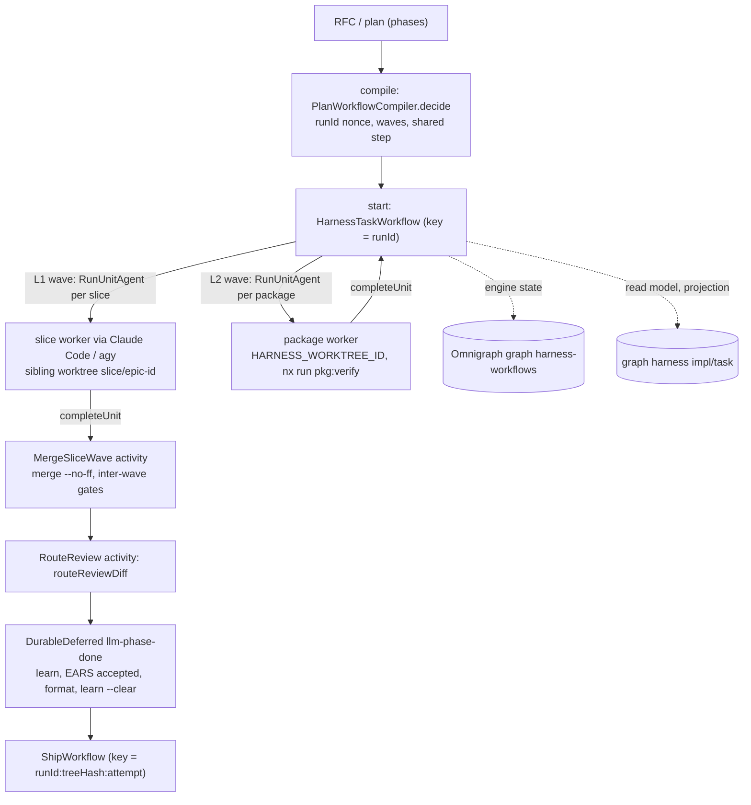

# RFC-0013: Durable Effect v4 Workflow Orchestration of Route D Epics and Package Waves

> **Supporting evidence:** [independent review of RFC-0011..0014](./reviews/2026-11-16-rfc-0011-0014-review.md) (§A cross-RFC findings, §F shared contracts F1-F8, §F9 workflow intent). This RFC is self-contained; the review is cited only as evidence for the shared contracts it names.

## 1. Executive Summary

Autonomous end-to-end execution (`/effect-lfg`) is coordinated today by Markdown prose in `effect-lfg/SKILL.md` ([claude-code](../../adapters/claude-code/skills/effect-lfg/SKILL.md), [antigravity](../../adapters/antigravity/plugins/effect-harness/skills/effect-lfg/SKILL.md)). Route D (PR #30, commit `7cbf806895`) already specifies a topological wave of disjoint slices in sibling worktrees `slice/<epic>-<id>`, a pinned `EPIC_BASE_SHA`, controller-only `git merge --no-ff` and controller-only `harness done` ([`multi-slice-worktree-execution.md`](../../adapters/claude-code/skills/effect-lfg/references/multi-slice-worktree-execution.md)). What is still prose is the _control flow and state_: which slices or packages form a wave, which unit is done, which is pending after `/compact`, who launches the implementers, and the exact gate order before `done`.

This RFC makes the orchestration a **real, durable Effect v4 workflow** (`effect/workflow`), with three load-bearing choices:

1. **The control flow is code.** `HarnessTaskWorkflow` (implementation of a compiled plan: waves, units, review, LLM phase) and `ShipWorkflow` (deterministic gates) are `Workflow.make` definitions whose bodies loop over a plan compiled by the pure `PlanWorkflowCompiler.decide` (`R = never`). Units run as `Activity` values; manual hand-offs and the LLM phase are `DurableDeferred` values. Reviewer selection is delegated to `Harness.routeReviewDiff` (ADR-0014).
2. **Durable state lives in Omnigraph and nowhere else.** No SQLite, PGlite or other database (and `node:sqlite` is banned in infra, `AGENTS.md`). The engine is `ClusterWorkflowEngine.layer` over a single-process sharding stack, with a **new `OmnigraphMessageStorage`** that implements the `MessageStorage.Encoded` driver of `effect/cluster` over a dedicated graph `harness-workflows` (main branch only, never touched by `done`). It runs inside the long-lived harness daemon, the only writer.
3. **Agents are launched by the workflow, through exactly two CLI runners:** Claude Code (`claude -p`) and Antigravity (`agy -p`). `AgentRunnerPort` has two live implementations in v1 and no others.

Two plan levels from Route D stay: **L1 `EpicPlan`** (slices in sibling worktrees; the controller alone merges and runs `done`) and **L2 `SlicePlan`** (package waves inside one slice, from `plan-graph-snapshot.json` plus the Nx project graph). The `ship` order is the canonical one (review F6): `format:check -> gc --strict -> ontology check --strict -> mutate --strict (workspace hash unchanged) -> verify -> done`.

**Main technical risk (stated up front).** `OmnigraphMessageStorage` is new code against an `@stability unstable` driver contract, and Sharding polls storage on timers (`entityMessagePollInterval` 10 s, `entityReplyPollInterval` 200 ms). Milestone **WF-0 is a spike with a go/no-go criterion** (§10.3) and a fallback (a custom `WorkflowEngine` over the same Omnigraph graph, §7). There is no SQL fallback.

A readable projection of runs, units and attempts into the planning graph (`harness`, branch `impl/<task>`, linked to EARS specs, stubs and tests) is derived from engine state and re-projected after `done`; it is never read to make decisions.

---

## 2. Motivation & Empirical Gap Analysis

### 2.1 Failure Modes of Prose-Only Control Flow

Evidence base: [`effect-lfg/SKILL.md`](../../adapters/claude-code/skills/effect-lfg/SKILL.md) (Stages 0-6, Overrides 2 and 4), [`multi-slice-worktree-execution.md`](../../adapters/claude-code/skills/effect-lfg/references/multi-slice-worktree-execution.md) (Steps D0-D5), [`verify-stamp.ts`](../../libs/harness/gates/src/verify-stamp.ts), and [`0013-repo-check.md`](./reviews/2026-11-16-rfc-0011-0014-evidence/0013-repo-check.md).

1. **Wave membership is decided by the LLM.** Route D step D1 tells the controller to partition slices into disjoint waves "when in doubt, serialize", and Stage 3 tells it which packages may run in parallel. There is no compiled artifact to inspect, diff or test.
2. **Resume depends on reconstructing state from git history.** Route D resumes by scanning `git log` for `integrate slice/<epic>-<id>` commits and `slice/*` branches (step D0). That says nothing about a half-implemented slice, an L2 package that already passed package verify, or an EARS requirement with no completed unit.
3. **The ship order has contradictory statements.** `AGENTS.md` says `verify -> done -> learn`; `effect-lfg` (Override 4, Stage 5) says `learn (+ promotions, --clear) -> gc -> ontology -> mutate -> verify -> done` with no format step. `format:check` (`oxfmt --check .`) is a root script, not a harness gate.
4. **The stamp is not a git tree.** `checkVerifyStamp` compares `computeWorkspaceTreeHash` (`verify-stamp.ts`), a SHA-256 over **all non-ignored files, tracked or not** (ignored: `.git`, `.harness`, `node_modules`, `dist`, `coverage`, `.nx`, `repos`, `.worktrees`, ...). `mutate --strict` rewrites tracked sources in place with a backup in `.harness/mutation-backup.json` (`mutation-check.ts`): it is mutating-with-restore, not read-only.
5. **Nobody launches the implementers.** The CLI is a process the agent runs; the controller agent starts subagents by prompt. A restart of the controller (compaction, crash, new session) loses which units were in flight. A workflow that owns the launch (via CLI runners) and the state removes the dependency on a surviving controller context.

### 2.2 Why a Durable Effect Workflow Now

- **Code decides, the LLM works in bounded leaves.** Graph compilation, wave partitioning, write-set disjointness, retry budgets, escalation and the ship order are deterministic TypeScript; each unit receives a bounded brief (the Route D 6-part slice brief for L1; for L2 a `TypedHoleContextBundle`, `MAX_HOLE_TOKENS = 1500` in `stratum-3-completion-and-holes.ts`). This follows the workflows-versus-agents split of Anthropic's _Building effective agents_ (2024) and the blueprint-first design of _Blueprint First, Model Second_ (arXiv:2508.02721).
- **Durable replay, not a hand-rolled log.** `effect/workflow` already provides the semantics this needs and that a bespoke JSONL log would have to re-implement: execution identity from an idempotency key, memoised activity results (failures included), durable waits (`DurableDeferred`), compensation, and resume by re-running the body (§4.2, verified in source). Temporal documents the same constraint (deterministic workflow definition, non-deterministic work in activities).
- **The engine is already in the dependency.** `effect@4.0.0` ships `workflow` and `cluster` (dist directories present in the installed package); the pinned subtree `repos/effect` is 4.0.6. The only missing piece is a storage driver, which is the new code of this RFC.

### 2.3 Why Omnigraph Is Acceptable as the Durable Store

Omnigraph has documented hazards when used for _run state_: it is a derived projection of code, `done` overwrites `impl/<task>` (`done-omnigraph-helpers.ts:494`, `mode: "overwrite"`), a schema or config digest change gives `RequiresCleanRebuild` which `rm -rf`s the whole cluster directory (`omnigraph-lifecycle.ts`, `evaluateClusterConfigDrift` in `omnigraph-auth-and-drift.ts`), the cluster is one shared instance for all worktrees, and the server may be down. Each hazard is neutralised by design:

| Hazard                                                        | Neutralisation                                                                                                                                                                                                                                                                                                                         |
| :------------------------------------------------------------ | :------------------------------------------------------------------------------------------------------------------------------------------------------------------------------------------------------------------------------------------------------------------------------------------------------------------------------------- |
| `done` overwrites `impl/<task>` in graph `harness`            | Run state lives in a **separate graph `harness-workflows`**, branch `main` only. `done` and the existing sync layer only address graph `harness`; WF-2 adds a regression test that `done` never issues a load against `harness-workflows`.                                                                                             |
| `RequiresCleanRebuild` deletes the cluster directory          | A `WorkflowGraphBackup` hook runs before the `rm -rf`: **export** of all `harness-workflows` nodes to `<git-common-dir>/harness/workflow-backups/<ts>.ndjson` and **restore** after rebuild. If export fails, the server is down, or a run is active and unexported, the rebuild is **refused (fail-closed)**.                         |
| Schema change in `harness-workflows` itself                   | Schema is **additive-only** (new node/edge types and optional properties); a CI check (`policy-tests.yaml` style) rejects `@key` changes and removals, so `harness-workflows` never triggers `RequiresCleanRebuild` on its own. The one-time addition of the graph to `cluster.yaml` is a rebuild at a point where the graph is empty. |
| Server down or restarting                                     | Every storage call fails with `PersistenceError`; the engine does not run activities it cannot persist. Runs are **paused, not lost**: in-flight rows keep their claim state and are re-delivered after restart (§5.3.5). `isOmnigraphUnavailableError` classifies the failure for the daemon's retry/backoff.                         |
| Concurrent writers                                            | **Single writer**: only the harness daemon (Cedar subject `harness-cli`) writes `harness-workflows`; a `WfWriterLease` row fences a second daemon. All writes use `ifGraphCommit` OCC (`mapOmnigraphPreconditionError`).                                                                                                               |
| Agents tampering with state                                   | Cedar: `agent-mcp` has only `read`/`invoke_query` on `harness-workflows`; the harness mutation policy keeps `<git-common-dir>/harness/**` (backups) at `deny` (review F4).                                                                                                                                                             |
| Shared canonical cluster, destructive rebuild from a worktree | Unchanged guard (`HARNESS_ALLOW_WORKTREE_CLUSTER_REBUILD`); the daemon runs against the canonical repo root only (§5.7).                                                                                                                                                                                                               |

Residual cost, accepted: Omnigraph write latency is higher than a local database, and every write is a graph commit (history growth is measured in WF-0 and bounded by run retention, §9).

---

## 3. Goals, Non-Goals & Hard Invariants

### 3.1 Goals

- **G1 - Two-level deterministic plan.** Compile an L1 `EpicPlan` and an L2 `SlicePlan` as stratified wave DAGs via `PlanWorkflowCompiler.decide` (`R = never`).
- **G2 - Real durable workflow.** `HarnessTaskWorkflow` and `ShipWorkflow` execute through `effect/workflow`; resume after daemon restart re-runs the body and reuses memoised activity results.
- **G3 - Omnigraph is the only durable store.** `OmnigraphMessageStorage` implements the `MessageStorage.Encoded` driver; graph `harness-workflows`; export/restore across clean rebuilds or fail-closed.
- **G4 - Workflow launches agents.** `RunUnitAgent` activity via `AgentRunnerPort`, with `ClaudeCodeRunnerLive` and `AntigravityRunnerLive` only; a manual mode via `DurableDeferred` and `harness workflow complete`.
- **G5 - Runtime write-set and verify.** `completeUnit` verifies `git diff` within `ownedRelPaths` plus the package verify, in both modes.
- **G6 - Canonical, stamp-safe ship.** `ShipWorkflow` keyed `runId:treeHash:attempt`, gate activities that assert the tree hash, restore check after `mutate --strict`.
- **G7 - Reviewer selection by the router** (`Harness.routeReviewDiff`) and a **readable projection** into graph `harness`.

### 3.2 Non-Goals

- **NG1 - Providers other than Claude Code and Antigravity.** No API-direct agent loop, no other CLI.
- **NG2 - Replacing Route D.** Slice decomposition rules, `EPIC_BASE_SHA`, sibling worktrees, controller-only merge/`done` and "never delete slice branches" stay as in `multi-slice-worktree-execution.md`; this RFC compiles and executes them.
- **NG3 - Another database.** No SQLite, PGlite, Postgres, Redis.
- **NG4 - Multi-machine clustering.** Single process, single daemon; `Runners.layerNoop`.
- **NG5 - Durable gate results.** Gate outcomes are never reused across `ship` attempts (invariant 7).
- **NG6 - Running LLM-phase steps from code.** `harness learn` analysis, promotions, EARS `proposed -> accepted`, `pnpm format`, `harness learn --clear` stay agent steps; the workflow waits for them on a `DurableDeferred` (§5.5.3).

### 3.3 Hard Architectural Invariants

1. **Acyclic plans.** `PlanWorkflowCompiler.decide` rejects a cyclic unit graph with `CyclicPlanWorkflowError` before emitting any wave (`Graph.isAcyclic`; `Graph.topo` throws on cycles and is only called after the check).
2. **Disjoint parallel waves, separately checked.** Level partitioning does not imply file disjointness; the compiler splits each level into first-fit sub-waves with pairwise-disjoint `ownedRelPaths`, and paths in the shared set (lockfile, `tsconfig.base.json`, barrels, docs/specs) are removed from units and handled in a sequential shared step (Route D step D1).
3. **Runtime write-set check.** A unit completes only if every changed path is inside its `ownedRelPaths`. For a unit in its own worktree (every L1 slice) the changed set is `git diff --name-only <base>..HEAD` plus untracked files; for L2 units sharing a checkout, paths owned by other in-flight units of the same wave are excluded from the changed set and re-attributed when those units complete. When a unit uses `harness_shadow_codemod` (RFC-0012) the agent passes `ownedRelPaths` as `allowedWriteGlobs` (`ExactPath` entries of `WriteScopeEntry`); `completeUnit` is the authoritative backstop.
4. **Isolation tiers are not conflated.** `HARNESS_WORKTREE_ID` only relocates harness state (`resolveHarnessStateDir`); file isolation comes from sibling git worktrees. L1 slices run with `HARNESS_WORKTREE_ID` unset; L2 implementers use it only for package-scoped `nx run <project>:verify` (Route D reference, section 1).
5. **Engine state is the authority.** Decisions are taken from the workflow body and memoised activity results only. The Omnigraph read model and the `harness` projection are never read to decide.
6. **Deterministic workflow body.** The body is re-executed on every resume (§4.2): no clock, randomness, environment, filesystem or Omnigraph reads outside activities; every tunable (concurrency, retry budget, runner profile, timeouts) is part of the payload.
7. **Ship is never memoised across attempts.** Each `ship` attempt is a new execution (key includes `treeHash` and `attempt`); every gate activity receives `treeHash` and asserts it before running.
8. **Stamp monotonicity.** Let `H(w)` be `computeWorkspaceTreeHash` (non-ignored files, `verify-stamp.ts`). During one ship attempt `H` is constant: each gate asserts `H = treeHash` at its start, `mutate-strict` additionally asserts `H` after its restore (`MutationRestoreError`), and `done` asserts it after completion (`ShipTreeDriftError`).
9. **No `--dangerously-skip-permissions`, ever.** Runner profiles are typed constants; the flag is not representable (§5.6).

---

## 4. Formal Model

### 4.1 Plan Compilation

**Inputs.** Extraction is impure and lives in `harness-cli` (R is allowed there): it reads `.harness/plan-graph-snapshot.json`, which contains `EffectFn{isStub, file, packageTag}` and `EarsSpec` nodes but **no** `StubHole` kind, **no** Nx project names and **no** import edges, and combines it with the Nx project graph (`nx graph --file` or nx-mcp) into a `CompileInput`: unit drafts (`ownedRelPaths`, `stubKeys`, `earsIds`), dependency edges, and the shared-path set. For L1, drafts come from the RFC phase table / cumulative spec (Route D step D1).

**Dependency DAG.** $\mathcal{D} = (\mathcal{U}, E_{\mathcal{U}})$ with edge $u \to v$ iff $v$ depends on $u$ (an Nx import edge for L2; a declared phase/slice dependency for L1).

**Levels.** After `Graph.isAcyclic(D)`, take the order of `Graph.topo(D)` and define

$$
\ell(v) = \begin{cases} 0 & \text{if } \text{pred}_{\mathcal{D}}(v) = \emptyset \\ 1 + \max_{u \to v \in E_{\mathcal{U}}} \ell(u) & \text{otherwise} \end{cases}
$$

`Graph.toposort` does not exist; the API is `Graph.topo` (`repos/effect/packages/effect/src/Graph.ts`).

**Waves.** Level $k$ is split by first-fit over units sorted by `unitId` into sub-waves with pairwise-disjoint owned paths; sub-waves keep level order. Waves $W_0 \prec W_1 \prec \dots \prec W_m$ satisfy:

- **Dependency soundness:** $u \to v \implies \text{wave}(u) < \text{wave}(v)$.
- **Disjointness (checked, not implied):** $\forall u \neq v \in W_k:\ \text{Owned}(u) \cap \text{Owned}(v) = \emptyset$.

**Optimality claim.** Level partitioning minimises the **number of waves** (critical-path length) under unbounded parallelism and unit-time tasks. It does not minimise makespan with bounded workers or non-uniform durations; barrier-free list scheduling with critical-path priority is the classical improvement (Hu 1961; Graham 1966, within $2 - 1/m$ of optimal). Barriers are kept deliberately: they simplify merge, inter-wave gates and resume.

### 4.2 Verified `effect/workflow` and `effect/cluster` Semantics

Verified in `repos/effect/packages/effect/src` (4.0.6; the installed `effect@4.0.0` contains the same `workflow` and `cluster` directories). All of it is `@stability unstable`.

| Fact                                                                                                                                                                                                                                                                                                                                                                                                             | Source                                                                             |
| :--------------------------------------------------------------------------------------------------------------------------------------------------------------------------------------------------------------------------------------------------------------------------------------------------------------------------------------------------------------------------------------------------------------- | :--------------------------------------------------------------------------------- |
| `Workflow.make(tag, { payload, idempotencyKey, success?, error?, suspendedRetrySchedule?, annotations? })`; `payload` is `Struct.Fields` or a struct schema; `success` defaults to `Void`, `error` to `Never`.                                                                                                                                                                                                   | `workflow/Workflow.ts:458-490`                                                     |
| Execution id = hash of `"${tag.length}:${tag}:${idempotencyKey(payload)}"`: same tag and key map to the same execution.                                                                                                                                                                                                                                                                                          | `Workflow.ts:340-341`                                                              |
| `workflow.toLayer(handler)` registers the body with the `WorkflowEngine`; handler is `(payload, executionId) => Effect`. `execute(payload, { discard?, detached? })`, `poll(executionId)`, `resume(executionId)`, `interrupt(executionId)`, `executionId(payload)` are the client surface.                                                                                                                       | `Workflow.ts:105-170, 345-425`                                                     |
| In the cluster engine a workflow execution is an entity `Workflow/<tag>` with id = execution id; the `run` request has primary key `""`, an activity request has primary key `activityPrimaryKey(name, attempt)`, a deferred has primary key = its name. **Memoisation is therefore dedup by primary key in `MessageStorage`**.                                                                                  | `cluster/ClusterWorkflowEngine.ts:687-700, 935, 955, 1010`                         |
| A saved request whose primary key already exists returns `SaveResult.Duplicate` carrying the stored reply; completed executions (success **or failure**) and activity exits (failures included) are not re-run. The in-memory engine behaves the same (`layerMemory` runs a body only when no state exists).                                                                                                     | `MessageStorage.ts:551+` (`makeEncoded`), `WorkflowEngine.ts:715-735`              |
| `Activity.make({ name, success?, error?, execute, interruptRetryPolicy? })`; `Activity.retry` re-runs an effect while updating `CurrentAttempt`; activity identity includes the attempt.                                                                                                                                                                                                                         | `workflow/Activity.ts:135-160, 220-260`                                            |
| `DurableDeferred.make(name, { success?, error? })`; `DurableDeferred.await` (exported as `await_`) suspends the run until a result exists; `succeed` / `fail` / `done` complete it from outside using a `Token`; `tokenFromExecutionId(deferred, { workflow, executionId })` builds the token without running inside the workflow.                                                                               | `workflow/DurableDeferred.ts:89-130, 195, 543-570, 624-770`                        |
| `Workflow.withCompensation(effect, (value, cause) => ...)` registers a finalizer only for **top-level** effects of the workflow body, not inside activities.                                                                                                                                                                                                                                                     | `Workflow.ts:176-177, 962-980`                                                     |
| `ClusterWorkflowEngine.layer : Layer<WorkflowEngine, never, Sharding \| MessageStorage>`.                                                                                                                                                                                                                                                                                                                        | `cluster/ClusterWorkflowEngine.ts:1089-1096`                                       |
| `SingleRunner.layer` wires `Sharding.layer` over `Runners.layerNoop`, `SqlMessageStorage.layer`, `RunnerStorage.layerMemory` (or SQL), `RunnerHealth.layerNoop` and `ShardingConfig.layerFromEnv(overrides)`; it requires `SqlClient` and `Crypto`.                                                                                                                                                              | `cluster/SingleRunner.ts:60-79`                                                    |
| `Sharding.layer` requires `ShardingConfig \| Runners \| MessageStorage \| RunnerStorage \| RunnerHealth`. Defaults: `entityMessagePollInterval` 10 s, `entityReplyPollInterval` 200 ms, `shardsPerGroup` 300.                                                                                                                                                                                                    | `cluster/Sharding.ts:2109-2113`, `cluster/ShardingConfig.ts:153-157, 193, 207-208` |
| `MessageStorage.makeEncoded(driver)` (needs `Snowflake.Generator`) builds the full `MessageStorage` service from an `Encoded` driver. `Encoded` has exactly: `saveEnvelope`, `saveReply`, `clearReplies`, `requestIdForPrimaryKey`, `repliesFor`, `repliesForUnfiltered`, `unprocessedMessages`, `unprocessedMessagesById`, `resetRequests`, `resetAddresses`, `clearAddress`, `resetShards`, `withTransaction`. | `cluster/MessageStorage.ts:361-505, 697`                                           |
| The SQL reference implementation claims rows for 10 minutes (`last_read < NOW() - 10 minutes`), orders by `rowid`, treats a message as unprocessed when no `WithExit` reply or unacked chunk reply exists and `processed = false`, and respects `deliver_at`.                                                                                                                                                    | `cluster/SqlMessageStorage.ts:354-360, 433-500`                                    |

**Consequences used throughout this RFC:**

1. A workflow key must be unique per intended execution: reusing a key returns the stored result, even a failure.
2. The body re-runs on resume, so it must be deterministic (invariant 6); only activity results and deferred results persist.
3. The correctness of idempotency depends entirely on the storage driver's primary-key dedup and on atomic claim/reply semantics (§5.3). That is why `OmnigraphMessageStorage` has a conformance test suite (WF-2).

### 4.3 Ship Pipeline Order (review F6, canonical)

```
plan -> skeleton -> plan-check -> implement -> review (router, ADR-0014)
  -> [LLM phase: harness learn + promotions, EARS accepted, pnpm format, harness learn --clear]
  -> harness workflow ship
       = format:check -> gc --strict -> ontology check --strict
         -> mutate --strict (then: H unchanged) -> verify -> done
```

`harness learn --promote-skills` (RFC-0014) runs **outside** `ship` on its own `learn/<date>` branch. The LLM phase is outside `ShipWorkflow` because promotions, spec status flips and formatting are edits; the deterministic phase is read-only apart from the restored mutation run and `.harness/` stamp files (ignored by the hash).

---

## 5. Detailed Technical Design

### 5.1 Contracts (`@harness/contract`)

Snippets follow `AGENTS.md`: branded scalars, no inline object types at boundaries, closed tagged unions, `Schema.TaggedError`, `Effect.fn("Name")(function* (...): Effect.fn.Return<A, E, R>)`, `ts-pattern` `.exhaustive()`.

```typescript
import { Schema } from "effect"
import { GitCommitSha } from "./repo-identity.js" // canonical brand owned by RFC-0011 §5.3.2 (40 hex); no copy here
import { ReviewRoutingPlan } from "./review-routing.js"

export const WorkflowRunId = Schema.NonEmptyString.pipe(
  Schema.check(Schema.isPattern(/^[a-z0-9][a-z0-9-]{7,63}$/)),
  Schema.brand("WorkflowRunId"),
) // nonce minted by `compile`, never derived from plan content
export type WorkflowRunId = typeof WorkflowRunId.Type

export const WorkUnitId = Schema.NonEmptyString.pipe(
  Schema.check(Schema.isPattern(/^[a-z0-9][a-z0-9_.:-]{0,63}$/)),
  Schema.brand("WorkUnitId"),
)
export type WorkUnitId = typeof WorkUnitId.Type

export const AttemptNumber = Schema.Int.pipe(
  Schema.check(Schema.isBetween({ minimum: 1, maximum: 3 })),
  Schema.brand("AttemptNumber"),
)
export type AttemptNumber = typeof AttemptNumber.Type

export const ShipAttempt = Schema.Int.pipe(
  Schema.check(Schema.isGreaterThanOrEqualTo(1)),
  Schema.brand("ShipAttempt"),
)
export type ShipAttempt = typeof ShipAttempt.Type

export const WaveIndex = Schema.Int.pipe(
  Schema.check(Schema.isGreaterThanOrEqualTo(0)),
  Schema.brand("WaveIndex"),
)
export type WaveIndex = typeof WaveIndex.Type

export const NxProjectName = Schema.NonEmptyString.pipe(Schema.brand("NxProjectName"))
export type NxProjectName = typeof NxProjectName.Type

export const OwnedRelPath = Schema.NonEmptyString.pipe(Schema.brand("OwnedRelPath"))
export type OwnedRelPath = typeof OwnedRelPath.Type

/** Hex SHA-256 produced by `computeWorkspaceTreeHash` (all non-ignored files): the verify-stamp hash only. */
export const WorkspaceTreeHash = Schema.String.pipe(
  Schema.check(Schema.isPattern(/^[0-9a-f]{64}$/)),
  Schema.brand("WorkspaceTreeHash"),
)
export type WorkspaceTreeHash = typeof WorkspaceTreeHash.Type

/** Hex SHA-256 over (path, bytes) of one unit's `ownedRelPaths`, sorted by path. Never compared with a `WorkspaceTreeHash`. */
export const PackageStampHash = Schema.String.pipe(
  Schema.check(Schema.isPattern(/^[0-9a-f]{64}$/)),
  Schema.brand("PackageStampHash"),
)
export type PackageStampHash = typeof PackageStampHash.Type

export const PlanSha256 = Schema.String.pipe(
  Schema.check(Schema.isPattern(/^[0-9a-f]{64}$/)),
  Schema.brand("PlanSha256"),
)
export type PlanSha256 = typeof PlanSha256.Type

export const StubSymbolKey = Schema.NonEmptyString.pipe(Schema.brand("StubSymbolKey"))
export type StubSymbolKey = typeof StubSymbolKey.Type

export const EarsRequirementKey = Schema.NonEmptyString.pipe(Schema.brand("EarsRequirementKey"))
export type EarsRequirementKey = typeof EarsRequirementKey.Type

export const SliceBranchName = Schema.NonEmptyString.pipe(
  Schema.check(Schema.isPattern(/^slice\/[a-z0-9][a-z0-9-]*-[a-z0-9][a-z0-9-]*$/)),
  Schema.brand("SliceBranchName"),
)
export type SliceBranchName = typeof SliceBranchName.Type

export const PackageVerifyCommand = Schema.NonEmptyString.pipe(Schema.brand("PackageVerifyCommand"))
export type PackageVerifyCommand = typeof PackageVerifyCommand.Type

export const WorkflowLevel = Schema.Literals(["epic", "slice"]).pipe(Schema.brand("WorkflowLevel"))
export type WorkflowLevel = typeof WorkflowLevel.Type

export const ShipStage = Schema.Literals([
  "format-check",
  "gc-strict",
  "ontology-check-strict",
  "mutate-strict",
  "verify",
  "done",
]).pipe(Schema.brand("ShipStage"))
export type ShipStage = typeof ShipStage.Type

/** The two supported agent CLIs. Closed set: adding a runner is a contract change. */
export const RunnerId = Schema.Literals(["claude-code", "antigravity"]).pipe(
  Schema.brand("RunnerId"),
)
export type RunnerId = typeof RunnerId.Type

export const MaxConcurrency = Schema.Int.pipe(
  Schema.check(Schema.isBetween({ minimum: 1, maximum: 8 })),
  Schema.brand("MaxConcurrency"),
)
export type MaxConcurrency = typeof MaxConcurrency.Type

/** Per-plan unit execution mode: workflow launches the agent, or a human/agent reports completion. */
export const UnitMode = Schema.TaggedUnion({
  Automatic: { runner: RunnerId, maxConcurrency: MaxConcurrency },
  Manual: {},
})
export type UnitMode = typeof UnitMode.Type

/** L1 `SliceUnit`: a Route D slice in its own sibling worktree. L2 `PackageUnit`: one Nx project inside a slice. */
export const CompiledWorkUnit = Schema.TaggedUnion({
  SliceUnit: {
    unitId: WorkUnitId,
    branch: SliceBranchName,
    waveIndex: WaveIndex,
    dependsOn: Schema.Array(WorkUnitId),
    ownedRelPaths: Schema.Array(OwnedRelPath),
    earsKeys: Schema.Array(EarsRequirementKey),
  },
  PackageUnit: {
    unitId: WorkUnitId,
    projectName: NxProjectName,
    waveIndex: WaveIndex,
    dependsOn: Schema.Array(WorkUnitId),
    ownedRelPaths: Schema.Array(OwnedRelPath),
    stubKeys: Schema.Array(StubSymbolKey),
    earsKeys: Schema.Array(EarsRequirementKey),
    packageVerifyCommand: PackageVerifyCommand,
  },
})
export type CompiledWorkUnit = typeof CompiledWorkUnit.Type

/** Everything the deterministic body may read: the payload of `HarnessTaskWorkflow`. */
export const CompiledPlan = Schema.Struct({
  runId: WorkflowRunId,
  level: WorkflowLevel,
  planSha: PlanSha256,
  baseSha: GitCommitSha,
  mode: UnitMode,
  units: Schema.Array(CompiledWorkUnit),
  sharedStepPaths: Schema.Array(OwnedRelPath),
})
export type CompiledPlan = typeof CompiledPlan.Type

export const UnitRejection = Schema.TaggedUnion({
  WriteSetViolation: { offendingPaths: Schema.Array(OwnedRelPath) },
  PackageVerifyFailed: { exitCode: Schema.Int.pipe(Schema.brand("GateExitCode")) },
  StampMissing: {},
  AgentFailed: { reason: Schema.NonEmptyString.pipe(Schema.brand("AgentFailureReason")) },
})
export type UnitRejection = typeof UnitRejection.Type

export const UnitEscalation = Schema.TaggedUnion({
  AuthRequired: { runner: RunnerId },
  RetryBudgetExhausted: { lastRejection: UnitRejection },
  MergeConflict: { branch: SliceBranchName },
})
export type UnitEscalation = typeof UnitEscalation.Type

/** Result of one attempt. A rejection is a SUCCESS value of the activity (so the body can retry), never an activity failure. */
export const UnitOutcome = Schema.TaggedUnion({
  Completed: {
    unitId: WorkUnitId,
    attempt: AttemptNumber,
    changedPaths: Schema.Array(OwnedRelPath),
    packageStampHash: PackageStampHash,
  },
  Rejected: { unitId: WorkUnitId, attempt: AttemptNumber, rejection: UnitRejection },
  Escalated: { unitId: WorkUnitId, escalation: UnitEscalation },
})
export type UnitOutcome = typeof UnitOutcome.Type
export type UnitCompletedOutcome = typeof UnitOutcome.cases.Completed.Type

export const LlmPhaseReceipt = Schema.Struct({
  workspaceHash: WorkspaceTreeHash,
  frictionLogCleared: Schema.Literals(["cleared"]).pipe(Schema.brand("FrictionLogState")),
})
export type LlmPhaseReceipt = typeof LlmPhaseReceipt.Type

export const TaskRunReceipt = Schema.Struct({
  runId: WorkflowRunId,
  review: ReviewRoutingPlan,
  completedUnits: Schema.Array(WorkUnitId),
  llmPhase: LlmPhaseReceipt,
})
export type TaskRunReceipt = typeof TaskRunReceipt.Type

export const ShipReceipt = Schema.Struct({
  runId: WorkflowRunId,
  attempt: ShipAttempt,
  verifiedTreeHash: WorkspaceTreeHash,
})
export type ShipReceipt = typeof ShipReceipt.Type

// ---- errors (Schema.TaggedError) ----
export class CyclicPlanWorkflowError extends Schema.TaggedError<CyclicPlanWorkflowError>()(
  "CyclicPlanWorkflowError",
  {
    cycleUnits: Schema.Array(WorkUnitId),
    reason: Schema.NonEmptyString.pipe(Schema.brand("WorkflowCompileReason")),
  },
) {}

export class DisjointOwnershipViolationError extends Schema.TaggedError<DisjointOwnershipViolationError>()(
  "DisjointOwnershipViolationError",
  { waveIndex: WaveIndex, overlappingPaths: Schema.Array(OwnedRelPath) },
) {}

/** Terminal failure of `HarnessTaskWorkflow` (after escalation was not resolved). */
export class TaskRunAbortedError extends Schema.TaggedError<TaskRunAbortedError>()(
  "TaskRunAbortedError",
  { runId: WorkflowRunId, escalation: UnitEscalation },
) {}

export class ShipTreeMismatchError extends Schema.TaggedError<ShipTreeMismatchError>()(
  "ShipTreeMismatchError",
  { stage: ShipStage, expected: WorkspaceTreeHash, actual: WorkspaceTreeHash },
) {}

export class MutationRestoreError extends Schema.TaggedError<MutationRestoreError>()(
  "MutationRestoreError",
  { before: WorkspaceTreeHash, after: WorkspaceTreeHash },
) {}

export class ShipTreeDriftError extends Schema.TaggedError<ShipTreeDriftError>()(
  "ShipTreeDriftError",
  { atStart: WorkspaceTreeHash, atDone: WorkspaceTreeHash },
) {}

export class ShipGateFailedError extends Schema.TaggedError<ShipGateFailedError>()(
  "ShipGateFailedError",
  {
    stage: ShipStage,
    exitCode: Schema.Int.pipe(Schema.brand("GateExitCode")),
    stderrSummary: Schema.NonEmptyString.pipe(Schema.brand("GateStderrSummary")),
  },
) {}

/** Raised by the Omnigraph storage driver's callers when the store cannot be reached: the engine pauses. */
export class WorkflowStoreUnavailableError extends Schema.TaggedError<WorkflowStoreUnavailableError>()(
  "WorkflowStoreUnavailableError",
  { operation: Schema.NonEmptyString.pipe(Schema.brand("WorkflowStoreOperation")) },
) {}
```

### 5.2 Pure Core (`@harness/gates` or `@harness/decision`, `R = never`)

```typescript
import { Effect, Schema } from "effect"
import * as Graph from "effect/Graph"
import { CompiledWorkUnit, CyclicPlanWorkflowError, WorkUnitId } from "@harness/contract"

export const UnitDependency = Schema.Struct({ from: WorkUnitId, to: WorkUnitId })
export type UnitDependency = typeof UnitDependency.Type

/** Impure extraction (snapshot + Nx graph / RFC phases) happens before this point, in harness-cli. */
export const CompileInput = Schema.Struct({
  units: Schema.Array(CompiledWorkUnit),
  dependencies: Schema.Array(UnitDependency),
})
export type CompileInput = typeof CompileInput.Type

export const CompiledWaves = Schema.Struct({ units: Schema.Array(CompiledWorkUnit) })
export type CompiledWaves = typeof CompiledWaves.Type

/** Longest-path levels over the unit DAG, then first-fit split into write-disjoint waves. */
export const compileWorkflowWaves = Effect.fn("PlanWorkflowCompiler.decide")(function* (
  input: CompileInput,
): Effect.fn.Return<CompiledWaves, CyclicPlanWorkflowError, never> {
  const indexById = new Map<WorkUnitId, Graph.NodeIndex>()
  const graph = Graph.directed<WorkUnitId, null>((mutable) => {
    for (const unit of input.units) indexById.set(unit.unitId, Graph.addNode(mutable, unit.unitId))
    for (const dep of input.dependencies) {
      const from = indexById.get(dep.from)
      const to = indexById.get(dep.to)
      if (from !== undefined && to !== undefined) Graph.addEdge(mutable, from, to, null)
    }
  })

  if (!Graph.isAcyclic(graph)) {
    const cycleUnits = Graph.stronglyConnectedComponents(graph)
      .filter((component) => component.length > 1)
      .flatMap((component) => component.flatMap((index) => unitIdAt(graph, index)))
    return yield* new CyclicPlanWorkflowError({ cycleUnits, reason: cycleReason(cycleUnits) })
  }

  // Safe: acyclicity was just established, so Graph.topo cannot throw GraphError.
  const order = Array.from(Graph.values(Graph.topo(graph)))
  const levelOf = assignLevels(order, input.dependencies)
  return { units: splitLevelsIntoDisjointWaves(input.units, levelOf) }
})
```

`unitIdAt`, `cycleReason`, `assignLevels` (the recurrence of §4.1), and `splitLevelsIntoDisjointWaves` (first-fit over `unitId`-sorted units per level, re-stamping each unit's `waveIndex`) are total, pure helpers in the same module. A postcondition guard re-checks pairwise disjointness per wave (`DisjointOwnershipViolationError`); it is unreachable if the splitter is correct and is covered by a property test. `wavesOf(plan)` (group by `waveIndex`, ascending) and `assertDisjoint(wave)` are pure helpers used by the workflow body and by `completeUnit`.

### 5.3 Engine Stack and `OmnigraphMessageStorage` (`@harness/infra`)

**New code, main technical risk.** Everything else in the stack is existing `effect/cluster` code.

#### 5.3.1 Layer composition

```typescript
import { Layer } from "effect"
import {
  ClusterWorkflowEngine,
  RunnerHealth,
  Runners,
  RunnerStorage,
  Sharding,
  ShardingConfig,
} from "effect/cluster"
import { Snowflake } from "effect/cluster"

/** Single-process sharding with Omnigraph-backed message storage. SingleRunner.layer with the SQL parts replaced. */
const HarnessShardingLive = Sharding.layer.pipe(
  Layer.provideMerge(Runners.layerNoop),
  Layer.provideMerge(OmnigraphMessageStorageLive),
  Layer.provide([RunnerStorage.layerMemory, RunnerHealth.layerNoop]),
  Layer.provide(
    ShardingConfig.layerFromEnv({
      shardsPerGroup: 16, // small: one process owns all shards (tuned in WF-0)
      entityMessagePollInterval: "30 seconds", // recovery poll only; local sends notify in-process (to confirm in WF-0)
    }),
  ),
)

export const HarnessWorkflowEngineLive = ClusterWorkflowEngine.layer.pipe(
  Layer.provide(HarnessShardingLive),
)
```

`OmnigraphMessageStorageLive` is `Layer.effect(MessageStorage)(makeOmnigraphEncodedDriver.pipe(Effect.flatMap(MessageStorage.makeEncoded)))` provided with `Snowflake.layerGenerator`, `ShardingConfig` and the Omnigraph client (`makeOmnigraphClient`, `libs/harness/graph/src/omnigraph-operations.ts`). `RunnerStorage.layerMemory` is sufficient (shard ownership is process-local) and is the reason no shard-lock nodes exist; single-writer is enforced by the lease (§5.3.4).

#### 5.3.2 Graph `harness-workflows`

`libs/harness/graph/cluster.yaml` gains a second graph and the Cedar policy lists it (**human-reviewed TCB edit**, §10.3 WF-2):

```yaml
policies:
  graph-access:
    file: graph.policy.yaml
    applies_to: [harness, harness-workflows]
graphs:
  harness:
    schema: schema.pg
    queries: queries/
    embedding_provider: local-ollama
  harness-workflows:
    schema: workflows.schema.pg
    queries: workflow-queries/
```

Node schema (`libs/harness/graph/workflows.schema.pg`), a direct mirror of the SQL tables of `SqlMessageStorage` (`cluster_messages`, `cluster_replies`). Snowflake ids fit `I64`; `seq` keeps the numeric id for ordering (SQL orders by `rowid`).

```
node WfMessage
  @instruction("One cluster envelope: request, ack-chunk or interrupt (mirror of the SQL messages table).")
{
  messageKey: String @key @description("Snowflake id of the envelope, decimal string")
  seq: I64 @index @description("Snowflake id as a number; monotonic, used for ORDER BY")
  primaryKeyHash: String? @index @description("message_id: sha-256 of the primary key; dedup key for idempotency")
  shardId: String @index
  entityType: String @index
  entityId: String @index
  kind: enum(request, ack_chunk, interrupt) @index
  tag: String?
  payload: String? @description("JSON of the encoded payload")
  headers: String?
  traceId: String?
  spanId: String?
  sampled: Bool?
  requestId: String @index
  replyId: String?
  processed: Bool @index @description("denormalised; authoritative state is derived from WfReply")
  lastReplyId: String?
  lastReadMs: I64? @index @description("claim timestamp (epoch ms)")
  deliverAtMs: I64? @index
}

node WfReply
  @instruction("A reply (exit or chunk) to a request (mirror of the SQL replies table).")
{
  replyKey: String @key @description("Snowflake id of the reply")
  seq: I64 @index
  requestId: String @index
  kind: enum(with_exit, chunk) @index
  payload: String @description("JSON of the exit or chunk values")
  sequence: I32?
  acked: Bool @index
}

node WfWriterLease
  @instruction("Single-writer fence for the workflow daemon.")
{
  name: String @key @description("always 'engine'")
  owner: String @description("daemon instance id + pid")
  heartbeatMs: I64
}
```

Read-model nodes written by workflow activities (`WfRun`, `WfUnit`, `WfAttempt`, `WfShipAttempt`) are in the same schema file and described in §5.7.4. They carry no engine state.

#### 5.3.3 Driver mapping

`makeOmnigraphEncodedDriver : Effect<MessageStorage.Encoded, never, OmnigraphWorkflowStore | Crypto>` implements all 13 members of `Encoded` (§4.2). `OmnigraphWorkflowStore` is a `Context.Service` wrapping the Omnigraph client with two primitives: `read(queryName, params)` and `commit(mutation, params, ifGraphCommit)`, mapping `mapOmnigraphPreconditionError` to an internal `WorkflowStoreConflictError` (retried by the driver after re-reading the head commit) and `isOmnigraphUnavailableError` to `WorkflowStoreUnavailableError`.

| `Encoded` member                                 | Omnigraph implementation                                                                                                                                                                                                                                                                                                                                                                                                                |
| :----------------------------------------------- | :-------------------------------------------------------------------------------------------------------------------------------------------------------------------------------------------------------------------------------------------------------------------------------------------------------------------------------------------------------------------------------------------------------------------------------------- |
| `saveEnvelope`                                   | If `primaryKey !== null`: read `WfMessage` by `primaryKeyHash` (sha-256, as SQL does for over-length keys); if present return `Duplicate{originalId, lastReceivedReply}` (joined from `WfReply`); else insert with `ifGraphCommit = head`. A concurrent insert fails the precondition, the driver re-reads and returns `Duplicate`. For `AckChunk` also mark the reply `acked` and earlier ack-chunk messages `processed` (one commit). |
| `saveReply`                                      | Insert `WfReply`, then update the message (`lastReplyId`; `processed = true` for `WithExit`), ideally in **one mutation commit** (multi-statement mutation support is unverified, §9). Fallback: insert the reply first, then update; because `processed` is derived from replies on every read, a crash between the two is repaired lazily.                                                                                            |
| `clearReplies(requestId, {expectedReplyId})`     | Delete the `with_exit` reply and `Interrupt` messages, reset the message to `processed = false, lastReplyId = null, lastReadMs = null`; with `expectedReplyId` the whole commit is conditional on the message's current `lastReplyId` (compare-and-set inside the same `ifGraphCommit` transaction), as the contract requires.                                                                                                          |
| `requestIdForPrimaryKey`                         | Read `WfMessage` by `primaryKeyHash`.                                                                                                                                                                                                                                                                                                                                                                                                   |
| `repliesFor`                                     | `WfReply` where `requestId in ids` and (`kind = with_exit` or `acked = false`), ordered by `seq`.                                                                                                                                                                                                                                                                                                                                       |
| `repliesForUnfiltered`                           | Same without the `acked` filter.                                                                                                                                                                                                                                                                                                                                                                                                        |
| `unprocessedMessages(shards, now, opts)`         | See §5.3.4.                                                                                                                                                                                                                                                                                                                                                                                                                             |
| `unprocessedMessagesById`                        | Same predicate, keyed by `messageKey`, without claiming.                                                                                                                                                                                                                                                                                                                                                                                |
| `resetRequests`, `resetAddresses`, `resetShards` | Set `lastReadMs = null` on unprocessed messages of the given ids/addresses/shards (release claims).                                                                                                                                                                                                                                                                                                                                     |
| `clearAddress`                                   | Delete `WfReply` and `WfMessage` of the entity address.                                                                                                                                                                                                                                                                                                                                                                                 |
| `withTransaction`                                | Identity (`effect => effect`): Omnigraph has no client transaction; atomicity is per commit, and multi-step operations are designed to be crash-repairable (above).                                                                                                                                                                                                                                                                     |

Every encoded payload is stored as an opaque JSON string, so the graph does not need to know workflow schemas (a payload schema change does not change the graph schema).

#### 5.3.4 `unprocessedMessages`, claims, OCC, at-least-once

- **Predicate (mirrors `SqlMessageStorage.ts:433-500`):** `shardId in shardIds`, `processed = false`, no `WfReply` of the request with `kind = with_exit` or `acked = false`, (`lastReadMs` null or older than `claimTimeoutMs`), (`deliverAtMs` null or `<= now`), ordered by `seq`, `limit`. The anti-join is expressed as a `.gq` preset (`wf_unprocessed`) where the query language allows it. Because the daemon is the only writer and the data set is small (tens to low hundreds of live rows), the fallback is to query `WfMessage` by the indexed `(processed = false, shardId)` and anti-join in the driver. Which form is feasible is a WF-0 finding (§9).
- **Claim:** rows returned are claimed by setting `lastReadMs = now` in one OCC commit. Empty polls do not write. The SQL reference hard-codes a 10-minute claim; agent units can run for hours, so `claimTimeoutMs` is a driver option (default 6 h) so that a long `RunUnitAgent` activity is not re-delivered while it is still running; whether Sharding independently dedups already-active entities is confirmed in WF-0.
- **OCC:** every commit passes `ifGraphCommit = head`; a precondition failure (`OmnigraphPreconditionError`) triggers re-read and bounded retry (3, jittered). With a single writer, conflicts arise only between the engine's own concurrent fibers.
- **At-least-once:** a message stays unprocessed until a `with_exit` reply commits; after a daemon crash the claim is released by `resetShards` at startup (existing Sharding behaviour on shard acquisition, to be confirmed) or by claim expiry, and the entity is re-activated: the body re-runs, memoised activities return stored exits, and the activity that was in flight runs again. **Activities must therefore be idempotent** (§5.4.4).
- **Single-writer lease:** at start the daemon commits `WfWriterLease{name: "engine", owner, heartbeatMs}` conditionally and refreshes it every 15 s; a daemon that cannot refresh stops the engine (fail closed). A second daemon sees a fresh lease and exits with `WorkflowEngineLeaseHeldError`.
- **Retention:** terminal runs are pruned (messages, replies) `workflowRetentionDays` after completion (default 30) by the daemon, keeping read-model rows; this bounds commit history growth (measured in WF-0).

#### 5.3.5 Pause on outage, export/restore on rebuild

- **Server down:** any storage call fails with `PersistenceError` wrapping `WorkflowStoreUnavailableError`; no activity is started that cannot persist its start, and no result is lost because results are persisted by the engine _after_ an activity returns (a result computed while the store was down is recomputed; the activity is idempotent). The daemon retries with `Schedule.exponential` capped at 30 s and reports `status: paused` to clients.
- **Rebuild guard (`WorkflowGraphBackup`).** `evaluateClusterConfigDrift` returns `RequiresCleanRebuild` for `cluster.yaml`, policy, epoch or `@key` changes (`omnigraph-auth-and-drift.ts`), and the lifecycle then removes the whole cluster directory (`omnigraph-lifecycle.ts`, `rmRecursiveSync`). WF-2 adds a pre-rebuild step: ask the daemon to quiesce (stop claiming, wait for in-flight activities up to a timeout), **export** every `harness-workflows` node to `<git-common-dir>/harness/workflow-backups/<utc>.ndjson`, verify the export by re-reading its row counts, then allow the rebuild; after rebuild **restore** by loading the NDJSON with the same loader used for `harness` (`syncToOmnigraphAndSnapshot`-style load; `mode` values other than `"overwrite"` are unverified) and re-verify counts. Export failure, count mismatch, or an unreachable server means **no rebuild** (fail closed, exit non-zero with instructions). The Cedar `export` action exists for the `admins` group (`graph.policy.yaml`); the concrete Omnigraph export/import command names are unverified (§9), and a driver-level dump through `invoke_query` over all node types is the fallback.

### 5.4 Workflows (`@harness/domain`-tier use cases; engine in `@harness/infra`)

The workflow bodies are pure use cases whose `R` is a set of service ports (`@harness/service`), so they sit in a `type:domain`-tier library; live ports are in `@harness/infra`.

#### 5.4.1 `HarnessTaskWorkflow`

```typescript
import { Duration, Effect, Schema } from "effect"
import { Activity, DurableDeferred, Workflow } from "effect/workflow"
import { match } from "ts-pattern"

export const HarnessTaskWorkflow = Workflow.make("HarnessTaskWorkflow", {
  payload: { plan: CompiledPlan },
  success: TaskRunReceipt,
  error: TaskRunAbortedError,
  // Key = runId nonce minted by `compile`; NEVER a hash of plan content (verified: same key => stored result, failures included).
  idempotencyKey: ({ plan }) => plan.runId,
})

export const LlmPhaseDone = DurableDeferred.make("llm-phase-done", { success: LlmPhaseReceipt })

const concurrencyOf = (mode: UnitMode): MaxConcurrency =>
  match(mode)
    .with({ _tag: "Automatic" }, (automatic) => automatic.maxConcurrency)
    .with({ _tag: "Manual" }, () => MaxConcurrency.make(1))
    .exhaustive()

export const HarnessTaskWorkflowLayer = HarnessTaskWorkflow.toLayer(
  Effect.fn("HarnessTaskWorkflow.run")(function* ({
    plan,
  }): Effect.fn.Return<TaskRunReceipt, TaskRunAbortedError, TaskWorkflowRuntime> {
    // Top-level compensation only: worktrees are removed if the run fails or is interrupted for good.
    const worktrees = yield* Workflow.withCompensation(provisionWorktrees(plan), (handle) =>
      removeWorktrees(handle),
    )

    const completed: Array<WorkUnitId> = []
    for (const wave of wavesOf(plan)) {
      const outcomes = yield* Effect.forEach(
        wave.units,
        (unit) => driveUnit(plan, worktrees, unit, AttemptNumber.make(1)),
        { concurrency: concurrencyOf(plan.mode) },
      )
      for (const outcome of outcomes) completed.push(outcome.unitId)
      yield* recordWave(plan, wave) // read-model activity (memoised, idempotent upsert)
      yield* mergeWaveIfEpic(plan, wave) // L1 only: activity MergeSliceWave
    }

    const review = yield* routeReview(plan) // activity wrapping Harness.routeReviewDiff
    const llmPhase = yield* DurableDeferred.await(LlmPhaseDone) // suspends until `harness workflow complete --phase llm`
    return { runId: plan.runId, review, completedUnits: completed, llmPhase }
  }),
)
```

`driveUnit` is the bounded retry loop (budget `AttemptNumber` max 3) and the only place where unit modes diverge:

```typescript
const driveUnit = Effect.fn("HarnessTaskWorkflow.driveUnit")(function* (
  plan: CompiledPlan,
  worktrees: WorktreeHandle,
  unit: CompiledWorkUnit,
  attempt: AttemptNumber,
): Effect.fn.Return<UnitCompletedOutcome, TaskRunAbortedError, TaskWorkflowRuntime> {
  const outcome = yield* attemptUnit(plan, worktrees, unit, attempt)
  return yield* match(outcome)
    .with({ _tag: "Completed" }, (done) => Effect.succeed(done))
    .with({ _tag: "Rejected" }, (rejected) =>
      nextAttemptOrEscalate(plan, worktrees, unit, rejected),
    )
    .with({ _tag: "Escalated" }, (escalated) => resolveEscalation(plan, worktrees, unit, escalated))
    .exhaustive()
})

const attemptUnit = Effect.fn("HarnessTaskWorkflow.attemptUnit")(function* (
  plan: CompiledPlan,
  worktrees: WorktreeHandle,
  unit: CompiledWorkUnit,
  attempt: AttemptNumber,
): Effect.fn.Return<UnitOutcome, never, TaskWorkflowRuntime> {
  return yield* match(plan.mode)
    .with({ _tag: "Automatic" }, (automatic) =>
      runUnitAgent(plan, worktrees, unit, attempt, automatic.runner),
    )
    .with({ _tag: "Manual" }, () => awaitUnitCompletion(plan, unit, attempt))
    .exhaustive()
})
```

`nextAttemptOrEscalate` recurses into `driveUnit` with `attempt + 1` (via `AttemptNumber.make`) while the budget allows, else yields `Escalated{RetryBudgetExhausted}`; `resolveEscalation` creates a per-escalation `DurableDeferred` (`escalation/<unitId>/<n>`) and suspends until an operator runs `harness workflow resume --unit <id> --decision retry|abort`; `abort` fails the run with `TaskRunAbortedError` (compensation then cleans up). Retrying after `AuthRequired` is therefore a plain operator action, not a failure.

#### 5.4.2 `ShipWorkflow`

```typescript
export const ShipWorkflow = Workflow.make("ShipWorkflow", {
  payload: { runId: WorkflowRunId, treeHash: WorkspaceTreeHash, attempt: ShipAttempt },
  success: ShipReceipt,
  error: Schema.Union([
    ShipGateFailedError,
    ShipTreeMismatchError,
    MutationRestoreError,
    ShipTreeDriftError,
  ]),
  // A fresh execution per attempt; the tree hash is part of the identity, so a stale failure can never be replayed for new code.
  idempotencyKey: ({ runId, treeHash, attempt }) => `${runId}:${treeHash}:${attempt}`,
})

const gate = (stage: ShipStage, treeHash: WorkspaceTreeHash) =>
  Activity.make({
    name: `RunGate/${stage}`,
    success: GateResult,
    error: Schema.Union([ShipGateFailedError, ShipTreeMismatchError, MutationRestoreError]),
    execute: runGateAssertingTree(stage, treeHash), // asserts H(workspace) = treeHash BEFORE running; mutate also after
  })

export const ShipWorkflowLayer = ShipWorkflow.toLayer(
  Effect.fn("ShipWorkflow.run")(function* ({
    runId,
    treeHash,
    attempt,
  }): Effect.fn.Return<ShipReceipt, ShipFailure, ShipRuntime> {
    yield* gate(ShipStage.make("format-check"), treeHash)
    yield* gate(ShipStage.make("gc-strict"), treeHash)
    yield* gate(ShipStage.make("ontology-check-strict"), treeHash)
    yield* gate(ShipStage.make("mutate-strict"), treeHash) // recovers backup first; asserts H unchanged afterwards
    yield* gate(ShipStage.make("verify"), treeHash)
    yield* gate(ShipStage.make("done"), treeHash) // asserts H unchanged afterwards (ShipTreeDriftError)
    return { runId, attempt, verifiedTreeHash: treeHash }
  }),
)
```

(`ShipStage.make` stands for the single canonical constructor of the brand; the literal values are the closed `ShipStage` union.) `runGateAssertingTree` shells out to the existing CLI gate (`pnpm harness <gate>`, `format:check` via the root script) as a child process of the daemon with a validated `repoRoot`, maps non-zero exit to `ShipGateFailedError`, wires failures into `LoopCircuitBreaker.decide` accounting (today only `verify`; new work), and for `mutate-strict` first calls the existing startup recovery (`recoverStartupBackup`). `mutate --strict`: `handleMutate` does not parse `--strict` today (only `--scope=`), so the flag is a no-op until WF-4 wires it.

#### 5.4.3 Why these keys are safe (verified semantics, §4.2)

- **`HarnessTaskWorkflow` keyed `runId`.** `compile` mints a random `runId` nonce, so a changed plan is a _new_ run, and **resume is "execute again with the same `runId`"**: the engine finds the execution, returns the stored exit if complete, otherwise re-runs the body with memoised activities. A key derived from plan content (`taskSlug:planSha`) would pin a failed execution forever.
- **`ShipWorkflow` keyed `runId:treeHash:attempt`.** After fixing code, `treeHash` changes, so the key changes; even with an unchanged tree, `attempt` increments, so a stored `ShipGateFailedError` is never returned for a new attempt, and a stored `verify` success is never reused. The daemon allocates `attempt` from the read model `WfShipAttempt` under OCC, so two concurrent `ship` calls cannot share an attempt.
- **Gate activities take `treeHash` as input and assert it first**, so even a bug in key construction cannot run a gate against a different tree than the one the attempt was keyed for.
- A `ShipWorkflow` execution that suspends (daemon restart mid-gate) resumes within the same attempt: completed gates are memoised for _that_ attempt only, which is safe because the tree is asserted constant for the attempt (invariant 8); the in-flight gate re-runs.

#### 5.4.4 Deterministic body rules and activity idempotency

- The body may call only `Effect.forEach`, activities, deferreds, pure helpers, and `wavesOf(plan)`. No `Date.now`, `Math.random`, `process.env`, fs, git, Omnigraph or network outside activities. A lint rule (`harness(syntax-bans)` extension) forbids those imports in files that define `Workflow.make` bodies.
- All tunables come from the payload (`plan.mode.maxConcurrency`, retry budget constant, runner profile id). Runner profiles are resolved inside activities from the runner id.
- **Activities are idempotent** because the engine is at-least-once:
  - `provisionWorktrees`: `git worktree add` guarded by `git worktree list` (existing worktree for the branch is reused).
  - `RunUnitAgent`: starts by checking the unit's recorded outcome for this attempt in the read model; on re-delivery after a crash it kills any orphan process group recorded for the attempt, then re-runs the agent in the same worktree (the agent sees its own previous edits).
  - `MergeSliceWave`: before `git merge --no-ff` it checks for an existing `integrate slice/<epic>-<id>` merge commit (Route D step D0 logic) and returns it.
  - `RecordWave`, `RecordUnitOutcome`: upserts keyed by `@key`.
  - Gates: re-run from scratch by construction.
- **Review step is an activity**, not body logic: `RouteReview` wraps `Harness.routeReviewDiff` over `git diff main...HEAD`; because the router consults a decision model, its output is memoised (not recomputed on resume).

### 5.5 Units: Automatic, Manual, LLM Phase

#### 5.5.1 Automatic mode (`RunUnitAgent`)

```typescript
const runUnitAgent = Effect.fn("HarnessTaskWorkflow.runUnitAgent")(function* (
  plan: CompiledPlan,
  worktrees: WorktreeHandle,
  unit: CompiledWorkUnit,
  attempt: AttemptNumber,
  runner: RunnerId,
): Effect.fn.Return<UnitOutcome, never, TaskWorkflowRuntime> {
  return yield* Activity.make({
    name: `RunUnitAgent/${unit.unitId}/${attempt}`,
    success: UnitOutcome,
    execute: Effect.gen(function* () {
      const agents = yield* AgentRunnerPort
      const verifier = yield* UnitVerifier
      const brief = yield* buildUnitBrief(plan, unit, attempt)
      const cwd = worktrees.pathFor(unit)
      const run = yield* agents.run({ runner, brief, cwd }).pipe(Effect.result)
      return yield* match(run)
        .with({ _tag: "Failure" }, (failure) => toOutcome(unit, attempt, failure.failure))
        .with({ _tag: "Success" }, () => verifier.completeUnit({ unit, attempt, cwd }))
        .exhaustive()
    }),
  })
})
```

`toOutcome` maps the runner's tagged errors (§5.6.4) to `Rejected{AgentFailed}` or, for `AgentAuthRequiredError`, `Escalated{AuthRequired}`. `UnitVerifier.completeUnit` is **the same verification used by manual mode**:

1. **Write set (invariant 3):** `git diff --name-only <base>..HEAD` plus untracked files in `cwd`, each path must be inside `ownedRelPaths`; other in-flight units' paths are excluded for shared-checkout L2 units. Violations give `Rejected{WriteSetViolation}`. An agent that changed nothing gives `Rejected{AgentFailed: no-change}`.
2. **Package verify:** L2 runs the unit's `packageVerifyCommand` itself (`pnpm nx run <project>:verify`, with `HARNESS_WORKTREE_ID` set) and records `PackageStampHash`; L1 calls `checkVerifyStamp` against the slice worktree's repo root (the slice worker ended with `CI=true pnpm harness verify` and committed; slice workers never run `ship` or `done`, as in Route D). A whole-tree stamp cannot be used for L2 because parallel units share a checkout.
3. Result: `Completed{changedPaths, packageStampHash}` or `Rejected{PackageVerifyFailed | StampMissing | WriteSetViolation}`. After 3 rejections the unit escalates.

Concurrency is `Effect.forEach(wave.units, ..., { concurrency: plan.mode.maxConcurrency })`; the runner profile's own `maxConcurrency` default (§5.6.2) is copied into the plan by `compile`.

#### 5.5.2 Manual mode (`DurableDeferred` per unit)

```typescript
const awaitUnitCompletion = Effect.fn("HarnessTaskWorkflow.awaitUnitCompletion")(function* (
  plan: CompiledPlan,
  unit: CompiledWorkUnit,
  attempt: AttemptNumber,
): Effect.fn.Return<UnitOutcome, never, TaskWorkflowRuntime> {
  yield* recordPending(plan, unit, attempt) // read-model activity: lets `status` list "waiting for unit X"
  const reported = DurableDeferred.make(`unit/${unit.unitId}/${attempt}`, { success: UnitOutcome })
  return yield* DurableDeferred.await(reported)
})
```

`harness workflow complete --unit <id> --repo-root <abs>` goes to the daemon, which (1) validates `repoRoot` against `git worktree list` (review F3), (2) runs `UnitVerifier.completeUnit` (same code path as automatic mode), (3) resolves the deferred with the resulting `UnitOutcome` via `DurableDeferred.succeed(reported, { token, value })` where `token = DurableDeferred.tokenFromExecutionId(reported, { workflow: HarnessTaskWorkflow, executionId })` and `executionId` is read from the read model. A rejection resolves the deferred with `Rejected`, the loop starts attempt + 1 and publishes a new deferred.

#### 5.5.3 LLM phase and escalations

`harness learn` analysis, promotions, EARS `accepted`, `pnpm format` and `harness learn --clear` stay agent steps. The workflow waits on `LlmPhaseDone`; `harness workflow complete --phase llm --repo-root <abs>` checks that the friction log is cleared and records `workspaceHash`, then resolves the deferred. Escalations (§5.4.1) use the same mechanism. The deferred suspends the run (no activity in flight), so an idle wait costs nothing.

### 5.6 Agent Runners (WF-5): Claude Code and Antigravity Only

#### 5.6.1 Port and profiles (`@harness/service` port, `@harness/infra` live)

```typescript
import { Context, Effect, Schema } from "effect"

export const UnitBrief = Schema.Class<UnitBrief>("UnitBrief")({
  unitId: WorkUnitId,
  attempt: AttemptNumber,
  promptText: Schema.NonEmptyString.pipe(Schema.brand("BriefPrompt")),
  ownedRelPaths: Schema.Array(OwnedRelPath),
  packageVerifyCommand: Schema.optionalKey(PackageVerifyCommand),
  mcpConfigPath: Schema.optionalKey(AbsolutePath), // harness-mcp (read-only tools) for runners that support it
})

export const AgentRunRequest = Schema.Struct({
  runner: RunnerId,
  brief: UnitBrief,
  cwd: AbsolutePath,
})
export type AgentRunRequest = typeof AgentRunRequest.Type

export const AgentRunResult = Schema.Struct({
  runner: RunnerId,
  exit: Schema.Int.pipe(Schema.brand("AgentExitCode")),
  resultText: Schema.String.pipe(Schema.brand("AgentResultText")),
  usage: AgentUsage, // input/output tokens, turns, cost when the CLI reports them
})
export type AgentRunResult = typeof AgentRunResult.Type

export interface AgentRunnerPortShape {
  readonly run: (request: AgentRunRequest) => Effect.Effect<AgentRunResult, AgentRunnerError>
}

export class AgentRunnerPort extends Context.Service<AgentRunnerPort, AgentRunnerPortShape>()(
  "@harness/service/AgentRunnerPort",
) {}
```

`AgentRunnerPort` has one live layer that dispatches on `RunnerId` to `ClaudeCodeRunnerLive` or `AntigravityRunnerLive` (`match(...).exhaustive()` over the closed `RunnerId` union). Profiles are typed constants in `libs/harness/workflow/runner-profiles.ts` (**human-reviewed TCB edit**: they define what spawned agents may do):

```typescript
export const RunnerProfile = Schema.Struct({
  runner: RunnerId,
  binary: ExecutableName, // "claude" | "agy"
  permissionRules: Schema.Array(PermissionRule), // allowed tools / settings rules
  maxConcurrency: MaxConcurrency,
  timeout: Schema.DurationFromMillis,
  model: Schema.optionalKey(ModelName),
})
```

No field can carry `--dangerously-skip-permissions`; the argv builders are total functions over the profile and a unit test asserts the flag never appears (REQ-1.13).

#### 5.6.2 Claude Code runner

- **Invocation (headless):** `claude -p "<brief>" --output-format json --allowedTools "<rules>" --max-turns <n> --mcp-config <file>` with `cwd` = the unit worktree; `--model` from the profile. Documented headless options in the Claude Code CLI reference: `-p/--print`, `--output-format json`, `--allowedTools`, `--max-turns`, `--mcp-config` (Claude Code docs; to be re-verified against the installed CLI version at implementation time).
- **Permissions:** `--allowedTools` lists exactly the rules the unit needs (read/search tools, `Edit`/`Write` limited to the worktree, `Bash` limited to `pnpm nx run <project>:verify`, `git status|diff|add|commit`, `pnpm harness plan-check|verify` as Route D allows for slice workers). It never includes `pnpm harness done|ship|workflow`, `alchemy deploy|destroy`, `rm -rf`. In `-p` mode there is no interactive prompt, so a tool outside the list is denied; a denial shows up as missing edits and is caught by `completeUnit` (the exact denial signalling in the JSON envelope is to be verified).
- **MCP:** `--mcp-config` points at a generated JSON file declaring the `harness-mcp` server with read-only tools (the agent can query the graph, `harness_workflow_plan`, `harness_lsp_diagnostics`); write-capable MCP tools stay available only where the unit's allowed rules include them (`harness_shadow_codemod` with the unit's `allowedWriteGlobs` in the brief).
- **Output:** `--output-format json` yields a single JSON result envelope (result text, error flag, turn count, usage and cost fields, session id); `ClaudeCodeRunnerLive` decodes it with a `Schema` (fields to be confirmed against the installed version) into `AgentRunResult`, with `usage` recorded in the read model (`WfAttempt.usage`).
- **Billing (UNVERIFIED, secondary source):** one source reports that from 2026-06-15 programmatic `claude -p` / Agent SDK usage draws from a separate credit pool rather than the interactive subscription limits ([startdebugging.net](https://startdebugging.net/2026/06/claude-agent-sdk-separate-credit-pool-june-15/)). Anthropic's own terms and plan documentation must be checked at implementation time (§9).

#### 5.6.3 Antigravity runner

Facts from the Antigravity CLI headless documentation ([antigravity.google/docs/cli/headless](https://antigravity.google/docs/cli/headless)):

- **Invocation:** `agy -p "<brief>"` (aliases `--print`, `--prompt`), `--output-format text|json|stream-json`, `--input-format stream-json`, `--json-schema`, `--model`, `--effort`, `--agent`, `--print-timeout` (default `0s`, meaning no limit), `--sandbox`. The runner uses `-p --output-format json --print-timeout <profile.timeout> --model <m>` and additionally an Effect-level timeout (below).
- **Permissions:** in headless mode, tools that are not pre-approved are **soft-denied: exit code 0 plus a notice on stderr**. Pre-approval is by `permissions.allow` rules in `~/.gemini/antigravity-cli/settings.json` (documented examples: `command(regex:...)`, `write_file(src/)`). The runner profile therefore carries the required `permissions.allow` rules; WF-5 provides `harness workflow doctor` that checks (read-only) that the user's settings contain them and prints the missing ones; **the harness does not edit that file**. `--dangerously-skip-permissions` exists but is forbidden here.
- **Auth:** cached interactive login (no token flag documented); `AuthRequired` is detected from the CLI's error output and surfaces as `AgentAuthRequiredError`.
- **cwd:** no documented cwd flag; the runner spawns the process with `cwd` = unit worktree.
- **Known issue:** `agy -p` reportedly hangs when spawned from a subprocess with redirected output ([google-antigravity/antigravity-cli#318](https://github.com/google-antigravity/antigravity-cli/issues/318)). Design consequences: always an Effect-level hard timeout (`Effect.timeoutOrElse` -> kill the whole process group, `SIGTERM` then `SIGKILL`), stdin closed/`/dev/null`, output captured through a pipe or pty as the spike decides (WF-0 item), and a soft-denial notice or hang is a **failed unit**, never a silent success.
- **MCP availability to `agy`: unknown.** The headless docs listed above do not document an `--mcp-config` equivalent; whether `agy` loads the harness MCP server from its own settings in headless mode is unverified (§9). Antigravity units therefore receive everything they need in the brief (the `TypedHoleContextBundle`) and use only CLI gates.
- **Output:** `--output-format json` (schema `--json-schema` optional) decoded by `Schema` into `AgentRunResult`; usage reporting is unverified.

#### 5.6.4 Failure taxonomy (tagged errors)

```typescript
export class AgentTimeoutError extends Schema.TaggedError<AgentTimeoutError>()(
  "AgentTimeoutError",
  { runner: RunnerId, afterMillis: Schema.Int.pipe(Schema.brand("TimeoutMillis")) },
) {}
export class AgentToolDeniedError extends Schema.TaggedError<AgentToolDeniedError>()(
  "AgentToolDeniedError",
  { runner: RunnerId, notice: Schema.NonEmptyString.pipe(Schema.brand("DenialNotice")) },
) {}
export class AgentAuthRequiredError extends Schema.TaggedError<AgentAuthRequiredError>()(
  "AgentAuthRequiredError",
  { runner: RunnerId },
) {}
export class AgentExitError extends Schema.TaggedError<AgentExitError>()("AgentExitError", {
  runner: RunnerId,
  exit: Schema.Int.pipe(Schema.brand("AgentExitCode")),
}) {}
export class AgentOutputParseError extends Schema.TaggedError<AgentOutputParseError>()(
  "AgentOutputParseError",
  { runner: RunnerId },
) {}
export class AgentNoChangeError extends Schema.TaggedError<AgentNoChangeError>()(
  "AgentNoChangeError",
  { runner: RunnerId },
) {}

export const AgentRunnerError = Schema.Union([
  AgentTimeoutError,
  AgentToolDeniedError,
  AgentAuthRequiredError,
  AgentExitError,
  AgentOutputParseError,
  AgentNoChangeError,
])
export type AgentRunnerError = typeof AgentRunnerError.Type
```

| Error                    | Detection                                                                                         | Workflow reaction                                     |
| :----------------------- | :------------------------------------------------------------------------------------------------ | :---------------------------------------------------- |
| `AgentTimeoutError`      | Effect-level timeout (and `--print-timeout` for `agy`)                                            | `Rejected{AgentFailed}`, retry                        |
| `AgentToolDeniedError`   | Claude Code: denial reported in the envelope (to verify); `agy`: exit 0 plus stderr denial notice | `Rejected{AgentFailed}`, retry (profile may be wrong) |
| `AgentAuthRequiredError` | Auth message in CLI output                                                                        | `Escalated{AuthRequired}`, operator resumes           |
| `AgentExitError`         | non-zero exit                                                                                     | `Rejected{AgentFailed}`, retry                        |
| `AgentOutputParseError`  | JSON envelope fails `Schema` decode                                                               | `Rejected{AgentFailed}`, retry                        |
| `AgentNoChangeError`     | `completeUnit` finds an empty change set                                                          | `Rejected{AgentFailed}`, retry                        |

The spawned process env is an allow-list (`PATH`, `HOME`, locale, the runner's own config variables); infra credentials (`CLOUDFLARE_*`, Omnigraph tokens) are never passed. `HOME` is required for the cached login, so the agent can read whatever `HOME` exposes: accepted residual risk, shared with every interactive agent session.

No other providers in v1 (NG1).

### 5.7 CLI / MCP Surface and Daemon

#### 5.7.1 Daemon hosting

`HarnessWorkflowEngineLive` runs inside the long-lived harness daemon (`apps/harness-mcp/src/daemon/unix-socket-daemon.ts`, `startHarnessDaemonServer`, newline-delimited request handler), which gains a `workflow` request family. The socket path today is derived from the repo root (`resolveDaemonSocketPath(repoRoot)`); for one writer per shared cluster the workflow family must resolve to the **canonical repo's** daemon even from linked worktrees (open question, §9). `harness-cli workflow ...` is a thin client; the daemon holds the Cedar identity `harness-cli` for `harness-workflows` writes.

#### 5.7.2 Commands

| Command / tool                                                                  | Behaviour                                                                                                                                                                                                                                                                   |
| :------------------------------------------------------------------------------ | :-------------------------------------------------------------------------------------------------------------------------------------------------------------------------------------------------------------------------------------------------------------------------- |
| `pnpm harness workflow compile`                                                 | Extracts inputs (impure), runs `PlanWorkflowCompiler.decide`, mints the `runId` nonce, prints the `CompiledPlan` JSON (`--level epic\|slice`, `--mode automatic --runner claude-code\|antigravity` or `--mode manual`). Starts nothing.                                     |
| `pnpm harness workflow start --plan <file>`                                     | Daemon: `HarnessTaskWorkflow.execute({ plan }, { discard: true })`; prints `runId` and `executionId`. Re-running with the same plan file is idempotent (same `runId`).                                                                                                      |
| `pnpm harness workflow status [--run <id>]`                                     | Reads the read model (and `HarnessTaskWorkflow.poll(executionId)` for terminal state): waves, unit statuses, pending deferreds, review plan, projection freshness, store `paused` flag.                                                                                     |
| `pnpm harness workflow complete --unit <id> --repo-root <abs>` / `--phase llm`  | Manual mode and LLM phase (§5.5.2-5.5.3). Requires explicit absolute `--repo-root` validated against `git worktree list` (review F3).                                                                                                                                       |
| `pnpm harness workflow resume --run <id> [--unit <id> --decision retry\|abort]` | Re-executes the workflow with the same `runId` after a daemon restart (`HarnessTaskWorkflow.resume(executionId)`), or answers an escalation deferred.                                                                                                                       |
| `pnpm harness workflow ship [--run <id>]`                                       | Computes `treeHash`, allocates `attempt`, executes `ShipWorkflow`, streams stage progress. L1: controller only, once, on `feat/<epic>` after all waves merged. Without a compiled run it uses an ephemeral `runId`.                                                         |
| `pnpm harness workflow doctor`                                                  | Read-only checks: Omnigraph reachability, lease, runner binaries, runner permission rules present (Antigravity settings), `repoRoot`.                                                                                                                                       |
| `harness_workflow_plan` (MCP, read-only)                                        | Returns status JSON from the read model; optional `repoRoot`, returns `resolvedRepoRoot`. One read-only tool, deliberately small (review X11): `CANONICAL_MCP_TOOL_NAMES` goes 16 to 18 (RFC-0011), 19 (RFC-0012), **20** (this RFC); WF-3 updates `tool-registry.test.ts`. |

`policy.ts` must allow `pnpm harness workflow ...` and the `node --import ./tools/node-ts-resolver.mjs apps/harness-cli/src/index.ts workflow ...` form. `workflow.command.ts` stays within the RFC-0007 command LOC budget (<= 650) by keeping logic in libraries.

#### 5.7.3 Reviewer selection

`Harness.routeReviewDiff` (`libs/harness/decision/src/review-router-decision.ts`) computes signals, applies the deterministic floor `ReviewRouter.decideDeterministic` (`R = never`) and merges monotonically with the advisory `ReviewRouterV1` decision into a `ReviewRoutingPlan` (`SkipReviewPlan | ActiveReviewPlan`) over 7 lenses (`SPECIALIST_REVIEWER_IDS`). The workflow defines no reviewer matrix; `RouteReview` (activity) returns the plan, and the controller dispatches exactly those reviewers (as `effect-lfg` Stage 4 instructs).

#### 5.7.4 Read model and readable projection

**Read model (graph `harness-workflows`).** Workflow activities `RecordUnitOutcome`, `RecordWave`, `recordPending` and the ship allocator upsert `WfRun`, `WfUnit`, `WfAttempt`, `WfShipAttempt` nodes (all `@key`, additive). They exist for `status`, `harness_workflow_plan`, the token lookup (`executionId`) and the projector, and are **never read by a workflow body or a decision**. If lost they can be rebuilt from engine replies by `workflow doctor --rebuild-views`.

**Projection into `harness` (`impl/<task>`).** `WorkflowProjector` (`Context.Service`, `project(runId)`) upserts `WorkflowRun`, `WorkUnit`, `UnitAttempt` into graph `harness`, branch `impl/<task>`, linked to `EffectFn` stubs, `EarsSpec`, `TraceabilityTuple` and `VitestCase`, so planning artifacts are queryable. Additive `schema.pg` extension:

```
node WorkflowRun
  @instruction("A durable workflow run (L1 EpicPlan or L2 SlicePlan) projected from engine state.")
{
  runId: String @key @description("WorkflowRunId")
  level: enum(epic, slice) @index
  planSha: String @index
  baseSha: String
  state: enum(running, waiting, completed, aborted) @index
}

node WorkUnit
  @instruction("A compiled slice (L1) or package (L2) unit of a workflow run.")
{
  unitKey: String @key @description("runId/unitId")
  runId: String @index
  unitId: String @index
  kind: enum(slice, package) @index
  waveIndex: I32 @index
  status: enum(pending, dispatched, completed, escalated) @index
  ownedRelPaths: [String]
}

node UnitAttempt
  @instruction("One attempt of a unit with its verdict.")
{
  attemptKey: String @key @description("runId/unitId#attempt")
  attempt: I32
  verdict: enum(dispatched, completed, rejected) @index
  runner: String?
  rejection: String?
  packageStampHash: String?
}

edge PlaysRunUnitRole: WorkflowRun -> WorkUnit @card(0..)
  @instruction("Incidence edge from a WorkflowRun to a member WorkUnit.")
{
  @key(@src, @dst, role)
  role: String @index @description("Role tag: run-unit")
  archimateRelation: String @index
}
// The remaining edges repeat the same body (@instruction, @key(@src, @dst, role), role, archimateRelation):
edge PlaysUnitAttemptRole: WorkUnit -> UnitAttempt @card(0..) { ... }          // role: unit-attempt
edge PlaysUnitStubRole: WorkUnit -> EffectFn @card(0..) { ... }                 // role: unit-stub
edge PlaysUnitEarsRole: WorkUnit -> EarsSpec @card(0..) { ... }                 // role: unit-ears
edge PlaysUnitTraceabilityRole: WorkUnit -> TraceabilityTuple @card(0..) { ... } // role: unit-traceability
edge PlaysAttemptTestRole: UnitAttempt -> VitestCase @card(0..) { ... }         // role: attempt-test
```

Presets in `libs/harness/graph/queries/harness.gq`, registered in `HARNESS_GQ_QUERY_NAMES` (no new MCP tool):

```
query workflow_pending_units($runId: String) {
  match {
    $run: WorkflowRun
    $run.runId = $runId
    $unit: WorkUnit
    $run playsRunUnitRole $unit
    $unit.status = "pending"
  }
  return { $unit.unitId as unitId, $unit.waveIndex as waveIndex, $unit.kind as kind }
}

query ears_without_completed_unit($runId: String) {
  match {
    $run: WorkflowRun
    $run.runId = $runId
    $spec: EarsSpec
    not {
      $unit: WorkUnit
      $run playsRunUnitRole $unit
      $unit playsUnitEarsRole $spec
      $unit.status = "completed"
    }
  }
  return { $spec.id as specId, $spec.path as path }
}
```

Rules: idempotent (identity by `@key`, OCC via `ifGraphCommit`); written only by Cedar subject `harness-cli`; projected after each wave, **again after `done`'s overwrite and before the Omnigraph merge** (so history lands on `main` through the normal merge), and again after a cluster rebuild; failure is non-fatal for the workflow (`status` shows `projection: stale`). Because `impl/<task>` is rewritten by `done`, the projection is a convenience, never state.

---

## 6. Capability Catalog & End-to-End Walkthrough

### 6.1 Two Levels



### 6.2 Walkthrough: Resumable Feature Build in `libs/sample`

1. After `pnpm harness plan-check` verifies `stub<A, E, R>()` skeletons across `@harness/sample-contract`, `@harness/sample-service`, `@harness/sample-domain` and `@harness/sample-infra`, the agent runs `pnpm harness workflow compile --level slice --mode automatic --runner claude-code`.
2. The compiler reads the Nx project graph. `sample-service` imports `sample-contract`; `sample-domain` imports `sample-contract` and `sample-service`; `sample-infra` imports `sample-contract`, `sample-service` **and `sample-domain`** (`libs/sample/infra/src/index.ts`, `package.json`). It emits four sequential waves: `W0 = [sample-contract]`, `W1 = [sample-service]`, `W2 = [sample-domain]`, `W3 = [sample-infra]`. Infra and domain are never in the same wave. Barrels (`src/index.ts`) and `tsconfig.base.json` go to the sequential shared step.
3. `pnpm harness workflow start --plan plan.json` executes `HarnessTaskWorkflow`. For `W0` the `RunUnitAgent` activity spawns `claude -p` in the worktree with the `sample-contract` brief; `completeUnit` checks `git diff --name-only` is inside `libs/sample/contract/**`, runs `pnpm nx run @harness/sample-contract:verify`, records the stamp and returns `Completed`. `W1` and `W2` follow.
4. `sample-infra` fails its package verify: the activity returns `Rejected{PackageVerifyFailed}` (attempt 1 of 3); the body starts attempt 2 under the activity name `RunUnitAgent/sample-infra/2`.
5. **The daemon is restarted** (or the machine reboots). Omnigraph comes back. `pnpm harness workflow resume --run <id>` (or the daemon's startup recovery) re-executes the body with the same `runId`: `W0..W2` activities return their memoised `Completed` outcomes without launching any agent, the attempt-1 rejection is replayed, and only attempt 2 of `sample-infra` runs.
6. All units complete. `RouteReview` records the router plan; the controller dispatches exactly those reviewers. The workflow suspends on `llm-phase-done` (no process running).
7. The agent runs the LLM phase (`harness learn`, promotions, EARS `accepted`, `pnpm format`, `harness learn --clear`), then `pnpm harness workflow complete --phase llm --repo-root <abs>`, then `pnpm harness workflow ship`: `ShipWorkflow` keyed `<runId>:<treeHash>:1` runs `format:check -> gc --strict -> ontology check --strict -> mutate --strict (hash equal) -> verify -> done`. A gate failure is fixed in code; `ship` again computes a new `treeHash`, `attempt = 2`, and repeats everything from `format:check`. After `done` overwrote `impl/<task>`, the projector reprojects the run before the Omnigraph merge.

For an L1 Route D epic the same loop runs with slice units: each slice runs in `slice/<epic>-<id>` from `EPIC_BASE_SHA`; `completeUnit` calls `checkVerifyStamp` against the slice worktree; `MergeSliceWave` merges `--no-ff` and runs the inter-wave gates.

Manual mode (`--mode manual`): `RunUnitAgent` is replaced by `awaitUnitCompletion`; the controller agent (or human) implements the unit and reports with `workflow complete --unit <id> --repo-root <abs>`; verification is identical.

---

## 7. Library Selection, Alternatives Considered & Trade-offs

| Alternative                                                                    | Runtime                                                  | Resume and idempotency                                                                                                                                                                                       | Verdict and reason                                                                                                                                                                                                                                                 |
| :----------------------------------------------------------------------------- | :------------------------------------------------------- | :----------------------------------------------------------------------------------------------------------------------------------------------------------------------------------------------------------- | :----------------------------------------------------------------------------------------------------------------------------------------------------------------------------------------------------------------------------------------------------------------- |
| **A. `effect/workflow` + `ClusterWorkflowEngine` + `OmnigraphMessageStorage`** | `effect` (`workflow`, `cluster`, `@stability unstable`)  | Execution identity from key, memoised activities, durable deferreds, compensation; storage = Omnigraph                                                                                                       | **Chosen.** Uses the engine's tested semantics; the only new code is a storage driver; satisfies "Omnigraph is the only store". Risk: driver contract is unstable and polls on timers (WF-0).                                                                      |
| B. JSONL event log + pure fold, state machine in code                          | `effect` (`Graph`, `Schema`), file in `<git-common-dir>` | Resume = refold; no engine                                                                                                                                                                                   | Alternative considered. Technically sound and tiny, but it re-implements execution identity, activity memoisation, durable waits and compensation as bespoke code, and it cannot itself launch or supervise agents; it also keeps durable state outside Omnigraph. |
| C. `SingleRunner.layer` with `SqlMessageStorage` (SQLite or PGlite)            | `effect/cluster` + SQL client                            | Same engine semantics as A                                                                                                                                                                                   | Alternative considered. Adds a second database; `node:sqlite` mocks/imports are banned in infra and local storage must run on real `workerd` (`AGENTS.md`); PGlite is an extra runtime dependency. Rejected for those reasons.                                     |
| D. Custom `WorkflowEngine` over the same Omnigraph graph                       | `effect/workflow`                                        | Engine interface has 10 methods (`register`, `execute`, `poll`, `interrupt`, `interruptUnsafe`, `resume`, `activityExecute`, `deferredResult`, `deferredDone`, `scheduleClock`, `WorkflowEngine.ts:414-487`) | **Fallback**, taken only if the WF-0 spike fails its go/no-go criterion. Larger surface (suspended state, deferreds, clocks, compensation must be persisted) but no dependence on Sharding's polling.                                                              |
| E. Markdown checklists only (status quo)                                       | none                                                     | none                                                                                                                                                                                                         | Insufficient: no compiled plan, no resume, no launch (§2.1).                                                                                                                                                                                                       |
| F. Temporal / BullMQ / Postgres workflow service                               | external server                                          | strong durability                                                                                                                                                                                            | Rejected: an external daemon and datastore for a local CLI.                                                                                                                                                                                                        |
| G. LangGraph-style LLM state-graph framework                                   | extra dependency                                         | own serializer                                                                                                                                                                                               | Rejected: duplicates Effect `Schema`/`Context.Service`, weak `E`/`R` tracking.                                                                                                                                                                                     |

Agent runners considered: a provider-agnostic API loop (via `@effect/ai`) was not chosen for v1 because the two target tools already provide file-editing agents with their own permission models; adding providers is a contract change to the closed `RunnerId`.

---

## 8. Ecosystem Impact, Performance & Cutover

### 8.1 Performance Targets (`PERF-09`)

These are **targets**, not measured results; WF-0 and WF-2 measure them before they become gates.

| Operation                                                              | Target p50 | Target p95 | Note                                                 |
| :--------------------------------------------------------------------- | :--------- | :--------- | :--------------------------------------------------- |
| `PlanWorkflowCompiler.decide` (<= 50 units, <= 200 edges)              | `< 2 ms`   | `< 6 ms`   | Excludes Nx graph extraction                         |
| `OmnigraphMessageStorage.saveEnvelope` / `saveReply` (one commit)      | `< 80 ms`  | `< 250 ms` | Local loopback server; WF-0 measures                 |
| Idle storage reads per minute (engine up, no runs)                     | `<= 10`    | `<= 20`    | Sharding poll interval and shard count tuned to this |
| Commits per completed 50-unit run                                      | `< 800`    | `< 1500`   | Drives retention and history growth                  |
| Resume after daemon restart to first re-activated activity             | `< 5 s`    | `< 15 s`   | Includes lease acquisition and claim release         |
| `completeUnit` (write-set check, excluding package verify)             | `< 100 ms` | `< 300 ms` | `git diff --name-only` plus hashing owned files      |
| Export + verify + restore of `harness-workflows` (<= 20 runs retained) | `< 3 s`    | `< 10 s`   | Runs inside the rebuild guard                        |

### 8.2 Coexistence and Cutover

- Existing commands (`plan-check`, `gc`, `verify`, `done`, `learn`, `mutate`) stay unchanged and callable; `workflow` composes them.
- `AGENTS.md` and both `effect-lfg` adapters are updated to the canonical order and the `compile | start | status | complete | resume | ship` loop; Route D stays authoritative for slice mechanics.
- Omnigraph: a second graph in `cluster.yaml` (one-time rebuild while empty), Cedar rules for `harness-workflows`, additive schema extension of `harness` for the projection (normal digest / `schema_apply` path, RFC-0010 / ADR-0015).
- The harness mutation policy (RFC-0012 §3.4) keeps `<git-common-dir>/harness/**` at `deny`, which covers `workflow-backups/`.
- Package placement: contracts in `@harness/contract`; ports (`AgentRunnerPort`, `UnitVerifier`, `WorkflowGraphBackup`, `WorkflowProjector`) in `@harness/service`; workflow definitions and bodies in a `type:domain`-tier harness library; engine layers, `OmnigraphMessageStorage`, runners and gates in `@harness/infra`; Node child-process use stays in `infra/src` (self-dogfooding rule).

---

## 9. Open Questions & Future Work

1. **WF-0 spike results.** Latency and call volume of `MessageStorage` over Omnigraph versus Sharding's polling; `shardsPerGroup` and poll tuning; whether local sends notify in-process (so storage polling is recovery-only); whether Sharding dedups already-active entities during a long activity; commit-history growth per run.
2. **Omnigraph capabilities not verified in this repo:** multi-statement atomic mutations (for `saveReply`); `.gq` support for anti-joins, `in`, ordering and `limit` (else the driver filters client side); insert semantics on an existing `@key`; export/import command names for a graph (Cedar action `export` exists for admins; `OmnigraphClient` export methods not found in `libs/harness/graph/src`); load `mode` values besides `"overwrite"`; commit compaction.
3. **Omnigraph lifecycle is single-graph today.** `omnigraph-lifecycle.ts` and `done-omnigraph-helpers.ts` address graph `harness`; adding `harness-workflows` requires generalising graph selection in the lifecycle, drift evaluation and policy `applies_to` (WF-2 scope, TCB-adjacent).
4. **`agy -p` from a subprocess** (issue #318): whether the hang reproduces under our spawn mode; stdout capture via pipe versus pty; soft-denial stderr text (the detection regex is configuration, not a documented contract); MCP availability to `agy` in headless mode; usage reporting.
5. **`agy` allow rules are user-global** (`~/.gemini/antigravity-cli/settings.json`): they also apply to the user's interactive sessions. Is there a documented per-invocation or per-directory settings override? Until then `workflow doctor` only checks and instructs.
6. **Claude Code output envelope** and denial signalling must be re-verified against the installed CLI version; **billing** of `claude -p` (separate credit pool from 2026-06-15 per a secondary source) and the terms for automated use of both CLIs must be verified at implementation time.
7. **Unstable APIs.** `effect/workflow`, `effect/cluster` and `MessageStorage.Encoded` are `@stability unstable`; `repos/effect` is 4.0.6 while the workspace consumes `effect@4.0.0` (`Graph.topo`, `Graph.isAcyclic`, `Graph.stronglyConnectedComponents`, `Schema.TaggedUnion` with `.cases`, and the full `cluster` export surface must be checked against 4.0.0 in WF-0/WF-1). Pin the version; contract tests for the driver run in CI.
8. **Daemon placement for linked worktrees:** one canonical daemon per shared cluster versus the per-repo socket path of today; how a CLI in a linked worktree discovers it.
9. **Credentials on disk.** `readAuthTokensFromClusterDir` reads Omnigraph tokens from the cluster directory; the harness mutation policy must also keep that directory unreadable/unwritable for agent tools, otherwise an agent shell could write the workflow graph (this risk exists for graph `harness` too; Cedar cannot stop a holder of the admin token).
10. **Retention policy** (`workflowRetentionDays`) and Omnigraph history compaction.
11. **Barrier-free scheduling** (Hu 1961; Graham 1966) if wave idle time proves material; **L2 attribution in a shared checkout** (require sibling worktrees for any L2 wave with more than one unit).

---

## 10. Rollout & Decomposition Plan (ADRs, EARS Specs & Milestones)

### 10.1 Prepared MADR Template for `libs/harness/docs/adr/0018-durable-effect-workflow-omnigraph-engine-and-agent-runners.md` (`harness:ADR-0018`)

```markdown
---
id: harness:ADR-0018
title: Durable Effect v4 Workflow Orchestration with Omnigraph-Backed Engine and Claude Code / Antigravity Runners
status: proposed
date: 2026-11-17
---

# ADR-0018: Durable Effect v4 Workflow Orchestration with Omnigraph-Backed Engine and Claude Code / Antigravity Runners

## Context

Route D specifies wave execution in prose. State and decisions (waves, completed units, ship order) live in the agent's context; AGENTS.md and effect-lfg disagree on the ship order; the verify stamp hashes all non-ignored files; no component launches or supervises implementers. `effect/workflow` provides durable execution semantics, but its only persistent engine uses SQL message storage.

## Decision

1. Model two levels: L1 EpicPlan (Route D slices) and L2 SlicePlan (package waves), compiled by pure `PlanWorkflowCompiler.decide` (`R = never`).
2. Execute them as Effect v4 workflows: `HarnessTaskWorkflow` (idempotencyKey = `runId` nonce) and `ShipWorkflow` (idempotencyKey = `runId:treeHash:attempt`), with deterministic bodies, memoised activities and `DurableDeferred` hand-offs.
3. Persist engine state only in Omnigraph: `ClusterWorkflowEngine.layer` over a single-process sharding stack with a new `OmnigraphMessageStorage` in a dedicated graph `harness-workflows` (main branch only, single writer, OCC), with export/restore around clean rebuilds (fail-closed).
4. Launch agents from the workflow through `AgentRunnerPort`, with exactly two runners (Claude Code `claude -p`, Antigravity `agy -p`); never `--dangerously-skip-permissions`; verify write set and package verify in `completeUnit`.
5. Run `ship` in the order `format:check -> gc --strict -> ontology check --strict -> mutate --strict (hash unchanged) -> verify -> done`, with gate activities that assert `treeHash`; delegate reviewer selection to `Harness.routeReviewDiff`.
6. Project run state read-only into graph `harness` (`impl/<task>`), re-projected after `done`.

## Consequences

- Resume is re-execution with the same `runId`; no gate result is memoised across ship attempts.
- AGENTS.md and effect-lfg are changed to the canonical order and the workflow loop.
- Omnigraph downtime pauses runs; a clean rebuild requires a verified export of `harness-workflows`.
- The harness depends on an `@stability unstable` cluster driver contract; a custom engine over the same graph is the documented fallback.

## Enforced By

- `libs/harness/workflow/src/harness-task.workflow.ts` and `ship.workflow.ts` (workflow definitions, deterministic bodies)
- `libs/harness/gates/src/plan-workflow-compiler.ts` (`PlanWorkflowCompiler.decide`)
- `libs/harness/infra/src/workflow/omnigraph-message-storage.ts` (`OmnigraphMessageStorage`)
- `libs/harness/infra/src/workflow/agent-runners.ts` (`ClaudeCodeRunnerLive`, `AntigravityRunnerLive`)
- `libs/harness/graph/workflows.schema.pg` and `cluster.yaml` (graph `harness-workflows`)
- `apps/harness-cli/src/commands/workflow.command.ts` (`pnpm harness workflow`)
```

### 10.2 Prepared EARS Specification Outline (`harness:SPEC-0017`)

Symbols: `WorkflowRun` is one execution of `HarnessTaskWorkflow`; `ownedRelPaths` is the declared write set of a unit; `H` is `computeWorkspaceTreeHash` (non-ignored files); `ShipStage` is the closed stage union of §5.1; `OmnigraphMessageStorage` is the `MessageStorage.Encoded` driver of §5.3; `RunnerId` is `"claude-code" | "antigravity"`.

| ID       | Pattern            | Requirement                                                                                                                                                                                                                                                                                                                                    | Effect Symbol                                              | Verification                                  |
| :------- | :----------------- | :--------------------------------------------------------------------------------------------------------------------------------------------------------------------------------------------------------------------------------------------------------------------------------------------------------------------------------------------- | :--------------------------------------------------------- | :-------------------------------------------- |
| REQ-1.1  | Unwanted behaviour | **If** the unit dependency graph contains a cycle, **then** `PlanWorkflowCompiler.decide` **shall** fail with `CyclicPlanWorkflowError` listing the units in the cycle and **shall** emit no wave.                                                                                                                                             | `PlanWorkflowCompiler.decide`                              | `PropertyTest`                                |
| REQ-1.2  | Ubiquitous         | `PlanWorkflowCompiler.decide` **shall** emit waves such that every dependency edge goes from a lower to a higher wave and the `ownedRelPaths` of units within one wave are pairwise disjoint.                                                                                                                                                  | `PlanWorkflowCompiler.decide`                              | `PropertyTest`                                |
| REQ-1.3  | Ubiquitous         | `OmnigraphMessageStorage` **shall** pass the `MessageStorage` driver conformance suite: a second `saveEnvelope` with an existing primary key returns `Duplicate` with the stored reply, `unprocessedMessages` returns only unprocessed, unclaimed, due messages ordered by id, and `clearReplies` with `expectedReplyId` is a compare-and-set. | `OmnigraphMessageStorage`                                  | `UnitTest` (contract suite, fake Omnigraph)   |
| REQ-1.4  | Event-driven       | **When** a `HarnessTaskWorkflow` is executed again with an existing `runId`, the system **shall** return the stored result if complete, otherwise re-run the body without re-invoking any activity that already has a stored exit.                                                                                                             | `HarnessTaskWorkflow`                                      | `UnitTest` (restart simulation) + `TraceTest` |
| REQ-1.5  | Event-driven       | **When** a unit attempt finishes (automatic or manual), `completeUnit` **shall** return `Completed` only if every changed path is within `ownedRelPaths` and the package verify passes, otherwise `Rejected`; after 3 rejections the unit **shall** escalate.                                                                                  | `UnitVerifier.completeUnit`                                | `UnitTest` + `TraceTest`                      |
| REQ-1.6  | Event-driven       | **When** `workflow ship` is invoked, the system **shall** execute `ShipWorkflow` with key `runId:treeHash:attempt`, a fresh `attempt` per invocation, and run `ShipStage` values in the order `format-check`, `gc-strict`, `ontology-check-strict`, `mutate-strict`, `verify`, `done`.                                                         | `ShipWorkflow`                                             | `TraceTest` (`SpanBudget`)                    |
| REQ-1.7  | Unwanted behaviour | **If** `H` at the start of any gate differs from the attempt's `treeHash`, **then** the gate **shall** fail with `ShipTreeMismatchError` and **shall not** run; **if** `H` after `mutate-strict` differs from before it, **then** `MutationRestoreError`; **if** `H` after `done` differs, **then** `ShipTreeDriftError`.                      | `runGateAssertingTree`                                     | `UnitTest`                                    |
| REQ-1.8  | Event-driven       | **When** the run reaches its review step, the system **shall** obtain the reviewer set from `Harness.routeReviewDiff` inside a memoised activity without applying a workflow-specific reviewer matrix.                                                                                                                                         | `routeReview`, `routeReviewDiff`                           | `UnitTest`                                    |
| REQ-1.9  | State-driven       | **While** the Omnigraph server is unreachable, the engine **shall** start no new activity, **shall not** record any unit as rejected, and **shall** resume the run after the store returns.                                                                                                                                                    | `OmnigraphMessageStorage`, `WorkflowStoreUnavailableError` | `UnitTest` (fault injection)                  |
| REQ-1.10 | Unwanted behaviour | **If** `harness-workflows` cannot be exported and verified, **then** a clean cluster rebuild **shall** be refused; after a rebuild the restored graph **shall** contain the exported row counts.                                                                                                                                               | `WorkflowGraphBackup`                                      | `UnitTest` + `IntegrationTest`                |
| REQ-1.11 | Ubiquitous         | A second daemon **shall not** write `harness-workflows` while a fresh `WfWriterLease` of another owner exists, and `done` **shall not** issue any write to graph `harness-workflows`.                                                                                                                                                          | `WfWriterLease`, `done`                                    | `UnitTest`                                    |
| REQ-1.12 | Ubiquitous         | Only Cedar subject `harness-cli` **shall** have `change` on `harness-workflows`; `agent-mcp` **shall** have `read` and `invoke_query` only.                                                                                                                                                                                                    | `graph.policy.yaml`                                        | `GraphCheck` (Cedar policy test)              |
| REQ-1.13 | Ubiquitous         | The runner argv builders **shall** never emit `--dangerously-skip-permissions`, **shall** spawn with `cwd` = the unit worktree and an allow-listed environment, and **shall** accept only `RunnerId` values `claude-code` and `antigravity`.                                                                                                   | `ClaudeCodeRunnerLive`, `AntigravityRunnerLive`            | `UnitTest`                                    |
| REQ-1.14 | Unwanted behaviour | **If** a runner exceeds its timeout, **or** reports a soft-denied tool (exit 0 with a denial notice), **or** exits non-zero, **then** the attempt **shall** be `Rejected` with the corresponding `AgentRunnerError`, never `Completed`; **if** auth is required **then** the unit **shall** escalate.                                          | `AgentRunnerPort.run`, `toOutcome`                         | `UnitTest` (fake CLI processes)               |
| REQ-1.15 | Event-driven       | **When** `WorkflowProjector.project` runs, graph `harness` branch `impl/<task>` **shall** converge to the projection of the read model regardless of prior graph state, and it **shall** be re-run after `done`'s overwrite and before the Omnigraph merge.                                                                                    | `WorkflowProjector`                                        | `UnitTest` + `GraphCheck`                     |
| REQ-1.16 | State-driven       | **While** a run exists, the system **shall** deny agent edits to `<git-common-dir>/harness/**` including `workflow-backups/` (harness mutation policy `deny`).                                                                                                                                                                                 | `classifyHarnessMutation` (RFC-0012 §3.4)                  | `UnitTest`                                    |

### 10.3 Independent Implementation Milestones

0. **WF-0 - Spike (no production code merged).** Build a throwaway `OmnigraphMessageStorage` against the pinned engine, run a 3-wave toy workflow with activities, a `DurableDeferred`, and a kill/restart, against a real local Omnigraph server, and measure. **Go criterion (all must hold):** (a) toy workflow completes and resumes after `kill -9` of the daemon with no duplicated memoised activity; (b) idle storage reads <= 20 per minute with defaults tuned as in §5.3.1; (c) p95 `saveEnvelope`/`saveReply` <= 250 ms and < 1500 commits for a 50-unit synthetic run; (d) export/restore round trip preserves row counts across a forced `RequiresCleanRebuild`; (e) a fake long activity (> 15 min) is not re-delivered while running; (f) `agy -p` and `claude -p` can be spawned from the daemon process with a hard timeout and produce parseable JSON (or the `agy` hang is characterised with a workaround). **No-go:** switch to alternative D (custom `WorkflowEngine` over the same graph); there is no SQL fallback. The spike's report becomes an evidence file and updates §9 and §8.1.
1. **WF-1 - Contracts and compiler (`@harness/contract`, `@harness/gates`):** branded scalars, `CompiledPlan`, `UnitOutcome`, errors; `PlanWorkflowCompiler.decide` (L1 from RFC phases, L2 from snapshot + Nx graph); property tests for REQ-1.1-1.2; PERF-09 compile benchmark; version-skew check of the 4.0.0 API surface.
2. **WF-2 - `OmnigraphMessageStorage`, engine in the daemon, graph `harness-workflows`, rebuild export/restore (`@harness/graph`, `@harness/infra`, `harness-mcp`, `harness-cli`):** `workflows.schema.pg`, `cluster.yaml` second graph and Cedar rules, generalised graph handling in lifecycle/drift code, driver + conformance suite (REQ-1.3), `HarnessWorkflowEngineLive`, writer lease, retention, `WorkflowGraphBackup` hooked before `rmRecursiveSync` (REQ-1.9-1.12, 1.16). `cluster.yaml`/policy edits and the rebuild hook in `omnigraph-lifecycle.ts` are **human-reviewed TCB edits** (RFC-0012 §3.4).
3. **WF-3 - `HarnessTaskWorkflow`, manual mode, CLI/MCP (`@harness/domain`-tier library, `harness-cli`, `harness-mcp`):** workflow body, `driveUnit`, `UnitVerifier.completeUnit`, manual `DurableDeferred` path, LLM-phase deferred, escalations, read model; `workflow compile | start | status | complete | resume | doctor`; read-only `harness_workflow_plan` (tool count 19 to 20, `tool-registry.test.ts` updated); `policy.ts` allowlist; REQ-1.4, 1.5. The `explicit repoRoot` validation reuses RFC-0012 TX-2's exported `validateWorktreeRepoRoot` (review F3; no second implementation).
4. **WF-4 - `ShipWorkflow` and skill updates (`harness-cli`, adapters, `AGENTS.md`):** `workflow ship`, gate activities asserting `treeHash`, `mutate --strict` parsing, `LoopCircuitBreaker` accounting, router activity; update `effect-lfg/SKILL.md`, `references/multi-slice-worktree-execution.md` and `references/review-and-shipping.md` in **both** adapters (`adapters/claude-code/skills/effect-lfg`, `adapters/antigravity/plugins/effect-harness/skills/effect-lfg`) to the new loop and canonical order; rewrite the workflow line of `AGENTS.md` (`... -> review -> LLM phase -> harness workflow ship`, `learn` before the final gates); REQ-1.6-1.8. Wiring `mutate --strict` and any call of `done` in `apps/harness-cli/src/commands/verify-and-done.command.ts`, and any change to `adapters/*/hooks.json`, are **human-reviewed TCB edits**; the ship workflow lives in a non-TCB module and only invokes the existing `done`.
5. **WF-5 - Agent runners (`@harness/service`, `@harness/infra`):** `AgentRunnerPort`, `ClaudeCodeRunnerLive`, `AntigravityRunnerLive`, runner profiles (**human-reviewed TCB edit**: they define agent permissions), brief builder (`TypedHoleContextBundle` / slice brief), failure taxonomy, `workflow doctor` checks for `agy` settings; fake-CLI tests for REQ-1.13-1.14; manual smoke runs on the `libs/sample` walkthrough with each runner.
6. **WF-6 - Readable projection (`@harness/graph`, `@harness/infra`, `harness-cli`):** additive `WorkflowRun`/`WorkUnit`/`UnitAttempt` schema in `schema.pg`, presets `workflow_pending_units` and `ears_without_completed_unit` in `harness.gq` and `HARNESS_GQ_QUERY_NAMES`, `WorkflowProjector` (idempotent, `ifGraphCommit`) called after waves, after `done`'s overwrite and before merge, and after rebuild; REQ-1.15. The hook in `apps/harness-cli/src/commands/verify-and-done.command.ts` is a **human-reviewed TCB edit**.
