# RFC-0014: Voyager-Style Compounding Skill & Typed Plugin Promotion in `harness learn` (Immutable TCB)

> **Revision (2026-11-17):** reworked after independent review ([review](./reviews/2026-11-16-rfc-0011-0014-review.md)); v1 promotes only query presets and Mode A codemod recipes, requires support from 3 distinct tasks, emits into a new tagged Nx project, and runs outside `harness workflow ship` on its own branch and PR. Gate plugins moved to v2 with human activation.

## 1. Executive Summary

Once an agent gains read-only query Code Mode (`harness_eval_query` in [RFC-0011](./0011-sandboxed-readonly-graph-codemode-mcp.md)) and transactional AST codemods (`harness_shadow_codemod` in [RFC-0012](./0012-transactional-shadow-lsp-ast-codemods.md)), a limitation shared by generic Code Mode setups remains: **ephemeral generated scripts vanish when the session ends**. Three sessions later another agent facing the same security-audit join or brand-migration pattern re-synthesizes the script from scratch, spending synthesis tokens and risking edge-case drift.

This RFC adds a promotion loop to `pnpm harness learn`, inspired by the skill library of Voyager (Wang et al., arXiv:2305.16291). Voyager stores a skill after a **single** critic-verified success and retrieves skills by embedding similarity of their descriptions. We deliberately differ in three ways: a skill is promoted only after **recurring in 3 distinct tasks**, its literal arguments are generalized into **branded `effect/Schema` parameters** by anti-unification, and a **human reviews the result in a pull request**. Prior learned-fix systems keep a human in the loop for the same reason (Revisar, Getafix; see §2.2).

v1 scope is deliberately small:

- Two promotable kinds only: **`query-preset`** (a named preset invoked through RFC-0011 `harness_eval_query({ preset, params })` and listed by `harness_sdk_search`; **no new MCP tools**) and **`codemod-recipe`** (an RFC-0012 Mode A `@ast-grep/napi` rule bundle invoked by `pnpm harness codemod --recipe <id>`).
- Input is the shared ledger of RFC-0011/RFC-0012 (`CodemodeLedgerEntry`, one JSONL file under the git common dir). The ledger is only a **candidate index**; every promotion is re-derived from it and never trusted.
- The pure core `SkillPromoter.decide` (`R = never`) anti-unifies data. The verification cascade needs I/O (TypeScript compile, git worktree, corpus scan) and therefore lives in `SkillPromotionLive`.
- Output goes to a new Nx project `libs/harness/synthesized` (`type:core`) as static, typechecked, linted TypeScript with a generated manifest.
- `pnpm harness learn --promote-skills` runs **outside** `harness workflow ship`, on its own `learn/<date>` branch and PR.
- Gate plugins are **v2**, emitted `proposed` and activated only by a human.

This RFC does **not** replace the friction-log path: `compounding-effect-learnings` and `RuleSynthesizer` over `.harness/learned-slices.json` keep promoting friction into pattern recipes and DPO rules exactly as today.

---

## 2. Motivation & Empirical Gap Analysis

### 2.1 What `harness learn` does today

Inspection of [`session-learn-report.command.ts`](../../apps/harness-cli/src/commands/session-learn-report.command.ts#L429) (`handleLearn`), the [`compounding-effect-learnings` skill](../../adapters/claude-code/skills/compounding-effect-learnings/SKILL.md) and [`rule-synthesizer.ts`](../../libs/harness/gates/src/rule-synthesizer.ts) shows:

1. **Friction promotion exists.** `handleLearn` clusters `.harness/friction-log.jsonl`, asks `LearnProposalV1` for a recommendation, and runs `decideRuleSynthesizer` over `.harness/learned-slices.json` ([L474](../../apps/harness-cli/src/commands/session-learn-report.command.ts#L474)). The skill promotes friction into `agent-patterns/*.md`, `policy.ts` allowlists, DPO rules and ADRs. It writes nothing for successful scripts.
2. **No path for successful scripts.** Verified `harness_eval_query` scripts and `harness_shadow_codemod` recipes have no route to graduate into reusable, typed artifacts. `handleLearn` has no `--promote-skills` flag and nothing in `apps/`, `libs/` or `adapters/` reads a codemode ledger yet; it is introduced by RFC-0011/RFC-0012.
3. **No anti-unification over TypeScript.** [`computeLggRule`](../../libs/harness/gates/src/rule-synthesizer.ts#L190-L293) is a **token-level** generalization: set differences over opaque stringified graph tokens, plus [`variabilizeGraphTokenWithMap`](../../libs/harness/gates/src/rule-synthesizer.ts#L144) which replaces `libs|apps/<scope>/` prefixes with scope variables. It is not Plotkin tree anti-unification and cannot generalize TypeScript expressions or `ast-grep` meta-variables. The TypeScript-AST anti-unifier in this RFC is **new work**, not an extension of that function.

Saving raw past scripts into an untyped folder (as naive skill libraries do) would also fail the harness standards: untyped JavaScript drifts when `@harness/contract` evolves, has no `effect/Schema` input validation and is not covered by `tsc`, `oxlint` or `verify`.

### 2.2 Prior art and what we deliberately change

- **Voyager** (Wang et al., 2023): skills are JavaScript programs stored in a vector database keyed by the embedding of a generated description; a skill is added after one successful self-verification (a GPT-4 critic). There is no recurrence threshold, no parameter generalization and no pruning. We keep the idea of a verified, compounding skill library and change the promotion rule, the storage form (typed modules, not strings) and the retrieval (named presets listed by `harness_sdk_search`, not embeddings).
- **Revisar** (Rolim et al., arXiv:1803.03806): anti-unification with clustering of concrete edits. Edit patterns found in at least n projects: 110,384 at n=1, 1,759 at n=2, 493 at n=3. The authors chose n>=3, and after manual review only about 8% of inspected patterns became quick fixes. A threshold of 2 admits about 3.5 times more candidates than 3, most of them spurious. We therefore require **3 distinct tasks** and a human PR review.
- **Getafix** (Bader et al., OOPSLA 2019): anti-unification plus hierarchical clustering and statistical ranking of candidate fix patterns, offered as suggestions to humans. We borrow "propose automatically, ranked and reviewed by a human".
- **AlphaEvolve** (Novikov et al., arXiv:2506.13131, section 2.4) describes an _evaluation cascade_: cheap tests first, later stages only for promising candidates. The number of stages is user-defined, so the three stages below are this RFC's own design.
- **Darwin Gödel Machine** (Zhang et al., arXiv:2505.22954): an agent that edits its own scaffold. The paper reports objective hacking: one agent variant removed the logging of tool-usage markers that the hallucination-detection function relied on, scoring well without solving the problem. Our mitigation matches the paper's own: the verifying code (gates, guards, TCB) is outside every write set of the promotion loop, and a promoted artifact can only add queries and recipes.

### 2.3 Tool-count pressure (why no new MCP tools)

RFC-0011 aims to reduce tool count and prompt tokens. Tool-selection accuracy degrades as the tool set grows (Anthropic, "Introducing advanced tool use": 49% to 74% on MCP evaluations once tool search is used; RAG-MCP, arXiv:2505.03275). Promoted queries are therefore **named presets of the existing `harness_eval_query` tool**, discoverable through `harness_sdk_search`. `HARNESS_GQ_QUERY_NAMES` ([`gq-queries.ts`](../../libs/harness/graph/src/gq-queries.ts#L14)) is a fixed tuple of Omnigraph `.gq` presets and cannot host TypeScript presets, so it is untouched.

---

## 3. Goals, Non-Goals & Hard Invariants

### 3.1 Goals

- **G1 - Candidate mining over the shared ledger.** Group `CodemodeLedgerEntry` rows (defined by RFC-0011, per F5 in the review; this RFC only reads them) by `alphaAstHash`, re-derive each hash locally, and keep clusters with support from **at least 3 distinct `taskSlug` values**.
- **G2 - Typed anti-unification (`SkillPromoter.decide`).** Generalize a cluster into a parameterized template plus a `Schema.Struct` of branded parameters.
- **G3 - Three-stage verification cascade (`SkillPromotionLive`).** Static/TCB/path/typecheck, then α-equivalence with optional semantic replay, then healthy-corpus zero-crash and measured precision. Latency is telemetry only.
- **G4 - Reviewable static emission.** Emit TypeScript into `libs/harness/synthesized` with a generated manifest, on branch `learn/<date>`, for human PR review.
- **G5 - Eviction.** Surface promoted artifacts with zero recorded use for 90 days as `gc` recommendations.

### 3.2 Non-Goals

- **NG1 - Gate plugins in v1.** A gate runs in-process inside `verify` and can block unrelated work. Gate promotion is v2 (VOY-4) and requires human activation.
- **NG2 - Mutating the TCB.** Promotion never writes any `IMMUTABLE_TCB_PATHS` entry or any path the Harness Mutation Policy ([RFC-0012 §3.4](./0012-transactional-shadow-lsp-ast-codemods.md), F4) classifies as `deny` for the actor `promotion`.
- **NG3 - Dynamic evaluation.** Promoted artifacts are compiled TypeScript. Query preset bodies are script **templates executed only by the RFC-0011 sandbox**; they are never `eval`-ed in the harness process.
- **NG4 - Promoting failed or sparse patterns.** Clusters with fewer than 3 distinct tasks, or entries whose outcome is not a success (`QueryRun` outcome other than `"success"`; `CodemodRun` rows exist only with outcome `"committed"`), or `QueryRun` rows produced by an already promoted preset (`preset != null`), are ignored.
- **NG5 - Replacing the friction path.** `compounding-effect-learnings` and `RuleSynthesizer` (`learned-slices.json`) are unchanged.
- **NG6 - Mode B (`ts-morph`) recipes.** Arbitrary script ASTs are outside v1 (RFC-0012 ships Mode B in its v2).

### 3.3 Hard Architectural Invariants

1. **Ledger is untrusted.** `classifyHarnessMutation` denies agent writes to the ledger path (F4/F5), but promotion still recomputes `alphaAstHash` from `normalizedTemplate`, discards rows whose recorded hash differs, and re-verifies every candidate. A forged or stale row can at worst waste a cascade run.
2. **Support is across tasks.** Support is `|{ taskSlug }|` over validated rows of one cluster, not the row count. Repeating one task does not raise it.
3. **Path containment, not prefix matching.** A candidate path is accepted iff, after backslash replacement and `path.posix.normalize`, it is relative, contains no `..` segment, and `path.posix.relative(SYNTHESIZED_GENERATED_ROOT, normalized)` neither starts with `..` nor is absolute. A bare `startsWith` check is rejected because `libs/harness/synthesized/src/generated/../../../gates/src/x.ts` would pass it. It must also satisfy `!isImmutableTcbPath(path)`.
4. **Pure core, impure cascade.** `SkillPromoter.decide` is `R = never` and works only on data. The cascade (TypeScript compile, `git worktree`, corpus scan) is `SkillPromotionLive` and its requirements appear in `R`.
5. **Decision model only vetoes.** `SynthesizedSkillQualityV1` may reject a candidate that passed every deterministic stage. It can never approve one or override a failed stage (AGENTS.md: deterministic gates always win). A missing or timed-out score means "no veto".
6. **Human merge is the activation.** `--promote-skills` writes only on branch `learn/<date>` and opens a PR. Query presets and codemod recipes take effect when the PR is merged; gate plugins (v2) additionally require flipping `status` from `proposed` to `active` by a human.
7. **Emission size.** Every emitted module is at most `MAX_SYNTHESIZED_MODULE_LINES = 300` lines, a new limit checked in Stage 1 on top of the existing `SelfDogfooding.decide` tiers (default 800, tiers 250-700). It is not an existing repository cap.

---

## 4. Formal Mathematical & Type-Theoretic Model

### 4.1 Validated candidate set and clusters

Let $L$ be the rows of `CodemodeLedgerEntry` (RFC-0011 §5.5 / F5 contract: `schemaVersion, alphaAstHash, normalizedTemplate, params, outputHash, baseCommitSha, graphSnapshotSha, taskSlug, worktreeId, outcome, durationMicros`), obtained only through `CodemodLedgerPort.readAll`. Define the validated set

$$
V = \{\, r \in L \;:\; \text{ok}(r) \;\land\; H(\text{Normalize}_\alpha^{\text{kind}(r)}(r.\text{normalizedTemplate})) = r.\text{alphaAstHash} \,\}, \qquad \text{ok}(r) \iff \begin{cases} r.\text{outcome} = \text{success} \land r.\text{preset} = \text{null} & r \text{ is a } \texttt{QueryRun} \\ r.\text{outcome} = \text{committed} & r \text{ is a } \texttt{CodemodRun} \end{cases}
$$

so rows of an already promoted preset (`preset != null`) never re-enter clustering. $\text{Normalize}_\alpha^{\text{kind}}$ is per kind and re-run **by the promoter**, not read from the ledger: for `QueryRun` it renames local identifiers sequentially (`v0, v1, ...`) and abstracts string and numeric literals into ordered slots (RFC-0011 §5.2); for `CodemodRun` it is `alphaNormalizeRuleBundle` (RFC-0012 §5.3.1: metavariables renumbered in first-occurrence order, literals kept, so a `CodemodRun` cluster is a set of identical bundles up to metavariable naming). $H$ is SHA-256. A cluster is $C(h) = \{ r \in V : r.\text{alphaAstHash} = h \}$ with kind fixed by the `QueryRun | CodemodRun` tag. Its support and eligibility are

$$
\text{supp}(C) = \bigl|\{\, r.\text{taskSlug} : r \in C \,\}\bigr|, \qquad \text{eligible} \iff \text{supp}(C) \ge k_{\min} = 3
$$

### 4.2 Typed anti-unification

For two trees $t_1, t_2$ with the same spine $\text{Normalize}_\alpha$, the least general generalization is

$$
t_1 \sqcup t_2 = \begin{cases} f\bigl(s_1 \sqcup u_1, \dots, s_m \sqcup u_m\bigr) & t_1 = f(s_1, \dots, s_m) \land t_2 = f(u_1, \dots, u_m) \\ t_1 & t_1 = t_2 \\ \theta_k & \text{otherwise (fresh slot, } \theta_k \mapsto t_1 \text{ and } \theta_k \mapsto t_2\text{)} \end{cases}
$$

extended to $n \ge 3$ instances by folding. Each slot $\theta_k$ takes the narrowest existing branded schema available at its call site, or a fresh `Schema.NonEmptyString.pipe(Schema.brand(...))`, so no emitted contract field is an unbranded primitive. The result is a template $T$ and substitutions $\sigma_i$ with $\sigma_i(T) =_\alpha \text{Normalize}_\alpha(r_i.\text{normalizedTemplate})$ for every $r_i \in C$.

For `codemod-recipe` the trees are the `pattern`/`fix` ASTs of an `@ast-grep` rule; slots are `ast-grep` meta-variables with constraints. The grammar and meta-variable binding are the RFC-0012 Mode A contract.

### 4.3 Three-stage evaluation cascade

A candidate $\Pi = (T, \Sigma_{\text{in}}, \text{kind}, \text{targetPath})$ is promoted iff all stages pass in order and the quality prior does not veto. The stage names are this RFC's own (the real `CASCADE_STAGE_NAMES` in [`rule-synthesizer.ts`](../../libs/harness/gates/src/rule-synthesizer.ts#L31-L36) are `Stage1_PushoutWellFormedness`, `Stage2_PositiveReplay`, `Stage3_ZeroFalsePositive`, `Stage4_ImmutableTcbAndQuality`, with DPO semantics).

1. **`Stage1_StaticTcbPathTypecheck`:** `targetPath` passes the containment rule of §3.3.3 and is not in `IMMUTABLE_TCB_PATHS`; the emitted module is at most 300 lines; it typechecks against `@harness/contract` with no `any`; for `query-preset` the template passes the RFC-0011 admission guard; for `codemod-recipe` the rule bundle passes the RFC-0012 Mode A rule validation.
2. **`Stage2_AlphaEquivalenceAndReplay`:** for every $r_i \in C$, instantiating $T$ with $r_i.\text{params}$ is α-equal to $r_i$'s recorded normalized AST. This is deterministic and cheap. **Optional semantic replay:** `git worktree add --detach` at $r_i.\text{baseCommitSha}$ in a temporary directory, run the instantiated recipe (dry-run, with `ledger: "skip"`) and compare the diff hash with $r_i.\text{outputHash}$. Replay is skipped (and reported as skipped) when the commit is unreachable; a mismatch when replay runs is a rejection.
3. **`Stage3_HealthyCorpusPrecision`:** run $\Pi$ over the healthy corpus (the current workspace in a temporary worktree). Every sandbox or codemod run of this stage uses `ledger: "skip"` (RFC-0011 `LedgerWriteMode`, RFC-0012 `CodemodLedgerPolicy.Skip`), so verification never writes ledger rows; dry-runs are not logged anyway. Requirements: **zero crashes**, and for `codemod-recipe` a measured **precision of at least 900 per mille**, defined as the share of matched sites after which the file's `tsc` diagnostics are not worse than before the rewrite. For `query-preset` there is no site-level ground truth, so the criterion is zero sandbox failures and no output truncation for every recorded parameter set; precision is not claimed (see §9). An empty corpus fails, as in the existing `RuleSynthesizer`.

Wall-clock latency is recorded as telemetry (never a gate). The **veto** is `SynthesizedSkillQualityV1` (§5.1): a score below `minQualityMillis` rejects with stage `QualityVeto`.

---

## 5. Detailed Technical Design in Effect-TS v4 Idioms

### 5.1 Contract schemas (`@harness/contract`)

`CodemodeLedgerEntry` and its field brands are owned by RFC-0011 and are only imported here.

```typescript
import { Schema } from "effect"
// Owned by RFC-0011 §5.5 (`libs/harness/contract/src/codemode-ledger.ts`); these are exactly the exported names.
import {
  AlphaAstHash,
  LedgerNormalizedTemplate,
  LedgerParams,
  LedgerTaskSlug,
} from "./codemode-ledger.js"

export const SynthesizedPluginId = Schema.NonEmptyString.pipe(
  Schema.check(Schema.isPattern(/^[a-z][a-z0-9_]{2,63}$/)), // identical to RFC-0011 `QueryPresetName`, so a plugin id is a valid preset name
  Schema.brand("SynthesizedPluginId"),
)
export type SynthesizedPluginId = typeof SynthesizedPluginId.Type

export const PluginTargetRelPath = Schema.NonEmptyString.pipe(Schema.brand("PluginTargetRelPath"))
export type PluginTargetRelPath = typeof PluginTargetRelPath.Type

// v1 kinds. v2 (VOY-4) appends "gate-plugin".
export const SkillPromotionKind = Schema.Literals(["query-preset", "codemod-recipe"]).pipe(
  Schema.brand("SkillPromotionKind"),
)
export type SkillPromotionKind = typeof SkillPromotionKind.Type

export const PromotionStatus = Schema.Literals(["proposed", "active"]).pipe(
  Schema.brand("PromotionStatus"),
)
export type PromotionStatus = typeof PromotionStatus.Type

export const SkillSupportCount = Schema.Int.pipe(
  Schema.check(Schema.isGreaterThanOrEqualTo(3)),
  Schema.brand("SkillSupportCount"),
)
export type SkillSupportCount = typeof SkillSupportCount.Type

export const SkillQualityScoreMillis = Schema.Int.pipe(
  Schema.check(Schema.isBetween({ minimum: 0, maximum: 1_000 })),
  Schema.brand("SkillQualityScoreMillis"),
)
export type SkillQualityScoreMillis = typeof SkillQualityScoreMillis.Type

export const CorpusPrecisionMillis = Schema.Int.pipe(
  Schema.check(Schema.isBetween({ minimum: 0, maximum: 1_000 })),
  Schema.brand("CorpusPrecisionMillis"),
)
export type CorpusPrecisionMillis = typeof CorpusPrecisionMillis.Type

export const SkillPromotionStage = Schema.Literals([
  "Stage0_CandidateSupport",
  "Stage1_StaticTcbPathTypecheck",
  "Stage2_AlphaEquivalenceAndReplay",
  "Stage3_HealthyCorpusPrecision",
  "QualityVeto",
]).pipe(Schema.brand("SkillPromotionStage"))
export type SkillPromotionStage = typeof SkillPromotionStage.Type

export const PromotionFailureReason = Schema.NonEmptyString.pipe(
  Schema.brand("PromotionFailureReason"),
)
export type PromotionFailureReason = typeof PromotionFailureReason.Type

export const ExtractedParamSpec = Schema.Struct({
  paramName: Schema.NonEmptyString.pipe(Schema.brand("ExtractedParamName")),
  brandName: Schema.NonEmptyString.pipe(Schema.brand("ExtractedParamBrand")),
  exampleValues: Schema.Array(Schema.NonEmptyString.pipe(Schema.brand("ParamExampleValue"))),
})
export type ExtractedParamSpec = typeof ExtractedParamSpec.Type

// One validated ledger row, reduced to the fields the pure core needs.
// The three field schemas are those of CodemodeLedgerEntry (RFC-0011).
export const PromotionInstance = Schema.Struct({
  taskSlug: LedgerTaskSlug,
  normalizedTemplate: LedgerNormalizedTemplate,
  params: LedgerParams,
})
export type PromotionInstance = typeof PromotionInstance.Type

export const SkillPromotionInput = Schema.Struct({
  alphaAstHash: AlphaAstHash,
  kind: SkillPromotionKind,
  instances: Schema.NonEmptyArray(PromotionInstance),
  targetPath: PluginTargetRelPath,
})
export type SkillPromotionInput = typeof SkillPromotionInput.Type

// Output of the pure core, input of the cascade. Emission is a pure function of this value.
export const PromotionCandidate = Schema.TaggedUnion({
  QueryPresetCandidate: {
    pluginId: SynthesizedPluginId,
    targetFile: PluginTargetRelPath,
    support: SkillSupportCount,
    params: Schema.Array(ExtractedParamSpec),
    templateText: Schema.NonEmptyString.pipe(Schema.brand("QueryTemplateText")),
  },
  CodemodRecipeCandidate: {
    pluginId: SynthesizedPluginId,
    targetFile: PluginTargetRelPath,
    support: SkillSupportCount,
    params: Schema.Array(ExtractedParamSpec),
    ruleBundleJson: Schema.NonEmptyString.pipe(Schema.brand("AstGrepRuleBundleJson")),
  },
})
export type PromotionCandidate = typeof PromotionCandidate.Type

// Generated manifest entry (one per promoted artifact).
export const SynthesizedManifestEntry = Schema.Struct({
  pluginId: SynthesizedPluginId,
  kind: SkillPromotionKind,
  status: PromotionStatus,
  support: SkillSupportCount,
  promotedOn: Schema.NonEmptyString.pipe(Schema.brand("PromotionDate")),
})
export type SynthesizedManifestEntry = typeof SynthesizedManifestEntry.Type

export class SkillPromotionFailedError extends Schema.TaggedError<SkillPromotionFailedError>()(
  "SkillPromotionFailedError",
  {
    alphaAstHash: AlphaAstHash,
    failedStage: SkillPromotionStage,
    reason: PromotionFailureReason,
  },
) {}
```

`SynthesizedSkillQualityV1` is a new kind in `@harness/decision`, added the way `SynthesizedRuleQualityV1` was ([`rule-quality-decision.ts`](../../libs/harness/decision/src/rule-quality-decision.ts)): a `Decision.make` with input and result schemas, `Effect.timeoutOption("1500 millis")` and a deterministic fallback. The fallback here is "no veto". The existing rule-quality default of 500 per mille for a missing score is not reused, because a veto-only prior must never act as an approval.

### 5.2 Pure promotion core (`SkillPromoter.decide`, `R = never`)

```typescript
import { Effect } from "effect"
import { match } from "ts-pattern"
import * as path from "node:path"
import {
  PromotionFailureReason,
  SkillPromotionFailedError,
  SkillPromotionStage,
  SkillSupportCount,
  type PromotionCandidate,
  type SkillPromotionInput,
} from "@harness/contract"
import { isImmutableTcbPath } from "./rule-synthesizer.js"

const SYNTHESIZED_GENERATED_ROOT = "libs/harness/synthesized/src/generated"

export const isInsideSynthesizedRoot = (target: string): boolean => {
  const normalized = path.posix.normalize(target.replace(/\\/g, "/").trim())
  if (path.posix.isAbsolute(normalized)) return false
  const rel = path.posix.relative(SYNTHESIZED_GENERATED_ROOT, normalized)
  return !rel.startsWith("..") && !path.posix.isAbsolute(rel) && rel !== ""
}

/**
 * Pure typed anti-unification of a validated ledger cluster (R = never).
 * Support is the number of DISTINCT taskSlug values, not the row count.
 */
export const decideSkillPromotion = Effect.fn("SkillPromoter.decide")(function* (
  input: SkillPromotionInput,
): Effect.fn.Return<PromotionCandidate, SkillPromotionFailedError> {
  const distinctTasks = new Set(input.instances.map((instance) => instance.taskSlug)).size
  if (distinctTasks < 3) {
    return yield* new SkillPromotionFailedError({
      alphaAstHash: input.alphaAstHash,
      failedStage: SkillPromotionStage.make("Stage0_CandidateSupport"),
      reason: PromotionFailureReason.make(`Support ${distinctTasks} distinct tasks, 3 required.`),
    })
  }
  if (isImmutableTcbPath(input.targetPath) || !isInsideSynthesizedRoot(input.targetPath)) {
    return yield* new SkillPromotionFailedError({
      alphaAstHash: input.alphaAstHash,
      failedStage: SkillPromotionStage.make("Stage1_StaticTcbPathTypecheck"),
      reason: PromotionFailureReason.make(
        "Target must resolve inside libs/harness/synthesized/src/generated/ and outside IMMUTABLE_TCB_PATHS.",
      ),
    })
  }
  const support = SkillSupportCount.make(distinctTasks)
  return yield* match(antiUnifyInstances(input, support))
    .with({ _tag: "Generalized" }, (ok) => Effect.succeed(ok.candidate))
    .with({ _tag: "Diverged" }, (bad) =>
      Effect.fail(
        new SkillPromotionFailedError({
          alphaAstHash: input.alphaAstHash,
          failedStage: SkillPromotionStage.make("Stage2_AlphaEquivalenceAndReplay"),
          reason: bad.reason,
        }),
      ),
    )
    .exhaustive()
})
```

`antiUnifyInstances` is the new pure function that implements §4.2 and returns a `Generalized | Diverged` tagged union. It is part of VOY-2.

### 5.3 Service port and live cascade (`SkillPromotionLive`)

```typescript
import { Context, type Effect } from "effect"
import { Schema } from "effect"
import type {
  PromotionCandidate,
  SkillPromotionFailedError,
  SkillSupportCount,
  SynthesizedPluginId,
} from "@harness/contract"

export const PromoteSkillsOptions = Schema.Struct({
  minSupport: SkillSupportCount,
  writeArtifacts: Schema.Boolean.pipe(Schema.brand("WriteArtifactsFlag")),
  replay: Schema.Boolean.pipe(Schema.brand("SemanticReplayFlag")),
})
export type PromoteSkillsOptions = typeof PromoteSkillsOptions.Type

export const SkillPromotionReport = Schema.Struct({
  evaluatedClusters: Schema.Int.pipe(Schema.brand("EvaluatedClusterCount")),
  promoted: Schema.Array(PromotionCandidate),
  rejected: Schema.Array(SkillPromotionFailedError),
})
export type SkillPromotionReport = typeof SkillPromotionReport.Type

export interface SkillPromotionPortShape {
  readonly promoteFromLedger: (options: PromoteSkillsOptions) => Effect.Effect<SkillPromotionReport>
  readonly verifySingleCandidateById: (
    pluginId: SynthesizedPluginId,
  ) => Effect.Effect<PromotionCandidate, SkillPromotionFailedError>
}

export class SkillPromotionPort extends Context.Service<
  SkillPromotionPort,
  SkillPromotionPortShape
>()("@harness/service/SkillPromotionPort") {}
```

`SkillPromotionLive` (`@harness/infra`, `libs/harness/infra/src/skill-promotion.service.ts`) implements the cascade. Its requirements are explicit: `CodemodLedgerPort` (RFC-0011; its `readAll` is the only ledger reader, there is no second one) for the candidate rows, `HarnessSubprocessRunner` (in `@harness/service`) for running `git worktree`, `TsCompilerOverlayService` (`@harness/graph`) for the typecheck, the RFC-0011 `ScriptSandboxPort` for query templates, and optionally the decision layer for `SynthesizedSkillQualityV1`. A rejected cluster does not fail the whole run: each cluster yields either a candidate or a `SkillPromotionFailedError` in the report.

### 5.4 Emission target: `libs/harness/synthesized`

The existing `tools/` directory is not a workspace member, has no Nx tags, and is outside the lint and syntax-ban overrides (`libs/**/src`, `apps/**/src`); emitting there would leave output unlinted and importable by nothing under `@nx/enforce-module-boundaries`. This RFC therefore adds a real project:

- **Declaration:** `libs/harness/synthesized/package.json` named `@harness/synthesized` with `"nx": { "tags": ["type:core"] }` (existing harness packages carry only `type:*` tags) and a `tsconfig.json` like `libs/harness/gates`. The existing `pnpm-workspace.yaml` glob `libs/harness/*` already includes it. Dependencies are `@harness/contract` and `effect` only, which satisfies the `type:core` constraint (contract, service, core) and keeps `@harness/gates` free of any import cycle.
- **Layout:** `src/manifest.ts` (generated, statically imports every module), `src/generated/<id>.preset.ts` and `src/generated/<id>.recipe.ts`, and `src/index.ts` exporting `SYNTHESIZED_QUERY_PRESETS` and `SYNTHESIZED_CODEMOD_RECIPES` filtered to entries with `status: "active"`.
- **Content of an emitted file** is data and schemas, not behaviour: the branded `Schema.Struct` of parameters plus, respectively, the query **script template text** (executed by the RFC-0011 sandbox through `harness_eval_query({ preset, params })`) or the `ast-grep` **rule bundle** (consumed by RFC-0012 Mode A through `--recipe`). No promoted file executes code inside the harness process.
- **Lint and verify coverage:** files under `libs/harness/synthesized/src` are covered by the existing `libs/**/src` overrides, the package's `typecheck`/`lint`/`test`/`verify` scripts, and `SelfDogfooding.decide`.
- **Mutation policy (F4, RFC-0012 §3.4 rule 4b):** `src/generated/**` and `src/manifest.ts` are `allow` only for actor `promotion` (and `ask` for interactive edits); everything else in the project is not writable by automation.

**One-time manual wiring (not performed by `learn`).** These are interactive `agent-edit` or human edits made once in VOY-3. They are `allow` under RFC-0012 §3.4 rule 5 (harness-owned, non-TCB paths) and touch **no** TCB file in v1; the only edits that would prompt are the TCB files, namely `apps/harness-cli/src/commands/guard-and-route.command.ts`, `apps/harness-cli/src/commands/verify-and-done.command.ts`, both `adapters/*/hooks.json` and, for v2 gate plugins (VOY-4), `libs/harness/gates/src/plugins/gate-plugin-registry.ts`. If wiring ever needs one of those, it is a human-reviewed change (`ask`), never an automated one:

1. `apps/harness-mcp`: the `harness_eval_query` handler resolves `preset` against `SYNTHESIZED_QUERY_PRESETS` and `harness_sdk_search` lists the preset ids; add `@harness/synthesized` to its `package.json` and `tsconfig` paths. It is not added to [`buildLiveMcpToolDescriptors`](../../apps/harness-mcp/src/tools/tool-registry.ts#L62) because no new tool exists.
2. `apps/harness-cli`: the `codemod --recipe <id>` flag (introduced by RFC-0012) resolves ids against `SYNTHESIZED_CODEMOD_RECIPES`.
3. `pnpm install` to update `pnpm-lock.yaml`, which agents may not write directly (`deny`).

After that, a promotion run only adds files under `libs/harness/synthesized/src` and regenerates the manifest.

### 5.5 CLI flow

`pnpm harness learn --promote-skills` extends `handleLearn` (flags are parsed with `argv.includes`). It runs outside `harness workflow ship` in this order: (1) create branch `learn/<date>`, (2) assert that the current branch is `learn/<date>` (it refuses to continue otherwise, REQ-1.9), (3) only then write the generated files and manifest, (4) run `pnpm harness verify` on that branch, and (5) leave the branch for a PR. `--replay` enables the semantic worktree replay. Without `--write` the command is a dry run that prints the `SkillPromotionReport`.

---

## 6. Capability Catalog & End-to-End Walkthrough

### 6.1 v1 Promotion Targets & Safeguards

| Source (ledger variant)        | Cluster trigger                             | Anti-unified contract                         | Consumed through                                               | Verification                                                   |
| :----------------------------- | :------------------------------------------ | :-------------------------------------------- | :------------------------------------------------------------- | :------------------------------------------------------------- |
| `QueryRun` (RFC-0011)          | 3 distinct `taskSlug`, same recomputed hash | Branded param struct + query template text    | `harness_eval_query({ preset, params })`, `harness_sdk_search` | Stage 1, α-equivalence, zero sandbox failure, quality veto     |
| `CodemodRun` Mode A (RFC-0012) | 3 distinct `taskSlug`, same recomputed hash | Branded param struct + `ast-grep` rule bundle | `pnpm harness codemod --recipe <id>`                           | Stage 1, α-equivalence, optional replay, precision >= 900/1000 |
| `GatePlugin` (v2, VOY-4)       | Defined with VOY-4                          | Additive check + remediation hint             | Gate registry, wired in a composition root                     | Emitted `proposed`; human activation                           |

```mermaid
flowchart LR
  Ledger["CodemodeLedgerEntry JSONL\n(git common dir, candidate index only)"] --> Validate["Recompute alphaAstHash\ndrop outcome != success"]
  Validate --> Cluster["Cluster by hash\nsupport = 3 distinct taskSlug"]
  Cluster --> Decide["SkillPromoter.decide (R = never)\nanti-unification -> branded Schema"]
  Decide --> S1["Stage 1: static, TCB, path containment, typecheck"]
  S1 --> S2["Stage 2: alpha-equivalence\n+ optional replay at baseCommitSha"]
  S2 --> S3["Stage 3: healthy corpus\nzero crash + precision"]
  S3 --> Veto["SynthesizedSkillQualityV1\n(veto only)"]
  Veto -->|"emit on learn/DATE"| Synth["libs/harness/synthesized\n+ manifest -> PR"]
```



### 6.2 End-to-end walkthrough: three security audits become one preset

All task names, paths and numbers are illustrative.

1. **Task A (`taskSlug` `sample-auth-audit`, in `libs/sample`):** an agent runs `harness_eval_query` joining HTTP endpoints, transitive callees reaching a repository service and a missing auth middleware, with the literal `"Repo"`. RFC-0011 appends a `QueryRun` ledger row (`preset: null`) with `normalizedTemplate`, `params`, `baseCommitSha` and the `LedgerContext` `taskSlug`.
2. **Task B (`orders-auth-audit`):** another agent runs the structurally identical query with `"DbClient"`. Support is 2 distinct tasks.
3. **A re-run of Task A** adds a second row for `sample-auth-audit`. Support stays at 2, because rows from one task do not count.
4. **First `learn --promote-skills` run:** the cluster has support 2, so `SkillPromoter.decide` fails with `Stage0_CandidateSupport` and nothing is written. The report lists it as "2 of 3".
5. **Task C (`billing-auth-audit`)** runs it with `"Cache"`. Support is 3.
6. **Second run, branch `learn/2026-12-02`:** the promoter recomputes the hash for all rows (all match), anti-unifies the single varying literal into `TargetDependencyToken = Schema.NonEmptyString.pipe(Schema.brand("TargetDependencyToken"))`, and proposes `libs/harness/synthesized/src/generated/unauthenticated_dep_endpoints.preset.ts`. Stage 1 compiles it and passes the path check. Stage 2 confirms that instantiating the template with each of the three params is α-equal to the recorded template. Stage 3 runs the template in the sandbox with each recorded param set over the current snapshot with no failure. `SynthesizedSkillQualityV1` does not veto. The command writes the file, regenerates `manifest.ts` (entry `status: "active"`, support 3), runs `verify` and leaves the branch for review.
7. **A human reviews and merges the PR.** From then on `harness_sdk_search` lists `unauthenticated_dep_endpoints` and agents call `harness_eval_query({ preset: "unauthenticated_dep_endpoints", params })` with no new tool and no synthesis; those calls log `QueryRun` rows with `preset != null`, which never count toward new clusters.
8. **Eviction.** If telemetry shows no use of the preset for 90 days, `harness gc` recommends removal (§8.3).

---

## 7. Library Selection, Rejected Alternatives & Trade-offs

| Paradigm                                                                                 | Abstraction form                                       | Verification rigor                                                 | Safety                                                           | Verdict                                                                                                                                                                                                                                 |
| :--------------------------------------------------------------------------------------- | :----------------------------------------------------- | :----------------------------------------------------------------- | :--------------------------------------------------------------- | :-------------------------------------------------------------------------------------------------------------------------------------------------------------------------------------------------------------------------------------- |
| **1. Typed anti-unification + 3-stage cascade + static Nx project + PR review - CHOSEN** | Branded `Schema` params + template or rule bundle data | tsc/oxlint (real project), α-equivalence, healthy corpus, `verify` | No gate code in v1; TCB denylist; veto-only System One           | **Winner:** promoted artifacts share the type safety and review path of hand-written code.                                                                                                                                              |
| **2. Voyager-faithful promotion (one verified success, embedding retrieval)**            | Stored JavaScript keyed by description embedding       | LLM critic only                                                    | Unreviewed code enters the library after one run                 | **Rejected:** a threshold of 1 or 2 admits mostly spurious patterns (Revisar: 1,759 at n=2 vs 493 at n=3); retrieval by embedding adds a vector store for a library of a few presets. Revisit retrieval only if the library grows (§9). |
| **3. Raw snippet bank (`.harness/skills/*.js`)**                                         | Untyped blobs                                          | Ad-hoc smoke runs                                                  | Bit-rots when `@harness/graph` APIs change                       | **Rejected.**                                                                                                                                                                                                                           |
| **4. Prose-only compounding (`agent-patterns/*.md`)**                                    | Markdown heuristics                                    | Link check                                                         | Safe                                                             | **Retained as complement:** the friction path (`compounding-effect-learnings` + `RuleSynthesizer`) is unchanged.                                                                                                                        |
| **5. Gate-plugin promotion in v1**                                                       | In-process additive AST checks                         | Same cascade                                                       | A wrong gate blocks unrelated work inside `verify`               | **Deferred to v2:** needs a defined derivation (e.g. `ast-grep` `pattern` as detection, `fix` as remediation hint) and human activation.                                                                                                |
| **6. Self-modifying evaluator loops (Darwin Gödel Machine style)**                       | Agent edits its own scaffold and evaluators            | Model scores its own fitness                                       | The paper observed objective hacking (deleted detection markers) | **Rejected ([RFC-0000 §3.4](./0000-harness-paradigms-landscape-and-decision-matrix.md)):** TCB and mutation policy stay outside every promotion write set.                                                                              |
| **7. Emit under `tools/synthesized-plugins/`**                                           | Plain directory                                        | None: not a workspace member, no tags, outside lint overrides      | Prefix checks bypassable with `..`                               | **Rejected:** replaced by `libs/harness/synthesized`.                                                                                                                                                                                   |

---

## 8. Ecosystem Impact, Performance & Clean-Slate Cutover

### 8.1 Performance and token impact (`PERF-10`)

These are **targets** to be measured by a `PERF-10` benchmark, not measured results. The baseline token figure is an order-of-magnitude assumption that the benchmark must replace with a measured value.

| Metric                                            | Baseline (ad-hoc RFC-0011/0012)                                  | Promoted artifact (RFC-0014)                            | Notes                                                                                      |
| :------------------------------------------------ | :--------------------------------------------------------------- | :------------------------------------------------------ | :----------------------------------------------------------------------------------------- |
| Synthesis tokens per recurring query              | script authored per task (order of 1,000 tokens, to be measured) | **0** (preset id + params)                              | The preset is looked up by name through `harness_sdk_search`.                              |
| Preset call overhead over a hand-written script   | N/A                                                              | **<= 5 ms** added by preset lookup and param validation | Sandbox execution cost is RFC-0011's and unchanged.                                        |
| `SkillPromoter.decide` per cluster                | N/A                                                              | **<= 5 ms**, in memory, `R = never`                     | Gated by a benchmark, not by wall-clock in production.                                     |
| `learn --promote-skills` end-to-end per candidate | N/A                                                              | reported as telemetry                                   | Dominated by typecheck, optional worktree replay and corpus scan; deliberately not a gate. |
| Tool count                                        | whatever RFC-0011/0012/0013 registered                           | **unchanged by this RFC**                               | Presets are not tools.                                                                     |

### 8.2 Relationship to `harness workflow ship` (RFC-0013)

`--promote-skills` **does not run inside** `harness workflow ship` and is not in the LLM-phase preamble. effect-lfg forbids pausing for `learn` promotions, so promoting inside an autonomous run would put LLM-derived artifacts into `verify` with no human review, and a new artifact could block an unrelated ship. The canonical order (F6) keeps friction promotion in the LLM phase and runs skill promotion as a separate, human-triggered job:

`... review -> [LLM phase: harness learn + friction promotions, harness learn --clear] -> harness workflow ship`, and separately `harness learn --promote-skills` on `learn/<date>`.

The promotion branch is verified by its own `pnpm harness verify` run and merged by a human like any other change; the verify stamp of a later ship covers the merged files.

### 8.3 Eviction (v1)

Artifacts record use through telemetry counters: `harness_eval_query` with a `preset` and `codemod --recipe` append a `TelemetryEvent` ([`telemetry.ts`](../../libs/harness/gates/src/telemetry.ts)) whose `toolName` is the preset or recipe id. `pnpm harness gc` reports an artifact with **zero recorded uses for 90 days** as a removal **recommendation**; it never deletes. Telemetry lives in per-worktree state (`resolveHarnessStateDir`), so a use in another worktree is not seen by the current one; the recommendation is therefore advisory and a human confirms (see §9).

---

## 9. Open Questions & Future Work

1. **Precision for query presets.** Site-level precision is defined only for codemod recipes. Candidate approaches for presets: a small labelled expectation set per preset, or reviewer-recorded accept/reject feedback. Until then Stage 3 checks only zero failures.
2. **Who may write the manifest (resolved 2026-11-17).** RFC-0012 §3.4 rule 4b gives actor `promotion` a narrow `allow` for `libs/harness/synthesized/src/generated/**` and `src/manifest.ts` only; `--promote-skills` refuses to run outside a `learn/<date>` branch. Activating a `proposed` entry is a manual edit and prompts (`ask`).
3. **Ledger retention.** `learn --clear` clears the friction log, not the ledger. Define compaction (for example drop rows of promoted clusters after merge).
4. **Cross-worktree telemetry.** Aggregate use counters across worktrees under the git common dir for exact eviction.
5. **v2 gate plugins (VOY-4).** Define the derivation of a gate from a recurring codemod, and wire the registry in a composition root, because a `@harness/gates -> @harness/synthesized` edge would conflict with gate descriptors that live in `@harness/gates`.
6. **Retrieval.** If the preset library grows beyond what name listing handles, add embedding or keyword retrieval to `harness_sdk_search`.
7. **Mode B lifting.** Lift `ts-morph` recipes into Mode A rules when anti-unification shows that a purely syntactic pattern suffices (depends on RFC-0012 v2).
8. **README index.** `docs/rfcs/README.md` still describes an older design of this RFC (friction-log input, five artifact variants) and is updated separately.

---

## 10. Rollout & Decomposition Plan (ADRs, EARS Specs & Milestones)

### 10.1 Prepared MADR Template for `libs/harness/docs/adr/0019-voyager-compounding-skill-promotion.md` (`harness:ADR-0019`)

```markdown
---
id: harness:ADR-0019
title: Voyager-Style Compounding Skill Promotion into a Tagged Synthesized Project
status: proposed
date: 2026-11-17
---

# ADR-0019: Voyager-Style Compounding Skill Promotion into a Tagged Synthesized Project

## Context

Sandboxed read-only queries (RFC-0011) and Mode A shadow codemods (RFC-0012) lower single-task cost, but their scripts vanish after each session. Self-evolution must keep the Immutable TCB intact and avoid objective hacking, and learned-pattern literature (Revisar, Getafix) shows low support thresholds and unreviewed promotion admit spurious patterns.

## Decision

1. Mine `CodemodeLedgerEntry` rows during `pnpm harness learn --promote-skills`, treating the ledger as an untrusted candidate index: recompute `alphaAstHash`, require support from at least 3 distinct `taskSlug`.
2. Generalize with the pure `SkillPromoter.decide` (`R = never`); verify in `SkillPromotionLive` with a three-stage cascade (static/TCB/path/typecheck, α-equivalence with optional replay, healthy-corpus zero-crash and precision). Latency is telemetry. `SynthesizedSkillQualityV1` may only veto.
3. v1 promotes only `query-preset` and `codemod-recipe`. Emit into the Nx project `libs/harness/synthesized` (`type:core`) with a generated manifest (`proposed | active`); only actor `promotion` may write generated files and the manifest (RFC-0012 §3.4 rule 4b), and activating a `proposed` entry prompts.
4. Run outside `harness workflow ship`, on branch `learn/<date>`, and merge by human PR review. Gate plugins are v2 and require human activation.
5. Evict artifacts with no recorded use for 90 days via `gc` recommendations.

## Consequences

- Recurring queries and Mode A recipes become named presets and recipes with zero synthesis cost and no new MCP tools.
- Promoted artifacts get real `tsc`, `oxlint`, `SelfDogfooding` and PR-review coverage.
- One-time manual wiring of `apps/harness-mcp` and `apps/harness-cli` is required.
- The friction-log promotion path is unchanged.

## Enforced By

- `libs/harness/gates/src/skill-promoter.ts` (`SkillPromoter.decide`)
- `libs/harness/infra/src/skill-promotion.service.ts` (`SkillPromotionLive`)
- `libs/harness/synthesized/src/manifest.ts` (generated manifest)
```

### 10.2 Prepared EARS Specification Outline (`harness:SPEC-0018`)

Symbols: `SkillPromoter.decide` (pure core, §5.2); `SkillPromotionLive` (cascade, §5.3); `isInsideSynthesizedRoot` (§5.2); `SYNTHESIZED_GENERATED_ROOT` = `libs/harness/synthesized/src/generated`; `distinctTasks` = the number of distinct `taskSlug` in a cluster of validated rows; `MAX_SYNTHESIZED_MODULE_LINES` = 300; `CorpusPrecisionMillis` as in §5.1.

| ID       | Pattern            | Requirement                                                                                                                                                                                                                                                                                                            | Effect Symbol               | Verification                            |
| :------- | :----------------- | :--------------------------------------------------------------------------------------------------------------------------------------------------------------------------------------------------------------------------------------------------------------------------------------------------------------------- | :-------------------------- | :-------------------------------------- |
| REQ-1.1  | Unwanted behaviour | **If** `distinctTasks` is below 3, **then** `SkillPromoter.decide` **shall** fail with `SkillPromotionFailedError` at stage `Stage0_CandidateSupport`, even if the cluster has 3 or more rows.                                                                                                                         | `SkillPromoter.decide`      | `UnitTest` + `PropertyTest`             |
| REQ-1.2  | Unwanted behaviour | **If** `targetPath` is in `IMMUTABLE_TCB_PATHS` or `isInsideSynthesizedRoot(targetPath)` is `false` (including `..` traversal, absolute and backslash paths), **then** `SkillPromoter.decide` **shall** fail at stage `Stage1_StaticTcbPathTypecheck`.                                                                 | `SkillPromoter.decide`      | `PropertyTest`                          |
| REQ-1.3  | Event-driven       | **When** a cluster has `distinctTasks` of 3 or more and its instances differ only in literals, `SkillPromoter.decide` **shall** return a `PromotionCandidate` whose `params` contains one branded `ExtractedParamSpec` per differing literal slot.                                                                     | `SkillPromoter.decide`      | `UnitTest` + `PropertyTest`             |
| REQ-1.4  | Unwanted behaviour | **If** a ledger row's recorded `alphaAstHash` differs from the hash `SkillPromotionLive` recomputes from its `normalizedTemplate`, or the row is a `QueryRun` with `preset != null`, **then** `SkillPromotionLive` **shall** exclude that row from clustering and count it as discarded in the `SkillPromotionReport`. | `SkillPromotionLive`        | `UnitTest`                              |
| REQ-1.5  | Unwanted behaviour | **If** instantiating the candidate template with any cluster row's `params` is not α-equal to that row's recorded normalized AST, **then** `SkillPromotionLive` **shall** reject the candidate at `Stage2_AlphaEquivalenceAndReplay`.                                                                                  | `SkillPromotionLive`        | `UnitTest`                              |
| REQ-1.6  | Unwanted behaviour | **If** semantic replay runs and its output hash differs from the row's `outputHash`, **then** `SkillPromotionLive` **shall** reject at `Stage2_AlphaEquivalenceAndReplay`; **if** the row's `baseCommitSha` is unreachable, **then** it **shall** record replay as skipped.                                            | `SkillPromotionLive`        | `UnitTest` + `TraceTest`                |
| REQ-1.7  | Unwanted behaviour | **If** running a candidate over the healthy corpus crashes, the corpus is empty, or a `codemod-recipe` precision is below 900 per mille, **then** `SkillPromotionLive` **shall** reject at `Stage3_HealthyCorpusPrecision` and write no file.                                                                          | `SkillPromotionLive`        | `UnitTest` + `TraceTest`                |
| REQ-1.8  | Unwanted behaviour | **If** `SynthesizedSkillQualityV1` returns a score below `minQualityMillis` for a candidate that passed all stages, **then** `SkillPromotionLive` **shall** reject it at `QualityVeto`; **if** the score is absent or times out, **then** it **shall not** reject.                                                     | `SkillPromotionLive`        | `UnitTest`                              |
| REQ-1.9  | Event-driven       | **When** `learn --promote-skills` promotes a candidate with `writeArtifacts` true, `SkillPromotionLive` **shall** write only files under `SYNTHESIZED_GENERATED_ROOT` and `libs/harness/synthesized/src/manifest.ts`, on a branch named `learn/<date>`, each at most `MAX_SYNTHESIZED_MODULE_LINES` lines.             | `SkillPromotionLive`        | `UnitTest` + `GraphCheck`               |
| REQ-1.10 | Ubiquitous         | `SkillPromotionLive` **shall** run every Stage 2 replay and Stage 3 corpus execution with `ledger: "skip"` so that verification appends no ledger row.                                                                                                                                                                 | `SkillPromotionLive`        | `UnitTest` (spy on `CodemodLedgerPort`) |
| REQ-2.1  | State-driven       | **While** a manifest entry has `status` `proposed`, the exports `SYNTHESIZED_QUERY_PRESETS` and `SYNTHESIZED_CODEMOD_RECIPES` **shall** omit it.                                                                                                                                                                       | `SYNTHESIZED_QUERY_PRESETS` | `UnitTest`                              |
| REQ-2.2  | Ubiquitous         | `harness_eval_query` **shall** resolve `preset` only from `SYNTHESIZED_QUERY_PRESETS`, and the set of registered MCP tool names **shall** be identical before and after a promotion.                                                                                                                                   | `McpToolRegistry`           | `UnitTest`                              |
| REQ-3.1  | Event-driven       | **When** `pnpm harness gc` runs and a promoted artifact has zero recorded telemetry uses for 90 days, `gc` **shall** list it as a removal recommendation and **shall not** delete it.                                                                                                                                  | `GraphGc.decide`            | `UnitTest`                              |

### 10.3 Independent Implementation Milestones

1. **VOY-1 (`@harness/contract`, `@harness/service`, `@harness/infra`, `@harness/decision`):** schemas of §5.1, `SkillPromotionPort`, reading candidates through RFC-0011's `CodemodLedgerPort.readAll` (no separate reader; it already skips rows that fail schema or `schemaVersion`), and the `SynthesizedSkillQualityV1` decision kind with a "no veto" fallback.
2. **VOY-2 (`@harness/gates`):** TypeScript-AST α-normalization and hashing, `antiUnifyInstances`, `SkillPromoter.decide`, `isInsideSynthesizedRoot`, with property tests (traversal paths, support counted by distinct task).
3. **VOY-3 (`libs/harness/synthesized`, `@harness/infra`, `harness-cli`, `harness-mcp`, adapters):** create the Nx project, implement `SkillPromotionLive` (cascade, worktree replay, emission, manifest generation), add `--promote-skills` (and `--replay`) to `handleLearn`, perform the one-time wiring of §5.4, add the 90-day `gc` recommendation, and add a step to `compounding-effect-learnings` in both adapter trees pointing at this separate command.
4. **VOY-4 (v2, gate plugins):** define gate derivation, emit `proposed` gate descriptors, wire the registry in a composition root, and require a human to set `status: "active"`. Blocked on §9 items 2 and 5.
