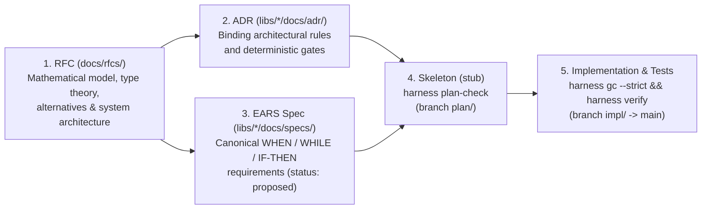
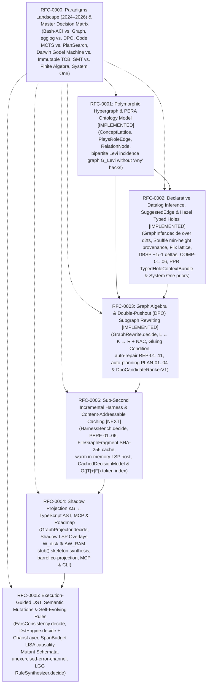

# Request for Comments (RFCs) — Architectural Proposals & Methodology

This directory (`docs/rfcs/`) stores formal **Request for Comments (RFC)** documents for cross-cutting architectural evolutions, new computational models, and subsystem designs in the **Effect-TS Engineering Harness**.

While [ADRs (`docs/adr/`)](../adr/README.md) record individual finalized architectural decisions and [EARS Specifications (`docs/specs/`)](../specs/README.md) define testable behavioral contracts over existing or actively implemented code symbols, **RFCs represent the pre-implementation Upstream Design Tier**. They provide a rigorous space to explore the problem domain, formalize mathematical and type-theoretic models, evaluate competing paradigms, and establish a concrete decomposition plan before writing the first line of production code.

---

## 1. Why We Maintain a Dedicated `docs/rfcs/` Tier (RFC $\rightarrow$ ADR $\rightarrow$ EARS Spec $\rightarrow$ Code)

In our harness, `docs/{adr,specs}` and `libs/*/docs/{adr,specs}` are continuously enforced by deterministic gates during `pnpm harness gc --strict` (`AdrDocLint.decide`, `EarsSpecLint.decide`, `stale-doc-reference`) and `pnpm harness plan-check` (`unmapped-spec-symbol`). Every symbol referenced in an active EARS specification or ADR must physically exist in the `HarnessGraph`.

For multi-phase architectural evolutions (such as introducing a polymorphic PERA hypergraph, stratified Datalog inference, and Double-Pushout graph rewriting), we need to:

1. **Decouple upstream architectural design from immediate symbol compilation:** Design the complete theory, data structures, algorithms, and interfaces without unimplemented future symbols breaking `harness verify` on `main`.
2. **Eliminate context loss across sessions:** Persist the full technical design directly in the repository as a durable artifact.
3. **Provide a clean decomposition into implementation units:** Every accepted RFC concludes with an explicit breakdown into the **ADRs** and **EARS specifications** that will be created when implementation begins.



### Comparison of Documentation Tiers in the Repository

| Property                         | **RFC (`docs/rfcs/`)**                                                                              | **ADR (`libs/*/docs/adr/`)**                                                  | **EARS Spec (`libs/*/docs/specs/`)**                                                    |
| :------------------------------- | :-------------------------------------------------------------------------------------------------- | :---------------------------------------------------------------------------- | :-------------------------------------------------------------------------------------- |
| **Primary Purpose**              | Comprehensive design of a new subsystem architecture, formal model, and algorithms prior to coding. | Record of a single architectural decision, its context, and rejected options. | Behavioral contract for specific `Effect.fn` use cases, deciders, services, and errors. |
| **Lifecycle Timing**             | Before implementation starts (research and architecture phase).                                     | During planning (`plan-check`) or when locking in a non-trivial trade-off.    | At the start of a concrete implementation task (`specifying-ears-with-effect`).         |
| **Enforcement in `gc --strict`** | Scanned for link integrity; future code symbols do not need to exist in `HarnessGraph` yet.         | Strictly validated via `AdrDocLint.decide` + `stale-doc-reference`.           | Strictly validated via `EarsSpecLint.decide` + `unmapped-spec-symbol`.                  |
| **Typical Scope**                | Multiple modules, milestones, or an entire architectural layer (decomposes into $1..N$ ADRs/Specs). | A single architectural invariant or trade-off.                                | A single feature area or domain use case.                                               |

---

## 2. How to Author and Structure RFCs in `effect-ts-harness`

Our RFC methodology draws on proven engineering standards (**Rust RFCs**, **Oxide Computer RFDs**, **IETF RFCs**, and **ISO/IEC/IEEE 42010**), tailored for **Effect-TS v4**:

### 2.1 Principles of a High-Quality RFC

1. **Empirical Grounding over Hand-Waving:** Every RFC must cite concrete files, line numbers, and empirical limitations in the existing repository.
2. **Formal Rigor Before Implementation:** When introducing a computational mechanism (e.g., Datalog fixpoints, hypergraph incidence, or DPO subgraph rewriting), the RFC must define exact mathematical semantics, soundness conditions (termination, confluence, complexity), and Effect v4 type signatures.
3. **Plan-as-Code in Idiomatic Effect v4:** All proposed data models in an RFC are authored using `Schema.brand`, `Schema.TaggedStruct`, `Schema.TaggedUnion`, `Schema.TaggedErrorClass`, `Context.Service`, and pure decision functions (`*.decide` with `R = never`) so they translate directly into `stub<A, E, R>()` skeletons.
4. **Honest Analysis of Rejected Alternatives and Non-Goals:** Documenting _what we are not building_ (Non-Goals) and _why_ we rejected tempting but flawed alternatives (e.g., running an external TypeDB server daemon or unconstrained self-modification) is just as important as the chosen design.
5. **Modularity (Numbered RFC Series):** When a design spans multiple orthogonal layers (e.g., 1. hypergraph data model, 2. deductive inference, 3. algebraic rewriting, 4. AST projection and MCP tools, 5. execution-guided verification), split it into a numbered RFC series rather than a single monolithic document.

---

### 2.2 Canonical 10-Section RFC Template

Every RFC document in `docs/rfcs/NNNN-<slug>.md` follows this canonical structure:

```markdown
---
rfc: RFC-NNNN
title: Concise descriptive title of the architectural proposal
status: draft | review | accepted | implemented | superseded | rejected
created: YYYY-MM-DD
updated: YYYY-MM-DD
authors:
  - "@Roman Selmeci"
target_packages:
  - "@harness/graph"
  - "@harness/gates"
  - "harness-cli"
  - "harness-mcp"
depends_on: []
target_adrs:
  - "harness:ADR-0009"
target_specs:
  - "harness:SPEC-0007"
---

# RFC-NNNN: Title of the Architectural Proposal

## 1. Executive Summary

Concise overview (2–3 paragraphs): what problem we are solving, what mechanism we propose, and what measurable benefits it brings to developers and autonomous agents.

## 2. Motivation & Empirical Gap Analysis

Concrete limitations of the current implementation backed by links to existing files in the repository. What cannot be expressed today or requires brittle imperative workarounds.

## 3. Goals, Non-Goals & Hard Invariants

- **Goals:** What the proposal explicitly solves.
- **Non-Goals:** What the proposal intentionally leaves out.
- **Hard Invariants:** Non-negotiable constraints (e.g., `R = never` for pure decision cores, zero external Docker/DB daemons, preserving Git-like branching in Omnigraph, `< 10 ms` latency).

## 4. Formal Mathematical & Type-Theoretic Model

Exact definition of the theory (sets, relations, morphisms, stratification, subgraph gluing conditions, termination proofs, and complexity bounds).

## 5. Detailed Technical Design in Effect-TS v4 Idioms

Concrete schemas (`Schema.brand`, `Schema.TaggedUnion`), error types (`Schema.TaggedErrorClass`), service interfaces (`Context.Service`), and pure decision signatures (`Effect.fn`).

## 6. Rule Catalog & End-to-End Walkthroughs

Practical rule catalogs, Mermaid transformation diagrams, and input/output walkthroughs on real repository domains (`libs/es`, `libs/sample`, `libs/harness`).

## 7. Library Selection, Rejected Alternatives & Trade-offs

Why we selected specific libraries and why we rejected alternative approaches (with concrete technical root causes).

## 8. Ecosystem Impact, Performance & Clean-Slate Cutover

Time/memory complexity analysis and clean-slate cutover strategy across Omnigraph `plan/*` and `impl/*` branches.

## 9. Open Questions & Future Work

Areas deferred to subsequent iterations.

## 10. Rollout & Decomposition Plan (ADRs, EARS Specs & Milestones)

Exact list of target ADRs, EARS specifications, and milestone implementation steps.
```

---

## 3. Architectural Series `RFC-0000` to `RFC-0006`: Comparative Landscape, PERA Hypergraph, Datalog, DPO Algebra, Sub-Second Caching & Execution-Guided Verification

Based on our research across 2024–2026 scientific literature, TypeDB 3.0 (PERA model + TypeQL Functions), Algebraic Graph Rewriting (Double-Pushout), Deterministic Simulation Testing (TigerBeetle VOPR, Antithesis, DeepMind AlphaEvolve), and calibrated System One models (`@effect/ai-typesafe`), we have designed a **7-part RFC series (`RFC-0000` through `RFC-0006`)**. It brings polymorphic hypergraphs, incremental Datalog, DPO algebra, sub-second content-addressable caching, execution-guided DST, and calibrated System One priors directly into our in-memory `HarnessGraph` (`effect/Graph`) and local Omnigraph—without external database or SMT daemons and while preserving Git-like branching (`plan/<task>` $\rightarrow$ `impl/<task>` $\rightarrow$ `main`):



### RFC Registry

| ID                                                                                            | Title                                                                                                                                      | Layer / Key Symbols & Libraries                                                                                                                                                                   | Status        | Date       |
| :-------------------------------------------------------------------------------------------- | :----------------------------------------------------------------------------------------------------------------------------------------- | :------------------------------------------------------------------------------------------------------------------------------------------------------------------------------------------------ | :------------ | :--------- |
| **[RFC-0000](./0000-harness-paradigms-landscape-and-decision-matrix.md)**                     | **Coding Harness Paradigms Landscape (2024–2026), Alternative Philosophies & Master Decision Matrix**                                      | 4-tier documentation architecture (`RFC-0000` $\to$ `RFC` $\to$ `ADR` $\to$ `SPEC`), analysis of competing philosophies (_SWE-agent_, _egglog_, _MCTS_, _DGM_, _Clover_, _System One_) & Matrix   | `accepted`    | 2026-11-06 |
| **[RFC-0001](./0001-polymorphic-hypergraph-and-pera-ontology-model.md)**                      | **Polymorphic Hypergraph & PERA Ontology Model over `effect/Graph` and Omnigraph**                                                         | `ConceptLattice.decide`, `PlaysRoleEdge`, `RelationNode`, `effect/Graph` (CSR) + `@modernrelay/omnigraph`                                                                                         | `implemented` | 2026-11-06 |
| **[RFC-0002](./0002-declarative-datalog-inference-and-edge-completion.md)**                   | **Declarative Relation Inference (`GraphInfer.decide`), Stratified Datalog & Automated Edge Completion (`SuggestedEdge`)**                 | `GraphInfer.decide`, `@electric-sql/d2ts` (DBSP $\mathbb{Z}$-set deltas + Soufflé min-height provenance + Flix lattice), `SuggestedEdge`, `TypedHoleContextBundle` (Hazel Typed Holes + PPR)      | `implemented` | 2026-11-06 |
| **[RFC-0003](./0003-algebraic-graph-rewriting-dpo-auto-repair-and-planning.md)**              | **Graph Algebra, Double-Pushout (DPO) Subgraph Rewriting (`GraphRewrite.decide`), Automated Antipattern Repair & Generative Planning**     | `GraphRewrite.decide`, `DpoRule`, `@electric-sql/d2ts` + `@modernrelay/omnigraph` ($L + \text{NAC}$ matching), `effect/Graph` (`GraphPatch`), `REP-01..11`, `PLAN-01..04`, `DpoCandidateRankerV1` | `implemented` | 2026-11-06 |
| **[RFC-0004](./0004-ast-code-projection-mcp-tools-and-implementation-roadmap.md)**            | **Bidirectional Projection $\Delta G \leftrightarrow \text{TypeScript AST}$ (`GraphProjector.decide`), MCP/CLI Interfaces & Rollout Plan** | `GraphProjector.decide`, `ts-morph` + `@ast-grep/napi`, In-Memory Shadow LSP Overlays ($W_{\text{disk}} \oplus \Delta W_{\text{RAM}}$), stratum-batch verification, `ADR-0009`                    | `draft`       | 2026-11-06 |
| **[RFC-0005](./0005-execution-guided-dst-mutation-hardening-and-self-evolving-rules.md)**     | **Execution-Guided Deterministic Simulation Testing (DST), Semantic Mutations, EARS Consistency & Self-Evolving DPO Rule Synthesis**       | `EarsConsistency.decide`, `DstEngine.decide` (`ChaosLayer` + `TestClock`), LISA causality in `SpanBudget.decide`, Mutant Schemata, `unexercised-error-channel`, `RuleSynthesizer.decide`          | `draft`       | 2026-11-06 |
| **[RFC-0006](./0006-sub-second-incremental-harness-caching-and-performance-architecture.md)** | **Sub-Second Incremental Harness, Content-Addressable AST/Decision Caching & Performance SLO Architecture**                                | `HarnessBench.decide`, `PERF-01..06`, lazy CLI fast-path (`< 25 ms`), `FileGraphFragment` SHA-256 cache (`< 50 ms`), warm in-memory LSP (`< 40 ms`), `CachedDecisionModel` (`.harness/cache/`)    | `draft`       | 2026-11-09 |
| **[RFC-0007](./0007-self-dogfooding-audit-and-modular-plugin-harness-architecture.md)**       | **Self-Dogfooding Audit, Anti-Pattern Post-Mortem & Effect-TS v4 Modular Plugin Harness Architecture**                                     | Elimination of `isInternalHarnessFile` exemptions, `Effect.fn` `R = never` anti-pattern post-mortem, Cordis-inspired capability seams (`Context.Service` + `Layer.scoped` + `LayerMap.Service`)   | `draft`       | 2026-11-12 |

### 3.1 "Don't Reinvent the Wheel": Chosen Library Stack vs. Evaluated Alternatives

A core engineering principle across `RFC-0001` through `RFC-0006` is **never writing low-level graph, Datalog, simulation, or AST manipulation algorithms from scratch**, but instead composing pure domain decision cores (`*.decide` with `R = never`) on top of battle-tested libraries—most of which are already installed in [`libs/harness/graph/package.json`](../../libs/harness/graph/package.json):

| Architectural Layer                                                                                   | Chosen Library (Winner)                                                                                               | Status in Repo                                                          | Evaluated Alternatives                                                                                                  | Why the Chosen Library Won                                                                                                                                                                                                                                                             |
| :---------------------------------------------------------------------------------------------------- | :-------------------------------------------------------------------------------------------------------------------- | :---------------------------------------------------------------------- | :---------------------------------------------------------------------------------------------------------------------- | :------------------------------------------------------------------------------------------------------------------------------------------------------------------------------------------------------------------------------------------------------------------------------------- |
| **1. Graph Core, CSR Matrices, SCC, Toposort, BFS/DFS (`RFC-0001`)**                                  | **`effect/Graph`** + **`@modernrelay/omnigraph`**                                                                     | **Already installed** (`effect@4.0.0`, `@modernrelay/omnigraph@0.14.0`) | `graphology` (`graphology-operators`), TypeDB 3.0 server, custom hypergraph class                                       | `effect/Graph` provides 8,700 lines of optimized CSR (`Uint32Array`) algorithms (`stronglyConnectedComponents`, `isAcyclic`, `toposort`, Dijkstra, BFS/DFS) natively in Effect v4; Omnigraph handles CoW branches `plan/*` and `impl/*`.                                               |
| **2. Stratified Datalog, Fixpoint & `SuggestedEdge` (`RFC-0002`)**                                    | **`@electric-sql/d2ts`** _(Differential Dataflow / DBSP in TS)_                                                       | **Installed** (`@electric-sql/d2ts`)                                    | `cozo-lib-wasm` / `cozo-node` (CozoDB), `datascript`, custom semi-naive evaluator                                       | 100% pure, statically typed TypeScript with zero native binaries; native `join`, `antiJoin` (stratified negation), `iterate` (recursive fixpoint with Soufflé min-height provenance via `reduce`), and DBSP $\mathbb{Z}$-set deltas (`+1/-1`) in `< 2 ms` with `R = never`.            |
| **3. Subgraph Pattern Matching ($L + \text{NAC}$) & DPO Rewriting (`RFC-0003`)**                      | **`@electric-sql/d2ts`** (`join` + `antiJoin`) + **`@modernrelay/omnigraph`** (`match / not`) + **`effect/Graph`**    | **Already installed**                                                   | Custom VF2 / Ullmann algorithm from scratch, `graphology` backtracking, Single-Pushout (SPO), pure `egglog`             | Every DPO pattern $L$ with negative condition $\text{NAC}$ is isomorphic to a relational `join` + `antiJoin` query in `d2ts` (or `match { ... not { ... } }` in Omnigraph). Eliminates custom VF2 isomorphism code; DPO gluing over `effect/Graph` is ~80 lines.                       |
| **4. Projection $\Delta G \leftrightarrow \text{TypeScript AST}$ & Shadow LSP (`RFC-0004`)**          | **`ts-morph`** (`28.0.0`) + **`@ast-grep/napi`** (`0.51.0`)                                                           | **Both already installed** in `@harness/graph`                          | Low-level `ts.factory.*` (TypeScript Compiler API), `jscodeshift`, raw string templates / regexes                       | `ts-morph` (`useInMemoryFileSystem: true`) + incremental `oldProgram` caching provides a high-level typed API for `stub<A,E,R>()` skeletons and Shadow RAM Overlays ($W_{\text{disk}} \oplus \Delta W_{\text{RAM}}$); `@ast-grep/napi` (Rust) handles structural AST rewrites.         |
| **5. Execution-Guided DST, Semantic Mutations & EARS Algebra (`RFC-0005`)**                           | **Effect v4 `TestClock` + `Layer` + `Tracer`** + **`@ast-grep/napi`** + **`fast-check`**                              | **All already installed**                                               | External SMT solver (`Z3` / `Alloy`), heavy `StrykerJS` mutator, VM hypervisor, unconstrained self-modification (_DGM_) | Effect v4 includes a cooperative fiber scheduler, `TestClock`, and `Layer` in core (DST with zero VM overhead); closed `Schema.TaggedUnion` types enable finite EARS checking in `< 2 ms` without Z3; Mutant Schemata + `ExercisesSpan` filtering speeds up mutation testing 250–300×. |
| **6. Semantic Sensor / Calibrated Priors Upstream of `.decide` (`RFC-0002`, `0003`, `0005`, `0006`)** | **`@effect/ai-typesafe`** + **`effect/ai/Decision`** (`CachedDecisionModel` over `clef-flash` in `@harness/decision`) | **Already installed** (`@harness/decision`)                             | Generative System-2 LLM calls inside the verification loop, brittle regexes over natural language                       | A single forward pass (`800 ms` timeout + SHA-256 disk memoization in `.harness/cache/decisions-v1.jsonl`) evaluates $1..64$ questions (`probability`, `classify`, `rate`) to supply calibrated semantic priors while keeping `R = never` in `.decide`.                                |

---

### 3.2 Implementation Plan: Clean-Slate Rollout (With Performance Hardening First)

Because `RFC-0001`, `RFC-0002`, and `RFC-0003` are now realized on `main`, we execute **`RFC-0006` (Performance & Incremental Caching Architecture) immediately next**, before building `RFC-0004` and `RFC-0005` on top:

```mermaid
flowchart TD
  M1["Milestones 1 & 2 [COMPLETED]: Clean-Slate PERA Hypergraph, Stratified Datalog & DPO Engine\n(RFC-0001 + RFC-0002 + RFC-0003, harness:ADR-0009, harness:SPEC-0007)\n• Bipartite Levi hypergraph G_Levi = (V_E ⊔ V_R, E_role) over effect/Graph and Omnigraph\n• @electric-sql/d2ts engine (S0..S3), Soufflé min-height reduce(), DBSP +1/-1 DatalogSession\n• Flix lattice SuggestedEdge (COMP-01..06) + Hazel TypedHoleContextBundle (PPR <= 1500 tok)\n• DPO rewriting engine GraphRewrite.decide (PLAN-01..04, REP-01..11, μ(G) ∈ N^6, 4 phases)"]

  M2["Milestone 3 [NEXT — RFC-0006]: Sub-Second Incremental Harness & Performance SLOs\n(RFC-0006, PERF-01..06, HarnessBench.decide)\n• Lazy CLI fast-path (< 25ms hooks) & single-pass WorkspaceVfsSnapshot\n• Content-addressable FileGraphFragment cache (.harness/cache/file-graph-v1.json) + oldProgram reuse (< 50ms)\n• O(|T|+|F|) precompiled token index & warm in-memory harness_lsp_diagnostics (< 40ms)\n• CachedDecisionModel SHA-256 memoization (.harness/cache/decisions-v1.jsonl) & HarnessBench.decide"]

  M3["Milestone 4 [RFC-0004]: Shadow AST Code Projection, Gate Consolidation & MCP/CLI\n(RFC-0004, harness:SPEC-0008)\n• Bidirectional AST projection GraphProjector.decide (ts-morph + @ast-grep/napi + barrel index.ts)\n• Stratum-batch Shadow LSP Overlays: α_Δ(W_disk ⊕ ΔW_RAM) ≅ H (< 35ms) with O(log k) bisection\n• Deletion of manual procedural loops in gc-check.ts, ontology-invariants.ts & branch-diff.ts\n• CLI commands plan-synth / repair & MCP tools harness_graph_infer / complete / rewrite"]

  M4["Milestone 5 [RFC-0005]: Execution-Guided DST, Mutant Schemata & Self-Evolving DPO Rules\n(RFC-0005, harness:ADR-0010, harness:SPEC-0009)\n• EarsConsistency.decide + EarsClauseSemanticsV1 in plan-check\n• DstEngine.decide + ChaosLayer (decoupled clockDriver fiber + DstSeed) & SpanBudget LISA causality\n• Enriched SpanRecorder (exitTag, errorTag) + Mutant Schemata (__HARNESS_ACTIVE_MUTANT_ID, < 200ms)\n• LGG RuleSynthesizer.decide (diff G_bad -> G_good with Immutable TCB) & PlanSearch.decide"]

  M1 --> M2
  M2 --> M3
  M3 --> M4
```



1. **Milestones 1 & 2 (`COMPLETED` — `RFC-0001` + `RFC-0002` + `RFC-0003`, `harness:ADR-0009`, `harness:SPEC-0007`)**:
   - Pure bipartite hypergraph $G_{\text{Levi}} = (V_E \sqcup V_R, E_{\text{role}})$, 4-stratum `@electric-sql/d2ts` Datalog engine (`GraphInfer.decide`), `DatalogSession`, `TypedHoleContextBundle`, and DPO rewriting engine (`GraphRewrite.decide` with `PLAN-01..04`, `REP-01..11`, and System One priors `HoleRelevanceAndEdgePriorV1` / `DpoCandidateRankerV1`).
2. **Milestone 3 (`NEXT` — Sub-Second Incremental Harness & Performance SLOs — `RFC-0006`)**:
   - Eliminates existing CLI/MCP/extractor/Ollama bottlenecks via lazy CLI hook dispatch (`PERF-01`, $< 25\text{ ms}$), content-addressable `FileGraphFragment` caching + `oldProgram` reuse (`PERF-02`, $< 50\text{ ms}$), $O(|T| + |F|)$ test-reach token indexing (`PERF-03`), warm in-memory `harness_lsp_diagnostics` (`PERF-04`, $< 40\text{ ms}$), SHA-256 `CachedDecisionModel` (`PERF-05`), and `HarnessBench.decide`.
3. **Milestone 4 (Shadow AST Code Projection, Gate Consolidation & MCP/CLI — `RFC-0004`, `harness:SPEC-0008`)**:
   - Bidirectional AST projection `GraphProjector.decide` with stratum-batch In-Memory Shadow LSP Overlays ($\alpha_{\Delta}(W_{\text{disk}} \oplus \Delta W_{\text{RAM}}) \cong H$) and replacement of manual procedural graph loops in `gc-check.ts`, `ontology-invariants.ts`, and `branch-diff.ts`.
4. **Milestone 5 (Execution-Guided DST, Mutant Schemata & Self-Evolving DPO Learning — `RFC-0005`, `harness:ADR-0010`, `harness:SPEC-0009`)**:
   - Finite EARS consistency checking (`EarsConsistency.decide` + `EarsClauseSemanticsV1`), deterministic simulation testing (`DstEngine.decide` + `ChaosLayer`), LISA temporal causality in `SpanBudget.decide`, error-channel saturation (`unexercised-error-channel`), single-compilation **Mutant Schemata** (`< 200 ms`) scoped via `ExercisesSpan` and git diff, and LGG anti-unification DPO rule synthesis (`RuleSynthesizer.decide` + `PlanSearch.decide`).

---

## 4. Related Documents in the Repository

- [Effect-TS Engineering Harness Architecture & Workflow (MVP v2)](../architecture-and-workflow.md)
- [Runtime Traces & Graph Enrichment](../runtime-traces-and-graph-enrichment.md)
- [Architecture Decision Records (ADRs) — Methodology & Registry](../adr/README.md)
- [EARS Feature Specifications & Verified Plan Graphs — Methodology & Registry](../specs/README.md)
