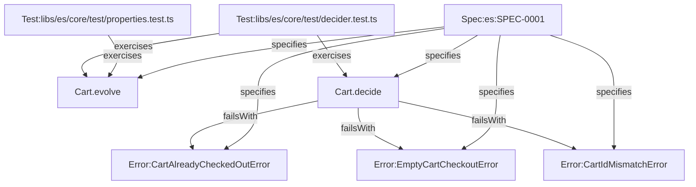

# Event Sourcing Decider Core, BDD Testing Harness, and Property Invariants

## Context

The repository is bootstrapping `effect-es`, an event sourcing and CQRS framework built on Effect v4 and Cloudflare primitives. Modern event-driven systems demand total separation between pure business invariants and stateful effectful coordination. Phase 1 establishes the mathematical foundation of this architecture: the Decider pattern, which unifies pure aggregate evolution, typed command evaluation, and deterministic state reconstruction.

In this framework archetype, business domain entities (such as `Cart`) belong strictly to `test/fixtures/` directories (the `scope:fixture` tag is not configured in `nx.json`), while production packages under `libs/es/` supply generic protocols and test engines:
- **Reused Contracts / Primitives:** Effect v4 Schemas (`Schema.Natural`, `Schema.Int`, `Schema.TaggedError`), `Equal.equals`, `Exit`, `Cause`.
- **Reused Services:** None. Deciders and reducers are completely pure and require zero environmental capabilities (`R = never`).
- **New Capabilities Needed:** Generic `Decider` interface and factory (`Decider.make`), branded numeric schemas (`StreamVersion`, `PositiveInt`), and a BDD-style decider test runner (`makeDeciderTestHarness`) providing `.given().when().thenEvents() / .thenNothing() / .thenFails()`.

## Goal

Provide a pure, type-safe Decider core and canonical BDD testing harness that verifies aggregate logic using given-events/when-command/then-events semantics with zero infrastructure dependencies and verified mathematical properties (chunked fold equivalence, deterministic replay, and terminal state immutability).

## How to read the requirements

Requirements follow EARS syntax. Each requirement is a single sentence with bold keywords (**When**, **While**, **If ... then**, **Where**) and the modal **shall** or **shall not**.

### Verification Column Mapping Rules

The `Verification` column in the EARS table maps each requirement to its deterministic enforcement mechanism:
- **`UnitTest` / `PropertyTest`:** Dynamic runtime assertions in `@effect/vitest` for business logic, return channel `A`, and typed failure channel `E`.
- **`GraphCheck`:** Static type-channel invariants (`R = never` for pure deciders, `E = never` for infallible reducers) enforced by `checkEffectGraph` and `OntologyInvariants.decide`.

## Requirements

### 1 · Decider Protocol and Reducer Purity

**Source (docs/mvp_event_sourcing.md Phase 1):** Decider pattern establishes aggregate state transitions as pure functions without side effects.

| ID | Pattern | Requirement | Effect Symbol | Verification |
| --- | --- | --- | --- | --- |
| REQ-1.1 | Event-driven | **When** Decider.make constructs an aggregate decider, Decider.make **shall** bind initialState, synchronous evolve reducer, and traced decide function into a unified Decider protocol. | Cart.decide | UnitTest |
| REQ-1.2 | State-driven | **While** evaluating domain commands, the Cart.decide decider **shall** require no environmental services (R = never) and emit events or fail with typed Schema.TaggedError. | Cart.decide | GraphCheck |
| REQ-1.3 | Event-driven | **When** reconstructing aggregate state, the synchronous Cart.evolve reducer **shall** remain pure and infallible (E = never, R = never) without invoking unscoped Effect runtimes. | Cart.evolve | GraphCheck |
| REQ-1.4 | Unwanted behaviour | **If** a checkout command is received for an empty cart or an active cart with zero items, **then** the Cart.decide decider **shall** fail with EmptyCartCheckoutError. | EmptyCartCheckoutError | UnitTest |
| REQ-1.5 | Unwanted behaviour | **If** a command is received for an already checked out cart, **then** the Cart.decide decider **shall** fail with CartAlreadyCheckedOutError. | CartAlreadyCheckedOutError | UnitTest |
| REQ-1.6 | Unwanted behaviour | **If** a command targets a cartId that does not match the existing aggregate state cartId, **then** the Cart.decide decider **shall** fail with CartIdMismatchError. | CartIdMismatchError | UnitTest |

### 2 · BDD Testing Harness and Assertion Fidelity

**Source (agent-patterns/event-sourcing.md Section 6):** Emmett-inspired BDD test specification for event-sourced aggregates.

| ID | Pattern | Requirement | Effect Symbol | Verification |
| --- | --- | --- | --- | --- |
| REQ-2.1 | Event-driven | **When** makeDeciderTestHarness executes thenEvents, the test harness **shall** verify that emitted events match expected events in count and strict structural equality via Equal.equals without JSON stringification fallback. | Cart.decide | UnitTest |
| REQ-2.2 | Event-driven | **When** makeDeciderTestHarness executes thenNothing, the test harness **shall** verify that exactly zero events are emitted for no-op commands. | Cart.decide | UnitTest |
| REQ-2.3 | Unwanted behaviour | **If** makeDeciderTestHarness executes thenFails with an expected error, **then** the test harness **shall** require an explicit expected error instance, reject unexpected defects via Cause.hasDies, and verify that the decider fails with matching structural equality. | Cart.decide | UnitTest |

### 3 · Branded Schemas and Numeric Constraints

**Source (agent-patterns/event-sourcing.md Section 4):** Precise numeric validation for revisions and quantities.

| ID | Pattern | Requirement | Effect Symbol | Verification |
| --- | --- | --- | --- | --- |
| REQ-3.1 | Ubiquitous | StreamVersion **shall** validate non-negative integers branded as StreamVersion at decode time. | StreamVersion | UnitTest |
| REQ-3.2 | Ubiquitous | PositiveInt **shall** validate strictly positive integers greater than zero branded as PositiveInt at decode time. | PositiveInt | UnitTest |

### 4 · Property-Based Algebraic Invariants

**Source (agent-patterns/event-sourcing.md Section 6):** Mathematical properties governing event replay and terminal state stability.

| ID | Pattern | Requirement | Effect Symbol | Verification |
| --- | --- | --- | --- | --- |
| REQ-4.1 | Event-driven | **When** arbitrary CartEvent streams are replayed, Cart.evolve **shall** satisfy chunked fold equivalence such that folding sequential slices yields identical state to folding the whole stream. | Cart.evolve | PropertyTest |
| REQ-4.2 | Event-driven | **When** arbitrary CartEvent streams are replayed, Cart.evolve **shall** produce deterministic state transitions identical across repeated evaluations. | Cart.evolve | PropertyTest |
| REQ-4.3 | Event-driven | **When** subsequent events are applied in a terminal CheckedOutCart state, Cart.evolve **shall** preserve terminal status. | Cart.evolve | PropertyTest |

## Assumptions
* **REQ-1.1:** Decider state, commands, and events are represented as closed discriminated unions with explicit `_tag` discriminants.
* **REQ-3.1:** Stream versions are 0-based non-negative integers (`Natural`).
* **REQ-3.2:** Quantities and batch sizes are strictly positive integers greater than zero (`PositiveInt`).

## Out of scope
* **Durable Object SQLite event persistence:** Addressed in Phase 2 (`Aggregate.durableObject`).
* **Cross-aggregate outbox and queue streaming:** Addressed in Phase 3.
* **HttpApi endpoints and schema upcasting:** Addressed in Phase 4.

## Known residual risks
* Long streams in large aggregates may eventually require snapshotting; snapshots are deferred post-MVP.

## Acceptance criteria
* All requirement rows pass declared verification methods (`UnitTest`, `PropertyTest`, `GraphCheck`).
* Zero policy violations reported by `harness gc --strict`.
* Plan topology verified by `harness plan-check`.

## Verified Plan Topology Graph

