# Cross-Aggregate Outbox Drain, Projector Checkpoints, Gap Parking, and Archive Rebuild

## Context

Phase 1 and Phase 2 of `effect-es` established pure Deciders (`R = never`), transactional aggregate event persistence, `commandId` deduplication, strongly-consistent `LocalProjection` read models, and transactional `es_outbox` row appends when `outboxMode` is `PublishOutbox`. However, queries that span multiple aggregates require an asynchronous cross-aggregate read path fed at least once from the aggregate outbox into a shared SQLite/D1 projector database:

- **Reused Contracts / Primitives:** `AggregateId`, `AggregateName`, `StreamVersion`, `PositiveInt`, `TimestampMs`, `ErrorMessage`, `EventMetadata`, `EventStreamCorruptionError`.
- **Reused Services:** `effect/sql/SqlClient`, `@effect/sql-sqlite-do/SqliteMigrator`.
- **New Capabilities Needed:** Branded contract schemas (`OutboxRowId`, `EventType`, `SerializedPayload`, `ProcessorId`, `BatchLimit`, `AggregateCount`), `PublishedEventEnvelope`, `OutboxDrainOutcome`, `ProjectionSequenceInput`, `ProjectionSequenceDecision`, `ProjectionCatchUpStatus`, typed errors (`OutboxPublishError`, `ProjectionArchiveCorruptionError`, `CrossProjectionNotFoundError`), pure sequencing decider (`ProjectionSequence.decide`) and `CrossAggregateProjection` / `EventBus` protocols in `@harness/es-core`, and at-least-once per-row outbox draining (`Outbox.drain`), projector ingestion (`Projector.ingest`), archive rebuild (`Projector.rebuild`), and catch-up verification (`Projector.checkCatchUp`) in `@harness/es-infra`.

## Goal

Deliver an end-to-end cross-aggregate event sourcing read path where Durable Object outbox rows are drained at least once to an `EventBus`, consumed idempotently by a projector with per-aggregate stream checkpoints, out-of-order gap parking, and an append-only `es_event_archive`, such that once all aggregate streams in `es_event_archive` are contiguous (no parked gaps), rebuilding any cross-aggregate projection from `es_event_archive` produces the exact same read model rows and checkpoints as live incremental ingestion.

## How to read the requirements

Requirements follow EARS syntax. Each requirement is a single sentence with bold keywords (**When**, **While**, **If ... then**, **Where**) and the modal **shall** or **shall not**.

### Verification Column Mapping Rules

The `Verification` column in the EARS table maps each requirement to its deterministic enforcement mechanism:

- **`UnitTest`:** Dynamic runtime assertions in `@effect/vitest` for outbox draining, projector ingestion, gap parking, archive rebuilds, and error channels.
- **`PropertyTest`:** Property-based assertions using `it.prop` / `it.effect.prop` with `Schema` arbitraries over `ProjectionSequence.decide`.
- **`GraphCheck`:** Static type-channel invariants (`R = never`) and trace span validation enforced by `checkEffectGraph` and `OntologyInvariants.decide`.

## Requirements

### 1 · At-Least-Once Outbox Drain

**Source (docs/mvp_event_sourcing.md Phase 3):** When outbox rows exist, an alarm drains them to the queue and deletes sent rows; on failure the alarm retries so delivery is at least once.

| ID      | Pattern            | Requirement                                                                                                                                                                                                                                        | Effect Symbol              | Verification |
| ------- | ------------------ | -------------------------------------------------------------------------------------------------------------------------------------------------------------------------------------------------------------------------------------------------- | -------------------------- | ------------ |
| REQ-1.1 | Event-driven       | **When** Outbox.drain executes against an es_outbox table containing pending rows, Outbox.drain **shall** publish each row in ascending id order through the EventBus and delete each published row from es_outbox before returning OutboxDrained. | Outbox.drain               | UnitTest     |
| REQ-1.2 | Event-driven       | **When** Outbox.drain executes against an empty es_outbox table, Outbox.drain **shall** return OutboxEmpty without invoking EventBus.publish.                                                                                                      | Outbox.drain               | UnitTest     |
| REQ-1.3 | Unwanted behaviour | **If** EventBus.publish fails on an outbox row during Outbox.drain, **then** Outbox.drain **shall** fail with OutboxPublishError while leaving the failed row and all subsequent rows in es_outbox for retry on the next alarm.                    | OutboxPublishError         | UnitTest     |
| REQ-1.4 | Unwanted behaviour | **If** a stored row in es_outbox contains invalid metadata JSON, metadata disagreeing with the row identity, or a corrupt stream_version, **then** Outbox.drain **shall** fail with EventStreamCorruptionError before invoking EventBus.publish.   | EventStreamCorruptionError | UnitTest     |

### 2 · Pure Cross-Aggregate Sequencing Decider

**Source (docs/mvp_event_sourcing.md Phase 3):** Each projection keeps a checkpoint per aggregate; events at or below the checkpoint are skipped, gaps are parked, and contiguous versions are applied in order.

| ID      | Pattern      | Requirement                                                                                                                                                                                                                                                   | Effect Symbol             | Verification |
| ------- | ------------ | ------------------------------------------------------------------------------------------------------------------------------------------------------------------------------------------------------------------------------------------------------------- | ------------------------- | ------------ |
| REQ-2.1 | State-driven | **While** incomingVersion is less than or equal to checkpointVersion, ProjectionSequence.decide **shall** return SkipDuplicateEvent with R = never.                                                                                                           | ProjectionSequence.decide | GraphCheck   |
| REQ-2.2 | State-driven | **While** incomingVersion is greater than checkpointVersion plus one, ProjectionSequence.decide **shall** return ParkOutOfOrderEvent naming checkpointVersion plus one as expectedVersion.                                                                    | ProjectionSequence.decide | PropertyTest |
| REQ-2.3 | State-driven | **While** incomingVersion equals checkpointVersion plus one, ProjectionSequence.decide **shall** return ApplyContiguousEvents containing incomingVersion followed by all contiguous parkedVersions in ascending order and the resulting newCheckpointVersion. | ProjectionSequence.decide | PropertyTest |

### 3 · Projector Ingestion, Checkpoints, and Gap Parking

**Source (docs/mvp_event_sourcing.md Phase 3):** The projector appends published events to `es_event_archive`, applies contiguous events atomically with checkpoint updates, skips duplicates, and parks out-of-order deliveries until missing versions arrive.

| ID      | Pattern            | Requirement                                                                                                                                                                                                                                                                                                  | Effect Symbol                    | Verification |
| ------- | ------------------ | ------------------------------------------------------------------------------------------------------------------------------------------------------------------------------------------------------------------------------------------------------------------------------------------------------------ | -------------------------------- | ------------ |
| REQ-3.1 | Event-driven       | **When** ProjectorInfra.initTables runs on a projector database, ProjectorInfra.initTables **shall** apply numbered SqliteMigrator migrations starting at 1 on the dedicated es_projector_sql_migrations table creating es_event_archive, es_projection_checkpoints, and es_projection_gaps.                 | ProjectorInfra.initTables        | UnitTest     |
| REQ-3.2 | Event-driven       | **When** Projector.ingest receives a PublishedEventEnvelope whose streamVersion equals the next expected version for a subscribed projection, Projector.ingest **shall** atomically archive the event, invoke CrossProjection.apply for the event and any unblocked parked gaps, and advance the checkpoint. | Projector.ingest                 | UnitTest     |
| REQ-3.3 | Event-driven       | **When** Projector.ingest receives a duplicate PublishedEventEnvelope at or below a projection's checkpointVersion, Projector.ingest **shall** skip CrossProjection.apply and preserve the existing read model state and checkpoint.                                                                         | Projector.ingest                 | UnitTest     |
| REQ-3.4 | Event-driven       | **When** Projector.ingest receives an out-of-order PublishedEventEnvelope above checkpointVersion plus one, Projector.ingest **shall** record the event in es_event_archive and es_projection_gaps without advancing the checkpoint until the missing version arrives.                                       | Projector.ingest                 | UnitTest     |
| REQ-3.5 | Event-driven       | **When** CrossProjection.apply is invoked for a domain event and metadata, CrossProjection.apply **shall** update the cross-aggregate read model table in the projector database.                                                                                                                            | CrossProjection.apply            | UnitTest     |
| REQ-3.6 | Unwanted behaviour | **If** a PublishedEventEnvelope or parked row has corrupt JSON, a zero or non-integer streamVersion, a metadata mismatch, or conflicts with an existing archived event payload at the same version, **then** Projector.ingest **shall** roll back and fail with ProjectionArchiveCorruptionError.            | ProjectionArchiveCorruptionError | UnitTest     |

### 4 · Archive Rebuild, Queries, and Catch-Up Verification

**Source (docs/mvp_event_sourcing.md Phase 3):** Rebuilding a cross-aggregate projection from the event archive must produce the exact same rows as the live projection, and tests wait on checkpoint catch-up rather than sleeping.

| ID      | Pattern            | Requirement                                                                                                                                                                                                                                                                                    | Effect Symbol                    | Verification |
| ------- | ------------------ | ---------------------------------------------------------------------------------------------------------------------------------------------------------------------------------------------------------------------------------------------------------------------------------------------- | -------------------------------- | ------------ |
| REQ-4.1 | Event-driven       | **When** Projector.rebuild is invoked for a CrossAggregateProjection, Projector.rebuild **shall** verify contiguous stream versions per aggregate in es_event_archive, invoke CrossProjection.rebuild, clear parked gaps, and write rebuilt checkpoints matching the live read model.          | Projector.rebuild                | UnitTest     |
| REQ-4.2 | Event-driven       | **When** CrossProjection.rebuild executes for a projection, CrossProjection.rebuild **shall** purge the projection read model state and replay all archived events in stream order.                                                                                                            | CrossProjection.rebuild          | UnitTest     |
| REQ-4.3 | Event-driven       | **When** CrossProjection.query is called with a registered processorId, CrossProjection.query **shall** return the current cross-aggregate read model decoded as a contract Schema.                                                                                                            | CrossProjection.query            | UnitTest     |
| REQ-4.4 | Unwanted behaviour | **If** CrossProjection.query is called with an unregistered processorId, **then** CrossProjection.query **shall** fail with CrossProjectionNotFoundError.                                                                                                                                      | CrossProjectionNotFoundError     | UnitTest     |
| REQ-4.5 | Event-driven       | **When** Projector.checkCatchUp inspects a processorId and aggregateName, Projector.checkCatchUp **shall** return CaughtUp when every archived aggregate stream version matches its projection checkpoint or Lagging when any aggregate checkpoint trails the archive head or has parked gaps. | Projector.checkCatchUp           | UnitTest     |
| REQ-4.6 | Unwanted behaviour | **If** es_event_archive contains non-contiguous stream versions or undecodable JSON for an aggregate during Projector.rebuild, **then** Projector.rebuild **shall** roll back the transaction and fail with ProjectionArchiveCorruptionError.                                                  | ProjectionArchiveCorruptionError | UnitTest     |

## Assumptions

- **REQ-1.1:** `Outbox.drain` does not wrap the entire batch in a single SQLite transaction because `EventBus.publish` performs external I/O; instead, it deletes each row from `es_outbox` immediately after `EventBus.publish` succeeds for that row, ensuring that if an alarm crashes or `EventBus.publish` fails mid-batch, any unacknowledged event remains in `es_outbox` for at-least-once redelivery while any already-published event is idempotently deduplicated by `Projector.ingest`.
- **REQ-3.1:** Both aggregate SQLite and cross-aggregate D1/SQLite projector storage execute over `effect/sql/SqlClient` and `@effect/sql-sqlite-do/SqliteMigrator` against real `workerd` SQLite instances via `@alchemy.run/cloudflare-runtime` in compliance with `harness:SPEC-0006` and `harness:ADR-0008`. Projector migrations use a dedicated tracking table (`es_projector_sql_migrations`) numbered from `1` so aggregate and projector migrations can run in any order on either separate or shared SQLite databases without skipping each other.
- **REQ-4.1:** During `Projector.rebuild`, archived events are replayed ordered by `(aggregate_id ASC, stream_version ASC)` after verifying that each aggregate stream in `es_event_archive` is contiguous starting from version `1`.

## Out of scope

- **HttpApi endpoints and schema upcasters:** Deferred to Phase 4 (`docs/mvp_event_sourcing.md`).
- **Multi-aggregate process managers and sagas:** Deferred to Phase 5 (`docs/mvp_event_sourcing.md`).
- **Cold archive tiering to R2:** Post-MVP open question.

## Known residual risks

- If an aggregate stream skips version `1` and only publishes version `2`, the projector will keep version `2` parked in `es_projection_gaps`, `Projector.checkCatchUp` will report `Lagging`, and `Projector.rebuild` will fail closed with `ProjectionArchiveCorruptionError` (`REQ-4.6`) until version `1` is delivered from the outbox to make the archive contiguous.
- Because `Outbox.drain` processes rows strictly in `ORDER BY id ASC` and fails closed on corrupt rows (`REQ-1.4`), a corrupt outbox head blocks subsequent outbox rows in that Durable Object until repaired or removed.

## Acceptance criteria

- All requirement rows pass declared verification methods (`UnitTest`, `PropertyTest`, `GraphCheck`).
- Killing or failing the outbox drain mid-batch and restarting delivers every outbox event at least once, and the cross-aggregate projection changes once per event.
- Out-of-order event delivery is parked in `es_projection_gaps` and automatically applied in contiguous order once the missing version arrives.
- Rebuilding the cross-aggregate projection from a contiguous `es_event_archive` produces the exact same read model rows and checkpoints as incremental live ingestion while preserving checkpoints and gaps belonging to other projection processors.

## Verified Plan Topology Graph

```mermaid
flowchart TD
  SPEC["Spec:es:SPEC-0003"]
  ADR["ADR:es:ADR-0003"]
  FN_DECIDE["fn:ProjectionSequence.decide"]
  FN_APPLY["fn:CrossProjection.apply"]
  FN_QUERY["fn:CrossProjection.query"]
  FN_REBUILD_CORE["fn:CrossProjection.rebuild"]
  FN_DRAIN["fn:Outbox.drain"]
  FN_INIT["fn:ProjectorInfra.initTables"]
  FN_INGEST["fn:Projector.ingest"]
  FN_REBUILD_INFRA["fn:Projector.rebuild"]
  FN_CATCHUP["fn:Projector.checkCatchUp"]
  SVC_SQL["Service:SqlClient"]
  SVC_BUS["Service:EventBus"]
  SVC_PROJ["Service:CrossAggregateProjection"]
  ERR_PUBLISH["Error:OutboxPublishError"]
  ERR_CORRUPT["Error:ProjectionArchiveCorruptionError"]
  ERR_NOTFOUND["Error:CrossProjectionNotFoundError"]
  ERR_STREAM_CORRUPT["Error:EventStreamCorruptionError"]
  ERR_SER["Error:EventSerializationError"]
  ERR_SQL["Error:SqlError"]

  SPEC -->|"specifies"| FN_DECIDE
  SPEC -->|"specifies"| FN_APPLY
  SPEC -->|"specifies"| FN_QUERY
  SPEC -->|"specifies"| FN_REBUILD_CORE
  SPEC -->|"specifies"| FN_DRAIN
  SPEC -->|"specifies"| FN_INIT
  SPEC -->|"specifies"| FN_INGEST
  SPEC -->|"specifies"| FN_REBUILD_INFRA
  SPEC -->|"specifies"| FN_CATCHUP
  ADR -->|"governs"| FN_DECIDE
  ADR -->|"governs"| FN_DRAIN
  ADR -->|"governs"| FN_INGEST
  ADR -->|"governs"| FN_REBUILD_INFRA
  ADR -->|"governs"| FN_CATCHUP

  FN_DRAIN -->|"requires"| SVC_SQL
  FN_DRAIN -->|"requires"| SVC_BUS
  FN_DRAIN -->|"failsWith"| ERR_PUBLISH
  FN_DRAIN -->|"failsWith"| ERR_STREAM_CORRUPT
  FN_DRAIN -->|"failsWith"| ERR_SER
  FN_DRAIN -->|"failsWith"| ERR_SQL

  FN_INIT -->|"requires"| SVC_SQL
  FN_INIT -->|"failsWith"| ERR_SQL

  FN_INGEST -->|"requires"| SVC_SQL
  FN_INGEST -->|"requires"| SVC_PROJ
  FN_INGEST -->|"failsWith"| ERR_CORRUPT
  FN_INGEST -->|"failsWith"| ERR_SQL

  FN_REBUILD_INFRA -->|"requires"| SVC_SQL
  FN_REBUILD_INFRA -->|"requires"| SVC_PROJ
  FN_REBUILD_INFRA -->|"failsWith"| ERR_CORRUPT
  FN_REBUILD_INFRA -->|"failsWith"| ERR_SQL

  FN_CATCHUP -->|"requires"| SVC_SQL
  FN_CATCHUP -->|"failsWith"| ERR_CORRUPT
  FN_CATCHUP -->|"failsWith"| ERR_SQL

  FN_APPLY -->|"requires"| SVC_PROJ
  FN_QUERY -->|"requires"| SVC_PROJ
  FN_QUERY -->|"failsWith"| ERR_NOTFOUND
  FN_REBUILD_CORE -->|"requires"| SVC_PROJ
```

