# Event Schema Evolution Upcasters, Frozen JSON Schema Snapshots, and HttpApi Command/Query Transport

## Context

Phases 1 through 3 of `effect-es` established pure Deciders (`R = never`), transactional aggregate persistence with `commandId` deduplication and local read-your-writes projections, and at-least-once outbox draining into an archive-backed cross-aggregate projector with per-aggregate stream checkpoints and gap parking. Phase 4 (`docs/mvp_event_sourcing.md`) completes the API, schema evolution, and harness verification layer:

- **Reused Contracts / Primitives:** `AggregateId`, `AggregateName`, `StreamVersion`, `PositiveInt`, `CommandId`, `ProjectionName`, `ProcessorId`, `EventType`, `AggregateCount`, `ErrorMessage`, `AggregateCommandResult`, `EventMetadata`.
- **Reused Services:** `effect/sql/SqlClient`, `effect/http-api/HttpApi`, `effect/reactivity/AtomHttpApi`.
- **New Capabilities Needed:** Branded contract schemas (`EventSchemaVersion`, `JsonSchemaText`), `EventVersionSnapshotEntry`, `EventUpcasterLink`, `EventSchemaEvolutionInput`, `EventSchemaEvolutionDecision`, `makeHandledCommandResponseSchema`, typed evolution errors (`FrozenEventSchemaViolationError`, `MissingEventUpcasterError`), pure schema evolution decider (`EventSchemaEvolution.decide`), JSON Schema snapshot builder (`EventSchemaEvolution.snapshot`), evolution gate verifier (`EventSchemaEvolution.verify`), `Schema.decodeTo` upcaster helper (`makeEventUpcaster`), `AggregateApiSpec` BDD test harness (`makeAggregateApiTestHarness`), and `HttpApi` command/query transport adapters (`AggregateHttp.seedStream`, `AggregateHttp.executeCommand`, `AggregateHttp.queryLocal`, `AggregateHttp.queryCross`).

## Goal

Enable stored historical events to evolve across schema versions without mutating persisted SQLite rows by decoding old versions through `Schema.decodeTo` upcasters while failing `verify` whenever a frozen event version JSON Schema drifts or lacks a contiguous upcaster, and expose aggregate commands, strongly consistent local read-model queries, and cross-aggregate D1 projection queries through `HttpApi`, `AggregateApiSpec`, and `AtomHttpApi`.

## How to read the requirements

Requirements follow EARS syntax. Each requirement is a single sentence with bold keywords (**When**, **While**, **If ... then**, **Where**) and the modal **shall** or **shall not**.

### Verification Column Mapping Rules

The `Verification` column in the EARS table maps each requirement to its deterministic enforcement mechanism:

- **`UnitTest`:** Dynamic runtime assertions in `@effect/vitest` for schema upcasting, frozen snapshot verification, `HttpApi` command/query handlers, `AggregateApiSpec`, and `AtomHttpApi` reactive client flows.
- **`PropertyTest`:** Property-based assertions using `it.prop` / `it.effect.prop` with `Schema` arbitraries over `EventSchemaEvolution.decide` and upcasted v2 event streams.
- **`GraphCheck`:** Static type-channel invariants (`R = never`), outbox discipline checks, and trace span validation enforced by `checkEffectGraph` and `OntologyInvariants.decide`.

## Requirements

### 1 · Pure Event Schema Evolution Decider and Frozen JSON Schema Snapshots

**Source (docs/mvp_event_sourcing.md Phase 4 — Event schema evolution):** Stored events are never rewritten; a JSON Schema snapshot of every released event version is committed, changing a released version fails `verify`, and adding a new version with its upcaster passes.

| ID      | Pattern            | Requirement                                                                                                                                                                                                                                                                                                             | Effect Symbol                   | Verification |
| ------- | ------------------ | ----------------------------------------------------------------------------------------------------------------------------------------------------------------------------------------------------------------------------------------------------------------------------------------------------------------------- | ------------------------------- | ------------ |
| REQ-1.1 | Event-driven       | **When** EventSchemaEvolution.snapshot is invoked with an eventType, version, and Effect Schema, EventSchemaEvolution.snapshot **shall** derive a deterministic draft-2020-12 JSON Schema snapshot with excess properties rejected and return an EventVersionSnapshotEntry.                                             | EventSchemaEvolution.snapshot   | UnitTest     |
| REQ-1.2 | State-driven       | **While** currentSnapshots has no duplicate keys, every committed snapshot matches its current JSON Schema, and every multi-version eventType has a contiguous non-duplicate non-orphan EventUpcasterLink chain from 1 to maxVersion, EventSchemaEvolution.decide **shall** return SchemaEvolutionValid with R = never. | EventSchemaEvolution.decide     | GraphCheck   |
| REQ-1.3 | State-driven       | **While** a committed event version is missing from currentSnapshots, has a modified jsonSchema, or currentSnapshots/committedSnapshots contains duplicate version entries, EventSchemaEvolution.decide **shall** return FrozenEventVersionDrifted.                                                                     | EventSchemaEvolution.decide     | PropertyTest |
| REQ-1.4 | State-driven       | **While** currentSnapshots for an eventType do not start at version 1, contain a version gap, lack a matching EventUpcasterLink for any transition, or registeredUpcasters contains duplicate or orphaned links, EventSchemaEvolution.decide **shall** return UnmappedEventVersionJump.                                 | EventSchemaEvolution.decide     | PropertyTest |
| REQ-1.5 | Event-driven       | **When** EventSchemaEvolution.verify evaluates an EventSchemaEvolutionInput that satisfies all frozen snapshot and contiguous upcaster invariants, EventSchemaEvolution.verify **shall** return SchemaEvolutionValid.                                                                                                   | EventSchemaEvolution.verify     | UnitTest     |
| REQ-1.6 | Unwanted behaviour | **If** EventSchemaEvolution.decide returns FrozenEventVersionDrifted during EventSchemaEvolution.verify, **then** EventSchemaEvolution.verify **shall** fail with FrozenEventSchemaViolationError.                                                                                                                      | FrozenEventSchemaViolationError | UnitTest     |
| REQ-1.7 | Unwanted behaviour | **If** EventSchemaEvolution.decide returns UnmappedEventVersionJump during EventSchemaEvolution.verify, **then** EventSchemaEvolution.verify **shall** fail with MissingEventUpcasterError.                                                                                                                             | MissingEventUpcasterError       | UnitTest     |

### 2 · Schema Transformation Upcasters on Aggregate and Projector Read Paths

**Source (docs/mvp_event_sourcing.md Phase 4 — Event schema evolution):** Version 1 to 2 is a Schema transformation from the old shape to the new, so decoding an old row yields the current type and the decider and projections only ever see current events.

| ID      | Pattern      | Requirement                                                                                                                                                                                                                                                                          | Effect Symbol            | Verification |
| ------- | ------------ | ------------------------------------------------------------------------------------------------------------------------------------------------------------------------------------------------------------------------------------------------------------------------------------ | ------------------------ | ------------ |
| REQ-2.1 | Event-driven | **When** an aggregate or projector configured with an upcasted event union codec reads a version 1 event payload stored before a version 2 schema change, the codec **shall** transform the version 1 payload into the version 2 event type without rewriting the stored SQLite row. | AggregateHttp.queryLocal | UnitTest     |
| REQ-2.2 | Event-driven | **When** local projection version bump or Projector.rebuild replays an archive containing both version 1 and version 2 stored events through an upcasted event codec, the projection **shall** receive all events as version 2 and produce a read model equal to live ingestion.     | AggregateHttp.queryCross | UnitTest     |

### 3 · HttpApi Command Execution, Stream Seeding, and AggregateApiSpec

**Source (docs/mvp_event_sourcing.md Phase 4 — Write path step 6 & Testing):** Commands and both kinds of queries go through `HttpApi`, and `AggregateApiSpec` seeds a stream, sends a request, and asserts the status and appended events together.

| ID      | Pattern            | Requirement                                                                                                                                                                                                                                                                                                                                      | Effect Symbol                    | Verification |
| ------- | ------------------ | ------------------------------------------------------------------------------------------------------------------------------------------------------------------------------------------------------------------------------------------------------------------------------------------------------------------------------------------------ | -------------------------------- | ------------ |
| REQ-3.1 | Event-driven       | **When** AggregateHttp.seedStream is invoked with an aggregateId and a sequence of historical events, AggregateHttp.seedStream **shall** persist the events with contiguous stream versions, apply local projections, and record outbox rows when outboxMode is PublishOutbox.                                                                   | AggregateHttp.seedStream         | UnitTest     |
| REQ-3.2 | Event-driven       | **When** AggregateHttp.executeCommand handles a valid command, AggregateHttp.executeCommand **shall** commit the command via Aggregate.handleCommand, drain one batch of up to 100 pending outbox rows to non-empty crossProjections after the transaction when PublishOutbox is active, and return HandledCommandResult.                        | AggregateHttp.executeCommand     | UnitTest     |
| REQ-3.3 | Unwanted behaviour | **If** AggregateHttp.seedStream or AggregateHttp.executeCommand encounters unencodable event payloads, corrupt stored rows, commandId reuse across aggregates, or concurrent version conflicts, **then** it **shall** fail with EventSerializationError, EventStreamCorruptionError, CommandAggregateMismatchError, or ConcurrencyConflictError. | CommandAggregateMismatchError    | UnitTest     |
| REQ-3.4 | Unwanted behaviour | **If** outbox draining or projector ingestion fails while AggregateHttp.executeCommand synchronizes cross-aggregate projections, **then** AggregateHttp.executeCommand **shall** fail with OutboxPublishError or ProjectionArchiveCorruptionError.                                                                                               | ProjectionArchiveCorruptionError | UnitTest     |

### 4 · HttpApi Local & Cross-Aggregate Queries and AtomHttpApi Reactive Client

**Source (docs/mvp_event_sourcing.md Phase 4 — Read path & Acceptance criteria):** Queries about one aggregate are answered by its Durable Object local projection, queries across aggregates are answered by D1 projections, and the client issues a command and reads both through `AtomHttpApi`.

| ID      | Pattern            | Requirement                                                                                                                                                                                                                                     | Effect Symbol                | Verification |
| ------- | ------------------ | ----------------------------------------------------------------------------------------------------------------------------------------------------------------------------------------------------------------------------------------------- | ---------------------------- | ------------ |
| REQ-4.1 | Event-driven       | **When** AggregateHttp.queryLocal is called for an aggregateId and projectionName, AggregateHttp.queryLocal **shall** load the aggregate to ensure local projection version parity and return the strongly consistent local read model.         | AggregateHttp.queryLocal     | UnitTest     |
| REQ-4.2 | Unwanted behaviour | **If** AggregateHttp.queryLocal is called with an unregistered projectionName, **then** AggregateHttp.queryLocal **shall** fail with LocalProjectionNotFoundError.                                                                              | LocalProjectionNotFoundError | UnitTest     |
| REQ-4.3 | Event-driven       | **When** AggregateHttp.queryCross is called with a registered processorId, AggregateHttp.queryCross **shall** delegate to Projector.queryCross to return the cross-aggregate read model for HttpApi endpoints and AtomHttpApi reactive clients. | AggregateHttp.queryCross     | UnitTest     |
| REQ-4.4 | Unwanted behaviour | **If** AggregateHttp.queryCross is called with an unregistered processorId, **then** AggregateHttp.queryCross **shall** fail with CrossProjectionNotFoundError.                                                                                 | CrossProjectionNotFoundError | UnitTest     |

## Assumptions

- **REQ-1.1 & REQ-1.2:** `EventSchemaEvolution.snapshot` uses Effect v4 `Schema.toJsonSchemaDocument(schema, { onExcessProperty: "error" })` and serializes the resulting JSON Schema document with lexicographically sorted object keys so snapshots are deterministic across runtimes. `EventSchemaEvolution.decide` permits `currentSnapshots` to be a superset of `committedSnapshots` when each added version has a contiguous `+1` upcaster chain (and rejects duplicate snapshot keys with `FrozenEventVersionDrifted` and duplicate or orphaned upcaster links with `UnmappedEventVersionJump`), while `libs/es/core/scripts/check-event-schemas.mjs` additionally enforces that every entry in `currentSnapshots` is committed in `event-snapshots.json` before `verify` succeeds.
- **REQ-2.1:** Upcasters are authored using `makeEventUpcaster`, which wraps `fromSchema.pipe(Schema.decodeTo(toSchema, SchemaTransformation.transform({ decode: upcast, encode: downcast })))`. When composed in `Schema.Union([CurrentVersionSchema, UpcastedPriorVersionSchema])` with `CurrentVersionSchema` listed first, decoding old stored JSON rows (`version: 1`) yields the `version: 2` domain type while encoding runtime `version: 2` events always serializes the current `version: 2` shape.
- **REQ-3.2 & REQ-4.3:** `AggregateHttp.executeCommand` accepts an optional list of `CrossAggregateProjection` instances; when `config.outboxMode._tag === "PublishOutbox"` and `crossProjections` is non-empty, it drains one batch (`DEFAULT_OUTBOX_BATCH_LIMIT = 100`) after the command transaction via `Outbox.drain` into `Projector.ingest`. `AggregateHttp.queryCross` (`queryCrossAggregateReadModel`) delegates to `queryCrossProjection`, and `HttpApi` endpoints plus `AtomHttpApi.Tag` reactive client bindings (`CartEsAtomClient`) are wired at the HTTP adapter/fixture boundary.

## Out of scope

- **Multi-aggregate process managers, timeouts, and compensations:** Deferred to Phase 5 (`docs/mvp_event_sourcing.md`).
- **Stream snapshots for long-lived aggregates:** Non-goal for the MVP (`docs/mvp_event_sourcing.md`).

## Known residual risks

- Upcaster chains (`v1 -> v2 -> v3`) execute sequentially at decode time on stored JSON payloads; if a chain grows deep over many schema generations, archive compaction may be needed post-MVP.
- When `AggregateHttp.executeCommand` runs with inline outbox synchronization in local emulation, a projector failure after the aggregate transaction commits leaves the aggregate events committed in `es_events` and any remaining unacknowledged rows in `es_outbox` for subsequent `Outbox.drain` retry.

## Acceptance criteria

- All requirement rows pass declared verification methods (`UnitTest`, `PropertyTest`, `GraphCheck`).
- A v1 event stored in SQLite before a v2 change decodes as v2 through its upcaster during `Aggregate.load`, `AggregateHttp.queryLocal`, and `Projector.rebuild`.
- Modifying a committed v1 event Schema fails `EventSchemaEvolution.verify` with `FrozenEventSchemaViolationError` (and fails `pnpm harness verify`), while adding a v2 event Schema paired with its v1-to-v2 upcaster passes.
- `AggregateApiSpec` (`makeAggregateApiTestHarness`) seeds an aggregate stream, dispatches commands over `HttpApiTest`, and asserts the HTTP response status, stream creation/deduplication status, stream version, and appended events together.
- An `AtomHttpApi` client issues a cart command mutation and reads both the updated single-cart view (local projection) and the open-carts report (cross-aggregate projection).

## Verified Topology Graph

```mermaid
flowchart TD
  2["EventSchemaEvolution.snapshot"]
  3["EventSchemaEvolution.decide"]
  4["EventSchemaEvolution.verify"]
  15["AggregateHttp.seedStream"]
  16["AggregateHttp.executeCommand"]
  17["AggregateHttp.queryLocal"]
  18["AggregateHttp.queryCross"]
  60["Tag:SqlClient"]
  72["Error:ConcurrencyConflictError"]
  73["Error:AggregateNotFoundError"]
  74["Error:LocalProjectionNotFoundError"]
  75["Error:CommandAggregateMismatchError"]
  76["Error:EventStreamCorruptionError"]
  77["Error:EventSerializationError"]
  78["Error:OutboxPublishError"]
  79["Error:ProjectionArchiveCorruptionError"]
  80["Error:CrossProjectionNotFoundError"]
  81["Error:FrozenEventSchemaViolationError"]
  82["Error:MissingEventUpcasterError"]
  155["ADR:es:ADR-0004"]
  159["Spec:es:SPEC-0004"]
  4 -->|"failsWith"| 81
  4 -->|"failsWith"| 82
  15 -->|"requires"| 60
  15 -->|"failsWith"| 72
  15 -->|"failsWith"| 76
  15 -->|"failsWith"| 77
  16 -->|"requires"| 60
  16 -->|"failsWith"| 72
  16 -->|"failsWith"| 75
  16 -->|"failsWith"| 76
  16 -->|"failsWith"| 77
  16 -->|"failsWith"| 78
  16 -->|"failsWith"| 79
  17 -->|"requires"| 60
  17 -->|"failsWith"| 73
  17 -->|"failsWith"| 74
  17 -->|"failsWith"| 76
  18 -->|"failsWith"| 80
  155 -->|"governs"| 2
  155 -->|"governs"| 3
  155 -->|"governs"| 4
  155 -->|"governs"| 15
  155 -->|"governs"| 16
  155 -->|"governs"| 17
  155 -->|"governs"| 18
  159 -->|"specifies"| 2
  159 -->|"specifies"| 3
  159 -->|"specifies"| 4
  159 -->|"specifies"| 15
  159 -->|"specifies"| 16
  159 -->|"specifies"| 17
  159 -->|"specifies"| 18
```

