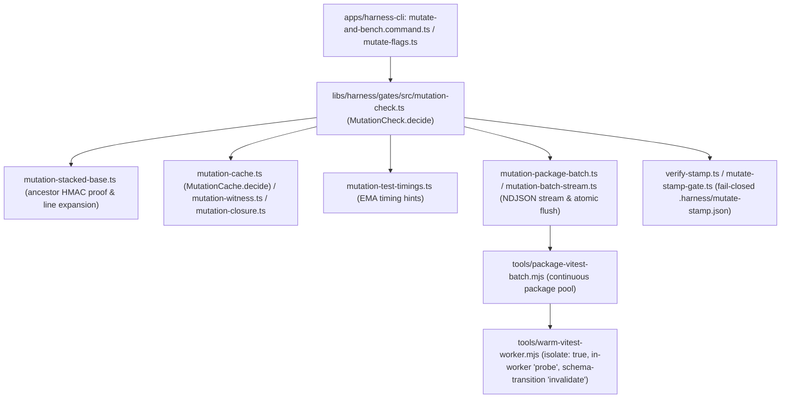

# ADR-0027 · Witness-Scoped Mutation Caching, Continuous Warm Worker Pool, Adaptive Timings, and Verified Stacked-PR Stamping

## Context and Problem Statement

Although `harness:ADR-0026` introduced package-level warm Vitest pools, Stage 0 coverage probing, and reverse-import reachability, stacked-PR verification across hundreds of mutants exposed five structural bottlenecks in the mutation engine:

1. **Over-broad cache closure invalidation and end-of-suite-only flushes:** `computeFileMutationClosureDigest` hashed every test in `allReachingTests` (including all `packageFallbackTests` and heavy meta-tests) into a single target-wide digest and triggered `allLibsSrcDigest` coupling on synthetic test string literals rather than genuine repo-root `libs/` filesystem traversal. Additionally, `flushCacheIfDirty()` flushed verified kills only after all packages finished, discarding completed work on timeouts or early aborts.
2. **No strict fail-fast or Stage-A-only remediation loop:** `--strict` evaluation continued executing full fallback test sweeps across remaining targets even after mutants survived, and lacked `--fail-fast`, `--max-survivors <N>`, and `--stage-a-only` modes with fail-closed stamp blocking.
3. **Static heavy-test allowlist scheduling:** Test prioritization relied on a hardcoded `HEAVY_META_TEST_BASENAMES` allowlist instead of observed per-test durations, allowing unmeasured slow integration suites to delay fast unit kills.
4. **Chunk-boundary pool teardown, cold probe subprocesses, and redundant file invalidation:** `executeQueuedPackageBatches` restarted warm Vite/Vitest worker pools across 4-file chunks, `runCoverageProbe` spawned cold per-file Vitest subprocesses, and `tools/warm-vitest-worker.mjs` issued redundant `vitest.invalidateFile` calls between mutants even when running with `isolate: true`.
5. **No stacked-PR parent branch verification:** `mutate-stamp-gate.ts` hardcoded `fallbackBaseRef: "main"`, forcing stacked PR branches to re-run ancestor PR mutants or lose `.harness/mutate-stamp.json` eligibility.

## Decision Drivers

- **Zero-Compromise Cryptographic Soundness:** Every cached kill must remain bound via HMAC-SHA256 to a verified killing `witnessTestFile` and its minimal transitive import closure, and `.harness/mutate-stamp.json` must never be written for `--stage-a-only`, `--scope`, `--fail-fast` early termination, or unverified `--base` refs.
- **Unbypassable VM/Module Isolation (`isolate: true`):** Supersede `harness:ADR-0026`'s `HARNESS_MUTATE_WARM_ISOLATE=0` opt-in because module-scoped caches (such as `ast-cache.ts`) produce false survivors without per-run isolation, while eliminating redundant `vitest.invalidateFile` calls across a fixed `schemaSource`.
- **High Inner-Loop and Stacked-PR Throughput:** Preserve completed kills incrementally via NDJSON streaming and atomic cache flushes, order tests by measured EMA durations, reuse a single continuous per-package warm worker pool with in-worker Stage 0 probes, and authorize `--strict --base <parentRef>` stamping via ancestor HMAC proof checks.

## Considered Options

- **Option 1: Keep Target-Wide `mutation-cache-v2` Closures, Chunk Restarts, and `main`-Only Stamping.** Retain coarse `allReachingTests` cache keys, static heavy-test lists, 4-file pool resets, and full `main...HEAD` re-evaluation on stacked branches.
- **Option 2: Relax Strict Scope or Disable `isolate: true` Across Warm Mutants.** Allow `HARNESS_MUTATE_WARM_ISOLATE=0` globally or bypass ancestor diff verification when `--base <parentRef>` is supplied.
- **Option 3: Witness-Scoped `mutation-cache-v3`, Continuous Warm Pool, Adaptive EMA Timings, and Verified Stacked-PR Stamping.** Upgrade the cache contract to `mutation-cache-v3`, add strict fail-fast and `--stage-a-only` controls, persist non-authoritative EMA timings in `mutation-test-timings-v1.json`, run continuous per-package warm pools with NDJSON streaming and in-worker probes under unbypassable `isolate: true`, and verify stacked ancestor lines cryptographically against `main...<parentRef>`.

## Decision Outcome

**Chosen option:** "Option 3: Witness-Scoped `mutation-cache-v3`, Continuous Warm Pool, Adaptive EMA Timings, and Verified Stacked-PR Stamping", because it preserves 100% `MutationCheck.decide` and `MutationCache.decide` soundness while eliminating cross-package invalidation storms, chunk-boundary worker churn, blind survivor waits, and redundant stacked-PR re-evaluation.

### Architecture Overview

### Architectural Rules and Guarantees

1. **Witness-Scoped `mutation-cache-v3` HMAC Binding, Tightened `allLibsSrcDigest`, and Incremental Atomic Flush (`SPEC-0034 REQ-1.1`..`REQ-1.5`):** `libs/harness/contract/src/mutation-cache.ts`, `libs/harness/gates/src/mutation/mutation-witness.ts`, `libs/harness/gates/src/mutation/mutation-cache.ts`, `libs/harness/gates/src/mutation/mutation-closure.ts`, and `libs/harness/gates/src/mutation-check.ts` bump `MUTATION_CACHE_SCHEMA_VERSION` to `"mutation-cache-v3"` (`mutation-cache-v3.json`), binding `MutationCacheEntry` and `computeMutationEntryMac` to `witnessTestFile` and `witnessClosureSha256` (the minimal transitive closure of `(relFile, witnessTestFile)` without hashing unrelated `packageFallbackTests`). `computeFileMutationClosureDigest` limits `allLibsSrcDigest` coupling to genuine repository-root `libs/` filesystem traversal rather than synthetic test string literals, and `flushCacheIfDirty()` atomically persists verified kills after each completed package batch and on clean/partial aborts.
2. **Strict `--fail-fast`, `--max-survivors <N>`, and `--stage-a-only` with Fail-Closed Stamp Blocking (`SPEC-0034 REQ-2.1`..`REQ-2.4`):** `apps/harness-cli/src/commands/mutate-flags.ts`, `apps/harness-cli/src/commands/mutate-and-bench.command.ts`, `libs/harness/gates/src/mutation-check.ts`, and `libs/harness/gates/src/mutation/mutation-package-batch.ts` validate `--fail-fast` (defaulting `--max-survivors` to `1`), `--max-survivors <N>`, and `--stage-a-only` (executing only `primaryTests` and Stage 0 per-`it` targeting while skipping `scopedFallbackTests` and `packageFallbackTests`). On early termination or non-zero survivors, the runner prints `file:line:original->replacement` via `formatSurvivorLine`, flushes prior kills, returns `passed: false` with non-zero exit code, removes stale `.harness/mutate-stamp.json` via `removeMutateStamp`, and refuses to write a new stamp under `--stage-a-only`, `--fail-fast` early termination, `--scope`, `--file`, or `--diff`.
3. **Non-Authoritative Adaptive EMA Test Timings (`SPEC-0034 REQ-3.1`..`REQ-3.3`):** `libs/harness/contract/src/mutation-test-timings.ts`, `libs/harness/gates/src/mutation/mutation-test-timings.ts`, and `tools/vitest-pool-helpers.mjs` record non-authoritative wall-clock EMA timings (`MUTATION_TEST_TIMING_EMA_ALPHA = 0.3`, `MUTATION_HEAVY_TEST_THRESHOLD_MS = 2000`) keyed by `(pkgKey, relTestFile, contentSha256)` into `.harness/cache/mutation-test-timings-v1.json`. Both `partitionTargetTestsWithTimings` and `sortTestsByMeasuredOrStaticSpeed` sort tests from lowest to highest measured duration and auto-classify heavy suites (`>= 2000` ms), falling back cleanly to line-count and static `HEAVY_META_TEST_BASENAMES` ordering if the timings file is missing, symlinked, schema-invalid, or stale.
4. **Continuous Per-Package Warm Pool, NDJSON Recovery, In-Worker Probes, and Schema-Transition Invalidation (`SPEC-0034 REQ-4.1`..`REQ-4.4`):** `libs/harness/gates/src/mutation/mutation-package-batch.ts`, `libs/harness/gates/src/mutation/mutation-batch-stream.ts`, `tools/package-vitest-batch.mjs`, `tools/vitest-pool-helpers.mjs`, and `tools/warm-vitest-worker.mjs` reuse a single continuous warm Vitest worker pool across all uncached files in a `(scope, pkgDir)` package batch, stream per-file results via NDJSON (`readStreamedPackageBatchReports`) for crash recovery, execute Stage 0 hit probes in-worker (`"probe"`) or via keyed probe caches, and issue `vitest.invalidateFile` (`"invalidate"`) strictly on `schemaSource` transitions between files rather than between `HARNESS_ACTIVE_MUTANT_ID` runs. Workers recycle deterministically at `MAX_WORKER_RSS_BYTES` (`2048 MiB`), recheck ambiguous `TimedOut` or `Exited(1)` outcomes solo (`concurrency=1`), and fail closed (`Abort`) on `Signaled`.
5. **Verified Stacked-PR `--strict --base <parentRef>` Stamping and Unbypassable `isolate: true` (`SPEC-0034 REQ-5.1`..`REQ-5.3`):** `libs/harness/gates/src/mutation/mutation-stacked-base.ts`, `libs/harness/gates/src/verify-stamp.ts`, `apps/harness-cli/src/commands/mutate-and-bench.command.ts`, and `apps/harness-cli/src/commands/mutate-stamp-gate.ts` validate `--base <parentRef>` via local git ancestry (`git merge-base --is-ancestor`), failing closed to `main` on missing or non-ancestor refs. When eligible under `--strict --base <parentRef>`, every modified mutable line in `main...<parentRef>` is verified against non-expired witness-verified HMAC entries in `mutation-cache-v3.json`; any unverified ancestor lines expand evaluation coverage before `.harness/mutate-stamp.json` (with optional `stackedBaseRef`) is written. Meanwhile, `tools/warm-vitest-worker.mjs` and `tools/package-vitest-batch.mjs` strip `HARNESS_MUTATE_WARM_ISOLATE` / `HARNESS_WARM_ISOLATE` and enforce `isolate: true` unconditionally, superseding `harness:ADR-0026`'s `HARNESS_MUTATE_WARM_ISOLATE=0` opt-in.

## Rejected Alternatives

### 1 · Option 1: Keep Target-Wide `mutation-cache-v2` Closures, Chunk Restarts, and `main`-Only Stamping

Retain `allReachingTests` target-wide cache keys, end-of-suite-only flushes, 4-file pool restarts, and `main`-only strict stamping.

**Why rejected:** Unrelated `type:infra` or fallback test edits invalidated over 95% of cached kills, late aborts discarded verified work, and stacked PR development paid repeated cold re-evaluations across ancestor diffs.

### 2 · Option 2: Disable `isolate: true` Globally or Bypass Ancestor Verification Under `--base`

Allow `HARNESS_MUTATE_WARM_ISOLATE=0` to skip Vitest module isolation or trust `--base <parentRef>` diffs without verifying ancestor HMAC proofs.

**Why rejected:** Shared module-level caches (`ast-cache.ts`) cause false survivors when `isolate: true` is disabled, and unverified `--base` stamping would allow unmutated ancestor code to reach `main` under a strict stamp.

## Consequences and Enforcement

### Positive Consequences

- Unrelated `type:infra`, `type:app`, or non-witness fallback test edits preserve valid `mutation-cache-v3` hits while per-package atomic flushes protect completed kills against aborts.
- Continuous per-package warm pools with in-worker Stage 0 probes, schema-transition-only `invalidateFile`, and adaptive EMA ordering reduce mutant evaluation latency without compromising isolation or kill parity.
- Stacked PRs can earn `.harness/mutate-stamp.json` via `--strict --base <parentRef>` with cryptographic `main`-diff equivalence.

### Negative Consequences and Trade-offs

- Superseding `HARNESS_MUTATE_WARM_ISOLATE=0` removes an unsafe speed opt-in, trading per-mutant module isolation cost for guaranteed elimination of shared-cache false survivors, mitigated by removing redundant `vitest.invalidateFile` calls and keeping workers continuous across targets.
- Continuous per-package pools extend worker process lifetimes, requiring `MAX_WORKER_RSS_BYTES` recycling and NDJSON stream recovery on worker crashes.

### Deterministic Enforcement

| Rule                                                                          | Enforced By                                                                                                                                                                                                                                                                                                                                                                                                                                                                                                         | Gate / Mechanism                                                                                                           | Governed Symbols       |
| :---------------------------------------------------------------------------- | :------------------------------------------------------------------------------------------------------------------------------------------------------------------------------------------------------------------------------------------------------------------------------------------------------------------------------------------------------------------------------------------------------------------------------------------------------------------------------------------------------------------ | :------------------------------------------------------------------------------------------------------------------------- | :--------------------- |
| Witness-scoped `mutation-cache-v3`, AST `allLibsSrcDigest` precision & flush  | `libs/harness/contract/src/workspace-and-process.ts`, `libs/harness/contract/src/ast-and-gate-primitives.ts`, `libs/harness/contract/src/mutation-cache.ts`, `libs/harness/gates/src/mutation/mutation-witness.ts`, `libs/harness/gates/src/mutation/mutation-cache.ts`, `libs/harness/gates/src/mutation/mutation-closure.ts`, `libs/harness/gates/src/mutation/mutation-context-digest.ts`, `libs/harness/gates/src/mutation/mutation-suite-helpers.ts`, `libs/harness/gates/test/mutation-witness-cache.test.ts` | HMAC witness binding (`witnessTestFile`, `witnessClosureSha256`), AST `allLibsSrcDigest` closure scan & atomic chunk flush | `MutationCache.decide` |
| Strict `--fail-fast`, `--max-survivors`, `--stage-a-only` & stamp blocking    | `apps/harness-cli/src/commands/mutate-flags.ts`, `apps/harness-cli/src/commands/mutate-and-bench.command.ts`, `apps/harness-cli/src/commands/declarative-cli.ts`, `libs/harness/gates/src/mutation-check.ts`, `libs/harness/gates/src/mutation/mutation-outcomes.ts`, `libs/harness/gates/test/mutation-fail-fast-and-stage-a.test.ts`, `apps/harness-cli/test/mutate-spec0034-cli.test.ts`                                                                                                                         | Early termination, `removeMutateStamp` cleanup, and fail-closed stamp write guards                                         | `MutationCheck.decide` |
| Non-authoritative EMA test timing cache & fast-before-heavy scheduling        | `libs/harness/contract/src/mutation-test-timings.ts`, `libs/harness/gates/src/mutation/mutation-test-timings.ts`, `libs/harness/gates/src/mutation/mutation-test-reachability.ts`, `libs/harness/gates/src/mutation/mutation-target-discovery.ts`, `tools/vitest-pool-helpers.mjs`, `libs/harness/gates/test/mutation-test-timings.test.ts`                                                                                                                                                                         | Non-authoritative EMA (`MUTATION_TEST_TIMING_EMA_ALPHA`, `MUTATION_HEAVY_TEST_THRESHOLD_MS`) timing persistence & sorting  | `MutationCheck.decide` |
| Continuous package warm pool, NDJSON streaming, probes & unbypassable isolate | `libs/harness/gates/src/mutation/mutation-package-batch.ts`, `libs/harness/gates/src/mutation/mutation-batch-stream.ts`, `libs/harness/gates/src/mutation-subprocess-helpers.ts`, `tools/package-vitest-batch.mjs`, `tools/vitest-pool-helpers.mjs`, `tools/warm-vitest-worker.mjs`, `tools/mutant-coverage-setup.mjs`, `tools/parallel-vitest-batch.mjs`, `libs/harness/gates/test/mutation-continuous-pool.test.ts`                                                                                               | Continuous worker lifecycle, in-worker probe and invalidate IPC, `MAX_WORKER_RSS_BYTES` recycling, and `isolate: true`     | `MutationCheck.decide` |
| Verified stacked-PR `--strict --base <parentRef>` ancestor proof & stamping   | `libs/harness/gates/src/mutation/mutation-stacked-base.ts`, `libs/harness/gates/src/verify-stamp.ts`, `apps/harness-cli/src/commands/mutate-stamp-gate.ts`, `libs/harness/gates/test/mutation-stacked-base.test.ts`, `apps/harness-cli/test/mutate-spec0034-cli.test.ts`                                                                                                                                                                                                                                            | Local git ancestry validation, `main...<parentRef>` HMAC verification & unverified ancestor line expansion                 | `MutationCheck.decide` |
