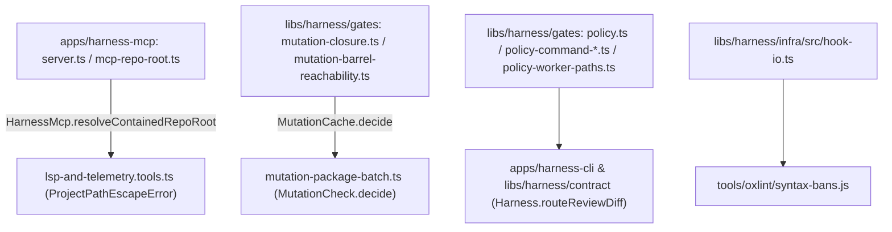

# ADR-0028 · Multi-Worktree MCP Root Containment, Symbol-Aware Barrel Witness Closure, and Guard Ergonomics

## Context and Problem Statement

Multi-worktree swarm orchestration and witness-scoped mutation runs (`harness:ADR-0027`, `harness:SPEC-0034`) revealed six recurring operational and architectural failure modes across `harness-mcp`, `MutationCache.decide`, the shell/file guard, Vitest isolation, and `harness-cli`:

1. **MCP daemon and worktree root drift:** `apps/harness-mcp/src/server.ts` passes raw `process.cwd()` into `startHarnessDaemonServer`, risking `.harness/` state creation inside plugin subdirectories; `pickAnchorRoot` in `apps/harness-mcp/src/tools/mcp-repo-root.ts` lacks a fallback to `SERVER_REPO_ROOT` / canonical git root when `boundaryRoot` or `cwd` lacks `.git`; and `harness_telemetry_report` / `harness_lsp_diagnostics` do not reject or warn on non-workspace roots.
2. **Coarse barrel closure hashing and silent multi-file batches:** `computeFileMutationClosureDigest` in `libs/harness/gates/src/mutation/mutation-closure.ts` visits every sibling export in `src/index.ts` even when a witness test only imports named runtime symbols, causing unrelated edits to invalidate witness cache entries, while `runPackageMutantBatchChecked` lacks throttled per-file progress output on stderr.
3. **Shell guard false positives:** Read-only invocations using `NX_TUI`, `nx run-many`, safe `xargs` checks (`wc`, `oxfmt --check`, `oxlint`), non-executing data-only heredocs to temp/variable paths, and workspace test directory globs (such as `libs/harness/gates/test/*mutat*`) are unnecessarily blocked or misclassified as guard self-invocations inside heredoc prose.
4. **Missing MCP parameter and swarm brief standards:** Agents repeatedly guess MCP tool parameter names (`symbolOrSpan`, `filePath` vs `paths`, `changedFiles`, `repoRoot`) and omit `REPO_ROOT` or absolute paths from swarm briefs.
5. **Vitest worker env leakage and timeout contention:** `apps/harness-cli/vitest.config.ts` and `libs/harness/infra/vitest.config.ts` inherit `HARNESS_WORKTREE_ID` into temp-repo tests, and the workspace `gc` test in `apps/harness-cli/test/cli-learn-and-gc.test.ts` hits the 10s default timeout under `nx run-many`.
6. **CLI, lint parity, and session cache friction:** `review-route` is absent from `CanonicalCliCommandName`, `report` lacks `--json`, `plan-check` prints verbose Mermaid by default instead of compact JSON summary, `omnigraph-lint-gate.ts` repeats `[state_lock_held]` info lines, `tools/oxlint/syntax-bans.js` lacks `unisolated-dot-harness-test-write`, and `computePreInvocationFingerprintFromIo` invalidates warm session caches on snapshot `mtimeMs` updates from `PostToolUse ingest`.

## Decision Drivers

- **Fail-Closed Containment and Witness Soundness:** MCP root anchoring must never permit directory traversal outside the repository or linked worktree cluster (`ProjectPathEscapeError`), and symbol-aware barrel pruning must fail closed to full-barrel hashing whenever namespace, default, side-effect, dynamic, unmapped, or wildcard imports occur.
- **Guard Security Without Inner-Loop Friction:** Guard ergonomics improvements must preserve `deny -> ask -> escalate -> allow` precedence (`harness:ADR-0003`) and secret/HMAC protection while eliminating false positives on safe read-only tooling and non-executing data heredocs.
- **Early Lint Parity and Stable Caching:** Test isolation defects must fail fast in `oxlint`, and session pre-invocation fingerprints must remain stable across routine `PostToolUse ingest` snapshot rewrites.

## Considered Options

- **Option 1: Keep Coarse Barrel Closures and Require Manual Workarounds.** Leave `process.cwd()` daemon startup, full-barrel closures, strict heredoc regexes, and `mtimeMs` snapshot fingerprinting unchanged while asking agents to pass explicit env overrides.
- **Option 2: Relax Guard and Containment Checks Globally.** Allow uncontained `repoRoot` paths, bypass heredoc body inspection altogether, or drop barrel closure hashing from `MutationCache.decide`.
- **Option 3: Workspace-Anchored MCP Containment, Fail-Closed Symbol-Aware Barrel Pruning, Scoped Guard/CLI Ergonomics, and Early Lint Parity.** Anchor `harness-mcp` on validated workspace roots, prune pure named barrel imports with fail-closed fallback and canonical `bindingDigest` hashing, strip only safe non-executing data heredocs and allow safe read-only flags, standardize MCP/swarm docs, isolate `HARNESS_WORKTREE_ID` in Vitest configs, and add CLI/oxlint/session-cache hardening.

## Decision Outcome

**Chosen option:** "Option 3: Workspace-Anchored MCP Containment, Fail-Closed Symbol-Aware Barrel Pruning, Scoped Guard/CLI Ergonomics, and Early Lint Parity", because it resolves multi-worktree containment bugs, witness cache over-invalidation, and developer/agent friction while keeping every cryptographic, guard, and containment boundary fail-closed.

### Architecture Overview

### Architectural Rules and Guarantees

1. **Workspace-Anchored MCP Daemon and Root Validation (`SPEC-0035 REQ-1.1`..`REQ-1.3`):** `apps/harness-mcp/src/server.ts` anchors `startHarnessDaemonServer` on the resolved workspace root (`resolveDefaultRepoRoot` / `findRepoRoot(process.cwd())`) rather than raw `process.cwd()`; `HarnessMcp.resolveContainedRepoRoot` in `apps/harness-mcp/src/tools/mcp-repo-root.ts` falls back to `SERVER_REPO_ROOT` or canonical git root in `pickAnchorRoot` before failing closed with `ProjectPathEscapeError`; and `apps/harness-mcp/src/tools/lsp-and-telemetry.tools.ts` validates workspace root markers (`hasValidWorkspaceRootMarker`) before accessing `.harness/` state.
2. **Fail-Closed Symbol-Aware Barrel Witness Closure & Progress (`SPEC-0035 REQ-2.1`..`REQ-2.3`):** `libs/harness/gates/src/mutation/mutation-closure.ts`, `libs/harness/gates/src/mutation/mutation-barrel-reachability.ts`, and `libs/harness/gates/src/mutation/mutation-barrel-closure.ts` resolve named runtime imports from `src/index.ts` via symbol-aware barrel closure resolution, hashing canonical binding digests for pure re-export barrels and barrel bytes for non-pure barrels while failing closed to full-barrel closures on namespace, default, side-effect, dynamic, unmapped, or wildcard imports. `libs/harness/gates/src/mutation/mutation-batch-stream.ts`, `libs/harness/gates/src/mutation/mutation-package-batch.ts`, and `libs/harness/gates/src/mutation-check.ts` emit throttled per-file progress on stderr for multi-file batches.
3. **Heredoc-Aware Guard Inspection & Read-Only Allowlist (`SPEC-0035 REQ-3.1`..`REQ-3.3`):** `libs/harness/gates/src/policy-command-lists.ts`, `libs/harness/gates/src/policy-command-rules.ts`, `libs/harness/gates/src/policy.ts`, `libs/harness/gates/src/policy-harness-state.ts`, `libs/harness/gates/src/policy-heredoc.ts`, and `libs/harness/gates/src/policy-worker-paths.ts` allow `NX_TUI`, `"nx run-many"`, and safe `xargs` check pipelines (`wc`, `oxfmt --check`, `oxlint`), strip non-executing data heredocs writing to safe temp/variable paths prior to secret/state inspection, restrict `GUARD_SELF_INVOCATION_PATTERN` to parsed command segments and executed snippets, and prevent `matchesSecretFileGlob` false positives on workspace test globs while blocking secrets and HMAC keys.
4. **MCP Cheat-Sheet & Swarm Brief Standardization (`SPEC-0035 REQ-4.1`..`REQ-4.2`):** `adapters/antigravity/plugins/effect-harness/rules/AGENTS.md`, `adapters/claude-code/rules/AGENTS.md`, `adapters/antigravity/plugins/effect-harness/skills/effect-harness/SKILL.md`, `adapters/antigravity/plugins/effect-harness/skills/effect-lfg/SKILL.md`, `adapters/claude-code/skills/effect-harness/SKILL.md`, and `adapters/claude-code/skills/effect-lfg/SKILL.md` codify the MCP Parameter Cheat-Sheet and Swarm Brief Header Standard (`REPO_ROOT`, absolute paths, MCP-first diagnostics).
5. **Vitest Env Isolation & Contention Timeout (`SPEC-0035 REQ-5.1`..`REQ-5.2`):** `apps/harness-cli/vitest.config.ts`, `apps/harness-mcp/vitest.config.ts`, and `libs/harness/infra/vitest.config.ts` set `HARNESS_WORKTREE_ID: ""` in `test.env`, and `apps/harness-cli/test/cli-learn-and-gc.test.ts` sets an explicit `30_000` ms timeout on the workspace `gc` test.
6. **CLI Ergonomics, Lint Parity & Session Cache Stability (`SPEC-0035 REQ-6.1`..`REQ-6.5`):** `libs/harness/contract/src/workspace-and-process.ts`, `apps/harness-cli/src/commands/command-registry.ts`, `apps/harness-cli/src/commands/declarative-cli.ts`, `apps/harness-cli/src/commands/declarative-cli-extra.ts`, `apps/harness-cli/src/commands/review-route.command.ts`, `apps/harness-cli/src/commands/guard-and-route.command.ts`, `apps/harness-cli/src/commands/cli-runtime.ts`, `apps/harness-cli/src/commands/plan-and-repair.command.ts`, `apps/harness-cli/src/commands/learn-and-report.command.ts`, `apps/harness-cli/src/commands/omnigraph-lint-gate.ts`, `libs/harness/decision/src/review-router-decision.ts`, `libs/harness/gates/src/plugins/ast-gate-law-helpers.ts`, `tools/oxlint/syntax-bans.js`, and `libs/harness/infra/src/hook-io.ts` expose `review-route` and `report --json`, default `plan-check` to compact JSON (`--mermaid` for flowchart), deduplicate `state_lock_held` skip lines, mirror `unisolated-dot-harness-test-write` in `oxlint`, and fingerprint graph snapshots by symlink-safe existence rather than volatile `mtimeMs`.

## Rejected Alternatives

### 1 · Option 1: Keep Coarse Barrel Closures and Manual Env Workarounds

Leave `process.cwd()` daemon startup, full-barrel closure hashing, strict heredoc regexes, and `mtimeMs` snapshot fingerprinting untouched.

**Why rejected:** Unrelated sibling exports continue invalidating witness-scoped mutation caches, MCP daemons create stray `.harness/` directories in plugin folders, and inherited `HARNESS_WORKTREE_ID` values break isolated temp-repo test suites.

### 2 · Option 2: Relax Guard and Containment Checks Globally

Disable containment errors, bypass heredoc body inspection globally, or drop barrel closure digests from `MutationCache.decide`.

**Why rejected:** Violates `harness:ADR-0003` and `harness:ADR-0004` containment invariants and compromises cryptographic witness cache soundness (`harness:ADR-0027`).

## Consequences and Enforcement

### Positive Consequences

- Multi-worktree MCP calls and daemon launches stay anchored to valid repository roots without polluting subdirectories.
- Named-symbol barrel imports in witness tests avoid cross-module invalidation storms while retaining fail-closed fallback for dynamic/wildcard/namespace cases.
- Developers and agents hit fewer guard false positives, get live batch progress, keep warm session caches across `PostToolUse ingest`, and catch `unisolated-dot-harness-test-write` early in `oxlint`.

### Negative Consequences and Trade-offs

- Default `harness plan-check` output changes from Mermaid text to compact JSON summary, requiring callers that embed diagrams to pass `--mermaid`.
- Symbol-aware barrel pruning adds AST import/export inspection in `mutation-closure.ts`, mitigated by fail-closed `FullBarrel` fallback on any ambiguous export form.

### Deterministic Enforcement

| Rule                                                                 | Enforced By                                                                                                                                                                                                                                                                                                                                                                                                                                                                                                                                                                                                                                                                                                                                                                                                                                                    | Gate / Mechanism                                                                                                                                                                                                                      | Governed Symbols                                                |
| :------------------------------------------------------------------- | :------------------------------------------------------------------------------------------------------------------------------------------------------------------------------------------------------------------------------------------------------------------------------------------------------------------------------------------------------------------------------------------------------------------------------------------------------------------------------------------------------------------------------------------------------------------------------------------------------------------------------------------------------------------------------------------------------------------------------------------------------------------------------------------------------------------------------------------------------------- | :------------------------------------------------------------------------------------------------------------------------------------------------------------------------------------------------------------------------------------ | :-------------------------------------------------------------- |
| Workspace-anchored MCP daemon & root validation                      | `apps/harness-mcp/src/server.ts`, `apps/harness-mcp/src/tools/mcp-repo-root.ts`, `apps/harness-mcp/src/tools/lsp-and-telemetry.tools.ts`                                                                                                                                                                                                                                                                                                                                                                                                                                                                                                                                                                                                                                                                                                                       | `resolveDefaultRepoRoot`, `findRepoRoot`, `ProjectPathEscapeError` containment & workspace root marker validation                                                                                                                     | `HarnessMcp.resolveContainedRepoRoot`, `ProjectPathEscapeError` |
| Symbol-aware barrel witness closure & stderr batch progress          | `libs/harness/gates/src/mutation-check.ts`, `libs/harness/gates/src/mutation/mutation-cache.ts`, `libs/harness/gates/src/mutation/mutation-closure.ts`, `libs/harness/gates/src/mutation/mutation-barrel-reachability.ts`, `libs/harness/gates/src/mutation/mutation-barrel-closure.ts`, `libs/harness/gates/src/mutation/mutation-batch-stream.ts`, `libs/harness/gates/src/mutation/mutation-package-batch.ts`                                                                                                                                                                                                                                                                                                                                                                                                                                               | `computeFileMutationClosureDigest` barrel closure pruning, canonical binding digest vs barrel bytes & throttled stderr progress in `runPackageMutantBatchChecked`                                                                     | `MutationCache.decide`, `MutationCheck.decide`                  |
| Heredoc-aware guard inspection & read-only allowlist                 | `libs/harness/gates/src/policy.ts`, `libs/harness/gates/src/policy-command-lists.ts`, `libs/harness/gates/src/policy-command-rules.ts`, `libs/harness/gates/src/policy-harness-state.ts`, `libs/harness/gates/src/policy-heredoc.ts`, `libs/harness/gates/src/policy-worker-paths.ts`                                                                                                                                                                                                                                                                                                                                                                                                                                                                                                                                                                          | `isCommandAllowed`, `SAFE_LEADING_ENV_VALUES`, `SAFE_PNPM_EXEC_PREFIXES`, `GUARD_SELF_INVOCATION_PATTERN`, `matchesSecretFileGlob` & safe data heredoc stripping                                                                      | —                                                               |
| MCP Cheat-Sheet & Swarm Brief Header Standard                        | `adapters/antigravity/plugins/effect-harness/rules/AGENTS.md`, `adapters/claude-code/rules/AGENTS.md`, `adapters/antigravity/plugins/effect-harness/skills/effect-harness/SKILL.md`, `adapters/antigravity/plugins/effect-harness/skills/effect-lfg/SKILL.md`, `adapters/claude-code/skills/effect-harness/SKILL.md`, `adapters/claude-code/skills/effect-lfg/SKILL.md`                                                                                                                                                                                                                                                                                                                                                                                                                                                                                        | Governance doc inspection & MCP parameter / swarm brief header parity (`harness_review_route`, `harness_route`)                                                                                                                       | `Harness.routeReviewDiff`                                       |
| Vitest `HARNESS_WORKTREE_ID` isolation & `gc` contention timeout     | `apps/harness-cli/vitest.config.ts`, `apps/harness-mcp/vitest.config.ts`, `libs/harness/infra/vitest.config.ts`, `apps/harness-cli/test/cli-learn-and-gc.test.ts`                                                                                                                                                                                                                                                                                                                                                                                                                                                                                                                                                                                                                                                                                              | Explicit worker worktree env isolation & `testTimeout` / `30_000` ms workspace `gc` test timeout                                                                                                                                      | —                                                               |
| CLI ergonomics, `oxlint` test-write parity & session cache stability | `libs/harness/contract/src/workspace-and-process.ts`, `libs/harness/decision/src/review-router-decision.ts`, `apps/harness-cli/src/commands/command-registry.ts`, `apps/harness-cli/src/commands/declarative-cli.ts`, `apps/harness-cli/src/commands/declarative-cli-extra.ts`, `apps/harness-cli/src/commands/review-route.command.ts`, `apps/harness-cli/src/commands/guard-and-route.command.ts`, `apps/harness-cli/src/commands/cli-runtime.ts`, `apps/harness-cli/src/commands/plan-and-repair.command.ts`, `apps/harness-cli/src/commands/learn-and-report.command.ts`, `apps/harness-cli/src/commands/omnigraph-lint-gate.ts`, `libs/harness/gates/src/plugins/ast-gate-law-helpers.ts`, `tools/oxlint/syntax-bans.js`, `libs/harness/infra/src/hook-io.ts`, `libs/harness/docs/specs/2026-11-25-harness-mcp-worktree-barrel-closure-and-ergonomics.md` | `CanonicalCliCommandName`, `handleReviewRoute`, `handleReport`, `handlePlanCheck`, deduplicated `state_lock_held` skip info, `unisolated-dot-harness-test-write` lint rule & `computePreInvocationFingerprintFromIo` existence digest | `Harness.routeReviewDiff`                                       |
