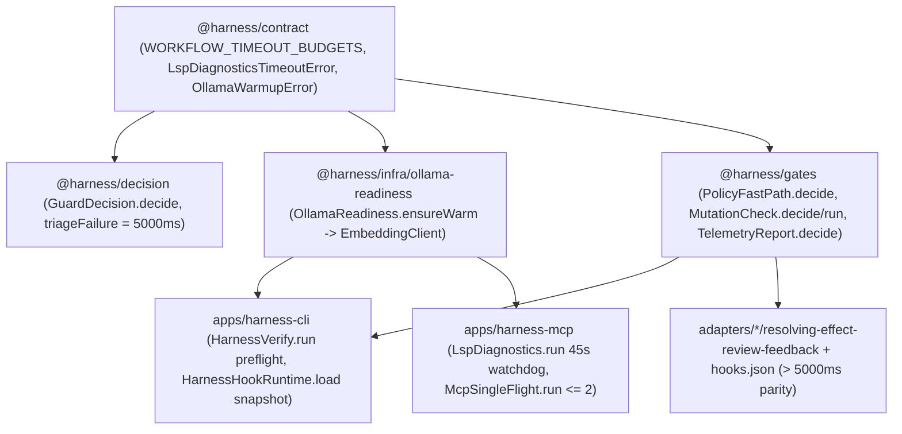

# ADR-0029 · Review-Loop Resilience, LSP Watchdog, Mutation Efficiency, Ollama Warm-Up & 5000ms DecisionModel Budget, Guard Fast-Path, and Telemetry Accuracy

## Context and Problem Statement

Review-window telemetry and transcripts from multi-specialist PR remediation loops (`1 976` review-window events / `3 108` cumulative events) surfaced six compounding operational and reliability failures:

1. **Unbounded LSP hangs and misclassified compiler diagnostics:** `harness_lsp_diagnostics` spawned `effect-tsgo` / `tsgolint` without a process-group watchdog (`12 270 187 ms` hang on a circular `TS2484` re-export) and logged normal non-zero compile errors during active edits as `"fail"` / `"fallback"` tool failures.
2. **Cold Ollama weights, aggressive DecisionModel timeouts, and MCP stampedes:** `2500 ms` guard timeouts (`35/37` timeouts), `1500 ms` review-route degradation, missing Qwen3 embedding warm-up (`POST /v1/embeddings`), and unthrottled concurrent specialist `harness_ontology_check` / `harness_review_route` calls caused avoidable advisory fallbacks.
3. **Full mutation re-runs on test-only edits & module-init misclassifications:** Editing or appending reaching boundary tests invalidated `sourceSha256`-only witness entries, module-init `SchemaError` throws under mutation were treated as `"infraFailure"`, and inner remediation loops lacked scoped `--survivors-only` iteration.
4. **Late verify pre-flight failures & self-hosted hook fragility:** `harness verify` spent `62 s` running `nx affected -t verify` before catching missing stamps or lint/format failures, `PreToolUse` / `Stop` hooks loaded live workspace TypeScript modules across `@harness/contract` refactors (`15` crashes in `60 s`), and safe chained read-only or `pnpm --dir` inspection commands fell through to `DecisionModel`.
5. **Skewed telemetry health reporting:** `TelemetryReport.decide` penalized expected `"diagnostics_found"` LSP checks, buried single multi-hour hang outliers inside means, omitted recurring guard timeout prefixes, and reported contradictory `firstPassVerify` metrics.
6. **Review-loop skill waste and line-ceiling exhaustion:** Remediation skills permitted `mutate --strict` / `verify` before second-pass re-audits, lacked `gc --strict` after Phase 3 contract edits, and trimmed tests at `1499/1500` lines instead of extracting companion modules at `90%` ceiling headroom.

## Decision Drivers

- **Bounded Subprocesses & Fail-Closed Diagnostics:** Every LSP compiler check must run inside a POSIX process group bounded by a configurable watchdog (`45 000 ms` default) and return structured `LspDiagnosticsTimeoutError` (with `TS2484` cycle hints) on expiration without hanging MCP callers.
- **System One Protocol Compliance & Single-Flight Warm-Up:** `clef-flash` must always be probed via `POST /v1/systemone` (`OLLAMA_KEEP_ALIVE=-1`) alongside a single-flight `EmbeddingClient.embedBatch` warm-up under unified `5000 ms` `WORKFLOW_TIMEOUT_BUDGETS`, while `McpSingleFlight.run` bounds concurrent MCP advisory calls (`concurrency <= 2`) without caching degraded results.
- **Deterministic Soundness & Fast Inner Loops:** Two-tier mutation witness caching, module-init kill classification (`MutationCheck.decide`), `--survivors-only` iteration (omitting stamps), pre-flight fail-fast verification order, prebuilt hook runtime snapshots, and expanded `PolicyFastPath.decide` must reduce remediation latency without relaxing strict gates or stamp integrity.
- **Observability Parity & Skill Discipline:** `TelemetryReport.decide` and paired Antigravity/Claude Code skill parity (`gc-adapter-skill-parity.ts`, `gc-doc-truth.plugin.ts`) must accurately distinguish compile findings, hang outliers, guard prefixes, and `firstPassVerify`.

## Considered Options

- **Option 1: Keep Unbounded Subprocesses, `2500 ms` Timeouts, and Live Hook Source Resolution.** Add ad-hoc timeouts in individual callers, ask agents to warm Ollama manually, and re-run full strict mutation suites on every test edit.
- **Option 2: Disable DecisionModel Guarding and Mutation Witness Checks During Review.** Bypass `DecisionModel` guard fallback, accept unverified mutant survivors on test edits, and suppress failing LSP telemetry globally.
- **Option 3: Unified Timeout Budgets, Bounded LSP Watchdog, Single-Flight Warm-Up/MCP Semaphore, Two-Tier Mutation Cache, Fail-Fast Verify & Hook Snapshot, and Parity-Checked Telemetry/Skills.** Codify shared budgets in `@harness/contract`, pure `R = never` deciders in `decision`/`gates`, supervised `LspDiagnostics.run` & `McpSingleFlight.run` in `harness-mcp`, `OllamaReadiness.ensureWarm` in `@harness/infra/ollama-readiness`, prebuilt hook runtime snapshots in `harness-cli`, and deterministic telemetry/doc-truth enforcement.

## Decision Outcome

**Chosen option:** "Option 3: Unified Timeout Budgets, Bounded LSP Watchdog, Single-Flight Warm-Up/MCP Semaphore, Two-Tier Mutation Cache, Fail-Fast Verify & Hook Snapshot, and Parity-Checked Telemetry/Skills", because it eliminates every identified bottleneck while maintaining strict hexagonal tier isolation, System One protocol compliance (`POST /v1/systemone`), and cryptographic witness/verify stamp soundness.

### Architecture Overview

### Architectural Rules and Guarantees

1. **Bounded LSP Diagnostics Watchdog & Telemetry Classification (`SPEC-0037 REQ-1.1`..`REQ-1.3`):** `apps/harness-mcp/src/tools/lsp-watchdog.ts` (`LspDiagnostics.run`) supervises `effect-tsgo` / `tsgolint` in detached POSIX process groups under a `WORKFLOW_TIMEOUT_BUDGETS.lspDiagnosticsWatchdogMs` (`45 000 ms`) watchdog, reaping via `SIGTERM`/`SIGKILL` and raising `LspDiagnosticsTimeoutError` (with `TS2484` cycle hints); `lsp-and-telemetry.tools.ts` classifies clean compiler errors (`errors > 0`) as `"diagnostics_found"` instead of `"fail"`/`"timeout"`.
2. **Ollama Warm-Up, 5000ms DecisionModel Budget & MCP Stampede Control (`SPEC-0037 REQ-2.1`..`REQ-2.5`):** `libs/harness/contract/src/workflow-timeouts.ts` defines unified `decisionModelTimeoutMs: 5_000`, `lspDiagnosticsWatchdogMs: 45_000`, and `ollamaWarmupProbeMs: 10_000`; `libs/harness/decision/src/guard-decision.ts` and `triage-decision.ts` adopt `5000 ms` with pure `GuardDecision.decide` (`R = never`); `libs/harness/infra/src/ollama-readiness-live.ts` exposes `OllamaReadiness.ensureWarm` via subpath `@harness/infra/ollama-readiness` (preserving hook-fastpath bundle lightness) using `OLLAMA_KEEP_ALIVE=-1`, `POST /v1/systemone`, single-flight `@harness/service/EmbeddingClient` warm-up, and `OllamaWarmupError`; `libs/harness/gates/src/plugins/gc/gc-doc-truth.plugin.ts` enforces adapter `PreToolUse` timeouts strictly `> 5000 ms`; `apps/harness-mcp/src/tools/mcp-single-flight.ts` (`McpSingleFlight.run`) bounds concurrent advisory work (`<= 2`) and coalesces non-degraded results by git tree + governance doc digest.
3. **Two-Tier Mutation Cache, Module-Init Kill Classification & Scoped Iteration (`SPEC-0037 REQ-3.1`..`REQ-3.4`):** `libs/harness/contract/src/mutation-cache.ts` and `libs/harness/gates/src/mutation/mutation-two-tier-cache.ts` preserve killed witnesses when source and helper support closures match and net-new tests pass without altering prior assertions or adding `.only`/mocks/hooks; `libs/harness/gates/src/mutation/mutation-init-classifier.ts` (`isMutatedModuleInitFailure`) and `libs/harness/gates/src/mutation/mutation-outcomes.ts` (`MutationCheck.decide`, `R = never`) classify mutant import/schema initialization crashes against a passing baseline as `"killed"`; `apps/harness-cli/src/commands/mutate-flags.ts` and `mutate-and-bench.command.ts` support `--survivors-only` and `--files` without writing strict stamps.
4. **Fail-Fast Verify Preflight, Prebuilt Hook Snapshot & Expanded Guard Fast-Path (`SPEC-0037 REQ-4.1`..`REQ-4.4`):** `apps/harness-cli/src/commands/verify-preflight.ts` and `verify-and-done.command.ts` (`HarnessVerify.run`) verify stubs, format, AST/self-dogfooding ceilings, `evaluateVerifyMutateStampGate`, and ontology invariants before spawning Nx; `apps/harness-cli/src/commands/hook-runtime-loader.ts` and `tools/node-ts-resolver.mjs` (`HarnessHookRuntime.load`) execute prebuilt snapshots under `.harness/hook-runtime/current` (rebuilt in non-isolated `verify`) with `HARNESS_HOOK_RUNTIME_SOURCE=1` source fallback; `libs/harness/gates/src/policy-fastpath-rules.ts` and `policy-fastpath-decide.ts` (`PolicyFastPath.decide`) deterministically allow chained/variable-expanded read-only commands, `pnpm --dir` checks, and explicit-path `pnpm oxfmt`.
5. **Accurate Telemetry Health Scoring (`SPEC-0037 REQ-5.1`..`REQ-5.4`):** `libs/harness/gates/src/telemetry.ts` and `telemetry-recommendations.ts` (`TelemetryReport.decide`) exclude `"diagnostics_found"` from tool-failure penalties, detect extreme hang outliers (`durationMs > 30_000 && durationMs > 5 * p95DurationMs`), surface top recurring guard timeout prefixes, and compute window-consistent `firstPassVerify`.
6. **Review Loop Skill Parity & Ceiling Headroom Discipline (`SPEC-0037 REQ-6.1`..`REQ-6.4`):** `libs/harness/gates/src/plugins/gc/gc-adapter-skill-parity.ts` enforces paired sections in both Antigravity and Claude Code `resolving-effect-review-feedback/SKILL.md` requiring post-Phase-3 `gc --strict`, blocking `mutate --strict` / `verify` until second-pass specialist re-audit completes, splitting files at `>= 90%` LOC ceiling, and sharing one orchestrator `harness_ontology_check` summary across disjoint P0/P1 re-audit prompts.

## Rejected Alternatives

### 1 · Option 1: Keep Unbounded Subprocesses, `2500 ms` Timeouts, and Live Hook Source Resolution

Add isolated per-command retry hacks while leaving compiler subprocesses unbounded, live workspace TypeScript hooks coupled to `@harness/contract` refactors, and `2500 ms` guard timeouts unchanged.

**Why rejected:** Fails to prevent multi-hour compiler hangs, `15`-crash hook outages during workspace refactors, or stampede contention under concurrent specialist agents.

### 2 · Option 2: Disable DecisionModel Guarding and Mutation Witness Checks During Review

Drop fallback guarding on timeouts, accept mutant cache hits blindly when test files change, and ignore LSP tool outcomes globally.

**Why rejected:** Compromises guard fail-closed security invariants (`harness:ADR-0003`) and mutation witness soundness (`harness:ADR-0027`), while hiding genuine `timeout` and `tool_error` incidents from telemetry.

## Consequences and Enforcement

### Positive Consequences

- Zero multi-hour compiler hangs (`LspDiagnostics.run` watchdog + `TS2484` cycle hints) and accurate separation of `"diagnostics_found"` vs `"timeout"` / `"tool_error"`.
- Warm `clef-flash` and Qwen3 embedding weights (`OLLAMA_KEEP_ALIVE=-1`) plus unified `5000 ms` DecisionModel budgets and bounded MCP concurrency (`<= 2`) eliminate cold-start guard storms.
- Two-tier mutation witness preservation, module-init kill classification, `--survivors-only`, fail-fast `HarnessVerify.run` preflight order, prebuilt hook snapshots, and expanded `PolicyFastPath.decide` sharply tighten inner-loop latency.

### Negative Consequences and Trade-offs

- Raising `decisionModelTimeoutMs` to `5000 ms` requires adapter `PreToolUse` command hook timeouts strictly above `5000 ms` (`> 5 s`), enforced statically by `gc-doc-truth.plugin.ts`.
- Prebuilt `.harness/hook-runtime/current` snapshots isolate hooks during edits to `libs/harness/**`; contributors iterating directly on hook policy must re-run `verify` or pass `HARNESS_HOOK_RUNTIME_SOURCE=1`.

### Deterministic Enforcement

| Rule                                                        | Enforced By                                                                                                                                                                                                                                                                                                                                                                                                                                                                                                                                                                                                                                                                                                                                                                                                                                                                                                                                                                                                                                                                                                                                                                                                                                                                                     | Gate / Mechanism                                                                                                                                                           | Governed Symbols                                                                                                                     |
| :---------------------------------------------------------- | :---------------------------------------------------------------------------------------------------------------------------------------------------------------------------------------------------------------------------------------------------------------------------------------------------------------------------------------------------------------------------------------------------------------------------------------------------------------------------------------------------------------------------------------------------------------------------------------------------------------------------------------------------------------------------------------------------------------------------------------------------------------------------------------------------------------------------------------------------------------------------------------------------------------------------------------------------------------------------------------------------------------------------------------------------------------------------------------------------------------------------------------------------------------------------------------------------------------------------------------------------------------------------------------------- | :------------------------------------------------------------------------------------------------------------------------------------------------------------------------- | :----------------------------------------------------------------------------------------------------------------------------------- |
| Bounded LSP watchdog & diagnostics classification           | `apps/harness-mcp/src/tools/lsp-watchdog.ts`, `apps/harness-mcp/src/tools/lsp-and-telemetry.tools.ts`, `apps/harness-mcp/src/tools/mcp-helpers.ts`, `libs/harness/contract/src/review-resilience.ts`                                                                                                                                                                                                                                                                                                                                                                                                                                                                                                                                                                                                                                                                                                                                                                                                                                                                                                                                                                                                                                                                                            | Detached POSIX process-group watchdog timer (`45000 ms` default), `TS2484` cycle hint diagnostics, and non-failure compiler outcome classification                         | `LspDiagnostics.run`, `LspDiagnosticsTimeoutError`                                                                                   |
| Ollama warm-up, `5000 ms` budget & MCP single-flight        | `libs/harness/contract/src/workflow-timeouts.ts`, `libs/harness/contract/src/review-routing.ts`, `libs/harness/contract/src/index.ts`, `libs/harness/decision/src/guard-decision.ts`, `libs/harness/decision/src/index.ts`, `libs/harness/decision/src/review-router-decision.ts`, `libs/harness/decision/src/triage-decision.ts`, `libs/harness/infra/src/embedding-client-live.ts`, `libs/harness/infra/src/index.ts`, `libs/harness/infra/src/local-decision-model-live.ts`, `libs/harness/infra/src/ollama-readiness-helpers.ts`, `libs/harness/infra/src/ollama-readiness-live.ts`, `apps/harness-cli/src/commands/daemon-and-omnigraph.service.ts`, `apps/harness-cli/src/commands/guard-and-route.command.ts`, `apps/harness-cli/src/commands/ollama-readiness.ts`, `apps/harness-mcp/src/managed-runtime.ts`, `apps/harness-mcp/src/server.ts`, `apps/harness-mcp/src/stdio-entrypoint.ts`, `apps/harness-mcp/src/tools/graph-navigation-schemas.ts`, `apps/harness-mcp/src/tools/graph-navigation.tools.ts`, `apps/harness-mcp/src/tools/mcp-single-flight.ts`, `apps/harness-mcp/src/tools/ontology-and-gq.tools.ts`, `apps/harness-mcp/src/tools/review-route-helpers.ts`, `apps/harness-mcp/src/tools/tool-registry.ts`, `libs/harness/gates/src/plugins/gc/gc-doc-truth.plugin.ts` | Single-source `WORKFLOW_TIMEOUT_BUDGETS`, System One readiness probe, single-flight embedding warm-up, MCP advisory concurrency semaphore, and `PreToolUse` timeout parity | `OllamaReadiness.ensureWarm`, `@harness/service/EmbeddingClient`, `OllamaWarmupError`, `GuardDecision.decide`, `McpSingleFlight.run` |
| Two-tier mutation cache, init-kill & scoped iteration       | `libs/harness/contract/src/mutation-cache.ts`, `libs/harness/gates/src/index.ts`, `libs/harness/gates/src/mutation-check.ts`, `libs/harness/gates/src/mutation-subprocess-helpers.ts`, `libs/harness/gates/src/mutation/mutation-batch-stream.ts`, `libs/harness/gates/src/mutation/mutation-cache.ts`, `libs/harness/gates/src/mutation/mutation-closure.ts`, `libs/harness/gates/src/mutation/mutation-init-classifier.ts`, `libs/harness/gates/src/mutation/mutation-outcomes.ts`, `libs/harness/gates/src/mutation/mutation-package-batch.ts`, `libs/harness/gates/src/mutation/mutation-suite-helpers.ts`, `libs/harness/gates/src/mutation/mutation-two-tier-cache.ts`, `apps/harness-cli/src/commands/mutate-and-bench.command.ts`, `apps/harness-cli/src/commands/mutate-flags.ts`                                                                                                                                                                                                                                                                                                                                                                                                                                                                                                      | Two-tier source plus test AST witness reuse, baseline-guarded module-init kill classification, and scoped survivors-only flag without stamp write                          | `MutationCheck.decide`, `MutationCheck.run`                                                                                          |
| Fail-fast verify preflight, hook snapshot & guard fast-path | `apps/harness-cli/src/commands/declarative-cli.ts`, `apps/harness-cli/src/commands/hook-runtime-loader.ts`, `apps/harness-cli/src/commands/hook-runtime-lock.ts`, `apps/harness-cli/src/commands/verify-and-done.command.ts`, `apps/harness-cli/src/commands/verify-preflight.ts`, `tools/node-ts-resolver.mjs`, `libs/harness/gates/src/policy.ts`, `libs/harness/gates/src/policy-command-rules.ts`, `libs/harness/gates/src/policy-fastpath-decide.ts`, `libs/harness/gates/src/policy-fastpath-rules.ts`, `libs/harness/gates/src/policy-fastpath-var-rules.ts`, `libs/harness/gates/src/policy-harness-state.ts`                                                                                                                                                                                                                                                                                                                                                                                                                                                                                                                                                                                                                                                                           | Ordered preflight gates before Nx verify, locked and hash-verified hook runtime snapshot resolution, and deterministic read-only fast-path classification                  | `HarnessVerify.run`, `HarnessHookRuntime.load`, `PolicyFastPath.decide`                                                              |
| Telemetry accuracy & adapter skill parity                   | `libs/harness/gates/src/telemetry.ts`, `libs/harness/gates/src/telemetry-io.ts`, `libs/harness/gates/src/telemetry-recommendations.ts`, `libs/harness/gates/src/plugins/gc/gc-adapter-skill-parity.ts`, `adapters/antigravity/plugins/effect-harness/skills/resolving-effect-review-feedback/SKILL.md`, `adapters/claude-code/skills/resolving-effect-review-feedback/SKILL.md`, `libs/harness/docs/specs/2026-11-27-review-loop-resilience-ollama-warmup-and-telemetry.md`                                                                                                                                                                                                                                                                                                                                                                                                                                                                                                                                                                                                                                                                                                                                                                                                                     | Compiler diagnostics outcome filtering, hang-outlier and top guard prefix recommendations, consistent `firstPassVerify`, and paired adapter skill parity checks            | `TelemetryReport.decide`                                                                                                             |
