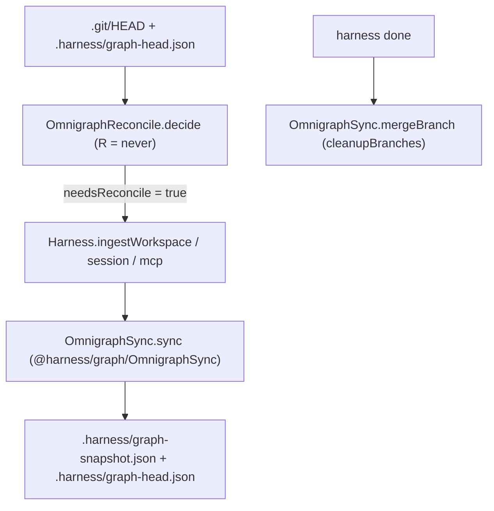

# Git-Aware Omnigraph Branch Lifecycle, Post-Merge HEAD Reconciliation, and Full Workspace Ingestion

## Context and Motivation

Audit of the Omnigraph branch lifecycle and `.harness/graph-snapshot.json` maintenance across `@harness/graph`, `@harness/gates`, `@harness/cli`, and `@harness/mcp` uncovered four architectural gaps when Pull Requests or local Git branches are merged into `main`:

1. **No Post-Merge / `git pull` HEAD Reconciliation (`OmnigraphReconcile.decide`):** When a PR is merged into `main` on GitHub and pulled locally (`git pull`), or when a local feature branch is merged into `main` via `git merge`, no Git hook or CLI/MCP check compared the current Git `HEAD` SHA against the `HEAD` SHA recorded when `.harness/graph-snapshot.json` and Omnigraph `main` were last updated. Consequently, `.harness/graph-snapshot.json` and Omnigraph `main` remained stale until the next manual `harness verify` + `harness done` cycle.
2. **Git-Branch-Unaware Omnigraph Task Branches (`resolveOmnigraphTaskBranches`):** Unless `HARNESS_WORKTREE_ID` or a linked `.git` worktree directory was used, `resolveOmnigraphTaskBranches` mapped every local Git branch in the primary checkout to `plan/current` and `impl/current`, causing branch collisions when switching between local feature branches.
3. **Incomplete `harness ingest` Command (`Harness.ingestWorkspace`) and Stale Task Branches (`OmnigraphSync.mergeBranch`):** `pnpm harness ingest` only counted AST `Effect.fn` spans via `buildWorkspaceFnIndex` without extracting the type-aware `HarnessGraph`, writing `.harness/graph-snapshot.json` + `.harness/graph-head.json`, or syncing to Omnigraph. Additionally, `OmnigraphSync.mergeBranch` left merged `plan/*` and `impl/*` branches lingering in Omnigraph after `harness done`.
4. **Temp-Workspace Test Leakage into Repository Omnigraph Cluster (`handlePlanCheck`, `handleVerify`, `handleDone`):** When CLI unit tests executed against isolated temporary directories (`/tmp/harness-cli-*`) lacking `libs/harness/graph/cluster.yaml`, `clusterRepoRoot` fell back to `CLI_REPO_ROOT` and synced synthetic test nodes (`Sample.fnA`, `Sample.real`) into the live repository's Omnigraph `main` branch.

## Requirements

### 1 · Pure Git HEAD & Snapshot Reconciliation Decider

**Source:** Post-merge staleness analysis of `.harness/graph-snapshot.json` and `.harness/graph-head.json` after `git pull` / `git merge`.

| ID | Pattern | Requirement | Effect Symbol | Verification |
| :--- | :--- | :--- | :--- | :--- |
| REQ-1.1 | State-driven | WHILE evaluating workspace graph freshness (`R = never`), `OmnigraphReconcile.decide` shall compute a deterministic reconciliation decision from `snapshotExists`, `recordedHeadSha`, `currentHeadSha`, `recordedGitBranch`, and `currentGitBranch` without performing I/O. | `OmnigraphReconcile.decide` | GraphCheck, PropertyTest |
| REQ-1.2 | Event-driven | WHEN `snapshotExists` is `false`, `OmnigraphReconcile.decide` shall return `needsReconcile: true` with `reason: "missing-snapshot"` and route `targetOmnigraphBranch` to `"main"` on `main`/`master` or `impl/branch-<slug>` on a feature branch. | `OmnigraphReconcile.decide` | UnitTest, PropertyTest |
| REQ-1.3 | Event-driven | WHEN `snapshotExists` is `true` and `currentHeadSha` is non-null and differs from `recordedHeadSha`, `OmnigraphReconcile.decide` shall return `needsReconcile: true` with `reason: "head-sha-changed"`. | `OmnigraphReconcile.decide` | UnitTest, PropertyTest |
| REQ-1.4 | Event-driven | WHEN `snapshotExists` is `true`, `currentHeadSha` matches `recordedHeadSha`, and `currentGitBranch` differs from a non-null `recordedGitBranch`, `OmnigraphReconcile.decide` shall return `needsReconcile: true` with `reason: "git-branch-changed"`. | `OmnigraphReconcile.decide` | UnitTest, PropertyTest |

### 2 · Git-Branch-Scoped Task Branches and Post-Merge Cleanup

**Source:** Branch collision analysis in [`libs/harness/graph/src/cluster-resolver.ts`](file:///home/roan/WebstormProjects/effect-ts-harness/libs/harness/graph/src/cluster-resolver.ts) and [`libs/harness/graph/src/omnigraph-sync.ts`](file:///home/roan/WebstormProjects/effect-ts-harness/libs/harness/graph/src/omnigraph-sync.ts).

| ID | Pattern | Requirement | Effect Symbol | Verification |
| :--- | :--- | :--- | :--- | :--- |
| REQ-2.1 | Event-driven | WHEN `OmnigraphSync.sync` persists a `HarnessGraph` to `.harness/graph-snapshot.json` and loads NDJSON into Omnigraph, `OmnigraphSync.sync` shall record the active Git `headSha` and `gitBranch` metadata in `.harness/graph-head.json` whenever `repoRoot` has a resolvable Git `HEAD`. | `OmnigraphSync.sync` | UnitTest |
| REQ-2.2 | Event-driven | WHEN `OmnigraphSync.mergeBranch` merges a task branch into `main` with `cleanupBranches` specified, `OmnigraphSync.mergeBranch` shall best-effort delete the merged task branches (`impl/*`, `plan/*`) from Omnigraph so completed task branches do not accumulate. | `OmnigraphSync.mergeBranch` | UnitTest |

### 3 · Full Workspace Graph Ingestion and Automatic CLI/MCP Reconciliation

**Source:** CLI `ingest` and `session` handlers in [`apps/harness-cli/src/index.ts`](file:///home/roan/WebstormProjects/effect-ts-harness/apps/harness-cli/src/index.ts) and MCP snapshot loader in [`apps/harness-mcp/src/server.ts`](file:///home/roan/WebstormProjects/effect-ts-harness/apps/harness-mcp/src/server.ts).

| ID | Pattern | Requirement | Effect Symbol | Verification |
| :--- | :--- | :--- | :--- | :--- |
| REQ-3.1 | Event-driven | WHEN `harness ingest` is invoked, `Harness.ingestWorkspace` shall extract the full type-aware `HarnessGraph`, write `.harness/graph-snapshot.json` and `.harness/graph-head.json`, and synchronize the graph to Omnigraph (`main` when on `main`/`master`, or the active task branch). | `Harness.ingestWorkspace` | UnitTest |
| REQ-3.2 | Event-driven | WHEN `harnessPlanCheck`, `harnessVerify`, or `harnessDone` executes against an external temporary directory lacking `libs/harness/graph/cluster.yaml`, the CLI shall persist local `.harness` snapshots without mutating `CLI_REPO_ROOT`'s live Omnigraph cluster. | `Harness.ingestWorkspace` | UnitTest |

## Architecture Diagram

