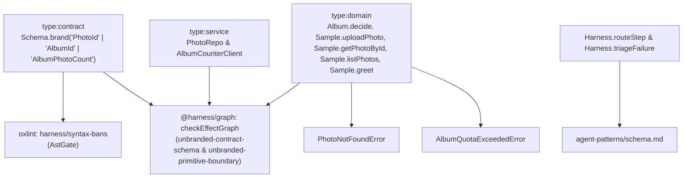

# Branded Domain Types and Primitive Obsession Enforcement Across Contract, Service, and Domain Boundaries

## Context

In TypeScript's structural type system, distinct domain concepts backed by the same runtime primitive (`string` or `number`) are mutually assignable unless nominally branded with `Schema.brand("BrandName")` or `Brand.Branded<A, "BrandName">`. Crucially, decode-time refinements such as `Schema.Int`, `Schema.Natural`, and `Schema.NonEmptyString` still widen to plain `number` or `string` in their TypeScript `Type` channel (`typeof Schema.Int.Type` is `number`), allowing in-memory code to transpose parameters (`userId` vs. `albumId`, `photoId` vs. `count`) or pass unvalidated negative/empty primitives directly into domain use-cases and service ports.

Existing Graph Context:

- **Reused Contracts / Errors:** `Photo`, `CreatePhotoInput`, `GreetInput`, `PhotoNotFoundError`, `AlbumQuotaExceededError` in [`libs/sample/contract/src/index.ts`](file:///home/roan/WebstormProjects/effect-ts-harness/.worktrees/feat/brand-types/libs/sample/contract/src/index.ts).
- **Reused Services:** `PhotoRepo`, `AlbumCounterClient` in [`libs/sample/service/src/index.ts`](file:///home/roan/WebstormProjects/effect-ts-harness/.worktrees/feat/brand-types/libs/sample/service/src/index.ts).
- **New Capabilities Needed:** Two-layer enforcement combining fast AST lint rules in `tools/oxlint/syntax-bans.js` with TypeScript `TypeChecker` `"~effect/Brand"` inspection (`unbranded-contract-schema` and `unbranded-primitive-boundary`) in `libs/harness/graph/src/extractor/schema-and-brand-extractor.ts` (orchestrated by `libs/harness/graph/src/type-extractor.ts`) and `libs/harness/graph/src/policy-check.ts`, deterministic routing/triage in `@harness/decision`, and full branded domain types across `@harness/sample-*`.

## Goal

Eliminate primitive obsession across contract, service, and domain packages by statically enforcing nominal branded types (`Schema.brand` / `Brand.Branded`) at both the AST lint level and the type-aware Effect graph level, with deterministic routing, failure triage, and reference sample compliance.

## How to read the requirements

Requirements follow EARS syntax. Each requirement is a single sentence with bold keywords (`When`, `While`, `If ... then`, `Where`) and the modal `shall` or `shall not`.

## Requirements

### 1 · AST Lint Gate for Primitive Type Definitions, Schemas, and Boundaries

**Source (`tools/oxlint/syntax-bans.js`):** Sub-second feedback during `PostToolUse` and `pnpm lint`.

| ID      | Pattern            | Requirement                                                                                                                                                                                                                                                                                                                                                                                                                                                                                                                    | Effect Symbol           | Verification |
| :------ | :----------------- | :----------------------------------------------------------------------------------------------------------------------------------------------------------------------------------------------------------------------------------------------------------------------------------------------------------------------------------------------------------------------------------------------------------------------------------------------------------------------------------------------------------------------------- | :---------------------- | :----------- |
| REQ-1.1 | Unwanted behaviour | **If** a source file in `type:contract`, `type:domain`, `type:core`, `type:service`, or `type:infra` declares a raw primitive type alias (`type X = string`, `number`, `boolean`, `bigint`, `any`, or `unknown`) or a raw inline object type alias (`type X = { ... }`), **then** the `harness/syntax-bans` rule **shall** reject the declaration and instruct the author to define a `Schema` with `Schema.brand` or `Schema.Struct` in `type:contract`.                                                                      | `Harness.triageFailure` | AstGate      |
| REQ-1.2 | Unwanted behaviour | **If** a `type:contract` file declares an unbranded scalar primitive schema (`Schema.String`, `Schema.NonEmptyString`, `Schema.Int`, `Schema.Number`, `Schema.Finite`, `Schema.Natural`, or `.check(...)` without `Schema.brand`, `Schema.fromBrand`, or `Schema.decodeTo`) or reuses the same `Schema.brand` key across multiple schemas, **then** the `harness/syntax-bans` rule **shall** reject the declaration and instruct the author to pipe into `Schema.brand` once and compose wire decoders with `Schema.decodeTo`. | `Harness.triageFailure` | AstGate      |
| REQ-1.3 | Unwanted behaviour | **If** a `Schema.Struct`, `Schema.Class`, `Schema.TaggedStruct`, `Schema.TaggedClass`, `Schema.TaggedUnion`, or `Schema.TaggedError` in `type:contract`, `type:domain`, or `type:core` defines a non-boolean scalar field (including quantity/version fields or references to local unbranded schema variables) without a brand, **then** the `harness/syntax-bans` rule **shall** reject the property and instruct the author to reference a branded contract schema.                                                         | `Harness.triageFailure` | AstGate      |
| REQ-1.4 | Unwanted behaviour | **If** a `Context.Service` method signature in `type:service` or an exported `Effect.fn` / `stub<A, E, R>` boundary in `type:domain` or `type:core` annotates a parameter or return/success type with a raw `string`, `number`, `boolean`, `any`, `unknown`, or inline object type literal (`{ ... }`), **then** the `harness/syntax-bans` rule **shall** reject the annotation and require a named branded contract schema type.                                                                                              | `Harness.triageFailure` | AstGate      |
| REQ-1.5 | Unwanted behaviour | **If** production code in `libs/*/src/**` casts an expression to a branded type via `as` (`as Brand.Branded<...>`, `as <Type> & Brand.Brand<...>`, or `as <BrandedType>`), **then** the `harness/syntax-bans` rule **shall** reject the cast and instruct the author to construct validated values via `<Schema>.make(...)`, `Brand.make(...)`, `Brand.nominal<...>()`, or `Schema.decodeUnknownEffect(...)`.                                                                                                                  | `Harness.triageFailure` | AstGate      |

### 2 · Type-Aware Graph Gate (`unbranded-contract-schema` & `unbranded-primitive-boundary`)

**Source (`libs/harness/graph/src/extractor/schema-and-brand-extractor.ts`, `type-extractor.ts` & `policy-check.ts`):** Cross-module TypeScript `TypeChecker` inspection of `"~effect/Brand"`.

| ID      | Pattern            | Requirement                                                                                                                                                                                                                                                                                                                                                                                                                                                                                                | Effect Symbol        | Verification |
| :------ | :----------------- | :--------------------------------------------------------------------------------------------------------------------------------------------------------------------------------------------------------------------------------------------------------------------------------------------------------------------------------------------------------------------------------------------------------------------------------------------------------------------------------------------------------- | :------------------- | :----------- |
| REQ-2.1 | Unwanted behaviour | **If** an exported scalar `Schema`, type alias, or any property of a `Schema.Struct` (including piped structs), `Schema.Class`, `Schema.TaggedStruct`, `Schema.TaggedClass`, `Schema.TaggedUnion`, or `Schema.TaggedError` in `type:contract`, `type:domain`, or `type:core` resolves in the TypeScript `TypeChecker` to `any`, `unknown`, or an open `string` or `number` `Type` lacking `"~effect/Brand"`, **then** `checkEffectGraph` **shall** report an `unbranded-contract-schema` policy violation. | `PhotoRepo`          | GraphCheck   |
| REQ-2.2 | Unwanted behaviour | **If** a `Context.Service` method in `type:service` or an exported `Effect.fn` in `type:domain` has a parameter or return/success type that is an inline object type literal (`{ ... }`), `any`, `unknown`, or resolves in the TypeScript `TypeChecker` to an unbranded `string` or `number` (or an object containing an unbranded `string` or `number` property) lacking `"~effect/Brand"`, **then** `checkEffectGraph` **shall** report an `unbranded-primitive-boundary` policy violation.              | `AlbumCounterClient` | GraphCheck   |
| REQ-2.3 | Unwanted behaviour | **If** a production file in `type:contract`, `type:domain`, `type:service`, or `type:infra` uses an `as` type assertion to coerce an unbranded expression to a type carrying `"~effect/Brand"`, **then** `checkEffectGraph` **shall** report an `unbranded-primitive-boundary` policy violation.                                                                                                                                                                                                           | `PhotoRepo`          | GraphCheck   |

### 3 · Deterministic Idiom Routing and Failure Triage for Branded Types

**Source (`libs/harness/decision/src/idiom-router.ts` & `triage-decision.ts`):** Zero-latency routing and mechanical failure hints.

| ID      | Pattern      | Requirement                                                                                                                                                                                                                                                                                                                                        | Effect Symbol           | Verification |
| :------ | :----------- | :------------------------------------------------------------------------------------------------------------------------------------------------------------------------------------------------------------------------------------------------------------------------------------------------------------------------------------------------- | :---------------------- | :----------- |
| REQ-3.1 | Event-driven | **When** a plan step mentions branded type keywords (`brand`, `branded type`, `Schema.brand`, `fromBrand`, `nominal type`, or `primitive obsession`), `Harness.routeStep` **shall** deterministically return `"schema"` without invoking `DecisionModel`.                                                                                          | `Harness.routeStep`     | GraphCheck   |
| REQ-3.2 | Event-driven | **When** verification output contains `unbranded-contract-schema`, `unbranded-primitive-boundary`, or a `harness/syntax-bans` / `harness(syntax-bans)` branded-type diagnostic, `Harness.triageFailure` **shall** deterministically return `kind: "mechanical"` with a remediation hint pointing to `Schema.brand` and `agent-patterns/schema.md`. | `Harness.triageFailure` | GraphCheck   |

### 4 · Branded Sample Reference Contracts, Services, and Domain Use-Cases

**Source (`libs/sample/*`):** Reference application compliance with `unbranded-contract-schema` and `unbranded-primitive-boundary`.

| ID      | Pattern            | Requirement                                                                                                                                                                                                                                                                                           | Effect Symbol        | Verification |
| :------ | :----------------- | :---------------------------------------------------------------------------------------------------------------------------------------------------------------------------------------------------------------------------------------------------------------------------------------------------- | :------------------- | :----------- |
| REQ-4.1 | State-driven       | **While** `currentCount` (`AlbumPhotoCount`) in `DecideAlbumQuotaInput` is at least `100` (`R = never`), the `Album.decide` decider **shall** fail with `AlbumQuotaExceededError` carrying branded `AlbumId` and non-negative `AlbumPhotoCount`.                                                      | `Album.decide`       | GraphCheck   |
| REQ-4.2 | State-driven       | **While** `currentCount` (`AlbumPhotoCount`) in `DecideAlbumQuotaInput` is less than `100` (`R = never`), the `Album.decide` decider **shall** return the incremented `AlbumPhotoCount` via `AlbumPhotoCount.make(currentCount + 1)`.                                                                 | `Album.decide`       | GraphCheck   |
| REQ-4.3 | Event-driven       | **When** `Sample.uploadPhoto` is invoked with a `CreatePhotoInput` containing branded `PhotoName` and `AlbumId`, `Sample.uploadPhoto` **shall** check quota via `Album.decide`, increment `AlbumCounterClient`, and persist the `Photo` via `PhotoRepo`.                                              | `Sample.uploadPhoto` | GraphCheck   |
| REQ-4.4 | Unwanted behaviour | **If** `Sample.getPhotoById` is invoked with a branded `PhotoId` (decoded directly or via `PhotoIdFromString` composed with `Schema.decodeTo(PhotoId)`) that does not exist in `PhotoRepo`, **then** `Sample.getPhotoById` **shall** fail with `PhotoNotFoundError` containing the branded `PhotoId`. | `PhotoNotFoundError` | GraphCheck   |
| REQ-4.5 | Event-driven       | **When** `Sample.listPhotos` is invoked, `Sample.listPhotos` **shall** return `ReadonlyArray<Photo>` with branded `PhotoId`, `PhotoName`, `AlbumId`, and `CreatedAtMillis` fields.                                                                                                                    | `Sample.listPhotos`  | GraphCheck   |
| REQ-4.6 | Event-driven       | **When** `Sample.greet` is invoked with `GreetInput` containing branded `PersonName`, `Sample.greet` **shall** return a branded `GreetingMessage`.                                                                                                                                                    | `Sample.greet`       | GraphCheck   |

## Assumptions

- **REQ-2.1 & REQ-2.2:** Internal harness tooling packages (`libs/harness/**` and `apps/harness-*`) are exempt from application domain branding rules so AST and graph analyzers can process raw source strings and line numbers.
- **REQ-2.1:** Literal discriminant fields (such as `_tag: "PhotoNotFoundError"`) are finite string literals, not open `string` primitives, and do not require branding.

## Out of scope

- Runtime branding of third-party library internals inside `node_modules` or read-only `repos/`.

## Known residual risks

- Developers constructing branded values in memory with `<Brand>.make(value)` at non-boundary locations can still trigger synchronous `BrandError` / `SchemaError` throws if the input violates the schema filter; boundary decoding via `Schema.decodeUnknownEffect` remains the preferred pattern for untrusted inputs.

## Acceptance criteria

- All requirement rows pass their declared Verification methods (`AstGate`, `GraphCheck`).
- `pnpm harness plan-check`, `pnpm harness gc --strict`, `pnpm harness ontology check --strict`, and `pnpm harness verify` exit `0`.

## Architecture Diagram

