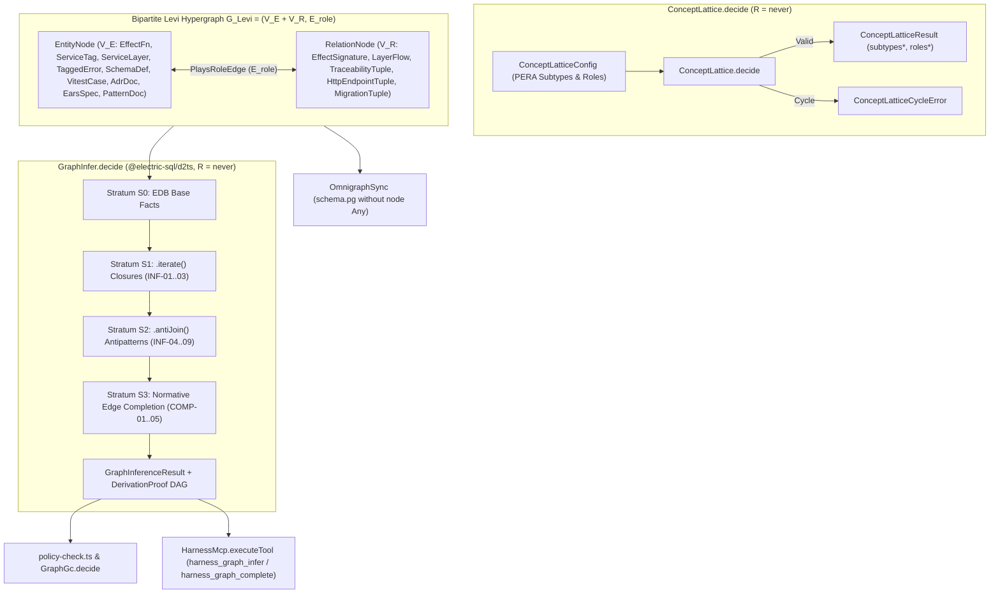

# SPEC-0007 · Polymorphic Hypergraph & Stratified Datalog Inference Engine

## Context

This specification defines the behavioral requirements for Milestone 1 of the Clean-Slate PERA Hypergraph and Stratified Datalog Inference Engine (`harness:ADR-0009`, `RFC-0001`, `RFC-0002`). The workspace architecture graph is represented as a pure bipartite Levi incidence hypergraph $G_{\text{Levi}} = (V_E \sqcup V_R, E_{\text{role}})$ without legacy binary edges or `node Any`, validated by `ConceptLattice.decide` and reasoned over by `GraphInfer.decide` across 4 strata in `@electric-sql/d2ts`.

- **Reused Contracts / Errors:** `HarnessGraph`, `OmnigraphSyncError`
- **Reused Services:** `OmnigraphSync`
- **New Capabilities Needed:** `EntityNode`, `RelationNode`, `PlaysRoleEdge`, `ConceptLatticeConfig`, `ConceptLatticeResult`, `ConceptLatticeCycleError`, `ConceptLattice.decide`, `DatalogRule`, `DerivationProof`, `InferredAntiPattern`, `SuggestedEdge`, `GraphInferenceResult`, `GraphInfer.decide`, `harness_graph_infer`, `harness_graph_complete`

## Goal

Every workspace architecture graph is constructed, persisted, and queried as a pure bipartite PERA hypergraph where ontology subtyping is verified by `ConceptLattice.decide` and recursive dependency closures, architectural antipatterns (`INF-04..09`), and missing-edge completions (`COMP-01..05`) are derived with deterministic `DerivationProof` trees by `GraphInfer.decide`.

## How to read the requirements

Requirements follow EARS syntax. Each requirement is a single sentence with bold keywords (`When`, `While`, `If ... then`, `Where`) and modal verb `shall` or `shall not`.

## Requirements

### 1 · Concept Lattice Validation & Role Inheritance

**Source (`harness:ADR-0009`, `RFC-0001`):** TypeDB-inspired PERA ontology requires acyclic subtype hierarchies and inherited role sets before hyperedge validation.

| ID | Pattern | Requirement | Effect Symbol | Verification |
| :--- | :--- | :--- | :--- | :--- |
| REQ-1.1 | State-driven | **While** evaluating a `ConceptLatticeConfig` within the pure ontology decider, the `ConceptLattice.decide` decider **shall** compute the reflexive-transitive subtype closure and inherited role sets with `R = never` and zero effectful dependencies. | `ConceptLattice.decide` | `GraphCheck` |
| REQ-1.2 | Event-driven | **When** `ConceptLattice.decide` receives an acyclic `ConceptLatticeConfig`, the `ConceptLattice.decide` span **shall** return a `ConceptLatticeResult` containing all inherited roles and transitive supertypes for every registered concept within 20ms. | `ConceptLattice.decide` | `PropertyTest` |
| REQ-1.3 | Unwanted behaviour | **If** a `ConceptLatticeConfig` contains a direct or transitive subtype cycle among concepts, **then** the `ConceptLattice.decide` span **shall** fail with a typed `ConceptLatticeCycleError` identifying the offending cycle path. | `ConceptLatticeCycleError` | `UnitTest` |

### 2 · Stratified Datalog Inference & Edge Completion

**Source (`harness:ADR-0009`, `RFC-0002`):** Procedural DFS policy checks cannot compose stratified negation, missing-edge completion, or deterministic proof trees.

| ID | Pattern | Requirement | Effect Symbol | Verification |
| :--- | :--- | :--- | :--- | :--- |
| REQ-2.1 | State-driven | **While** evaluating a bipartite PERA `HarnessGraph` across strata $S_0$ through $S_3$, the `GraphInfer.decide` decider **shall** execute Differential Dataflow fixed-point inference and stratified anti-joins purely in-memory with `R = never`. | `GraphInfer.decide` | `GraphCheck` |
| REQ-2.2 | Event-driven | **When** `GraphInfer.decide` executes stratum $S_1$ over `EffectSignature`, `LayerFlow`, and `TraceabilityTuple` relations, the `GraphInfer.decide` span **shall** derive fixed-point transitive closures for `EffectiveRequires` (`INF-01`), `EffectiveFailsWith` (`INF-02`), and `LayerDependsOn` / `EffectiveTestReach` (`INF-03`) within 50ms. | `GraphInfer.decide` | `PropertyTest` |
| REQ-2.3 | Event-driven | **When** `GraphInfer.decide` executes stratum $S_2$ over the converged $S_1$ closure, the `GraphInfer.decide` span **shall** emit deterministic `InferredAntiPattern` diagnostics with `DerivationProof` DAGs for rules `INF-04` through `INF-09`. | `GraphInfer.decide` | `UnitTest` |
| REQ-2.4 | Event-driven | **When** `GraphInfer.decide` executes stratum $S_3$ over incomplete governance or signature relations and `stub<A, E, R>()` holes, the `GraphInfer.decide` span **shall** emit Flix-lattice-joined `SuggestedEdge` completions (`ConfidenceMillis`) and Personalized PageRank `TypedHoleContextBundle` slices with `DerivationProof` lineage for rules `COMP-01` through `COMP-06`. | `GraphInfer.decide` | `UnitTest` |

### 3 · Policy Delegation, Omnigraph Sync & MCP Tools

**Source (`harness:ADR-0009`, `RFC-0001`, `RFC-0002`):** Downstream policy evaluation, Omnigraph persistence, and MCP agents must consume the reified PERA hypergraph and Datalog inference results directly.

| ID | Pattern | Requirement | Effect Symbol | Verification |
| :--- | :--- | :--- | :--- | :--- |
| REQ-3.1 | Optional feature | **Where** `OmnigraphSync` synchronizes a `HarnessGraph` into `@modernrelay/omnigraph`, the `OmnigraphSync` service **shall** persist only typed `EntityNode` and `RelationNode` vertices connected by `PlaysRole` edges without `node Any`. | `OmnigraphSync` | `UnitTest` |
| REQ-3.2 | Event-driven | **When** `HarnessMcp.executeTool` receives a `harness_graph_infer` or `harness_graph_complete` request, the `HarnessMcp.executeTool` span **shall** return the stratified `GraphInferenceResult` or filtered `SuggestedEdge` candidates with their `DerivationProof` trees within 100ms. | `HarnessMcp.executeTool` | `UnitTest` |

## Assumptions

- **REQ-2.1:** `@electric-sql/d2ts` runs synchronously in memory over bounded workspace graphs (`< 50,000` vertices).

## Out of scope

- **Double-Pushout (DPO) Graph Rewriting & AST Code Projection.** Scheduled for Milestone 2 (`RFC-0003`, `RFC-0004`, `harness:SPEC-0008`).

## Known residual risks

- Cyclic call graphs in workspace TypeScript code require canonical tuple deduplication inside `@electric-sql/d2ts` `.iterate()` so fixed-point convergence terminates in at most $|V|$ steps.

## Acceptance criteria

- All requirement rows pass their declared verification method (`GraphCheck`, `PropertyTest`, `UnitTest`).
- `libs/harness/graph`, `libs/harness/gates`, `apps/harness-mcp`, and `apps/harness-cli` pass `pnpm harness gc --strict` and `CI=true pnpm harness verify`.

## Verified Architecture Topology

