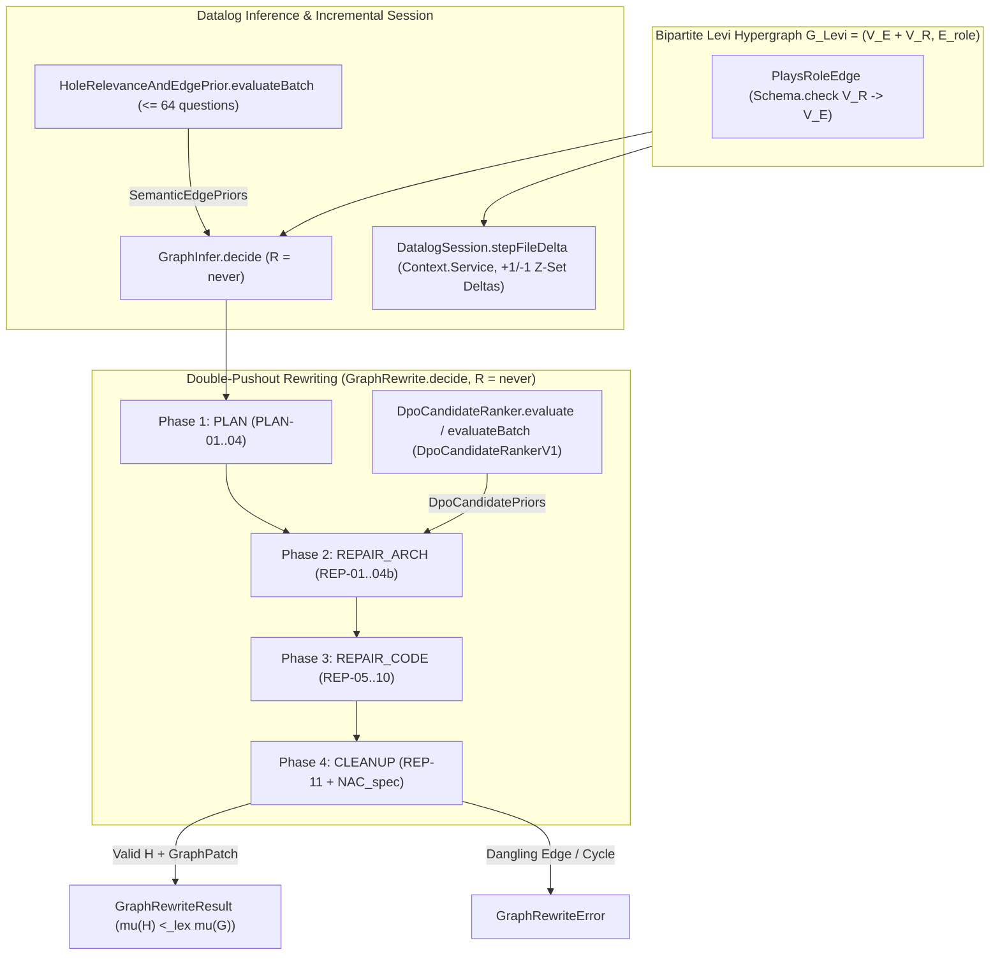

# SPEC-0008 · Double-Pushout (DPO) Graph Rewriting, Incremental Datalog Session & System One Candidate Ranking

## Context

This specification defines the behavioral requirements for Milestone 2 (`RFC-0001` Clean-Slate finalization, `RFC-0002` extensions A.1/A.2, and `RFC-0003` Double-Pushout Graph Rewriting + System One Priors) governed by `harness:ADR-0009`. It extends the PERA bipartite Levi incidence hypergraph $G_{\text{Levi}} = (V_E \sqcup V_R, E_{\text{role}})$ and Stratified Datalog engine (`GraphInfer.decide`) with:

1. A bipartite `Schema.check` invariant on `PlaysRoleEdge` ($V_R \to V_E$), Soufflé min-height provenance (`reduce(minHeightReducer)`), Flix confidence lattice merging (`reduce(flixConfidenceReducer)`), Hazel typed-hole Personalized PageRank bundles (`COMP-06` $\le 1500$ tokens), and incremental DBSP $\mathbb{Z}$-set file-edit delta stepping (`DatalogSession`).
2. A pure Double-Pushout (DPO) algebraic graph rewriting engine (`GraphRewrite.decide`, `R = never`) enforcing the Gluing Condition and Bipartite Levi Relation Preservation Law ($V_R \in K$), guaranteed to terminate via a 6-component lexicographical measure $\mu(G) \in \mathbb{N}^6$ and 4-phase stratification (`PLAN` $\prec$ `REPAIR_ARCH` $\prec$ `REPAIR_CODE` $\prec$ `CLEANUP`) over rules `PLAN-01..04` and `REP-01..11`.
3. System One calibrated sensors (`HoleRelevanceAndEdgePriorV1` batched up to 64 questions and `DpoCandidateRankerV1` tie-breaking $\mu$-equivalent repairs).

- **Reused Contracts / Errors:** `HarnessGraph`, `EntityNode`, `RelationNode`, `PlaysRoleEdge`, `GraphInferenceResult`, `GraphInferenceError`, `SemanticEdgePriors`
- **Reused Services:** `DecisionModel`
- **New Capabilities Needed:** `DatalogSession`, `DatalogSession.stepFileDelta`, `RewriteRuleId`, `RewritePhase`, `GraphMeasure`, `GraphPatch`, `SystemOneScoreMillis`, `DpoCandidatePriors`, `RewriteCandidate`, `GraphRewriteResult`, `GraphRewriteError`, `GraphRewrite.decide`, `HoleRelevanceAndEdgePrior.evaluateBatch`, `DpoCandidateRankerV1`, `DpoCandidateRanker.evaluate`, `DpoCandidateRanker.evaluateBatch`

## Goal

Every workspace hypergraph enforces the bipartite $V_R \to V_E$ incidence invariant at schema decode boundaries, supports sub-2ms incremental DBSP $\mathbb{Z}$-set updates via `DatalogSession`, and executes mathematically terminating Double-Pushout (DPO) plan synthesis (`PLAN-01..04`) and antipattern auto-repair (`REP-01..11`) via `GraphRewrite.decide` with System One semantic tie-breaking (`DpoCandidateRankerV1`).

## How to read the requirements

Requirements follow EARS syntax. Each requirement is a single sentence with bold keywords (`When`, `While`, `If ... then`, `Where`) and modal verb `shall` or `shall not`.

## Requirements

### 1 · Bipartite Hypergraph Invariant, Datalog Provenance & Incremental Session

**Source (`harness:ADR-0009`, `RFC-0001`, `RFC-0002`):** The Levi hypergraph $G_{\text{Levi}} = (V_E \sqcup V_R, E_{\text{role}})$ must reject non-bipartite role edges at schema boundaries, converge on cyclic call graphs in $\le |V_E|$ steps, cap typed-hole context bundles at $\le 1500$ tokens, and process single-file $\mathbb{Z}$-set deltas incrementally.

| ID      | Pattern            | Requirement                                                                                                                                                                                                                                                                                                                                                                                                                                        | Effect Symbol                  | Verification   |
| :------ | :----------------- | :------------------------------------------------------------------------------------------------------------------------------------------------------------------------------------------------------------------------------------------------------------------------------------------------------------------------------------------------------------------------------------------------------------------------------------------------- | :----------------------------- | :------------- |
| REQ-1.1 | Unwanted behaviour | **If** a `PlaysRoleEdge` payload specifies an entity-prefixed `relationId` or a relation-prefixed `entityKey` violating the bipartite $V_R \to V_E$ incidence invariant, **then** the `PlaysRoleEdge` schema decoder **shall** reject the payload with a schema validation failure.                                                                                                                                                                | `GraphInfer.decide`            | `UnitTest`     |
| REQ-1.2 | Event-driven       | **When** `GraphInfer.decide` evaluates recursive call chains containing cycles in Stratum $S_1$ and multiple candidate derivations in Stratum $S_3$, the `GraphInfer.decide` span **shall** converge via `reduce(minHeightReducer)` keyed on `"${callerKey}->${calleeKey}"`, merge duplicate `SuggestedEdge` candidates via `reduce(flixConfidenceReducer)`, and cap every `TypedHoleContextBundle` (`COMP-06`) at or below 1500 estimated tokens. | `GraphInfer.decide`            | `PropertyTest` |
| REQ-1.3 | Optional feature   | **Where** `DatalogSession` is provided for incremental file-edit evaluation, the `DatalogSession.stepFileDelta` span **shall** apply `-1` retraction weights for old file facts and `+1` insertion weights for new file facts into the open `@electric-sql/d2ts` stream and return the updated `GraphInferenceResult`.                                                                                                                             | `DatalogSession.stepFileDelta` | `UnitTest`     |
| REQ-1.4 | Unwanted behaviour | **If** `DatalogSession.stepFileDelta` or `GraphInfer.decide` encounters an invalid file delta or `@electric-sql/d2ts` execution failure, **then** the span **shall** fail with a typed `GraphInferenceError`.                                                                                                                                                                                                                                      | `GraphInferenceError`          | `UnitTest`     |

### 2 · Double-Pushout (DPO) Algebraic Graph Rewriting (`GraphRewrite.decide`)

**Source (`harness:ADR-0009`, `RFC-0003`):** Plan synthesis (`PLAN-01..04`) and antipattern repair (`REP-01..11`) must execute as pure Double-Pushout graph productions preserving reified relation vertices in the gluing interface $K$ and strictly decreasing the 6-component lexicographical measure $\mu(G) \in \mathbb{N}^6$.

| ID      | Pattern            | Requirement                                                                                                                                                                                                                                                                                                                                                                                                                                         | Effect Symbol         | Verification   |
| :------ | :----------------- | :-------------------------------------------------------------------------------------------------------------------------------------------------------------------------------------------------------------------------------------------------------------------------------------------------------------------------------------------------------------------------------------------------------------------------------------------------- | :-------------------- | :------------- |
| REQ-2.1 | State-driven       | **While** evaluating a `HarnessGraph` across rewrite phases `PLAN`, `REPAIR_ARCH`, `REPAIR_CODE`, and `CLEANUP`, the `GraphRewrite.decide` decider **shall** execute all Double-Pushout productions purely in-memory with `R = never` and preserve every modified reified relation node $rel \in V_R$ inside the gluing interface $K$.                                                                                                              | `GraphRewrite.decide` | `GraphCheck`   |
| REQ-2.2 | Event-driven       | **When** `GraphRewrite.decide` runs in `auto-plan`, `auto-repair`, `cleanup`, or `full` mode on a `HarnessGraph` with unrealized `EarsSpec` clauses or architectural/hygiene violations, the `GraphRewrite.decide` span **shall** apply rules `PLAN-01..04` and `REP-01..11` in phase order such that every Phase 1–3 rewrite strictly decreases $\mu(H) <_{\text{lex}} \mu(G)$ in $\mathbb{N}^6$ and `REP-11` respects $\text{NAC}_{\text{spec}}$. | `GraphRewrite.decide` | `PropertyTest` |
| REQ-2.3 | Unwanted behaviour | **If** a candidate DPO rewrite violates the Dangling Condition on $G_{\text{Levi}}$ or fails graph invariant validation during `GraphRewrite.decide`, **then** the `GraphRewrite.decide` span **shall** fail with a typed `GraphRewriteError` identifying the offending rule and dangling node or edge.                                                                                                                                             | `GraphRewriteError`   | `UnitTest`     |

### 3 · System One Batched Hole Priors & DPO Candidate Ranking

**Source (`harness:ADR-0009`, `RFC-0002 §4.4/§4.6`, `RFC-0003 §4.3`):** `DecisionModel` priors calibrate `SemanticEdgePriors` in up to 64 batched questions per forward pass and break ties among $\mu$-equivalent DPO repair candidates (`REP-04a` vs. `REP-04b`) without overriding the deterministic measure $\mu(G)$.

| ID      | Pattern      | Requirement                                                                                                                                                                                                                                                                                                                                                                                    | Effect Symbol                             | Verification |
| :------ | :----------- | :--------------------------------------------------------------------------------------------------------------------------------------------------------------------------------------------------------------------------------------------------------------------------------------------------------------------------------------------------------------------------------------------- | :---------------------------------------- | :----------- |
| REQ-3.1 | Event-driven | **When** `HoleRelevanceAndEdgePrior.evaluateBatch` evaluates up to 32 candidate hole/edge inputs (up to 64 `Decision.probability` and `Decision.rate` questions in a single `DecisionModel` pass), the `HoleRelevanceAndEdgePrior.evaluateBatch` span **shall** return a calibrated `SemanticEdgePriors` record or fall back deterministically within 1500ms if the model times out or fails.  | `HoleRelevanceAndEdgePrior.evaluateBatch` | `UnitTest`   |
| REQ-3.2 | Event-driven | **When** `DpoCandidateRanker.evaluate` or `DpoCandidateRanker.evaluateBatch` evaluates competing $\mu$-equivalent DPO repair strategies (`REP-04a` vs. `REP-04b`), the `DpoCandidateRanker.evaluate` span **shall** classify the repair strategy and rate architectural cohesion to produce `DpoCandidatePriors` (`SystemOneScoreMillis` in $[0, 1000]$) with a 1500ms deterministic fallback. | `DpoCandidateRanker.evaluate`             | `UnitTest`   |

## Assumptions

- **REQ-2.1:** Left-hand side patterns $L$ are anchored on typed nodes from `GraphInfer.decide` and `HarnessGraph`, enabling fast in-memory matching and pushout complement verification.

## Out of scope

- **Physical TypeScript AST Code Projection (`GraphProject.apply`).** Scheduled for Milestone 3 (`RFC-0004`).

## Known residual risks

- Multi-candidate repairs with identical $\mu(H)$ and identical System One tie-breaker scores fall back to deterministic lexicographical ordering by `(phase, ruleId, primaryNodeKey)`.

## Acceptance criteria

- All requirement rows pass their declared verification method (`GraphCheck`, `PropertyTest`, `UnitTest`).
- `libs/harness/graph` and `libs/harness/decision` pass `pnpm harness plan-check`, `pnpm harness gc --strict`, and `CI=true pnpm harness verify`.

## Verified Architecture Topology

