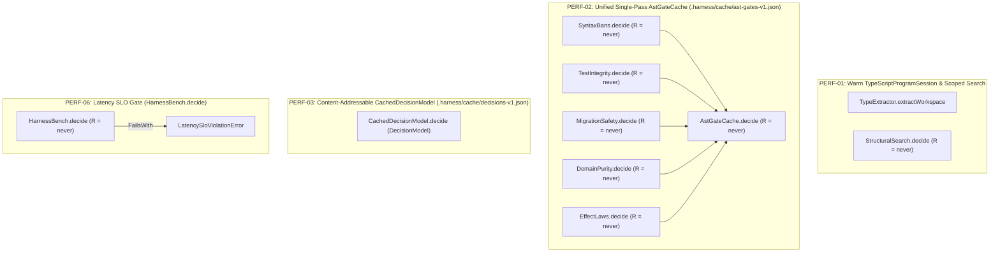

# SPEC-0010 · Sub-Second Incremental Harness, Content-Addressable AST/Decision Caching & Latency SLO Gate

## Context

This specification defines the behavioral requirements for Milestone 3 (`RFC-0006`: Sub-Second Incremental Harness, Content-Addressable AST/Decision Caching `PERF-01` through `PERF-06`, and `HarnessBench.decide`), governed by `harness:ADR-0009` and `harness:ADR-0011`. It eliminates cold full-workspace recompilation, quadratic test-reachability scanning, redundant multi-gate AST parsing, and duplicate `DecisionModel` evaluations across the CLI and MCP surfaces:

1. **`PERF-01` (`libs/harness/graph/src/type-extractor.ts`):** Persistent warm `TypeScriptProgramSession` reusing `ts.Program` and `ts.SourceFile` ASTs keyed by `(filePath, contentSha256)`, exported declaration fingerprint `declHash(f) = SHA256(emitDeclarationOnly(f))` early cut-off on `overlays`, per-file `FileGraphFragment` disk caching (`.harness/cache/file-graph-v1.json`), and $O(|T| + |F|)$ single-pass identifier/callee token indexing for `ExercisesSpan` edges.
2. **`PERF-02` (`libs/harness/gates/src/ast-cache.ts`):** Unified single-pass AST gate visitor and content-addressable disk cache (`AstGateCache`) keyed by `(filePath, sha256(content), HARNESS_GATE_RULE_VERSION)` persisted in `.harness/cache/ast-gates-v1.json`, backing `AstGateCache.decide`, `SyntaxBans.decide`, `TestIntegrity.decide`, `MigrationSafety.decide`, `DomainPurity.decide`, and `EffectLaws.decide`.
3. **`PERF-03` (`libs/harness/decision/src/cached-decision-model.ts`):** Content-addressable `CachedDecisionModel` wrapper around `DecisionModel` computing `cacheKey = SHA256(taskId + "\0" + promptVersion + "\0" + canonicalJson(input))`, backed by `.harness/cache/decisions-v1.json` and concurrent request coalescing.
4. **`PERF-04` & `PERF-05` (`apps/harness-cli/src/index.ts` & `apps/harness-mcp/src/server.ts`):** Incremental affected-only `verify` fast-path over $\Delta F$ since the last valid `.harness/verify-stamp.json` (or `HEAD`), and optional Unix domain socket daemon delegation (`.harness/daemon.sock`) with seamless in-process fallback.
5. **`PERF-06` (`libs/harness/gates/src/bench-check.ts` & `apps/harness-cli/src/index.ts`):** Branded schemas and pure `HarnessBench.decide` (`R = never`) latency SLO gate evaluating `StageLatencyMeasurement` against `StageLatencyBudget` (`p50BudgetMs`, `p95BudgetMs`), returning `HarnessBenchReport` or failing with `LatencySloViolationError`, wired to `pnpm harness bench`.
6. **Scoped Structural & Line-Locator Search (`libs/harness/graph/src/structural-search.ts` & `apps/harness-mcp/src/server.ts`):** Path-scoped AST and line-locator search (`StructuralSearch.decide`) enabling specialist review subagents to locate AST patterns, internal symbols, comments, and governance/SQL/JSON lines in targeted files (`filePath`, `paths`, `subDirs`) without blind full-file pagination or external browser REPL fallbacks.

- **Reused Contracts / Errors:** `HarnessGraph`, `BranchingViolation`, `MigrationViolation`, `DatalogSession`
- **Reused Services:** `DecisionModel`
- **New Capabilities Needed:** `TypeScriptProgramSession`, `TypeExtractor.extractWorkspace`, `StructuralSearch.decide`, `AstGateCache`, `AstGateCache.decide`, `SyntaxBans.decide`, `TestIntegrity.decide`, `MigrationSafety.decide`, `DomainPurity.decide`, `EffectLaws.decide`, `CachedDecisionModel.decide`, `BenchStageName`, `LatencyMillis`, `StageLatencyBudget`, `StageLatencyMeasurement`, `HarnessBenchReport`, `LatencySloViolationError`, `HarnessBench.decide`

## Goal

Every incremental graph extraction, AST gate check, and `DecisionModel` evaluation executes through cryptographically content-addressed caches with declaration-signature early cut-off and concurrent request coalescing, validated by a pure `HarnessBench.decide` latency SLO gate (`R = never`).

## How to read the requirements

Requirements follow EARS syntax. Each requirement is a single sentence with bold keywords (`When`, `While`, `If ... then`, `Where`) and modal verb `shall` or `shall not`.

## Requirements

### 1 · Warm `TypeScriptProgramSession` & Declaration-Signature Early Cut-Off (`PERF-01`)

**Source (`harness:ADR-0009`, `harness:ADR-0011`, `RFC-0006 §4.1–4.2`):** `extractTypeGraph` / `TypeExtractor.extractWorkspace` must reuse warm `ts.Program` and `ts.SourceFile` ASTs, apply `declHash` early cut-off when edited file declaration signatures are unchanged, and index test reachability in $O(|T| + |F|)$.

| ID      | Pattern      | Requirement                                                                                                                                                                                                                                                                                                                                                                                                                                                                                                                                                                                                                                                                                            | Effect Symbol                    | Verification |
| :------ | :----------- | :----------------------------------------------------------------------------------------------------------------------------------------------------------------------------------------------------------------------------------------------------------------------------------------------------------------------------------------------------------------------------------------------------------------------------------------------------------------------------------------------------------------------------------------------------------------------------------------------------------------------------------------------------------------------------------------------------- | :------------------------------- | :----------- |
| REQ-1.1 | Event-driven | **When** `TypeExtractor.extractWorkspace` (`extractTypeGraph` or `extractWorkspaceTypeAwareGraph`) is invoked with `overlays` or a warm `TypeScriptProgramSession`, the `TypeExtractor.extractWorkspace` span **shall** reuse unmodified `ts.SourceFile` ASTs and persisted `.harness/cache/file-graph-v1.json` `FileGraphFragment` records when `(contentSha256, packageTag)` and `patternDocs` match, re-extract only the modified file when an explicitly return-typed export keeps `declHash(f_new) === declHash(f_old)`, and re-extract the transitive reverse-import cone whenever `declHash` (including normalized body text for unannotated exports), file existence, or `packageTag` changes. | `TypeExtractor.extractWorkspace` | `UnitTest`   |

### 2 · Unified Single-Pass `AstGateCache` & Gate Deciders (`PERF-02`)

**Source (`harness:ADR-0011`, `RFC-0006 §4.5`):** All AST-level static gates (`SyntaxBans.decide`, `TestIntegrity.decide`, `MigrationSafety.decide`, `DomainPurity.decide`, `EffectLaws.decide`) must share a unified single-pass AST visitor and bounded path-keyed cache (`AstGateCache.decide`) persisted atomically in `.harness/cache/ast-gates-v1.json`.

| ID      | Pattern      | Requirement                                                                                                                                                                                                                                                                                                                                                                                                                                                                                                      | Effect Symbol            | Verification   |
| :------ | :----------- | :--------------------------------------------------------------------------------------------------------------------------------------------------------------------------------------------------------------------------------------------------------------------------------------------------------------------------------------------------------------------------------------------------------------------------------------------------------------------------------------------------------------- | :----------------------- | :------------- |
| REQ-2.1 | State-driven | **While** evaluating TypeScript source files across `AstGateCache.decide`, `SyntaxBans.decide`, `TestIntegrity.decide`, `MigrationSafety.decide`, `DomainPurity.decide`, and `EffectLaws.decide`, the gate deciders **shall** execute with `R = never`, parse each modified source file at most once via the unified single-pass AST visitor, replace stale `contentSha256` entries in place per `(filePath, packageTag)`, and serve cached `GateViolation` results when `(contentSha256, ruleVersion)` matches. | `AstGateCache.decide`    | `PropertyTest` |
| REQ-2.2 | Event-driven | **When** `SyntaxBans.decide`, `TestIntegrity.decide`, `MigrationSafety.decide`, `DomainPurity.decide`, or `EffectLaws.decide` evaluates a batch of `AstGateFileInput` records, each respective gate span **shall** filter and return the deterministic `AstGateDecisionReport` for its gate domain while sharing the underlying `AstGateCache` entry.                                                                                                                                                            | `SyntaxBans.decide`      | `PropertyTest` |
| REQ-2.3 | Event-driven | **When** `TestIntegrity.decide`, `MigrationSafety.decide`, `DomainPurity.decide`, and `EffectLaws.decide` evaluate `AstGateFileInput` records containing test mocks, unsafe SQL DDL, impure domain imports, or non-exhaustive branching, each respective decider **shall** emit the corresponding `GateViolation` items deterministically with `R = never`.                                                                                                                                                      | `TestIntegrity.decide`   | `PropertyTest` |
| REQ-2.4 | Event-driven | **When** `MigrationSafety.decide`, `DomainPurity.decide`, and `EffectLaws.decide` are invoked on source file inputs, the `MigrationSafety.decide`, `DomainPurity.decide`, and `EffectLaws.decide` spans **shall** return deterministic `AstGateDecisionReport` values monotonic in input violations.                                                                                                                                                                                                             | `MigrationSafety.decide` | `PropertyTest` |
| REQ-2.5 | Event-driven | **When** `DomainPurity.decide` and `EffectLaws.decide` inspect domain and contract modules, the `DomainPurity.decide` and `EffectLaws.decide` spans **shall** report impure infrastructure imports and `EffectLaws` branching or error violations with `R = never`.                                                                                                                                                                                                                                              | `DomainPurity.decide`    | `PropertyTest` |
| REQ-2.6 | Event-driven | **When** `EffectLaws.decide` evaluates TypeScript AST nodes for `ts-pattern` exhaustiveness and `Effect.fn` laws, the `EffectLaws.decide` span **shall** return all `effect-laws` violations without re-parsing cached files.                                                                                                                                                                                                                                                                                    | `EffectLaws.decide`      | `PropertyTest` |

### 3 · Content-Addressable `CachedDecisionModel` & Request Coalescing (`PERF-03`)

**Source (`harness:ADR-0011`, `RFC-0006 §4.6`):** `DecisionModel` calls must be cached by `SHA256(taskId + "\0" + promptVersion + "\0" + modelId + "\0" + canonicalJson(input))` in memory and `.harness/cache/decisions-v1.json`, coalescing concurrent identical requests and never caching failed model calls.

| ID      | Pattern      | Requirement                                                                                                                                                                                                                                                                                                                                                                                                                                                                                                                                                                                               | Effect Symbol                | Verification |
| :------ | :----------- | :-------------------------------------------------------------------------------------------------------------------------------------------------------------------------------------------------------------------------------------------------------------------------------------------------------------------------------------------------------------------------------------------------------------------------------------------------------------------------------------------------------------------------------------------------------------------------------------------------------- | :--------------------------- | :----------- |
| REQ-3.1 | Event-driven | **When** `CachedDecisionModel.decide` (or a `DecisionModel` wrapped by `makeCachedDecisionModelLayer`) receives decision requests with identical `(taskId, promptVersion, modelId, canonicalJson(input))` sequentially or concurrently across fibers, the `CachedDecisionModel.decide` span **shall** coalesce concurrent in-flight requests into a single underlying `DecisionModel` invocation, atomically persist only successful (`Option.Some`) answers to `.harness/cache/decisions-v1.json` with TTL expiration, and trigger a cache miss whenever `input`, `promptVersion`, or `modelId` changes. | `CachedDecisionModel.decide` | `UnitTest`   |

### 4 · `HarnessBench.decide` Latency SLO Gate (`PERF-06`)

**Source (`harness:ADR-0011`, `RFC-0006 §6`):** Stage latency measurements must be evaluated purely (`R = never`) against `p50BudgetMs` and `p95BudgetMs` SLO budgets and fail closed on empty samples or unbudgeted stages.

| ID      | Pattern            | Requirement                                                                                                                                                                                                                                                                                                                                                                                                           | Effect Symbol              | Verification   |
| :------ | :----------------- | :-------------------------------------------------------------------------------------------------------------------------------------------------------------------------------------------------------------------------------------------------------------------------------------------------------------------------------------------------------------------------------------------------------------------- | :------------------------- | :------------- |
| REQ-4.1 | State-driven       | **While** evaluating a `HarnessBenchInput` containing non-empty `StageLatencyMeasurement` and matching `StageLatencyBudget` records, the `HarnessBench.decide` decider **shall** compute stage pass/fail status purely in-memory with `R = never` and return a `HarnessBenchReport` when all measured stages have `sampleCount >= 1`, a matching budget entry, and `p50Ms <= p50BudgetMs` and `p95Ms <= p95BudgetMs`. | `HarnessBench.decide`      | `PropertyTest` |
| REQ-4.2 | Unwanted behaviour | **If** any `StageLatencyMeasurement` in `HarnessBenchInput` has `sampleCount === 0`, lacks a matching `StageLatencyBudget` entry, or exceeds its configured `p50BudgetMs` (`p50Ms > p50BudgetMs`) or `p95BudgetMs` (`p95Ms > p95BudgetMs`), **then** the `HarnessBench.decide` span **shall** fail with a typed `LatencySloViolationError` listing every violating stage and budget threshold.                        | `LatencySloViolationError` | `PropertyTest` |

### 5 · Scoped Structural & Line-Locator Search (`StructuralSearch.decide`)

**Source (`harness:ADR-0011`):** Specialist review and research subagents require fast, path-scoped AST and line-locator search across TypeScript and governance/SQL/JSON files without blind 800-line pagination or external browser REPL workarounds.

| ID      | Pattern      | Requirement                                                                                                                                                                                                                                                                                                                                                                                                                                                                                   | Effect Symbol             | Verification   |
| :------ | :----------- | :-------------------------------------------------------------------------------------------------------------------------------------------------------------------------------------------------------------------------------------------------------------------------------------------------------------------------------------------------------------------------------------------------------------------------------------------------------------------------------------------- | :------------------------ | :------------- |
| REQ-5.1 | State-driven | **While** evaluating a `StructuralSearchOptions` input across workspace files or explicit `filePath`, `paths`, and `subDirs` targets, the `StructuralSearch.decide` decider **shall** enforce repository-root path containment (ignoring any path escaping `repoRoot`), match TypeScript AST patterns via `@ast-grep/napi`, and fall back to deterministic 1-indexed line and column matching when locating comments, string literals, or patterns in `.md`, `.sql`, `.json`, or `.js` files. | `StructuralSearch.decide` | `PropertyTest` |

## Assumptions

- **REQ-1.1:** File contents on disk or in `overlays` are UTF-8 TypeScript/TSX modules whose SHA-256 digest uniquely identifies their lexical content.
- **REQ-3.1:** `canonicalJson(input)` produces a deterministic key-sorted JSON representation invariant to object property insertion order.

## Out of scope

- **Distributed remote build caching across machines.** All content-addressable caches in `.harness/cache/` are local to the repository/worktree state directory.

## Known residual risks

- First cold run in an empty `.harness/cache/` directory still pays the initial `ts.createProgram` parse cost before populating `.harness/cache/file-graph-v1.json` and `.harness/cache/ast-gates-v1.json`.

## Acceptance criteria

- All requirement rows pass their declared verification method (`PropertyTest`, `UnitTest`).
- `libs/harness/graph`, `libs/harness/gates`, `libs/harness/decision`, `apps/harness-cli`, and `apps/harness-mcp` pass `pnpm harness plan-check`, `pnpm harness gc --strict`, and `CI=true pnpm harness verify`.

## Verified Architecture Topology

