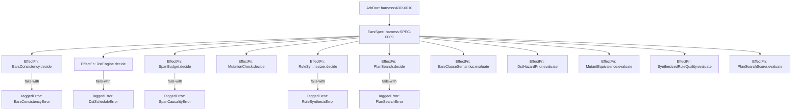

# SPEC-0009 · Execution-Guided Deterministic Simulation Testing, Zero-Respawn Mutant Schemata, EARS Consistency & Self-Evolving DPO Rule Synthesis

## Context

This specification defines the behavioral requirements for Milestone 5 (`RFC-0005`: Execution-Guided Deterministic Simulation Testing, Zero-Respawn Mutant Schemata, EARS Consistency, Self-Evolving DPO Rule Synthesis & System One Priors), governed by `harness:ADR-0009` and `harness:ADR-0010`:

1. **Step 1 — Finite Algebraic EARS Consistency & Completeness Checking (`EarsConsistency.decide` & `EarsClauseSemanticsV1` — `RFC-0005 §4.1`):** Pure relational consistency and state-completeness verification (`EARS-01` `ears-contradictory-clauses`, `EARS-02` `ears-shadowed-clause`, `EARS-03` `ears-incomplete-state-coverage`) over finite `Schema.TaggedUnion` state variants $\Sigma$ and guard variants $\Gamma$, calibrated by `EarsClauseSemanticsV1` (`EarsClauseSemantics.evaluate`) and wired into `plan-check` and `gc --strict`.
2. **Step 2 — Execution-Guided Deterministic Simulation Testing (`DstEngine.decide`, `DstHazardPriorV1`, `ChaosLayer`, `it.effect.dst`) & Temporal Causality in `SpanBudget.decide` (`RFC-0005 §4.2`):** Deterministic `XorShift64*` fault/delay/interruption schedule generation driven by `DstSeed` and `DstHazardPriorV1` (`DstHazardPrior.evaluate`), deadlock-free `it.effect.dst` simulation via a decoupled supervisor `clockDriver` fiber (`Effect.yieldNow()` followed by `TestClock.adjust`), two-tier seed budgets (`10` seeds in fast mode, `100` seeds in full verify), `DstSeed` stamping in `.harness/verify-stamp.json`, and LISA temporal causality rules (`MustPrecede`, `ForbiddenUnder`, `RequireCompensationOnFailure` — `CAUS-01`, `CAUS-02`) in `SpanBudget.decide`.
3. **Step 3 — Concolic Error-Channel Saturation (`SAT-01`, `SAT-02`), Zero-Respawn Mutant Schemata via `ExercisesSpan` & `MutantEquivalenceV1` (`RFC-0005 §4.3`):** Enriched `makeRecordingTracer` in `libs/harness/ingest/src/recording-tracer.ts` recording `exitTag: "Success" | "Failure" | "Defect"`, `errorTag` (via `Cause.findErrorOption` / `findRecoverableError` with zero `any`), and `valueTag`; descendant-aware error-channel saturation (`SAT-01` `unexercised-error-channel` and `SAT-02` `shallow-branch-saturation`); `git diff` line-scoped in-memory Mutant Schemata (`globalThis.__HARNESS_ACTIVE_MUTANT_ID`) in `MutationCheck.decide`; and `MutantEquivalenceV1` (`MutantEquivalence.evaluate`) filtering.
4. **Step 4 — Self-Evolving DPO Rule Synthesis via LGG Anti-Unification (`RuleSynthesizer.decide` & `SynthesizedRuleQualityV1`) & `PlanSearch.decide` (`PlanSearchScorerV1` — `RFC-0005 §4.4`):** First-Order Graph Anti-Unification ($\phi: V_{\text{bad}} \rightharpoonup V_{\text{good}}$ variabilizing `?Scope`), 4-stage AlphaEvolve cascade evaluation with zero false positives and Immutable TCB enforcement in `RuleSynthesizer.decide` calibrated by `SynthesizedRuleQualityV1` (`SynthesizedRuleQuality.evaluate`), and best-of-$K$ skeleton ranking in `PlanSearch.decide` calibrated by `PlanSearchScorerV1` (`PlanSearchScorer.evaluate`) and wired into `LoopCircuitBreaker.decide`.

- **Reused Contracts / Errors:** `HarnessGraph`, `RecordedSpanEvent`, `SpanBudgetSpec`, `SpanBudgetViolation`, `CodeMutant`, `MutationSuiteReport`, `FrictionEvent`, `LoopThrashingStatus`, `VerifyStamp`
- **Reused Services:** `DecisionModel`, `SpanRecorder`
- **New Capabilities Needed:** `EarsConsistency.decide`, `EarsConsistencyError`, `EarsClauseSemanticsV1`, `EarsClauseSemantics.evaluate`, `DstSeed`, `DstEngine.decide`, `DstScheduleError`, `DstHazardPriorV1`, `DstHazardPrior.evaluate`, `SpanBudget.decide`, `SpanCausalityError`, `MutationCheck.decide`, `MutantEquivalenceV1`, `MutantEquivalence.evaluate`, `RuleSynthesizer.decide`, `RuleSynthesisError`, `SynthesizedRuleQualityV1`, `SynthesizedRuleQuality.evaluate`, `PlanSearch.decide`, `PlanSearchError`, `PlanSearchScorerV1`, `PlanSearchScorer.evaluate`

## Goal

Every EARS specification, concurrent Effect workflow, domain mutation, and recurring friction cluster is verified in-process via finite relational consistency checking, deadlock-free deterministic simulation testing with LISA temporal causality, sub-200ms zero-respawn Mutant Schemata, and LGG DPO rule synthesis with Immutable TCB protection.

## How to read the requirements

Requirements follow EARS syntax. Each requirement is a single sentence with bold keywords (`When`, `While`, `If ... then`, `Where`) and modal verb `shall` or `shall not`.

## Requirements

### 1 · Finite Algebraic EARS Consistency & Completeness (`EarsConsistency.decide` & `EarsClauseSemanticsV1`)

**Source (`harness:ADR-0010`, `RFC-0005 §4.1`):** EARS requirement tables must be checked for pairwise contradiction (`EARS-01`), order-dependent shadowing (`EARS-02`), and state-space completeness (`EARS-03`) over finite `Schema.TaggedUnion` variants $\Sigma$ and $\Gamma$.

| ID      | Pattern            | Requirement                                                                                                                                                                                                                                                                                                                                                                                                                                            | Effect Symbol                 | Verification   |
| :------ | :----------------- | :----------------------------------------------------------------------------------------------------------------------------------------------------------------------------------------------------------------------------------------------------------------------------------------------------------------------------------------------------------------------------------------------------------------------------------------------------- | :---------------------------- | :------------- |
| REQ-1.1 | State-driven       | **While** evaluating an `EarsConsistencyInput` over finite state variants $\Sigma$, guard variants $\Gamma$, and `EarsSemanticClause` records, the `EarsConsistency.decide` decider **shall** execute with `R = never` and return an `EarsConsistencyReport` with `ok: true` when no pairwise clause contradiction (`EARS-01`), clause shadowing (`EARS-02`), or uncovered state variant (`EARS-03`) exists.                                                  | `EarsConsistency.decide`      | `PropertyTest` |
| REQ-1.2 | Unwanted behaviour | **If** an `EarsConsistencyInput` contains contradictory outcomes for overlapping states and guards (`EARS-01`), an earlier clause whose state and guard subsume a subsequent clause (`EARS-02`), or uncovered state variants in $\Sigma \setminus \bigcup_i S_i$ (`EARS-03`), **then** the `EarsConsistency.decide` span **shall** fail with a typed `EarsConsistencyError` enumerating each violation.                                                       | `EarsConsistencyError`        | `PropertyTest` |
| REQ-1.3 | Event-driven       | **When** `EarsClauseSemantics.evaluate` is invoked with natural-language EARS clauses and `Schema.TaggedUnion` state and guard variant sets of cardinality $2..26$, the `EarsClauseSemantics.evaluate` span **shall** classify active state variants, guard variants, and pairwise guard relations (`equivalent`, `first_subsumes_second`, `second_subsumes_first`, `mutually_exclusive`, `independent_overlapping`) with a deterministic lexical fallback. | `EarsClauseSemantics.evaluate` | `UnitTest`     |

### 2 · Execution-Guided Deterministic Simulation Testing (`DstEngine.decide`, `DstHazardPriorV1`) & Temporal Causality (`SpanBudget.decide`)

**Source (`harness:ADR-0010`, `RFC-0005 §4.2`):** Concurrent Effect workflows must be tested against deterministic `XorShift64*` fault schedules with a decoupled `clockDriver` fiber so `TestClock` never deadlocks, and traces must satisfy LISA temporal causality invariants (`CAUS-01`, `CAUS-02`).

| ID      | Pattern            | Requirement                                                                                                                                                                                                                                                                                                                                                                                                                                          | Effect Symbol             | Verification   |
| :------ | :----------------- | :--------------------------------------------------------------------------------------------------------------------------------------------------------------------------------------------------------------------------------------------------------------------------------------------------------------------------------------------------------------------------------------------------------------------------------------------------- | :------------------------ | :------------- |
| REQ-2.1 | State-driven       | **While** evaluating a `DstEngineConfig` with a non-negative `DstSeed`, target service methods, and optional `hazardPriors`, the `DstEngine.decide` decider **shall** compute an identical `DstSchedule` sequence across repeated runs for the same `DstSeed` using pure 64-bit `XorShift64*` arithmetic with `R = never`.                                                                                                                              | `DstEngine.decide`        | `PropertyTest` |
| REQ-2.2 | Unwanted behaviour | **If** `DstEngine.decide` receives a `DstEngineConfig` with an empty `targets` list or invalid step bounds, **then** the `DstEngine.decide` span **shall** fail with a typed `DstScheduleError` identifying the offending `DstSeed` and reason.                                                                                                                                                                                                              | `DstScheduleError`        | `PropertyTest` |
| REQ-2.3 | Event-driven       | **When** `DstHazardPrior.evaluate` evaluates a service capability method signature and EARS clause context, the `DstHazardPrior.evaluate` span **shall** rate concurrency hazard across `pure_lookup`, `idempotent_io`, `stateful_mutation`, and `distributed_saga_step` via `DstHazardPriorV1` and return a calibrated `DstProbabilityMillis` weight with a deterministic fallback.                                                                        | `DstHazardPrior.evaluate` | `UnitTest`     |
| REQ-2.4 | State-driven       | **While** evaluating `SpanBudgetSpec` counts and LISA `TemporalCausalityRule` invariants (`MustPrecede`, `ForbiddenUnder`, `RequireCompensationOnFailure`) over `RecordedSpanEvent` traces, the `SpanBudget.decide` decider **shall** verify span call counts and causal ordering purely with `R = never`.                                                                                                                                                    | `SpanBudget.decide`       | `PropertyTest` |
| REQ-2.5 | Unwanted behaviour | **If** a recorded span trace violates a `SpanBudgetSpec` call limit (`BUDG-01`), executes a dependent span before its `MustPrecede` prerequisite or omits a `RequireCompensationOnFailure` span after failure (`CAUS-01`), or invokes a `ForbiddenUnder` descendant span inside a restricted ancestor (`CAUS-02`), **then** the `SpanBudget.decide` span **shall** fail with a typed `SpanCausalityError` containing the exact violations.                   | `SpanCausalityError`      | `PropertyTest` |

### 3 · Concolic Error-Channel Saturation & Zero-Respawn Mutant Schemata (`MutationCheck.decide` & `MutantEquivalenceV1`)

**Source (`harness:ADR-0010`, `RFC-0005 §4.3`):** `makeRecordingTracer` must capture `exitTag`, `errorTag`, and `valueTag` without `any`, `SAT-01` must credit failures across both a span and its descendant spans, and `MutationCheck.decide` must evaluate `git diff`-scoped in-memory Mutant Schemata filtered by `MutantEquivalenceV1`.

| ID      | Pattern      | Requirement                                                                                                                                                                                                                                                                                                                                                                                                                                                     | Effect Symbol                | Verification   |
| :------ | :----------- | :-------------------------------------------------------------------------------------------------------------------------------------------------------------------------------------------------------------------------------------------------------------------------------------------------------------------------------------------------------------------------------------------------------------------------------------------------------------- | :--------------------------- | :------------- |
| REQ-3.1 | State-driven | **While** evaluating `MutationEvaluationInput` records containing `MutantOutcome` results, `MutantEquivalenceV1` probability priors, and span saturation observations, the `MutationCheck.decide` decider **shall** exclude surviving mutants with equivalence probability $\ge 850$ millis from `survivedMutants` (tracking `equivalentCount` separately, while mutants with priors $< 850$ millis or fallback `0` millis remain in `survivedMutants` and fail the gate), require zero surviving mutants (`survivedCount === 0`) for `passed: true`, credit `SAT-01` error-channel coverage across both each span $s_f$ and its descendant spans $s_f \prec_{\text{parent}}^+ s_c$, and execute with `R = never`. | `MutationCheck.decide`       | `PropertyTest` |
| REQ-3.2 | Event-driven | **When** `MutantEquivalence.evaluate` inspects a surviving `CodeMutant` snippet and its enclosing function AST summary, the `MutantEquivalence.evaluate` span **shall** estimate semantic equivalence probability via `MutantEquivalenceV1` and fall back deterministically to `0` millis (`non-equivalent`) when the `DecisionModel` is unavailable.                                                                                                                 | `MutantEquivalence.evaluate` | `UnitTest`     |

### 4 · Self-Evolving DPO Rule Synthesis (`RuleSynthesizer.decide`, `SynthesizedRuleQualityV1`) & `PlanSearch.decide` (`PlanSearchScorerV1`)

**Source (`harness:ADR-0010`, `RFC-0005 §4.4`):** `pnpm harness learn` must synthesize generalized DPO rules via Plotkin's LGG anti-unification ($\phi: V_{\text{bad}} \rightharpoonup V_{\text{good}}$) verified by the 4-stage AlphaEvolve cascade evaluator and Immutable TCB guard, while `PlanSearch.decide` ranks multi-skeleton candidates on thrashing recovery.

| ID      | Pattern            | Requirement                                                                                                                                                                                                                                                                                                                                                                                                                                  | Effect Symbol                     | Verification   |
| :------ | :----------------- | :------------------------------------------------------------------------------------------------------------------------------------------------------------------------------------------------------------------------------------------------------------------------------------------------------------------------------------------------------------------------------------------------------------------------------------------- | :-------------------------------- | :------------- |
| REQ-4.1 | State-driven       | **While** evaluating a `RuleSynthesizerInput` containing $G_{\text{bad}}$, $G_{\text{good}}$, `healthyCorpusSnapshots`, and `targetFiles` outside the Immutable TCB, the `RuleSynthesizer.decide` decider **shall** compute the Least General Generalization (LGG) with variabilized `?Scope` bindings, verify all 4 AlphaEvolve cascade stages with zero false positives on healthy snapshots, and execute with `R = never`.                    | `RuleSynthesizer.decide`          | `PropertyTest` |
| REQ-4.2 | Unwanted behaviour | **If** a candidate rule in `RuleSynthesizer.decide` violates DPO pushout well-formedness (`Stage1_PushoutWellFormedness`), fails positive replay on $G_{\text{bad}} \to G_{\text{good}}$ (`Stage2_PositiveReplay`), matches any healthy snapshot in `healthyCorpusSnapshots` (`Stage3_ZeroFalsePositive`), or targets a file inside the Immutable TCB (`Stage4_ImmutableTcbAndQuality`), **then** `RuleSynthesizer.decide` **shall** fail with `RuleSynthesisError`. | `RuleSynthesisError`              | `PropertyTest` |
| REQ-4.3 | Event-driven       | **When** `SynthesizedRuleQuality.evaluate` evaluates a candidate DPO rule specification and friction cluster context, the `SynthesizedRuleQuality.evaluate` span **shall** rate rule generality across `overfitted_to_single_file`, `domain_specific`, `reusable_idiom`, and `universal_effect_law` and compute a composite quality score in millis with a deterministic fallback.                                                                        | `SynthesizedRuleQuality.evaluate` | `UnitTest`     |
| REQ-4.4 | State-driven       | **While** evaluating a `PlanSearchInput` containing candidate skeleton decompositions $C_1, \dots, C_K$, the `PlanSearch.decide` decider **shall** rank candidates lexicographically by minimal violation count $\mu(G(C_k))$, minimal structural complexity, and highest `PlanSearchScorerV1` cohesion prior with `R = never`.                                                                                                                          | `PlanSearch.decide`               | `PropertyTest` |
| REQ-4.5 | Unwanted behaviour | **If** `PlanSearch.decide` is invoked with an empty candidate list or when `requireZeroViolations` is enabled and every candidate has `violationCount > 0`, **then** the `PlanSearch.decide` span **shall** fail with a typed `PlanSearchError`.                                                                                                                                                                                                     | `PlanSearchError`                 | `PropertyTest` |
| REQ-4.6 | Event-driven       | **When** `PlanSearchScorer.evaluate` evaluates a candidate plan skeleton summary against EARS requirements, the `PlanSearchScorer.evaluate` span **shall** rate decomposition cohesion across `fragmented`, `adequate`, `modular`, and `minimal_complete` via `PlanSearchScorerV1` with a deterministic fallback.                                                                                                                                       | `PlanSearchScorer.evaluate`       | `UnitTest`     |

## Assumptions

- **REQ-1.1:** State and guard domains extracted from `Schema.TaggedUnion` declarations have finite cardinality $\le 26$, fitting within the `Decision.classify` limit enforced by `assertDecisionLimits`.
- **REQ-2.1:** Tested Effect workflows under `it.effect.dst` perform time-dependent operations via `Effect.sleep` / `TestClock` and random/fault branching via `DstEngine` or `Random`.
- **REQ-4.1:** The Immutable Trusted Computing Base (TCB) includes `libs/harness/gates/src/policy.ts`, `libs/harness/gates/src/verify-stamp.ts`, `libs/harness/gates/src/ast-cache.ts`, `libs/harness/gates/src/mutation-check.ts`, `libs/harness/gates/src/rule-synthesizer.ts`, and `apps/harness-cli/src/index.ts`.

## Out of scope

- External SMT solvers (`z3`, `cvc5`) or external JVM/Rust database daemons.
- Multi-machine distributed network packet capture outside the `workerd` / Node.js in-process runtime.

## Verified Plan Topology Graph

