# SPEC-0011 · Self-Dogfooding Audit Enforcement & Effect-TS v4 Modular Capability Plugin Harness

## Context

This specification defines the behavioral requirements for `RFC-0007` (Self-Dogfooding Audit, Effect-TS v4 Paradigm Alignment & Modular Plugin Harness Architecture), governed by `harness:ADR-0012`. It eliminates the architectural double standard between the harness packages (`libs/harness/*`, `apps/harness-*`) and the application/framework domains (`libs/sample/*`, `libs/es/*`):

1. **Pure Self-Dogfooding Decider (`libs/harness/gates/src/plugins/self-dogfooding-plugin.ts` & `libs/harness/gates/src/ast-cache.ts`):** Pure `SelfDogfooding.decide` (`R = never`) and unified `AstGateCache.decide` enforce zero dummy `yield* Effect.void` statements (`effect-fn-dummy-void`), zero nested `Effect.runSync` / `Effect.runPromise` calls inside `Effect.fn` / `Effect.fnUntraced` / `Effect.gen` / `Effect.sync` / `Layer.*` (`nested-effect-run-sync`), zero `switch` statements (`harness-switch-statement`) or `match(...).run()` calls (`match-run-statement`) across harness source files, and a strict path-scoped 800-line file budget (`file-line-budget-exceeded`) across modular plugin, service, command, tool, and `@harness/graph` files (`/plugins/`, `/services/`, `/commands/`, `/tools/`, `libs/harness/graph/src/**/*.ts`).
2. **Cordis-Inspired Three-Role Capability Seams (`libs/harness/gates/src/services/*.ts` & `libs/harness/gates/src/plugins/gate-plugin-registry.ts`):** Introduces `WorkspaceFs`, `HarnessSubprocessRunner`, `ActiveMutantContext`, and `GatePluginRegistry` (`Context.Service` + `Layer` providers + `Effect.fn` consumers with non-empty `R` and typed `Schema.TaggedError` channels) so I/O, child processes, mutant activation, and gate plugin evaluation are dependency-injected and executed during `pnpm harness gc --strict` and `pnpm harness verify`.
3. **Scoped TypeScript Compiler Overlay Service (`libs/harness/graph/src/services/ts-compiler-overlay-service.ts`):** Introduces `TsCompilerOverlayService` (`Context.Service` + `Layer.effect` with `Effect.acquireRelease` cleanup of service-owned sessions) and `TsCompilerOverlay.extractGraph` (`Effect.fn`) to manage warm `TypeScriptProgramSession` state with deterministic resource finalization.
4. **Modular CLI Command & MCP Tool Registries (`apps/harness-cli/src/commands/command-registry.ts` & `apps/harness-mcp/src/tools/tool-registry.ts`):** Introduces `HarnessCommandRegistry` (`HarnessCli.dispatchCommand`) and `McpToolRegistry` (`HarnessMcp.dispatchTool`), replacing monolithic `switch` dispatchers in `apps/harness-cli/src/index.ts` and `apps/harness-mcp/src/server.ts` with typed plugin registries wired to the live command and tool handlers.

- **Reused Contracts / Errors:** `HarnessGraph`, `GateViolation`, `AstGateEvaluationInput`, `AstGateDecisionReport`, `UnknownToolError`
- **Reused Services:** `DecisionModel`
- **New Capabilities Needed:** `SelfDogfooding.decide`, `SelfDogfoodingViolationError`, `GatePluginRegistry`, `GatePluginRunner.evaluateAll`, `WorkspaceFs`, `WorkspaceFs.readAndVerifyFile`, `WorkspaceFsError`, `HarnessSubprocessRunner`, `HarnessSubprocess.execChecked`, `HarnessSubprocessError`, `ActiveMutantContext`, `MutationCheck.withActiveMutant`, `TsCompilerOverlayService`, `TsCompilerOverlay.extractGraph`, `TsCompilerOverlayError`, `HarnessCommandRegistry`, `HarnessCli.dispatchCommand`, `CliCommandNotFoundError`, `McpToolRegistry`, `HarnessMcp.dispatchTool`

## Goal

Every harness subsystem (`@harness/ingest`, `@harness/decision`, `@harness/gates`, `@harness/graph`, `harness-cli`, and `harness-mcp`) obeys the same Effect-TS v4 laws as domain packages—using explicit `Context.Service` + `Layer` dependency injection for I/O and stateful capabilities, pure `R = never` deciders without `yield* Effect.void`, exhaustive `ts-pattern` matching without `switch` statements, and modular plugin files under 800 lines verified by `SelfDogfooding.decide`.

## How to read the requirements

Requirements follow EARS syntax. Each requirement is a single sentence with bold keywords (`When`, `While`, `If ... then`, `Where`) and modal verb `shall` or `shall not`.

## Requirements

### 1 · Pure Self-Dogfooding Gate Decider (`SelfDogfooding.decide`)

**Source (`harness:ADR-0012`, `RFC-0007 §2 & §7`):** The harness must deterministically detect and reject `yield* Effect.void` dummy yields, nested `Effect.runSync`/`Effect.runPromise` inside Effect constructors, `switch` statements in harness source files, and modular plugin files exceeding the 800-line budget.

| ID      | Pattern            | Requirement                                                                                                                                                                                                                                                                                                                                                                                                                                    | Effect Symbol                  | Verification   |
| :------ | :----------------- | :--------------------------------------------------------------------------------------------------------------------------------------------------------------------------------------------------------------------------------------------------------------------------------------------------------------------------------------------------------------------------------------------------------------------------------------------- | :----------------------------- | :------------- |
| REQ-1.1 | State-driven       | **While** evaluating a `SelfDogfoodingInput` batch of workspace source files where every file has zero `yield* Effect.void` statements, zero nested `Effect.runSync` or `Effect.runPromise` calls inside `Effect.fn`, `Effect.gen`, `Effect.sync`, or `Layer`, zero `switch` statements, and line counts within `maxPluginFileLines` (enforced across all `isModularPluginPath` targets including `libs/harness/graph/src/**/*.ts` and `libs/harness/gates/src/**/*.ts` regardless of `isModularPluginFile: false`, as well as files with `isModularPluginFile: true`, or files where `isModularPluginFile` is omitted while `input.maxPluginFileLines` is explicitly set), the `SelfDogfooding.decide` decider **shall** return a clean `SelfDogfoodingReport` purely with `R = never`. | `SelfDogfooding.decide`        | `PropertyTest` |
| REQ-1.2 | Unwanted behaviour | **If** any inspected source file in `SelfDogfoodingInput` contains a `yield* Effect.void` statement (`effect-fn-dummy-void`), a nested `Effect.runSync` or `Effect.runPromise` call inside an Effect constructor (`nested-effect-run-sync`), a `switch` statement (`harness-switch-statement`), or exceeds `maxPluginFileLines` (`file-line-budget-exceeded` when matched by `isModularPluginPath`—even with `isModularPluginFile: false`—or when `isModularPluginFile` is `true`, or when `isModularPluginFile` is omitted while `input.maxPluginFileLines` is set) when `failOnViolation` is true, **then** the `SelfDogfooding.decide` span **shall** fail with `SelfDogfoodingViolationError`. | `SelfDogfoodingViolationError` | `PropertyTest` |
| REQ-1.3 | Event-driven       | **When** `AstGateCache.decide` evaluates a harness-internal source file containing `yield* Effect.void`, a `switch` statement, or `match(...).run()`, the `AstGateCache.decide` span **shall** report `effect-fn-dummy-void`, `discriminant-branching`, and `non-exhaustive-union-match` violations without `isHarnessInternal` exemption.                                                                                                               | `SelfDogfooding.decide`        | `UnitTest`     |

### 2 · Capability Services for Filesystem, Subprocess & Scoped Mutant Context (`@harness/gates`)

**Source (`harness:ADR-0012`, `RFC-0007 §4`):** Filesystem reads/writes, subprocess execution, gate plugin orchestration, and active mutant context must be modeled as `Context.Service` capabilities provided via `Layer`s rather than raw synchronous globals.

| ID      | Pattern            | Requirement                                                                                                                                                                                                                                                                                                                                                                         | Effect Symbol                    | Verification |
| :------ | :----------------- | :---------------------------------------------------------------------------------------------------------------------------------------------------------------------------------------------------------------------------------------------------------------------------------------------------------------------------------------------------------------------------------- | :------------------------------- | :----------- |
| REQ-2.1 | Event-driven       | **When** `WorkspaceFs.readAndVerifyFile` is invoked with a valid `WorkspaceFilePath`, the `WorkspaceFs.readAndVerifyFile` span **shall** yield the `WorkspaceFs` service from `R` and return the decoded file content and line count.                                                                                                                                               | `WorkspaceFs.readAndVerifyFile`  | `UnitTest`   |
| REQ-2.2 | Unwanted behaviour | **If** the target `WorkspaceFilePath` does not exist or cannot be read by `WorkspaceFs`, **then** the `WorkspaceFs.readAndVerifyFile` span **shall** fail with a typed `WorkspaceFsError`.                                                                                                                                                                                          | `WorkspaceFsError`               | `UnitTest`   |
| REQ-2.3 | Event-driven       | **When** `HarnessSubprocess.execChecked` is invoked with a valid `SubprocessCommand` and argument list, the `HarnessSubprocess.execChecked` span **shall** yield the `HarnessSubprocessRunner` service from `R` and return the structured stdout, stderr, and exit code `0`.                                                                                                        | `HarnessSubprocess.execChecked`  | `UnitTest`   |
| REQ-2.4 | Unwanted behaviour | **If** the command executed by `HarnessSubprocessRunner` exits with a non-zero status code or throws an OS spawn error, **then** the `HarnessSubprocess.execChecked` span **shall** fail with a typed `HarnessSubprocessError`.                                                                                                                                                     | `HarnessSubprocessError`         | `UnitTest`   |
| REQ-2.5 | Event-driven       | **When** `MutationCheck.withActiveMutant` executes an effectful test callback for a target `ActiveMutantId`, the `MutationCheck.withActiveMutant` span **shall** yield `ActiveMutantContext` from `R`, activate the mutant ID for the duration of the callback, and guarantee restoration of the previous mutant state on success, failure, or fiber interruption.                   | `MutationCheck.withActiveMutant` | `UnitTest`   |
| REQ-2.6 | Event-driven       | **When** `GatePluginRunner.evaluateAll` is invoked with a list of workspace file paths, the `GatePluginRunner.evaluateAll` span **shall** yield `GatePluginRegistry` and `WorkspaceFs` from `R`, execute all registered gate plugins, and return the aggregated `SelfDogfoodingReport`.                                                                                              | `GatePluginRunner.evaluateAll`   | `UnitTest`   |
| REQ-2.7 | Unwanted behaviour | **If** `GatePluginRunner.evaluateAll` is invoked with `failOnViolation: true` and any registered gate plugin reports violations, **then** the `GatePluginRunner.evaluateAll` span **shall** fail with a typed `SelfDogfoodingViolationError`.                                                                                                                                      | `SelfDogfoodingViolationError`   | `UnitTest`   |

### 3 · Scoped TypeScript Compiler Overlay Service (`@harness/graph`)

**Source (`harness:ADR-0012`, `RFC-0007 §4.2`):** Warm `TypeScriptProgramSession` instances must be managed through a scoped `Context.Service` (`TsCompilerOverlayService`) whose `Layer.effect` provider (`Effect.acquireRelease`) deterministically disposes service-owned compiler programs when the scope closes.

| ID      | Pattern            | Requirement                                                                                                                                                                                                                                                                                                            | Effect Symbol                    | Verification |
| :------ | :----------------- | :--------------------------------------------------------------------------------------------------------------------------------------------------------------------------------------------------------------------------------------------------------------------------------------------------------------------- | :------------------------------- | :----------- |
| REQ-3.1 | Event-driven       | **When** `TsCompilerOverlay.extractGraph` is invoked with a repository root and optional in-memory file overlays, the `TsCompilerOverlay.extractGraph` span **shall** yield `TsCompilerOverlayService` from `R` and return the extracted `HarnessGraph` using the scoped compiler session.                            | `TsCompilerOverlay.extractGraph` | `UnitTest`   |
| REQ-3.2 | Unwanted behaviour | **If** `TsCompilerOverlay.extractGraph` receives an empty or invalid repository root path, **then** the `TsCompilerOverlay.extractGraph` span **shall** fail with a typed `TsCompilerOverlayError`.                                                                                                                    | `TsCompilerOverlayError`         | `UnitTest`   |

### 4 · Modular CLI Command & MCP Tool Plugin Registries (`harness-cli` & `harness-mcp`)

**Source (`harness:ADR-0012`, `RFC-0007 §4.4–4.5`):** CLI command routing and MCP tool execution must use injectable plugin registries (`HarnessCommandRegistry`, `McpToolRegistry`) without `switch` statements.

| ID      | Pattern            | Requirement                                                                                                                                                                                                                                                                                                      | Effect Symbol                | Verification |
| :------ | :----------------- | :--------------------------------------------------------------------------------------------------------------------------------------------------------------------------------------------------------------------------------------------------------------------------------------------------------------- | :--------------------------- | :----------- |
| REQ-4.1 | Event-driven       | **When** `HarnessCli.dispatchCommand` is invoked with a registered CLI command name and arguments, the `HarnessCli.dispatchCommand` span **shall** yield `HarnessCommandRegistry` from `R` and execute the matched command plugin handler.                                                                       | `HarnessCli.dispatchCommand` | `UnitTest`   |
| REQ-4.2 | Unwanted behaviour | **If** `HarnessCli.dispatchCommand` is invoked with an unregistered command name, **then** the `HarnessCli.dispatchCommand` span **shall** fail with a typed `CliCommandNotFoundError`.                                                                                                                          | `CliCommandNotFoundError`    | `UnitTest`   |
| REQ-4.3 | Event-driven       | **When** `HarnessMcp.dispatchTool` is invoked with a registered MCP tool name and arguments, the `HarnessMcp.dispatchTool` span **shall** yield `McpToolRegistry` from `R` and return the tool plugin's structured response without using a `switch` statement.                                                   | `HarnessMcp.dispatchTool`    | `UnitTest`   |
| REQ-4.4 | Unwanted behaviour | **If** `HarnessMcp.dispatchTool` is invoked with an unregistered tool name, **then** the `HarnessMcp.dispatchTool` span **shall** fail with a typed `UnknownToolError`.                                                                                                                                          | `UnknownToolError`           | `UnitTest`   |

## Assumptions

- **REQ-1.1:** Modular plugin, service, mutation, command, tool, and graph/gates files matched by `isModularPluginPath` (`libs/harness/*/src/plugins/**`, `libs/harness/*/src/services/**`, `/mutation/`, `libs/harness/gates/src/**/*.ts`, `libs/harness/graph/src/**/*.ts`, `apps/harness-cli/src/commands/**`, and `apps/harness-mcp/src/tools/**`) enforce a maximum line budget of `MaxPluginFileLines = 800` unconditionally—passing `isModularPluginFile: false` cannot opt out a path matched by `isModularPluginPath`.
- **REQ-2.5:** `ActiveMutantContext` synchronizes with `globalThis.__HARNESS_ACTIVE_MUTANT_ID` inside its scoped `Effect.acquireRelease` bracket so generated Mutant Schemata (`ADR-0010`) and Effect fibers observe identical active mutant state.

## Out of scope

- **Dynamic loading of untrusted third-party npm plugins at runtime.** All harness plugins are statically composed via Effect `Layer`s to preserve Trusted Computing Base (TCB) integrity.

## Known residual risks

- Canonical `@harness/graph` entry orchestrators (`type-extractor.ts`, `datalog-engine.ts`, `graph-rewrite.ts`, `graph-engine.ts`, `graph-projector.ts`, plus `gc-check.ts`) target `<= 250` lines under RFC-0007 (`< 500` lines for sub-extractors under `extractor/`, `<= 700` lines for `compiler-session.ts` and `engine/*`, and `<= 750` lines for remaining decomposed submodules), whereas `SelfDogfooding.decide` enforces the coarser deterministic hard ceiling of `MaxPluginFileLines = 800` across all `libs/harness/graph/src/**/*.ts` files (`ADR-0001..0011`, `SPEC-0001..0010`).

## Acceptance criteria

- All requirement rows pass their declared verification method (`PropertyTest`, `UnitTest`).
- Zero `yield* Effect.void` statements and zero `switch` statements remain across `libs/` and `apps/` non-test source files.
- `pnpm harness plan-check`, `pnpm harness gc --strict`, `pnpm harness ontology check --strict`, `pnpm harness mutate --strict`, `CI=true pnpm harness verify`, and `CI=true pnpm harness done` pass with zero errors.

## Verified Plan Topology (`harness plan-check`)

```mermaid
flowchart TD
  0["HarnessCli.dispatchCommand #91;app#93;"]
  3["HarnessMcp.dispatchTool #91;app#93;"]
  68["GatePluginRunner.evaluateAll #91;service#93;"]
  69["SelfDogfooding.decide #91;service#93;"]
  71["MutationCheck.withActiveMutant #91;service#93;"]
  72["HarnessSubprocess.execChecked #91;service#93;"]
  73["WorkspaceFs.readAndVerifyFile #91;service#93;"]
  88["TsCompilerOverlay.extractGraph #91;service#93;"]
  98["Service: HarnessCommandRegistry"]
  99["Service: McpToolRegistry"]
  103["Service: GatePluginRegistry"]
  104["Service: ActiveMutantContext"]
  105["Service: HarnessSubprocessRunner"]
  106["Service: WorkspaceFs"]
  109["Service: TsCompilerOverlayService"]
  130["Error: UnknownToolError"]
  151["Error: SelfDogfoodingViolationError"]
  152["Error: WorkspaceFsError"]
  153["Error: HarnessSubprocessError"]
  162["Error: TsCompilerOverlayError"]
  0 -->|"RequiresService"| 98
  3 -->|"RequiresService"| 99
  3 -->|"FailsWith"| 130
  68 -->|"RequiresService"| 103
  68 -->|"RequiresService"| 106
  68 -->|"FailsWith"| 151
  68 -->|"FailsWith"| 152
  69 -->|"FailsWith"| 151
  71 -->|"RequiresService"| 104
  72 -->|"RequiresService"| 105
  72 -->|"FailsWith"| 153
  73 -->|"RequiresService"| 106
  73 -->|"FailsWith"| 152
  88 -->|"RequiresService"| 109
  88 -->|"FailsWith"| 162
```

