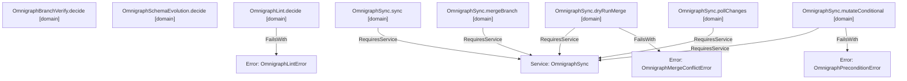

# SPEC-0014 · Omnigraph v0.14.0 Native Capabilities & Harness Integration

## Context

This specification defines the behavioral requirements for integrating `@modernrelay/omnigraph` v0.14.0 native capabilities (`OMNI-01` through `OMNI-10`) into the Effect-TS Engineering Harness, governed by [RFC-0010](../../../../docs/rfcs/0010-omnigraph-v014-native-capabilities-and-harness-integration.md) and `harness:ADR-0015`. It replaces unkeyed `Plays*Role` edges, destructive `branches.delete` / `rmRecursiveSync` workarounds, and unauthenticated local startup with keyed incidence edges, lossless `mode: "overwrite"` branch synchronization, pure `R = never` branch verification and schema evolution deciders, hybrid RRF search, Optimistic Concurrency Control (`ifGraphCommit`), incremental `changes.poll` Datalog streaming, mounted Cedar policies, unpublished DPO commit proposals, and `Blob` / `omnigraph optimize` maintenance.

- **Reused Contracts / Errors:** `OmnigraphPreconditionError`, `OmnigraphMergeConflictError`, `OmnigraphLintError`
- **Reused Services:** `@harness/graph/OmnigraphSync`
- **New Capabilities Needed:** `OmnigraphSync.dryRunMerge`, `OmnigraphSync.mutateConditional`, `OmnigraphSync.pollChanges`, `OmnigraphBranchVerify.decide`, `OmnigraphSchemaEvolution.decide`, `OmnigraphLint.decide`

## Goal

Every PERA incidence edge in `schema.pg` carries `@key(@src, @dst, role)` for idempotent loads, non-`main` branches preserve commit lineage via `mode: "overwrite"`, concurrent branch conflicts and schema drift are evaluated deterministically by pure `R = never` deciders (`OmnigraphBranchVerify.decide`, `OmnigraphSchemaEvolution.decide`, `OmnigraphLint.decide`), `main` and all branches enforce read-only `agent-mcp` policy rules alongside `ifGraphCommit` OCC preconditions, and `DatalogSession` stays incrementally synchronized via `og.changes.poll` with hybrid search and incremental Datalog updates.

## How to read the requirements

Requirements follow EARS syntax. Each requirement is a single sentence with bold keywords (`When`, `While`, `If ... then`, `Where`) and modal verb `shall` or `shall not`.

## Requirements

### 1 · Keyed Incidence Edges & Lossless Overwrite Sync (`OMNI-01`)

**Source:** [RFC-0010 §5.1, §5.6](../../../../docs/rfcs/0010-omnigraph-v014-native-capabilities-and-harness-integration.md)

| ID      | Pattern            | Requirement                                                                                                                                                                                                                                                                                                                                                                                                                                          | Effect Symbol        | Verification |
| :------ | :----------------- | :--------------------------------------------------------------------------------------------------------------------------------------------------------------------------------------------------------------------------------------------------------------------------------------------------------------------------------------------------------------------------------------------------------------------------------------------------- | :------------------- | :----------- |
| REQ-1.1 | Ubiquitous         | `schema.pg` **shall** declare `@key(@src, @dst, role)` inside every `Plays*Role` edge body so repeated `merge` loads are idempotent without duplicating edges.                                                                                                                                                                                                                                                                                       | —                    | `GraphCheck` |
| REQ-1.2 | Event-driven       | **When** `OmnigraphSync.sync` synchronizes a non-`main` branch (`plan/*` or `impl/*`), `OmnigraphSync.sync` **shall** call `og.load` with `mode: "overwrite"` while preserving prior commits on up-to-date or non-conflicting branches.                                                                                                                                                                                                              | `OmnigraphSync.sync` | `UnitTest`   |
| REQ-1.3 | Unwanted behaviour | **If** an existing non-`main` branch (`plan/*` or `impl/*`) is re-synchronized and either descends from the `from` branch head (`mergeBase.graphCommitId === targetCommitId`) or passes a `dryRun: true` merge into `from` without `ConflictError`, **then** `OmnigraphSync.sync` **shall not** delete the target branch so branch commit history remains intact.                                                                                    | `OmnigraphSync.sync` | `UnitTest`   |
| REQ-1.4 | Unwanted behaviour | **If** an existing non-`main` branch (`plan/*` or `impl/*`) synchronized with `mode: "overwrite"` and `from` reports `branchCreated === false`, trails behind `from` (`mergeBase.graphCommitId !== targetCommitId`), and fails a `dryRun: true` merge into `from` with `ConflictError`, **then** `OmnigraphSync.sync` **shall** delete that stale non-`main` branch (tolerating `NotFoundError`) and reload it from `from` with `mode: "overwrite"`. | `OmnigraphSync.sync` | `UnitTest`   |

### 2 · Hybrid Semantic + Lexical Search (`OMNI-02`)

**Source:** [RFC-0010 §5.1, §5.2](../../../../docs/rfcs/0010-omnigraph-v014-native-capabilities-and-harness-integration.md)

| ID      | Pattern      | Requirement                                                                                                                                                                                                                                            | Effect Symbol | Verification |
| :------ | :----------- | :----------------------------------------------------------------------------------------------------------------------------------------------------------------------------------------------------------------------------------------------------- | :------------ | :----------- |
| REQ-2.1 | Ubiquitous   | `schema.pg` **shall** declare `@index` full-text fields on searchable code and governance node types so native BM25 and fuzzy queries execute over indexed text properties (selective vector columns are governed by `harness:ADR-0025` / `harness:SPEC-0031`). | —             | `GraphCheck` |
| REQ-2.2 | Event-driven | **When** `harness_gq_query` executes `rank_patterns_hybrid`, `rank_candidate_services_for_stub`, or `resolve_effect_fn_fuzzy`, `OmnigraphSync` **shall** rank scope-filtered subgraph matches using `rrf(nearest(...), bm25(...))` or `fuzzy(..., 2)`. | —             | `UnitTest`   |

### 3 · Branch Diff & Dry-Run Merge Gate (`OMNI-03`)

**Source:** [RFC-0010 §5.4, §5.5](../../../../docs/rfcs/0010-omnigraph-v014-native-capabilities-and-harness-integration.md)

| ID      | Pattern            | Requirement                                                                                                                                                                                                                                                                                                                                                                                                                                                                                                                                                                                                                                                                                            | Effect Symbol                  | Verification               |
| :------ | :----------------- | :----------------------------------------------------------------------------------------------------------------------------------------------------------------------------------------------------------------------------------------------------------------------------------------------------------------------------------------------------------------------------------------------------------------------------------------------------------------------------------------------------------------------------------------------------------------------------------------------------------------------------------------------------------------------------------------------------- | :----------------------------- | :------------------------- |
| REQ-3.1 | State-driven       | **While** executing in pure evaluation mode, `OmnigraphBranchVerify.decide` **shall** inspect `OmnigraphBranchDiffState` (`ResolvedDiff` with `changes`, `observedImplEffectFnCount`, and `unchangedStubCount`, or `MissingMergeBase`) and `dryRunConflicts` with `R = never` and return `verdict: "violated"` on `missing-merge-base`, `dry-run-merge-conflict`, `planned-effect-fn-dropped` (with move/rename exemption when matching `spanName` is re-inserted), `no-effect-fn-implemented` (when `observedImplEffectFnCount === 0` with `> 0` active planned `EffectFnInserted`/`EffectFnUpdated` entries), or `unimplemented-stub-remaining` (from diff `stubAfter` or `unchangedStubCount > 0`). | `OmnigraphBranchVerify.decide` | `GraphCheck, PropertyTest` |
| REQ-3.2 | Unwanted behaviour | **If** `OmnigraphSync.dryRunMerge` (`og.branches.merge` with `dryRun: true`) reports a `ConflictError` with `mergeConflicts`, **then** `OmnigraphSync` **shall** fail with typed `OmnigraphMergeConflictError`.                                                                                                                                                                                                                                                                                                                                                                                                                                                                                        | `OmnigraphMergeConflictError`  | `UnitTest`                 |
| REQ-3.3 | Event-driven       | **When** `OmnigraphSync.mergeBranch` merges `impl/*` into `main` on `done`, `OmnigraphSync.mergeBranch` **shall** pass `deleteBranch: true` instead of force-overwriting `main` on conflicts.                                                                                                                                                                                                                                                                                                                                                                                                                                                                                                          | `OmnigraphSync.mergeBranch`    | `UnitTest`                 |

### 4 · Optimistic Concurrency Control & Change-Feed Datalog Sync (`OMNI-04`)

**Source:** [RFC-0010 §4.4, §5.6](../../../../docs/rfcs/0010-omnigraph-v014-native-capabilities-and-harness-integration.md)

| ID      | Pattern            | Requirement                                                                                                                                                                                                                                                                                                                                                                                                                 | Effect Symbol                | Verification |
| :------ | :----------------- | :-------------------------------------------------------------------------------------------------------------------------------------------------------------------------------------------------------------------------------------------------------------------------------------------------------------------------------------------------------------------------------------------------------------------------- | :--------------------------- | :----------- |
| REQ-4.1 | Unwanted behaviour | **If** `OmnigraphSync.mutateConditional` sends a conditional write with `ifGraphCommit` and Omnigraph responds with `PreconditionFailedError` (HTTP `412`), **then** `OmnigraphSync` **shall** fail with `OmnigraphPreconditionError` carrying expected and actual `OmnigraphCommitId` values.                                                                                                                              | `OmnigraphPreconditionError` | `UnitTest`   |
| REQ-4.2 | Event-driven       | **When** `OmnigraphSync.pollChanges` (`executePollChanges`) polls `og.changes.poll` using a persisted `OmnigraphChangeCursor` and encounters HTTP `410`, `executePollChanges` **shall** recover via `og.changes.baseline` and return `requiresBaseline: true`, while `unix-socket-daemon` consumes `requiresBaseline` to rebuild or incrementally step `DatalogSession.stepFileDelta` from committed `EntityChange` blocks. | `OmnigraphSync.pollChanges`  | `TraceTest`  |

### 5 · GQ 2.1 Edge Unions & Multi-Hop Governance Queries (`OMNI-05`)

**Source:** [RFC-0010 §5.2](../../../../docs/rfcs/0010-omnigraph-v014-native-capabilities-and-harness-integration.md)

| ID      | Pattern      | Requirement                                                                                                                                                                                                                                                                                                                                              | Effect Symbol | Verification |
| :------ | :----------- | :------------------------------------------------------------------------------------------------------------------------------------------------------------------------------------------------------------------------------------------------------------------------------------------------------------------------------------------------------- | :------------ | :----------- |
| REQ-5.1 | Event-driven | **When** `ontology_realized_by_doc` is invoked for an `AdrDoc` or `EarsSpec`, `queries/harness.gq` **shall** match `TraceabilityTuple` rows by `adrId` or `earsSpecId` and `executeNamedGqQueryInMemory` **shall** traverse outgoing `TraceabilityTuple` `governing-adr`/`specifying-ears` and `realizing-symbol` role edges across realizing artifacts. | —             | `UnitTest`   |

### 6 · Self-Describing Schema & In-Graph `GraphPolicy` Nodes (`OMNI-06`)

**Source:** [RFC-0010 §5.1, §5.2](../../../../docs/rfcs/0010-omnigraph-v014-native-capabilities-and-harness-integration.md)

| ID      | Pattern    | Requirement                                                                                                                                                                     | Effect Symbol | Verification |
| :------ | :--------- | :------------------------------------------------------------------------------------------------------------------------------------------------------------------------------ | :------------ | :----------- |
| REQ-6.1 | Ubiquitous | `schema.pg` **shall** declare `@instruction` annotations on PERA node/edge types and a `GraphPolicy` node type binding invariant names to stored `.gq` `checkQuery` validators. | —             | `GraphCheck` |

### 7 · Offline `omnigraph lint` & Non-Destructive Schema Evolution (`OMNI-07`)

**Source:** [RFC-0010 §5.5](../../../../docs/rfcs/0010-omnigraph-v014-native-capabilities-and-harness-integration.md)

| ID      | Pattern            | Requirement                                                                                                                                                                                                                                                                                                                                                                                                                                                                                           | Effect Symbol                     | Verification               |
| :------ | :----------------- | :---------------------------------------------------------------------------------------------------------------------------------------------------------------------------------------------------------------------------------------------------------------------------------------------------------------------------------------------------------------------------------------------------------------------------------------------------------------------------------------------------- | :-------------------------------- | :------------------------- |
| REQ-7.1 | Unwanted behaviour | **If** `OmnigraphLint.decide` inspects `omnigraph lint --json` output under `OmnigraphLintPolicy` (`fail-on-error`, `deny-warnings`, or `report-only`) and detects a failing status or blocking diagnostic, **then** `OmnigraphLint.decide` **shall** fail with `OmnigraphLintError` under blocking policies (`fail-on-error`/`deny-warnings`) or report `OmnigraphLintViolation` (`_tag`: `omnigraph-lint-status-not-ok` or `omnigraph-lint-error`) under `report-only` prior to cluster deployment. | `OmnigraphLintError`              | `UnitTest`                 |
| REQ-7.2 | State-driven       | **While** evaluating config drift with `R = never`, `OmnigraphSchemaEvolution.decide` **shall** emit `LiveClusterApply` for additive schema or query updates and `RequiresCleanRebuild` for `@key(...)` edge-key or policy-bundle changes rather than wiping `.harness/omnigraph-cluster` on additive edits.                                                                                                                                                                                          | `OmnigraphSchemaEvolution.decide` | `GraphCheck, PropertyTest` |

### 8 · Cedar Policies & Authenticated MCP Binding (`OMNI-08`)

**Source:** [RFC-0010 §5.3](../../../../docs/rfcs/0010-omnigraph-v014-native-capabilities-and-harness-integration.md)

| ID      | Pattern          | Requirement                                                                                                                                                                                                                                                                                                                                                                                                                                                                                                                                                                                                                                                                                                                                                                                | Effect Symbol | Verification |
| :------ | :--------------- | :----------------------------------------------------------------------------------------------------------------------------------------------------------------------------------------------------------------------------------------------------------------------------------------------------------------------------------------------------------------------------------------------------------------------------------------------------------------------------------------------------------------------------------------------------------------------------------------------------------------------------------------------------------------------------------------------------------------------------------------------------------------------------------------- | :------------ | :----------- |
| REQ-8.1 | Ubiquitous       | `cluster.yaml` **shall** mount the single `graph-access` policy bundle from `graph.policy.yaml` (`protected_branches: [main]`, `admins: [harness-cli]`, `readers: [agent-mcp, harness-cli]` with `agent-mcp` read-only across all branches matching `policies.cedar`, covering all 13 cases in `policy-tests.yaml`), while keeping hardened `cluster.policy.yaml` (`owners: [harness-cli]`, `readers: [agent-mcp, harness-cli]`) on disk because Omnigraph CLI rejects mounting multiple bundles simultaneously (`matches 2 policy bundles`), and `ensureLocalOmnigraphReady` configures `OMNIGRAPH_SERVER_BEARER_TOKENS_JSON` without `--unauthenticated` when `cluster.yaml` declares `policies:` (logging a warning to stderr only in conditional fallback when `policies:` is absent). | —             | `Inspection` |
| REQ-8.2 | Optional feature | **Where** the repository Omnigraph cluster runs on a hash-derived loopback port with per-actor Bearer tokens, `ensureOmnigraphEndpointTokens` **shall** harden `clusterRootDir` (`0o700`), write atomic `0o600` `server.json` (without `token`) and atomic `0o600` `auth-tokens.json` (per-actor tokens for `harness-cli` and `agent-mcp`, failing closed if permissive `(mode & 0o077) !== 0` or corrupt), while `resolveOmnigraphBaseUrl` and `tools/omnigraph-mcp-launcher.mjs` enforce loopback and `canonicalRepoRoot` checks with `agent-mcp` actor token validation and deterministic fallback port resolution.                                                                                                                                                                     | —             | `UnitTest`   |

### 9 · Unpublished Commit Proposals for DPO Candidates (`OMNI-09`)

**Source:** [RFC-0010 §2, §5.6](../../../../docs/rfcs/0010-omnigraph-v014-native-capabilities-and-harness-integration.md)

| ID      | Pattern      | Requirement                                                                                                                                                                                                                                                                           | Effect Symbol | Verification |
| :------ | :----------- | :------------------------------------------------------------------------------------------------------------------------------------------------------------------------------------------------------------------------------------------------------------------------------------ | :------------ | :----------- |
| REQ-9.1 | Event-driven | **When** `OmnigraphSync` stages or inspects unpublished DPO commit proposals via `proposeMergeCommit`, `inspectCommitChanges`, `publishCommit`, or `dropCommit`, `OmnigraphSync` **shall** isolate uncommitted graph changes before publishing or dropping them on the target branch. | —             | `UnitTest`   |

### 10 · Versioned `Blob` Artifacts & Lance Maintenance (`OMNI-10`)

**Source:** [RFC-0010 §5.1, §8](../../../../docs/rfcs/0010-omnigraph-v014-native-capabilities-and-harness-integration.md)

| ID       | Pattern      | Requirement                                                                                                                                                                                                                                                                                                                                                                                                 | Effect Symbol | Verification |
| :------- | :----------- | :---------------------------------------------------------------------------------------------------------------------------------------------------------------------------------------------------------------------------------------------------------------------------------------------------------------------------------------------------------------------------------------------------------- | :------------ | :----------- |
| REQ-10.1 | Event-driven | **When** `verify` or `done` runs with `.harness/spans.jsonl` present, `harness-cli` **shall** persist the trace payload onto the first `VitestCase.spanTraceBlob` via `putBlob` and verify it via `statBlob`, while `OmnigraphSync.getBlobText` and `OmnigraphSync.statBlob` expose typed reads for callers.                                                                                                | —             | `UnitTest`   |
| REQ-10.2 | Event-driven | **When** `pnpm harness gc --strict` runs on a full workspace cluster, `harness-cli` **shall** invoke non-destructive `omnigraph optimize`, and **when** `done` completes a task merge, `harness-cli` **shall** invoke `omnigraph optimize` followed by retention-bounded `omnigraph cleanup --keep 5 --confirm` on `.harness/omnigraph-cluster/graphs/harness.omni` to persist derived traversal adjacency. | —             | `UnitTest`   |

## Assumptions

- **REQ-1.1:** A one-time clean-slate rebuild of `.harness/omnigraph-cluster` (`rfc-0009-v2` epoch) is performed because Omnigraph v0.14.0 refuses adding `@key(...)` to existing unkeyed edge types in place.
- **REQ-2.1:** Local `omnigraph-server` detects local Ollama `qwen3-embedding:8b` (`harness:ADR-0025` / `harness:SPEC-0031`) or falls back to deterministic mock embeddings (`OMNIGRAPH_EMBEDDINGS_MOCK=1`) unless `OMNIGRAPH_EMBEDDING_API_KEY` is explicitly provided; `@index` full-text fields continue supporting BM25 lexical matching when embeddings are absent.

## Out of scope

- **Remote multi-node distributed Omnigraph cluster orchestration:** This specification covers the local single-node Lance-backed Omnigraph cluster per repository.

## Known residual risks

- **Embedding latency when external provider key is configured:** Enabling an external embedding provider (`OMNIGRAPH_EMBEDDING_API_KEY`) incurs provider latency on first query/load before ANN arms stabilize.
- **Change-feed baseline reset on retention compaction:** Aggressive `omnigraph cleanup` retention windows can expire an old `OmnigraphChangeCursor`, requiring `og.changes.baseline` recovery on HTTP `410`.

## Acceptance criteria

- All requirement rows pass their declared verification method (`GraphCheck`, `PropertyTest`, `UnitTest`, `TraceTest`, `Inspection`).
- `omnigraph lint --schema libs/harness/graph/schema.pg --query libs/harness/graph/queries/harness.gq --json` passes with zero errors, and `omnigraph policy validate` / `omnigraph policy test` pass against `graph.policy.yaml`.
- `pnpm harness gc --strict` and `pnpm harness verify` pass with zero errors.

## Verified Plan Topology (`harness plan-check`)

