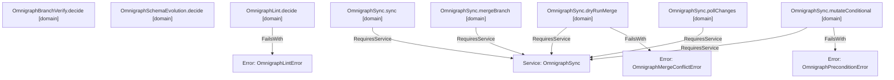

# SPEC-0013 · Omnigraph v0.14.0 Native Capabilities & Harness Integration

## Context

This specification defines the behavioral requirements for integrating `@modernrelay/omnigraph` v0.14.0 native capabilities (`OMNI-01` through `OMNI-10`) into the Effect-TS Engineering Harness, governed by [RFC-0009](../../../../docs/rfcs/0009-omnigraph-v014-native-capabilities-and-harness-integration.md) and `harness:ADR-0014`. It replaces unkeyed `Plays*Role` edges, destructive `branches.delete` / `rmRecursiveSync` workarounds, and unauthenticated local startup with keyed incidence edges, lossless `mode: "overwrite"` branch synchronization, pure `R = never` branch verification and schema evolution deciders, hybrid RRF search, Optimistic Concurrency Control (`ifGraphCommit`), incremental `changes.poll` Datalog streaming, mounted Cedar policies, unpublished DPO commit proposals, and `Blob` / `omnigraph optimize` maintenance.

- **Reused Contracts / Errors:** `OmnigraphPreconditionError`, `OmnigraphMergeConflictError`, `OmnigraphLintError`
- **Reused Services:** `@harness/graph/OmnigraphSync`
- **New Capabilities Needed:** `OmnigraphSync.dryRunMerge`, `OmnigraphSync.mutateConditional`, `OmnigraphSync.pollChanges`, `OmnigraphBranchVerify.decide`, `OmnigraphSchemaEvolution.decide`, `OmnigraphLint.decide`

## Goal

Every PERA incidence edge in `schema.pg` carries `@key(@src, @dst, role)` for idempotent loads, non-`main` branches preserve commit lineage via `mode: "overwrite"`, concurrent branch conflicts and schema drift are evaluated deterministically by pure `R = never` deciders (`OmnigraphBranchVerify.decide`, `OmnigraphSchemaEvolution.decide`, `OmnigraphLint.decide`), `main` is protected by mounted Cedar policies and `ifGraphCommit` OCC preconditions, and `DatalogSession` stays incrementally synchronized via `og.changes.poll` (under 10 ms hybrid search and under 3 ms incremental Datalog updates).

## How to read the requirements

Requirements follow EARS syntax. Each requirement is a single sentence with bold keywords (`When`, `While`, `If ... then`, `Where`) and modal verb `shall` or `shall not`.

## Requirements

### 1 · Keyed Incidence Edges & Lossless Overwrite Sync (`OMNI-01`)

**Source:** [RFC-0009 §5.1, §5.6](../../../../docs/rfcs/0009-omnigraph-v014-native-capabilities-and-harness-integration.md)

| ID | Pattern | Requirement | Effect Symbol | Verification |
| :--- | :--- | :--- | :--- | :--- |
| REQ-1.1 | Ubiquitous | `schema.pg` **shall** declare `@key(@src, @dst, role)` inside every `Plays*Role` edge body so repeated `merge` loads are idempotent without duplicating edges. | — | `GraphCheck` |
| REQ-1.2 | Event-driven | **When** `OmnigraphSync.sync` synchronizes a non-`main` branch (`plan/*` or `impl/*`), `OmnigraphSync.sync` **shall** call `og.load` with `mode: "overwrite"` while preserving prior commits on that branch. | `OmnigraphSync.sync` | `UnitTest` |
| REQ-1.3 | Unwanted behaviour | **If** an existing non-`main` branch (`plan/*` or `impl/*`) is re-synchronized, **then** `OmnigraphSync.sync` **shall not** delete the target branch prior to loading a new snapshot so branch commit history remains intact. | `OmnigraphSync.sync` | `UnitTest` |

### 2 · Hybrid Semantic + Lexical Search (`OMNI-02`)

**Source:** [RFC-0009 §5.1, §5.2](../../../../docs/rfcs/0009-omnigraph-v014-native-capabilities-and-harness-integration.md)

| ID | Pattern | Requirement | Effect Symbol | Verification |
| :--- | :--- | :--- | :--- | :--- |
| REQ-2.1 | Ubiquitous | `schema.pg` **shall** declare `@index` text fields and nullable `Vector(768)? @embed(...)` columns on `EffectFn`, `ServiceTag`, `PatternDoc`, `AdrDoc`, and `EarsSpec`. | — | `GraphCheck` |
| REQ-2.2 | Event-driven | **When** `harness_gq_query` executes `rank_patterns_hybrid`, `rank_candidate_services_for_stub`, or `resolve_effect_fn_fuzzy`, `OmnigraphSync` **shall** rank scope-filtered subgraph matches using `rrf(nearest(...), bm25(...))` or `fuzzy(..., 2)`. | — | `UnitTest` |

### 3 · Branch Diff & Dry-Run Merge Gate (`OMNI-03`)

**Source:** [RFC-0009 §5.4, §5.5](../../../../docs/rfcs/0009-omnigraph-v014-native-capabilities-and-harness-integration.md)

| ID | Pattern | Requirement | Effect Symbol | Verification |
| :--- | :--- | :--- | :--- | :--- |
| REQ-3.1 | State-driven | **While** executing in pure evaluation mode, `OmnigraphBranchVerify.decide` **shall** inspect `OmnigraphBranchDiff` changes and `dryRunConflicts` with `R = never` and return `verdict: "violated"` if any planned `EffectFn` was deleted, remains a stub, or has a merge conflict. | `OmnigraphBranchVerify.decide` | `GraphCheck, PropertyTest` |
| REQ-3.2 | Unwanted behaviour | **If** `OmnigraphSync.dryRunMerge` (`og.branches.merge` with `dryRun: true`) reports a `ConflictError` with `mergeConflicts`, **then** `OmnigraphSync` **shall** fail with typed `OmnigraphMergeConflictError`. | `OmnigraphMergeConflictError` | `UnitTest` |
| REQ-3.3 | Event-driven | **When** `OmnigraphSync.mergeBranch` merges `impl/*` into `main` on `done`, `OmnigraphSync.mergeBranch` **shall** pass `deleteBranch: true` instead of force-overwriting `main` on conflicts. | `OmnigraphSync.mergeBranch` | `UnitTest` |

### 4 · Optimistic Concurrency Control & Change-Feed Datalog Sync (`OMNI-04`)

**Source:** [RFC-0009 §4.4, §5.6](../../../../docs/rfcs/0009-omnigraph-v014-native-capabilities-and-harness-integration.md)

| ID | Pattern | Requirement | Effect Symbol | Verification |
| :--- | :--- | :--- | :--- | :--- |
| REQ-4.1 | Unwanted behaviour | **If** `OmnigraphSync.mutateConditional` sends a conditional write with `ifGraphCommit` and Omnigraph responds with `PreconditionFailedError` (HTTP `412`), **then** `OmnigraphSync` **shall** fail with `OmnigraphPreconditionError` carrying expected and actual `OmnigraphCommitId` values. | `OmnigraphPreconditionError` | `UnitTest` |
| REQ-4.2 | Event-driven | **When** `OmnigraphSync.pollChanges` polls `og.changes.poll` in the warm MCP daemon using a persisted `OmnigraphChangeCursor`, `unix-socket-daemon` **shall** convert committed `EntityChange` blocks into incremental deltas for `DatalogSession.stepFileDelta` and fall back to `og.changes.baseline` on HTTP `410`. | `OmnigraphSync.pollChanges` | `TraceTest` |

### 5 · GQ 2.1 Edge Unions & Multi-Hop Governance Queries (`OMNI-05`)

**Source:** [RFC-0009 §5.2](../../../../docs/rfcs/0009-omnigraph-v014-native-capabilities-and-harness-integration.md)

| ID | Pattern | Requirement | Effect Symbol | Verification |
| :--- | :--- | :--- | :--- | :--- |
| REQ-5.1 | Event-driven | **When** `ontology_realized_by_doc` is invoked for an `AdrDoc` or `EarsSpec`, `queries/harness.gq` and `executeNamedGqQueryInMemory` **shall** traverse both `playsGoverningAdrRole` and `playsSpecifyingEarsRole` across all five realizing artifact role edges. | — | `UnitTest` |

### 6 · Self-Describing Schema & In-Graph `GraphPolicy` Nodes (`OMNI-06`)

**Source:** [RFC-0009 §5.1, §5.2](../../../../docs/rfcs/0009-omnigraph-v014-native-capabilities-and-harness-integration.md)

| ID | Pattern | Requirement | Effect Symbol | Verification |
| :--- | :--- | :--- | :--- | :--- |
| REQ-6.1 | Ubiquitous | `schema.pg` **shall** declare `@instruction` annotations on PERA node/edge types and a `GraphPolicy` node type binding invariant names to stored `.gq` `checkQuery` validators. | — | `GraphCheck` |

### 7 · Offline `omnigraph lint` & Non-Destructive Schema Evolution (`OMNI-07`)

**Source:** [RFC-0009 §5.5](../../../../docs/rfcs/0009-omnigraph-v014-native-capabilities-and-harness-integration.md)

| ID | Pattern | Requirement | Effect Symbol | Verification |
| :--- | :--- | :--- | :--- | :--- |
| REQ-7.1 | Unwanted behaviour | **If** `OmnigraphLint.decide` inspects non-empty type/syntax errors from `omnigraph lint --json`, **then** `OmnigraphLint.decide` **shall** fail with `OmnigraphLintError` prior to cluster deployment. | `OmnigraphLintError` | `UnitTest` |
| REQ-7.2 | State-driven | **While** evaluating config drift with `R = never`, `OmnigraphSchemaEvolution.decide` **shall** emit `LiveClusterApply` for additive schema or query updates rather than wiping `.harness/omnigraph-cluster`. | `OmnigraphSchemaEvolution.decide` | `GraphCheck, PropertyTest` |

### 8 · Cedar Policies & Authenticated MCP Binding (`OMNI-08`)

**Source:** [RFC-0009 §5.3](../../../../docs/rfcs/0009-omnigraph-v014-native-capabilities-and-harness-integration.md)

| ID | Pattern | Requirement | Effect Symbol | Verification |
| :--- | :--- | :--- | :--- | :--- |
| REQ-8.1 | Ubiquitous | `cluster.yaml` **shall** mount the single `graph-access` policy bundle from `graph.policy.yaml` (`protected_branches: [main]`, `admins: [harness-cli]`, `agents: [agent-mcp]`, `readers: [agent-mcp, harness-cli, default]`, covering all 12 cases in `policy-tests.yaml`), while keeping hardened `cluster.policy.yaml` (`owners: [harness-cli]`, `readers: [agent-mcp, harness-cli]`) on disk because Omnigraph CLI rejects mounting multiple bundles simultaneously (`matches 2 policy bundles`), and `ensureLocalOmnigraphReady` configures `OMNIGRAPH_SERVER_BEARER_TOKENS_JSON` without `--unauthenticated`. | — | `Inspection` |
| REQ-8.2 | Optional feature | **Where** the repository Omnigraph cluster runs on a hash-derived loopback port with per-actor Bearer tokens, `ensureOmnigraphEndpointTokens` **shall** harden `clusterRootDir` (`0o700`), write atomic `0o600` `server.json` (without `token`) and atomic `0o600` `auth-tokens.json` (per-actor tokens for `harness-cli` and `agent-mcp`, failing closed if permissive `(mode & 0o077) !== 0` or corrupt), while `resolveOmnigraphBaseUrl` and `tools/omnigraph-mcp-launcher.mjs` enforce loopback and `canonicalRepoRoot` checks with `agent-mcp` actor token validation and deterministic fallback port resolution. | — | `UnitTest` |

### 9 · Unpublished Commit Proposals for DPO Candidates (`OMNI-09`)

**Source:** [RFC-0009 §2, §5.6](../../../../docs/rfcs/0009-omnigraph-v014-native-capabilities-and-harness-integration.md)

| ID | Pattern | Requirement | Effect Symbol | Verification |
| :--- | :--- | :--- | :--- | :--- |
| REQ-9.1 | Event-driven | **When** `plan-synth` or `repair` generates multiple candidate DPO patches, `OmnigraphSync` **shall** support staging candidates as unpublished commit proposals inspectable via `commits.changes` before `commits.publish` or `commits.drop`. | — | `UnitTest` |

### 10 · Versioned `Blob` Artifacts & Lance Maintenance (`OMNI-10`)

**Source:** [RFC-0009 §5.1, §8](../../../../docs/rfcs/0009-omnigraph-v014-native-capabilities-and-harness-integration.md)

| ID | Pattern | Requirement | Effect Symbol | Verification |
| :--- | :--- | :--- | :--- | :--- |
| REQ-10.1 | Event-driven | **When** `verify` records test execution spans or ingests governance markdown, `OmnigraphSync` **shall** support reading and writing nullable `spanTraceBlob` and `markdownBlob` cells via `og.blobs.get`, `stat`, and `put`. | — | `UnitTest` |
| REQ-10.2 | Event-driven | **When** `pnpm harness gc` or `done` completes a task merge, `harness-cli` **shall** invoke `omnigraph optimize` (and retention-bounded `omnigraph cleanup`) on `.harness/omnigraph-cluster/graphs/harness.omni` to persist derived traversal adjacency. | — | `UnitTest` |

## Assumptions

- **REQ-1.1:** A one-time clean-slate rebuild of `.harness/omnigraph-cluster` (`rfc-0009-v2` epoch) is performed because Omnigraph v0.14.0 refuses adding `@key(...)` to existing unkeyed edge types in place.
- **REQ-2.1:** Local `nomic-embed-text` embeddings are available in Ollama when evaluating ANN arms, with nullable `Vector(768)?` columns degrading gracefully when embeddings are absent.

## Out of scope

- **Remote multi-node distributed Omnigraph cluster orchestration:** This specification covers the local single-node Lance-backed Omnigraph cluster per repository.

## Known residual risks

- **Embedding latency on cold Ollama start:** First-time `nomic-embed-text` embedding generation may incur model load latency before stabilizing under 10 ms for hybrid queries.
- **Change-feed baseline reset on retention compaction:** Aggressive `omnigraph cleanup` retention windows can expire an old `OmnigraphChangeCursor`, requiring `og.changes.baseline` recovery on HTTP `410`.

## Acceptance criteria

- All requirement rows pass their declared verification method (`GraphCheck`, `PropertyTest`, `UnitTest`, `TraceTest`, `Inspection`).
- `omnigraph lint --schema libs/harness/graph/schema.pg --query libs/harness/graph/queries/harness.gq --json` passes with zero errors, and `omnigraph policy validate` / `omnigraph policy test` pass against `graph.policy.yaml`.
- `pnpm harness gc --strict` and `pnpm harness verify` pass with zero errors.

## Verified Plan Topology (`harness plan-check`)

