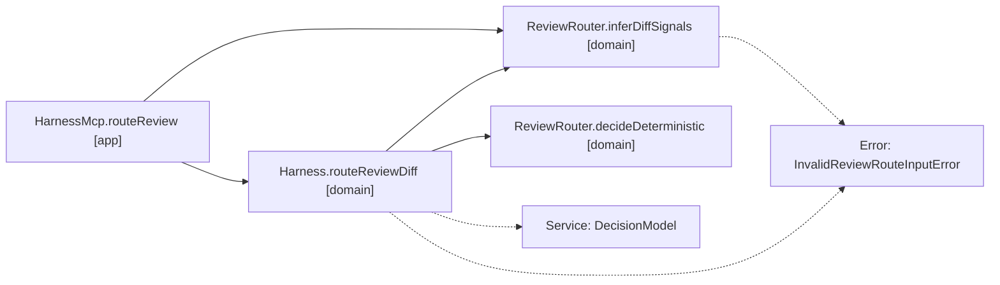

## Context

Today, automated and agent-driven code review in the Effect-TS Harness lacks a typed, deterministic routing contract and precomputed Effect graph context bundle. Reviewing a diff without structured signal extraction causes two opposite failure modes: small, localized diffs over-dispatch multiple specialist reviewers and burn context tokens, while cross-cutting diffs touching `scope:web` atoms, D1/DO migrations, `type:contract` schemas, or framework `type:core` packages miss domain-specific failure modes.

- **Reused Contracts / Errors:** `NxTierTag`, `NxScopeTag`, `EnclosingSymbolName`, `ErrorReasonMessage`, `McpToolName`, `CANONICAL_MCP_TOOL_NAMES`, `stub` from `@harness/contract`
- **Reused Services:** `DecisionModel.DecisionModel` (`effect/ai/DecisionModel`), `LocalDecisionModel` (`@harness/infra`)
- **New Capabilities Needed:** `ReviewRawDiffInput`, `ReviewDiffSignals`, `ReviewRoutingPlan` (`SkipReviewPlan` | `ActiveReviewPlan`), `ReviewerId` (7 specialist lenses), `ReviewDepth`, `ReviewGraphContextBundle`, `ReviewRouteToolOutput`, `InvalidReviewRouteInputError`, `ReviewRouterV1`, `ReviewRouter.inferDiffSignals`, `ReviewRouter.decideDeterministic`, `Harness.routeReviewDiff`, and MCP tool `harness_review_route` (`HarnessMcp.routeReview`).

## Goal

Every code review invocation routes diffs monotonically from deterministic file, tier, scope, and line-count signals—optionally augmented upward by `clef-flash` (`ReviewRouterV1`) within a bounded `1500 millis` timeout—to a closed `ReviewRoutingPlan` and precomputed `ReviewGraphContextBundle` via `harness_review_route`, ensuring trivial changes stay lightweight while high-risk diffs always receive mandatory specialist lenses.

## How to read the requirements

Requirements follow EARS syntax. Each requirement is a single sentence with bold keywords (`When`, `While`, `If ... then`, `Where`) and the modal `shall` or `shall not`.

## Requirements

### 1 · Boundary Validation and Diff Signal Extraction

**Source (Review Routing Contract):** Untrusted file paths and diff metadata must be validated into branded contract types before any deterministic or model-augmented routing runs.

| ID      | Pattern            | Requirement                                                                                                                                                                                             | Effect Symbol                 | Verification |
| ------- | ------------------ | ------------------------------------------------------------------------------------------------------------------------------------------------------------------------------------------------------- | ----------------------------- | ------------ |
| REQ-1.1 | Event-driven       | **When** a valid `ReviewRawDiffInput` is supplied, `ReviewRouter.inferDiffSignals` **shall** return normalized `ReviewDiffSignals` with branded `ReviewSignalPath` entries and boolean surface flags.   | ReviewRouter.inferDiffSignals | UnitTest     |
| REQ-1.2 | Unwanted behaviour | **If** any entry in `ReviewRawDiffInput.changedFiles` is empty, contains a null byte, or attempts `..` path traversal, **then** `ReviewRouter.inferDiffSignals` **shall** fail with `InvalidReviewRouteInputError`. | InvalidReviewRouteInputError  | UnitTest     |

### 2 · Pure Monotonic Deterministic Review Routing

**Source (Monotonic Routing Invariant):** Deterministic routing must be pure (`R = never`) and enforce non-downgradeable depth and specialist reviewer floors from extracted diff signals.

| ID      | Pattern      | Requirement                                                                                                                                                                                               | Effect Symbol                    | Verification |
| ------- | ------------ | --------------------------------------------------------------------------------------------------------------------------------------------------------------------------------------------------------- | -------------------------------- | ------------ |
| REQ-2.1 | Event-driven | **When** evaluating `ReviewDiffSignals`, `ReviewRouter.decideDeterministic` **shall** return a closed `ReviewRoutingPlan` (`SkipReviewPlan` or `ActiveReviewPlan`) with `R = never`.                     | ReviewRouter.decideDeterministic | GraphCheck   |
| REQ-2.2 | Event-driven | **When** `ReviewDiffSignals` indicates zero behavioral risk (trivial docs/comments only), `ReviewRouter.decideDeterministic` **shall** return `SkipReviewPlan` with `depth = "skip"` and empty selections. | ReviewRouter.decideDeterministic | UnitTest     |
| REQ-2.3 | Event-driven | **When** `ReviewDiffSignals` sets any surface flag (`hasAuthOrSecretSurface`, `hasConcurrencyOrResourceChange`, `hasStatefulOrDeciderChange`, `hasWebSurface`, `hasMigrationOrInfraBindingChange`, `hasContractBoundaryChange`, `hasArchitectureOrAdapterSurface`, `hasTestOrSpecChange`), `ReviewRouter.decideDeterministic` **shall** include the corresponding mandatory `ReviewerSelection` in `ActiveReviewPlan`. | ReviewRouter.decideDeterministic | UnitTest     |

### 3 · Hybrid System One Augmentation and MCP Precomputation

**Source (Clef-Flash Integration & MCP Surface):** `Harness.routeReviewDiff` combines deterministic floors with `ReviewRouterV1` (`clef-flash`) monotonically, and `HarnessMcp.routeReview` exposes the precomputed plan and graph context over MCP.

| ID      | Pattern            | Requirement                                                                                                                                                                                                     | Effect Symbol         | Verification |
| ------- | ------------------ | --------------------------------------------------------------------------------------------------------------------------------------------------------------------------------------------------------------- | --------------------- | ------------ |
| REQ-3.1 | Event-driven       | **When** `Harness.routeReviewDiff` invokes `ReviewRouterV1` via `DecisionModel.decide`, `Harness.routeReviewDiff` **shall** only escalate `ReviewDepth` or append additional `ReviewerSelection` entries above the deterministic floor. | Harness.routeReviewDiff | PropertyTest |
| REQ-3.2 | Unwanted behaviour | **If** `DecisionModel.decide` times out after `1500 millis` or fails with a non-interrupt cause, **then** `Harness.routeReviewDiff` **shall** return the deterministic `ReviewRoutingPlan` with `source = "degraded-fallback"`. | Harness.routeReviewDiff | UnitTest     |
| REQ-3.3 | Event-driven       | **When** `harness_review_route` is invoked with `ReviewRawDiffInput`, `HarnessMcp.routeReview` **shall** return `ReviewRouteToolOutput` containing the `ReviewRoutingPlan`, `ReviewDiffSignals`, and `ReviewGraphContextBundle`. | HarnessMcp.routeReview | UnitTest     |

## Assumptions

- **REQ-3.2:** `DecisionModel.decide` uses a `1500 millis` `Effect.timeoutOption` budget matching `IdiomRouterV1` and re-interrupts pure fiber interruptions via `isPureInterruptCause`.
- **REQ-3.3:** `ReviewGraphContextBundle` reuses `resolveNode`, `findTestsReaching`, and ontology governance references already indexed by `@harness/graph`.

## Out of scope

- **Inline code mutation during review.** Specialist reviewers remain strictly read-only; fixes are handed off to implementation agents.

## Verified Plan Topology (`harness plan-check`)

## Known residual risks

- If `clef-flash` is cold or unavailable in local Ollama, `Harness.routeReviewDiff` falls back to `degraded-fallback` deterministic routing, which guarantees all surface-matched mandatory lenses but cannot add semantic escalation for subtle unflagged diffs.

## Acceptance criteria

- All requirement rows pass their declared Verification methods (`UnitTest`, `PropertyTest`, `GraphCheck`).
- `libs/harness/contract`, `libs/harness/decision`, and `apps/harness-mcp` pass `plan-check`, `gc --strict`, and `ontology check --strict`.
- Frontmatter updated to `status: accepted` upon implementation and verified by `pnpm harness verify`.
