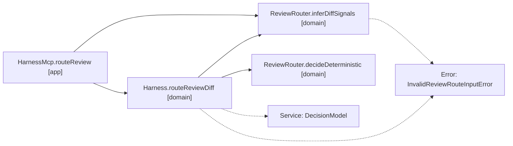

## Context

Without a typed, deterministic review-routing contract, automated and agent-driven code review in the Effect-TS Harness lacks a precomputed Effect graph context bundle and parity across both Antigravity and Claude Code adapters. Reviewing a diff without structured signal extraction causes two opposite failure modes: small, localized diffs over-dispatch multiple specialist reviewers and burn context tokens, while cross-cutting diffs touching `scope:web` atoms, D1/DO migrations, `type:contract` schemas, or framework `type:core` packages miss domain-specific failure modes, and adapter drift risks inconsistent specialist rosters or read-only guarantees.

- **Reused Contracts / Errors:** `NxTierTag`, `NxScopeTag`, `EnclosingSymbolName`, `ErrorReasonMessage`, `McpToolName`, `CANONICAL_MCP_TOOL_NAMES`, `stub` from `@harness/contract`
- **Reused Services:** `DecisionModel.DecisionModel` (`effect/ai/DecisionModel`), `LocalDecisionModel` (`@harness/infra`)
- **New Capabilities Needed:** `ReviewRawDiffInput`, `ReviewDiffSignals`, `ReviewRoutingPlan` (`SkipReviewPlan` | `ActiveReviewPlan`), `ReviewerId` (7 specialist lenses), `ReviewDepth`, `ReviewDepthRank`, `getReviewDepthRank`, `ReviewTimeoutMillis`, `ReviewGraphContextBundle`, `ReviewRouteToolOutput`, `InvalidReviewRouteInputError`, `ReviewRouterV1`, `ReviewRouter.inferDiffSignals`, `ReviewRouter.decideDeterministic`, `Harness.routeReviewDiff`, MCP tool `harness_review_route` (`HarnessMcp.routeReview`), and synchronized 7-specialist read-only `effect-code-review` adapters across Antigravity and Claude Code.

## Goal

Every code review invocation routes non-empty diffs monotonically from a pure deterministic floor over file, tier, scope, and line-count signals—optionally augmented upward by `clef-flash` (`ReviewRouterV1`) within a bounded timeout (default `1500 millis`)—to a closed `ReviewRoutingPlan` and precomputed `ReviewGraphContextBundle` via `harness_review_route`, dispatching strictly read-only specialist reviewers from a synchronized 7-lens roster across Antigravity and Claude Code adapters so trivial documentation edits stay lightweight while code, config, and high-risk diffs always receive mandatory specialist lenses.

## How to read the requirements

Requirements follow EARS syntax. Each requirement is a single sentence with bold keywords (`When`, `While`, `If ... then`, `Where`) and the modal `shall` or `shall not`.

## Requirements

### 1 · Boundary Validation and Diff Signal Extraction

**Source (Review Routing Contract):** Untrusted file paths and diff metadata must be non-empty and validated into normalized branded contract types before any deterministic or model-augmented routing runs.

| ID      | Pattern            | Requirement                                                                                                                                                                                                                                       | Effect Symbol                 | Verification |
| ------- | ------------------ | ------------------------------------------------------------------------------------------------------------------------------------------------------------------------------------------------------------------------------------------------- | ----------------------------- | ------------ |
| REQ-1.1 | Event-driven       | **When** a valid non-empty `ReviewRawDiffInput` is supplied, `ReviewRouter.inferDiffSignals` **shall** return normalized `ReviewDiffSignals` with path-safe branded `ReviewSignalPath` entries and boolean surface flags.                         | ReviewRouter.inferDiffSignals | UnitTest     |
| REQ-1.2 | Unwanted behaviour | **If** `ReviewRawDiffInput.changedFiles` is empty or any entry is empty, exceeds `512` characters, contains a null byte, or attempts path traversal, **then** `ReviewRouter.inferDiffSignals` **shall** fail with `InvalidReviewRouteInputError`. | InvalidReviewRouteInputError  | UnitTest     |

### 2 · Pure Deterministic Review Floor

**Source (Deterministic Floor Invariant):** Deterministic floor routing must be pure (`R = never`), skip only small allowlisted documentation diffs, and select mandatory specialist reviewers from extracted diff signals.

| ID      | Pattern      | Requirement                                                                                                                                                                                                                                                                                                                                                                                                                                                                       | Effect Symbol                    | Verification |
| ------- | ------------ | --------------------------------------------------------------------------------------------------------------------------------------------------------------------------------------------------------------------------------------------------------------------------------------------------------------------------------------------------------------------------------------------------------------------------------------------------------------------------------- | -------------------------------- | ------------ |
| REQ-2.1 | Event-driven | **When** evaluating `ReviewDiffSignals`, `ReviewRouter.decideDeterministic` **shall** return a closed `ReviewRoutingPlan` (`SkipReviewPlan` or `ActiveReviewPlan`) with `R = never`.                                                                                                                                                                                                                                                                                              | ReviewRouter.decideDeterministic | GraphCheck   |
| REQ-2.2 | Event-driven | **When** every path in `ReviewDiffSignals.changedFiles` matches the non-governance documentation allowlist, all boolean surface flags are `false`, and `changedLineCount` is less than `40`, `ReviewRouter.decideDeterministic` **shall** return `SkipReviewPlan` with `depth = "skip"` and empty selections.                                                                                                                                                                     | ReviewRouter.decideDeterministic | UnitTest     |
| REQ-2.3 | Event-driven | **When** `ReviewDiffSignals` sets any surface flag (`hasAuthOrSecretSurface`, `hasConcurrencyOrResourceChange`, `hasStatefulOrDeciderChange`, `hasWebSurface`, `hasMigrationOrInfraBindingChange`, `hasContractBoundaryChange`, `hasArchitectureOrAdapterSurface`, `hasTestOrSpecChange`) or touches any non-documentation file, `ReviewRouter.decideDeterministic` **shall** return `ActiveReviewPlan` with mandatory `ReviewerSelection` entries and deterministic floor depth. | ReviewRouter.decideDeterministic | UnitTest     |

### 3 · Monotonic Hybrid System One Augmentation and MCP Precomputation

**Source (Clef-Flash Integration & MCP Surface):** `Harness.routeReviewDiff` merges the deterministic floor with `ReviewRouterV1` (`clef-flash` scoring `recommendedDepth` and five semantic risk lenses) monotonically, and `HarnessMcp.routeReview` exposes the precomputed plan, manifest warnings, and graph context over MCP.

| ID      | Pattern            | Requirement                                                                                                                                                                                                                                                                                                            | Effect Symbol           | Verification |
| ------- | ------------------ | ---------------------------------------------------------------------------------------------------------------------------------------------------------------------------------------------------------------------------------------------------------------------------------------------------------------------- | ----------------------- | ------------ |
| REQ-3.1 | Event-driven       | **When** `Harness.routeReviewDiff` invokes `ReviewRouterV1` via `DecisionModel.decide`, `Harness.routeReviewDiff` **shall** monotonically preserve or escalate `ReviewDepth` and mandatory floor selections, setting `source = "model-augmented"` only when depth or selections change beyond the deterministic floor. | Harness.routeReviewDiff | PropertyTest |
| REQ-3.2 | Unwanted behaviour | **If** `DecisionModel.decide` times out (default `1500 millis`) or fails with a typed model error, **then** `Harness.routeReviewDiff` **shall** log a warning and return the deterministic `ReviewRoutingPlan` with `source = "degraded-fallback"` and populated `degradedReason`.                                     | Harness.routeReviewDiff | UnitTest     |
| REQ-3.3 | Event-driven       | **When** `harness_review_route` is invoked with non-empty `changedFiles` and required `changedLineCount`, `HarnessMcp.routeReview` **shall** return `ReviewRouteToolOutput` containing the `ReviewRoutingPlan`, `ReviewDiffSignals`, `ReviewGraphContextBundle`, manifest `warnings`, and graph degradation metadata.  | HarnessMcp.routeReview  | UnitTest     |

### 4 · Seven-Specialist Roster, Read-Only Review Skill, and Cross-Adapter Parity

**Source (harness:ADR-0014, Adapter & Skill Governance):** Both Antigravity and Claude Code adapters must ship identical 7-specialist read-only review capabilities, SDO-compliant `effect-code-review` skills, and complete 17-tool MCP documentation without cross-runtime tool leakage.

| ID      | Pattern    | Requirement                                                                                                                                                                                                                                                    | Effect Symbol          | Verification |
| ------- | ---------- | -------------------------------------------------------------------------------------------------------------------------------------------------------------------------------------------------------------------------------------------------------------- | ---------------------- | ------------ |
| REQ-4.1 | Ubiquitous | Both Antigravity and Claude Code adapters **shall** ship all seven read-only specialist reviewer definitions matching `SPECIALIST_REVIEWER_IDS` with runtime-accurate MCP Tooling and Navigation Protocol instructions and the Quote-the-Line output contract. | HarnessMcp.routeReview | UnitTest     |
| REQ-4.2 | Ubiquitous | Both Antigravity and Claude Code adapters **shall** ship the read-only `effect-code-review` skill with `"Use when..."` SDO frontmatter, hard deterministic-gate suppression, and runtime-specific subagent dispatch without cross-adapter tool leakage.        | HarnessMcp.routeReview | UnitTest     |
| REQ-4.3 | Ubiquitous | All adapter skill catalogs and READMEs **shall** document all seventeen `CANONICAL_MCP_TOOL_NAMES` entries including `harness_review_route`.                                                                                                                   | HarnessMcp.routeReview | UnitTest     |

## Assumptions

- **REQ-3.2:** `DecisionModel.decide` uses a configurable `ReviewTimeoutMillis` `Effect.timeoutOption` budget defaulting to `1500 millis` and handles typed model failures via `Effect.catch` so pure fiber interruptions and runtime defects propagate natively.
- **REQ-3.3:** `ReviewGraphContextBundle` reuses `resolveNode`, `findTestsReaching`, and ontology governance references already indexed by `@harness/graph`, and `ReviewRouteToolOutput` floors depth at `focused` whenever manifest tag warnings occur.

## Out of scope

- **Inline code mutation during review.** Specialist reviewers remain strictly read-only; fixes are handed off to implementation agents.

## Verified Plan Topology (`harness plan-check`)

## Known residual risks

- If `clef-flash` is cold or unavailable in local Ollama, `Harness.routeReviewDiff` falls back to `degraded-fallback` deterministic routing (`degradedReason` recorded), which guarantees all surface-matched mandatory lenses and non-doc floors (`>= lite`) but cannot add semantic escalation for subtle unflagged diffs.

## Acceptance criteria

- All requirement rows pass their declared Verification methods (`UnitTest`, `PropertyTest`, `GraphCheck`).
- `libs/harness/contract`, `libs/harness/decision`, and `apps/harness-mcp` pass `plan-check`, `gc --strict`, and `ontology check --strict`.
- Frontmatter updated to `status: accepted` upon implementation and verified by `pnpm harness verify`.
