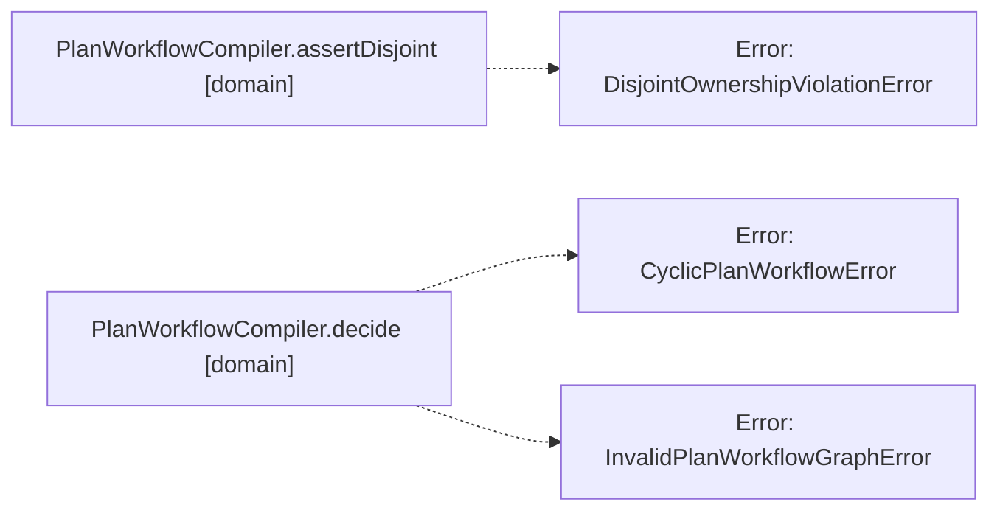

## Context

Orchestrating multi-unit Effect-TS harness plans as deterministic workflows requires typed, boundary-validated contracts in `@harness/contract` and a pure topological DAG compiler in `@harness/gates` that partitions work units into write-disjoint execution waves. Without branded repo identities, path-traversal-safe ownership paths, closed tagged unions, and a deterministic wave compiler, concurrent work units risk overlapping file edits, cyclic dependency deadlocks, or unvalidated primitive boundaries.

- **Reused Contracts / Errors:** `ReviewRoutingPlan`, `stub` from `@harness/contract`; `BenchStageName`, `LatencyMillis`, `StageLatencyBudget` from `@harness/gates`
- **Reused Services:** None (pure `R = never` contract and compiler layer)
- **New Capabilities Needed:** `AbsoluteRepoRoot`, `GitCommitSha`, `WorkflowRunId`, `WorkUnitId`, `OwnedRelPath`, `CompiledWorkUnit` (`SliceUnit` | `PackageUnit`), `CompiledPlan`, `CompileInput`, `CompiledWave`, `CompiledWaves`, `wavesOf`, `PlanGraphIssue`, `CyclicPlanWorkflowError`, `DisjointOwnershipViolationError`, `InvalidPlanWorkflowGraphError`, `PlanWorkflowCompiler.decide`, and `PlanWorkflowCompiler.assertDisjoint`.

## Goal

Every workflow plan compiles through typed, branded `@harness/contract` schemas and `PlanWorkflowCompiler.decide` (`R = never`) into topologically ordered, pairwise write-disjoint `CompiledWaves` with deterministic `wavesOf` grouping, failing fast with typed `InvalidPlanWorkflowGraphError`, `CyclicPlanWorkflowError`, or `DisjointOwnershipViolationError` on malformed, cyclic, or overlapping plans.

## How to read the requirements

Requirements follow EARS syntax. Each requirement is a single sentence with bold keywords (`When`, `While`, `If ... then`, `Where`) and the modal `shall` or `shall not`.

## Requirements

### 1 · Branded Workflow Contracts & Repo Identities

**Source (RFC-0013 §5.1):** All workflow identifiers, repository identities, ownership paths, and state transitions must be validated at schema boundaries as branded scalars and closed tagged unions without raw primitive leaks.

| ID      | Pattern            | Requirement                                                                                                                                                                                                                                                                                                                                               | Effect Symbol    | Verification |
| ------- | ------------------ | --------------------------------------------------------------------------------------------------------------------------------------------------------------------------------------------------------------------------------------------------------------------------------------------------------------------------------------------------------- | ---------------- | ------------ |
| REQ-1.1 | Ubiquitous         | `AbsoluteRepoRoot` and `GitCommitSha` schemas in `@harness/contract` **shall** validate absolute POSIX root paths without null bytes and 40-character lowercase hexadecimal commit SHAs as branded scalar types.                                                                                                                                          | AbsoluteRepoRoot | UnitTest     |
| REQ-1.2 | Unwanted behaviour | **If** an `OwnedRelPath` input is empty, exceeds `512` characters, contains whitespace padding, backslashes, drive letters, or `.` / `..` traversal segments, **then** `OwnedRelPath` **shall** reject decoding while `CompiledWorkUnit`, `UnitMode`, `UnitRejection`, `UnitEscalation`, `UnitOutcome`, and `PlanGraphIssue` remain closed tagged unions. | OwnedRelPath     | UnitTest     |
| REQ-1.3 | Event-driven       | **When** `wavesOf` receives a `CompiledPlan` or `CompiledWaves`, `wavesOf` **shall** return `CompiledWave` groups sorted by `waveIndex` ascending with each wave's units sorted by `unitId` lexicographically.                                                                                                                                            | wavesOf          | PropertyTest |

### 2 · Pure Topological DAG Wave Compilation & Disjointness

**Source (RFC-0013 §5.2):** Plan compilation must be pure (`R = never`), reject duplicate or dangling graph inputs and cycles, enforce topological monotonicity and pairwise write-disjointness per wave, and stay within sub-millisecond latency budgets.

| ID      | Pattern            | Requirement                                                                                                                                                                                                                                                         | Effect Symbol                   | Verification |
| ------- | ------------------ | ------------------------------------------------------------------------------------------------------------------------------------------------------------------------------------------------------------------------------------------------------------------- | ------------------------------- | ------------ |
| REQ-2.1 | Unwanted behaviour | **If** `CompileInput.units` contains duplicate `WorkUnitId` entries, **then** `PlanWorkflowCompiler.decide` **shall** fail with `InvalidPlanWorkflowGraphError` carrying `DuplicateWorkUnitId`.                                                                     | InvalidPlanWorkflowGraphError   | UnitTest     |
| REQ-2.2 | Unwanted behaviour | **If** `CompileInput.dependencies` references a `from` or `to` `WorkUnitId` absent from `CompileInput.units`, **then** `PlanWorkflowCompiler.decide` **shall** fail with `InvalidPlanWorkflowGraphError` carrying `DanglingUnitDependency`.                         | InvalidPlanWorkflowGraphError   | UnitTest     |
| REQ-2.3 | Unwanted behaviour | **If** the dependency graph in `CompileInput` contains a cycle or self-loop, **then** `PlanWorkflowCompiler.decide` **shall** fail with `CyclicPlanWorkflowError` listing the cycle `WorkUnitId`s while keeping `R = never`.                                        | CyclicPlanWorkflowError         | GraphCheck   |
| REQ-2.4 | Event-driven       | **When** compiling an acyclic `CompileInput`, `PlanWorkflowCompiler.decide` **shall** assign `waveIndex` values satisfying `wave(u) < wave(v)` for every dependency `(u, v)` and split levels via first-fit into pairwise `ownedRelPaths`-disjoint `CompiledWave`s. | PlanWorkflowCompiler.decide     | PropertyTest |
| REQ-2.5 | Unwanted behaviour | **If** any two units in a `CompiledWave` share an `OwnedRelPath`, **then** `PlanWorkflowCompiler.assertDisjoint` **shall** fail with `DisjointOwnershipViolationError` listing `waveIndex` and `overlappingPaths`.                                                  | DisjointOwnershipViolationError | UnitTest     |
| REQ-2.6 | Ubiquitous         | `DEFAULT_STAGE_LATENCY_BUDGETS` in `@harness/gates` **shall** enforce `p50BudgetMs <= 2` and `p95BudgetMs <= 6` for `PlanWorkflowCompiler.decide`.                                                                                                                  | PlanWorkflowCompiler.decide     | TraceTest    |

## Assumptions

- **REQ-2.4:** Dependency edges `(from, to)` represent `from` must complete before `to` (`wave(from) < wave(to)`), and `OwnedRelPath` equality is exact string equality after schema validation.

## Out of scope

- **Workflow execution engine, Omnigraph storage driver, and CLI/MCP runner wiring.** Covered in subsequent RFC-0013 waves (WF-2 through WF-5).

## Verified Plan Topology (`harness plan-check`)

## Known residual risks

- First-fit sub-wave splitting preserves topological monotonicity and disjointness deterministically, though pathological write-overlap graphs may serialize more units than an optimal graph-coloring schedule.

## Acceptance criteria

- All requirement rows pass their declared Verification methods (`UnitTest`, `PropertyTest`, `GraphCheck`, `TraceTest`).
- `libs/harness/contract` and `libs/harness/gates` pass `plan-check`, `gc --strict`, and `ontology check --strict`.
- Frontmatter updated to `status: accepted` upon implementation and verified by `pnpm harness verify`.
