## Context

Telemetry analysis of multi-hour review and verification runs revealed four compounding execution bottlenecks in the Effect-TS Engineering Harness: repeated `harness mutate --strict` invocations re-ran every Vitest test across every killed mutant without `--bail=1` or cross-run caching, large monolithic gate test suites (`2,600` to `4,059` lines) unnecessarily widened mutation reaching sets, every Antigravity hook spawned Node with cold TypeScript loader resolution that eagerly loaded `@harness/graph` and `typescript` alongside redundant `buildSessionReport` computation on `PreInvocation`, and workers bypassed Nx caching (`--skip-nx-cache`) while unisolated Vitest subprocess tests polluted `.harness/telemetry-log.jsonl`.

- **Reused Contracts / Errors:** `AstSourceFilePath`, `ContentSha256`, `NonNegativeCount`, `compareCodeUnits`, `computeContentSha256` from `@harness/contract`
- **Reused Services:** `SyncHostIo` from `@harness/service/host-io`; `WorkspaceFs`, `HarnessSubprocessRunner`, `AstGateCachePort`, `DecisionCachePort`, `UnixSocketDaemonPort`, `ActiveMutantContext` from `@harness/service`
- **New Capabilities Needed:** `MutationCacheEntry`, `MutationCacheStore`, `MutationCacheLookupInput`, `MutationCacheLookupDecision`, `MutationCache.decide`, `computeMutantCacheKey`, `computeMutationContextDigests`, `loadMutationCache`, `saveMutationCacheAtomic`, `@harness/gates/hook-fastpath`, `@harness/decision/hook-fastpath`, `@harness/infra/hook-fastpath`, `@harness/graph/cluster-resolver`, `SKIP_NX_CACHE_BANNED_REASON`, `explainCommandDenyReason`, `isSkipNxCacheCommand`, `shouldSuppressLiveRepoTestSideEffects`, `shouldRequireLiveOllama`, `isWorkspaceTsSourceFileName`, and `tryReadPreInvocationSessionCache`.

## Goal

Every hook invocation avoids eager `typescript` and `@harness/graph` barrel loads while serving clean `PreInvocation` state from a fingerprint-validated fast-path cache, `harness mutate --strict` executes reaching tests fail-fast (`--bail=1`) backed by a content-addressable `.harness/cache/mutation-cache-v1.json` cache and modular `< 2,000`-line test files, `classifyCommand` blocks unapproved `--skip-nx-cache` runs, and Vitest test suites leave live `.harness/telemetry-log.jsonl` and `.harness/friction-log.jsonl` untouched.

## How to read the requirements

Requirements follow EARS syntax. Each requirement is a single sentence with bold keywords (`When`, `While`, `If ... then`, `Where`) and the modal `shall` or `shall not`.

## Requirements

### 1 · Fail-Fast Mutant Execution & Content-Addressable Mutant Cache

**Source (`libs/harness/contract/src/mutation-cache.ts`, `libs/harness/gates/src/mutation/mutation-cache.ts`, `mutation-check.ts`, `mutation-subprocess-helpers.ts`, `tools/parallel-vitest-batch.mjs`):** Repeated strict mutation runs must terminate each mutant on the first failing test and skip re-executing previously killed mutants whose source, mutant schema, reaching tests, and workspace dependencies have not changed.

| ID      | Pattern            | Requirement                                                                                                                                                                                                                                                                                                                                                                                                                                                                                                                                           | Effect Symbol        | Verification |
| ------- | ------------------ | ----------------------------------------------------------------------------------------------------------------------------------------------------------------------------------------------------------------------------------------------------------------------------------------------------------------------------------------------------------------------------------------------------------------------------------------------------------------------------------------------------------------------------------------------------- | -------------------- | ------------ |
| REQ-1.1 | Event-driven       | **When** `runVitestTargetList` or `parallel-vitest-batch.mjs` executes Vitest for an active mutant (`HARNESS_ACTIVE_MUTANT_ID`), the runner **shall** pass `--bail=1` while keeping the unmutated baseline run without `--bail=1`.                                                                                                                                                                                                                                                                                                                    | MutationCache.decide | UnitTest     |
| REQ-1.2 | Event-driven       | **When** `computeMutationContextDigests`, `computeMutantCacheKey`, and `MutationCache.decide` evaluate candidate mutant keys against `MutationCacheStore`, `MutationCache.decide` **shall** partition candidates into `hitKeys` and `missKeys` using SHA-256 digests bound to `"mutation-cache-v1"`, target source, compiled mutant schema, mutant descriptor, workspace `libs/*/*/src/**/*.{ts,tsx}` sources, workspace config/tool runners, cross-package `test/` helpers, and reaching test files, without caching `Signaled` or `TimedOut` kills. | MutationCache.decide | PropertyTest |
| REQ-1.3 | Unwanted behaviour | **If** `.harness/cache/mutation-cache-v1.json` is missing, unreadable, symlinked, or fails `MutationCacheStore` schema decoding, **then** `loadMutationCache` **shall** degrade safely to an empty store and re-evaluate mutants without minting unverified kills, and `--no-cache` (`disableMutantCache: true`) **shall** bypass cache reads.                                                                                                                                                                                                        | MutationCache.decide | UnitTest     |

### 2 · Sub-50ms Hook Cold-Start & PreInvocation Session Fast-Path

**Source (`tools/node-ts-resolver.mjs`, `@harness/gates/hook-fastpath`, `@harness/decision/hook-fastpath`, `@harness/infra/hook-fastpath`, `@harness/graph/cluster-resolver`, `apps/harness-cli/src/**`):** Per-turn hooks (`guard`, `route`, `session --format=antigravity`) must start without loading `typescript` or full graph analysis modules and avoid redundant `buildSessionReport` or AST scans when workspace state is unchanged.

| ID      | Pattern      | Requirement                                                                                                                                                                                                                                                                                                                                                                                                                                                                                                                                                                                                        | Effect Symbol              | Verification |
| ------- | ------------ | ------------------------------------------------------------------------------------------------------------------------------------------------------------------------------------------------------------------------------------------------------------------------------------------------------------------------------------------------------------------------------------------------------------------------------------------------------------------------------------------------------------------------------------------------------------------------------------------------------------------ | -------------------------- | ------------ |
| REQ-2.1 | Event-driven | **When** `tools/node-ts-resolver.mjs` initializes and resolves workspace `@harness/*` package `"exports"` or relative `.js` specifiers under `libs/` and `apps/`, `node-ts-resolver.mjs` **shall** enable V8 compile caching outside the repo tree and resolve existing `.ts`/`.tsx` targets only when a literal `.js` file is absent on disk, while the four zero-`typescript` subpaths (`@harness/gates/hook-fastpath`, `@harness/decision/hook-fastpath`, `@harness/infra/hook-fastpath`, `@harness/graph/cluster-resolver`) **shall** expose hook primitives without loading `@harness/graph` or `typescript`. | Harness.decideGuardCommand | UnitTest     |
| REQ-2.2 | Event-driven | **When** `handleDoctorOrSession` runs with `--format=antigravity`, `handleDoctorOrSession` **shall** skip unused `buildSessionReport` computation and serve `.harness/session-preinvocation-cache.json` only when `HARNESS_REQUIRE_OLLAMA` is not `"1"` and `HEAD`, `.harness/*` state file stats (including content-hashed `graph-snapshot.json` and conditional `telemetry-log.jsonl` when `friction-log.jsonl` is non-empty), `tsgo`/cluster config files, git porcelain status + untracked/dirty files, endpoint env config, and a 15-second `ollamaProbed` TTL match.                                         | SessionHandoff.decide      | UnitTest     |

### 3 · Deterministic Nx Cache Guard & Focused Gate Test Partitioning

**Source (`libs/harness/gates/src/policy.ts`, `libs/harness/decision/src/triage-decision.ts`, `libs/harness/gates/test/*.test.ts`):** Routine commands must preserve Nx caching unless explicitly authorized, and gate test files must stay modular so mutation reaching sets isolate individual source modules.

| ID      | Pattern            | Requirement                                                                                                                                                                                                                                                                                                                                              | Effect Symbol         | Verification |
| ------- | ------------------ | -------------------------------------------------------------------------------------------------------------------------------------------------------------------------------------------------------------------------------------------------------------------------------------------------------------------------------------------------------- | --------------------- | ------------ |
| REQ-3.1 | Unwanted behaviour | **If** a shell command invokes `nx` or an Nx-wrapping runner script with `--skip-nx-cache` without `HARNESS_ALLOW_SKIP_NX_CACHE=1`, **then** `classifyCommand` **shall** return `"deny"`, `explainCommandDenyReason` **shall** supply `SKIP_NX_CACHE_BANNED_REASON`, and `Harness.triageFailure` **shall** triage the denial deterministically in `0ms`. | Harness.triageFailure | UnitTest     |
| REQ-3.2 | State-driven       | **While** `@harness/gates` test suites are partitioned across `libs/harness/gates/test/*.test.ts`, every `.test.ts` file in `libs/harness/gates/test/` **shall** remain at or below `2000` lines so `partitionReachingTestFiles` isolates reaching Vitest runs by module concern.                                                                        | MutationCheck.decide  | UnitTest     |

### 4 · Live Workspace Telemetry & Friction Isolation Under Vitest

**Source (`apps/harness-cli/src/index.ts`, `apps/harness-cli/src/commands/daemon-and-omnigraph.service.ts`, `apps/harness-cli/src/commands/session-learn-report.command.ts`, `apps/harness-cli/src/commands/verify-and-done.command.ts`):** In-process Vitest tests must not pollute the repository's live `.harness/` telemetry, friction logs, or session reports.

| ID      | Pattern      | Requirement                                                                                                                                                                                                                                                                                                                                                                                                                                        | Effect Symbol        | Verification |
| ------- | ------------ | -------------------------------------------------------------------------------------------------------------------------------------------------------------------------------------------------------------------------------------------------------------------------------------------------------------------------------------------------------------------------------------------------------------------------------------------------- | -------------------- | ------------ |
| REQ-4.1 | State-driven | **While** `HARNESS_DISABLE_LIVE_TELEMETRY=1` (set by `vitest.config.ts`) or `HARNESS_TEST_ISOLATION=1` is set without an explicit `HARNESS_STATE_DIR` and the target `repoRoot` resolves to `CLI_REPO_ROOT`, `runCliEffect`, `recordTelemetry`, `recordFriction`, `writeDoneSessionReport`, and `writeSessionReportFiles` **shall** suppress writes to `CLI_REPO_ROOT/.harness/` while preserving writes to temporary test `repoRoot` directories. | SessionReport.decide | UnitTest     |

## Assumptions

- **REQ-1.2:** Hashing all `libs/*/*/src/**/*.{ts,tsx}` sources plus cross-package `test/` non-test helpers, root/package configs, tool runners, and reaching test files guarantees zero false cache hits even when transitive workspace imports or harness runners change.
- **REQ-2.1:** Enabling V8 bytecode caching under `os.tmpdir()` (overridable via `NODE_COMPILE_CACHE`) avoids modifying the hashed workspace tree Hash (`verify-stamp.json` / `mutate-stamp.json`).

## Out of scope

- Pre-bundling `apps/harness-cli` into a checked-in dist binary or running persistent background daemon processes automatically in hook scripts.

## Known residual risks

- Uncommitted non-Vitest external runtime changes (e.g., Node.js version upgrades) are not hashed into `mutation-cache-v1.json`; pass `--no-cache` to bypass cached kill entries on demand.

## Acceptance criteria

- All requirement rows pass their declared Verification methods (`UnitTest` and `PropertyTest`).
- `pnpm harness gc --strict`, `pnpm harness ontology check --strict`, `pnpm harness mutate --strict`, `CI=true pnpm harness verify`, and `CI=true pnpm harness done` pass after `status: accepted`.

## 4. Verified Plan Topology Graph

```mermaid
flowchart TD
  1690["Spec:harness:SPEC-0019 #40;Harness Execution Speed, Incremental Mutant Caching, and Hook Fast-Path#41;"]
  1691["Trace: TraceabilityTuple:specifies:harness:SPEC-0019-#gt;EffectFn:libs/harness/gates/src/mutation/mutation-cache.ts#35;decideMutationCacheLookup"]
  1692["Trace: TraceabilityTuple:specifies:harness:SPEC-0019-#gt;EffectFn:libs/harness/gates/src/mutation/mutation-outcomes.ts#35;decideMutationReport"]
  1693["Trace: TraceabilityTuple:specifies:harness:SPEC-0019-#gt;EffectFn:libs/harness/decision/src/guard-decision.ts#35;decideGuardCommand"]
  1694["Trace: TraceabilityTuple:specifies:harness:SPEC-0019-#gt;EffectFn:libs/harness/decision/src/triage-decision.ts#35;triageFailure"]
  1695["Trace: TraceabilityTuple:specifies:harness:SPEC-0019-#gt;EffectFn:libs/harness/gates/src/session-handoff.ts#35;decideSessionHandoff"]
  1696["Trace: TraceabilityTuple:specifies:harness:SPEC-0019-#gt;EffectFn:libs/harness/gates/src/telemetry.ts#35;decideSessionReport"]
  84["MutationCache.decide #91;domain#93;"]
  85["MutationCheck.decide #91;domain#93;"]
  49["Harness.decideGuardCommand #91;domain#93;"]
  67["Harness.triageFailure #91;domain#93;"]
  101["SessionHandoff.decide #91;domain#93;"]
  103["SessionReport.decide #91;domain#93;"]
  1691 -->|"PlaysRole:specifying-ears"| 1690
  1691 -->|"PlaysRole:realizing-symbol"| 84
  1692 -->|"PlaysRole:specifying-ears"| 1690
  1692 -->|"PlaysRole:realizing-symbol"| 85
  1693 -->|"PlaysRole:specifying-ears"| 1690
  1693 -->|"PlaysRole:realizing-symbol"| 49
  1694 -->|"PlaysRole:specifying-ears"| 1690
  1694 -->|"PlaysRole:realizing-symbol"| 67
  1695 -->|"PlaysRole:specifying-ears"| 1690
  1695 -->|"PlaysRole:realizing-symbol"| 101
  1696 -->|"PlaysRole:specifying-ears"| 1690
  1696 -->|"PlaysRole:realizing-symbol"| 103
```

