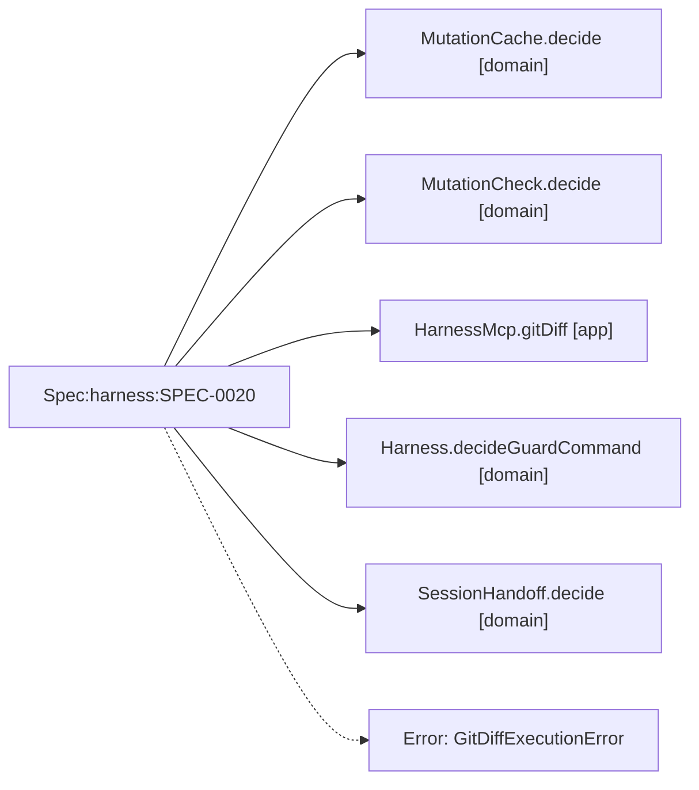

## Context

Telemetry audits of multi-round code-review resolution loops exposed six interacting execution bottlenecks: monolithic `workspaceSrcDigest` cache keys invalidated all cached killed mutants whenever unrelated workspace files or specs changed, unbatched per-file Vitest baselines ran repeatedly across files in the same package, read-only specialist reviewers lacked a bounded git-diff MCP tool, shell guard rules inspected raw quoted text for `|` and multi-character `[...]` patterns (`1,500ms` timeouts), `session --format=antigravity` self-invalidated its cache via `telemetry-log.jsonl` over a 15-second TTL, and Nx prompted interactively when top-level `"analytics": false` was omitted from `nx.json`.

- **Reused Contracts / Errors:** `AstSourceFilePath`, `ContentSha256`, `ErrorReasonMessage`, `McpToolName`, `CANONICAL_MCP_TOOL_NAMES`, `WorkspaceFilePath`, `compareCodeUnits`, `computeContentSha256`, `stub` from `@harness/contract`; `ProjectPathEscapeError` from `apps/harness-mcp`
- **Reused Services:** `SyncHostIo` (`@harness/service/host-io`), `nodeSyncHostIo` (`@harness/infra`)
- **New Capabilities Needed:** `GitDiffErrorReason`, `GitDiffExecutionError`, `GitDiffToolResult`, `BatchMutantResultsSchema`, `harness_git_diff` (`CANONICAL_MCP_TOOL_NAMES` expanded to 17 tools), `computeFileMutationClosureDigest`, `readBytesPrefixSync`, batched per-package baseline verification with per-file fallback, per-worker `HARNESS_STATE_DIR` isolation and solo confirmation in `runVitestTargetList`, `--diff` (`diffOnly`) filtering in `handleMutate` / `runDomainMutationSuite`, `CommandView.unclosedQuote`, `CommandView.hasDoubleQuotedSubstitution`, `CommandView.hasAnsiCQuote`, `isWorkspaceRelPathIncludedInStamp`, and `.harness/last-done.json` cache fingerprinting with a `300_000`ms TTL.

## Goal

Every `harness mutate` run isolates mutant cache invalidation to each target file's transitive dependency closure and touched repo-asset buckets while running a single unmutated baseline per `(scope, pkgDir)` and supporting `--file ... --diff`, `harness-mcp` exposes `harness_git_diff` as its 17th canonical read-only MCP tool across both adapters, `classifyCommand` evaluates shell operators and regex character classes quote-awarely, `session` preserves a 300-second self-stable cache backed by `.harness/last-done.json`, and `nx.json` disables interactive analytics prompts at top level.

## How to read the requirements

Requirements follow EARS syntax. Each requirement is a single sentence with bold keywords (`When`, `While`, `If ... then`, `Where`) and the modal `shall` or `shall not`.

## Requirements

### 1 · Per-File Import-Closure Mutant Cache, Batched Package Baselines & Diff-Only File Runs

**Source (`libs/harness/gates/src/mutation/*`, `libs/harness/gates/src/mutation-check.ts`, `mutation-subprocess-helpers.ts`, `apps/harness-cli/src/commands/mutate-and-bench.command.ts`):** Narrowing cache keys to transitive dependency closures, batching package baselines, and supporting `--file ... --diff` eliminate cold full-suite bottlenecks in review-fix loops without sacrificing cache soundness.

| ID      | Pattern      | Requirement                                                                                                                                                                                                                                                                                                                                                                                                                                                                                                                                                            | Effect Symbol        | Verification |
| ------- | ------------ | ---------------------------------------------------------------------------------------------------------------------------------------------------------------------------------------------------------------------------------------------------------------------------------------------------------------------------------------------------------------------------------------------------------------------------------------------------------------------------------------------------------------------------------------------------------------------- | -------------------- | ------------ |
| REQ-1.1 | Event-driven | **When** `computeMutationContextDigestsChecked`, `computeFileMutationClosureDigest`, and `computeMutantCacheKey` derive mutant cache keys for `(relFile, allReachingTests)`, `MutationCache.decide` **shall** bind each key to `rootRuntimeDigest`, the exact installed Vitest version, the transitive TS/JS import closure plus explicit present/absent package/test-helper digests (falling back to `allLibsSrcDigest` on unresolved imports or missing `"exports"` targets), and conditional repo-asset bucket digests referenced by the closure or reaching tests. | MutationCache.decide | PropertyTest |
| REQ-1.2 | Event-driven | **When** `runDomainMutationSuite` and `runVitestTargetList` evaluate mutants across candidate files, `MutationCheck.decide` **shall** execute one unmutated Vitest package baseline per `(scope, pkgDir)` with per-file fallback while isolating parallel batch workers (`HARNESS_STATE_DIR`), confirming batch `TimedOut`/unconfirmed `Exited(1)` mutants solo (`concurrency=1`), preserving signal names, and failing closed (`abort`) on `Signaled`, missing pass summaries, or persistent timeouts.                                                                | MutationCheck.decide | UnitTest     |
| REQ-1.3 | Event-driven | **When** `handleMutate` or `runDomainMutationSuite` runs with `--file` and `--diff` (`diffOnly: true` without `--all`), `MutationCheck.decide` **shall** restrict candidate mutants in `targetFiles` to git-diff modified lines without writing `.harness/mutate-stamp.json`.                                                                                                                                                                                                                                                                                          | MutationCheck.decide | UnitTest     |

### 2 · Read-Only `harness_git_diff` MCP Tool & 17-Tool Cross-Adapter Parity

**Source (`libs/harness/contract/src/workspace-and-process.ts`, `apps/harness-mcp/src/tools/git-diff.tools.ts`, `adapters/**`, `README.md`):** Exposing bounded git diffs natively over MCP eliminates multi-minute blind file scanning by read-only specialist reviewers.

| ID      | Pattern            | Requirement                                                                                                                                                                                                                                                                                                                                                                                                                                                                                                                                                            | Effect Symbol         | Verification |
| ------- | ------------------ | ---------------------------------------------------------------------------------------------------------------------------------------------------------------------------------------------------------------------------------------------------------------------------------------------------------------------------------------------------------------------------------------------------------------------------------------------------------------------------------------------------------------------------------------------------------------------- | --------------------- | ------------ |
| REQ-2.1 | Event-driven       | **When** `harness_git_diff` is invoked with optional `repoRoot`, `baseRef`, `paths`, `statOnly`, and `maxPatchChars`, `HarnessMcp.gitDiff` **shall** return a closed discriminated `GitDiffToolResult` (`StatOnly`, `PatchComplete`, `PatchBudgetZero`, `PatchTruncated`) using bounded prefix reads (`readBytesPrefixSync`) via `git --no-optional-locks` capped at `maxPatchChars` (default `120000`, max `400000`) with non-omitting untracked notices while documenting all 17 `CANONICAL_MCP_TOOL_NAMES` identically across Antigravity and Claude Code adapters. | HarnessMcp.gitDiff    | UnitTest     |
| REQ-2.2 | Unwanted behaviour | **If** `baseRef` starts with `-` or contains whitespace or control characters, direct inputs violate bounds (`maxPatchChars < 0`, non-finite, or non-integer), `paths` escape `repoRoot`, an untracked regular file is unreadable, or `git merge-base`/`git diff` fails, **then** `HarnessMcp.gitDiff` **shall** fail closed with `GitDiffExecutionError` or `ProjectPathEscapeError`.                                                                                                                                                                                 | GitDiffExecutionError | UnitTest     |

### 3 · Quote-Aware Shell Guard, Self-Stable PreInvocation Cache & Non-Interactive Nx

**Source (`libs/harness/gates/src/policy-shell-parser.ts`, `policy.ts`, `apps/harness-cli/src/commands/mutate-and-bench.command.ts`, `session-fastpath.ts`, `nx.json`):** Eliminating false-positive `clef-flash` escalations on quoted `rg` regexes, eliminating cache self-invalidation in `session`, and adding top-level `analytics: false` in `nx.json` cut per-turn hook overhead and prevent interactive Nx hangs.

| ID      | Pattern      | Requirement                                                                                                                                                                                                                                                                                                                                                                                                                                                                                                        | Effect Symbol              | Verification |
| ------- | ------------ | ------------------------------------------------------------------------------------------------------------------------------------------------------------------------------------------------------------------------------------------------------------------------------------------------------------------------------------------------------------------------------------------------------------------------------------------------------------------------------------------------------------------ | -------------------------- | ------------ |
| REQ-3.1 | Event-driven | **When** `toCommandView` and `classifyCommand` inspect a shell command, `classifyCommand` **shall** normalize `\<newline>` continuations and evaluate `SHELL_OPERATORS`, pipe/conjunction segmentation, `<(...)`/`>(...)` process substitution, and quote-adjacent unquoted bracket globs on `view.unquoted` while escalating `view.unclosedQuote`, `view.hasDoubleQuotedSubstitution`, `view.hasAnsiCQuote`, and single-character/empty-quote `OBFUSCATION_PATTERNS` on normalized raw `command`.                 | Harness.decideGuardCommand | UnitTest     |
| REQ-3.2 | Event-driven | **When** `handleDoctorOrSession` evaluates `.harness/session-preinvocation-cache.json` with a `300000`ms TTL, `computePreInvocationFingerprint` **shall** hash `.harness/last-done.json` (written via `writeDoneSessionReport`/`writeLastDoneMarker` and write-denied by `classifyFileWrite`) and non-ignored workspace artifacts filtered by `isWorkspaceRelPathIncludedInStamp` instead of `telemetry-log.jsonl` so `session` calls never self-invalidate clean caches or miss stale `verify-stamp.json` inputs. | SessionHandoff.decide      | UnitTest     |

## Assumptions

- **REQ-1.1:** Any file containing unresolvable non-literal dynamic `import(...)` expressions or scanning `libs/` paths dynamically falls back to mixing `allLibsSrcDigest` into its closure digest to remain sound.
- **REQ-2.1:** `harness_git_diff` runs read-only git porcelain/diff commands with `git --no-optional-locks` and never acquires repository lock files.

## Out of scope

- Replacing Vitest subprocess execution with persistent worker threads inside `@harness/gates`.

## Verified Plan Topology (`harness plan-check`)

## Known residual risks

- Files that resolve sibling modules purely via computed runtime strings (not static/dynamic string-literal imports and not matching `libs/` dynamic-scan heuristics) rely on `allLibsSrcDigest` fallback detection; pass `--no-cache` to bypass cached kill entries on demand.

## Acceptance criteria

- All requirement rows pass their declared Verification methods (`UnitTest` and `PropertyTest`).
- `pnpm harness gc --strict`, `pnpm harness ontology check --strict`, `pnpm harness mutate --strict`, `CI=true pnpm harness verify`, and `CI=true pnpm harness done` pass after `status: accepted`.
