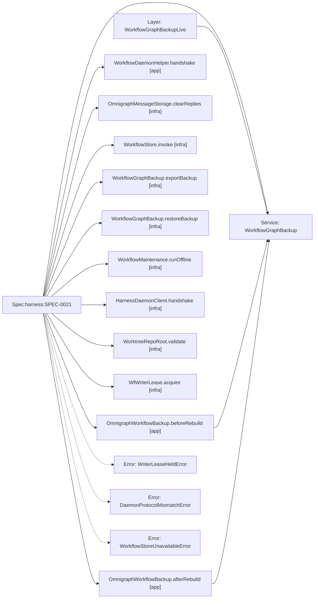

## Context

Durable Effect v4 workflows require a persistent, single-writer `MessageStorage.Encoded` driver backed by `@modernrelay/omnigraph` (`harness-workflows` graph), isolated from `harness` branch overwrites executed during `done`. Operating safely across linked git worktrees on Linux also requires resolving the canonical daemon socket under `<git-common-dir>/harness/daemon.sock`, fencing concurrent daemon processes with an OS advisory lock and monotonic `leaseEpoch`, enforcing versioned `workflow.handshake` verification before IPC calls, backing up and restoring `harness-workflows` via a crash-safe `pending-workflow-restore.json` journal across clean cluster rebuilds, bounding Lance MVCC growth via offline maintenance, and denying agent shell/file access to protected harness runtime state (`<git-common-dir>/harness/**`, `auth-tokens.json`, `daemon.sock`, `daemon.lock`, `workflow-backups/`).

- **Reused Contracts / Errors:** `AbsoluteRepoRoot`, `DaemonSocketPath`, `WorkspaceFsError`, `stub` from `@harness/contract`
- **Reused Services:** `OmnigraphClient`, `makeWorkflowOmnigraphClient`, `resolveWorkflowOmnigraphConfig`, `WORKFLOW_OMNIGRAPH_GRAPH_ID` from `@harness/graph`; `UnixSocketDaemonPort` from `@harness/service`
- **New Capabilities Needed:** `SeqKey`, `encodeSeqKey`, `decodeSeqKey`, `LeaseEpoch`, `LeaseHolderId`, `LeaseFilePath`, `LeaseHolderPid`, `WorkflowProtocolVersion`, `WORKFLOW_DAEMON_PROTOCOL_VERSION`, `WorkflowDaemonCapability`, `DaemonProtocolMismatchDetail`, `GitCommonDirPath`, `WorktreePathKind`, `ValidatedWorktreeRoot`, `DaemonHandshakeRequest`, `DaemonHandshakeResponse`, `BackupDirPath`, `WorkflowBackupFilePath`, `WorkflowBackupCount`, `WorkflowBackupTimestampMs`, `BackupFileHash`, `WorkflowBackupMode`, `WorkflowBackupSummary`, `WorkflowRestoreRequest` (with `expectedSha256`), `WorkflowRestoreSummary`, `WorkflowStoreOperation`, `WorkflowStoreFailureReason`, `WriterLeaseHeldError`, `DaemonProtocolMismatchError`, `WorkflowStoreUnavailableError`, `WorkflowGraphBackup` (`@harness/service`), `makeOmnigraphMessageStorageLayer`, `makeHarnessWorkflowEngineLayer`, `acquireWriterLease`, `validateWorktreeRepoRoot`, `handshakeWorkflowDaemon`, `handleWorkflowDaemonHandshake`, `WorkflowGraphBackupLive`, `runOfflineWorkflowMaintenance`, `beforeRebuildWorkflowBackup`, and `afterRebuildWorkflowBackup`.

## Goal

Every workflow engine mailbox operation persists atomically to the isolated `harness-workflows` graph inside a single-writer fenced daemon anchored at `<git-common-dir>/harness/daemon.sock`, with fail-closed cluster rebuild backups (`pending-workflow-restore.json` + `expectedSha256`), offline Lance compaction/cleanup (`--keep 1 --confirm`), versioned daemon handshakes, and deterministic guard denials over protected harness runtime state.

## How to read the requirements

Requirements follow EARS syntax. Each requirement is a single sentence with bold keywords (`When`, `If ... then`) and the modal `shall` or `shall not`.

## Requirements

### 1 · Omnigraph Workflow Storage Driver, Concurrency & Writer Lease (RFC-0013 `REQ-2.1..REQ-2.6`)

**Source (RFC-0013 §5.3, §10.2 `REQ-2.1..REQ-2.6`, §10.3 item 2):** Persistence in `harness-workflows` must preserve `MessageStorage.Encoded` semantics, serialize concurrent mutations, bound actor HTTP concurrency, fence stale writers, and surface outage errors cleanly.

| ID      | Pattern            | Requirement                                                                                                                                                                                                                                                                                                                                                                  | Effect Symbol                        | Verification |
| ------- | ------------------ | ---------------------------------------------------------------------------------------------------------------------------------------------------------------------------------------------------------------------------------------------------------------------------------------------------------------------------------------------------------------------------- | ------------------------------------ | ------------ |
| REQ-1.1 | Event-driven       | **When** `OmnigraphMessageStorage` executes `saveEnvelope` with a non-null primary key matching an existing `WfMessage` row, `OmnigraphMessageStorage` **shall** return `Duplicate` carrying the stored `lastReceivedReply` under continuous `writeMutex` serialization.                                                                                                     | WorkflowStore.invoke                 | UnitTest     |
| REQ-1.2 | Event-driven       | **When** `OmnigraphMessageStorage` queries `unprocessedMessages` for due shard envelopes, `OmnigraphMessageStorage` **shall** group `opts.addresses` by `entityType` inside GQ 2.1 (`wf_unprocessed_candidate_messages_for_addresses`) before `limit` and order due, unclaimed rows by 20-character zero-padded `SeqKey` ascending.                                          | WorkflowStore.invoke                 | UnitTest     |
| REQ-1.3 | Event-driven       | **When** `OmnigraphMessageStorage.clearReplies` removes replies for a request, `OmnigraphMessageStorage.clearReplies` **shall** hold `writeMutex` continuously across the `D2` two-commit `$expectedReplyId` CAS sequence, preserve `Interrupt` envelopes (`where requestId = $requestId`), and execute single-shot Commit-2 compensation via `wf_repair_dangling_requests`. | OmnigraphMessageStorage.clearReplies | UnitTest     |
| REQ-1.4 | Ubiquitous         | `WorkflowStore.invoke` **shall** bound process-wide Omnigraph HTTP requests through one shared `WORKFLOW_MAX_CONCURRENT_HTTP = 12` semaphore with `AbortSignal.timeout` and bounded `429` and `412` retry backoff outside `writeMutex` sleeps while isolating corrupt reply JSON rows individually and deleting `clearAddress` state atomically via `wf_clear_address`.      | WorkflowStore.invoke                 | UnitTest     |
| REQ-1.5 | Unwanted behaviour | **If** `omnigraph-server` is unreachable or retries exhaust during a `harness-workflows` storage operation, **then** `WorkflowStore.invoke` **shall** fail with `WorkflowStoreUnavailableError` without corrupting mailbox state or marking workflow units rejected.                                                                                                         | WorkflowStoreUnavailableError        | UnitTest     |
| REQ-1.6 | Unwanted behaviour | **If** another live daemon holds OS `flock` on `<git-common-dir>/harness/daemon.lock` or an active `WfWriterLease` verified by PID liveness (with process start-time reuse protection) or `45000`ms heartbeat TTL, **then** `WfWriterLease.acquire` **shall** fail with `WriterLeaseHeldError` instead of overwriting `leaseEpoch`.                                          | WriterLeaseHeldError                 | UnitTest     |

### 2 · Daemon IPC Handshake, Linked Worktrees, Cedar Isolation & Backup/Maintenance (RFC-0013 `REQ-2.7..REQ-2.9`)

**Source (RFC-0013 §5.3.2, §5.3.5, §5.7.1, §10.2 `REQ-2.7..REQ-2.9`, §10.3 item 2):** Workflow clients must communicate exclusively with a protocol-verified daemon at `<git-common-dir>/harness/daemon.sock`, Cedar policies must isolate `harness-workflows`, and cluster rebuilds/maintenance must preserve durable workflow state fail-closed.

| ID      | Pattern            | Requirement                                                                                                                                                                                                                                                                                                                                                                                      | Effect Symbol                     | Verification |
| ------- | ------------------ | ------------------------------------------------------------------------------------------------------------------------------------------------------------------------------------------------------------------------------------------------------------------------------------------------------------------------------------------------------------------------------------------------ | --------------------------------- | ------------ |
| REQ-2.1 | Event-driven       | **When** `WorktreeRepoRoot.validate` resolves an explicit `repoRoot` against `git worktree list`, `WorktreeRepoRoot.validate` **shall** emit a `ValidatedWorktreeRoot` binding `commonGitDir`, `worktreeRoot`, and `WorktreePathKind` (`canonical` or `linked`) to `<git-common-dir>/harness/` runtime paths.                                                                                    | WorktreeRepoRoot.validate         | UnitTest     |
| REQ-2.2 | Unwanted behaviour | **If** `HarnessDaemonClient.handshake` connects to a daemon whose `WorkflowDaemonHelper.handshake` response has a mismatched `WorkflowProtocolVersion` or `commonGitDir` or omits required `WorkflowDaemonCapability` handlers, **then** `HarnessDaemonClient.handshake` **shall** fail with `DaemonProtocolMismatchError` without direct fallback writes.                                       | DaemonProtocolMismatchError       | UnitTest     |
| REQ-2.3 | Ubiquitous         | `workflows.policy.yaml` **shall** permit `harness-cli` workflow administration while rejecting `agent-mcp` reads, exports, queries, and mutations on `harness-workflows` with HTTP `404`/`403` without disrupting `agent-mcp` reads on `harness`.                                                                                                                                                | —                                 | Inspection   |
| REQ-2.4 | Unwanted behaviour | **If** `WorkflowGraphBackup.exportBackup` (`OmnigraphWorkflowBackup.beforeRebuild`) fails before `killOmnigraphServerPidIfAlive` on `RequiresCleanRebuild` or `WorkflowGraphBackup.restoreBackup` fails `expectedSha256`/count parity before `server.json` publication, **then** `OmnigraphWorkflowBackup.beforeRebuild` **shall** fail closed while preserving `pending-workflow-restore.json`. | WorkflowGraphBackup.exportBackup  | UnitTest     |
| REQ-2.5 | Event-driven       | **When** `omnigraph cluster apply` finishes rebuilding a cluster after a verified export or pending restore journal, `WorkflowGraphBackup.restoreBackup` (`OmnigraphWorkflowBackup.afterRebuild`) **shall** load the verified NDJSON backup onto protected branch `main` (`mode: "merge"`) and confirm `expectedSha256` and entity count parity before exposing `server.json`.                   | WorkflowGraphBackup.restoreBackup | UnitTest     |
| REQ-2.6 | Event-driven       | **When** `WorkflowMaintenance.runOffline` executes against a quiesced stopped cluster under ordered `.startup.lock` -> `daemon.lock` synchronization, `WorkflowMaintenance.runOffline` **shall** run `omnigraph optimize`, `omnigraph cleanup --keep 1 --confirm` (with configurable `keepVersions`), and post-quiescence `omnigraph cluster force-unlock`.                                      | WorkflowMaintenance.runOffline    | UnitTest     |

### 3 · Protected Harness Runtime State Guards (RFC-0013 `REQ-4.6`)

**Source (RFC-0013 §5.7, §10.2 `REQ-4.6`):** Same-UID agent executions must be deterministically prevented from tampering with or inspecting `<git-common-dir>/harness/**`, `auth-tokens.json`, `daemon.sock`, `daemon.lock`, or `workflow-backups/`.

| ID      | Pattern      | Requirement                                                                                                                                                                                                                                                                                                                                                                                                                                                                 | Effect Symbol              | Verification |
| ------- | ------------ | --------------------------------------------------------------------------------------------------------------------------------------------------------------------------------------------------------------------------------------------------------------------------------------------------------------------------------------------------------------------------------------------------------------------------------------------------------------------------- | -------------------------- | ------------ |
| REQ-3.1 | Event-driven | **When** `explainCommandDenyRule` or `classifyFileWrite` inspects a shell command (including quoted inline scripts, `bun -e`, `env -S`, `sort -o`, `find -fprint`, `git --output`, noclobber redirections, `.git/./harness` normalization, or read binaries) or file write targeting `<git-common-dir>/harness/**`, `workflow-backups/`, `auth-tokens.json`, `daemon.sock`, or `daemon.lock`, `Harness.decideGuardCommand` **shall** enforce deterministic `deny` verdicts. | Harness.decideGuardCommand | UnitTest     |

## Assumptions

- **REQ-1.6:** Local daemon crash takeover checks OS advisory `flock` and local process PID liveness (`LeaseHolderPid` + `/proc/<pid>/stat` start-time identity) first, taking over in `< 1s` after `SIGKILL` (even on same-PID reuse) and falling back to `WRITER_LEASE_HEARTBEAT_TTL_MS` (`45000`ms) only when live external identity holds the lease.
- **REQ-2.3:** `done` and existing `OmnigraphSync` sync helpers address graph `harness` only and never issue loads against `harness-workflows`.

## Out of scope

- **WF-3 `HarnessTaskWorkflow`, unexported active-run tracking, manual `DurableDeferred` completion, and `harness_workflow_plan` MCP tool.** Deferred to a subsequent WF-3 EARS specification.
- **WF-4 `ShipWorkflow` gates (`format-check -> gc-strict -> ontology-check-strict -> mutate-strict -> verify -> done`), WF-5 `AgentRunnerPort` (`claude-code` / `antigravity`), and WF-6 `WorkflowProjector`.** Deferred to subsequent WF-4..WF-6 EARS specifications.

## Verified Plan Topology (`harness plan-check`)

## Known residual risks

- `MessageStorage.Encoded` in `effect/cluster` is marked `@stability unstable` in `effect@4.0.0`, requiring conformance verification against `SqlMessageStorage` semantics in WF-2 tests.
- Same-UID tool isolation for spawned unit workers (`HARNESS_UNIT_WORKER=1`) is scoped to WF-3/WF-5 policy extensions beyond the runtime-state path protections in `REQ-3.1`.

## Acceptance criteria

- All requirement rows pass their declared Verification methods (`UnitTest` and `Inspection`).
- `libs/harness/contract`, `libs/harness/service`, `libs/harness/gates`, `libs/harness/graph`, `libs/harness/infra`, `apps/harness-mcp`, and `apps/harness-cli` pass `typecheck`, `lint`, `gc --strict`, `ontology check --strict`, `mutate --strict`, `CI=true verify`, and `CI=true done`.
- Frontmatter updated to `status: accepted` upon WF-2 implementation completion before final gates.
