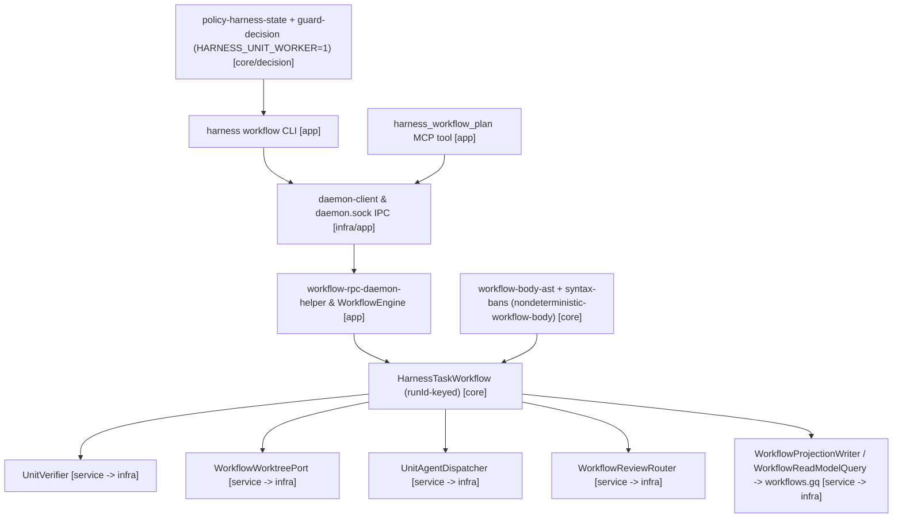

## Context

RFC-0013 Milestones WF-1 (`harness:SPEC-0017`) and WF-2 (`harness:SPEC-0021`, `harness:ADR-0018`) established workflow contracts, the pure `PlanWorkflowCompiler.decide` DAG compiler, Omnigraph workflow schema/persistence, and the `WorkflowEngine` daemon runtime. Milestone WF-3 completes the durable orchestration loop, deterministic unit verification, non-authoritative Omnigraph read-model projections, Unix-socket daemon RPC endpoints, read-only MCP inspection, CLI control plane, and same-UID worker isolation guards.

- **Reused Contracts / Errors:** `CompiledPlan`, `WorkUnit`, `UnitMode`, `UnitOutcome`, `UnitRejection`, `UnitEscalation`, `TaskRunReceipt`, `LlmPhaseReceipt`, `WorkspaceFsError`, `WorkflowStoreUnavailableError`, `AbsoluteRepoRoot` from `@harness/contract`
- **Reused Services:** `WorkflowStorePort`, `UnixSocketDaemonPort` from `@harness/service`
- **New Capabilities Needed:** Pure `HarnessTaskWorkflow` (`Workflow.make("HarnessTaskWorkflow", ...)` keyed by `plan.runId`) in `@harness/gates`, workflow body AST determinism gate (`"nondeterministic-workflow-body"`), `@harness/service` workflow port suite (`UnitVerifier`, `UnitAgentDispatcher`, `WorkflowWorktreePort`, `WorkflowReviewRouter`, `WorkflowProjectionWriter`, `WorkflowReadModelQuery`), additive GQ 2.1 read-model queries in `workflows.gq` (including `wf_probe_runs` and `WorkflowRebuiltRunCount`), `priorUnitOwnedPaths` exclusion on shared-step verification, `@harness/infra` live adapters and daemon IPC client helpers, `workflow.*` daemon RPC handlers and `harness_workflow_plan` MCP tool (`17 -> 18` canonical tools), `harness workflow` CLI subcommand (`compile | start | status | complete | resume | doctor | abort`), and `HARNESS_UNIT_WORKER=1` same-UID isolation guards.

## Goal

Every multi-unit task run compiles into a deterministic `CompiledPlan` executed by `HarnessTaskWorkflow` (`runId`-keyed) on the daemon `WorkflowEngine` with worktree compensation preserving `slice/*` branches, bounded retry/escalation budgets (`max 3`), shared sequential steps (`REQ-1.4` with `priorUnitOwnedPaths` exclusion), fail-closed unit ownership and stamp/package verification (`UnitVerifier`), read-only Omnigraph status projections (`workflows.gq`, `wf_probe_runs`, `WorkflowProjectionWriter`/`WorkflowReadModelQuery`, and `WorkflowRebuiltRunCount`), IPC-routed `DurableDeferred` completions (`tokenFromExecutionId`), CLI/MCP operator surfaces, and same-UID recursion/credential isolation for spawned workers (`REQ-4.6`).

## How to read the requirements

Requirements follow EARS syntax. Each requirement is a single sentence with bold keywords (`When`, `While`, `If ... then`, `Where`) and the modal `shall` or `shall not`.

## Requirements

### 1 · Durable `HarnessTaskWorkflow` Execution & Determinism (`REQ-1.4`, `REQ-3.1`)

**Source (`libs/harness/gates/src/harness-task-workflow.ts`, `libs/harness/gates/src/plugins/workflow-body-ast.ts`, `tools/oxlint/syntax-bans.js`):** Workflow execution in `type:core` must replay identically under Effect's journal, bound retries and escalations cleanly, preserve slice branches across compensation, and reject non-deterministic operations in workflow body files at lint/gate time.

| ID      | Pattern      | Requirement                                                                                                                                                                                                                                                                                                                                                                                                                                                                                                                                                                                     | Effect Symbol               | Verification |
| ------- | ------------ | ----------------------------------------------------------------------------------------------------------------------------------------------------------------------------------------------------------------------------------------------------------------------------------------------------------------------------------------------------------------------------------------------------------------------------------------------------------------------------------------------------------------------------------------------------------------------------------------------- | --------------------------- | ------------ |
| REQ-1.1 | Event-driven | **When** `HarnessTaskWorkflow` starts or resumes for a `CompiledPlan`, `HarnessTaskWorkflow` **shall** register `Workflow.make("HarnessTaskWorkflow", ...)` keyed solely by `plan.runId` (never by plan content hash), wrap `provisionWorkflowWorktrees` in top-level `Workflow.withCompensation` removing linked worktree checkouts while preserving `slice/*` branches, execute waves deterministically (invoking `mergeSliceWave` idempotently on L1 waves), execute sequential `driveSharedStep` when `sharedStepPaths.length > 0`, await `LlmPhaseDone`, and invoke `routeWorkflowReview`. | Harness.executeTaskWorkflow | UnitTest     |
| REQ-1.2 | Event-driven | **When** `HarnessTaskWorkflow.driveWorkUnit` drives a compiled `WorkUnit`, `HarnessTaskWorkflow.driveWorkUnit` **shall** exhaustively match `UnitMode` (`Manual` awaiting `DurableDeferred` `unit/<unitId>/<attempt>`, `Automatic` delegating through `UnitAgentDispatcher`), enforce a bounded attempt budget of 3 before escalating via `DurableDeferred` (`escalation/<unitId>/<n>`), retry from fresh cycle-suffixed attempt/deferred names upon `Retry`, and fail with `TaskRunAbortedError` upon `Abort`.                                                                                 | Harness.driveWorkUnit       | UnitTest     |
| REQ-1.3 | Event-driven | **When** AST and oxlint gates inspect workflow definition modules containing `Workflow.make(...)`, `workflow-body-ast.ts` and `syntax-bans.js` **shall** emit `"nondeterministic-workflow-body"` for direct calls to `Date.now`, `Math.random`, `process.env`, filesystem/git APIs, Omnigraph clients, or network APIs outside activity handlers.                                                                                                                                                                                                                                               | SyntaxBans.decide           | UnitTest     |

### 2 · Shared Deterministic Unit Verification (`REQ-3.2`)

**Source (`libs/harness/infra/src/workflow/unit-verifier-live.ts`):** Manual and automatic completions must share one verification boundary enforcing write-set isolation and verification stamps.

| ID      | Pattern      | Requirement                                                                                                                                                                                                                                                                                                                                                                                                                                                                                                                                                                                                                                                                                                                                      | Effect Symbol        | Verification |
| ------- | ------------ | ------------------------------------------------------------------------------------------------------------------------------------------------------------------------------------------------------------------------------------------------------------------------------------------------------------------------------------------------------------------------------------------------------------------------------------------------------------------------------------------------------------------------------------------------------------------------------------------------------------------------------------------------------------------------------------------------------------------------------------------------ | -------------------- | ------------ |
| REQ-2.1 | Event-driven | **When** `UnitVerifier.completeUnit` or `UnitVerifier.completeSharedStep` validates a unit completion in `cwd`, `UnitVerifierLive` **shall** compute touched paths via NUL-delimited `git diff --no-renames --name-only -z <base>..HEAD` plus untracked files (excluding sibling in-flight L2 unit paths and `priorUnitOwnedPaths` on `completeSharedStep`), reject empty change sets as `Rejected(AgentFailed)`, reject out-of-ownership edits as `Rejected(WriteSetViolation)`, run async `packageVerifyCommand` with `HARNESS_WORKTREE_ID` on L2 units recording `PackageStampHash`, validate `checkVerifyStamp` without `HARNESS_WORKTREE_ID` on L1 slice units, or fail with `WorkspaceFsError` when git/verify subprocess execution fails. | Harness.completeUnit | UnitTest     |

### 3 · Read Model, Daemon IPC, CLI & MCP Surface

**Source (`libs/harness/graph/workflow-queries/workflows.gq`, `libs/harness/infra/src/workflow/`, `apps/harness-mcp/src/`, `apps/harness-cli/src/commands/`):** Status queries must read non-authoritative Omnigraph projections while all workflow state transitions execute inside the daemon via synchronous `DurableDeferred` tokens and validated repository paths.

| ID      | Pattern      | Requirement                                                                                                                                                                                                                                                                                                                                                                                                                                                                                                                                                             | Effect Symbol                         | Verification |
| ------- | ------------ | ----------------------------------------------------------------------------------------------------------------------------------------------------------------------------------------------------------------------------------------------------------------------------------------------------------------------------------------------------------------------------------------------------------------------------------------------------------------------------------------------------------------------------------------------------------------------- | ------------------------------------- | ------------ |
| REQ-3.1 | Ubiquitous   | `workflows.gq` (`wf_probe_runs`), `WorkflowProjectionWriter`, and `WorkflowReadModelQuery` **shall** project non-authoritative `WfRun`, `WfUnit`, and `WfAttempt` views strictly for `workflow status`, `harness_workflow_plan`, and `workflow doctor --rebuild-views` (returning `WorkflowRebuiltRunCount` or raising `WorkflowStoreUnavailableError` when Omnigraph is unavailable), while `HarnessTaskWorkflow` **shall not** read those views for control-flow decisions.                                                                                           | Harness.rebuildWorkflowReadModelViews | UnitTest     |
| REQ-3.2 | Event-driven | **When** operators invoke CLI `workflow` (`compile`, `start`, `status`, `complete`, `resume`, `doctor`, `abort`) or read-only MCP tool `harness_workflow_plan`, CLI and MCP **shall** route state transitions over `<git-common-dir>/harness/daemon.sock` using synchronous `DurableDeferred.tokenFromExecutionId`, validate explicit `--repo-root` (on `complete`) and optional MCP `repoRoot` with canonical `validateWorktreeRepoRoot`, enforce a cleared friction log on `complete --phase llm`, and include `harness_workflow_plan` in the 18 canonical MCP tools. | Harness.compileWorkflowPlanFromRepo   | UnitTest     |

### 4 · Same-UID Worker Isolation Guards (`REQ-4.6`)

**Source (`libs/harness/gates/src/policy-harness-state.ts`, `libs/harness/gates/src/policy.ts`, `libs/harness/decision/src/guard-decision.ts`, `apps/harness-cli/src/commands/hook-fastpath-core.ts`):** Spawned worker processes share OS UID with the orchestrator and must be prevented from mutating orchestration state or accessing daemon credentials.

| ID      | Pattern      | Requirement                                                                                                                                                                                                                                                                                                                                                                                                                    | Effect Symbol              | Verification |
| ------- | ------------ | ------------------------------------------------------------------------------------------------------------------------------------------------------------------------------------------------------------------------------------------------------------------------------------------------------------------------------------------------------------------------------------------------------------------------------ | -------------------------- | ------------ |
| REQ-4.1 | Event-driven | **When** a hook or guard invocation runs with `HARNESS_UNIT_WORKER=1`, `policy-harness-state.ts`, `policy.ts`, `guard-decision.ts`, and `hook-fastpath-core.ts` **shall** block recursive `harness workflow` (`start`, `resume`, `abort`, or `done`) commands and direct file/shell access to `daemon.sock` or `auth-tokens.json` while keeping `policy-zero-dep` and `hook-entry-lightweight` closures free of heavy imports. | Harness.decideGuardCommand | UnitTest     |

## Assumptions

- **REQ-1.2:** Live LLM/agent runner profiles (`ClaudeCodeRunnerLive`, `AntigravityRunnerLive`, `runner-profiles.ts`) land in WF-5; in WF-3 `UnitAgentDispatcher` provides the typed port boundary tested against fake layers and `UnitAgentDispatcherLive` fails cleanly into rejection/retry handling.
- **REQ-3.2:** `ShipWorkflow` (`harness ship` and `Ship*Error`s) remains deferred to WF-4 so `@harness/contract` preserves zero `[dead-tagged-error]` diagnostics under `gc --strict`.

## Out of scope

- Multi-step `ShipWorkflow` gate/mutation/push orchestration and `runner-profiles.ts` agent subprocess spawning (WF-4 / WF-5).

## Known residual risks

- Same-UID worker isolation defends cooperating harness and tool guard invocations and hook fast-paths; OS-level separate-UID sandboxing is outside WF-3 scope.

## Acceptance criteria

- All requirement rows pass their declared Verification methods (`UnitTest`), including `REQ-3.1` replay determinism verification and `nondeterministic-workflow-body` AST enforcement.
- `pnpm harness gc --strict`, `pnpm harness ontology check --strict`, `pnpm harness mutate --strict`, `CI=true pnpm harness verify`, and `CI=true pnpm harness done` pass after `status: accepted`.

## Verified Plan Graph Topology (`pnpm harness plan-check`)

## Pre-Implementation Adversarial Plan Lens

- **Journal Replay & Determinism (`REQ-3.1`):** All wall-clock reads (`Clock.currentTimeMillis`), read-model projections, worktree mutations, git merges, agent dispatches, verification runs, and review routing run strictly inside named `Activity.make` handlers or read-model activities; retry cycles after escalation suffix deferred names (`unit/<unitId>/<attempt>/r<n>`) so prior memoised attempt results never mask post-escalation reruns.
- **Compensation & Branch Preservation:** `Workflow.withCompensation` wraps worktree provisioning with `removeWorktreeCheckouts` (`E = never`), removing linked worktrees cleanly while leaving `slice/*` branches intact for audit and recovery.
- **Token Spoofing / Worktree Escape Prevention:** All external completions and escalations flow exclusively through daemon Unix-socket RPC using canonical `validateWorktreeRepoRoot` and synchronous `DurableDeferred.tokenFromExecutionId`; same-UID workers (`HARNESS_UNIT_WORKER=1`) are blocked from recursive orchestration commands and credential/socket files while preserving fast-path closure bounds.
