## Context

Post-mortem analysis of PR #44 surfaced three deterministic gate blind spots across hook configuration parity, fail-closed AST checks, and ADR governance verification. First, `libs/harness/gates/src/plugins/gc/gc-doc-truth.plugin.ts` validates hook JSON timeouts and fail-closed shell wrappers (`hook-bootstrap-fail-closed`) without checking `PreToolUse` `matcher` patterns against `READ_ONLY_TOOL_NAMES` in `apps/harness-cli/src/commands/hook-guard-payload.ts`, allowing tools such as `read_file`, `view_file_outline`, `view_code_item`, `LS`, and `Find` to bypass hook interception silently.

Second, `libs/harness/gates/src/plugins/ast-gate-law-helpers.ts` and `libs/harness/gates/src/plugins/self-dogfooding-plugin.ts` inspect only `Cause.hasInterruptsOnly` and silent `Effect.catchDefect`, leaving unguarded `Effect.catchCause`, corrupt-data masking via `Schema.decodeOption` nullish fallbacks or empty `Effect.catchTag` recoveries, interrupt-skipping `Effect.tapError` rollbacks inside resource provisioning, and `Result.try` synchronous filesystem fallbacks inside `libs/harness/infra/src/` undetected. Third, `libs/harness/gates/src/adr-lint.ts` validates enforcement tables unidirectionally (table to frontmatter), allowing split helper modules added to ADR `enforced_by` frontmatter to disappear from `### Deterministic Enforcement` without error.

- **Reused Contracts / Errors:** `GcFindingKind`, `AstGateDecisionReport`, `GateViolation`, `SelfDogfoodingRuleId`, `AdrDocLintReport` from `@harness/contract` and `@harness/gates`
- **Reused Services:** `SyncHostIo` from `@harness/service/host-io`
- **New Capabilities Needed:** `hook-matcher-tool-parity` GC check across adapter `hooks.json` and `README.md` files, AST detectors for `untyped-catch-cause-interrupt-leak`, `silent-decode-fallback`, `provision-tap-error-leak`, expanded `infra` path coverage for `silent-gate-fs-fallback`, and bidirectional `enforced_by` ↔ `### Deterministic Enforcement` validation in `AdrDocLint.decide`

## Goal

Every adapter `PreToolUse` hook matcher and README table stays mechanically synchronized with canonical CLI guard tool sets, production harness source files across all packages (including `libs/harness/infra/src/`) fail closed on fiber interrupts, corrupt decodes, and partial provisioning rollbacks, and every ADR `enforced_by` entry is accounted for bidirectionally inside its `Deterministic Enforcement` table.

## How to read the requirements

Requirements follow EARS syntax. Each requirement is a single sentence with bold keywords (`When`, `While`, `If ... then`, `Where`) and the modal `shall` or `shall not`.

## Requirements

### 1 · Hook Matcher Tool Parity

**Source (`libs/harness/gates/src/plugins/gc/gc-doc-truth.plugin.ts`, `apps/harness-cli/src/commands/hook-guard-payload.ts`, `adapters/*/hooks.json`):** Prevents silent guard bypasses when a tool name exists in CLI guard logic but is omitted from `PreToolUse` hook matchers or adapter README docs.

| ID      | Pattern            | Requirement                                                                                                                                                                                                                                   | Effect Symbol    | Verification |
| ------- | ------------------ | --------------------------------------------------------------------------------------------------------------------------------------------------------------------------------------------------------------------------------------------- | ---------------- | ------------ |
| REQ-1.1 | Event-driven       | **When** evaluating adapter hook configurations, the `GraphGc.decide` decider **shall** parse every `PreToolUse` matcher pattern in Antigravity and Claude Code `hooks.json` against canonical guard tool sets.                               | `GraphGc.decide` | `UnitTest`   |
| REQ-1.2 | Unwanted behaviour | **If** any read-only, file-write, or command tool name for an adapter is absent from its `hooks.json` `PreToolUse` matchers, **then** the `GraphGc.decide` decider **shall** report a `hook-matcher-tool-parity` finding.                     | `GraphGc.decide` | `UnitTest`   |
| REQ-1.3 | Unwanted behaviour | **If** an adapter `README.md` documents a `PreToolUse` or `PostToolUse` matcher string that differs from its corresponding `hooks.json` matcher, **then** the `GraphGc.decide` decider **shall** report a `hook-matcher-tool-parity` finding. | `GraphGc.decide` | `UnitTest`   |

### 2 · Fail-Closed & Interrupt-Safe AST Laws

**Source (`libs/harness/gates/src/plugins/ast-gate-law-helpers.ts`, `libs/harness/gates/src/plugins/ast-gate-visitors.ts`, `libs/harness/gates/src/plugins/self-dogfooding-plugin.ts`):** Eliminates silent interrupt swallowing, corrupt-data masking, partial-provision rollback leaks, and `libs/harness/infra/src/` FS fallback blind spots caught during PR #44 review.

| ID      | Pattern            | Requirement                                                                                                                                                                                                                                                                                                      | Effect Symbol           | Verification |
| ------- | ------------------ | ---------------------------------------------------------------------------------------------------------------------------------------------------------------------------------------------------------------------------------------------------------------------------------------------------------------- | ----------------------- | ------------ |
| REQ-2.1 | Unwanted behaviour | **If** a production `src/` file invokes `Effect.catchCause` without branching on `isPureInterruptCause`, **then** the `AstGateCache.decide` decider **shall** emit an `untyped-catch-cause-interrupt-leak` violation.                                                                                            | `AstGateCache.decide`   | `AstGate`    |
| REQ-2.2 | Unwanted behaviour | **If** a production `src/` file silently masks decode or workflow-store failures using `Schema.decodeOption` nullish fallback or `Effect.catchTag` returning an empty success value, **then** the `AstGateCache.decide` decider **shall** emit a `silent-decode-fallback` violation.                             | `AstGateCache.decide`   | `AstGate`    |
| REQ-2.3 | Unwanted behaviour | **If** a `provision*` function or an `Effect.acquireRelease` `acquire` block uses `Effect.tapError` for rollback cleanup instead of `Effect.onExit` (or nested resource `Effect.acquireRelease` finalizers), **then** the `SelfDogfooding.decide` decider **shall** emit a `provision-tap-error-leak` violation. | `SelfDogfooding.decide` | `AstGate`    |
| REQ-2.4 | State-driven       | **While** inspecting `libs/harness/infra/src/` files for synchronous filesystem reads inside `Result.try`, the `SelfDogfooding.decide` decider **shall** report `silent-gate-fs-fallback` violations identically to gates, graph, CLI, and MCP sources.                                                          | `SelfDogfooding.decide` | `AstGate`    |

### 3 · Bidirectional ADR Enforcement Table Parity

**Source (`libs/harness/gates/src/adr-lint.ts`):** Ensures split helper modules added to ADR `enforced_by` frontmatter are always accounted for in `### Deterministic Enforcement`.

| ID      | Pattern            | Requirement                                                                                                                                                                                                                      | Effect Symbol       | Verification |
| ------- | ------------------ | -------------------------------------------------------------------------------------------------------------------------------------------------------------------------------------------------------------------------------- | ------------------- | ------------ |
| REQ-3.1 | Unwanted behaviour | **If** an ADR frontmatter `enforced_by` entry is absent from every `Enforced By` cell in the `Deterministic Enforcement` table, **then** the `AdrDocLint.decide` decider **shall** report an `adr-enforcement-mismatch` finding. | `AdrDocLint.decide` | `UnitTest`   |
| REQ-3.2 | State-driven       | **While** validating ADR frontmatter and `Deterministic Enforcement` tables, the `AdrDocLint.decide` decider **shall** preserve purity with `R = never`.                                                                         | `AdrDocLint.decide` | `GraphCheck` |

## Assumptions

- **REQ-1.1:** Canonical guard tool lists for Antigravity and Claude Code adapters are parsed statically via TypeScript AST from `apps/harness-cli/src/commands/hook-guard-payload.ts` via `SyncHostIo` so `@harness/gates` preserves its Nx tier boundary without importing `harness-cli`.
- **REQ-2.2:** Boundary CLI stdin and startup config decoders that return `Option` explicitly on malformed optional payloads are exempt only inside designated CLI/config probe helpers documented in the AST rule module.

## Out of scope

- **Core test reachability, pure-module infra/app mutation discovery, and workflow cross-seam tests (P0-B).** Specified separately in `harness:SPEC-0026`.
- **Typed workflow protocol contracts, contract shape hardening, policy property fuzzer, and test hygiene (P1) and semantic doc/review upgrades (P2).** Specified in `harness:SPEC-0027`..`harness:SPEC-0030`.

## Known residual risks

- Adding stricter fail-closed AST rules (`untyped-catch-cause-interrupt-leak`, `silent-decode-fallback`, `silent-gate-fs-fallback` in `infra`) and bidirectional ADR table checks may surface pre-existing violations across existing files that must be remediated cleanly when implementing this specification.

## Acceptance criteria

- All requirement rows pass their declared Verification methods (`UnitTest`, `AstGate`, `GraphCheck`).
- All modified and newly extracted `@harness/gates` source files remain `<= 800` lines post-`oxfmt` and preserve the `gc-hook-fastpath.ts` 3-profile lightweight closure.
- `pnpm harness gc --strict`, `pnpm harness ontology check --strict`, `pnpm harness mutate --strict`, `CI=true pnpm harness verify`, and `CI=true pnpm harness done` pass after updating frontmatter to `status: accepted`.

## Verified Plan Topology (`harness plan-check`)

```mermaid
flowchart TD
  89["AdrDocLint.decide #91;domain#93;"]
  90["AstGateCache.decide #91;domain#93;"]
  103["GraphGc.decide #91;domain#93;"]
  119["SelfDogfooding.decide #91;domain#93;"]
  2278["Trace: TraceabilityTuple:specifies:harness:SPEC-0025"] -->|"PlaysRole:realizing-symbol"| 103
  2279["Trace: TraceabilityTuple:specifies:harness:SPEC-0025"] -->|"PlaysRole:realizing-symbol"| 90
  2280["Trace: TraceabilityTuple:specifies:harness:SPEC-0025"] -->|"PlaysRole:realizing-symbol"| 119
  2281["Trace: TraceabilityTuple:specifies:harness:SPEC-0025"] -->|"PlaysRole:realizing-symbol"| 89
  1402["Trace: libs/harness/gates/test/ast-fail-closed-laws.test.ts"] -->|"PlaysRole:exercised-span"| 90
  1403["Trace: libs/harness/gates/test/ast-fail-closed-laws.test.ts"] -->|"PlaysRole:exercised-span"| 119
  1418["Trace: libs/harness/gates/test/gc-ears-and-adr-quality.test.ts"] -->|"PlaysRole:exercised-span"| 89
  1420["Trace: libs/harness/gates/test/gc-ears-and-adr-quality.test.ts"] -->|"PlaysRole:exercised-span"| 103
```

