# SPEC-0031 · Three-Tier Retrieval, Semantic Governance Embeddings, and Deterministic PageIndex-lite

## Context

This specification defines the three-tier retrieval architecture governed by `harness:ADR-0025`: Tier 1 deterministic code/governance graph extraction with Omnigraph `bm25`/`fuzzy`, Tier 2 selective `qwen3-embedding:8b` (`Vector(4096)?`) hybrid `rrf(nearest, bm25)` indexing with content-hash caching over `PatternDoc`, `AdrDoc`, and `EarsRequirement` nodes, and Tier 3 deterministic Markdown PageIndex-lite document inspection.

- **Reused Contracts / Errors:** `WorkspaceFilePath`, `ErrorReasonMessage`, `OmnigraphSync`
- **Reused Services:** `@harness/service/WorkspaceFs`, `@harness/graph/OmnigraphSync`
- **New Capabilities Needed:** `@harness/service/EmbeddingClient`, `@harness/service/EmbeddingCachePort`, `EmbeddingProviderError`, `EmbeddingCacheError`, `DocTreePathError`, `EmbeddingSyncPlan.decide`, `SemanticConflictPairer.decide`, `OntologyConflict.collectSemanticCandidates`, `DocTree.parseMarkdownTree`, `DocTree.buildGovernanceCatalog`, `DocTree.inspect`, `GraphEmbeddings.embedDelta`, `GraphEmbeddings.sync`, `OllamaEmbeddingClient.embedBatch`, `FileEmbeddingCache.read`, `FileEmbeddingCache.write`, `HarnessMcp.searchKnowledge`, `HarnessMcp.docTree`

## Goal

Agents navigate TypeScript code deterministically through the PERA Levi hypergraph and lexical `bm25`/`fuzzy` queries, discover patterns, architectural decisions, and EARS requirements semantically in one hydrated call via `qwen3-embedding:8b` hybrid Omnigraph RRF search (with 0 ms cached document-sync re-embedding and explicit `bm25-only` degradation when Ollama is unavailable), detect cross-spec behavioral conflicts across unrelated symbols, and inspect large markdown documents or the full governance catalog through bounded deterministic heading trees.

## How to read the requirements

Requirements follow EARS syntax. Each requirement is a single sentence with bold keywords (`When`, `While`, `If ... then`, `Where`) and modal verb `shall` or `shall not`.

## Requirements

### 1 · Deterministic Governance Extraction & PageIndex-lite

**Source (`harness:ADR-0025`):** Complete governance traceability and zero-LLM section indexing.

| ID      | Pattern            | Requirement                                                                                                                                                                                                                                                       | Effect Symbol                    | Verification |
| ------- | ------------------ | ----------------------------------------------------------------------------------------------------------------------------------------------------------------------------------------------------------------------------------------------------------------- | -------------------------------- | ------------ |
| REQ-1.1 | Event-driven       | **When** `parseGovernanceDocFile` and `assembleTestAndGovernanceGraph` load workspace governance documents, the extractor **shall** populate `informedByAdrs`, `AdrDoc.searchText`, and `EarsRequirement` nodes linked via `TraceabilityTuple` edges.             | —                                | `UnitTest`   |
| REQ-1.2 | Event-driven       | **When** `DocTree.parseMarkdownTree` parses Markdown text, `DocTree.parseMarkdownTree` **shall** ignore headings inside fenced code blocks and assign deterministic section identifiers with exact line bounds.                                                   | `DocTree.parseMarkdownTree`      | `UnitTest`   |
| REQ-1.3 | Event-driven       | **When** `DocTree.buildGovernanceCatalog` summarizes a `HarnessGraph`, `DocTree.buildGovernanceCatalog` **shall** emit a deterministic catalog of all `AdrDoc` and `EarsSpec` entries including requirement counts and `informedByAdrs`.                          | `DocTree.buildGovernanceCatalog` | `UnitTest`   |
| REQ-1.4 | Unwanted behaviour | **If** `DocTree.inspect` receives a target path that escapes the repository root, points into `.git/` or `node_modules/`, points to a missing file, or targets an unsupported extension, **then** `DocTree.inspect` **shall** fail with typed `DocTreePathError`. | `DocTreePathError`               | `UnitTest`   |

### 2 · Selective `qwen3-embedding:8b` Sync & Graceful Degradation

**Source (`harness:ADR-0025`):** Zero-overhead cached embedding updates and explicit non-mock degradation.

| ID      | Pattern            | Requirement                                                                                                                                                                                                                                                                        | Effect Symbol                | Verification   |
| ------- | ------------------ | ---------------------------------------------------------------------------------------------------------------------------------------------------------------------------------------------------------------------------------------------------------------------------------- | ---------------------------- | -------------- |
| REQ-2.1 | Ubiquitous         | `schema.pg` **shall** declare `Vector(4096)? @embed(...) @index` solely on `PatternDoc.summaryEmbedding`, `AdrDoc.searchEmbedding`, and `EarsRequirement.clauseEmbedding`, omitting vector columns on bare code symbol nodes.                                                      | —                            | `UnitTest`     |
| REQ-2.2 | State-driven       | **While** planning document embedding synchronization, `EmbeddingSyncPlan.decide` **shall** execute purely with `R = never`.                                                                                                                                                       | `EmbeddingSyncPlan.decide`   | `GraphCheck`   |
| REQ-2.3 | State-driven       | **While** evaluating current document content hashes against a cached snapshot, `EmbeddingSyncPlan.decide` **shall** return `CacheHitAll` when all hashes, model IDs, and dimensions match with zero evicted keys and emit deterministic delta operations otherwise.               | `EmbeddingSyncPlan.decide`   | `PropertyTest` |
| REQ-2.4 | Unwanted behaviour | **If** Ollama `/v1/embeddings` returns a transport error, non-2xx HTTP status, dimension mismatch, or non-finite vector component, **then** `OllamaEmbeddingClient.embedBatch` **shall** fail with typed `EmbeddingProviderError`.                                                 | `EmbeddingProviderError`     | `UnitTest`     |
| REQ-2.5 | Event-driven       | **When** `GraphEmbeddings.embedDelta` computes vectors for changed or uncached items, `GraphEmbeddings.embedDelta` **shall** delegate to `@harness/service/EmbeddingClient` and return L2-normalized vectors matching configured dimensions.                                       | `GraphEmbeddings.embedDelta` | `UnitTest`     |
| REQ-2.6 | Event-driven       | **When** `GraphEmbeddings.sync` encounters an unavailable provider, cache write failure, or `EmbeddingProviderError`, `GraphEmbeddings.sync` **shall** persist completed batches and degrade to `bm25-only` with an explicit degraded reason instead of synthesizing mock vectors. | `GraphEmbeddings.sync`       | `UnitTest`     |
| REQ-2.7 | Unwanted behaviour | **If** `FileEmbeddingCache.read` or `FileEmbeddingCache.write` encounters a symlink, boundary escape, I/O error, or corrupt snapshot, **then** `FileEmbeddingCache.read` and `FileEmbeddingCache.write` **shall** fail with typed `EmbeddingCacheError`.                           | `EmbeddingCacheError`        | `UnitTest`     |

### 3 · Hybrid Retrieval MCP Tools, Two-Stage Routing & Cross-Spec Conflict Pairing

**Source (`harness:ADR-0025`):** Ergonomic single-call MCP entrypoints, System One routing scalability, and semantic conflict discovery.

| ID      | Pattern      | Requirement                                                                                                                                                                                                                                          | Effect Symbol                                | Verification   |
| ------- | ------------ | ---------------------------------------------------------------------------------------------------------------------------------------------------------------------------------------------------------------------------------------------------- | -------------------------------------------- | -------------- |
| REQ-3.1 | Event-driven | **When** `HarnessMcp.searchKnowledge` receives a natural-language query, `HarnessMcp.searchKnowledge` **shall** return ranked hits hydrated with `linkedSymbols` and an explicit `retrievalMode` (`hybrid-rrf`, `bm25-only`, or `lexical-fallback`). | `HarnessMcp.searchKnowledge`                 | `UnitTest`     |
| REQ-3.2 | Event-driven | **When** `HarnessMcp.docTree` receives `catalog`, `tree`, or `section` requests, `HarnessMcp.docTree` **shall** return bounded governance catalog entries, markdown heading ranges, or exact line-sliced content via `DocTree.inspect`.              | `HarnessMcp.docTree`                         | `UnitTest`     |
| REQ-3.3 | State-driven | **While** ranking candidate cross-spec requirement pairs, `SemanticConflictPairer.decide` **shall** execute purely with `R = never`.                                                                                                                 | `SemanticConflictPairer.decide`              | `GraphCheck`   |
| REQ-3.4 | State-driven | **While** evaluating cross-spec requirement pairs lacking shared `Effect Symbol` identifiers, `SemanticConflictPairer.decide` **shall** exclude shared-symbol and self pairs and return deterministic top-K candidates.                              | `SemanticConflictPairer.decide`              | `PropertyTest` |
| REQ-3.5 | Event-driven | **When** `harness_route` evaluates an implementation step without a deterministic regex match, `harness_route` **shall** combine Omnigraph pattern retrieval with `IdiomRouterV1` and surface `agent-patterns/planning.md` among candidate blocks.   | —                                            | `UnitTest`     |
| REQ-3.6 | Event-driven | **When** `OntologyConflict.collectSemanticCandidates` collects cross-spec pairs for active specifications, `OntologyConflict.collectSemanticCandidates` **shall** fail closed with `degraded: true` when required embeddings are unavailable.        | `OntologyConflict.collectSemanticCandidates` | `UnitTest`     |

## Assumptions

- **REQ-2.6:** Local Ollama runs `qwen3-embedding:8b` (`4096` dimensions) on loopback `127.0.0.1:11434`; when offline, `GraphEmbeddings.sync` and `HarnessMcp.searchKnowledge` continue operating cleanly in `bm25-only` or `lexical-fallback` mode without wiping existing graph vectors.
- **REQ-2.1:** Evolving `schema.pg` from `Vector(768)?` to `Vector(4096)?` bumps `CLUSTER_SCHEMA_EPOCH` and triggers a clean rebuild (`RequiresCleanRebuild`) of `.harness/omnigraph-cluster`.

## Out of scope

- **Dense embeddings on TypeScript AST symbol nodes (`EffectFn`, `ServiceTag`, `TaggedError`, `SchemaDef`):** Handled deterministically by the PERA Levi graph and native Omnigraph `bm25`/`fuzzy`.
- **LLM-generated summary trees for short governance files:** Handled deterministically by `DocTree.parseMarkdownTree` and `DocTree.buildGovernanceCatalog`.

## Known residual risks

- Changing the active embedding model in `cluster.yaml` invalidates `embeddings-v1.json` and recomputes vectors for all `PatternDoc`, `AdrDoc`, and `EarsRequirement` nodes on the next sync.
- Query-time string parameters in legacy `.gq` queries (`rank_patterns_hybrid`) depend on the running `omnigraph-server` having `qwen3-embedding:8b` available when not invoked with precomputed `Vector(4096)` vectors.

## Acceptance criteria

- All requirement rows pass their declared Verification methods (`UnitTest`, `PropertyTest`, `GraphCheck`).
- `omnigraph lint --schema libs/harness/graph/schema.pg --query libs/harness/graph/queries/harness.gq` exits `0` with zero diagnostics.
- Adapter skills updated via TDD pressure scenarios and verified by `adapter-config.test.ts`, `gc --strict`, `ontology check --strict`, `mutate --strict`, `verify`, and `done`.

## Verified Plan Topology (`harness plan-check`)

Verified clean (`exit 0`, zero `unmapped-spec-symbol` / `dead-tagged-error` / `impure-decider` / `omnigraph lint` findings) against `.harness/plan-graph-snapshot.json`:

```mermaid
flowchart TD
  Spec["EarsSpec: harness:SPEC-0031"]
  SyncPlan["EmbeddingSyncPlan.decide [R = never]"]
  ConflictPairer["SemanticConflictPairer.decide [R = never]"]
  CollectConflicts["OntologyConflict.collectSemanticCandidates [EmbeddingClient | EmbeddingCachePort]"]
  DocTreeParse["DocTree.parseMarkdownTree [R = never]"]
  DocTreeCat["DocTree.buildGovernanceCatalog [R = never]"]
  DocTreeInspect["DocTree.inspect [WorkspaceFs]"]
  GraphEmbedDelta["GraphEmbeddings.embedDelta [EmbeddingClient]"]
  GraphEmbedSync["GraphEmbeddings.sync [EmbeddingClient | EmbeddingCachePort]"]
  OllamaEmbed["OllamaEmbeddingClient.embedBatch [infra]"]
  CacheRead["FileEmbeddingCache.read [infra]"]
  CacheWrite["FileEmbeddingCache.write [infra]"]
  McpSearch["HarnessMcp.searchKnowledge [app]"]
  McpDocTree["HarnessMcp.docTree [app]"]
  SvcClient["Service: @harness/service/EmbeddingClient"]
  SvcCache["Service: @harness/service/EmbeddingCachePort"]
  LayerClient["Layer: OllamaEmbeddingClientLive"]
  LayerCache["Layer: FileEmbeddingCacheLive"]
  ErrEmbed["Error: EmbeddingProviderError"]
  ErrCache["Error: EmbeddingCacheError"]
  ErrPath["Error: DocTreePathError"]

  Spec -->|specifying-ears| SyncPlan
  Spec -->|specifying-ears| ConflictPairer
  Spec -->|specifying-ears| CollectConflicts
  Spec -->|specifying-ears| DocTreeParse
  Spec -->|specifying-ears| DocTreeCat
  Spec -->|specifying-ears| DocTreeInspect
  Spec -->|specifying-ears| GraphEmbedDelta
  Spec -->|specifying-ears| GraphEmbedSync
  Spec -->|specifying-ears| OllamaEmbed
  Spec -->|specifying-ears| CacheRead
  Spec -->|specifying-ears| CacheWrite
  Spec -->|specifying-ears| McpSearch
  Spec -->|specifying-ears| McpDocTree
  GraphEmbedDelta -->|requires-service| SvcClient
  GraphEmbedSync -->|requires-service| SvcClient
  GraphEmbedSync -->|requires-service| SvcCache
  CollectConflicts -->|requires-service| SvcClient
  CollectConflicts -->|requires-service| SvcCache
  LayerClient -->|provided-service| SvcClient
  LayerCache -->|provided-service| SvcCache
  GraphEmbedDelta -->|fails-with| ErrEmbed
  OllamaEmbed -->|fails-with| ErrEmbed
  CacheRead -->|fails-with| ErrCache
  CacheWrite -->|fails-with| ErrCache
  DocTreeInspect -->|fails-with| ErrPath
```

- **Pre-Implementation Adversarial Plan Lens:**
  - Pure deciders (`EmbeddingSyncPlan.decide`, `SemanticConflictPairer.decide`) enforce `R = never`.
  - No `node:*` imports in `type:service` or `type:contract`; `node:crypto` only in `@harness/graph` (`type:core` allowlist); HTTP fetch + `process.env` + filesystem cache writes isolated in `@harness/infra` / `type:app`.
  - Graceful fallback: unavailable or mismatched Ollama fails typed `EmbeddingProviderError` inside `embedBatchViaOllama` / `embedGraphDelta`, while `GraphEmbeddings.sync` catches and returns `mode: "bm25-only"` with explicit `degradedReason` (never synthesizing mock vectors).
