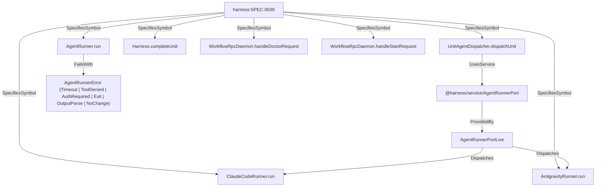

## Context

`HarnessTaskWorkflow` (`harness:SPEC-0023`) and `ShipWorkflow` (`harness:SPEC-0032`) already implement durable Effect v4 workflow orchestration, unit write-set verification (`UnitVerifier.completeUnit`), and same-UID worker isolation guards (`HARNESS_UNIT_WORKER=1`), while `UnitAgentDispatcherLive` remained a WF-3 `"placeholder"` stub returning failure so automatic mode stayed disabled until WF-5. Empirical WF-0 subprocess findings (`docs/rfcs/reviews/2026-11-17-rfc-0013-wf0-spike-evidence.md`, Suite 7 & Supp Probe 4) established strict CLI sandboxing constraints for `claude -p` and `agy -p`: default `claude -p` exposes write-capable global IDE MCP servers unless `--strict-mcp-config --mcp-config <file> --setting-sources ""` is passed alongside `--settings <generated-hooks.json>` for `PreToolUse -> guard` only, whereas `agy -p` hangs on inherited `ANTIGRAVITY_*`/`AGY_*` session environment variables, hangs on PTY wrappers, lacks `--disallowedTools` / `--strict-mcp-config`, and can hit transient pre-output `exit 3` schema startup failures. In production runner profiles, Antigravity uses `--mode accept-edits` for automatic write units (`--mode plan` remains supported by `AntigravityMode` paired with post-step diff checks).

- **Reused Contracts / Errors:** `RunnerId`, `WorkUnitId`, `AttemptNumber`, `OwnedRelPath`, `AbsoluteRepoRoot`, `PackageVerifyCommand`, `WorkflowRunId`, `UnitRejection`, `UnitOutcome`, `UnitEscalation`, `UnitAgentRequest`, `UnitAgentDispatchResult`, `CompleteUnitInput`, `WORKFLOW_TIMEOUT_BUDGETS`, `formatBoundedErrorMessage` from `@harness/contract`; `TypedHoleContextBundle` from `@harness/graph`; POSIX process-group reaping from `libs/harness/infra/src/workflow/verify-child-process.ts`
- **Reused Services:** `UnitAgentDispatcher`, `UnitVerifier`
- **New Capabilities Needed:** WF-5 runner contracts (`UnitBrief`, `AgentRunRequest`, `AgentRunResult`, `AgentUsage`, `RunnerProfile`, branded runner scalars, and 6 `AgentRunnerError` tagged classes), runner timeout monotonicity in `WORKFLOW_TIMEOUT_BUDGETS`, `AgentRunnerPort` in `@harness/service`, TCB `runner-profiles.ts` with pure total argv/env builders, POSIX process-group supervision with orphan attempt reaping, `ClaudeCodeRunnerLive`, `AntigravityRunnerLive`, `AgentRunnerPortLive`, deterministic `buildUnitBrief` + `toOutcome`, `"live"` `UnitAgentDispatcherLive`, `AgentNoChangeError` surfacing in `UnitVerifier.completeUnit`, and `workflow doctor` runner checks

## Goal

Every `Automatic` mode workflow unit executes deterministically inside an isolated worktree subprocess via `AgentRunnerPort` (`claude-code` or `antigravity`), enforcing `--dangerously-skip-permissions`-free profiles, strict environment allow-lists (`HARNESS_UNIT_WORKER=1`, no `CLOUDFLARE_*`/Omnigraph secrets, stripped `ANTIGRAVITY_*`/`AGY_*`), scoped MCP/hook isolation, POSIX process-group supervision, typed `AgentRunnerError` classification through `toOutcome`, and read-only `workflow doctor` runner readiness reporting.

## How to read the requirements

Requirements follow EARS syntax. Each requirement is a single sentence with bold keywords (`When`, `While`, `If ... then`, `Where`) and the modal `shall` or `shall not`.

## Requirements

### 1 · Runner Contracts, Profiles & Subprocess Sandboxing (`RFC-0013 REQ-4.1`)

**Source (`libs/harness/contract/src/workflow-runners.ts`, `libs/harness/contract/src/workflow-timeouts.ts`, `libs/harness/infra/src/workflow/runner-profiles.ts`, `libs/harness/infra/src/workflow/runner-process-supervision.ts`):** Runner profiles, CLI arguments, and spawned subprocess environments must be statically bounded and allow-listed so `--dangerously-skip-permissions`, infra secrets, and PTY hangs can never enter unit worker processes.

| ID      | Pattern    | Requirement                                                                                                                                                                                                                                | Effect Symbol   | Verification |
| ------- | ---------- | ------------------------------------------------------------------------------------------------------------------------------------------------------------------------------------------------------------------------------------------ | --------------- | ------------ |
| REQ-1.1 | Ubiquitous | `AgentRunner.run` **shall** dispatch strictly over closed `RunnerId` values `"claude-code"` or `"antigravity"`, using `stdio: ["ignore", "pipe", "pipe"]`, worktree `cwd`, and `WORKFLOW_TIMEOUT_BUDGETS` monotonic timeout/grace budgets. | AgentRunner.run | UnitTest     |
| REQ-1.2 | Ubiquitous | `RunnerProfile`, `BriefPrompt`, and the total argv builders in `runner-profiles.ts` **shall not** represent or emit `--dangerously-skip-permissions` over validated inputs.                                                                | AgentRunner.run | UnitTest     |
| REQ-1.3 | Ubiquitous | `AgentRunner.run` **shall** construct the child environment from a strict allow-list excluding `CLOUDFLARE_*` and Omnigraph tokens while setting `HARNESS_UNIT_WORKER=1` so WF-3 worker isolation guards engage inside spawned workers.    | AgentRunner.run | UnitTest     |
| REQ-1.4 | Ubiquitous | `AgentRunner.run` **shall** supervise detached POSIX process groups with `SIGTERM` followed by `SIGKILL` on timeout or interruption and reap any surviving orphan process group recorded for an attempt on crash re-delivery.              | AgentRunner.run | UnitTest     |

### 2 · Claude Code Runner Isolation & Envelope Decoding (`RFC-0013 REQ-4.2`)

**Source (`libs/harness/infra/src/workflow/agent-runners-live.ts`, `libs/harness/infra/src/workflow/runner-profiles.ts`, `libs/harness/infra/src/workflow/agent-runner-outcome.ts`):** `ClaudeCodeRunnerLive` must isolate MCP servers and settings sources while re-injecting `PreToolUse` guard hooks and decoding structured JSON envelopes.

| ID      | Pattern            | Requirement                                                                                                                                                                                                                                                                                             | Effect Symbol         | Verification |
| ------- | ------------------ | ------------------------------------------------------------------------------------------------------------------------------------------------------------------------------------------------------------------------------------------------------------------------------------------------------- | --------------------- | ------------ |
| REQ-2.1 | Ubiquitous         | `ClaudeCodeRunner.run` **shall** invoke `claude -p` with `--output-format json --strict-mcp-config --mcp-config <generated-file> --setting-sources "" --settings <generated-hooks.json> --allowedTools <rules> --disallowedTools <denied> --permission-mode dontAsk`.                                   | ClaudeCodeRunner.run  | UnitTest     |
| REQ-2.2 | Ubiquitous         | `ClaudeCodeRunner.run` **shall** emit a scoped `<generated-hooks.json>` containing solely `PreToolUse` guard hooks (never `Stop` hooks) alongside a scoped MCP config file and remove generated temporary config files in a scoped finalizer.                                                           | ClaudeCodeRunner.run  | UnitTest     |
| REQ-2.3 | Unwanted behaviour | **If** `claude -p` reports permission denials, auth failure, non-zero exit, timeout, or invalid JSON output, **then** `ClaudeCodeRunner.run` **shall** fail with the corresponding `AgentToolDeniedError`, `AgentAuthRequiredError`, `AgentExitError`, `AgentTimeoutError`, or `AgentOutputParseError`. | AgentOutputParseError | UnitTest     |

### 3 · Antigravity Runner Hardening & Isolation Restrictions (`RFC-0013 REQ-4.3`)

**Source (`libs/harness/infra/src/workflow/agent-runners-live.ts`, `libs/harness/infra/src/workflow/runner-profiles.ts`, `libs/harness/infra/src/workflow/agent-runner-outcome.ts`):** `AntigravityRunnerLive` must eliminate nested session env hangs, enforce MCP isolation restrictions, decode structured JSON output, and retry transient pre-output startup failures.

| ID      | Pattern            | Requirement                                                                                                                                                                                                                                                                                   | Effect Symbol          | Verification |
| ------- | ------------------ | --------------------------------------------------------------------------------------------------------------------------------------------------------------------------------------------------------------------------------------------------------------------------------------------- | ---------------------- | ------------ |
| REQ-3.1 | Ubiquitous         | `AntigravityRunner.run` **shall** strip all `ANTIGRAVITY_*` and `AGY_*` environment variables and invoke `agy -p` with `--output-format json --print-timeout <seconds>s --mode <mode>` over `stdio: ["ignore", "pipe", "pipe"]`.                                                              | AntigravityRunner.run  | UnitTest     |
| REQ-3.2 | Unwanted behaviour | **If** an `AgentRunRequest` targets `"antigravity"` with `mcpIsolation: "hard"`, **then** `AntigravityRunner.run` **shall** either fail with `AgentToolDeniedError` when `hardMcpFallback` is `"reject"` or delegate to `ClaudeCodeRunner.run` when `hardMcpFallback` is `"fallback-claude"`. | AgentToolDeniedError   | UnitTest     |
| REQ-3.3 | Event-driven       | **When** `agy -p` fails startup with `exit 3` before emitting stdout, `AntigravityRunner.run` **shall** attempt up to `WORKFLOW_TIMEOUT_BUDGETS.agentStartupRetryMaxAttempts` total attempts before failing with `AgentExitError`.                                                            | AgentExitError         | UnitTest     |
| REQ-3.4 | Unwanted behaviour | **If** `agy -p` emits stderr soft-denial notices, auth notices, or malformed JSON output, **then** `AntigravityRunner.run` **shall** fail with `AgentToolDeniedError`, `AgentAuthRequiredError`, or `AgentOutputParseError`.                                                                  | AgentAuthRequiredError | UnitTest     |

### 4 · Live Dispatcher, Brief Builder, Outcome Mapping & Doctor Checks (`RFC-0013 REQ-4.4`)

**Source (`libs/harness/infra/src/workflow/agent-dispatcher-live.ts`, `libs/harness/infra/src/workflow/unit-brief-builder.ts`, `libs/harness/infra/src/workflow/unit-verifier-live.ts`, `libs/harness/infra/src/workflow/runner-doctor.ts`, `apps/harness-mcp/src/daemon/workflow-rpc-doctor-helper.ts`):** Automatic workflow units must run end-to-end through `UnitAgentDispatcherLive`, classify empty diffs and runner failures uniformly through `toOutcome`, and expose runner readiness in `workflow doctor`.

| ID      | Pattern            | Requirement                                                                                                                                                                                                                                                                                                                                                     | Effect Symbol                         | Verification |
| ------- | ------------------ | --------------------------------------------------------------------------------------------------------------------------------------------------------------------------------------------------------------------------------------------------------------------------------------------------------------------------------------------------------------- | ------------------------------------- | ------------ |
| REQ-4.1 | Event-driven       | **When** `UnitAgentDispatcher.dispatchUnit` dispatches a compiled unit, `UnitAgentDispatcherLive` (`runnerKind: "live"`) **shall** construct a deterministic `UnitBrief` (including `REPO_ROOT`, owned paths, optional `holeBundles` / `mcpConfigPath`, and `priorRejection`) and invoke `AgentRunnerPort.run` forwarding `mcpIsolation` and `hardMcpFallback`. | UnitAgentDispatcher.dispatchUnit      | UnitTest     |
| REQ-4.2 | Unwanted behaviour | **If** `AgentRunnerPort.run` fails with `AgentTimeoutError`, `AgentToolDeniedError`, `AgentExitError`, `AgentOutputParseError`, or `AgentNoChangeError`, **then** `toOutcome` **shall** return `Rejected` with `AgentFailed` using bounded `formatBoundedErrorMessage` text.                                                                                    | AgentTimeoutError                     | UnitTest     |
| REQ-4.3 | Unwanted behaviour | **If** `AgentRunnerPort.run` fails with `AgentAuthRequiredError`, **then** `toOutcome` **shall** return `Escalated` with `AuthRequired` immediately without waiting for retry-budget exhaustion.                                                                                                                                                                | AgentAuthRequiredError                | UnitTest     |
| REQ-4.4 | Unwanted behaviour | **If** `Harness.completeUnit` detects zero changed files inside an automatic unit's worktree (`input.runner` present), **then** `Harness.completeUnit` **shall** classify the empty change set as `AgentNoChangeError` mapped via `toOutcome` to `Rejected` (`AgentFailed`).                                                                                    | AgentNoChangeError                    | UnitTest     |
| REQ-4.5 | Event-driven       | **When** `WorkflowRpcDaemon.handleStartRequest` receives an `Automatic` plan, `WorkflowRpcDaemon.handleStartRequest` **shall** accept live dispatchers (`runnerKind: "live"`) and reject placeholder dispatchers fail-closed.                                                                                                                                   | WorkflowRpcDaemon.handleStartRequest  | UnitTest     |
| REQ-4.6 | Event-driven       | **When** `WorkflowRpcDaemon.handleDoctorRequest` runs `workflow.doctor`, `WorkflowRpcDaemon.handleDoctorRequest` **shall** append read-only runner readiness checks for `agent-dispatcher`, `runner-claude-code`, and `runner-antigravity`.                                                                                                                     | WorkflowRpcDaemon.handleDoctorRequest | UnitTest     |

## Assumptions

- **REQ-1.1 / REQ-3.1:** Automated verification uses deterministic fake `claude` and `agy` executable scripts in temporary directories so CI never invokes paid or interactive CLI sessions.
- **REQ-2.1 / REQ-4.6:** `claude` uses `--strict-mcp-config --setting-sources "" --settings <generated-hooks.json>` to neutralize global IDE MCP servers while retaining `PreToolUse -> guard`; Antigravity settings remain read-only inspected by `workflow doctor` (`~/.gemini/antigravity-cli/settings.json`) without mutating user global files.

## Out of scope

- Live `WorkflowProjector` sync into analytical Omnigraph graph `harness` (`impl/<task>`) on wave, `done` pre-merge, and post-rebuild hooks (implemented in WF-6 via `harness:SPEC-0038`).
- Automated CI execution against paid live `claude` or `agy` API endpoints (covered by optional manual smoke runs).

## Known residual risks

- Spawned unit workers share the host OS UID with the daemon and need `HOME` for cached CLI authentication; protection against credential/socket tampering relies on `HARNESS_UNIT_WORKER=1` guards in `libs/harness/gates/src/policy.ts`, `PreToolUse` hooks, and disjoint Cedar policies (`workflows.policy.yaml`).
- `agy` lacks native `--disallowedTools` and `--strict-mcp-config` flags; hard MCP isolation requests must reject or fall back to `claude-code`, `ANTIGRAVITY_RUNNER_PROFILE` defaults to `--mode accept-edits`, and `--mode plan` remains bounded by `UnitVerifier.completeUnit` write-set diff enforcement.

## Acceptance criteria

- All requirement rows pass their declared `UnitTest` suites across `@harness/contract`, `@harness/service`, `@harness/gates`, `@harness/infra`, `harness-mcp`, and `harness-cli`, achieving 100% mutant kill on pure modules under `pnpm harness mutate --strict`.
- `pnpm harness plan-check`, `pnpm harness learn --clear`, `pnpm harness gc --strict`, `pnpm harness ontology check --strict`, `pnpm harness mutate --strict`, `CI=true pnpm harness verify`, and `CI=true pnpm harness done --cli` pass cleanly after `status: accepted`.

## Verified Plan Topology Graph

Verified via `pnpm harness plan-check --mermaid` (exit 0):

## Adversarial Plan Lens

- **Replay & Crash Recovery:** `HarnessTaskWorkflow` derives `priorRejection` strictly from `runAttemptCycle`'s memoized `UnitOutcome` loop; `spawnSupervisedAgentProcess` records attempt pgid metadata outside worker-writable trees under `<gitCommonDir>/harness/runner-pgids/` (falling back to a private per-UID directory in `tmpdir()` when outside git) and invokes `reapOrphanAttemptProcessGroup` before re-spawning on crash re-delivery.
- **No Silent Cleanup Swallowing (`SPEC-0033 REQ-3.1`):** Scoped temp-dir cleanup and pgid record cleanup log warnings on failure (`process.stderr.write`) rather than `Effect.ignore`.
- **Same-UID & MCP Isolation:** `buildRunnerEnv` strips `CLOUDFLARE_*`, Omnigraph tokens, `ANTIGRAVITY_*`, and `AGY_*`, sets `HARNESS_UNIT_WORKER=1`, and routes `antigravity` `mcpIsolation: "hard"` via explicit `"reject"` or `"fallback-claude"`.
