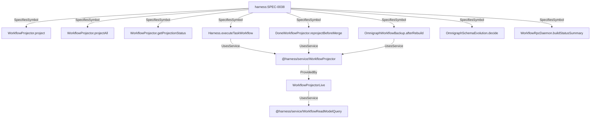

## Context

`HarnessTaskWorkflow` (`harness:SPEC-0023`), `ShipWorkflow` (`harness:SPEC-0032`), and live agent runners (`harness:SPEC-0036`) execute durable plans against the dedicated `harness-workflows` graph, while `harness` (`impl/<task>` and `main`) only tracks static code, governance, and test entities (`EffectFn`, `EarsSpec`, `TraceabilityTuple`, `VitestCase`). Because `done` overwrites `impl/<task>` via `mode: "overwrite"` (`done-omnigraph-helpers.ts`) and cluster rebuilds restore `harness-workflows` without populating `harness`, analytical queries across active runs, pending units, and EARS requirement coverage cannot join workflow execution state against planning artifacts.

- **Reused Contracts / Errors:** `WorkflowRunId`, `WorkUnitId`, `AttemptNumber`, `WaveIndex`, `CompiledPlan`, `WorkflowProjectionStatus`, `WorkflowRunRecord`, `WorkflowUnitRecord`, `WorkflowAttemptRecord`, `WorkflowActivityTag`, `WORKFLOW_TIMEOUT_BUDGETS`, `OmnigraphBranchName`, `OmnigraphCommitId`, `NonNegativeCount`, `WorkflowStoreFailureReason`, `isPureInterruptCause` from `@harness/contract`
- **Reused Services:** `WorkflowReadModelQuery`, `WorkflowGraphBackup`
- **New Capabilities Needed:** Projection input/outcome contracts (`WorkflowProjectorInput`, `WorkflowProjectionOutcome`, `WorkflowProjectAllOutcome`, `mergeWorkflowProjectionStatus`), `ProjectWaveToHarness` protocol tag (`SPEC-0027`), monotonic projector timeout/OCC budgets in `WORKFLOW_TIMEOUT_BUDGETS`, `WorkflowProjector` service port, additive `schema.pg` (`WorkflowRun`, `WorkUnit`, `UnitAttempt`, 6 keyed `Plays*Role` edges) and 2 GQ 2.1 presets (`workflow_pending_units`, `ears_without_completed_unit`), idempotent `ifGraphCommit`-fenced `WorkflowProjectorLive`, wave/done-pre-merge/post-rebuild trigger hooks, and `"stale"` projection status propagation

## Goal

Durable workflow runs, work units, and unit attempts are projected idempotently as a read-only convenience into the analytical `harness` graph (`impl/<task>` and `main`), linked to `EffectFn` stubs, `EarsSpec`, `TraceabilityTuple`, and `VitestCase` nodes, triggered after each wave, after `done`'s overwrite before Omnigraph merge, and after cluster rebuilds, with any non-interrupt projection failure surfacing `projectionStatus: "stale"` without failing or aborting workflows or `done`.

## How to read the requirements

Requirements follow EARS syntax. Each requirement is a single sentence with bold keywords (`When`, `While`, `If ... then`, `Where`) and the modal `shall` or `shall not`.

## Requirements

### 1 · Analytical Schema, GQ 2.1 Presets & Policy (`RFC-0013 §5.7.4`)

**Source (`libs/harness/graph/schema.pg`, `libs/harness/graph/queries/harness.gq`, `libs/harness/graph/graph.policy.yaml`, `apps/harness-cli/src/commands/omnigraph-auth-and-drift.ts`):** The analytical `harness` graph must accept workflow projection nodes and keyed incidence edges via additive live cluster evolution while keeping writes restricted to `harness-cli` and queries accessible to `agent-mcp` without expanding the MCP tool surface.

| ID      | Pattern      | Requirement                                                                                                                                                                                                                                                                                                                             | Effect Symbol                   | Verification |
| ------- | ------------ | --------------------------------------------------------------------------------------------------------------------------------------------------------------------------------------------------------------------------------------------------------------------------------------------------------------------------------------- | ------------------------------- | ------------ |
| REQ-1.1 | Ubiquitous   | `schema.pg` **shall** declare keyed nodes `WorkflowRun`, `WorkUnit`, and `UnitAttempt` alongside six `@key(@src, @dst, role)` incidence edges (`PlaysRunUnitRole`, `PlaysUnitAttemptRole`, `PlaysUnitStubRole`, `PlaysUnitEarsRole`, `PlaysUnitTraceabilityRole`, `PlaysAttemptTestRole`).                                              | —                               | GraphCheck   |
| REQ-1.2 | Event-driven | **When** `schema.pg` adds the WF-6 node and edge types without altering existing `@key` definitions, `OmnigraphSchemaEvolution.decide` **shall** classify the drift as additive (`LiveClusterApply`) without triggering `RequiresCleanRebuild`.                                                                                         | OmnigraphSchemaEvolution.decide | UnitTest     |
| REQ-1.3 | Ubiquitous   | `queries/harness.gq` and `HARNESS_GQ_QUERY_NAMES` **shall** expose `workflow_pending_units($runId: String)` and `ears_without_completed_unit($runId: String)` (with positive `$memberUnit: WorkUnit` binding before `not { ... }`), bringing `HARNESS_GQ_QUERY_NAMES` to `22` presets while keeping `CANONICAL_MCP_TOOL_NAMES` at `20`. | —                               | GraphCheck   |
| REQ-1.4 | Ubiquitous   | `graph.policy.yaml` **shall** permit `agent-mcp` to `read` and `invoke_query` on `harness` while denying `change`, `load`, and branch mutations from actors outside `admins: [harness-cli]`.                                                                                                                                            | —                               | GraphCheck   |

### 2 · Projection Contracts, Protocol Tags & Timeout Budgets (`SPEC-0027`)

**Source (`libs/harness/contract/src/workflow-projection.ts`, `libs/harness/contract/src/workflow-protocol.ts`, `libs/harness/contract/src/workflow-timeouts.ts`, `libs/harness/service/src/workflow-ports.ts`):** Projection payloads, wave activity names, and timeout/OCC retry bounds must follow `SPEC-0005` branding and `SPEC-0027` single-source protocol/timeout contracts.

| ID      | Pattern    | Requirement                                                                                                                                                                                                                         | Effect Symbol                        | Verification |
| ------- | ---------- | ----------------------------------------------------------------------------------------------------------------------------------------------------------------------------------------------------------------------------------- | ------------------------------------ | ------------ |
| REQ-2.1 | Ubiquitous | `@harness/contract` and `@harness/service` **shall** define closed discriminated `WorkflowProjectorInput` / `WorkflowProjectionOutcome` schemas and the `WorkflowProjector` (`@harness/service/WorkflowProjector`) capability port. | `@harness/service/WorkflowProjector` | UnitTest     |
| REQ-2.2 | Ubiquitous | `encodeWorkflowActivityName` and `decodeWorkflowActivityName` **shall** round-trip `ProjectWaveToHarness` wave projection activities symmetrically via `WorkflowActivityTag`.                                                       | —                                    | PropertyTest |
| REQ-2.3 | Ubiquitous | `WORKFLOW_TIMEOUT_BUDGETS` **shall** declare monotonic `projectorHttpTimeoutMs`, `projectorOccMaxAttempts`, and `projectorOccRetryBackoffMs` bounds enforced by `validateWorkflowTimeoutBudgets`.                                   | —                                    | UnitTest     |

### 3 · Idempotent OCC Projector & Non-Fatal Staleness (`RFC-0013 §5.7.4`)

**Source (`libs/harness/infra/src/workflow/workflow-projector-live.ts`, `apps/harness-mcp/src/daemon/workflow-rpc-status-helper.ts`):** `WorkflowProjectorLive` must upsert runs, units, attempts, and edges into `harness` idempotently under `ifGraphCommit` OCC as actor `harness-cli`, and surface staleness on non-interrupt failures without breaking workflow execution.

| ID      | Pattern            | Requirement                                                                                                                                                                                                                                                                                                                 | Effect Symbol                        | Verification |
| ------- | ------------------ | --------------------------------------------------------------------------------------------------------------------------------------------------------------------------------------------------------------------------------------------------------------------------------------------------------------------------- | ------------------------------------ | ------------ |
| REQ-3.1 | Event-driven       | **When** `WorkflowProjector.project` executes for a `WorkflowRunId`, `WorkflowProjector.project` **shall** read run, unit, and attempt records from `WorkflowReadModelQuery` and idempotently upsert `WorkflowRun`, `WorkUnit`, `UnitAttempt`, and matching `Plays*Role` edges into graph `harness` as actor `harness-cli`. | WorkflowProjector.project            | GraphCheck   |
| REQ-3.2 | Event-driven       | **When** an `ifGraphCommit` conditional mutation returns HTTP `412` or `409`, `WorkflowProjector.project` **shall** re-read fresh branch commit state and retry up to `WORKFLOW_TIMEOUT_BUDGETS.projectorOccMaxAttempts` with `WORKFLOW_TIMEOUT_BUDGETS.projectorOccRetryBackoffMs` backoff.                                | WorkflowProjector.project            | UnitTest     |
| REQ-3.3 | Unwanted behaviour | **If** readable projection fails with a non-interrupt error or defect, **then** `WorkflowProjector.project` and `WorkflowProjector.projectAll` **shall** record `"stale"` status and return `WorkflowProjectionOutcome.Stale` without failing the workflow, while pure fiber interrupts **shall** propagate unchanged.      | WorkflowProjector.projectAll         | UnitTest     |
| REQ-3.4 | Event-driven       | **When** `WorkflowRpcDaemon.buildStatusSummary` builds `WorkflowStatusSummary`, `WorkflowRpcDaemon.buildStatusSummary` **shall** merge `WorkflowProjector.getProjectionStatus` so any recorded readable projection failure surfaces `projectionStatus: "stale"`.                                                            | WorkflowRpcDaemon.buildStatusSummary | UnitTest     |

### 4 · Wave, Pre-Merge `done`, and Post-Rebuild Hooks (`RFC-0013 REQ-4.5`)

**Source (`libs/harness/gates/src/harness-task-workflow.ts`, `libs/harness/gates/src/harness-task-workflow-projections.ts`, `apps/harness-cli/src/commands/done-workflow-projector.ts`, `apps/harness-cli/src/commands/done-omnigraph-helpers.ts`, `apps/harness-cli/src/commands/omnigraph-workflow-backup.ts`):** Projection must fire automatically after every wave, after `done`'s overwrite before merge, and after cluster rebuilds.

| ID      | Pattern      | Requirement                                                                                                                                                                                                                                                                                         | Effect Symbol                              | Verification |
| ------- | ------------ | --------------------------------------------------------------------------------------------------------------------------------------------------------------------------------------------------------------------------------------------------------------------------------------------------- | ------------------------------------------ | ------------ |
| REQ-4.1 | Event-driven | **When** a DAG wave finishes in `Harness.executeTaskWorkflow`, `Harness.executeTaskWorkflow` **shall** invoke `ProjectWaveToHarness` via `WorkflowProjector.project` onto `impl/<task>` without aborting on `Stale` outcomes.                                                                       | Harness.executeTaskWorkflow                | TraceTest    |
| REQ-4.2 | Event-driven | **When** `syncOmnigraphOnDone` completes `mode: "overwrite"` reload and span-trace blob upload on `impl/<task>`, `DoneWorkflowProjector.reprojectBeforeMerge` **shall** re-project workflow state onto `impl/<task>` strictly before `runPreMergeOmnigraphBranchVerify` and `mergeOmnigraphBranch`. | DoneWorkflowProjector.reprojectBeforeMerge | GraphCheck   |
| REQ-4.3 | Event-driven | **When** `OmnigraphWorkflowBackup.afterRebuild` finishes restoring `harness-workflows` onto `main`, `OmnigraphWorkflowBackup.afterRebuild` **shall** trigger non-fatal `WorkflowProjector.projectAll` into `harness` without failing the restore if `harness` is absent or unavailable.             | OmnigraphWorkflowBackup.afterRebuild       | UnitTest     |

## Assumptions

- **REQ-1.3:** Both `workflow_pending_units` and `ears_without_completed_unit` are invoked through the existing `harness_gq_query` MCP tool (`CANONICAL_MCP_TOOL_NAMES` stays `20`). `workflow_pending_units` orders by `($unit.waveIndex asc, $unit.unitId asc)` and `ears_without_completed_unit` orders by `($spec.id asc, $spec.path asc)`; because GQ 2.1 omits `distinct`, callers deduplicate by `specId` when multiple non-completed units in the same run reference the same `EarsSpec`.
- **REQ-3.1:** Readable projection links `WorkUnit -> EffectFn` (`PlaysUnitStubRole`), `WorkUnit -> EarsSpec` (`PlaysUnitEarsRole`), `WorkUnit -> TraceabilityTuple` (`PlaysUnitTraceabilityRole`), and `UnitAttempt -> VitestCase` (`PlaysAttemptTestRole`) only when the target entity already exists on the target branch, avoiding dangling edges.
- **REQ-4.1 & REQ-4.2:** `ProjectWaveToHarness` projects wave-granular state using `worktrees.canonicalRepoRoot` (`ActiveTaskImplBranch`) so `sharedStep` / terminal state remains wave-granular during active execution, while `DoneWorkflowProjector.reprojectBeforeMerge` explicitly projects the caller's `impl/<task>` branch (including linked worktrees `impl/wt-<slug>`) and terminal `WorkflowRun.state` before merge.
- **REQ-4.2:** When `graphs/harness-workflows.omni` does not exist in the cluster directory, `DoneWorkflowProjector.reprojectBeforeMerge` skips cleanly without issuing requests against `harness-workflows`.

## Out of scope

- Reading projected `WorkflowRun`/`WorkUnit`/`UnitAttempt` nodes from graph `harness` to drive workflow control-flow decisions (engine state in `harness-workflows` remains the sole authority per `RFC-0013` Invariant 5).
- Adding new MCP tools for workflow projection queries.

## Known residual risks

- Because `done` overwrites `impl/<task>` before re-projecting, any pre-existing historical runs no longer present in `harness-workflows` will not reappear on `main` after `done` merges `impl/<task>` into `main`.
- `WorkflowProjector`'s `statusRef` tracks readable projection staleness in-memory for the active daemon lifetime; restarting the daemon clears prior in-memory `"stale"` indicators until the next wave, `done-pre-merge`, or `post-rebuild` projection executes.

## Acceptance criteria

- All `GraphCheck`, `UnitTest`, `PropertyTest`, and `TraceTest` suites across `@harness/contract`, `@harness/graph`, `@harness/gates`, `@harness/infra`, `harness-mcp`, and `harness-cli` pass cleanly with 100% mutant kill on pure modules.
- `pnpm harness plan-check`, `pnpm harness learn --clear`, `pnpm harness gc --strict`, `pnpm harness ontology check --strict`, `pnpm harness mutate --strict`, `CI=true pnpm harness verify`, and `CI=true pnpm harness done --cli` pass after setting `status: accepted`.

## Verified Plan Topology Graph

Verified via `pnpm harness plan-check --mermaid` (exit 0):

## Adversarial Plan Lens

- **Idempotency & OCC Conflict Recovery:** `WorkflowProjectorLive` resolves target branch entities via `@key`, skips mutations when the computed diff is a no-op, and executes conditional `og.mutate(..., { ifGraphCommit })` with bounded `412`/`409`/`429` re-read retries (`WORKFLOW_TIMEOUT_BUDGETS.projectorOccMaxAttempts` / `projectorOccRetryBackoffMs`).
- **Non-Fatal Failure & Interrupt Preservation:** Non-interrupt errors/defects record `"stale"` in the instance-scoped `Ref` and return `WorkflowProjectionOutcome.Stale` without failing workflows, `done`, or rebuild restores, while `isPureInterruptCause` always propagates pure fiber interrupts.
- **Line-Budget & TCB Isolation:** Wave projection lives in `harness-task-workflow-projections.ts` (`harness-task-workflow.ts <= 800`), pre-merge projection lives in `done-workflow-projector.ts` (`done-omnigraph-helpers.ts <= 650`), and `computeProjectionStatus` moves to `workflow-rpc-shared.ts` (`workflow-rpc-status-helper.ts <= 650`).
